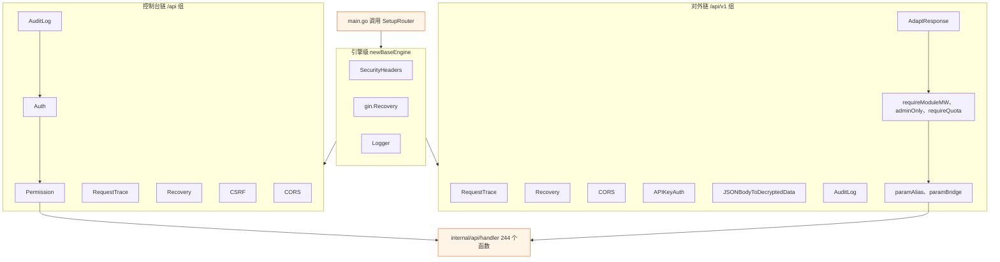
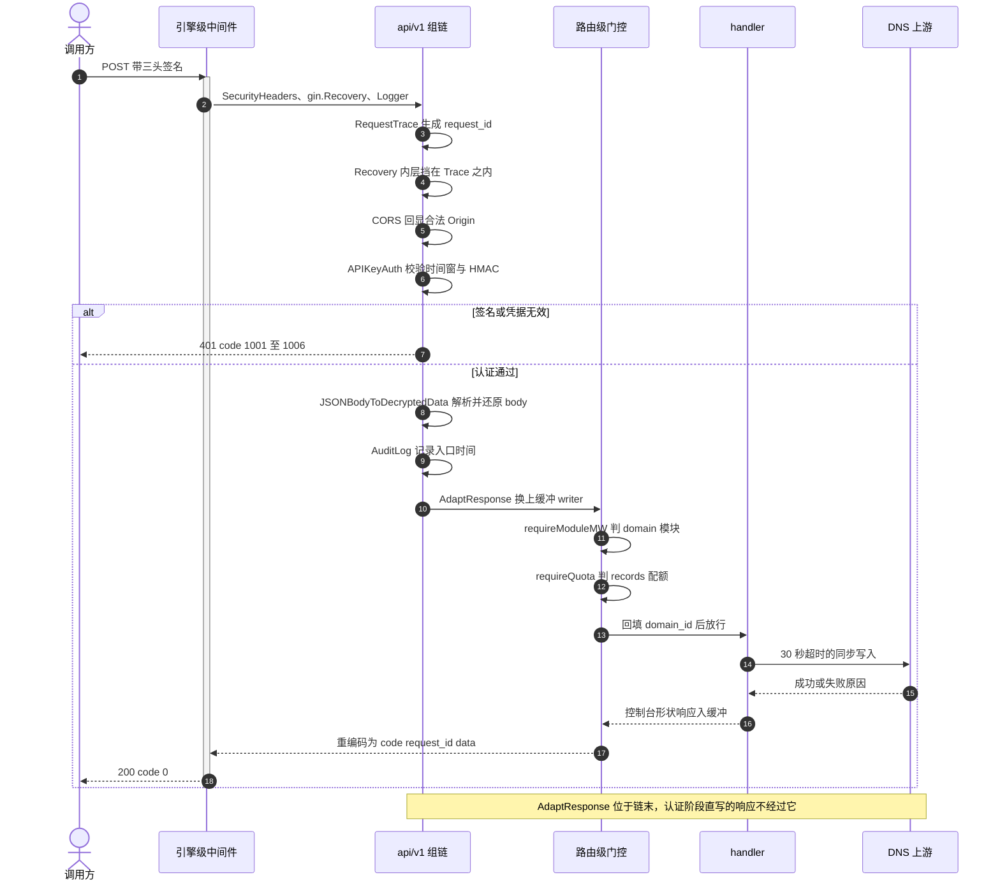
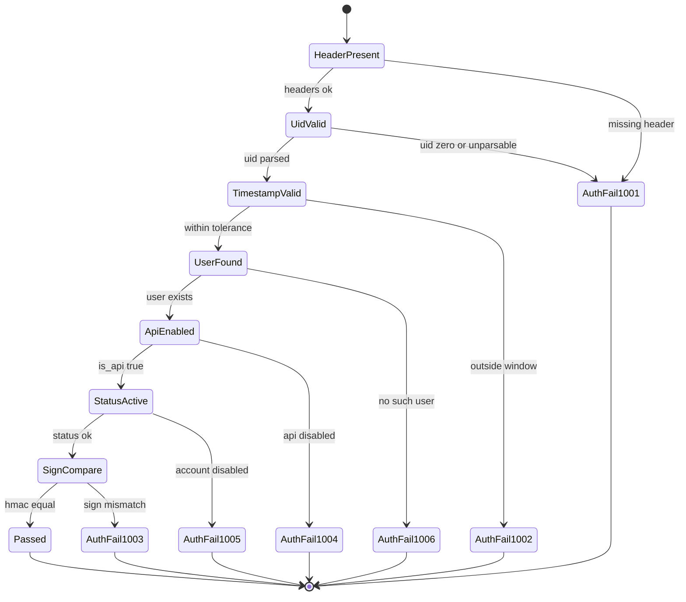
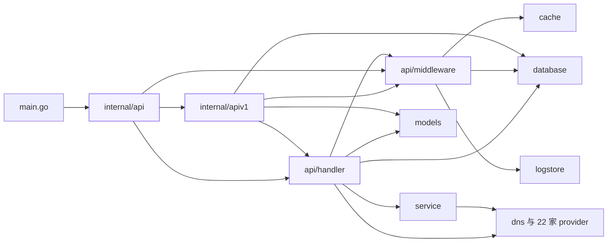
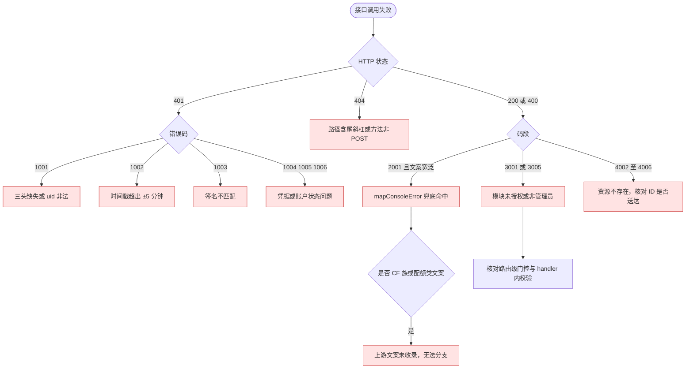

# API参考文档
<cite>
**本文档引用的文件**
- [main.go](file://main/main.go)
- [router.go](file://main/internal/api/router.go)
- [auth.go](file://main/internal/api/middleware/auth.go)
- [csrf.go](file://main/internal/api/middleware/csrf.go)
- [audit.go](file://main/internal/api/middleware/audit.go)
- [permission.go](file://main/internal/api/middleware/permission.go)
- [request_trace.go](file://main/internal/api/middleware/request_trace.go)
- [sign.go](file://main/internal/api/middleware/sign.go)
- [apikey.go](file://main/internal/api/middleware/apikey.go)
- [router.go (apiv1)](file://main/internal/apiv1/router.go)
- [auth.go (apiv1)](file://main/internal/apiv1/auth.go)
- [adapt.go](file://main/internal/apiv1/adapt.go)
- [errors.go](file://main/internal/apiv1/errors.go)
- [response.go](file://main/internal/apiv1/response.go)
- [bridge.go](file://main/internal/apiv1/bridge.go)
- [scope.go](file://main/internal/apiv1/scope.go)
- [params.go](file://main/internal/apiv1/params.go)
- [quota_gate.go](file://main/internal/apiv1/quota_gate.go)
- [record_sync.go](file://main/internal/apiv1/record_sync.go)
- [domain.go (apiv1)](file://main/internal/apiv1/domain.go)
- [record.go](file://main/internal/apiv1/record.go)
- [routes_batch1.go](file://main/internal/apiv1/routes_batch1.go)
- [routes_batch2.go](file://main/internal/apiv1/routes_batch2.go)
- [domain.go (handler)](file://main/internal/api/handler/domain.go)
- [user.go (handler)](file://main/internal/api/handler/user.go)
- [auth.go (handler)](file://main/internal/api/handler/auth.go)
- [quicklogin.go](file://main/internal/api/handler/quicklogin.go)
- [optimizeip.go](file://main/internal/api/handler/optimizeip.go)
</cite>
## 目录
1. [简介](#简介)
2. [项目结构](#项目结构)
3. [核心组件](#核心组件)
4. [架构总览](#架构总览)
5. [详细组件分析](#详细组件分析)
6. [依赖关系分析](#依赖关系分析)
7. [性能考虑](#性能考虑)
8. [故障排查指南](#故障排查指南)
9. [结论](#结论)
10. [附录](#附录)
## 简介
本仓库对外提供两套 HTTP 接口，共用同一批业务处理器：控制台链路 `/api`（226 条路由）与程序化调用链路 `/api/v1`（145 条路由）。划分依据不是「内部接口 vs 公开接口」，而是**交互主体不同**：前者服务浏览器中的 Next.js 前端，后者服务第三方脚本、运维自动化与开放平台集成。

| 项 | 控制台 `/api` | 对外 `/api/v1` |
|----|---------------|----------------|
| 路由条数 | 226（`router.go:68-334`、`341-342`、`407`） | 145（`apiv1` 四个注册文件） |
| HTTP 方法 | GET 与 POST 混合 | 全部 POST |
| 路径参数 | 37 条含 `:id` / `:recordId` 等 | 无，一律 JSON body |
| 认证 | `_t` Cookie 解密值与 Bearer 逐字相等 | `X-API-UID` / `X-API-Timestamp` / `X-API-Sign` |
| 会话有效期 | access 15 分钟、refresh 7 天 | 无会话概念，凭据不过期 |
| CSRF | 强制 double-submit | 未挂载 |
| 响应外层 | `{code, msg, data}` | `{code, request_id, data}` / `{code, request_id, message}` |
| 业务码 | `0` / `-1` 为主 | 33 个分段码（`errors.go:18-63`） |
| HTTP 状态 | 业务错误也回 200 | 按码段回 400/401/404/409/500/502/504 |
| 入口限流 | 登录锁定、快速登录、发信频控 | 无 |
| 版本策略 | 无版本段 | 仅 `v1`，无 `v2` 预留与废弃响应头 |
**章节来源**
- [main/internal/api/router.go:63-64](file://main/internal/api/router.go#L63-L64)
- [main/internal/apiv1/router.go:24-47](file://main/internal/apiv1/router.go#L24-L47)
- [main/internal/apiv1/auth.go:36-41](file://main/internal/apiv1/auth.go#L36-L41)
- [main/internal/apiv1/errors.go:18-63](file://main/internal/apiv1/errors.go#L18-L63)
- [main/internal/api/middleware/sign.go:183-206](file://main/internal/api/middleware/sign.go#L183-L206)
## 项目结构
接口层由两个包承担：`internal/api` 负责引擎装配与控制台路由，`internal/apiv1` 负责对外路由与契约适配。`apiv1` 由 `api` 在装配阶段调用（`router.go:63`），二者共同复用 `internal/api/handler` 的业务函数。

| 目录 / 文件 | 行数 | 职责 | 关键符号（起始行） |
|-------------|:----:|------|--------------------|
| `main/main.go` | 156 | 进程装配与监听 | `SetupRouter` 调用:128、`http.Server`:133-138 |
| `main/internal/api/router.go` | 464 | 引擎级中间件、控制台路由、静态回落 | `SetupRouter`:18、`newBaseEngine`:24、`applyAPIMiddleware`:44 |
| `main/internal/api/middleware/` | 2461 | 会话、CSRF、审计、权限、追踪、响应封装 | `Auth`:auth.go-125、`CSRF`:csrf.go-70、`Permission`:permission.go-132 |
| `main/internal/api/handler/` | 32 个非测试文件 | 244 个 `func X(c *gin.Context)` 业务入口 | `GetDomains`:domain.go-128、`generateAPIKey`:user.go-49 |
| `main/internal/apiv1/router.go` | 47 | 对外链顺序与十个注册函数 | `Setup`:24 |
| `main/internal/apiv1/auth.go` | 165 | 签名校验、body 落上下文 | `APIKeyAuth`:44、`signWithKey`:118、`JSONBodyToDecryptedData`:143 |
| `main/internal/apiv1/adapt.go` | 148 | 控制台响应改写为对外契约 | `AdaptResponse`:32、`mapConsoleError`:120 |
| `main/internal/apiv1/errors.go` | 136 | 33 个错误码与 HTTP 状态、默认文案 | 常量块:18-63、`httpStatusFor`:71 |
| `main/internal/apiv1/response.go` | 108 | 统一响应结构 | `okBody`:26、`errBody`:40、`OK`:62、`Fail`:72 |
| `main/internal/apiv1/bridge.go` | 120 | 路径参数回填与 body 还原 | `paramAlias`:36、`paramBridge`:49、`bridgeParams`:78 |
| `main/internal/apiv1/scope.go` | 132 | 模块 / 域名 / 子域 / 只读四维鉴权 | `requireModule`:28、`requireAdmin`:38、`scopeDomain`:117 |
| `main/internal/apiv1/params.go` | 88 | 分页归一、必填校验、绑定错误归一 | `parsePaging`:32、`bindJSON`:56、`requireString`:70 |
| `main/internal/apiv1/quota_gate.go` | 47 | 对外配额闸门 | `requireQuota`:36 |
| `main/internal/apiv1/record_sync.go` | 475 | 五个记录的同步写实现 | `resolveRecordScope`:55、`CreateRecordSync`:121 |
| `main/internal/apiv1/{domain,record,routes_batch1,routes_batch2}.go` | 82/58/103/147 | 145 条路由注册与门控声明 | `registerDomainRoutes`:domain.go-21 |
装配关系如下。`apiv1` 挂在引擎根而非 `/api` 组内是刻意的：`/api` 组带 CSRF double-submit 校验，API Key 客户端既无 `_csrf` cookie 也无从取得 token，继承该链会让所有写请求被 403 拒。

**图表来源**
- [main/internal/api/router.go:24-53](file://main/internal/api/router.go#L24-L53)
- [main/internal/api/router.go:63-64](file://main/internal/api/router.go#L63-L64)
- [main/internal/api/router.go:95-104](file://main/internal/api/router.go#L95-L104)
- [main/internal/apiv1/router.go:24-46](file://main/internal/apiv1/router.go#L24-L46)
- [main/main.go:128-138](file://main/main.go#L128-L138)

两条全局设置影响所有接口：`gin.RedirectTrailingSlash` 与 `RedirectFixedPath` 均为 `false`（`router.go:26-27`），故 `/api/v1/domains/list/` 与 `/api/v1/domains/list` **不等价**；又因签名串包含 `PATH`，多一个尾斜杠会同时导致路由 404 与签名基准不一致。
**章节来源**
- [main/internal/api/router.go:18-53](file://main/internal/api/router.go#L18-L53)
- [main/internal/apiv1/router.go:9-47](file://main/internal/apiv1/router.go#L9-L47)
- [main/internal/api/middleware/csrf.go:70-79](file://main/internal/api/middleware/csrf.go#L70-L79)
## 核心组件
| 组件 | 位置 | 单一职责 | 失败输出 |
|------|------|----------|----------|
| 路由装配 | `api/router.go:18`、`apiv1/router.go:24` | 组链顺序与路由注册 | 不产生响应 |
| 会话认证 | `middleware/auth.go:125` | Cookie 与 Bearer 双值一致 | 401 + `code:401` |
| CSRF 校验 | `middleware/csrf.go:70` | double-submit 比对 | 403 + `code:403` |
| API Key 签名 | `apiv1/auth.go:44` | 三头、时间窗、HMAC | 401 + `1xxx` |
| 参数桥接 | `apiv1/bridge.go:36`/`:49` | 回填路径参数、还原 body | 不拦截，交 handler 报错 |
| 权限范围 | `apiv1/scope.go:28`/`:38` | 模块与管理员判定 | `3001` / `3005` |
| 配额闸门 | `apiv1/quota_gate.go:36` | 创建前配额上限 | `4008` |
| 响应封装 | `apiv1/response.go:62`/`:72` | 固定对外契约形状 | 见响应字段表 |
| 响应适配 | `apiv1/adapt.go:32` | 控制台形状重编码 | 按文案映射码 |
| 错误码表 | `apiv1/errors.go:18-63` | 码值、HTTP 状态、默认文案 | `messageFor` 兜底 |
| 请求追踪 | `middleware/request_trace.go:135` | 生成 `request_id`、落请求日志 | 不拦截 |
| 审计日志 | `middleware/audit.go:21` | 写操作落 `logs` 表 | 不拦截 |
```mermaid
classDiagram
  class SetupRouter
  class Apiv1Setup {
    +RequestTrace()
    +Recovery()
    +CORS()
    +APIKeyAuth()
    +JSONBodyToDecryptedData()
    +AuditLog()
    +AdaptResponse()
  }
  class APIKeyAuth
  class AdaptResponse
  class MapConsoleError
  class ResponseWriter {
    +OK()
    +Fail()
    +Failf()
    +OKPage()
  }
  class OkBody {
    +int Code
    +string RequestID
    +interface{} Data
    +string Message
  }
  class ErrBody {
    +int Code
    +string RequestID
    +string Message
  }
  SetupRouter --> Apiv1Setup
  Apiv1Setup --> APIKeyAuth
  Apiv1Setup --> AdaptResponse
  AdaptResponse --> MapConsoleError
  AdaptResponse --> OkBody
  AdaptResponse --> ErrBody
  APIKeyAuth --> ResponseWriter
  ResponseWriter --> OkBody
  ResponseWriter --> ErrBody
```
**图表来源**
- [main/internal/api/router.go:18-55](file://main/internal/api/router.go#L18-L55)
- [main/internal/apiv1/router.go:24-46](file://main/internal/apiv1/router.go#L24-L46)
- [main/internal/apiv1/adapt.go:23-148](file://main/internal/apiv1/adapt.go#L23-L148)
- [main/internal/apiv1/response.go:26-108](file://main/internal/apiv1/response.go#L26-L108)
### 签名与响应封装
待签串与算法固定（`apiv1/auth.go:93-94`、`:118-122`）：
```text
message = uid + "\n" + timestamp + "\n" + METHOD + "\n" + PATH
sign    = hex(HMAC-SHA256(message, users.api_key))
```
`PATH` 含 `/api/v1` 前缀、**不含查询串**；`uid` 与 `timestamp` 用 `TrimSpace` 后的原始字符串参与签名。校验顺序固定，任一环节失败即短路：三头非空 → `uid` 可解析且非 0 → 时间戳可解析 → 落在 ±5 分钟窗口 → 用户存在 → `is_api` → `status == 1` → `hmac.Equal` 常量时间比对。API Key 由 `generateAPIKey()` 产生（32 字节 `crypto/rand` → 64 位小写 hex），同时充当签名密钥。

| 要素 | 取值 | 位置 |
|------|------|------|
| 请求头 | `X-API-UID` / `X-API-Timestamp` / `X-API-Sign` | `apiv1/auth.go:38-40` |
| 时间窗 | ±5 分钟 | `apiv1/auth.go:37` |
| 摘要与比较 | HMAC-SHA256 hex，`hmac.Equal` | `apiv1/auth.go:96`、`:118-122` |
| 覆盖范围 | 方法 + 路径，**不含 body 与 query** | `apiv1/auth.go:93` |
| 密钥来源 | `users.api_key` | `handler/user.go:49-53` |
| 上下文注入 | `user_id`（字符串）、`username`、`level`、`auth_type=apikey` | `apiv1/auth.go:106-109` |
| 模块权限注入 | `ApplyUserPermissionModules` | `apiv1/auth.go:111` |
> `middleware/apikey.go` 存在一份同名实现（`APIKeyAuth`:44、`JSONBodyToDecryptedData`:27），错误形状是 `{code:401, msg}` 且**不写 `auth_type`**。非测试代码中该文件无任何挂载点，实际生效的是 `apiv1` 版本；若被误挂载，`EncryptedResponse`（`sign.go:142-158`）会因缺少 `auth_type` 而对 API Key 客户端尝试加密。

`okBody` 与 `errBody` 是两个独立结构，成功与失败的字段集合**不同形**：失败响应没有 `data`，成功响应的 `data` 恒在（无载荷为 `null`）。客户端必须先判 `code` 再取 `data`。

| 字段 | 类型 | 恒返回 | 可为空 | 说明 |
|------|------|:------:|:------:|------|
| `code` | int | 是 | 否 | `0` 成功；非 0 为 `errors.go:18-63` 的 33 码之一 |
| `request_id` | string | 是 | 是 | `RequestTrace` 生成（`request_trace.go:47-49`），缺失为空串而非省略 |
| `data` | object/array/null | 仅成功响应 | 是 | 透传控制台 handler 的 `data`（`adapt.go:92-96`） |
| `message` | string | 失败响应必有 | 否 | 成功响应 `omitempty`，仅控制台 `SuccessMsg` 文案时出现（`response.go:37`、`adapt.go:97-99`） |
控制台的封装完全不同：`SuccessResponse` 输出 `{code:0,data}`、`SuccessMsg` 输出 `{code:0,msg}`、`ErrorResponse` 输出 `{code:-1,msg}`，三者都经 `EncryptedResponse`，而该函数在 `auth_type == "apikey"` 时走明文分支——判定依据是**认证方式而非路径**。
**章节来源**
- [main/internal/apiv1/auth.go:36-122](file://main/internal/apiv1/auth.go#L36-L122)
- [main/internal/api/handler/user.go:44-53](file://main/internal/api/handler/user.go#L44-L53)
- [main/internal/api/middleware/apikey.go:18-112](file://main/internal/api/middleware/apikey.go#L18-L112)
- [main/internal/api/middleware/sign.go:142-162](file://main/internal/api/middleware/sign.go#L142-L162)
- [main/internal/apiv1/response.go:17-108](file://main/internal/apiv1/response.go#L17-L108)
- [main/internal/apiv1/adapt.go:81-109](file://main/internal/apiv1/adapt.go#L81-L109)
- [main/internal/api/middleware/sign.go:142-206](file://main/internal/api/middleware/sign.go#L142-L206)
- [main/internal/api/middleware/request_trace.go:44-50](file://main/internal/api/middleware/request_trace.go#L44-L50)
## 架构总览

**图表来源**
- [main/internal/apiv1/router.go:24-46](file://main/internal/apiv1/router.go#L24-L46)
- [main/internal/apiv1/auth.go:44-165](file://main/internal/apiv1/auth.go#L44-L165)
- [main/internal/apiv1/adapt.go:32-110](file://main/internal/apiv1/adapt.go#L32-L110)
- [main/internal/apiv1/record.go:23-42](file://main/internal/apiv1/record.go#L23-L42)
- [main/internal/apiv1/record_sync.go:31-145](file://main/internal/apiv1/record_sync.go#L31-L145)

三个影响排障定位的结构事实：`AdaptResponse` 挂在链末（`apiv1/router.go:34`），认证与参数阶段的 `Fail` 不经过它——缓冲为空即返回（`adapt.go:50-53`）；路由级门控在它**之后**执行，其 `Fail` 会被缓冲，再由 `adapt.go:63-67` 依据响应体中的 `"request_id"` 子串识别为对外自有响应并原样透出；未通过认证的请求不进审计写库（`audit.go:45-48`）。
**章节来源**
- [main/internal/apiv1/adapt.go:32-67](file://main/internal/apiv1/adapt.go#L32-L67)
- [main/internal/apiv1/router.go:33-34](file://main/internal/apiv1/router.go#L33-L34)
- [main/internal/api/middleware/audit.go:21-48](file://main/internal/api/middleware/audit.go#L21-L48)
## 详细组件分析
### 两条链的中间件顺序与差异
顺序必须按 `.Use` 的实际注册次序描述，颠倒会改变安全语义。引擎级三层在 `newBaseEngine()`（`router.go:24-32`），`/api` 组级五层在 `applyAPIMiddleware()`（`router.go:44-53`），认证级两层在 `auth` 子组（`router.go:96`、`:104`）。

| 序 | 中间件 | 位置 | 作用范围 | 短路行为 | 跳过条件 |
|:--:|--------|------|----------|----------|----------|
| 1 | `SecurityHeaders` | `router.go:28` | 全局 | 无 | 无 |
| 2 | `gin.Recovery` | `router.go:29` | 全局 | 500 | 兜静态资源与 `NoRoute` |
| 3 | `Logger` | `router.go:30` | 全局 | 无 | 部分静态路径 |
| 4 | `CORS` | `router.go:45` | `/api` 组 | OPTIONS 204 | Origin 不在白名单则不回显 |
| 5 | `RequestTrace` | `router.go:47` | `/api` 组 | 无 | 非 `/api` 前缀直通 |
| 6 | `Recovery`（内层） | `router.go:48` | `/api` 组 | 500 + `code:-1` | broken pipe 只 `Abort` |
| 7 | `CSRF` | `router.go:50` | `/api` 组 | 403 + `code:403` | 安全方法、2 前缀、16 精确路径 |
| 8 | `AuditLog` | `router.go:52` | `/api` 组 | 无 | 非写方法、跳过前缀/后缀/精确表 |
| 9 | `Auth` | `router.go:96` | `auth` 子组 201 条 | 401 + `code:401` | 无 |
| 10 | `Permission` | `router.go:104` | `auth` 子组 | 200 + `code:-1` | `level>=2` 或请求不含域名 ID |
双层 panic 恢复的顺序约束由 `router.go:34-43` 的注释块锁定：内层 `Recovery` 必须紧跟 `RequestTrace`，否则 panic 穿透会让 `RequestTrace` 在 `c.Next()` 之后的落库代码不执行，请求日志完全丢失。`Permission` 的两个放行分支需单列：`level >= 2` 直通（`permission.go:137-141`），请求未携带域名 ID 时也直通并交 handler 判断（`:143-147`）；同时 `isDomainScopedWriteRequest`（`:265-279`）把**所有 POST 视为写**，唯一豁免是路径以 `/whois` 结尾。

| 序 | 中间件 | 位置 | 与控制台的差异 |
|:--:|--------|------|----------------|
| 1-3 | `SecurityHeaders` / `gin.Recovery` / `Logger` | `router.go:28-30` | 完全共用引擎级三层 |
| 4 | `RequestTrace` | `apiv1/router.go:27` | 同 |
| 5 | `Recovery` | `apiv1/router.go:28` | 同 |
| 6 | `CORS` | `apiv1/router.go:29` | **位置不同**：控制台在第 4 位，这里在追踪之后 |
| 7 | `APIKeyAuth` | `apiv1/router.go:30` | 替代 `Auth` |
| 8 | `JSONBodyToDecryptedData` | `apiv1/router.go:31` | 控制台链无此层 |
| 9 | `AuditLog` | `apiv1/router.go:32` | 同函数，位于认证之后 |
| 10 | `AdaptResponse` | `apiv1/router.go:34` | 控制台链无此层 |
| — | `CSRF` | 未挂载 | 对外链无 CSRF |
| — | `Permission` | 未挂载 | 域名三维由 `scope.go` 承担 |
`CORS` 位置差异的理由写在 `apiv1/router.go:20`：「放在认证之前以便 OPTIONS 预检不被拦」。但该安排并未让浏览器可用——145 条路由只注册 POST，gin 按方法分树，`OPTIONS` 落到 `NoRoute`，**根本不经过组上的 CORS**；且 `Access-Control-Allow-Headers`（`middleware/auth.go:524`）不含 `X-API-UID` / `X-API-Timestamp` / `X-API-Sign`。结论：对外链仅支持服务端到服务端调用。
**章节来源**
- [main/internal/api/router.go:24-53](file://main/internal/api/router.go#L24-L53)
- [main/internal/api/router.go:95-104](file://main/internal/api/router.go#L95-L104)
- [main/internal/api/middleware/permission.go:132-279](file://main/internal/api/middleware/permission.go#L132-L279)
- [main/internal/api/middleware/csrf.go:30-110](file://main/internal/api/middleware/csrf.go#L30-L110)
- [main/internal/api/middleware/audit.go:98-121](file://main/internal/api/middleware/audit.go#L98-L121)
- [main/internal/apiv1/router.go:9-46](file://main/internal/apiv1/router.go#L9-L46)
- [main/internal/api/middleware/auth.go:516-531](file://main/internal/api/middleware/auth.go#L516-L531)
### 认证与授权矩阵
| 角色 | `Auth`（控制台） | `CSRF` | `Permission` | `APIKeyAuth`（对外） | 路由级门控 |
|------|:----------------:|:------:|:------------:|:--------------------:|------------|
| 未认证 | 401 | 写请求 403 | 不触达 | 401 + `1001` | 不触达 |
| 普通用户（无模块授权） | 通过 | 需 token | 视域名 ID | 通过 | 模块族 `3001` |
| 已授模块 M | 通过 | 需 token | 视域名 ID | 通过 | 放行 |
| 只读委派用户 | 通过 | 需 token | 写操作被拒 | 通过 | 仅 5 个同步写接口判只读 |
| 管理员（`level>=2`） | 通过 | 需 token | 直通 | 通过 | 直通 |
模块判定与注入同源：`APIKeyAuth` 认证成功后调用 `ApplyUserPermissionModules`（`apiv1/auth.go:111`），路由级再经 `UserModuleAllowed` 判定（`apiv1/scope.go:29`）。实际使用的模块键只有 `domain`、`cert`、`deploy`、`monitor` 四个，加上 23 条 `adminOnly` 与 2 条自身作用域接口（`/users/me`、`/users/me/password`），覆盖 145 条。三维资源校验（域名 / 子域 / 只读）由 `scopeDomain`（`apiv1/scope.go:117-132`）承担，其生产调用点是 `record_sync.go:56`，即**仅覆盖 5 个同步写记录接口**，其余端点依赖被复用 handler 的内部校验。
**章节来源**
- [main/internal/apiv1/auth.go:102-112](file://main/internal/apiv1/auth.go#L102-L112)
- [main/internal/apiv1/scope.go:27-132](file://main/internal/apiv1/scope.go#L27-L132)
- [main/internal/apiv1/record_sync.go:47-60](file://main/internal/apiv1/record_sync.go#L47-L60)
- [main/internal/api/middleware/permission.go:132-148](file://main/internal/api/middleware/permission.go#L132-L148)
### 参数读取、桥接与端点契约
控制台 handler 一律经 `BindDecryptedData` 取参：优先读上下文 `decrypted_data`，读不到才回落 `ShouldBindQuery` / `ShouldBindJSON`（`sign.go:104-127`）。对外链由 `JSONBodyToDecryptedData` 显式写入该键，并在读完 body 后立即还原（`apiv1/auth.go:152-162`）——不还原会让直接调用 `c.ShouldBindJSON` 的那批 handler 拿到 EOF，字段全零值且多数不报错。

| 桥接 | 位置 | 动作 | 覆盖面 |
|------|------|------|--------|
| `paramAlias` | `bridge.go:36-41` | 回填路径参数 + 还原 body | `domains` 组 16 条、`records` 组 13 条、`cert` 三子组、`schedule` 子组、3 条独立路由 |
| `paramBridge` | `bridge.go:49-56` | 上述 + body 标量搬进 query | `records/smartparse` |
| `cfDomainBridge` | `bridge.go:59-61` | `paramBridge` 且键为 `domain_id` | CF 主机名 / 回退源 / DCV 15 条 |
| `cfAccountBridge` | `bridge.go:64-66` | `paramBridge` 且键为 `account_id` | CF Tunnel 13 条 |
| `systemParamBridge` | `bridge.go:69-71` | `paramBridge` 且键为 `log_id` | `system` 组 14 条 |
| 无桥接 | — | — | `accounts` 6、`monitor` 15、`users` 11、`optimizeip` 7、`cert/deploy-accounts` 7 |
`bridgeParams` 有两条必须知道的约束：只在 `c.Param(key)` 为空**且** body 存在对应键时回填，调用方显式给的路径参数优先（`bridge.go:84-91`）；值经 `TrimSpace(fmt.Sprint(raw))`，空串与 `<nil>` 一律跳过（`:92-94`），因此**无法用空值清空字段**。`mergeScalarsToQuery` 只搬 `string`/`float64`/`bool`/`nil` 四类标量，且已存在的 query 键不覆盖（`:106-119`），故数组与嵌套对象永远搬不进 query。

以 `POST /api/v1/records/create` 为样板：入参结构体 `recordWriteRequest`（`record_sync.go:34-46`）为五个写接口共用。

| 参数 | 位置 | 类型 | 必填 | 约束 | 默认 | 说明 |
|------|:----:|------|:----:|------|------|------|
| `domain_id` | body | string | 是 | 正整数字符串，回落 `:id` | — | 目标域名 ID |
| `name` | body | string | 是 | `requireString` 判空 | — | 主机记录（rr） |
| `type` | body | string | 是 | 同上 | — | 记录类型 |
| `value` | body | string | 是 | 同上 | — | 记录值 |
| `line` | body | string | 否 | 服务商线路码 | `default` | 空串时被填为 default |
| `ttl` | body | int | 否 | 零值归一 | `600` | 见 `record_sync.go:140-143` |
| `mx` | body | int | 否 | MX 优先级 | `0` | 仅 MX 有意义 |
| `weight` | body | *int | 否 | 指针，未传不覆盖 | — | 负载均衡权重 |
| `remark` | body | string | 否 | **未见长度校验（风险）** | `""` | 备注 |
| `enable` | body | *bool | 否 | 仅 `/status` 使用 | — | 启停开关 |

| 字段 | 类型 | 恒返回 | 可为空 | 说明 |
|------|------|:------:|:------:|------|
| `code` | int | 是 | 否 | 成功固定 `0` |
| `request_id` | string | 是 | 是 | 追踪 ID |
| `data.record_id` | string | 是 | 否 | 云端返回的记录 ID |
请求与响应示例（敏感值一律 `{占位}`）：
```json
{"domain_id": "128", "name": "www", "type": "A", "value": "203.0.113.10", "line": "default", "ttl": 600, "remark": "示例记录"}
```
```json
{"code": 0, "request_id": "req_1759981234567890123_42", "data": {"record_id": "95341986"}}
```
失败响应没有 `data` 字段，文案由 `requireString` 拼装（`params.go:70-77`）：
```json
{"code": 2002, "request_id": "req_1759981234567890123_43", "message": "缺少必填参数 name"}
```
列表接口的 `data` 直接透传控制台 handler 结构。`POST /api/v1/domains/list` 对应 `GetDomains`，输出 `{total, list}`，行字段取自 `handler/domain.go:217-238`：
```json
{"code": 0, "request_id": "req_1759981234567890123_44", "data": {"total": 2, "list": [{"id": 128, "aid": 7, "cid": 3, "name": "example.com", "record_count": 12, "expire_time": "2027-01-01", "remark": "示例备注", "account_name": "示例账户", "account_type": "aliyun", "type_name": "主域名", "perm_sub": "{THIRD_ID_占位或授权串}"}]}}
```
同一业务函数在控制台的形状是 `{"code":0,"data":{"total":2,"list":[]}}`（无 `request_id`）；CSRF 下发端点的形状是 `{"code":0,"msg":"ok","data":{"token":"{CSRF_TOKEN_占位}"}}`（`middleware/csrf.go:119-128`），是 `msg` 字段的实例。
**章节来源**
- [main/internal/apiv1/bridge.go:15-119](file://main/internal/apiv1/bridge.go#L15-L119)
- [main/internal/apiv1/auth.go:124-165](file://main/internal/apiv1/auth.go#L124-L165)
- [main/internal/api/middleware/sign.go:104-131](file://main/internal/api/middleware/sign.go#L104-L131)
- [main/internal/apiv1/domain.go:28-71](file://main/internal/apiv1/domain.go#L28-L71)
- [main/internal/apiv1/record_sync.go:31-145](file://main/internal/apiv1/record_sync.go#L31-L145)
- [main/internal/apiv1/params.go:65-77](file://main/internal/apiv1/params.go#L65-L77)
- [main/internal/api/handler/domain.go:78-86](file://main/internal/api/handler/domain.go#L78-L86)
- [main/internal/api/handler/domain.go:212-241](file://main/internal/api/handler/domain.go#L212-L241)
- [main/internal/api/middleware/csrf.go:119-129](file://main/internal/api/middleware/csrf.go#L119-L129)
### 错误码统一映射与有损风险
控制台所有业务错误都是 `{code:-1, msg:"中文文案"}`，对外链只能按**子串**反推类别。`mapConsoleError`（`adapt.go:120-148`）规则**顺序敏感**，先命中先返回：

| 命中条件 | 映射码 | HTTP |
|----------|:------:|:----:|
| 含「无权限」/「仅管理员」/「无权操作」/「权限不足」 | 3002 | 400 |
| 含「只读」 | 3004 | 400 |
| 含「不存在」且含「域名」 | 4002 | 404 |
| 含「不存在」且含「账户」 | 4003 | 404 |
| 含「不存在」且含「任务」 | 4006 | 404 |
| 仅含「不存在」 | 4001 | 404 |
| 含「已存在」或「重复」 | 4007 | 409 |
| 含「账户配置」 | 5002 | 502 |
| 含「不支持」 | 5003 | 502 |
| 含「超时」 | 5006 | 504 |
| 含「参数」/「缺少」/「不能为空」 | 2001 | 400 |
| **未命中任何规则** | **2001** | 400 |
有损映射的三条确定后果：其一，「用户不存在」「订单不存在」「分类不存在」都被折叠为 `4001`，而非语义更准确的 `1006` / `4005`；其二，同一含义可能有两个码——管理员限定在 handler 内失败时文案含「仅管理员」折叠为 `3002`，而路由级 `adminOnly` 给 `3005`；其三，任何未收录文案统一落 `2001`，调用方无法区分「参数错误」「上游拒绝」「权限不足」。签名校验不受影响：它在 `AdaptResponse` 之前短路，`Fail` 直写真实语义码。

**图表来源**
- [main/internal/apiv1/auth.go:44-115](file://main/internal/apiv1/auth.go#L44-L115)
- [main/internal/apiv1/adapt.go:113-148](file://main/internal/apiv1/adapt.go#L113-L148)

**章节来源**
- [main/internal/apiv1/adapt.go:113-148](file://main/internal/apiv1/adapt.go#L113-L148)
- [main/internal/apiv1/errors.go:18-136](file://main/internal/apiv1/errors.go#L18-L136)
- [main/internal/apiv1/params.go:20-48](file://main/internal/apiv1/params.go#L20-L48)
- [main/internal/apiv1/quota_gate.go:31-47](file://main/internal/apiv1/quota_gate.go#L31-L47)
### 配额门与同步写
`requireQuota`（`quota_gate.go:36-47`）复用 handler 的配额判定但把错误输出换成对外格式，维度名取 `max_` 之后部分。挂载面刻意保持最小：仅 `records/create`（`record.go:34`）与 `records/batch/add`（`record.go:40`）——其余创建接口的配额门在被复用的控制台 handler 内部，路由层重复挂会让同一接口经两个入口调用时给出不同错误码。

记录族五个写接口（`CreateRecordSync`:121、`UpdateRecordSync`:195、`DeleteRecordSync`:270、`SetRecordStatusSync`:319、`UpdateRecordRemarkSync`:368）是对外链**唯一不复用控制台 handler** 的一组：控制台同名写接口用后台协程异步执行并立即回「提交成功」，程序化调用拿不到成败，故这里以 `recordOpTimeout = 30s` 同步等待并在成功后回写本地记录表。
**章节来源**
- [main/internal/apiv1/quota_gate.go:9-47](file://main/internal/apiv1/quota_gate.go#L9-L47)
- [main/internal/apiv1/record.go:24-42](file://main/internal/apiv1/record.go#L24-L42)
- [main/internal/apiv1/record_sync.go:25-60](file://main/internal/apiv1/record_sync.go#L25-L60)
- [main/internal/apiv1/record_sync.go:121-368](file://main/internal/apiv1/record_sync.go#L121-L368)
## 依赖关系分析
依赖方向单向：`apiv1` 不依赖 `api` 包，反向由 `api/router.go:63` 调用 `apiv1.Setup`；两条链共同依赖 `handler` 与 `middleware`。

**图表来源**
- [main/main.go:128](file://main/main.go#L128)
- [main/internal/api/router.go:63-64](file://main/internal/api/router.go#L63-L64)
- [main/internal/apiv1/auth.go:16-21](file://main/internal/apiv1/auth.go#L16-L21)
- [main/internal/apiv1/record_sync.go:1-20](file://main/internal/apiv1/record_sync.go#L1-L20)
### 端点总表与外部依赖
| 模块 | 前缀 | 条数 | 注册位置 | 门控 | 桥接 |
|------|------|:----:|----------|------|------|
| 域名 | `/api/v1/domains` | 19 | `apiv1/domain.go:30-71` | `domain` | 组级 `paramAlias`，3 条单挂 |
| 解析记录 | `/api/v1/records` | 14 | `apiv1/record.go:25-57` | `domain`，2 条加配额门 | 组级 `paramAlias`，smartparse 用 `paramBridge` |
| DNS 账户 | `/api/v1/accounts` | 6 | `routes_batch1.go:13-18` | `domain` | 无 |
| 证书 | `/api/v1/cert` | 25 | `routes_batch1.go:31-66` | `cert` / `deploy` | 三个子组各自 `paramAlias` |
| 容灾监控 | `/api/v1/monitor` | 15 | `routes_batch1.go:73-87` | `monitor` | 无 |
| 定时切换 | `/api/v1/schedule` | 6 | `routes_batch1.go:97-102` | `domain` | `tasks` 子组 `paramAlias{"id":"id"}` |
| Cloudflare | `/api/v1/cloudflare` | 28 | `routes_batch2.go:31-63` | `domain` | `cfDomainBridge` / `cfAccountBridge` |
| 系统管理 | `/api/v1/system` | 14 | `routes_batch2.go:86-103` | `adminOnly` | 组级 `systemParamBridge` |
| 用户 | `/api/v1/users` | 11 | `routes_batch2.go:111-125` | 2 条自身、9 条 `adminOnly` | 无 |
| 优选 IP | `/api/v1/optimizeip` | 7 | `routes_batch2.go:132-138` | `domain` | 无 |
| 合计 | — | **145** | 4 个注册文件 | — | — |
控制台 `/api` 的 226 条按注册区段分组：

| 模块 | 条数 | 注册位置 | 鉴权 |
|------|:----:|----------|------|
| 匿名与安装 | 21 | `router.go:68-93` | 无 |
| 账户自身（含 TOTP、OAuth 绑定） | 13 | `router.go:106-111`、`282-289` | `Auth` |
| DNS 账户 | 7 | `router.go:113-118`、`244` | `Auth` + `Permission` |
| 域名 | 15 | `router.go:120-134` | 同上 |
| 解析记录与扩展 | 22 | `router.go:136-155`、`273-274` | 同上 |
| 一键加速 | 10 | `router.go:158-167` | 同上 |
| 容灾监控 | 15 | `router.go:169-183` | 同上 |
| 证书与 CNAME | 22 | `router.go:185-203`、`245`、`276-279` | 同上 |
| 用户与委派权限 | 11 | `router.go:205-215` | 全部管理员 |
| 套餐与配额 | 13 | `router.go:218-232` | 全部管理员 |
| 操作日志与请求日志 | 8 | `router.go:234-236`、`291-295` | `Auth` |
| 系统配置与运维 | 12 | `router.go:238-242`、`260-265`、`326-328` | `Auth` |
| 通知渠道测试 | 11 | `router.go:249-259` | `Auth` |
| 概览与优选 IP（含引擎级 3 条） | 12 | `router.go:247-248`、`329-334`、`337`、`341-342`、`407` | 混合 |
| 定时切换 | 6 | `router.go:266-271` | `Auth` + `Permission` |
| Cloudflare 增强 | 28 | `router.go:298-325` | `Auth` + `Permission` |
| 合计 | **226** | — | — |
单端点的参数、响应字段与错误分支见同目录子文档《域名管理API》《认证API》《DNS记录管理API》。

| 依赖 | 入口 | 影响面 | 失败表现 |
|------|------|--------|----------|
| SQLite / MySQL 三库 | `database.WithContext(c)` | 全部读写接口 | 5xx，控制台 `code:-1` 经映射 → `2001` |
| Redis 缓存 | `cache.C` | 请求日志、频控、读穿缓存 | 连接失败回退内存缓存，接口语义不变 |
| 22 家 DNS 服务商 | `dns.GetProvider` | 域名与记录的云端操作 | 上游文案 → `5003` / `5004` / `5006` |
| 证书上游与部署目标 | `cert`、`cert/deploy` | 签发与部署接口 | 文案含「不存在」→ `4001` |
| SMTP 与通知渠道 | `notify` | 找回密码、发码、告警 | 异步发送，接口不回传失败 |
**章节来源**
- [main/internal/apiv1/domain.go:21-82](file://main/internal/apiv1/domain.go#L21-L82)
- [main/internal/apiv1/record.go:18-58](file://main/internal/apiv1/record.go#L18-L58)
- [main/internal/apiv1/routes_batch1.go:10-103](file://main/internal/apiv1/routes_batch1.go#L10-L103)
- [main/internal/apiv1/routes_batch2.go:26-147](file://main/internal/apiv1/routes_batch2.go#L26-L147)
- [main/internal/api/router.go:68-342](file://main/internal/api/router.go#L68-L342)
- [main/internal/apiv1/auth.go:75-91](file://main/internal/apiv1/auth.go#L75-L91)
- [main/internal/apiv1/adapt.go:104-109](file://main/internal/apiv1/adapt.go#L104-L109)
- [main/internal/apiv1/record_sync.go:93-120](file://main/internal/apiv1/record_sync.go#L93-L120)
## 性能考虑
### 入口限流、请求体截断与批量分页
全仓非测试代码中的限流共四处，全部在控制台链：登录失败锁定（`handler/auth.go:258-261` 回 429）、快速登录按 IP 每小时 30 次（`handler/quicklogin.go:120-128` 回 429）、发信频控与邮箱验证码窗口。`apiv1` 包内无任何限流中间件，而 `apiv1/router.go:33` 的注释仍写「必须在认证与限流之后」——注释与实现不符。**优化方向**：在 `APIKeyAuth` 之后插入按 `user_id` 与路径两维的令牌桶；`http.Server` 目前只设 `ReadHeaderTimeout: 30s` 与 `IdleTimeout: 120s`（`main.go:133-138`），未设 `MaxHeaderBytes` 与 body 上限。**效果**：把单凭据滥用的爆炸半径从「全站」收敛到「该用户配额窗口内」。

`RequestTrace` 以 `io.LimitReader(c.Request.Body, MaxBodySize)` 读取后回写 `c.Request.Body`（`request_trace.go:135` 起，`MaxBodySize` 定义于 `:30`）。超过 64 KiB 的请求体会被**静默截断**，随后 `JSONBodyToDecryptedData` 的 `io.ReadAll` 拿到截断内容，JSON 解析失败被 `_ =` 吞掉（`apiv1/auth.go:154-160`），`decrypted_data` 留作空 map，接口按「缺参」处理。受影响最大的是批量新增记录与监控任务的批量创建。**优化方向**：对写接口把截断显性化——解析失败返回 `2003` 而非继续按空参处理，或改为分块提交。**效果**：把「回 2001 参数不合法」这类无法定位的失败转为可诊断错误。

| 端点族 | 同步性 | 分页 | 性能特征 |
|--------|:------:|:----:|----------|
| `/records/{create,update,delete,status,remark}` | 同步 | — | 单次云端调用，30 秒上限 |
| `/records/batch/{add,edit,action}` | 异步 | — | 立即回 `code:0`，结果不可回查 |
| `/monitor/tasks/{switch,auto-create,batch}` | 异步 | — | 同上 |
| `/cert/orders/{create,process}` | 异步 | — | 签发由后台任务推进 |
| `/cert/orders/list`、`/cert/deploys/list`、`/users/list` | 同步 | **无分页** | 全表返回，行数随运营增长 |
| `/domains/list`、`/records/list`、`/monitor/tasks/list` | 同步 | 有 | 上限由各 handler 自定义 |
| `/optimizeip/tasks/list` | 同步 | `offset`/`limit` | 分页键与其余接口不同制 |
对外链的分页信封 `OKPage` / `Page`（`response.go:95-108`）与归一函数 `parsePaging`（`params.go:32-48`，默认 20、上限 200）**没有任何非测试调用点**，因此实际分页语义完全由各控制台 handler 决定，145 条端点无一使用对外自产的分页形状。**优化方向**：为三个无分页列表接口接入 `OKPage` 并收敛到 `maxPageSize`。**效果**：单次响应的内存与带宽占用变为常数级。
**章节来源**
- [main/internal/apiv1/router.go:33](file://main/internal/apiv1/router.go#L33)
- [main/main.go:130-138](file://main/main.go#L130-L138)
- [main/internal/api/handler/auth.go:258-261](file://main/internal/api/handler/auth.go#L258-L261)
- [main/internal/api/handler/quicklogin.go:120-128](file://main/internal/api/handler/quicklogin.go#L120-L128)
- [main/internal/api/middleware/request_trace.go:24-32](file://main/internal/api/middleware/request_trace.go#L24-L32)
- [main/internal/api/middleware/request_trace.go:135-160](file://main/internal/api/middleware/request_trace.go#L135-L160)
- [main/internal/apiv1/auth.go:152-162](file://main/internal/apiv1/auth.go#L152-L162)
- [main/internal/apiv1/params.go:20-48](file://main/internal/apiv1/params.go#L20-L48)
- [main/internal/apiv1/response.go:88-108](file://main/internal/apiv1/response.go#L88-L108)
- [main/internal/apiv1/record_sync.go:25-35](file://main/internal/apiv1/record_sync.go#L25-L35)
## 故障排查指南

**图表来源**
- [main/internal/apiv1/auth.go:50-100](file://main/internal/apiv1/auth.go#L50-L100)
- [main/internal/apiv1/adapt.go:120-148](file://main/internal/apiv1/adapt.go#L120-L148)
- [main/internal/apiv1/scope.go:28-45](file://main/internal/apiv1/scope.go#L28-L45)
### 签名不匹配（`1003`）
签名基准由四段拼接，任一段不一致都得到 `1003`。按排查成本从低到高：

| 检查项 | 正确取值 | 常见错法 |
|--------|----------|----------|
| 换行符 | 单个 `\n`（0x0A） | 写成 `\r\n` 或用空格分隔 |
| `PATH` | 含 `/api/v1` 前缀的完整路径，不含查询串 | 只签 `/domains/list`；把 `?page=1` 一起签 |
| 尾斜杠 | 与请求完全一致，路由不做归一 | 请求带 `/` 而签名不带 |
| `METHOD` | 大写 `POST` | 小写 |
| `uid` / `timestamp` | `TrimSpace` 后的原始字符串 | 用补零或规范化后的值参与签名 |
| 密钥 | `users.api_key` 原值 | 用其哈希、或已轮转的旧 key |
可直接复现基准的构造方式（凭据一律占位）：
```bash
API_UID="{UID}"
API_KEY="{API_KEY_占位}"
V1_PATH="/api/v1/domains/list"
TS="$(date +%s)"
SIGN="$(printf '%s\n%s\n%s\n%s' "$API_UID" "$TS" "POST" "$V1_PATH" \
  | openssl dgst -sha256 -hmac "$API_KEY" -hex | awk '{print $NF}')"
curl -sS -X POST "https://{SITE_HOST}${V1_PATH}" \
  -H "Content-Type: application/json" \
  -H "X-API-UID: ${API_UID}" \
  -H "X-API-Timestamp: ${TS}" \
  -H "X-API-Sign: ${SIGN}" \
  -d '{"page":1,"page_size":20}'
```
**章节来源**
- [main/internal/apiv1/auth.go:46-100](file://main/internal/apiv1/auth.go#L46-L100)
- [main/internal/api/router.go:26-27](file://main/internal/api/router.go#L26-L27)
### 错误码 `2001` 兜底
`2001` 有两个来源：`parseUintParam` 的显式参数校验（`params.go:80-88`），以及 `mapConsoleError` 的**未命中兜底**（`adapt.go:145-146`）。看到 `2001` 不能直接断定是参数错误。

| 症状 | 判定方法 | 结论 |
|------|----------|------|
| 文案形如「参数 x 必须是正整数，收到 …」 | 显式校验文案 | 确为参数问题 |
| 文案是上游原始串且不含「参数/缺少/不能为空」 | 走了兜底分支 | 码值不可信，按文案判断 |
| Cloudflare 族失败 | 该族 handler 直接 `c.JSON` 写 `code:1`，而 `adapt.go:81` 只把 `code == 0` 当成功 | 文案未收录时统一落 `2001` |
| 配额超限 | 控制台文案不在映射表内 | 落 `2001`；仅路由级 `requireQuota` 给 `4008` |
**处置原则**：新增对外专用 handler 时直接调用 `Fail` 给出准确码值，不依赖文案映射——该约定已写在 `adapt.go:113-118`。
**章节来源**
- [main/internal/apiv1/adapt.go:74-148](file://main/internal/apiv1/adapt.go#L74-L148)
- [main/internal/apiv1/params.go:79-88](file://main/internal/apiv1/params.go#L79-L88)
- [main/internal/apiv1/quota_gate.go:36-47](file://main/internal/apiv1/quota_gate.go#L36-L47)
### CSRF 差异与两条链的行为分裂
| 场景 | 控制台 | 对外 | 排查要点 |
|------|--------|------|----------|
| 非 GET 请求缺 token | 403 `CSRF token 缺失` | 不受影响 | 先 `GET /api/csrf` 取 token，或确保 `_csrf` cookie 已下发 |
| 白名单命中 | 2 个前缀 + 16 条精确路径放行 | 无此概念 | `POST /api/auth/captcha/behavioral/verify` **不在**精确表内，脚本化调用需带 token |
| 浏览器直连对外接口 | 不适用 | OPTIONS 落 `NoRoute`，允许头不含 `X-API-*` | 只能服务端到服务端调用 |
| 只读授权 + 纯查询 POST | 被 `Permission` 判为写而拒绝 | 不受该限制 | 两条链对同一角色的可见性相反 |
另一处分裂来自 `Permission` 只挂在控制台链：只读委派用户调用控制台的纯查询 POST（如 `POST /api/request-logs/list`）会被 `isDomainScopedWriteRequest`（`permission.go:265-279`）判为写而拒绝，而同一用户走对外链**不受该限制**——对外链不执行 `Permission`，只由 `scopeDomain` 在 5 个同步写接口上判只读。
**章节来源**
- [main/internal/api/middleware/csrf.go:30-110](file://main/internal/api/middleware/csrf.go#L30-L110)
- [main/internal/api/middleware/permission.go:260-279](file://main/internal/api/middleware/permission.go#L260-L279)
- [main/internal/apiv1/scope.go:87-132](file://main/internal/apiv1/scope.go#L87-L132)
### 参数不生效与 ID 送达
| 症状 | 根因 | 定位 |
|------|------|------|
| `4002` / `4003` / `4006` 而参数明明传了 | 桥接键名与 body 键名不一致 | 证书三族要求 `account_id` / `order_id` / `deploy_id` |
| `code:0` 但什么都没改 | handler 读 `c.Param("id")` 得空串，解析为 0 | 该端点无桥接：`users` 组 7 条、`optimizeip` 组 4 条 |
| body 传 `deploy` / `active` 无效 | `paramAlias` 不搬 query | 只有 `paramBridge` 才把标量搬进查询串（`bridge.go:106-119`） |
| 字段无法清空 | 空串与 `<nil>` 被跳过 | `bridge.go:92-94` 的显式约束 |
| 空 body 得到全零值 | 解析错误被吞掉，`decrypted_data` 为空 map | `apiv1/auth.go:156-160` |
「`code:0` 却未生效」已在工作区结构性确认：这 11 条路由的注册处未挂任何桥接（`routes_batch2.go:106-139`），而对应 handler 读取 `c.Param("id")` 并忽略解析错误（`handler/user.go:161`、`:232`、`:272`、`:285`、`:322-323`、`:356-357`、`:373`；`handler/optimizeip.go:281`、`:316`、`:326`、`:343`）。
**章节来源**
- [main/internal/apiv1/bridge.go:78-119](file://main/internal/apiv1/bridge.go#L78-L119)
- [main/internal/apiv1/routes_batch2.go:106-139](file://main/internal/apiv1/routes_batch2.go#L106-L139)
- [main/internal/api/handler/user.go:157-373](file://main/internal/api/handler/user.go#L157-L373)
- [main/internal/api/handler/optimizeip.go:277-343](file://main/internal/api/handler/optimizeip.go#L277-L343)
## 结论
两条链路以「一套 handler、两种契约」共存：控制台链强调浏览器安全边界（会话双值一致、CSRF、域名三维判定），对外链强调契约稳定（分段错误码、恒定 `request_id`、全部 POST + JSON body）。`AdaptResponse` 把两者的耦合点收敛到单文件单函数，是这套结构最重要的工程取舍。

已验证的优势：复用而非复制——145 条对外端点中仅 5 条重写实现；门控声明在路由表上可读——`requireModuleMW` / `adminOnly` / `requireQuota` / 桥接均在注册处显式出现；错误码与 HTTP 状态解耦——`httpStatusFor` 与码段一一对应。

需要正视的短板（均已在当前工作区定位）：`mapConsoleError` 是按文案的有损映射，未收录文案统一落 `2001`，同一语义可能给出 `3002` 或 `3005`；对外链无入口限流且注释与实现不符；签名不绑定请求体，时间窗内的换 body 重放无法被现有机制发现；11 条端点因缺少桥接而结构性不可达或静默假成功；33 个码中 8 个无触发路径，`OKPage` / `parsePaging` 无生产调用点。

下一步按「先修可达性、再修可观测性、最后修一致性」推进：补齐 `users` 与 `optimizeip` 两组的桥接；把截断与解析失败显性化为 `2003`；为新增对外 handler 立「直接 `Fail` 给准确码」的硬约束并加静态检查；对外链补限流与 body 上限。
**章节来源**
- [main/internal/apiv1/adapt.go:12-22](file://main/internal/apiv1/adapt.go#L12-L22)
- [main/internal/apiv1/domain.go:9-20](file://main/internal/apiv1/domain.go#L9-L20)
- [main/internal/apiv1/record.go:9-16](file://main/internal/apiv1/record.go#L9-L16)
## 附录
### 端点清单与错误码速查
路径均为 `/api/v1` 下的完整相对路径；门控与桥接见「端点总表」。

| 模块 | 端点路径清单 |
|------|--------------|
| 域名（19） | `/domains/list`、`/domains/detail`、`/domains/create`、`/domains/sync`、`/domains/delete`、`/domains/update`、`/domains/batch`、`/domains/lines`、`/domains/whois`、`/domains/aliases`、`/domains/aliases/add`、`/domains/aliases/delete`、`/domains/categories`、`/domains/categories/create`、`/domains/categories/update`、`/domains/categories/set`、`/domains/categories/delete`、`/domains/groups`、`/domains/groups/change` |
| 解析记录（14） | `/records/list`、`/records/create`、`/records/update`、`/records/delete`、`/records/status`、`/records/remark`、`/records/batch/add`、`/records/batch/edit`、`/records/batch/action`、`/records/weight`、`/records/weight/update`、`/records/quickinfo`、`/records/logs`、`/records/smartparse` |
| DNS 账户（6） | `/accounts/list`、`/accounts/detail`、`/accounts/create`、`/accounts/update`、`/accounts/delete`、`/accounts/check` |
| 证书账户与提供商（6） | `/cert/accounts/list`、`/cert/accounts/create`、`/cert/accounts/update`、`/cert/accounts/delete`、`/cert/providers`、`/cert/deploy-types` |
| 证书订单（8） | `/cert/orders/list`、`/cert/orders/create`、`/cert/orders/process`、`/cert/orders/delete`、`/cert/orders/log`、`/cert/orders/detail`、`/cert/orders/download`、`/cert/orders/auto` |
| 证书部署与部署账户（11） | `/cert/deploys/list`、`/cert/deploys/create`、`/cert/deploys/update`、`/cert/deploys/delete`、`/cert/deploys/process`、`/cert/deploy-accounts/list`、`/cert/deploy-accounts/detail`、`/cert/deploy-accounts/create`、`/cert/deploy-accounts/update`、`/cert/deploy-accounts/delete`、`/cert/deploy-accounts/check` |
| 容灾监控（15） | `/monitor/tasks/list`、`/monitor/tasks/create`、`/monitor/tasks/update`、`/monitor/tasks/delete`、`/monitor/tasks/toggle`、`/monitor/tasks/switch`、`/monitor/tasks/logs`、`/monitor/tasks/history`、`/monitor/tasks/uptime`、`/monitor/tasks/resolve-status`、`/monitor/tasks/batch`、`/monitor/tasks/auto-create`、`/monitor/overview`、`/monitor/status`、`/monitor/lookup` |
| 定时切换（6） | `/schedule/tasks/list`、`/schedule/tasks/create`、`/schedule/tasks/update`、`/schedule/tasks/delete`、`/schedule/tasks/toggle`、`/schedule/tasks/batch` |
| Cloudflare 主机名与回退源（15） | `/cloudflare/hostnames/list`、`/cloudflare/hostnames/add`、`/cloudflare/hostnames/update`、`/cloudflare/hostnames/delete`、`/cloudflare/hostnames/batch-add`、`/cloudflare/hostnames/batch-update`、`/cloudflare/hostnames/batch-delete`、`/cloudflare/hostnames/txt-targets`、`/cloudflare/hostnames/refresh`、`/cloudflare/hostnames/setup-validation`、`/cloudflare/fallback/get`、`/cloudflare/fallback/set`、`/cloudflare/fallback/delete`、`/cloudflare/dcv-delegation-uuid`、`/cloudflare/default-line` |
| Cloudflare Tunnel（13） | `/cloudflare/tunnels/list`、`/cloudflare/tunnels/add`、`/cloudflare/tunnels/delete`、`/cloudflare/tunnels/token`、`/cloudflare/tunnels/public-hostnames/list`、`/cloudflare/tunnels/public-hostnames/save`、`/cloudflare/tunnels/public-hostnames/delete`、`/cloudflare/tunnels/cidr/list`、`/cloudflare/tunnels/cidr/add`、`/cloudflare/tunnels/cidr/delete`、`/cloudflare/tunnels/hostname-routes/list`、`/cloudflare/tunnels/hostname-routes/add`、`/cloudflare/tunnels/hostname-routes/delete` |
| 系统管理（14） | `/system/config/get`、`/system/config/update`、`/system/optimizeip/config/get`、`/system/optimizeip/config/update`、`/system/optimizeip/license`、`/system/cache/clear`、`/system/logs/list`、`/system/logs/detail`、`/system/logs/clean`、`/system/request-logs/list`、`/system/request-logs/detail`、`/system/request-logs/error`、`/system/request-logs/stats`、`/system/request-logs/clean` |
| 用户（11） | `/users/me`、`/users/me/password`、`/users/list`、`/users/create`、`/users/update`、`/users/delete`、`/users/api-key/reset`、`/users/permissions/list`、`/users/permissions/add`、`/users/permissions/update`、`/users/permissions/delete` |
| 优选 IP（7） | `/optimizeip/tasks/list`、`/optimizeip/tasks/create`、`/optimizeip/tasks/update`、`/optimizeip/tasks/delete`、`/optimizeip/tasks/toggle`、`/optimizeip/tasks/run`、`/optimizeip/status` |
清单合计 19 + 14 + 6 + 6 + 8 + 11 + 15 + 6 + 15 + 13 + 14 + 11 + 7 = **145**，与注册代码逐条一致。其中 11 条因缺少桥接而 ID 不可达：`/users/update`、`/users/delete`、`/users/api-key/reset`、`/users/permissions/{list,add,update,delete}`、`/optimizeip/tasks/{update,delete,toggle,run}`。

| 码 | 常量 | 默认文案 | HTTP | 触发面 |
|:--:|------|----------|:----:|--------|
| 1001 | `CodeUnauthorized` | 缺少 API 凭据 | 401 | 三头任一为空、`uid` 非法或为 0 |
| 1002 | `CodeTimestampInvalid` | 请求时间戳已失效 | 401 | 非整数或超出 ±5 分钟 |
| 1003 | `CodeSignMismatch` | 签名验证失败 | 401 | `hmac.Equal` 不等 |
| 1004 | `CodeAPIKeyMissing` | 该用户未启用 API 访问 | 401 | `is_api` 为假 |
| 1005 | `CodeAccountDisabled` | 账户已被禁用 | 401 | `status != 1` |
| 1006 | `CodeUserNotFound` | 凭据对应的用户不存在 | 401 | 按 `uid` 查不到 |
| 2001 | `CodeParamInvalid` | 参数不合法 | 400 | `parseUintParam`，以及映射兜底 |
| 2002 | `CodeParamMissing` | 缺少必填参数 | 400 | `requireString`、`loadDomain` 空 ID |
| 2003 | `CodeBodyUnreadable` | 请求体解析失败 | 400 | `bindJSON` 报错 |
| 2004 | `CodePageOutOfRange` | 分页参数超出允许范围 | 400 | 预留，无生产调用点 |
| 2005 | `CodeUnsupportedType` | 参数取值不在支持范围内 | 400 | 预留 |
| 3001 | `CodeModuleDenied` | 无该功能模块的访问权限 | 400 | 路由级模块门控 |
| 3002 | `CodeDomainDenied` | 无该域名的操作权限 | 400 | `requireDomain`，或文案含无权限类关键词 |
| 3003 | `CodeSubDomainDenied` | 无该子域名的操作权限 | 400 | `requireSubDomain`，仅 5 个同步写接口 |
| 3004 | `CodeReadOnly` | 该域名仅有只读权限 | 400 | `requireWritable`，或文案含只读 |
| 3005 | `CodeAdminRequired` | 该接口仅管理员可用 | 400 | `adminOnly` |
| 3006 | `CodeOwnerRequired` | 仅资源所有者可执行该操作 | 400 | 预留，所有权失败被折叠为 3002 |
| 4001 | `CodeResourceNotFound` | 目标资源不存在 | 404 | 仅含「不存在」的兜底 |
| 4002 | `CodeDomainNotFound` | 域名不存在 | 404 | `loadDomain`，或文案「不存在+域名」 |
| 4003 | `CodeAccountNotFound` | DNS 账户不存在 | 404 | `providerForDomain`，或文案「不存在+账户」 |
| 4004 | `CodeRecordNotFound` | 解析记录不存在 | 404 | 同步写族云端回查失败 |
| 4005 | `CodeCertOrderNotFound` | 证书订单不存在 | 404 | 预留，走映射得 4001 |
| 4006 | `CodeTaskNotFound` | 任务不存在 | 404 | 文案「不存在+任务」 |
| 4007 | `CodeResourceConflict` | 资源已存在，无法重复创建 | 409 | 文案「已存在/重复」 |
| 4008 | `CodeResourceLocked` | 资源正在处理中，请稍后重试 | 409 | 配额超限（`quota_gate.go:41-43`） |
| 5001 | `CodeProviderError` | DNS 服务商返回错误 | 502 | 预留，上游失败统一 5004 |
| 5002 | `CodeAccountConfigBad` | 账户配置缺失或无法解析 | 502 | 文案「账户配置」 |
| 5003 | `CodeProviderUnsupported` | 当前服务商不支持该能力 | 502 | `GetProvider` 失败，或文案「不支持」 |
| 5004 | `CodeDNSWriteFailed` | 云端记录写入失败 | 502 | 5 个同步写接口的上游失败 |
| 5005 | `CodeCertIssueFailed` | 证书签发或部署失败 | 502 | 预留 |
| 5006 | `CodeUpstreamTimeout` | 上游服务响应超时 | 504 | 文案「超时」 |
| 9001 | `CodeInternalError` | 服务端内部错误 | 500 | 预留，panic 走 `code:-1` 后映射为 2001 |
| 9002 | `CodeNotImplemented` | 该能力尚未提供 | 500 | 预留 |
**章节来源**
- [main/internal/apiv1/domain.go:28-71](file://main/internal/apiv1/domain.go#L28-L71)
- [main/internal/apiv1/record.go:23-57](file://main/internal/apiv1/record.go#L23-L57)
- [main/internal/apiv1/routes_batch1.go:10-103](file://main/internal/apiv1/routes_batch1.go#L10-L103)
- [main/internal/apiv1/routes_batch2.go:26-147](file://main/internal/apiv1/routes_batch2.go#L26-L147)
- [main/internal/apiv1/errors.go:18-136](file://main/internal/apiv1/errors.go#L18-L136)
- [main/internal/apiv1/auth.go:50-100](file://main/internal/apiv1/auth.go#L50-L100)
- [main/internal/apiv1/scope.go:28-108](file://main/internal/apiv1/scope.go#L28-L108)
- [main/internal/apiv1/quota_gate.go:36-47](file://main/internal/apiv1/quota_gate.go#L36-L47)
### 术语、约定与延伸阅读
| 术语 | 含义 |
|------|------|
| 控制台链 | `/api` 前缀 + 会话认证 + CSRF 的请求处理路径 |
| 对外链 | `/api/v1` 前缀 + API Key 签名 + 响应适配的请求处理路径 |
| 桥接 | 把 JSON body 的键回填为控制台 handler 所需路径参数或查询参数的中间件 |
| 模块键 | `users.permissions` JSON 中的功能授权项，实际取值 `domain` / `cert` / `deploy` / `monitor` |
| 配额维度 | `max_` 之后的资源维度名，共 8 个：domains、records、accounts、monitors、certs、schedules、deploys、optimize_ip |
| 有损映射 | `mapConsoleError` 依据中文文案子串推断错误码的行为 |
| 静默假成功 | 参数未送达导致以零值执行且仍返回 `code:0` 的情形 |

| 文档 | 覆盖内容 |
|------|----------|
| 《认证API》 | 控制台五种登录方式、令牌生命周期、`1xxx` 码的完整分支 |
| 《域名管理API》 | 域名与解析记录族逐端点的参数、响应字段与错误分支 |
| 《DNS记录管理API》 | 记录读写两族端点、同步与异步语义、批量接口约束 |
| 《用户权限系统/API密钥系统》 | API Key 生成、存储、轮换与吊销的完整链路 |
| 《系统架构/后端架构》 | 中间件链装配与包依赖全貌 |
**章节来源**
- [main/internal/apiv1/bridge.go:15-33](file://main/internal/apiv1/bridge.go#L15-L33)
- [main/internal/apiv1/adapt.go:113-119](file://main/internal/apiv1/adapt.go#L113-L119)
- [main/internal/apiv1/quota_gate.go:27-35](file://main/internal/apiv1/quota_gate.go#L27-L35)
- [本节为通用指导，无需特定文件来源]
