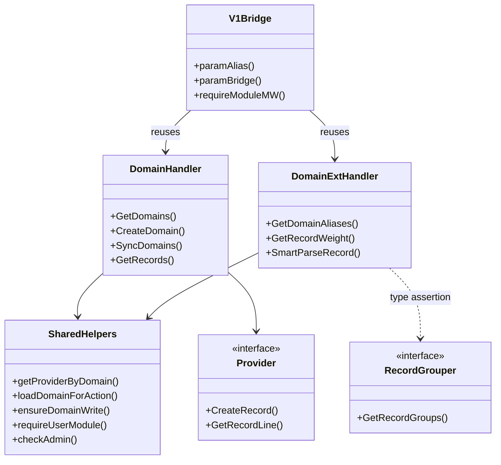
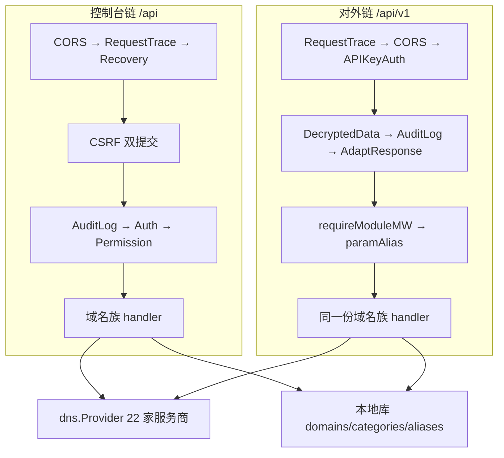
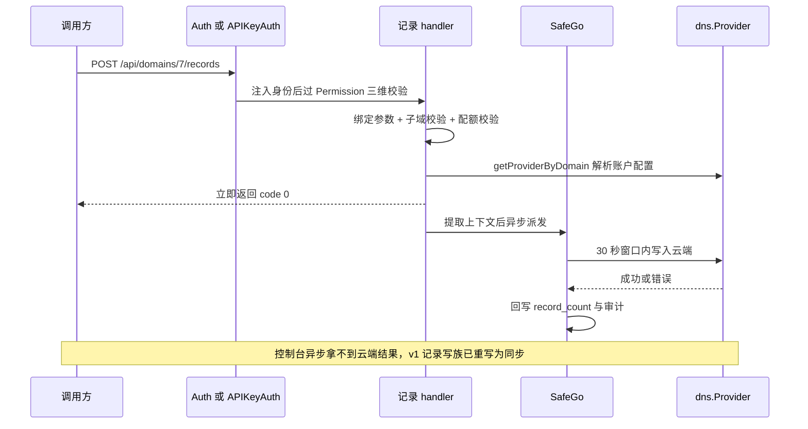
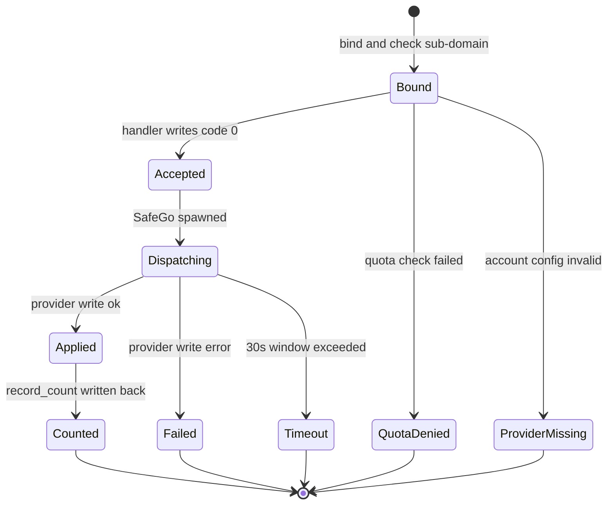
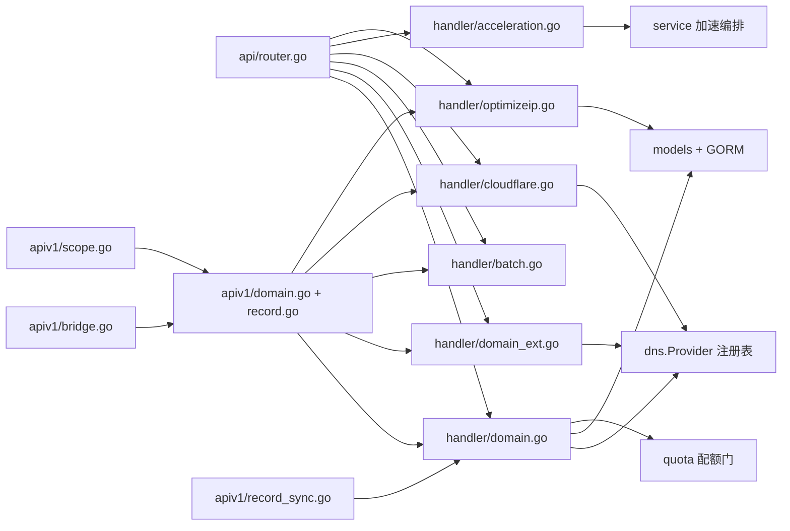
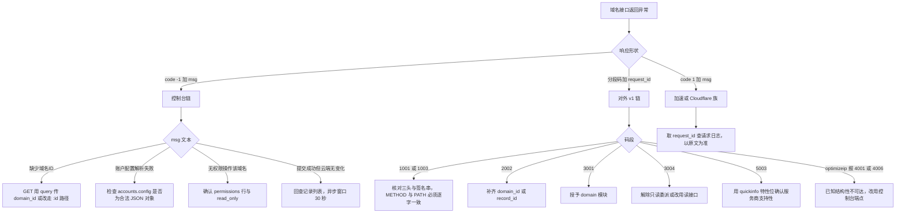

# 域名管理API

<cite>
**本文档引用的文件**
- [router.go](file://main/internal/api/router.go)
- [domain.go](file://main/internal/api/handler/domain.go)
- [domain_ext.go](file://main/internal/api/handler/domain_ext.go)
- [domain_category.go](file://main/internal/api/handler/domain_category.go)
- [dns_check.go](file://main/internal/api/handler/dns_check.go)
- [batch.go](file://main/internal/api/handler/batch.go)
- [acceleration.go](file://main/internal/api/handler/acceleration.go)
- [cname.go](file://main/internal/api/handler/cname.go)
- [quicklogin.go](file://main/internal/api/handler/quicklogin.go)
- [optimizeip.go](file://main/internal/api/handler/optimizeip.go)
- [cloudflare.go](file://main/internal/api/handler/cloudflare.go)
- [logs.go](file://main/internal/api/handler/logs.go)
- [account.go](file://main/internal/api/handler/account.go)
- [permission.go](file://main/internal/api/middleware/permission.go)
- [sign.go (middleware)](file://main/internal/api/middleware/sign.go)
- [domain.go (apiv1)](file://main/internal/apiv1/domain.go)
- [record.go](file://main/internal/apiv1/record.go)
- [record_sync.go](file://main/internal/apiv1/record_sync.go)
- [routes_batch2.go](file://main/internal/apiv1/routes_batch2.go)
- [auth.go (apiv1)](file://main/internal/apiv1/auth.go)
- [bridge.go](file://main/internal/apiv1/bridge.go)
- [scope.go](file://main/internal/apiv1/scope.go)
- [response.go](file://main/internal/apiv1/response.go)
- [errors.go](file://main/internal/apiv1/errors.go)
- [interface.go (DNS)](file://main/internal/dns/interface.go)
- [models.go](file://main/internal/models/models.go)
- [cloudflare.go (models)](file://main/internal/models/cloudflare.go)
</cite>

## 目录

1. [简介](#简介)
2. [项目结构](#项目结构)
3. [核心组件](#核心组件)
4. [架构总览](#架构总览)
5. [详细组件分析](#详细组件分析)
6. [依赖关系分析](#依赖关系分析)
7. [性能考虑](#性能考虑)
8. [故障排查指南](#故障排查指南)
9. [结论](#结论)
10. [附录](#附录)

## 简介

### 定位与范围

本文是控制台域名管理域的接口清单，覆盖两条调用链上的全部域名相关端点：控制台链 `/api` 共 92 条、对外链 `/api/v1` 共 33 条，两者共用同一份 `internal/api/handler` 业务实现，差异只落在认证方式、参数载体与响应信封上。

纳入范围：域名主体与同步（9 条）、解析记录与批量（11 条）、域名扩展与分类（14 条）、DNS 检测与 WHOIS（3 条）、一键加速（10 条）、Cloudflare 增强（28 条）、优选 IP（10 条）、快速登录与证书 CNAME 联动（6 条）、按账户列域名与服务商清单（2 条）；对应 v1 侧为 `domains` 19 条与 `records` 14 条。不纳入：证书签发与部署、容灾监控任务、套餐配额本体，本文仅在域名端点触达 `CheckQuota`/`CheckFeature` 门时引用其结论。一键加速、快速登录、证书 CNAME、DNS 检测、到期时间刷新均未迁移到 v1。

**章节来源**
- [main/internal/api/router.go:118-341](file://main/internal/api/router.go)

### 大纲口径与实际路由对应

需求大纲给出的部分路径为概念口径，代码实际注册路径不同，正文一律使用代码实测路径。

| 大纲口径 | 代码实际路径 | 注册位置 |
| --- | --- | --- |
| `/api/domains/ext` | `:id/{aliases,records/weight,records/quickinfo,records/logs,record-groups}` | `router.go:144-155` |
| `/api/dns/check` | `POST /api/domains/dns-check` | `router.go:120` |
| `/api/dns/whois` | `POST /api/domains/:id/whois`；v1 `POST /api/v1/domains/whois` | `router.go:153` |
| `/api/dns/cname` | `/api/cert/cnames*`（4 条） | `router.go:276-279` |
| `/api/dns/optimizeip` | `/api/optimizeip/tasks*`、`/api/system/optimizeip/*`、`GET /optimizeip/status` | `router.go:326-341` |
| `/api/acceleration/*` | `/api/domains/:id/accel*` + `/api/system/accel/*` | `router.go:158-167` |
| `/api/batch/*` | `domains/batch`、`domains/batch/update-expire`、`:id/records/batch*` | `router.go:130-140` |
| `/api/quicklogin/*` | `GET /api/quicklogin`、`GET /api/domains/:id/loginurl` | `router.go:337`、`274` |

**章节来源**
- [main/internal/api/router.go:120-341](file://main/internal/api/router.go)

## 项目结构

```text
main/internal/
├── api/
│   ├── router.go                  控制台域名族路由注册
│   ├── middleware/{auth,permission,sign}.go
│   └── handler/
│       ├── domain.go              域名 CRUD + 同步 + 批量 + 记录读写
│       ├── domain_ext.go          别名/权重/分组/智能解析/quickinfo
│       ├── domain_category.go     域名分类
│       ├── dns_check.go           多 DNS 服务器并发探测
│       ├── batch.go               记录批量 + WHOIS
│       ├── acceleration.go        EO/ESA/CF 一键加速
│       ├── cloudflare.go          主机名 + Tunnel + 回退源 + DCV
│       ├── optimizeip.go          优选 IP 任务与配置
│       ├── quicklogin.go          域名免密登录
│       ├── cname.go               证书 CNAME 联动
│       └── logs.go / account.go   域名操作日志 / 服务商清单
└── apiv1/
    ├── domain.go / record.go      域名 19 条、记录 14 条对外端点
    ├── record_sync.go             记录写接口同步重写
    └── bridge.go / scope.go       参数桥接 / 模块与三维校验
```

### 文件职责与规模

| 文件 | 导出 handler | 行数 | 被 v1 复用 |
| --- | --- | --- | --- |
| `handler/domain.go` | 17 | 1774 | 全部 |
| `handler/domain_ext.go` | 9 | 418 | 全部 |
| `handler/domain_category.go` | 5 | 187 | 全部 |
| `handler/dns_check.go` | 1 | 197 | 未迁移 |
| `handler/batch.go` | 4 | 510 | 全部 |
| `handler/acceleration.go` | 10 | 1000 | 未迁移 |
| `handler/cloudflare.go` | 28 | 2509 | 全部 |
| `handler/optimizeip.go` | 10 | 381 | 7 条 |
| `handler/quicklogin.go` / `cname.go` | 2 / 4 | 204 / 179 | 未迁移 |
| `apiv1/record_sync.go` | 5 | 430 | v1 专用 |

技术栈矩阵：Gin（路由分组与参数绑定）、GORM（`domains`/`domain_categories`/`domain_aliases`）、`dns.Provider` 接口（22 家服务商）、`net.Resolver` 加 DoH 回落（DNS 检测）、JWT 加 AES-GCM Cookie（控制台会话）、HMAC-SHA256（对外签名）、Redis 与进程内 cache（快速登录 token、优选 IP 状态）。

**章节来源**
- `wc -l` 与函数索引 `rg -N '^func ([A-Z]\w*)\(c \*gin\.Context\)'` 实测
- [main/internal/api/router.go:118-341](file://main/internal/api/router.go)

## 核心组件

### 组件清单

| 组件 | 载体 | 单一职责 | 关键协作者 |
| --- | --- | --- | --- |
| 域名清单器 | `GetDomains` | JOIN 账户、权限行过滤、分页 | `buildDomainsListQuery`、排序白名单 |
| 域名接入器 | `CreateDomain` | 校验账户、取 `third_id`、落库 | `getMainDomainByPSL` |
| 域名同步器 | `SyncDomains` | 以云端列表为准 upsert | `getSyncDomainID` |
| 批量操作器 | `BatchDomainAction` | IN 查询批处理四类动作 | `CheckDomainPermission` |
| 记录读写器 | `GetRecords`、`CreateRecord` 等 | 云端记录查询与写入 | `getProviderByDomain`、`SafeGo` |
| 域名扩展器 | `domain_ext.go` 九件套 | 别名/权重/分组等增值 | `loadDomainForAction`、`ensureDomainWrite` |
| 参数桥接器 | `paramAlias`、`paramBridge` | v1 body 键回填为路径参数 | `bridgeParams`、`mergeScalarsToQuery` |
| 权限门 | `Permission` 加 handler 自查 | 域名/子域/只读三维 | `isDomainScopedWriteRequest` |

**章节来源**
- [main/internal/api/handler/domain.go:78-130](file://main/internal/api/handler/domain.go)
- [main/internal/api/handler/domain_ext.go:40-87](file://main/internal/api/handler/domain_ext.go)

### 组件关系



**图表来源**
- [main/internal/api/handler/domain.go:33-52](file://main/internal/api/handler/domain.go)
- [main/internal/api/handler/domain_ext.go:40-87](file://main/internal/api/handler/domain_ext.go)
- [main/internal/apiv1/domain.go:22-74](file://main/internal/apiv1/domain.go)

**章节来源**
- [main/internal/dns/interface.go:6-18](file://main/internal/dns/interface.go)

## 架构总览

### 两条链的装配



`/api/v1` 挂在引擎根而非 `/api` 组内，是因为 `/api` 组带 CSRF 双提交校验，API Key 客户端不持有 `_csrf` cookie，继承该链会让所有写请求被 403 拒。同理 v1 链上不执行 `middleware.Permission()`，三维校验改由 handler 自查与 `scopeDomain` 承担。

**图表来源**
- [main/internal/api/router.go:24-104](file://main/internal/api/router.go)
- [main/internal/apiv1/bridge.go:36-103](file://main/internal/apiv1/bridge.go)

**章节来源**
- [main/internal/apiv1/router.go:25-34](file://main/internal/apiv1/router.go)

### 记录写入端到端时序



**图表来源**
- [main/internal/api/handler/domain.go:875-935](file://main/internal/api/handler/domain.go)
- [main/internal/apiv1/record_sync.go:121](file://main/internal/apiv1/record_sync.go)

**章节来源**
- [main/internal/api/middleware/permission.go:130-200](file://main/internal/api/middleware/permission.go)

### 端点分布对照

| 维度 | 控制台域名域 | 对外 v1 域名域 |
| --- | --- | --- |
| 条数 / 方法 | 92，GET 27 / POST 65 | 33，全部 POST |
| 含 `:id` 路径参数 | 46 | 0（靠桥接回填） |
| 参数载体 | query + body + path | 仅 body |
| 响应信封 | `{code,msg,data}`，码仅 0/-1 | `{code,request_id,data}`，分段码 |
| 异步写端点 | 记录增删改暂停 + 批量族 | 仅批量族 3 条 |

**章节来源**
- [main/internal/apiv1/domain.go:21-70](file://main/internal/apiv1/domain.go)
- [main/internal/apiv1/record.go:18-57](file://main/internal/apiv1/record.go)

## 详细组件分析

### 域名主体：查询、详情、接入、同步

控制台端点（`router.go:118-134`）：

| Method | Path | Handler | 细粒度门 | 响应 |
| --- | --- | --- | --- | --- |
| GET | `/api/domains` | `domain.go:128` | `module:domain` | `data:list[],total` |
| GET | `/api/domains/:id` | `domain.go:249` | module + 非管理员域名校验 | 单对象 |
| POST | `/api/domains` | `domain.go:314` | `checkAdmin` + `CheckQuota("domains")` | `data:id,msg` |
| POST | `/api/domains/sync` | `domain.go:458` | `checkAdmin` | `data:added,updated` |
| POST | `/api/domains/:id/delete` | `domain.go:574` | `checkAdmin` | `msg` |
| POST | `/api/domains/:id` | `domain.go:1390` | module | `msg` |
| POST | `/api/domains/batch` | `domain.go:1473` | module；`action=delete` 需 admin，否则逐 ID 域名校验 | `msg` |
| POST | `/api/domains/:id/update-expire` | `domain.go:1557` | module | `msg` |
| POST | `/api/domains/batch/update-expire` | `domain.go:1591` | module | `msg` |
| GET | `/api/accounts/:id/domains` | `domain.go:1295` | module | `data:list[],total` |
| GET | `/api/dns/providers` | `account.go:445` | module | `data[]`（按 `type` 升序） |

参数经 `BindDecryptedData` 绑定：GET 走 `ShouldBindQuery`，POST 走 body 或 `decrypted_data`。分页归一为默认 20、上限 200；排序字段受白名单约束，仅 `name`/`record_count`/`expire_time`/`created_at` 可排序。

```json
{ "code": 0, "data": { "total": 2, "list": [{ "id": 7, "aid": 3, "cid": 3, "name": "example.com", "third_id": "1234567", "record_count": 42, "remark": "生产主域", "is_hide": false, "is_sso": false, "is_notice": true, "expire_time": "2027-04-11T00:00:00Z", "account_name": "dnspod-main", "account_type": "dnspod", "type_name": "DNSPod", "perm_sub": "www,api" }] } }
```

`perm_sub` 仅当请求者是被委派用户且命中 `permissions` 行时出现。备注遵循「用户独立备注优先，否则回落域名全局备注」。接入时若账户为 `dnspod` 且提交的不是主域，走子域托管委派分支，返回的 `name` 可能被服务商规范化；`sync` 的 `domains[].id` 同时接受字符串与数字，因为各家域名 ID 类型不统一。

**章节来源**
- [main/internal/api/handler/domain.go:78-330](file://main/internal/api/handler/domain.go)
- [main/internal/api/handler/domain.go:1295-1610](file://main/internal/api/handler/domain.go)
- [main/internal/api/middleware/sign.go:104-127](file://main/internal/api/middleware/sign.go)
- [main/internal/models/models.go:72-92](file://main/internal/models/models.go)

### 解析记录：读写与异步语义

| Method | Path | Handler | 门 | 同步性 |
| --- | --- | --- | --- | --- |
| GET | `/api/domains/:id/records` | `domain.go:640` | module + 子域过滤 | 读 |
| POST | `/api/domains/:id/records` | `domain.go:875` | module + 子域 + `CheckQuota("records")` | 异步 |
| POST | `/api/domains/:id/records/:recordId` | `domain.go:989` | module + 子域 | 异步 |
| POST | `/api/domains/:id/records/:recordId/delete` | `domain.go:1065` | module + 域名 | 异步 |
| POST | `/api/domains/:id/records/:recordId/status` | `domain.go:1150` | module + 域名 | 异步 |
| POST | `/api/domains/:id/records/batch` | `batch.go:47` | module + `CheckFeature("batch_ops")` | 异步 |
| POST | `/api/domains/:id/records/batch/edit` | `batch.go:238` | module + `CheckFeature("batch_ops")` | 异步 |
| POST | `/api/domains/:id/records/batch/action` | `batch.go:342` | module + `CheckFeature("batch_ops")` | 异步 |
| POST | `/api/domains/:id/records/quickinfo` | `domain_ext.go:301` | module + 域名 | 读 |
| GET | `/api/domains/:id/records/logs` | `domain_ext.go:329` | module + 域名 | 读 |
| GET | `/api/domains/:id/lines` | `domain.go:1241` | module + 域名 | 读 |



**图表来源**
- [main/internal/api/handler/domain.go:887-935](file://main/internal/api/handler/domain.go)
- [main/internal/api/handler/batch.go:238-260](file://main/internal/api/handler/batch.go)

命名陷阱：记录**读**的行字段是 PascalCase，**写**请求是 snake_case，转换发生在 `domain.go:700-737` 的 `RecordItem`。`Status` 在云端是 `enable`/`DISABLE` 等异构表达，读接口统一折叠为 `"1"`/`"0"`；写请求的 `status` 过滤参数接受 `1`/`0`、`enable`/`disable`、`ENABLE`/`PAUSE`/`DISABLE`。缺省值：`line` 空则 `default`，`ttl` 为 0 则 600。

```json
{ "code": 0, "data": { "total": 1, "list": [{ "RecordId": "1678901234", "Name": "www", "Type": "CNAME", "Value": "www.cdn.example.invalid", "Line": "DEFAULT", "LineName": "默认", "TTL": 600, "Status": "1", "Remark": "CDN 接入" }] } }
```

批量接口两种载荷二选一：`records` 文本域（每行一条，配合全局 `type`/`line`/`ttl`）或 `items[]` 结构化数组。

```json
{ "domain_id": "7", "type": "A", "line": "default", "ttl": 600, "records": "api 1.2.3.4\nadmin 5.6.7.8" }
```

**章节来源**
- [main/internal/api/handler/domain.go:622-760](file://main/internal/api/handler/domain.go)
- [main/internal/api/handler/batch.go:23-60](file://main/internal/api/handler/batch.go)
- [main/internal/dns/interface.go:6-18](file://main/internal/dns/interface.go)

### 域名扩展：别名、权重、分组、智能解析

| Method | Path | Handler | 关键参数 | 响应 |
| --- | --- | --- | --- | --- |
| GET | `/api/domains/:id/aliases` | `domain_ext.go:89` | `:id` | `data:list[]` |
| POST | `/api/domains/:id/aliases` | `domain_ext.go:102` | `name*` | 别名对象 |
| POST | `/api/domains/aliases/:aliasId/delete` | `domain_ext.go:138` | `:aliasId`，回落 `:id` | `msg` |
| GET | `/api/domains/:id/records/weight` | `domain_ext.go:171` | `?sub`，回落 `?name` | `data:name,list[],line,weight` |
| POST | `/api/domains/:id/records/weight` | `domain_ext.go:216` | `record_id*`,`weight` | `msg` |
| GET | `/api/domains/records/smartparse` | `domain_ext.go:276` | `?value`，回落 `?domain` | `data:type,value` |
| GET | `/api/domains/:id/record-groups` | `domain_ext.go:357` | `:id` | `data:list[]` |
| POST | `/api/domains/:id/record-groups/change` | `domain_ext.go:387` | `record_ids*[]`,`group_id*` | `data:null` |
| GET | `/api/domains/:id/logs` | `logs.go:27` | `domain_id*`,`page`,`page_size`,`keyword`,`start_date`,`end_date` | `data:list[],total,source` |

扩展族共享两个私有助手：`loadDomainForAction` 只认 `c.Param("id")`，取不到即回「缺少域名ID」，随后非管理员走 `CheckDomainPermission`；`ensureDomainWrite` 按域名权限、上下文 `perm_read_only`、子域权限三级串联。因此所有扩展端点在 v1 下必须依赖桥接把 `domain_id` 回填成 `:id`。

分组族做了接口断言：`provider.(dns.RecordGrouper)` 不成立时 `GetRecordGroups` 返回空列表而不报错，`ChangeRecordGroup` 则明确回「当前DNS服务商不支持记录分组」——这一非对称意味着不能用空列表判断支持性，需改用 `quickinfo` 的 `supports_*` 特性位。`smartparse` 为纯本地启发式，不查云端：IPv4 判 `A`、IPv6 判 `AAAA`、含点且不含路径分隔符判 `CNAME`。域名操作日志遵循「云端优先、本地降级」，故响应带 `source` 字段。

```json
{ "code": 0, "data": { "type": "CNAME", "value": "www.cdn.example.invalid" } }
```

**章节来源**
- [main/internal/api/handler/domain_ext.go:20-120](file://main/internal/api/handler/domain_ext.go)
- [main/internal/api/handler/domain_ext.go:357-418](file://main/internal/api/handler/domain_ext.go)
- [main/internal/api/handler/logs.go:20-60](file://main/internal/api/handler/logs.go)

### 域名分类

| Method | Path | Handler | 请求体 | 备注 |
| --- | --- | --- | --- | --- |
| GET | `/api/domains/categories` | `domain_category.go:17` | — | 每行附 `domain_count` |
| POST | `/api/domains/categories` | `domain_category.go:51` | `name*`,`remark`,`sort` | 重复回「分类名称已存在」 |
| POST | `/api/domains/categories/:id` | `domain_category.go:91` | `name*`,`remark`,`sort` | 更新 |
| POST | `/api/domains/categories/:id/delete` | `domain_category.go:138` | `:id` | 不级联改写域名 `cid` |
| POST | `/api/domains/category` | `domain_category.go:172` | `ids*[]`,`cid` | 批量归类，`cid=0` 即清除 |

列表按 `sort ASC, id DESC` 排序，五端点权限门均为 `module:domain`。

**章节来源**
- [main/internal/api/handler/domain_category.go:14-187](file://main/internal/api/handler/domain_category.go)

### DNS 检测与 WHOIS

| Method | Path | Handler | 门 | 特征 |
| --- | --- | --- | --- | --- |
| POST | `/api/domains/dns-check` | `dns_check.go:57` | 仅 Auth | 7 家公共 DNS 并发，无域名归属校验 |
| POST | `/api/domains/:id/whois` | `batch.go:459` | module + 域名 | 返回注册商与到期时间 |
| POST | `/api/domains/:id/update-expire` | `domain.go:1557` | module | WHOIS 结果落库 `expire_time` |

探测器池固定 7 项：阿里 `223.5.5.5`、腾讯 `119.29.29.29`、百度 `180.76.76.76`、114 `114.114.114.114`、Google `8.8.8.8`、Cloudflare `1.1.1.1`、OpenDNS `208.67.222.222`，单项 UDP 拨号超时 5 秒，失败后回落一次 DoH。`type` 仅接受 `A`/`AAAA`/`CNAME`/`MX`/`TXT`/`NS`，其余回「不支持的记录类型」。结果数组与探测池等长，失败项以 `error` 字段表达。

```json
{ "code": 0, "data": [ { "server": "阿里DNS", "ip": "223.5.5.5", "results": ["1.2.3.4"], "ttl": "300", "cost": 18 }, { "server": "Google", "ip": "8.8.8.8", "results": [], "ttl": "", "cost": 5003, "error": "read udp i/o timeout" } ] }
```

`dns-check` 不做归属判断，任何已登录用户都能查询任意域名的解析结果；这与同族 WHOIS（需 `domain_id` 且过域名权限）构成明确的能力落差，属设计现状而非缺陷。

**章节来源**
- [main/internal/api/handler/dns_check.go:18-110](file://main/internal/api/handler/dns_check.go)
- [main/internal/api/handler/batch.go:450-480](file://main/internal/api/handler/batch.go)

### 一键加速

| Method | Path | Handler | 门 |
| --- | --- | --- | --- |
| POST | `/api/domains/:id/accel` | `acceleration.go:117` | 域名权限 |
| POST | `/api/domains/:id/accel/batch` | `acceleration.go:645` | 域名权限 |
| GET | `/api/domains/:id/accel/status` | `acceleration.go:720` | 仅 Auth |
| GET/POST | `/api/system/accel/config` | `acceleration.go:22` / `:51` | `requireAdmin` |
| GET | `/api/system/accel/platforms` | `acceleration.go:745` | 仅 Auth |
| GET | `/api/system/accel/accounts` | `acceleration.go:886` | `requireAdmin` |
| POST | `/api/system/accel/apply-account` | `acceleration.go:939` | `requireAdmin` |
| POST | `/api/system/accel/eo/zones` | `acceleration.go:802` | `requireAdmin` |
| POST | `/api/system/accel/esa/sites` | `acceleration.go:844` | `requireAdmin` |

策略与执行动作：`cf_only` 仅 Cloudflare 写 CNAME；`eo_only` 走腾讯 EO（线路 DEF）；`esa_only` 走阿里 ESA（线路 DEF）；`mixed_cf_eo` 与 `mixed_cf_esa` 分别叠加 EO/ESA 的 CN 线路与 CF，按分线路写；空值或未知策略回落 `cf_only`。

该族响应信封与控制台标准不同形：失败写 `{"code":1,"msg":...}` 并带 HTTP 400/403，而非 `code:-1` 加 HTTP 200。单条超时 60 秒、批量 120 秒。`GetAccelConfig` 读回时把 `accel_eo_secret_key` 与 `accel_esa_access_key_secret` 替换为星串，但仍回显各 `*_id` 标识字段。

```json
{ "code": 0, "msg": "加速配置完成", "data": { "accel_results": [{ "cname": "example.com.cdn.example.invalid", "status": "active", "platform": "cloudflare" }], "dns_results": [{ "cname": "example.com.cdn.example.invalid", "status": "ok", "deleted_count": 1, "cleanup_skipped": false }] } }
```

**章节来源**
- [main/internal/api/handler/acceleration.go:22-210](file://main/internal/api/handler/acceleration.go)
- [main/internal/api/handler/acceleration.go:645-960](file://main/internal/api/handler/acceleration.go)
- [main/internal/apiv1/routes_batch2.go:74-82](file://main/internal/apiv1/routes_batch2.go)

### Cloudflare 增强

28 条端点全部以 `:id` 结尾（主机名族的 `:id` 是域名 ID，Tunnel 族是账户 ID），共用 `cfRequestBody` 与 `cfString` 两个助手，取值三级回落：body 键、`GetPostForm`、`Query`。自定义主机名 10 条（`router.go:298-307`）：

| Method | Path | Handler | 响应 data |
| --- | --- | --- | --- |
| GET | `/api/cloudflare/hostnames/:id` | `cloudflare.go:683` | `{rows[],total}` |
| POST | `/api/cloudflare/hostnames/{add,update,delete}/:id` | `:743` / `:818` / `:883` | 主机名对象或 — |
| POST | `/api/cloudflare/hostnames/batch-{add,update,delete}/:id` | `:919` / `:982` / `:1050` | `{success[],failed[]}` |
| POST | `/api/cloudflare/hostnames/txt-targets/:id` | `cloudflare.go:1083` | `{candidates[],hostname}` |
| POST | `/api/cloudflare/hostnames/refresh/:id` | `cloudflare.go:1110` | 主机名对象 |
| POST | `/api/cloudflare/hostnames/setup-validation/:id` | `cloudflare.go:1153` | `{added[],results[],fqdn,purpose,record_id,status,type}` |
| POST | `/api/cloudflare/fallback/{get,set,delete}/:id` | `:1395` / `:1434` / `:1469` | `{origin}` 或 — |
| POST | `/api/cloudflare/dcv_delegation_uuid/:id` | `cloudflare.go:1498` | `{uuid}` |
| POST | `/api/cloudflare/get_domain_default_line` | `cloudflare.go:2450` | `{default_line}` |

Tunnel 全族 13 条（`router.go:313-325`）位于 `/api/cloudflare/tunnels/` 下：`:id`（列表 `GET`）、`add/:id`、`delete/:id`、`token/:id`、`public-hostnames/{data,save,delete}/:id`、`cidr/{data,add,delete}/:id`、`hostnameroutes/{data,add,delete}/:id`，分别由 `cloudflare.go:1539/1599/1657/1712/2078/2124/2214/1767/1810/1868/1923/1966/2026` 处理，列表类返回 `{rows[],total}`，`token/:id` 返回凭据 `{token}`。

三点必须注意：权限判定不在路由层，全部依赖 handler 内模块自查与账户归属；失败响应用 `"code": 1` 加 HTTP 400，v1 侧按文案重映射后几乎一律落 `2001`；分页键是 camelCase 的 `pageSize`，与其余接口的 `page_size` 不同制。v1 侧做了命名规整：`dcv_delegation_uuid` 改为 `dcv-delegation-uuid`、`get_domain_default_line` 改为 `default-line`、`hostnameroutes` 改为 `hostname-routes`，理由是签名对象需为常量路径并避免 gin 路由树静态段与参数段回溯。

**章节来源**
- [main/internal/api/router.go:298-325](file://main/internal/api/router.go)
- [main/internal/api/handler/cloudflare.go:141-168](file://main/internal/api/handler/cloudflare.go)
- [main/internal/apiv1/routes_batch2.go:26-64](file://main/internal/apiv1/routes_batch2.go)

### 优选 IP、快速登录与证书 CNAME 联动

| Method | Path | Handler | 门 |
| --- | --- | --- | --- |
| GET/POST | `/api/system/optimizeip/config` | `optimizeip.go:34` / `:52` | `requireAdmin` |
| POST | `/api/system/optimizeip/license` | `optimizeip.go:87` | `requireAdmin` |
| POST | `/api/optimizeip/tasks/list` | `optimizeip.go:134` | `requireAdmin` |
| POST | `/api/optimizeip/tasks` | `optimizeip.go:239` | `CheckQuota("optimize_ip")` + `requireAdmin` |
| POST | `/api/optimizeip/tasks/{:id,:id/delete,:id/toggle,:id/run}` | `:277` / `:312` / `:322` / `:339` | `requireAdmin`，只读 `:id` |
| GET | `/optimizeip/status` | `optimizeip.go:364` | 引擎级、无认证、纯文本 |
| GET | `/api/domains/:id/loginurl` | `quicklogin.go:60` | module + 域名 |
| GET | `/api/quicklogin` | `quicklogin.go:124` | 匿名，IP 每小时 30 次 |
| GET | `/api/cert/cnames` | `cname.go:26` | `module:cert`，分页上限 200 |
| POST | `/api/cert/cnames` | `cname.go:64` | `checkAdmin`：`domain*`,`did*`,`rr*` |
| POST | `/api/cert/cnames/:id/{delete,verify}` | `cname.go:115` / `:154` | `checkAdmin` |

优选 IP 在 v1 迁移了 7 条，其中 `update`/`delete`/`toggle`/`run` 四条带 `:id` 语义的端点因该子组未挂任何桥接而结构性不可达：handler 只读 `c.Param("id")`，而 v1 路由表没有路径参数。`delete` 的后果尤其危险，`WHERE id = 0` 影响 0 行却返回 `code=0` 与「删除成功」。任务请求体沿用无分隔小写命名（`did`、`rr`、`recordid`、`ip_type`、`cdn_type`、`recordnum`），列表分页用 `offset`/`limit`。

快速登录的 token 以 `ql:` 前缀写入 cache，5 分钟有效、命中即删；`url` 字段按 `X-Forwarded-Proto` 判定 scheme 并用 `c.Request.Host` 拼接，反向代理后必须正确转发该头。`cert_cnames` 表只有 `domain`/`did`/`rr`/`status` 四个业务列，`verify` 端点直接把 `status` 置 1，属「人工确认后置位」语义，不应被当作解析已生效的证明。

```json
{ "code": 0, "data": { "url": "https://dnsplane.example.invalid/api/quicklogin?token={one-time-token}", "token": "{one-time-token}", "expire_at": "2026-10-11T10:35:00Z" } }
```

**章节来源**
- [main/internal/api/handler/optimizeip.go:34-400](file://main/internal/api/handler/optimizeip.go)
- [main/internal/api/handler/quicklogin.go:51-130](file://main/internal/api/handler/quicklogin.go)
- [main/internal/api/handler/cname.go:16-179](file://main/internal/api/handler/cname.go)
- [main/internal/apiv1/routes_batch2.go:129-139](file://main/internal/apiv1/routes_batch2.go)

### 对外 v1 的域名与记录接口

`/api/v1/domains` 19 条（`apiv1/domain.go:21-70`，模块 `domain`，组级 `paramAlias{"id":"domain_id"}`）：

| Path | Handler | 请求体主要字段 |
| --- | --- | --- |
| `/api/v1/domains/list` | `domain.go:128` | `keyword`,`aid`,`cid`,`page`,`page_size`,`sort_field`,`sort_order` |
| `/api/v1/domains/detail` | `domain.go:249` | `id` 或 `domain_id` |
| `/api/v1/domains/{create,sync}` | `:314` / `:458` | `account_id*`,`name*`；`aid*`,`domains[]` |
| `/api/v1/domains/{delete,update}` | `:574` / `:1390` | `domain_id` 或 `id`；`id`,`is_hide`,`is_sso`,`is_notice`,`remark`,`expire_time` |
| `/api/v1/domains/batch` | `domain.go:1473` | `ids*[]`,`action*`,`is_notice`,`remark` |
| `/api/v1/domains/{lines,whois}` | `domain.go:1241`；`batch.go:459` | `domain_id` |
| `/api/v1/domains/aliases{,/add}` | `domain_ext.go:89` / `:102` | `domain_id`；`domain_id`,`name*` |
| `/api/v1/domains/aliases/delete` | `domain_ext.go:138` | `alias_id`（单独挂 `paramAlias{"aliasId":"alias_id"}`） |
| `/api/v1/domains/categories{,/create,/set}` | `domain_category.go:17` / `:51` / `:172` | —；`name*`,`remark`,`sort`；`ids*[]`,`cid` |
| `/api/v1/domains/categories/{update,delete}` | `domain_category.go:91` / `:138` | `id*`,`name*`；`id`（各挂 `paramAlias{"id":"id"}`） |
| `/api/v1/domains/{groups,groups/change}` | `domain_ext.go:357` / `:387` | `domain_id`；`domain_id`,`record_ids*[]`,`group_id*` |

`/api/v1/records` 14 条（`apiv1/record.go:18-57`，模块 `domain`，组级同上）：

| Path | Handler | 同步性 | 备注 |
| --- | --- | --- | --- |
| `/api/v1/records/list` | `domain.go:640` | 读 | 字段 PascalCase |
| `/api/v1/records/{create,update,delete,status,remark}` | `record_sync.go:121/195/270/319/368` | 同步 | `create` 另挂 `requireQuota("records")`；`update` 未传字段用原值回填 |
| `/api/v1/records/batch/{add,edit,action}` | `batch.go:47/238/342` | 异步 | `add` 挂 `requireQuota("records")` |
| `/api/v1/records/weight{,/update}` | `domain_ext.go:171` / `:216` | 读 / 写 | `sub` 靠桥接搬进 query |
| `/api/v1/records/{quickinfo,logs}` | `domain_ext.go:301` / `:329` | 读 | — |
| `/api/v1/records/smartparse` | `domain_ext.go:276` | 读 | 唯一改用 `paramBridge` 的记录接口 |

签名串与请求头（`apiv1/auth.go:23-100`），时间戳窗口正负 5 分钟，`PATH` 含 `/api/v1` 前缀且不含查询串：

```bash
U="3"; TS="$(date +%s)"; PP="/api/v1/domains/list"
SIGN=$(printf '%s\n%s\nPOST\n%s' "$U" "$TS" "$PP" \
  | openssl dgst -sha256 -hmac "{api-key}" -hex | awk '{print $2}')
curl -sS -X POST "https://dnsplane.example.invalid${PP}" \
  -H "X-API-UID: ${U}" -H "X-API-Timestamp: ${TS}" -H "X-API-Sign: ${SIGN}" \
  -H 'Content-Type: application/json' -d '{"keyword":"example","page":1,"page_size":20}'
```

成功与失败响应不同形，失败无 `data` 键，客户端必须先判 `code` 再取 `data`：

```json
{ "code": 0, "request_id": "req_1759981234567890123_42", "data": { "total": 1, "list": [{ "id": 7, "name": "example.com", "aid": 3, "record_count": 42 }] } }
```

```json
{ "code": 3001, "request_id": "req_1759981234567890123_43", "message": "无该功能模块的访问权限" }
```

| 码 | 含义 | HTTP | 域名域典型触发 |
| --- | --- | --- | --- |
| 2002 | 缺少必填参数 | 400 | `record_id`、`domain_id` 缺失 |
| 3001 | 无模块权限 | 400 | 未授予 `domain` 模块 |
| 3002 | 无域名权限 | 400 | 非管理员访问他人域名；优选 IP 的「仅管理员」文案也折叠到此 |
| 3004 | 只读域名 | 400 | 同步写接口上的 `requireWritable` |
| 4002 / 4003 / 4004 | 域名 / 账户 / 记录不存在 | 404 | `loadDomain`、`providerForDomain`、同步写回查 |
| 4007 | 资源冲突 | 409 | 别名重复、分类名重复 |
| 5003 / 5004 | 服务商不支持 / 云端写入失败 | 502 | 能力缺失、同步写上游错误 |

引擎关闭了尾斜杠重定向，`/api/v1/domains/list/` 与 `/api/v1/domains/list` 不等价，多一个斜杠会同时导致路由 404 与签名基准不一致。三维鉴权在 v1 由 `scopeDomain` 施加，但只有 5 个同步写记录接口走这条路；v1 链不执行 `Permission`，故 `perm_read_only` 等上下文键恒不存在，依赖它们的分支静默跳过——同一角色在两条链上可见性相反：只读用户在控制台调 `POST /api/domains/:id/records/quickinfo` 会被拒（该中间件把所有 POST 视为写，唯一豁免是路径以 `/whois` 结尾），在 v1 反而能读。

**章节来源**
- [main/internal/apiv1/domain.go:21-74](file://main/internal/apiv1/domain.go)
- [main/internal/apiv1/record.go:16-57](file://main/internal/apiv1/record.go)
- [main/internal/apiv1/auth.go:23-122](file://main/internal/apiv1/auth.go)
- [main/internal/apiv1/bridge.go:36-119](file://main/internal/apiv1/bridge.go)
- [main/internal/apiv1/errors.go:10-92](file://main/internal/apiv1/errors.go)
- [main/internal/api/middleware/permission.go:130-279](file://main/internal/api/middleware/permission.go)

## 依赖关系分析

### 内部依赖



**图表来源**
- [main/internal/api/router.go:118-341](file://main/internal/api/router.go)
- [main/internal/apiv1/record.go:1-58](file://main/internal/apiv1/record.go)

**章节来源**
- [main/internal/apiv1/domain.go:1-82](file://main/internal/apiv1/domain.go)

### 依赖矩阵与外部实体

| 被依赖方 | 域名侧依赖点 | 强度 | 缺失后果 |
| --- | --- | --- | --- |
| `dns.Provider` | 记录读写、线路、分组、权重、日志 | 强 | 「账户配置解析失败」或「不支持」 |
| `middleware.Permission` | 控制台三维校验 | 强 | 域名级越权风险 |
| `middleware/sign.go` | 响应信封与参数绑定 | 强 | 响应结构不稳定 |
| `apiv1/bridge.go` | v1 参数送达 | 强 | 「缺少域名ID」 |
| `quota` | `domains`/`records`/`optimize_ip` | 中 | 超额仍可写入 |
| `cache` 与 `sysconfig` | 快速登录 token、加速与优选策略 | 中 | 登录不可用、策略回退默认 |

| 外部实体 | 经由端点 | 失败表现 |
| --- | --- | --- |
| 22 家 DNS 服务商 OpenAPI | 记录族、线路族、分组族 | `code:-1` 透传中文错误；v1 折叠 5003/5004 |
| Cloudflare API | `cloudflare/*`、`accel` 的 `cf_*` | `{"code":1}` 加 HTTP 400 |
| 腾讯 EO 与阿里 ESA | `/api/system/accel/*` | `accel_results` 内含 error 行 |
| 7 家公共 DNS 与 DoH | `/api/domains/dns-check` | 单项 `error`，`cost` 接近 5000ms |
| WHOIS 注册局 | `/:id/whois` 与两个 expire 端点 | 文本为空或到期时间不更新 |

**章节来源**
- [main/internal/dns/interface.go:6-40](file://main/internal/dns/interface.go)
- [main/internal/api/handler/domain_ext.go:80-87](file://main/internal/api/handler/domain_ext.go)

## 性能考虑

| 问题 | 现状与优化方向 | 效果 |
| --- | --- | --- |
| 记录列表需叠加多种过滤，服务商只支持部分谓词 | 先拉云端再 `filterLocal` 精筛；应优先用云端 `keyword`/`type`/`line`/`status` 缩小结果集 | 减少大域名下的云端往返与内存占用 |
| 子域权限为有限列表 | 一次请求合并多次云端拉取再合并去重 | 语义正确但放大调用数 |
| 分类列表逐分类 `COUNT`（N+1） | 改为单条 `GROUP BY cid` 聚合后内存映射 | DB 往返从 N+1 降到 2 |
| 控制台记录写异步 | 窗口 30 秒、批量 120 秒，HTTP 层不被上游拖住 | 代价是调用方拿不到成败 |
| v1 同步写族 | 5 个接口以等待真实结果为优先级 | 集成方可据此决定后续动作 |

分页参数在域名域内三种制式并存，跨族封装必须按端点适配：`/api/domains`、`:id/records`、`:id/logs`、`/api/cert/cnames` 用 `page`/`page_size`（默认 20、上限 200）；`/api/cloudflare/hostnames/:id` 用 `page`/`pageSize`；`/api/optimizeip/tasks/list` 用 `offset`/`limit`。同一概念三种写法意味着客户端无法复用一份分页模型。

**章节来源**
- [main/internal/api/handler/domain.go:745-770](file://main/internal/api/handler/domain.go)
- [main/internal/api/handler/domain_category.go:17-40](file://main/internal/api/handler/domain_category.go)
- [main/internal/api/handler/logs.go:44-52](file://main/internal/api/handler/logs.go)

## 故障排查指南

### 排查决策树



**图表来源**
- [main/internal/api/middleware/sign.go:183-206](file://main/internal/api/middleware/sign.go)
- [main/internal/apiv1/errors.go:18-92](file://main/internal/apiv1/errors.go)
- [main/internal/api/handler/cloudflare.go:141-168](file://main/internal/api/handler/cloudflare.go)

### 症状与自检

| 症状 | 根因 | 排查 | 方案 |
| --- | --- | --- | --- |
| `v1/domains/whois` 报「缺少域名ID」 | body 键写成 `id` | 对照组级 `paramAlias{"id":"domain_id"}` | 改键名或两者都提供 |
| `v1/domains/categories/update` 恒 4001 | 该端点用 `paramAlias{"id":"id"}` | 检查 body 是否有顶层 `id` | 用 `id` 而非 `domain_id` |
| `records/smartparse` 拿不到 `value` | 组级 `paramAlias` 不搬 query | 该端点单独挂 `paramBridge` | 确认路径为 `/api/v1/records/smartparse` |
| 记录写返回成功但云端未变 | 控制台异步派发 | 回查 `GET /api/domains/:id/records` | 迁移到 v1 同步族 |
| 只读用户读 `quickinfo` 被拒 | `Permission` 把所有 POST 视为写 | 看 msg 是否为「该域名为只读权限」 | 改用 GET 端点或 v1 链 |
| Cloudflare 失败全是 2001 | 上游文案未纳入映射表 | 取 `request_id` 查请求日志 | 以日志原文为准，不按码分支 |
| 批量接口部分失败无提示 | 条数只进 `message` 文案 | 读 `message` 但不得当契约解析 | 提交后用 `records/list` 核对 |
| 加速配置读回是星串 | 密钥读回时被主动脱敏 | 属预期行为 | 更新时提交完整明文密钥 |

```bash
# 1. 确认域名族路由注册与 method（GET 与 POST 不等价）
rg -n '"\/domains' main/internal/api/router.go

# 2. 确认 v1 域名与记录族的桥接与门
rg -n 'paramAlias|paramBridge|requireModuleMW|requireQuota' main/internal/apiv1/domain.go main/internal/apiv1/record.go

# 3. 确认 handler 内的域名级校验入口
rg -n 'loadDomainForAction|ensureDomainWrite|CheckDomainPermission|CheckSubDomainPermission' \
  main/internal/api/handler/domain.go main/internal/api/handler/domain_ext.go
```

**章节来源**
- [main/internal/api/middleware/permission.go:262-279](file://main/internal/api/middleware/permission.go)
- [main/internal/apiv1/bridge.go:36-119](file://main/internal/apiv1/bridge.go)
- [main/internal/api/handler/acceleration.go:42-47](file://main/internal/api/handler/acceleration.go)

## 结论

域名域是本项目「一套 handler、两条链」设计最完整的示例：控制台 92 条与对外 33 条端点中，除 5 个记录写接口被刻意重写为同步语义外，其余全部复用同一份业务实现；扩展能力独立到 `domain_ext.go`，与主文件的 CRUD 与记录职责分层清晰，符合单一职责。参数读取统一走 `BindDecryptedData`（GET 自动降级 `ShouldBindQuery`），使同一 handler 天然支持两条链；权限分层明确，模块门在路由或入口函数、域名与子域门在 handler 内自查；服务商能力差异通过 `ProviderFeatures` 与 `RecordGrouper` 断言暴露，不为不支持的调用编造成功。

遗留风险集中在四处，均已在正文标注：三维鉴权在 v1 只覆盖 5 条同步写接口；记录读写两套字段名与分页三种制式并存；加速与 Cloudflare 族使用 `code:1` 独立信封；优选 IP 有 4 条 v1 端点结构性不可达且 `delete` 静默成功。建议把 `requireWritable` 提为 v1 写族组级中间件、为分页参数提供兼容别名、优先补齐桥接缺失，次要项包括分类列表的 N+1 与 `dns-check` 缺少归属校验。

**章节来源**
- [main/internal/apiv1/scope.go:117](file://main/internal/apiv1/scope.go)
- [main/internal/api/handler/domain.go:86-96](file://main/internal/api/handler/domain.go)

## 附录

### 控制台与 v1 能力对照

| 能力 | 控制台 | v1 |
| --- | --- | --- |
| 列表 / 详情 | `GET /api/domains`、`GET /api/domains/:id` | `POST /api/v1/domains/{list,detail}` |
| 接入 / 同步 / 删除 / 更新 | `POST /api/domains`、`/sync`、`/:id/delete`、`/:id` | `POST /api/v1/domains/{create,sync,delete,update}` |
| 批量域名动作 / 到期刷新 | `domains/batch`、`update-expire` 两条 | 仅 `domains/batch`，到期刷新未迁移 |
| 分类管理 | `categories*`、`POST /api/domains/category` | `POST /api/v1/domains/categories*` |
| 记录读写 / 记录批量 | `GET/POST /api/domains/:id/records*` | `POST /api/v1/records/*`，写为同步、批量仍异步 |
| DNS 检测 / WHOIS | `dns-check`、`:id/whois` | 仅 `domains/whois` |
| Cloudflare / 优选 IP | 28 条 / 10 条 | 28 条（路径规整）/ 7 条（4 条不可达） |
| 一键加速 / 快速登录 / 证书 CNAME | 10 条 / 2 条 / 4 条 | 全部未迁移 |

### 权限门与术语速查

| 门 | 实现 | 出现端点 |
| --- | --- | --- |
| `module:domain` | `requireUserModule` 或 `requireModuleMW("domain")` | 域名与记录族绝大多数 |
| `checkAdmin` / `requireAdmin` | 等级判定 | 接入、同步、删除域名；加速配置族；优选 IP 全族；CNAME 写族 |
| `CheckDomainPermission` | 域名归属 | 详情、批量、扩展族、日志、加速 |
| `CheckSubDomainPermission` | 子域前缀 | 记录写、批量写 |
| `perm_read_only` | 上下文键 | 仅控制台链存在 |
| `CheckQuota` / `CheckFeature` | `domains`/`records`/`optimize_ip`；`batch_ops` | 接入域名、单条记录创建、优选 IP 创建；记录批量三条 |

| 术语 | 含义 |
| --- | --- |
| `third_id` | 域名在服务商侧的 ID，同步与写操作以此定位 |
| 别名 | `domain_aliases` 表的一行，仅影响本地聚合展示，不影响 DNS |
| 权重 / 分组 | 服务商侧记录属性与可选接口，需查 `supports_*` 特性位 |
| 桥接 | v1 把 body 键回填成控制台 `c.Param` 所需的值 |
| 同步重写 | `record_sync.go` 替换控制台异步实现，等待真实结果 |

**章节来源**
- [main/internal/api/router.go:118-341](file://main/internal/api/router.go)
- [main/internal/apiv1/routes_batch2.go:74-139](file://main/internal/apiv1/routes_batch2.go)
- [main/internal/models/models.go:72-92](file://main/internal/models/models.go)
