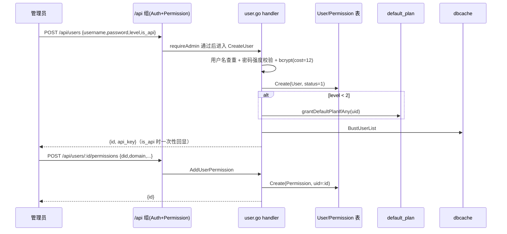
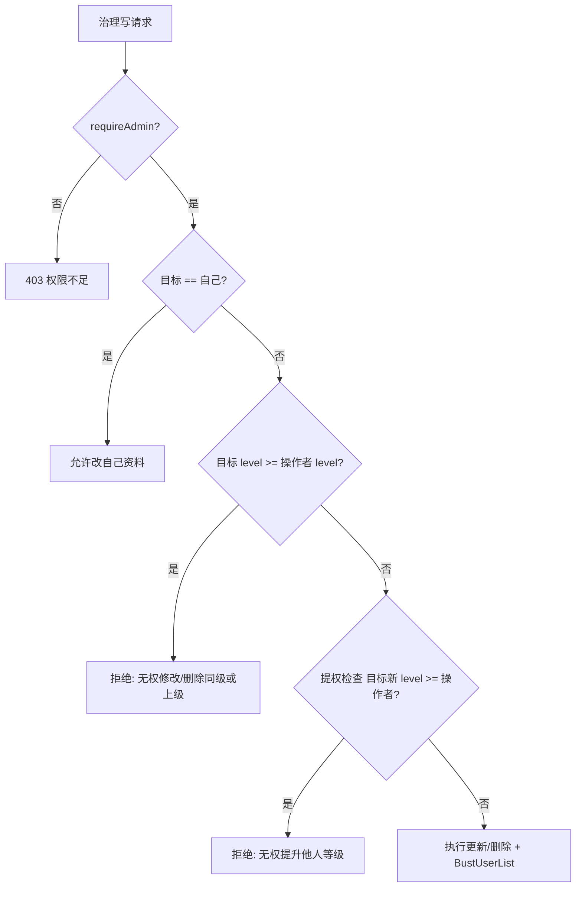
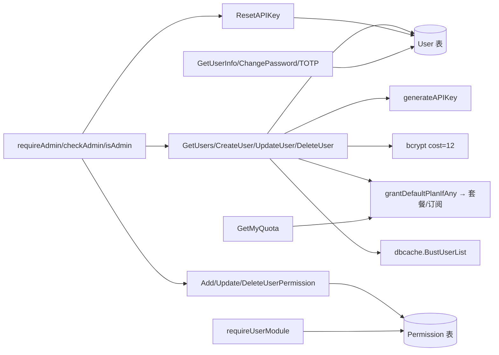

# 用户管理API

<cite>
**本文档引用的文件**
- [router.go](file://main/internal/api/router.go)
- [user.go](file://main/internal/api/handler/user.go)
- [auth.go](file://main/internal/api/handler/auth.go)
- [account.go](file://main/internal/api/handler/account.go)
- [default_plan.go](file://main/internal/api/handler/default_plan.go)
- [plan.go](file://main/internal/api/handler/plan.go)
- [models.go](file://main/internal/models/models.go)
</cite>

## 目录
1. [简介](#简介)
2. [项目结构](#项目结构)
3. [核心组件](#核心组件)
4. [架构总览](#架构总览)
5. [详细组件分析](#详细组件分析)
6. [依赖关系分析](#依赖关系分析)
7. [性能考虑](#性能考虑)
8. [故障排查指南](#故障排查指南)
9. [结论](#结论)
10. [附录](#附录)

## 简介

DNSPlane 的用户管理 API 分为三层：**管理员用户治理**（`/api/users` 族的增删改、域名委派权限、API Key 重置）、**用户自助**（`/api/user/*` 的资料、配额、改密、绑定邮箱、TOTP 二步验证）、**匿名找回**（`/api/auth/forgot-*`、`/api/auth/reset-*`）。

核心事实与命名澄清：

- 管理员用户治理端点全部经 `requireAdmin`（`account.go:43`），即 `level >= 2` 才放行；`GET /api/users` 返回全量列表且**含每个用户的 `api_key` 明文、无分页**，属高敏感端点。
- 自助端点仅需会话（`Auth`），普通用户只能操作自己；不存在越权读取他人 `api_key` 的自助入口。
- 用户「状态」由 `status` 字段承载（1 为启用），「角色」由 `level` 字段承载（0/1 普通、>=2 管理员），二者均在 `POST /api/users/:id` 更新；域名级细粒度授权由 `permissions` 委派表单独管理。
- 新用户若为非管理员（`level < 2`），创建时自动落一条默认套餐订阅（`grantDefaultPlanIfAny`，`default_plan.go:32`），将用户与配额体系关联。

**章节来源**
- [user.go](file://main/internal/api/handler/user.go)
- [account.go](file://main/internal/api/handler/account.go)

## 项目结构

用户域文件横跨 `user.go`（治理）、`auth.go`（自助与找回）、`account.go`（权限门）与 `default_plan.go`（配额关联）。

| 文件 | 相对路径 | 职责 | 关键符号 |
| --- | --- | --- | --- |
| 主路由 | `main/internal/api/router.go` | 挂载 `Auth`+`Permission` 与用户路由 | `auth := api.Group` `:95` |
| 用户治理 handler | `main/internal/api/handler/user.go` | CRUD、委派权限、API Key | `GetUsers` `:55` |
| 自助/找回 handler | `main/internal/api/handler/auth.go` | 资料、改密、TOTP、密码找回 | `GetUserInfo` `:458` |
| 权限门 helper | `main/internal/api/handler/account.go` | 管理员/模块判定 | `requireAdmin` `:43` |
| 默认套餐 | `main/internal/api/handler/default_plan.go` | 新用户配额兜底 | `grantDefaultPlanIfAny` `:32` |
| 配额 handler | `main/internal/api/handler/plan.go` | 我的配额读取 | `GetMyQuota` `:621` |
| 数据模型 | `main/internal/models/models.go` | `User`/`Permission` 表 | `User` `:8` |

**章节来源**
- [router.go](file://main/internal/api/router.go)
- [auth.go](file://main/internal/api/handler/auth.go)
- [default_plan.go](file://main/internal/api/handler/default_plan.go)

## 核心组件

用户域由「治理 handler + 自助 handler + 权限门 + 配额关联」四组协作。

| 组件 | 类型 | 作用 |
| --- | --- | --- |
| `requireAdmin` | 权限门 | 非管理员写「权限不足，仅管理员可操作」 |
| `checkAdmin` / `isAdmin` | 判定 | `level>=2`；兼容 `int`/`float64` |
| `requireUserModule` | 模块门 | 校验 `permissions` 的模块开关（`account.go:67`） |
| `generateAPIKey` | 生成器 | 32 字节 `crypto/rand` → 64 位 hex（`user.go:49`） |
| `grantDefaultPlanIfAny` | 配额关联 | 非管理员新用户落默认套餐 |
| `dbcache.BustUserList` | 缓存失效 | 用户写操作后清理管理端全量列表缓存 |

`level` 语义贯穿全域：`CreateUser`/`UpdateUser` 用同级/上级保护约束互改，`DeleteUser` 禁删同级或上级，`operationLogScope` 类可见性亦以 `isAdmin` 收窄。API Key 同时充当 OpenAPI HMAC-SHA256 的签名密钥，故其明文泄露等同凭据泄露。

**章节来源**
- [account.go](file://main/internal/api/handler/account.go)
- [user.go](file://main/internal/api/handler/user.go)

## 架构总览

管理员创建并授权一个用户的典型时序如下。所有治理写操作都触发 `dbcache.BustUserList`，保证 `GET /api/users` 的缓存列表即时反映变更。



**图表来源**
- [user.go](file://main/internal/api/handler/user.go)
- [default_plan.go](file://main/internal/api/handler/default_plan.go)

### 权限收窄流程

下图概括 `POST /api/users/:id`（更新）与 `POST /api/users/:id/delete`（删除）共享的层级校验：对非本人操作，同级或更高 `level` 的目标一律拒绝，以阻断横向提权与同级互删。



**图表来源**
- [user.go](file://main/internal/api/handler/user.go)

## 详细组件分析

所有端点位于 `/api` 组下，先经 `Auth`（会话鉴权）再经 `Permission`（域名/模块）；治理端点叠加 `requireAdmin`，自助端点仅会话。

### GET /api/users（用户全量列表）

| 项目 | 值 |
| --- | --- |
| Method / Path | `GET /api/users` |
| 认证 | 会话 |
| 权限 | `requireAdmin`（仅管理员） |
| Handler | `main/internal/api/handler/user.go:55`（`GetUsers`） |

无参数。全表 `Select` 11 个公开字段（不含 `password`/`totp_secret`），**不分页**，结果经 `dbcache.KeyUsersAdminFullList` 缓存。响应每行含 `api_key` 明文（`userPublicRow`，`user.go:29`），因此该端点凭据泄露风险最高。

```json
// 请求：GET /api/users
{}
```

```json
// 响应
{
  "code": 0,
  "data": {
    "total": 2,
    "list": [
      {
        "id": 1, "username": "admin", "email": "a@example.com",
        "level": 2, "is_api": true, "api_key": "<64位hex>",
        "status": 1, "permissions": "", "totp_open": false,
        "reg_time": "2026-01-01T00:00:00Z", "last_time": null
      }
    ]
  }
}
```

**章节来源**
- [user.go](file://main/internal/api/handler/user.go#L55)

### POST /api/users（创建用户）

| 项目 | 值 |
| --- | --- |
| Method / Path | `POST /api/users` |
| 认证 | 会话 |
| 权限 | `requireAdmin` |
| Handler | `main/internal/api/handler/user.go:96`（`CreateUser`） |

请求体 `CreateUserRequest`：

| 参数 | 类型 | 必填 | 说明 |
| --- | --- | --- | --- |
| `username` | string | 是 | 唯一，查重 |
| `password` | string | 是 | `min=8` 且过强度校验 |
| `email` | string | 否 | — |
| `level` | int | 否 | 角色等级，默认 0 |
| `is_api` | bool | 否 | 启用则生成 `api_key` |
| `permissions` | string | 否 | 模块开关 JSON |

流程：用户名查重（存在 → `code:-1 用户名已存在`）→ `ValidatePasswordStrength` → bcrypt（cost=12，`auth.go:36`）→ `Status=1` → `is_api` 生成 key → 若 `level<2` 落默认套餐 → `BustUserList`。响应一次性回显 `api_key`。

```json
// 请求体
{ "username": "ops01", "password": "S3cret!pass", "email": "ops@example.com", "level": 0, "is_api": true }
```

```json
// 响应
{ "code": 0, "msg": "创建成功", "data": { "id": 7, "api_key": "<64位hex>" } }
```

**章节来源**
- [user.go](file://main/internal/api/handler/user.go#L96)
- [default_plan.go](file://main/internal/api/handler/default_plan.go#L32)

### POST /api/users/:id（更新用户）

| 项目 | 值 |
| --- | --- |
| Method | `POST /api/users/:id` |
| 认证 | 会话 |
| 权限 | `requireAdmin` + 层级约束 |
| Handler | `main/internal/api/handler/user.go:157`（`UpdateUser`） |

路径参数 `:id`。请求体 `password`(非空才改)、`email`、`level`、`is_api`、`status`、`permissions`。约束：非本人且目标 `level >= 当前` → 拒「无权修改同级或更高权限的用户」；非本人且 `req.level >= 当前` → 拒「无权将他人等级提升至同级或以上」。API Key 联动：`is_api` 且原 key 空 → 生成；`!is_api` → 置空（吊销）。响应回显最新 `api_key`。

```json
// 请求体（吊销 API 访问并禁用账户）
{ "email": "ops@example.com", "level": 0, "is_api": false, "status": 0 }
```

```json
// 响应（api_key 已清空）
{ "code": 0, "msg": "更新成功", "data": { "api_key": "" } }
```

```json
// 越权响应
{ "code": -1, "msg": "无权修改同级或更高权限的用户" }
```

**章节来源**
- [user.go](file://main/internal/api/handler/user.go#L157)

### POST /api/users/:id/delete（删除用户）

| 项目 | 值 |
| --- | --- |
| Method | `POST /api/users/:id/delete` |
| 认证 | 会话 |
| 权限 | `requireAdmin` + 层级约束 |
| Handler | `main/internal/api/handler/user.go:228`（`DeleteUser`） |

禁删自己（`400 不能删除自己`）；非本人且目标 `level >= 当前` → 拒。级联删除仅 `UserOAuth`（释放第三方账号，避免永久占用）与 `Permission`（域名委派），其余业务资产（DNS 账户、证书、监控、订阅）刻意保留。`User` 走软删（`gorm.DeletedAt`），完成后 `BustUserList`。

```json
// 请求：POST /api/users/7/delete
{}
```

```json
// 响应
{ "code": 0, "msg": "删除成功" }
```

**章节来源**
- [user.go](file://main/internal/api/handler/user.go#L228)

### GET /api/users/:id/permissions（域名委派列表）

| 项目 | 值 |
| --- | --- |
| Method | `GET /api/users/:id/permissions` |
| 权限 | `requireAdmin` |
| Handler | `main/internal/api/handler/user.go:268`（`GetUserPermissions`） |

以 `:id` 作为 `uid` 查询 `Permission` 表，返回授权行数组（`models.Permission`，`models.go:25`）。

```json
// 响应
{
  "code": 0,
  "data": [
    { "id": 12, "uid": 7, "did": 3, "domain": "example.com", "sub": "www", "read_only": true, "expire_time": null, "created_at": "2026-10-01T00:00:00Z" }
  ]
}
```

**章节来源**
- [user.go](file://main/internal/api/handler/user.go#L268)
- [models.go](file://main/internal/models/models.go#L25)

### POST /api/users/:id/permissions（新增域名委派）

| 项目 | 值 |
| --- | --- |
| Method | `POST /api/users/:id/permissions` |
| 权限 | `requireAdmin` |
| Handler | `main/internal/api/handler/user.go:281`（`AddUserPermission`） |

请求体：

| 参数 | 类型 | 必填 | 说明 |
| --- | --- | --- | --- |
| `did` | uint | 是 | 域名 ID |
| `domain` | string | 是 | 域名名 |
| `sub` | string | 否 | 子域限制 |
| `read_only` | bool | 否 | 只读授权 |
| `expire_time` | time | 否 | 授权过期（仅约束域名委派，不约束 API Key） |

`uid` 取路径 `:id`。成功后返回新权限行 `id`。

```json
// 请求体
{ "did": 3, "domain": "example.com", "sub": "www", "read_only": true }
```

```json
// 响应
{ "code": 0, "msg": "添加成功", "data": { "id": 12 } }
```

**章节来源**
- [user.go](file://main/internal/api/handler/user.go#L281)

### POST /api/users/:id/permissions/:permId（更新委派）

| 项目 | 值 |
| --- | --- |
| Method | `POST /api/users/:id/permissions/:permId` |
| 权限 | `requireAdmin` |
| Handler | `main/internal/api/handler/user.go:318`（`UpdateUserPermission`） |

以 `id = :permId AND uid = :id` 定位，防跨用户篡改；不存在返回 `404 权限不存在`。请求体仅 `sub`、`read_only`、`expire_time`。

```json
// 请求体
{ "sub": "api", "read_only": false, "expire_time": "2027-01-01T00:00:00Z" }
```

```json
// 响应
{ "code": 0, "msg": "更新成功" }
```

**章节来源**
- [user.go](file://main/internal/api/handler/user.go#L318)

### POST /api/users/:id/permissions/:permId/delete（删除委派）

| 项目 | 值 |
| --- | --- |
| Method | `POST /api/users/:id/permissions/:permId/delete` |
| 权限 | `requireAdmin` |
| Handler | `main/internal/api/handler/user.go:352`（`DeleteUserPermission`） |

`id = :permId AND uid = :id` 删除，`RowsAffected==0` → `404 权限不存在`。

```json
// 请求：POST /api/users/7/permissions/12/delete
{}
```

```json
// 响应
{ "code": 0, "msg": "删除成功" }
```

**章节来源**
- [user.go](file://main/internal/api/handler/user.go#L352)

### POST /api/users/:id/reset-apikey（重置 API Key）

| 项目 | 值 |
| --- | --- |
| Method | `POST /api/users/:id/reset-apikey` |
| 权限 | `requireAdmin` |
| Handler | `main/internal/api/handler/user.go:369`（`ResetAPIKey`） |

目标用户不存在 → `404`；`is_api=false` → `400 用户未启用API访问`。生成新 64 位 hex key 落库并 `BustUserList`，一次性回显。因 `APIKeyAuth` 每请求直查库，重置即时生效。

```json
// 请求：POST /api/users/7/reset-apikey
{}
```

```json
// 响应
{ "code": 0, "msg": "重新生成成功", "data": { "api_key": "<新64位hex>" } }
```

**章节来源**
- [user.go](file://main/internal/api/handler/user.go#L369)

### POST /api/users/:id/send-reset（管理员代发找回密码邮件）

| 项目 | 值 |
| --- | --- |
| Method | `POST /api/users/:id/send-reset` |
| 权限 | `requireAdmin` |
| Handler | `main/internal/api/handler/auth.go:1039`（`AdminSendResetEmail`） |

以 `:id` 定位用户，触发密码找回邮件下发，返回 `msg`。用于管理员协助无法自助的用户。

```json
// 请求：POST /api/users/7/send-reset
{}
```

```json
// 响应
{ "code": 0, "msg": "发送成功" }
```

**章节来源**
- [auth.go](file://main/internal/api/handler/auth.go#L1039)
- [router.go](file://main/internal/api/router.go)

### POST /api/users/:id/reset-totp（管理员重置 TOTP）

| 项目 | 值 |
| --- | --- |
| Method | `POST /api/users/:id/reset-totp` |
| 权限 | `requireAdmin` |
| Handler | `main/internal/api/handler/auth.go:1103`（`AdminResetTOTP`） |

清除目标用户的 TOTP 绑定（`totp_secret`/`totp_open`），用于用户丢失二步验证设备时的接管。返回 `msg`。

```json
// 请求：POST /api/users/7/reset-totp
{}
```

```json
// 响应
{ "code": 0, "msg": "重置成功" }
```

**章节来源**
- [auth.go](file://main/internal/api/handler/auth.go#L1103)

### GET /api/user/info（当前用户资料）

| 项目 | 值 |
| --- | --- |
| Method | `GET /api/user/info` |
| 认证 | 会话 |
| 权限 | 仅本人 |
| Handler | `main/internal/api/handler/auth.go:458`（`GetUserInfo`） |

无参数。返回当前会话用户的公开字段，含本人 `api_key`（`is_api` 时可见）、`level`、`totp_open`、`reg_time`、`last_time` 等。是普通用户唯一能看到自己 `api_key` 的自助入口。

```json
// 响应
{
  "code": 0,
  "data": {
    "id": 7, "username": "ops01", "email": "ops@example.com", "level": 0,
    "is_api": true, "api_key": "<64位hex>", "totp_open": false,
    "reg_time": "2026-10-01T00:00:00Z", "last_time": null
  }
}
```

**章节来源**
- [auth.go](file://main/internal/api/handler/auth.go#L458)

### GET /api/user/quota（我的配额）

| 项目 | 值 |
| --- | --- |
| Method | `GET /api/user/quota` |
| 认证 | 会话 |
| 权限 | 仅本人 |
| Handler | `main/internal/api/handler/plan.go:621`（`GetMyQuota`） |

返回当前用户的配额来源与用量：`source`、`plan_id`、`plan_name`、`quotas`、`used`。管理员（`level>=2`）不受配额约束；普通用户的默认来源为创建时 `grantDefaultPlanIfAny` 落下的套餐。

```json
// 响应
{
  "code": 0,
  "data": {
    "source": "plan", "plan_id": 2, "plan_name": "标准版",
    "quotas": { "domain": 10, "record": 200 }, "used": { "domain": 3, "record": 41 }
  }
}
```

**章节来源**
- [plan.go](file://main/internal/api/handler/plan.go#L621)

### POST /api/user/password（修改密码）

| 项目 | 值 |
| --- | --- |
| Method | `POST /api/user/password` |
| 认证 | 会话 |
| 权限 | 仅本人 |
| Handler | `main/internal/api/handler/auth.go:487`（`ChangePassword`） |

请求体 `old_password`(required)、`new_password`(required,min=8)。校验旧密码、强度校验后 bcrypt 更新，返回 `msg`。

```json
// 请求体
{ "old_password": "S3cret!pass", "new_password": "N3wStr0ng!pw" }
```

```json
// 响应
{ "code": 0, "msg": "修改成功" }
```

**章节来源**
- [auth.go](file://main/internal/api/handler/auth.go#L487)

### POST /api/user/bind-email/send-code 与 /api/user/bind-email（绑定邮箱）

| 项目 | 值 |
| --- | --- |
| Method | `POST /api/user/bind-email/send-code` → `auth.go:1507`；`POST /api/user/bind-email` → `auth.go:1544` |
| 认证 | 会话 |
| 权限 | 仅本人 |

`send-code` 入参 `email`，向目标邮箱下发验证码；`bind-email` 入参 `email`、`code`，校验后落库。两步均返回 `msg`。

```json
// 请求体（send-code）
{ "email": "ops@example.com" }
```

```json
// 请求体（bind-email）
{ "email": "ops@example.com", "code": "123456" }
```

```json
// 响应
{ "code": 0, "msg": "绑定成功" }
```

> 说明：`auth.go:1507`/`:1544` 两个函数体本次未逐行读取，仅由路由挂载（`router.go:109-110`）与既有分析索引确认其归属与入参；如入参字段名与实际不符，请以当前工作区 `auth.go` 对应函数为准。

**章节来源**
- [router.go](file://main/internal/api/router.go)

### TOTP 二步验证（status / enable / verify / disable）

四个自助端点，均仅会话、仅本人：

| Method / Path | Handler | 入参 | 返回 |
| --- | --- | --- | --- |
| `GET /api/user/totp/status` | `GetTOTPStatus` `auth.go:587` | — | `data:totp_open` |
| `POST /api/user/totp/enable` | `EnableTOTP` `auth.go:605` | — | `data:secret,uri` |
| `POST /api/user/totp/verify` | `VerifyAndEnableTOTP` `auth.go:652` | `code` | `msg` |
| `POST /api/user/totp/disable` | `DisableTOTP` `auth.go:688` | `code` | `msg` |

启用为两步：`enable` 生成 `secret` 与 `otpauth://` URI（未生效），`verify` 校验验证码后才置 `totp_open=true`；`disable` 需当前 `code` 二次确认。

```json
// POST /api/user/totp/enable 响应
{ "code": 0, "data": { "secret": "{占位_base32}", "uri": "otpauth://totp/DNSPlane:ops01?secret={占位}&issuer=DNSPlane" } }
```

```json
// POST /api/user/totp/verify 请求体
{ "code": "123456" }
```

```json
// POST /api/user/totp/verify 响应
{ "code": 0, "msg": "验证成功" }
```

**章节来源**
- [auth.go](file://main/internal/api/handler/auth.go#L587)
- [router.go](file://main/internal/api/router.go)

### 匿名找回端点（forgot/reset password 与 totp）

以下端点在 `Auth` 组之外，匿名可达，走验证码流程：

| Method / Path | Handler | 入参 | 说明 |
| --- | --- | --- | --- |
| `POST /api/auth/forgot-password` | `ForgotPassword` `auth.go:840` | 邮箱/验证码 | 下发找回 |
| `POST /api/auth/reset-password` | `ResetPassword` `auth.go:893` | token,新密码 | 重置口令 |
| `POST /api/auth/forgot-totp` | `ForgotTOTP` `auth.go:942` | 邮箱/验证码 | 二步验证找回 |
| `POST /api/auth/reset-totp` | `ResetTOTP` `auth.go:997` | token | 清除 TOTP |

```json
// POST /api/auth/reset-password 请求体
{ "token": "{找回token}", "password": "N3wStr0ng!pw" }
```

```json
// 响应
{ "code": 0, "msg": "重置成功" }
```

**章节来源**
- [auth.go](file://main/internal/api/handler/auth.go#L840)
- [router.go](file://main/internal/api/router.go)

## 依赖关系分析

用户域依赖呈「治理写 User/Permission + 关联 Plan + 失效 Cache；自助读写 auth 侧；权限门横切」的结构。



**图表来源**
- [user.go](file://main/internal/api/handler/user.go)
- [auth.go](file://main/internal/api/handler/auth.go)

关键依赖：

- 治理端点全部依赖 `requireAdmin`，删除/更新额外依赖目标与操作者的 `level` 比较。
- `CreateUser` 与配额体系耦合：`level<2` 触发 `grantDefaultPlanIfAny`，使新用户即刻具备可用配额来源。
- API Key 生命周期横跨创建（回显）、更新（`is_api` 开关联动）、重置（`ResetAPIKey`）、关闭（置空吊销），且 `GET /api/users` 会一次性暴露全部明文。

**章节来源**
- [default_plan.go](file://main/internal/api/handler/default_plan.go#L32)
- [account.go](file://main/internal/api/handler/account.go#L43)

## 性能考虑

基于已验证实现：

- **全表无分页风险**：`GET /api/users` 不分页且带 `api_key` 明文，用户规模增长时响应体线性膨胀，应限制调用频率并考虑按需字段裁剪（现状已排除 `password`/`totp_secret`）。
- **管理端列表缓存**：`GetUsers` 走 `dbcache.KeyUsersAdminFullList`，所有治理写操作必须以 `BustUserList` 失效，否则返回陈旧列表。
- **bcrypt 成本**：`bcryptCost=12`（`auth.go:36`），单次创建/改密的 CPU 开销固定，批量建号时应避免并发风暴。
- **软删成本**：`User` 软删保留历史行，长期会累积 `deleted_at` 记录，需规划归档。
- **级联范围克制**：删除用户仅级联 `UserOAuth`+`Permission`，业务资产保留，避免误删可接管资产，但也意味着删号后需单独回收其残留配额与订阅。

**章节来源**
- [user.go](file://main/internal/api/handler/user.go#L55)
- [auth.go](file://main/internal/api/handler/auth.go#L36)

## 故障排查指南

| 症状 | 可能原因 | 处置 |
| --- | --- | --- |
| 治理端点全返回权限不足 | `level` 非 int/float64 或 < 2 | 校验 `checkAdmin` 兼容分支与登录态 `level` |
| 无法修改某管理员 | 同级/上级保护 | 由更高 `level` 管理员操作 |
| 删除自己失败 | `DeleteUser` 禁删本人 | 用其他管理员账号 |
| `reset-apikey` 返回未启用 | `is_api=false` | 先更新用户开启 API 访问 |
| `api_key` 变更后旧 key 仍可用 | 客户端缓存/未即时查库 | `APIKeyAuth` 每请求直查库，重置即时生效，清客户端凭据 |
| `GET /api/users` 数据不刷新 | 管理端列表缓存未失效 | 确认写操作触发 `BustUserList` |
| TOTP 绑定后仍提示未开启 | 只 `enable` 未 `verify` | 完成 `verify` 才置 `totp_open` |
| 新用户无配额来源 | 默认套餐缺失 | 检查 `grantDefaultPlanIfAny` 是否落订阅 |

**章节来源**
- [user.go](file://main/internal/api/handler/user.go#L228)
- [account.go](file://main/internal/api/handler/account.go#L24)

## 结论

用户管理 API 以 `level`（角色）+ `status`（状态）+ `permissions`（域名委派）三要素建模：管理员通过 `/api/users` 族完成 CRUD、层级受控的更新与删除、委派授权与 API Key 全生命周期管理；普通用户通过 `/api/user/*` 自助维护资料、密码、邮箱、TOTP 与配额；匿名找回走 `/api/auth/*`。安全上以「治理端点 requireAdmin + 同级/上级保护 + 非本人禁止提权」为骨架，并将 API Key 明文暴露面严格限制在 4 个出口。集成时最需注意：`GET /api/users` 的高敏感与无分页特性，以及创建非管理员用户与默认套餐的隐式耦合。

**章节来源**
- [本节为通用指导，无需特定文件来源]

## 附录

### 端点速查

| Method / Path | Handler | 权限 | 返回要点 |
| --- | --- | --- | --- |
| `GET /api/users` | `GetUsers` `user.go:55` | admin | `total,list`(含明文 key) |
| `POST /api/users` | `CreateUser` `user.go:96` | admin | `id,api_key` |
| `POST /api/users/:id` | `UpdateUser` `user.go:157` | admin+层级 | `api_key` |
| `POST /api/users/:id/delete` | `DeleteUser` `user.go:228` | admin+层级 | `msg` |
| `GET /api/users/:id/permissions` | `GetUserPermissions` `user.go:268` | admin | `[]Permission` |
| `POST /api/users/:id/permissions` | `AddUserPermission` `user.go:281` | admin | `id` |
| `POST /api/users/:id/permissions/:permId` | `UpdateUserPermission` `user.go:318` | admin | `msg` |
| `POST /api/users/:id/permissions/:permId/delete` | `DeleteUserPermission` `user.go:352` | admin | `msg` |
| `POST /api/users/:id/reset-apikey` | `ResetAPIKey` `user.go:369` | admin | `api_key` |
| `POST /api/users/:id/send-reset` | `AdminSendResetEmail` `auth.go:1039` | admin | `msg` |
| `POST /api/users/:id/reset-totp` | `AdminResetTOTP` `auth.go:1103` | admin | `msg` |
| `GET /api/user/info` | `GetUserInfo` `auth.go:458` | 本人 | 资料+自身 key |
| `GET /api/user/quota` | `GetMyQuota` `plan.go:621` | 本人 | `quotas,used` |
| `POST /api/user/password` | `ChangePassword` `auth.go:487` | 本人 | `msg` |
| `GET/POST /api/user/totp/*` | `auth.go:587/605/652/688` | 本人 | status/secret/msg |
| `POST /api/auth/forgot|reset-password` | `auth.go:840/893` | 匿名 | `msg` |
| `POST /api/auth/forgot|reset-totp` | `auth.go:942/997` | 匿名 | `msg` |

### 字段速查（models.User）

| 字段 | 类型 | 说明 |
| --- | --- | --- |
| `level` | int | 角色：0/1 普通，>=2 管理员 |
| `is_api` | bool | 是否启用 API Key 访问 |
| `api_key` | string(64) | HMAC 签名密钥，明文出口受限 |
| `status` | int | 账户状态，1 启用 |
| `permissions` | text | 模块开关 JSON（domain/cert/deploy/monitor） |
| `totp_open` | bool | 二步验证是否生效 |
| `totp_secret` | string | 密钥，序列化不外泄（`json:"-"`） |

**章节来源**
- [user.go](file://main/internal/api/handler/user.go)
- [models.go](file://main/internal/models/models.go#L8)
