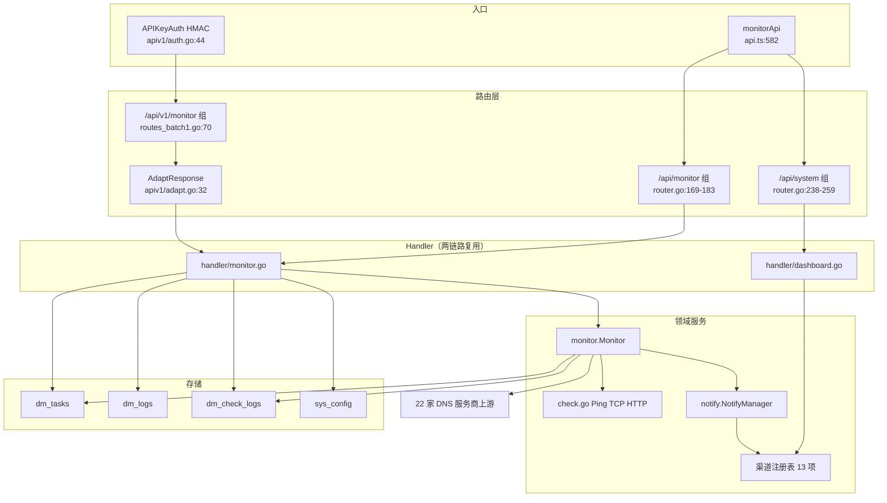
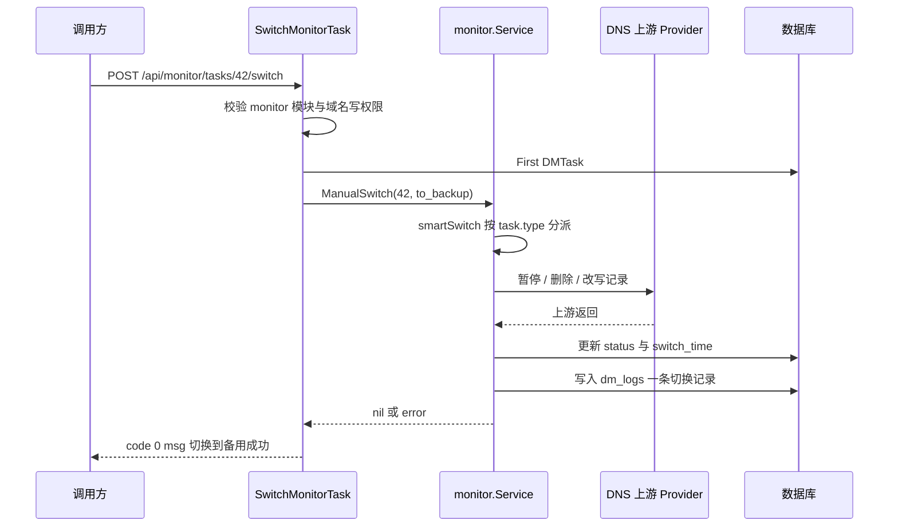
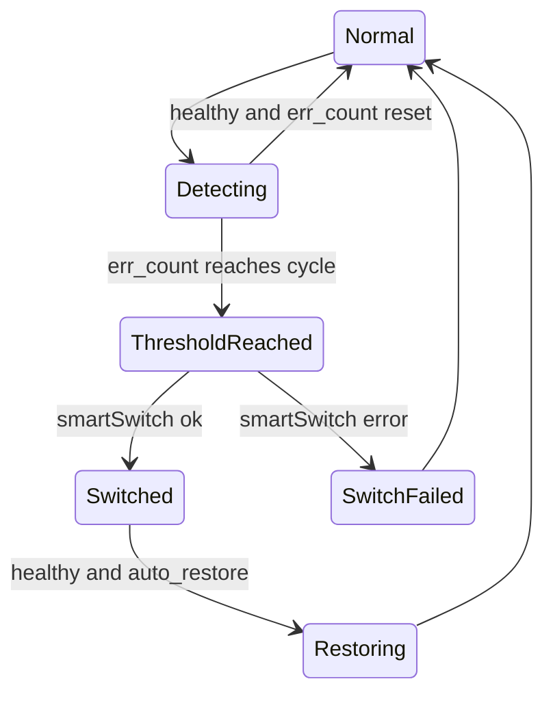
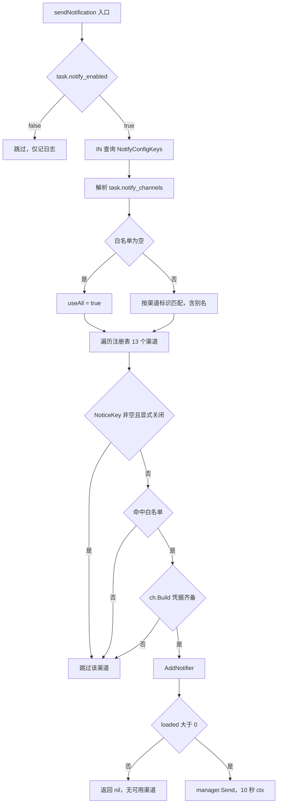

# 监控告警API

<cite>
**本文档引用的文件**
- [router.go](file://main/internal/api/router.go)
- [monitor.go](file://main/internal/api/handler/monitor.go)
- [dashboard.go](file://main/internal/api/handler/dashboard.go)
- [quota.go](file://main/internal/api/handler/quota.go)
- [user.go](file://main/internal/api/handler/user.go)
- [sign.go](file://main/internal/api/middleware/sign.go)
- [permission.go](file://main/internal/api/middleware/permission.go)
- [router.go (apiv1)](file://main/internal/apiv1/router.go)
- [routes_batch1.go](file://main/internal/apiv1/routes_batch1.go)
- [auth.go](file://main/internal/apiv1/auth.go)
- [errors.go](file://main/internal/apiv1/errors.go)
- [response.go](file://main/internal/apiv1/response.go)
- [adapt.go](file://main/internal/apiv1/adapt.go)
- [domain.go](file://main/internal/apiv1/domain.go)
- [models.go](file://main/internal/models/models.go)
- [hooks.go](file://main/internal/models/hooks.go)
- [monitor.go (service)](file://main/internal/monitor/monitor.go)
- [check.go](file://main/internal/monitor/check.go)
- [ssrf.go](file://main/internal/monitor/ssrf.go)
- [notify.go](file://main/internal/notify/notify.go)
- [channel.go](file://main/internal/notify/channel.go)
- [channel_registry.go](file://main/internal/notify/channel_registry.go)
- [channel_adapters.go](file://main/internal/notify/channel_adapters.go)
- [api.ts](file://web/lib/api.ts)
- [main.go](file://main/main.go)
</cite>

## 目录

1. [简介](#简介)
2. [项目结构](#项目结构)
3. [核心组件](#核心组件)
4. [架构总览](#架构总览)
5. [详细组件分析](#详细组件分析)
6. [依赖关系分析](#依赖关系分析)
7. [性能考虑](#性能考虑)
8. [故障排查指南](#故障排查指南)
9. [结论](#结论)
10. [附录](#附录)

## 简介

本文档给出 DNSPlane 容灾监控与告警通知的完整接口契约，覆盖控制台链路 `/api`（会话 + CSRF）与对外链路 `/api/v1`（API Key + HMAC 签名）。15 条监控接口在两条链路上各注册一次，另有 11 条渠道自检接口与 2 条通知配置读写接口，合计 43 条。

接口按用途分四组：任务生命周期、探测与切换、聚合视图、告警投递。三条口径必须先明确，否则会按错误的路径去集成：

1. **不存在 `/api/monitor/results`**。探测结果落库表是 `dm_check_logs`，对外由 `.../history`（探测点）与 `.../uptime`（统计）暴露，切换记录由 `.../logs` 暴露，实时态由 `.../resolve-status` 暴露。
2. **不存在 `/api/notify/channels` 与 `/api/notify/test`**。渠道清单只在进程内由 `notify.Channels()` 注册表提供，无 HTTP 端点；配置读写走 `/api/system/config`，测试发送按渠道拆成 11 条 `/api/system/<channel>/test`。全仓库检索 `/api/notify` 路由注册为空。
3. **两条链路响应信封不同**。控制台返回 `{code, msg, data}` 且 `code` 只有 `0` 与 `-1`（`sign.go:183-199`）；对外链路返回 `{code, request_id, data}`，`code` 是分段稳定码（`response.go:26-64`）。

**章节来源**
- [router.go](file://main/internal/api/router.go)
- [sign.go](file://main/internal/api/middleware/sign.go)
- [response.go](file://main/internal/apiv1/response.go)

## 项目结构

| 路径 | 角色 | 关键位置 |
|------|------|----------|
| `main/internal/api/router.go` | 控制台路由 | `monitor` 组 `:169-183`、`system/*/test` `:249-259`、`system/config` `:238-239` |
| `main/internal/apiv1/routes_batch1.go` | 对外路由 | `registerMonitorRoutes` `:70`，15 条 `:73-87` |
| `main/internal/api/handler/monitor.go` | 监控 HTTP 处理器 | 15 个 handler，`:124` 至 `:1242` |
| `main/internal/api/handler/dashboard.go` | 渠道自检处理器 | `buildChannelForTest` `:56`、`testChannelNotification` `:94`、11 个导出 handler `:205-222` `:409-441` |
| `main/internal/monitor/monitor.go` | 探测与切换守护服务 | `Monitor` `:56`、`dispatchTasks` `:144`、`processTaskAsync` `:183`、`smartSwitch` `:411`、`sendNotification` `:767` |
| `main/internal/notify/` | 渠道注册表与发信 | `Channel` 接口 `channel_registry.go:20`、13 个适配器 `channel_adapters.go:19-328` |

前端消费集中在一个 API 客户端对象与四个类型定义：`monitorApi` 15 个方法（`api.ts:582-606`）、11 个渠道自检调用（`:739-749`）、`MonitorTask`（`:1154-1205`）、`MonitorCheckPoint`（`:1141-1152`）、`MonitorLog` 与 `MonitorOverview`（`:1207-1228`）。监控守护协程在进程启动时创建并常驻（`main.go:105-107`），HTTP 层只做参数校验、权限判定与数据读取，探测调度、主备切换与告警投递全部由常驻协程驱动，两者通过数据库表与内存 `sync.Map` 交互。

**章节来源**
- [router.go](file://main/internal/api/router.go)
- [routes_batch1.go](file://main/internal/apiv1/routes_batch1.go)
- [monitor.go](file://main/internal/api/handler/monitor.go)
- [dashboard.go](file://main/internal/api/handler/dashboard.go)
- [api.ts](file://web/lib/api.ts)
- [main.go](file://main/main.go)

## 核心组件

### 控制台监控接口组（15 条）

全部挂在 `auth` 分组下，继承 `CORS → RequestTrace → Recovery → CSRF → AuditLog → Auth → Permission`（`router.go:44-53` `:96` `:104`）。

| # | 方法与路径 | Handler | 定义行 | 权限层 |
|---|------------|---------|--------|--------|
| 1 | `GET /api/monitor/tasks` | `GetMonitorTasks` | `:124` | monitor 模块 |
| 2 | `POST /api/monitor/tasks` | `CreateMonitorTask` | `:222` | monitor + 写 + 配额 |
| 3 | `POST /api/monitor/tasks/:id/delete` | `DeleteMonitorTask` | `:402` | monitor + 写 |
| 4 | `POST /api/monitor/tasks/:id` | `UpdateMonitorTask` | `:313` | monitor + 写 |
| 5 | `POST /api/monitor/tasks/:id/toggle` | `ToggleMonitorTask` | `:440` | monitor + 写 |
| 6 | `POST /api/monitor/tasks/:id/switch` | `SwitchMonitorTask` | `:477` | monitor + 写 |
| 7 | `GET /api/monitor/tasks/:id/logs` | `GetMonitorLogs` | `:536` | monitor + 任务可见 |
| 8 | `GET /api/monitor/tasks/:id/history` | `GetMonitorHistory` | `:811` | monitor + 任务可见 |
| 9 | `GET /api/monitor/tasks/:id/uptime` | `GetMonitorUptime` | `:858` | monitor + 任务可见 |
| 10 | `GET /api/monitor/tasks/:id/resolve-status` | `GetResolveStatus` | `:1242` | monitor + 任务可见 |
| 11 | `GET /api/monitor/overview` | `GetMonitorOverview` | `:577` | monitor 模块 |
| 12 | `POST /api/monitor/tasks/batch` | `BatchCreateMonitorTasks` | `:687` | monitor + 写 |
| 13 | `POST /api/monitor/tasks/auto-create` | `AutoCreateMonitorTask` | `:1043` | monitor + 写 |
| 14 | `POST /api/monitor/lookup` | `LookupRecord` | `:923` | monitor + 域名 + 子域 |
| 15 | `GET /api/monitor/status` | `GetMonitorStatus` | `:791` | monitor 模块 |

**章节来源**
- [router.go](file://main/internal/api/router.go)
- [monitor.go](file://main/internal/api/handler/monitor.go)

### 渠道自检与通知配置接口组（11 + 2 条）

每条自检接口对应一个 `notify.NotifyType`，实现体只有两行：调用统一的 `testChannelNotification(c, <类型>)`。

| # | 路径 | Handler | 渠道标识 | 适配器位置 |
|---|------|---------|----------|------------|
| 16 | `POST /api/system/mail/test` | `TestMailNotification` `:205` | `email` | `channel_adapters.go:19-34` |
| 17 | `POST /api/system/telegram/test` | `TestTelegramNotification` `:210` | `telegram` | `:39-60` |
| 18 | `POST /api/system/webhook/test` | `TestWebhookNotification` `:215` | `webhook` | `:65-90` |
| 19 | `POST /api/system/custom-webhook/test` | `TestCustomWebhookNotification` `:220` | `custom_webhook` | `:95-123` |
| 20 | `POST /api/system/discord/test` | `TestDiscordNotification` `:409` | `discord` | `:128-140` |
| 21 | `POST /api/system/bark/test` | `TestBarkNotification` `:414` | `bark` | `:145-168` |
| 22 | `POST /api/system/wechat/test` | `TestWechatNotification` `:419` | `wechat` | `:173-185` |
| 23 | `POST /api/system/dingtalk/test` | `TestDingtalkNotification` `:424` | `dingtalk` | `:190-205` |
| 24 | `POST /api/system/feishu/test` | `TestFeishuNotification` `:429` | `feishu` | `:210-225` |
| 25 | `POST /api/system/wxwork-app/test` | `TestWxWorkAppNotification` `:434` | `wxwork_app` | `:230-250` |
| 26 | `POST /api/system/wxtpl/test` | `TestWxTplNotification` `:439` | `wxtpl` | `:255-277` |

注册表共 13 个渠道（`channel_adapters.go:330-344`），未开放自检端点的 `wxpusher` 与 `qqbot` 走各自凭据判定，后者收发由 `POST /api/qqbot/webhook`（`router.go:342`）承担。

| # | 路径 | Handler | 鉴权 | 说明 |
|---|------|---------|------|------|
| 27 | `GET /api/system/config` | `GetSystemConfig`（`user.go:625`） | `requireAdmin` `:628` | 返回全部 `sys_config` 扁平键值映射，直接 `c.JSON` `:639` |
| 28 | `POST /api/system/config` | `UpdateSystemConfig`（`user.go:673`） | `requireAdmin` `:676` | 逐键 upsert `:712`，仅失效本次改动键 `:715` |

这两条是渠道配置的**唯一**写入入口，`mail_*`、`tgbot_*`、`webhook_*`、`discord_webhook`、`bark_*`、`wechat_*`、`dingtalk_*`、`feishu_*`、`wxwork_*`、`wxtpl_*`、`wechat_app*`、`qqbot_*` 以及六个 `notice_*` 开关全部经由它们落库。

**章节来源**
- [router.go](file://main/internal/api/router.go)
- [dashboard.go](file://main/internal/api/handler/dashboard.go)
- [user.go](file://main/internal/api/handler/user.go)
- [channel_adapters.go](file://main/internal/notify/channel_adapters.go)

### 对外链路监控接口组（15 条）

全部为 `POST`，全部经 `requireModuleMW("monitor")`（`domain.go:75`），handler 与控制台**复用同一批函数**，参数与返回结构一致，差异只在信封与鉴权。对外链路没有注册任何 `system/*/test`。

| # | 路径 | 复用 Handler | 注册行 | # | 路径 | 复用 Handler | 注册行 |
|---|------|--------------|--------|---|------|--------------|--------|
| 29 | `/api/v1/monitor/tasks/list` | `GetMonitorTasks` | `:73` | 37 | `/api/v1/monitor/tasks/uptime` | `GetMonitorUptime` | `:81` |
| 30 | `/api/v1/monitor/tasks/create` | `CreateMonitorTask` | `:74` | 38 | `/api/v1/monitor/tasks/resolve-status` | `GetResolveStatus` | `:82` |
| 31 | `/api/v1/monitor/tasks/update` | `UpdateMonitorTask` | `:75` | 39 | `/api/v1/monitor/tasks/batch` | `BatchCreateMonitorTasks` | `:83` |
| 32 | `/api/v1/monitor/tasks/delete` | `DeleteMonitorTask` | `:76` | 40 | `/api/v1/monitor/tasks/auto-create` | `AutoCreateMonitorTask` | `:84` |
| 33 | `/api/v1/monitor/tasks/toggle` | `ToggleMonitorTask` | `:77` | 41 | `/api/v1/monitor/overview` | `GetMonitorOverview` | `:85` |
| 34 | `/api/v1/monitor/tasks/switch` | `SwitchMonitorTask` | `:78` | 42 | `/api/v1/monitor/status` | `GetMonitorStatus` | `:86` |
| 35 | `/api/v1/monitor/tasks/logs` | `GetMonitorLogs` | `:79` | 43 | `/api/v1/monitor/lookup` | `LookupRecord` | `:87` |
| 36 | `/api/v1/monitor/tasks/history` | `GetMonitorHistory` | `:80` | — | — | — | — |

**章节来源**
- [routes_batch1.go](file://main/internal/apiv1/routes_batch1.go)
- [domain.go](file://main/internal/apiv1/domain.go)

## 架构总览



**图表来源**
- [router.go](file://main/internal/api/router.go)
- [routes_batch1.go](file://main/internal/apiv1/routes_batch1.go)
- [auth.go](file://main/internal/apiv1/auth.go)
- [adapt.go](file://main/internal/apiv1/adapt.go)
- [monitor.go (service)](file://main/internal/monitor/monitor.go)
- [channel_adapters.go](file://main/internal/notify/channel_adapters.go)

## 详细组件分析

### 任务列表与任务生命周期：查询、创建、更新、启停、删除

参数经 `BindDecryptedData` 绑定（`sign.go:104`）：GET 且无加密载荷时读 Query，其余读 JSON body。

| 参数 | 类型 | 默认 | 约束 |
|------|------|------|------|
| `page` | int | `1` | `<= 0` 归一为 1（`monitor.go:136`） |
| `page_size` | int | `200` | `<= 0` 归一 200，`> 500` 收敛 500（`:139-144`） |
| `keyword` | string | 空 | 命中 `domains.name`、`dm_tasks.rr`、`dm_tasks.main_value` 之一（`:117-120`） |

非管理员查询追加 `dm_tasks.did IN (子查询)`，子查询同时覆盖自有账户域名与 `permissions` 表未过期委派域名（`userAccessibleDomainIDs` `:30-42`）。`total` 与列表并发发出（`:152-166`）。

```json
{ "code": 0, "data": { "total": 137, "list": [{
  "id": 42, "did": 7, "rr": "api", "record_id": "rec-{占位}", "record_type": "A",
  "type": 2, "main_value": "203.0.113.10", "backup_values": "203.0.113.20,203.0.113.21",
  "backup_type": "ip", "check_type": 2, "check_url": "https://api.example.com/healthz",
  "frequency": 60, "cycle": 3, "timeout": 5, "status": 0, "main_health": true,
  "err_count": 0, "active": true, "notify_enabled": true,
  "notify_channels": "[\"email\",\"telegram\"]", "auto_restore": true, "domain": "example.com" }] } }
```

`proxy_password` 不会出现在响应中：`DMTask.ProxyPassword` 的 JSON 标签是 `-`（`models.go:171`），落库前 `BeforeSave` 加密、读取后 `AfterFind` 解密（`hooks.go:54-55`）。

`POST /api/monitor/tasks` 的必填字段由 `binding:"required"` 声明（`CreateMonitorTaskRequest` `:171-196`），共 5 个：`domain_id`、`rr`、`record_id`、`main_value`、`frequency`。写入前三道闸门：`requireMonitorWrite`（`:60`，模块 → 域名 → `perm_read_only` → 子域）、`CheckQuota(c, "monitors")`（`:234`，已用数按 `dm_tasks` 关联账户统计，`quota.go:288-292`，上限取套餐 `max_monitors`，`quota.go:34` `:248`）、零值兜底 `cycle=3 / timeout=2`（`:238-243`）。创建使用 `Select("*").Create`（`:275`），让 `check_type=0`、`type=0` 这类合法零值真正写入。

`POST /api/monitor/tasks/:id`（`UpdateMonitorTask` `:313`）的更新语义分两类，这是最易踩坑之处：

| 字段类别 | 行为 | 覆盖范围 |
|----------|------|----------|
| 防零值覆盖 | 仅有效值才写 | `domain_id`（需 `>0`）、`rr`、`record_id`、`main_value`（`:356-367`） |
| 始终更新 | 零值视为有效意图 | `type`、`backup_value`、`backup_values`、`check_type`、`check_url`、`tcp_port`、`expect_status`、`expect_keyword`、`max_redirects`、`proxy_*`、`frequency`、`cycle`、`timeout`、`use_proxy`、`cdn`、`auto_restore`、`notify_enabled`、`remark`（`:370-391`） |

即**更新是全量覆盖语义**：只改 `remark` 而不上送其余字段，会把 `frequency`、`cycle`、`timeout` 及全部代理字段清零。`backup_value` 同时写入 `backup_value` 与 `backup_values` 两列（`:371-372`）。改 `domain_id` 或 `rr` 时对新目标重新走一遍 `requireMonitorWrite`（`:347-351`），防止迁移到无权限域名。

`toggle` 只 `Update("active", ...)`（`:467`）。`active` 是 `idx_dm_tasks_active_next` 索引首列（`models.go:162`），守护协程按 `active = true AND check_next_time <= now` 扫描（`monitor.go:150`），停用即脱离调度。`delete` 级联删除该任务全部 `dm_logs`（`:429-430`），但**不删** `dm_check_logs`——历史表在独立库 `LogDB`，由数据库维护任务清理。两者只返回消息（`{"code":0,"msg":"操作成功"}` / `"删除成功"`），对外链路把 `msg` 映射到 `message`（`response.go:37`）。

**章节来源**
- [monitor.go](file://main/internal/api/handler/monitor.go)
- [sign.go](file://main/internal/api/middleware/sign.go)
- [models.go](file://main/internal/models/models.go)
- [hooks.go](file://main/internal/models/hooks.go)
- [quota.go](file://main/internal/api/handler/quota.go)
- [monitor.go (service)](file://main/internal/monitor/monitor.go)
- [response.go](file://main/internal/apiv1/response.go)

### 手动主备切换 `POST /api/monitor/tasks/:id/switch`

`to_backup` 声明为 `*bool`（`:474`），用指针区分"未传"与"传了 false"；未传时按当前状态定向，`loaded.Status == 0` 判为切到备用（`:510-515`）。



**图表来源**
- [monitor.go](file://main/internal/api/handler/monitor.go)
- [monitor.go (service)](file://main/internal/monitor/monitor.go)

`smartSwitch` 按 `task.type` 分派（`:445-474`）：

| `type` | 切到备用 | 恢复主源 |
|--------|----------|----------|
| 0 | `disableRecord`：平台支持则暂停，否则删除（`:480-`） | `enableRecord` `:513` |
| 1 | 先取记录详情存入 `record_info` 快照再 `DeleteDomainRecord`（`:452-467`） | `recreateRecord` `:521` |
| 2 | `switchToBackup` `:556` | `switchToMain` `:664` |

三个失败点返回不同错误串：`monitor.Service` 为 nil 直接返回"监控服务未启动"（`handler :495-498`）；任务不存在返回"任务不存在"；上游写入失败把错误拼进"切换失败: "前缀（`:517-520`）。`CreateMonitorTaskRequest` 注释列了 4 种类型（`0:暂停/恢复 1:删除/恢复 2:切换备用 3:条件开启`，`:175`），但 `smartSwitch` 只处理 0/1/2，`type=3` 落到 `unknown task type: 3`。

**章节来源**
- [monitor.go](file://main/internal/api/handler/monitor.go)
- [monitor.go (service)](file://main/internal/monitor/monitor.go)

### 探测历史、可用性与实时态、全站概览

| 接口 | 时间窗 | 上限 | 数据源 |
|------|--------|------|--------|
| `GET .../history` | `period` ∈ `1h`/`7d`/`30d`，其余一律按 24h（`:839-848`） | `maxMonitorHistoryPoints = 4000`（`:27`） | `LogDB.dm_check_logs` |
| `GET .../uptime` | 固定 24h / 7d / 30d 三窗口 | 三组聚合值 | 同上 |
| `GET .../logs` | 无窗口 | `page_size` 默认 20，**无上限收敛**（`:563-565`） | `dm_logs` |

`history` 先按 `created_at DESC` 取最近 4000 条再 `slices.Reverse`（`:851-853`），返回时间正序且可能被截断的序列；`LogDB` 为 nil 时返回空数组而非报错（`:833-836`）。`uptime` 每窗口 3 条查询共 9 条（`:897-910`）：

```json
{ "code": 0, "data": {
  "24h": { "total": 1440, "success": 1436, "uptime": 99.72, "avg_duration": 42.18 },
  "7d":  { "total": 10076, "success": 9988, "uptime": 99.13, "avg_duration": 44.05 },
  "30d": { "total": 43198, "success": 42760, "uptime": 99.0, "avg_duration": 43.72 } } }
```

两值均保留两位小数（`:914-915`）。`avg_duration` 只对 `success = true` 样本求平均，故障期间超时不计入，因此反映"健康时的响应耗时"而非全量耗时。

`resolve-status` 读内存态而非数据库：`monitor.Service.GetResolveStatus(taskID)` 从 `sync.Map` 取最近一次探测的 `ResolveStatus`（`:757`，结构体 `:32-39`），进程重启后为空，handler 返回空数组（`:1263-1266`）。

`GET /api/monitor/overview` 单请求触发 9 路并发查询（`wg.Add(9)`，`:605-643`）：

| 字段 | 计算方式 |
|------|----------|
| `task_count` | 可见范围 `dm_tasks` 全量 |
| `active_count` | `active = true` |
| `healthy_count` | `active = true AND status = 0` |
| `faulty_count` | `status = 1`（**未加 active 条件**，停用但停在备用态者仍计入） |
| `switch_count` | 近 24h `dm_logs` 条数 |
| `fail_count` | 近 24h `dm_logs` 中 `action = 1` 条数 |
| `avg_uptime` | 近 24h `dm_check_logs` 的 `success/total × 100`，`Round(×10000)/100`（`:645-648`） |
| `run_count` / `run_time` | `sys_config` 对应键（`:641` `:650-662`） |
| `run_state` | `run_time` 距今 15 秒内为 `1`（`:664-671`） |

窗口起点是 `time.Now().Add(-24 * time.Hour)`（`:582`），变量名 `yesterday` 易误读为自然日。权限口径是 monitor 模块（`:578`），无管理员判定；统计范围随 `isAdmin` 收窄（`:585-596`），非管理员看到自己可见域名的聚合值而非全站值。

`GET /api/monitor/status` 只读 `run_time` 一个键（`:798`），判据"距今 10 秒内"（`:803`）。而写入方 `updateRunStatus` 由 60 秒 ticker 驱动（`monitor.go:114` `:130-132`），即使协程健康，`run_time` 也只每分钟刷新，本接口在多数时间窗内返回 `running = false`；概览的同一判据用 15 秒（`handler :667`），同样小于刷新周期。

```json
{ "code": 0, "data": { "running": false, "run_time": "2026-10-11 09:41:03" } }
```

`api.ts:605` 的 `getStatus` 标注返回 `{ running, last_run }`，后端实际键是 `run_time`——读取 `last_run` 得到 `undefined`。

**章节来源**
- [monitor.go](file://main/internal/api/handler/monitor.go)
- [monitor.go (service)](file://main/internal/monitor/monitor.go)
- [api.ts](file://web/lib/api.ts)

### 批量创建、智能创建与记录反查

`POST /api/monitor/tasks/batch`（`BatchCreateMonitorTasks` `:687`）入参是**单个** `BatchMonitorRequest`（`:198-220`，必填 `domain_id`、`rr`、`frequency`），不是任务数组。语义为"给定子域，为该子域下云端全部 A/AAAA 记录各建一个任务"：权限校验后**不做配额判定**（与 `create` 不同）；调 `GetSubDomainRecords(ctx, rr, 1, 100, "", "")` 只取前 100 条（`:718`）；跳过非 A/AAAA（`:734`）；按 `record_id` 查重计入 `existed`（`:739-742`）；把 `type/line/ttl/mx/remark` 序列化为 `record_info` 快照（`:744-751`）。返回 `{"created":N,"existed":M}`。前端 `batchCreate` 入参类型 `{ tasks: Partial<MonitorTask>[] }`（`api.ts:603`）与契约不符。

`POST /api/monitor/tasks/auto-create`（`AutoCreateMonitorTask` `:1043`）是记录选择式创建，兼容性最强：

| 输入形态 | 生效优先级 |
|----------|-----------|
| `records[]` 数组 | 优先（`:1127-1135`） |
| `record_id`/`record_type`/`record_value`/`record_line` 单记录字段 | `records` 为空时回落（`:1136-1142`） |
| `strategy` | 大于 0 时覆盖 `type`（`:1100-1103`） |
| `backup_values` | 非空时覆盖 `backup_value`（`:1106-1109`） |

`records[]` 元素字段名支持三套写法，由 `AutoCreateRecord` 多字段并列 + getter 归一（`:987-1040`）：小写 `id/type/value/line/name`、PascalCase `RecordId/Type/Value/Line/LineName`、snake_case `record_id`。默认值与 `create` 不同：`frequency` 60、`cycle` 3、`timeout` 5（`:1089-1097`）。`notify_channels` 为字符串数组，`json.Marshal` 后存入 `dm_tasks.notify_channels`（`:1112-1116`）。`backup_type` 由 `IsIPValue` 判定：全部条目可被 `net.ParseIP` 解析则 `ip`，否则 `cname`（`:1166-1169`、`:1218-1239`）。写入用 `database.DB`（非 `WithContext(c)`），`record_id` 为空的元素被静默跳过（`:1154-1157`），返回 `{"ids":[...],"created":N}` 而不返回跳过数。

`POST /api/monitor/lookup`（`LookupRecord` `:923`）是**只读语义的 POST**，入参 `domain_id` + `sub_domain`，返回云端实时记录。校验顺序值得注意：先查域名存在（`:936`），**再**判模块权限（`:941`），再判域名与子域权限（`:945-952`），因此对不存在的域名，无权限方也能得到"域名不存在"。分页固定 `1, 100`（`:969`）。

```json
{ "code": 0, "data": { "domain": "example.com", "account_type": "alidns",
  "records": [{ "id": "rec-{占位}", "name": "api", "type": "A", "value": "203.0.113.10", "line": "default", "ttl": 600 }] } }
```

**章节来源**
- [monitor.go](file://main/internal/api/handler/monitor.go)
- [api.ts](file://web/lib/api.ts)

### 探测调度与状态机



**图表来源**
- [monitor.go (service)](file://main/internal/monitor/monitor.go)

| 常量 | 值 | 位置 | 作用 |
|------|-----|------|------|
| ticker | 1 秒 | `monitor.go:110` | 扫描到期任务 |
| statusTicker | 60 秒 | `:114` | 刷新 `run_time` / `run_count` |
| `maxDispatchPerTick` | 100 | `:24` | 单轮最多派发任务数 |
| `maxConcurrentChecks` | 64 | `:29` | 全局地址探测信号量 |
| 单任务 ctx | `timeout + 10` 秒 | `:192` | 整轮探测上限 |

调度按 `check_next_time ASC` 取前 100（`:150-153`），保证长期未检查者优先。同一任务用 `processing` 的 `LoadOrStore` 防重入，但**仍在本轮顺延** `check_next_time`（`:165-178`），避免每 tick 重复命中。每轮探测对主源与全部备用源的每个解析地址各起一个 goroutine（`:203-236`），主源任一地址失败即判 `mainHealthy = false`。

`checkAddress` 按 `check_type` 分派（`:349-388`）：

| `check_type` | 方式 | 目标推导 | 备注 |
|--------------|------|----------|------|
| 0 | ICMP Ping | `resolveIPv4(addr)` | Windows 走 `IcmpSendEcho`，其余原始套接字（`check.go:55-60`）；解析失败或无权限时 TCP 兜底 `:151` |
| 1 | TCP 拨号 | `addr:tcp_port`，为 0 用 80（`:353-356`） | `check.go:163` |
| 2 | HTTP | `check_url` 空则拼 `http://<addr>`（`:359-361`） | 受 SSRF 白名单约束 |
| 3 | HTTPS | `check_url` 空则拼 `https://<addr>`（`:373-375`） | 同上 |
| 其他 | 直接失败 | — | `unknown check type`（`:387`） |

信号量满时新探测排队，等待期间 ctx 超时即返回"探测并发已满且等待超时"（`:342-347`）。`cdn = true` 时把当前地址作为 `HostIP` 传入，改写连接目标但保留 URL 与 SNI（`:366-369`、`check.go:176`）。HTTP 判定由 `expect_status` 状态码匹配（`check.go:192`）与 `expect_keyword` 正文关键词决定，正文预览上限 8192 字节（`check.go:22`）；`max_redirects` 语义为 `0` 跟随默认 3 次、`-1` 完全不跟随（`check.go:27`）。`check_url` 只允许 `http`/`https` 两种 scheme（`ssrf.go:16` `:31-43`）。

告警触发在阈值分支内完成（`:311-331`）：切换成功发 `fault`，切换失败发 `fault_switch_failed`，主源恢复且 `auto_restore` 生效发 `recover`，三类事件文案模板见 `:788-805`。

**章节来源**
- [monitor.go (service)](file://main/internal/monitor/monitor.go)
- [check.go](file://main/internal/monitor/check.go)
- [ssrf.go](file://main/internal/monitor/ssrf.go)

### 告警渠道装载判定与渠道自检端点



**图表来源**
- [monitor.go (service)](file://main/internal/monitor/monitor.go)
- [channel_registry.go](file://main/internal/notify/channel_registry.go)
- [channel_adapters.go](file://main/internal/notify/channel_adapters.go)

三层开关互相独立，且都是"未配置视为开启"，仅显式写入 `0` / `false` / `no` / `off` 才生效：

| 开关层 | 键 | 判定函数 |
|--------|-----|----------|
| 任务级 | `dm_tasks.notify_enabled` | 布尔列，`monitor.go:768` |
| 容灾告警级 | `notice_mail`、`notice_wxtpl`、`notice_tgbot`、`notice_qqbot`、`notice_webhook`、`notice_custom_webhook` | `noticeEnabled` `:918`（仅 6 个渠道有 `NoticeKey`） |
| 渠道启用级 | `mail_enabled`、`tgbot_enabled` 等 11 个 `*_enabled` | `ChannelEnabled`（`channel.go:22`） |

`notice_wxtpl` 归属 `wxpusher` 渠道而非 `wxtpl` 渠道（`channel_adapters.go:288-293`），是键名沿用造成的反直觉映射。白名单支持两组别名（`monitor.go:905-908`）：`mail`/`email` 等价，`wxwork`/`wxwork_app` 等价；其余渠道以 `NotifyType` 原值为白名单值。

13 个渠道的必填与可选配置键：

| 渠道标识 | 必填键（缺一则 `Build` 返回 false） | 可选键 |
|----------|--------------------------------------|--------|
| `email` | `mail_host`、`mail_port`、`mail_user`、`mail_password`、`mail_from` 或 `mail_recv` | `mail_secure`、`mail_tls`、`mail_type`、`mail_auth`、`mail_api_user`、`mail_api_key`、`mail_from_name` |
| `telegram` | `tgbot_token`、`tgbot_chatid` | `tgbot_topicid`、`tgbot_url`、`tgbot_proxy` |
| `webhook` | `webhook_url` | `webhook_method`、`webhook_content_type`、`webhook_headers`、`webhook_body`、`webhook_content_format`、`webhook_user` |
| `custom_webhook` | `custom_webhook_url`（须过 `ValidateOutboundURL`） | `custom_webhook_method`、`_headers`、`_body`、`_content_type`、`_content_format` |
| `discord` | `discord_webhook` | — |
| `bark` | `bark_server` 或旧键 `bark_url`，加 `bark_key` | — |
| `wechat` | `wechat_webhook` | — |
| `dingtalk` | `dingtalk_webhook` | `dingtalk_secret` |
| `feishu` | `feishu_webhook` | `feishu_secret` |
| `wxwork_app` | `wxwork_corpid`、`wxwork_agentid`、`wxwork_secret` | `wxwork_touser` |
| `wxtpl` | `wxtpl_appid`、`wxtpl_appsecret`、`wxtpl_template_id`、`wxtpl_users` | `wxtpl_url` |
| `wxpusher` | `wechat_apptoken`、`wechat_appuid` | 无 `EnabledKey`，受 `notice_wxtpl` 管辖 |
| `qqbot` | `qqbot_appid`、`qqbot_appsecret`、`qqbot_openid` | 无 `EnabledKey`，受 `notice_qqbot` 管辖 |

各渠道凭据在 `sys_config` 中明文存储，任何读取接口的返回值都应按 `{占位}` 脱敏后再外发。

11 个 handler 共用 `testChannelNotification`（`dashboard.go:94`），流程固定：`checkAdmin` 判定（`:95-98`）→ `buildChannelForTest` 用该渠道 `ConfigKeys()` 做一次 `IN` 查询再 `Build`（`:56-76`）→ 30 秒超时 ctx（`:106`）→ 邮件用 `RenderTestEmail(siteName)` 美化模板、其余用纯文本（`:109-114`）→ `notifier.Send`，失败返回"消息发送失败：" + 错误串，成功返回 `{"code":0,"msg":"消息发送成功"}`。

复用注册表的 `Build` 意味着测试端点与容灾告警装载出**同一个** notifier，消除了历史上"Webhook 只传 URL、Telegram 只传两项"的字段缺失分叉（注释见 `channel_registry.go:12-18`、`channel_adapters.go:11-14`）。

| 错误串 | 触发条件 | 位置 |
|--------|----------|------|
| `通知渠道 {t} 未注册` | 传入注册表外标识 | `:59` |
| `读取通知配置失败：{err}` | `sys_config` 查询出错 | `:64` |
| `请先完成{Label}配置` | `Build` 判定凭据不足 | `:73` |

端点没有请求体参数，配置一律从 `sys_config` 读取，因此"测试通过"只证明已保存的配置可用，不验证尚未提交的表单值。

**章节来源**
- [monitor.go (service)](file://main/internal/monitor/monitor.go)
- [channel.go](file://main/internal/notify/channel.go)
- [channel_registry.go](file://main/internal/notify/channel_registry.go)
- [channel_adapters.go](file://main/internal/notify/channel_adapters.go)
- [notify.go](file://main/internal/notify/notify.go)
- [dashboard.go](file://main/internal/api/handler/dashboard.go)

## 依赖关系分析

### 对外链路鉴权契约与错误码映射

`/api/v1` 中间件链为 `RequestTrace → Recovery → CORS → APIKeyAuth → JSONBodyToDecryptedData → AuditLog → AdaptResponse`（`apiv1/router.go:27-34`）。

| 请求头 | 内容 |
|--------|------|
| `X-API-UID` | 用户数字 ID，须解析为无符号整数且非 0（`auth.go:56-61`） |
| `X-API-Timestamp` | Unix 秒级时间戳，窗口 ±5 分钟（`:37` `:69`） |
| `X-API-Sign` | `hex(HMAC-SHA256(uid + "\n" + timestamp + "\n" + METHOD + "\n" + PATH, api_key))`（`:29` `:93`） |

待签串含方法与路径，同一签名无法挪用到另一条路径。用户须 `IsAPI = true` 且 `Status == 1`。`/api` 分组带 CSRF double-submit 而 API Key 客户端无 cookie，故对外链路独立挂载（`router.go:57-63`）。

监控接口在对外链路可能出现的错误码（`errors.go:18-63`，分段规则与"一经发布不得复用或改义"见 `:5-17`）：

| 码 | 语义 | HTTP | 监控场景 |
|----|------|------|----------|
| `1001` | 缺少 API 凭据 | 401 | 三个头任一为空 |
| `1002` | 时间戳非法或过期 | 401 | 超出 ±5 分钟 |
| `1003` | 签名验证失败 | 401 | HMAC 不匹配 |
| `1004` | 用户未启用 API 访问 | 401 | `IsAPI = false` |
| `2001` | 参数格式或取值非法 | 400 | `binding:"required"` 未满足 |
| `2002` | 必填参数缺失 | 400 | `tasks/batch` 缺 `domain_id`/`rr` |
| `3001` | 无该功能模块访问权限 | 400 | `requireModuleMW("monitor")` 与 `requireMonitorModule` |
| `3002` | 无该域名操作权限 | 400 | `CheckDomainPermission` |
| `3003` | 无该子域名操作权限 | 400 | `LookupRecord` 子域判定 |
| `4002` | 域名不存在 | 404 | `batch` 与 `lookup` |
| `4006` | 任务不存在 | 404 | 八个带 `:id` 的 handler |
| `5004` | 云端记录写入失败 | 502 | `tasks/switch` 上游返回错误 |

**章节来源**
- [router.go](file://main/internal/api/router.go)
- [auth.go](file://main/internal/apiv1/auth.go)
- [response.go](file://main/internal/apiv1/response.go)
- [errors.go](file://main/internal/apiv1/errors.go)
- [routes_batch1.go](file://main/internal/apiv1/routes_batch1.go)

### 权限模型

| 判定 | 函数 | 依据 |
|------|------|------|
| 模块权限 | `UserModuleAllowed`（`permission.go:383`） | `users.permissions` JSON 的 `monitor`；该列未配置或解析失败时对非管理员一律放行 |
| 域名权限 | `CheckDomainPermission`（`:335`） | 自有账户域名或 `permissions` 表委派 |
| 子域权限 | `CheckSubDomainPermission`（`:344`） | 委派规则的子域白名单 |
| 只读 | `perm_read_only` 上下文键 | 由 `middleware.Permission()` 写入（`router.go:104`），写操作拒绝 |

`monitor` 是 v1 侧四个使用 `requireModuleMW` 的模块之一（`domain`/`cert`/`deploy`/`monitor`），且 15 条**全部无桥接**——handler 内部都有 `:id` 回落与模块判定，对外链路无需参数适配即可复用。这个约定必须在新增接口时维持，否则对外链路会静默丢参。

**章节来源**
- [permission.go](file://main/internal/api/middleware/permission.go)
- [monitor.go](file://main/internal/api/handler/monitor.go)
- [routes_batch1.go](file://main/internal/apiv1/routes_batch1.go)
- [domain.go](file://main/internal/apiv1/domain.go)

## 性能考虑

| 维度 | 现状 | 影响 | 证据 |
|------|------|------|------|
| 读放大 | `overview` 9 路并发、`uptime` 9 条 SQL、`tasks` 2 条 | 高频轮询概览页会持续压 `dm_logs` / `dm_check_logs` | `monitor.go:605-643` `:897-910` |
| 索引缺口 | `dm_check_logs.created_at` 有索引，`dm_logs.created_at` 未声明 | `overview` 两条 `dm_logs` 统计在日志量大时全表扫描 | `models.go:189` `:198` |
| 分页收敛 | `tasks` 上限 500，`logs` 无上限 | `page_size=100000` 一次载入全部切换日志 | `monitor.go:142-144` `:563-565` |
| 历史截断 | `history` 上限 4000 点且无 `truncated` 标记 | 30 天窗下 `frequency=60` 理论 43200 点，实得最近 4000 条（约 66 小时），前端无从感知 | `monitor.go:27` `:851-853` |
| 探测并发 | 全局信号量 64，单轮派发 100 任务 | 任务数超过 `100 × frequency` 时检查间隔被拉长；满额排队叠加超时 | `monitor.go:24` `:29` `:342-347` |
| 告警串行 | `SendAll` 顺序 for 循环，全渠道共享一个 ctx | 告警 ctx 10 秒而各渠道 `http.Client.Timeout` 30 秒，首个慢渠道吃满预算使后续渠道必然失败 | `notify.go:688-696` `monitor.go:814` `notify.go:322` |
| SMTP 无池化 | 每次 `Send` 新建 TCP+TLS 短连接，拨号 12 秒、单阶段 15 秒 | 与 10 秒 ctx 冲突，邮件优先告警最易超时 | `notify.go` 邮件分支 |
| 上游调用 | `batch` 与 `lookup` 实时调用服务商 API，分页硬编码 `1, 100` | 超出部分既不建任务也不提示；耗时与失败率完全受服务商限流约束 | `monitor.go:718` `:969` |

## 故障排查指南

### 任务不探测或切换报错

按序验证：`GET /api/monitor/status` 看 `run_time` 是否在最近一分钟内刷新（停滞说明守护协程未运行）→ `GET /api/monitor/tasks` 确认 `active = true` → 检查 `check_next_time` 是否持续推进（停在过去值即被 `maxDispatchPerTick` 挡在队尾）→ `type = 3` 的任务在切换阶段必然失败。

`monitor.Service` 是包级变量（`monitor.go:19`），仅在 `main.go:105` 的 `monitor.New()` 赋值。若进程未走到该行（配置加载或数据库初始化阶段 panic），路由照常注册而 Service 为 nil，`switch` 返回"监控服务未启动"、`resolve-status` 返回空数组。

**章节来源**
- [monitor.go](file://main/internal/api/handler/monitor.go)
- [monitor.go (service)](file://main/internal/monitor/monitor.go)
- [main.go](file://main/main.go)

### 状态与字段显示异常

| 现象 | 原因 | 判据 |
|------|------|------|
| 概览 `run_state=0`、`status.running=false`，但监控实际在跑 | 阈值 15 秒 / 10 秒小于 60 秒刷新周期 | 以 `run_time` 绝对值是否在近 60 秒内为准，不依赖 `running`/`run_state` |
| 更新后 `frequency` 变 0 | `UpdateMonitorTask` 无条件覆盖 | 部分更新必须先读回原值再整体提交 |
| `faulty_count` 高于预期 | 统计未加 `active` 条件 | 停用但停在备用态的任务被计入 |
| 前端 `last_run` 为 `undefined` | 后端键名是 `run_time` | 修正 `api.ts:605` 类型标注 |
| `batchCreate` 返回"参数解析失败" | 前端传数组、后端收单对象 | 改为 `{domain_id, rr, frequency}` |
| `list` 的 `status`、`logs` 的 `action` 传了不生效 | 后端结构体未声明这两个字段 | `monitor.go:129-133` `:530-534`，需客户端自行过滤 |

**章节来源**
- [monitor.go](file://main/internal/api/handler/monitor.go)
- [api.ts](file://web/lib/api.ts)

### 收不到容灾告警

| 层 | 检查 | 判据 |
|----|------|------|
| 任务 | `notify_enabled` | 必须为 `true`，否则 `monitor.go:768` 直接跳过并记日志 |
| 任务 | `notify_channels` | 空数组走全渠道；非空须命中渠道标识，注意 `mail`/`email`、`wxwork`/`wxwork_app` 别名 |
| 系统 | 六个 `notice_*` | 仅 6 个渠道有 `NoticeKey`；值为 `0`/`false`/`no`/`off` 才关闭 |
| 系统 | 11 个 `*_enabled` | 同一组关闭字面量；未配置视为启用 |
| 凭据 | `POST /api/system/<channel>/test` | 返回"请先完成{渠道名}配置"即 `Build` 判定凭据不足 |
| 触发条件 | `err_count` 与 `status` | 须 `err_count >= cycle` **且**此前 `status == 0`；已在备用态不重复告警 |

多渠道只有首个成功时，参见性能考虑的 10 秒 ctx 与 30 秒渠道超时冲突：把 SMTP 换成 `mail_type=1/2` 的 API 后端，或收窄渠道白名单。

**章节来源**
- [monitor.go (service)](file://main/internal/monitor/monitor.go)
- [channel.go](file://main/internal/notify/channel.go)
- [channel_adapters.go](file://main/internal/notify/channel_adapters.go)
- [dashboard.go](file://main/internal/api/handler/dashboard.go)

### 权限与安全检查

只读授权模式下 `POST /api/monitor/lookup` 会被拒——接口是只读语义但方法是 POST，只读判定基于 HTTP 方法而非语义；只读用户应改用 `GET /api/domains/:id/records`。

| 检查项 | 位置 |
|--------|------|
| 15 条监控路由是否齐全 | `router.go:169-183` |
| 敏感字段是否泄漏 | `DMTask.ProxyPassword` JSON 标签 `-`，`hooks.go:54` 落库加密 |
| 探测 URL 的 SSRF 面 | `check_url` 仅允许 http/https（`ssrf.go:16`）；`custom_webhook` 走 `ValidateOutboundURL`（`channel_adapters.go:112`） |
| 概览是否越权读全站 | 权限口径为 monitor 模块（`monitor.go:578`），统计范围随 `isAdmin` 收窄 `:585-596` |
| 死代码 | `notify.LoadMailNotifier`（`notify.go:892`）生产零调用，注释称供 monitor 使用但 monitor 实际走注册表 |

**章节来源**
- [monitor.go](file://main/internal/api/handler/monitor.go)
- [router.go](file://main/internal/api/router.go)
- [hooks.go](file://main/internal/models/hooks.go)
- [ssrf.go](file://main/internal/monitor/ssrf.go)
- [notify.go](file://main/internal/notify/notify.go)

## 结论

对外契约由 43 条接口构成：控制台 15 条监控读写、11 条渠道自检、2 条配置读写，加对外链路 15 条镜像路由。最值得肯定的是**渠道注册表统一了三条装载路径**——`Channel` 接口把标识、显示名、配置键、启用开关、告警开关与构造方式收敛到一处（`channel_registry.go:20-33`），容灾告警、到期通知与自检端点共享同一份构造逻辑，字段缺失类缺陷不可能只出现在一处。

缺口集中在三类：**读接口边界不严**（`logs` 缺 `page_size` 上限，`history` 的 4000 点截断对调用方不可见，`overview` 与 `status` 的存活判据小于刷新周期）；**更新语义易误用**（`UpdateMonitorTask` 无条件覆盖，`type=3` 未被 `smartSwitch` 支持）；**前后端契约漂移**（`last_run` 与 `run_time`、`{tasks:[]}` 与单对象入参，以及两个未实现的过滤参数）。

**章节来源**
- [channel_registry.go](file://main/internal/notify/channel_registry.go)
- [monitor.go](file://main/internal/api/handler/monitor.go)
- [routes_batch1.go](file://main/internal/apiv1/routes_batch1.go)

## 附录

### 请求与响应示例

对外链路签名与调用（载荷已脱敏）：

```bash
UID=1001; TS=$(date +%s); METHOD=POST; PATH_V1=/api/v1/monitor/tasks/list; KEY='{占位-api-key}'
SIGN=$(printf '%s\n%s\n%s\n%s' "$UID" "$TS" "$METHOD" "$PATH_V1" \
  | openssl dgst -sha256 -hmac "$KEY" -hex | sed 's/^.* //')
curl -sS -X POST "https://{占位-host}${PATH_V1}" \
  -H "X-API-UID: ${UID}" -H "X-API-Timestamp: ${TS}" -H "X-API-Sign: ${SIGN}" \
  -H 'Content-Type: application/json' -d '{"page":1,"page_size":200,"keyword":"api"}'
```

v1 成功与失败响应：

```json
{ "code": 0, "request_id": "req-{占位}", "data": { "total": 1, "list": [ { "id": 42, "rr": "api", "status": 0 } ] } }
```

```json
{ "code": 3001, "request_id": "req-{占位}", "message": "无该功能模块的访问权限" }
```

控制台创建任务请求体（`CreateMonitorTaskRequest` `:171-196`），成功响应 `{ "code": 0, "data": { "id": 42 } }`：

```json
{ "domain_id": 7, "rr": "api", "record_id": "rec-{占位}", "record_type": "A", "type": 2,
  "main_value": "203.0.113.10", "backup_value": "203.0.113.20", "check_type": 3,
  "check_url": "https://api.example.com/healthz", "tcp_port": 443, "expect_status": "200",
  "expect_keyword": "ok", "max_redirects": -1, "use_proxy": false, "proxy_type": "http",
  "proxy_host": "", "proxy_port": 0, "proxy_username": "", "proxy_password": "{占位}",
  "frequency": 60, "cycle": 3, "timeout": 5, "cdn": false, "remark": "主站 API 容灾" }
```

渠道自检无请求体，必须先 `POST /api/system/config` 保存再调用：

```bash
curl -sS -X POST 'https://{占位-host}/api/system/telegram/test' \
  -H "Authorization: Bearer {占位-jwt}" -H "X-CSRF-Token: {占位-csrf}" -b '_csrf={占位-cookie}'
```

成功 `{ "code": 0, "msg": "消息发送成功" }`，失败 `{ "code": -1, "msg": "请先完成Telegram配置" }`。

**章节来源**
- [auth.go](file://main/internal/apiv1/auth.go)
- [monitor.go](file://main/internal/api/handler/monitor.go)
- [dashboard.go](file://main/internal/api/handler/dashboard.go)

### 大纲口径与实际接口对照

| 大纲口径 | 实际接口 | 结论 |
|----------|----------|------|
| `/api/monitor/tasks` | `GET` / `POST /api/monitor/tasks` | 存在，读写同路径 |
| `/api/monitor/tasks/:id` | `POST /api/monitor/tasks/:id` | 存在，仅更新；删除走 `/:id/delete` |
| `/api/monitor/results` | 无 | 由 `.../history`、`.../uptime`、`.../logs`、`.../resolve-status` 四个接口分担 |
| `/api/monitor/overview` | `GET /api/monitor/overview` | 存在 |
| `/api/notify/channels` | 无 | 清单只在进程内由 `notify.Channels()` 提供；配置读写为 `GET`/`POST /api/system/config` |
| `/api/notify/test` | 无同名端点 | 拆成 11 条 `POST /api/system/<channel>/test` |

**章节来源**
- [router.go](file://main/internal/api/router.go)
- [routes_batch1.go](file://main/internal/apiv1/routes_batch1.go)

### 字段速查：`dm_tasks` 与响应映射

| 列名 | JSON | 类型 | 语义 |
|------|------|------|------|
| `id` / `did` | `id` / `did` | uint | 主键 / 域名 ID（列表 LEFT JOIN 出 `domain`） |
| `rr` / `record_id` | 同名 | string | 主机记录 / 上游记录 ID（切换目标对象） |
| `type` | `type` | int | 切换策略 0/1/2 |
| `main_value` / `backup_value` / `backup_values` | 同名 | string | 主源与备用值，多备用逗号分隔 |
| `backup_type` | `backup_type` | string | `ip` / `cname`，由 `IsIPValue` 判定 |
| `check_type` / `check_url` / `tcp_port` | 同名 | — | 探测方式与目标 |
| `frequency` / `cycle` / `timeout` | 同名 | int | 间隔 / 失败阈值 / 单次超时 |
| `status` / `main_health` / `err_count` / `active` | 同名 | — | 0 正常 1 已切备用 / 末次主源健康 / 连续失败数 / 是否参与调度 |
| `record_info` | `record_info` | string | 切换状态快照 JSON（`TaskState`） |
| `notify_enabled` / `notify_channels` / `auto_restore` | 同名 | — | 告警开关 / 渠道白名单 / 恢复后自动回切 |
| `allow_insecure_tls` | 同名 | bool | HTTP(S) 探测跳过证书校验 |
| — | `proxy_password` | — | 不出现在响应（JSON 标签 `-`） |

`last_error`、`backup_health`、`fault_time`、`recover_time` 由探测流程写入（`monitor.go:275-316`），其中 `last_error` 与 `backup_health` 在 `models.DMTask` 中无显式字段声明，属表列存在而结构体未映射，前端类型按运行时聚合字段声明（`api.ts:1185-1204`）。

**章节来源**
- [models.go](file://main/internal/models/models.go)
- [monitor.go (service)](file://main/internal/monitor/monitor.go)
- [api.ts](file://web/lib/api.ts)

### 相关文档

- `docs/API参考文档/认证API.md`：会话、CSRF 与 API Key 签名完整契约
- `docs/API参考文档/域名管理API.md`：记录读写接口，`lookup` 的只读替代方案
- `docs/监控告警系统/`：领域服务实现视角
- `docs/数据库设计.md`：`dm_tasks`、`dm_logs`、`dm_check_logs` 表结构与索引
- `docs/配置管理.md`：`sys_config` 渠道配置键的写入侧说明

[本节为通用指导，无需特定文件来源]
