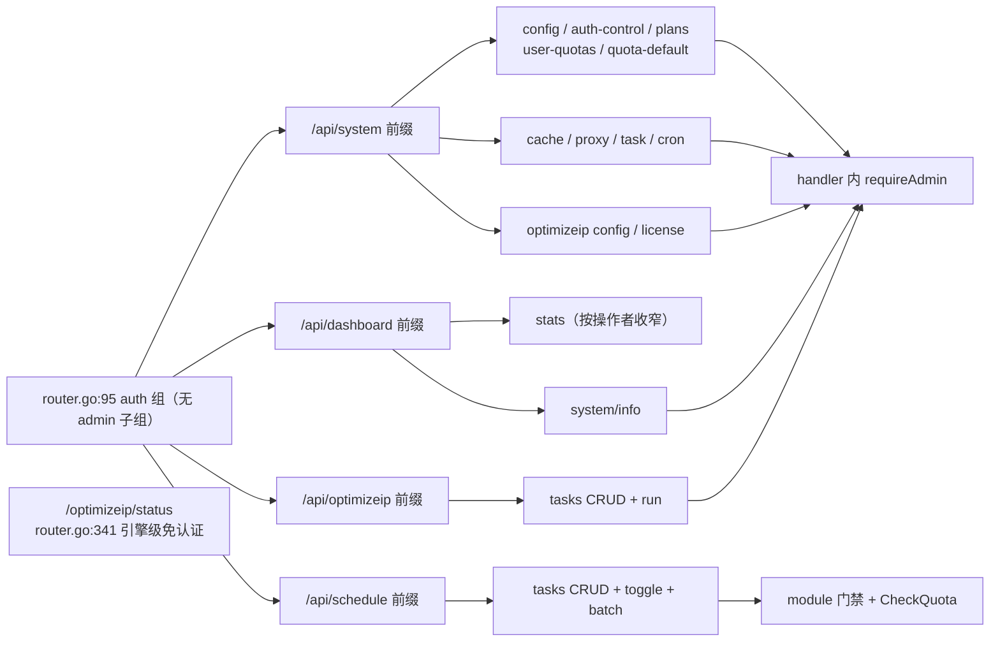
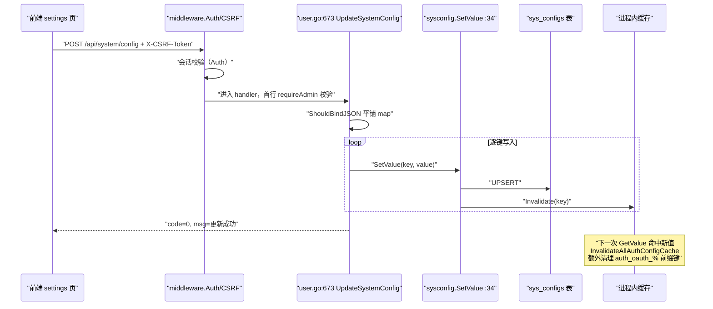
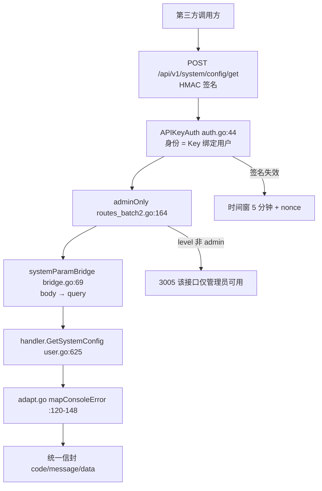
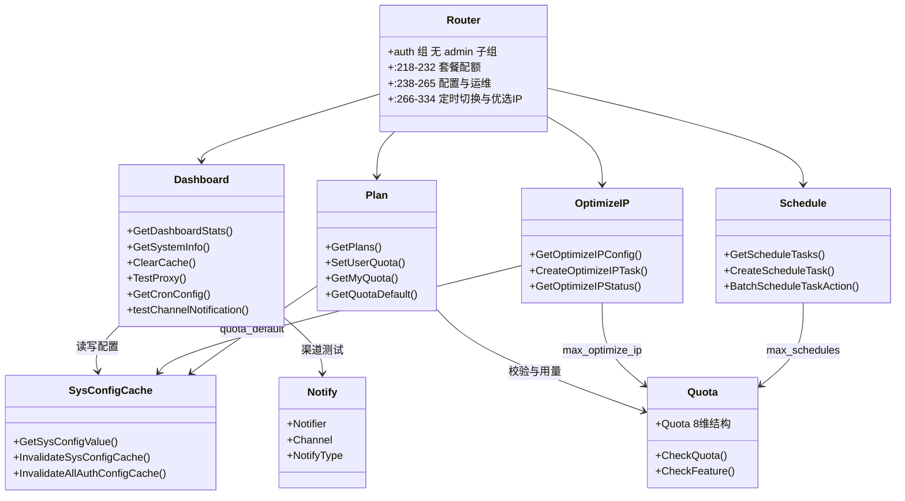

# 系统管理API

<cite>
**本文档引用的文件**
- [router.go](file://main/internal/api/router.go)
- [dashboard.go](file://main/internal/api/handler/dashboard.go)
- [user.go](file://main/internal/api/handler/user.go)
- [plan.go](file://main/internal/api/handler/plan.go)
- [quota.go](file://main/internal/api/handler/quota.go)
- [optimizeip.go](file://main/internal/api/handler/optimizeip.go)
- [schedule.go](file://main/internal/api/handler/schedule.go)
- [auth_control.go](file://main/internal/api/handler/auth_control.go)
- [sysconfig_cache.go](file://main/internal/api/handler/sysconfig_cache.go)
- [routes_batch1.go](file://main/internal/apiv1/routes_batch1.go)
- [routes_batch2.go](file://main/internal/apiv1/routes_batch2.go)
- [bridge.go](file://main/internal/apiv1/bridge.go)
- [auth.go (apiv1)](file://main/internal/apiv1/auth.go)
- [errors.go](file://main/internal/apiv1/errors.go)
- [adapt.go](file://main/internal/apiv1/adapt.go)
- [permission.go](file://main/internal/api/middleware/permission.go)
- [sign.go](file://main/internal/api/middleware/sign.go)
- [sysconfig.go](file://main/internal/sysconfig/sysconfig.go)
- [notify.go](file://main/internal/notify/notify.go)
- [maintenance.go](file://main/internal/database/maintenance.go)
- [quota.go (models)](file://main/internal/models/quota.go)
- [api.ts](file://web/lib/api.ts)
- [VERSION](file://VERSION)
</cite>

## 目录

1. [简介](#简介)
2. [项目结构](#项目结构)
3. [核心组件](#核心组件)
4. [架构总览](#架构总览)
5. [详细组件分析](#详细组件分析)
6. [依赖关系分析](#依赖关系分析)
7. [性能考虑](#性能考虑)
8. [故障排查指南](#故障排查指南)
9. [结论](#结论)
10. [附录](#附录)

## 简介

系统管理是「运维者视角」的端点族，回答四类问题：**平台怎么配的**（`/api/system/config`、`/api/system/auth-control`）、**平台现在怎么样**（`/api/dashboard/stats`、`/api/dashboard/system/info`、`/api/system/task/status`）、**平台能做什么动作**（`/api/system/cache/clear`、`/api/system/proxy/test`、11 个通知渠道 `test`）、**平台按什么规则约束用户**（`/api/system/plans*`、`/api/system/user-quotas*`、`/api/system/quota-default`、`/api/user/quota`）。此外还包含两个业务性子系统：**优选 IP**（`/api/optimizeip/tasks*` 与 `/api/system/optimizeip/*`）和**定时切换**（`/api/schedule/tasks*`）。

本文覆盖两条链路：

- **控制台链路** `/api/system/*`、`/api/dashboard/*`、`/api/optimizeip/*`、`/api/schedule/*`、`/api/user/quota`，共 **51 条**（按 `router.go` 实测清点，不含一键加速 `accel` 族 7 条与引擎级免认证端点）。
- **对外链路** `/api/v1/system/*`（本文 6 条：config 读写、optimizeip 配置读写与 license、cache/clear；同组另 8 条日志族 `:94-103` 归《请求日志API》）、`/api/v1/optimizeip/*`（7 条）、`/api/v1/schedule/*`（6 条），本文合计 **19 条**（`routes_batch2.go:83-104`、`:151-161` 与 `routes_batch1.go:91-103` 实测）。

**明确边界**（避免与同目录其它文档重复）：

- 操作日志与请求日志端点（`/api/logs*`、`/api/request-logs*` 及 v1 对应 7 条）归《请求日志API》。
- 一键加速族（`/api/system/accel/*`，`router.go:161-167`）虽挂 `system` 前缀，业务属域名加速，归《域名管理API》。

**章节来源**
- [router.go:95-341](file://main/internal/api/router.go#L95-L341)
- [routes_batch2.go:83-161](file://main/internal/apiv1/routes_batch2.go#L83-L161)


## 项目结构

系统管理链路横跨「路由 → 门卫 → handler → 配置缓存 → 通知引擎 → 模型」六段。

| 层次 | 文件 | 关键位置 | 职责 |
| --- | --- | --- | --- |
| 控制台路由 | `main/internal/api/router.go` | `:107`、`:218-232`、`:238-271`、`:326-334`、`:341` | REST 路径、`:id` 语义、分组挂载 |
| 对外路由 | `main/internal/apiv1/routes_batch2.go` | `:83-104`、`:151-161` | 全 `POST`、动词路径、`adminOnly` |
| v1 参数桥接 | `main/internal/apiv1/bridge.go` | `systemParamBridge()` 起于 `:69` | body → query/路径搬运 |
| v1 签名门卫 | `main/internal/apiv1/auth.go` | `APIKeyAuth()` 起于 `:44` | HMAC 校验与身份注入 |
| 控制台会话门卫 | `main/internal/api/middleware/auth.go` | `Auth()` | Cookie 与 Bearer 一致性 |
| 细粒度权限 | `main/internal/api/middleware/permission.go` | `UserModuleAllowed()` | 模块可见性与配额门禁 |
| 概览与运维 handler | `main/internal/api/handler/dashboard.go` | 535 行 | stats、system/info、cron、proxy、通知测试 |
| 系统配置 handler | `main/internal/api/handler/user.go` | `:625`、`:673` | 全站配置读写 |
| 套餐配额 handler | `main/internal/api/handler/plan.go` | 13 个函数 | 套餐 CRUD、用户配额、订阅 |
| 配额判定 | `main/internal/api/handler/quota.go` | `CheckQuota()` `:183` | 8 维资源门禁 |
| 优选 IP handler | `main/internal/api/handler/optimizeip.go` | 12 个函数 | 配置、许可、任务与引擎状态 |
| 定时切换 handler | `main/internal/api/handler/schedule.go` | 6 个函数 | 定时解析切换任务 |
| 登录注册开关 | `main/internal/api/handler/auth_control.go` | `:97`、`:124` | 认证方式白名单 |
| 配置缓存门面 | `main/internal/api/handler/sysconfig_cache.go` | 39 行 | handler 侧读写 `sysconfig` |
| 配置缓存实现 | `main/internal/sysconfig/sysconfig.go` | `GetValue()` `:17` | 进程内 `SysConfig` 缓存 |
| 前端调用层 | `web/lib/api.ts` | `:755-808`、`:1732-1736` | 端点封装与类型 |

**章节来源**
- [sysconfig_cache.go:14-39](file://main/internal/api/handler/sysconfig_cache.go#L14-L39)
- [sysconfig.go:12-40](file://main/internal/sysconfig/sysconfig.go#L12-L40)


## 核心组件

### API路由器

`router.go` 只有一个 `auth := api.Group("")`（`:95`），**路由层不存在 admin 子组**：`rg 'admin' internal/api/router.go` 零命中。所有管理员约束都在 handler 内实现，使用两个辅助函数：`requireAdmin`（`account.go:43`，内部已含错误响应）与 `checkAdmin`（`account.go:24`，仅返回布尔）。系统管理族的分布：

| 路由段 | 行号区间 | 条数 | 族 |
| --- | --- | --- | --- |
| `/api/user/quota` | `:107` | 1 | 本人配额 |
| `/api/system/plans*` | `:218-222` | 5 | 套餐 |
| `/api/system/user-quotas*` | `:224-229` | 6 | 用户配额与订阅 |
| `/api/system/quota-default` | `:231-232` | 2 | 默认配额 |
| `/api/system/config*` | `:238-239` | 2 | 全站配置 |
| `/api/system/auth-control*` | `:241-242` | 2 | 认证开关 |
| `/api/dashboard/*` | `:247-248` | 2 | 概览与运行时 |
| `/api/system/{渠道}/test` | `:249-259` | 11 | 通知渠道测试 |
| `/api/system/{cache,proxy,task,cron}` | `:260-265` | 5 | 运维动作 |
| `/api/schedule/tasks*` | `:266-271` | 6 | 定时切换 |
| `/api/system/optimizeip/*` | `:326-328` | 3 | 优选 IP 配置 |
| `/api/optimizeip/tasks*` | `:329-334` | 6 | 优选 IP 任务 |

关键约定：`/api/dashboard/system/info` 挂在 `dashboard` 前缀而非 `system` 前缀（`:248`），因此**不存在** `GET /api/system/info` 这一路径；前端 `api.ts:782` 的 `getSystemInfo()` 也按 `/dashboard/system/info` 调用，两处一致。



**图表来源**
- [router.go:104-341](file://main/internal/api/router.go#L104-L341)

**章节来源**
- [router.go:218-271](file://main/internal/api/router.go#L218-L271)
- [api.ts:755-808](file://web/lib/api.ts#L755-L808)

### 处理器层

系统管理族的 handler 分散在 6 个文件，按「读配置 / 改配置 / 触发外部动作 / 查询运行时」四种形态组织：

| handler | 文件与行号 | 形态 | 判权方式 |
| --- | --- | --- | --- |
| `GetSystemConfig` | `user.go:625` | 读全量配置 map | `requireAdmin`（`:628`） |
| `UpdateSystemConfig` | `user.go:673` | 写平铺 map | `requireAdmin`（`:676`） |
| `GetDashboardStats` | `dashboard.go:134` | 聚合计数 | 无 admin 判定，按操作者收窄口径 |
| `GetSystemInfo` | `dashboard.go:485` | 运行时指标 | `checkAdmin`（`:486`） |
| `ClearCache` | `dashboard.go:245` | 副作用动作 | `checkAdmin`（`:246`） |
| `TestProxy` | `dashboard.go:260` | 出网探测 | `checkAdmin`（`:261`） |
| `GetTaskStatus` | `dashboard.go:381` | 读任务态 | `requireAdmin`（`:382`） |
| `GetCronConfig` | `dashboard.go:420` | 读 cron | `requireAdmin`（`:421`） |
| `UpdateCronConfig` | `dashboard.go:524` | 写 cron | `checkAdmin`（`:525`） |
| `testChannelNotification` | `dashboard.go:94` | 真实外发消息 | `checkAdmin`（`:95`） |
| `GetPlans` 等 13 个 | `plan.go:150-758` | 套餐与配额 | `requireAdmin`（每个函数首行，`:151`…`:759`） |
| `GetOptimizeIPConfig` 等 | `optimizeip.go:34-376` | 配置 + 任务 | `requireAdmin` + 创建路径 `CheckQuota(c,"optimize_ip")`（`:241`） |
| `GetScheduleTasks` 等 6 个 | `schedule.go:44-223` | 定时切换 | 创建走 `CheckQuota(c,"schedules")`（`:83`），余为模块门禁 |
| `GetAuthControl` / `UpdateAuthControl` | `auth_control.go:97`、`:124` | 认证开关 | `requireAdmin`（`:98`、`:125`） |

11 个通知测试端点是 `testChannelNotification(c, notify.NotifyType)` 的薄封装：`TestMailNotification`（`:225`）、`TestTelegramNotification`（`:230`）、`TestWebhookNotification`（`:235`）、`TestCustomWebhookNotification`（`:240`）、`TestDiscordNotification`（`:450`）、`TestBarkNotification`（`:455`）、`TestWechatNotification`（`:460`）、`TestDingtalkNotification`（`:465`）、`TestFeishuNotification`（`:470`）、`TestWxWorkAppNotification`（`:475`）、`TestWxTplNotification`（`:480`）。

**章节来源**
- [dashboard.go:94-134](file://main/internal/api/handler/dashboard.go#L94-L134)
- [dashboard.go:225-260](file://main/internal/api/handler/dashboard.go#L225-L260)
- [dashboard.go:450-524](file://main/internal/api/handler/dashboard.go#L450-L524)

### 中间件层

| 中间件 | 位置 | 在系统管理族中的作用 |
| --- | --- | --- |
| `Auth()` | `middleware/auth.go` | 会话 Cookie 与 Bearer 双凭据一致性，注入 `uid`/`level` |
| `Permission()` | `router.go:104` 挂载 | 域名三维权限，`schedule`/`optimizeip` 任务族的 `module` 门禁 |
| `requireAdmin(c)` | `account.go:43` | 路由层无 admin 子组时的**唯一**管理员闸门，内部已发错误响应 |

| `CSRF` | 控制台组 | 所有 `POST` 需 `X-CSRF-Token` |
| `EncryptedResponse` | `TestProxy` 出口 | 代理口令相关的探测结果加密回传 |
| `APIKeyAuth()` | `apiv1/auth.go:44` | v1 HMAC-SHA256 签名，身份来自 Key 绑定用户 |
| `adminOnly` | `routes_batch2.go:164` | v1 系统组统一要求 `level == admin` |
| `systemParamBridge()` | `bridge.go:69` | v1 把 body 字段搬进 query，兼容控制台读 `c.Query` 的 handler |

值得注意的结构性事实：控制台**不存在 admin 路由子组**，管理员约束完全下沉到 handler 首行的 `requireAdmin`/`checkAdmin`。这意味着「看 `router.go` 判断某端点要不要管理员」是行不通的——必须逐个读 handler。唯一的例外是 `GET /api/dashboard/stats`（`:134`），它无 admin 判定，普通用户也能读，但走的是**按操作者收窄**的口径（见 handler 注释与 `quotaUsed`）。另有两个引擎级免认证端点：`GET /optimizeip/status`（`router.go:341`）与 `GET /quicklogin`。

**章节来源**
- [routes_batch2.go:164](file://main/internal/apiv1/routes_batch2.go#L164)
- [bridge.go:69](file://main/internal/apiv1/bridge.go#L69)
- [dashboard.go:381-420](file://main/internal/api/handler/dashboard.go#L381-L420)

### 数据访问层

系统管理族的数据面由三块组成：

1. **`sys_configs` 表**（`models.SysConfig`）：全站配置与配额默认值。读写经 `sysconfig` 包的进程内缓存（`GetValue()` `:17`、`Invalidate()` `:28`、`SetValue()` `:34`），handler 侧统一走 `sysconfig_cache.go` 的 `GetSysConfigValue` / `InvalidateSysConfigCache` / `InvalidateAllAuthConfigCache`。`InvalidateAllAuthConfigCache` 硬编码 12 个键并追加 `auth_oauth_%` 模糊清理（`sysconfig_cache.go:26-38`）。
2. **`plans` / `user_quotas` / `user_subscriptions`**（`main/internal/models/quota.go`）：套餐定义、按用户覆盖的配额、订阅关系。三者的主键 `ID` 均为**字符串**（`quota.go:20`、`:53`、`UserQuota` 以 `user_id` 为主键 `:67`），`Plan.Quotas` 与 `Plan.Features` 在库中是 **JSON 文本列**（`:32-33`）。`plan.go` 的 `quotaFromJSON`（`:44`）、`quotaToJSON`（`:67`）、`overlayQuotaMap`（`:102`）负责 JSON 文本与 `Quota` 结构（`quota.go:31-40`，8 个维度）之间的双向转换。`SetUserQuota` 只写 `user_quotas`，套餐订阅另走 `SetUserSubscription`，因此接口入参中的 `plan_id`/`expire_at` 与 `quotas` 覆盖分属两张表。
3. **`optimizeip_tasks` / `schedule_tasks`**：优选 IP 任务与定时切换任务的持久化，由各自 handler 直接经 GORM 访问。

| 配额维度（`quota.go:31`） | JSON 键 | 约束对象 |
| --- | --- | --- |
| `MaxDomains` | `max_domains` | 域名数 |
| `MaxRecords` | `max_records` | 解析记录数 |
| `MaxAccounts` | `max_accounts` | DNS 账户数 |
| `MaxMonitors` | `max_monitors` | 容灾监控任务数 |
| `MaxCerts` | `max_certs` | 证书订单数 |
| `MaxSchedules` | `max_schedules` | 定时切换任务数 |
| `MaxDeploys` | `max_deploys` | 部署任务数 |
| `MaxOptimizeIP` | `max_optimize_ip` | 优选 IP 任务数 |

`unlimitedQuota()`（`quota.go:48`）把全部维度铺成 `-1` 再被配置覆盖，因此「套餐未写某维度」等价于「该维度不限」，而不是「禁止」。

**章节来源**
- [sysconfig_cache.go:14-39](file://main/internal/api/handler/sysconfig_cache.go#L14-L39)
- [quota.go:31-56](file://main/internal/api/handler/quota.go#L31-L56)
- [plan.go:44-129](file://main/internal/api/handler/plan.go#L44-L129)

## 架构总览

一次「管理员保存系统配置」的完整链路，展示配置读写与缓存失效的耦合点：



**图表来源**
- [user.go:673](file://main/internal/api/handler/user.go#L673)
- [sysconfig.go:17-40](file://main/internal/sysconfig/sysconfig.go#L17-L40)
- [sysconfig_cache.go:20-39](file://main/internal/api/handler/sysconfig_cache.go#L20-L39)

对外链路复用同一批 handler，只在入口做参数搬运：



**图表来源**
- [routes_batch2.go:83-104](file://main/internal/apiv1/routes_batch2.go#L83-L104)
- [bridge.go:69](file://main/internal/apiv1/bridge.go#L69)
- [errors.go:39](file://main/internal/apiv1/errors.go#L39)
- [adapt.go:120-148](file://main/internal/apiv1/adapt.go#L120-L148)

## 详细组件分析

### 系统配置管理

控制台两条 + v1 两条，读写 `sys_configs` 全表：

| 链路 | 方法 | 路径 | 权限 | handler | 关键出入参 |
| --- | --- | --- | --- | --- | --- |
| 控制台 | GET | `/api/system/config` | `requireAdmin`（`:628`） | `user.go:625` | 返回 `map[string]string` 全量 |
| 控制台 | POST | `/api/system/config` | `requireAdmin`（`:676`） | `user.go:673` | 平铺 map，`ShouldBindJSON` |
| 对外 | POST | `/api/v1/system/config/get` | `adminOnly` | `user.go:625` | `data` 为全站配置 |
| 对外 | POST | `/api/v1/system/config/update` | `adminOnly` | `user.go:673` | `data` 为 `null` |

读请求返回的是**未脱敏明文**，至少包含 `mail_password`、`tgbot_token`、`oauth_*_secret`、`turnstile_secret_key`。这是 `admin` 权限的既定行为，但在把该端点接入自动化脚本或工单系统时等同于交出全部下游凭据，属于安全侧的高危面（`.wiki-context/analysis-api.md` §10.14 已登记）。

```json
{
  "code": 0,
  "message": "success",
  "data": {
    "site_name": "{站点名}",
    "site_url": "https://{你的域名}",
    "mail_host": "{SMTP主机}",
    "mail_port": "465",
    "mail_user": "{发件邮箱}",
    "mail_password": "{明文口令，敏感}",
    "tgbot_token": "{Bot令牌，敏感}",
    "webhook_url": "{出站Webhook}",
    "turnstile_site_key": "{站点密钥}",
    "turnstile_secret_key": "{私密切换键，敏感}",
    "quota_default": "{\"max_domains\":-1,\"max_records\":-1}"
  }
}
```

写入按「键存在才更新」的 upsert 语义，**不做字段白名单**：任意 `key` 都会被写进 `sys_configs`。因此拼错的键不会报错，只会形成一条无人读取的死配置。

```bash
# 通过 v1 链路读取全站配置（密钥脱敏，签名需按 apiv1/auth.go 规则生成）
curl -sS -X POST "https://{你的域名}/api/v1/system/config/get" \
  -H "X-API-Key: {API密钥}" \
  -H "X-Timestamp: {秒级时间戳}" \
  -H "X-Nonce: {随机串}" \
  -H "X-Signature: {HMAC-SHA256签名}" \
  -H "Content-Type: application/json" \
  -d '{}'
# 预期输出：{"code":0,"message":"success","data":{"site_name":"...","mail_password":"..."}}
# 若返回 {"code":3005,...} 表示该 API Key 绑定用户不是 admin
```

**章节来源**
- [user.go:625-700](file://main/internal/api/handler/user.go#L625-L700)
- [routes_batch2.go:83-92](file://main/internal/apiv1/routes_batch2.go#L83-L92)

### 登录注册开关

`auth_control.go` 与通用配置的关键差异是**键白名单**：`authControlFixedKeys()`（`:37`）固定可读写键集合，`isWritableAuthControlKey()`（`:62`）在 `UpdateAuthControl`（`:124`）中拦截白名单之外的键，避免用该端点写任意配置。

| 方法 | 路径 | 权限 | handler | 语义 |
| --- | --- | --- | --- | --- |
| GET | `/api/system/auth-control` | `requireAdmin`（`:98`） | `auth_control.go:97` | 返回登录/注册/MagicLink/邮箱白名单开关 |
| POST | `/api/system/auth-control` | `requireAdmin`（`:125`） | `auth_control.go:124` | 白名单内键位写入，随后失效缓存 |

v1 **不迁移** 该族（`routes_batch2.go:74-82` 注释），程序化调用方无法经 v1 改开关。

**章节来源**
- [auth_control.go:37-124](file://main/internal/api/handler/auth_control.go#L37-L124)
- [routes_batch2.go:73-82](file://main/internal/apiv1/routes_batch2.go#L73-L82)

### 概览与运行时指标

| 方法 | 路径 | 权限 | handler | 返回要点 |
| --- | --- | --- | --- | --- |
| GET | `/api/dashboard/stats` | 无 admin 判定（按操作者收窄） | `dashboard.go:134` | 域名数、证书数、部署数、任务数、证书订单/部署状态分布、容灾监控状态分布 |
| GET | `/api/dashboard/system/info` | handler 内 `checkAdmin`（`:486`） | `dashboard.go:485` | 版本、Go 运行时、CPU、协程数、内存、三个库文件字节数、维护统计 |

`GetSystemInfo` 的实现（`dashboard.go:485-513`）逐字段来源如下：

| 字段 | 来源 | 说明 |
| --- | --- | --- |
| `version` | `dashboard.go:500` **字面量 `"1.0.0"`** | 硬编码，不读 `VERSION` 文件，也不来自构建期注入 |
| `go_version` / `os` / `arch` / `num_cpu` / `goroutines` | `runtime` | 与部署机实时一致 |
| `memory_alloc` / `memory_sys` | `runtime.ReadMemStats` | 进程内存 |
| `data_db_size` / `logs_db_size` / `request_db_size` | `getFileSize()` `:515` | 对 `data/*.db` 直接 `os.Stat` |
| `db_maintenance` | `database.GetMaintenanceStats()` | 维护任务统计 |

**已核实的已知问题**：仓库根 `VERSION` 文件内容为 `1.0.11`，而 `GetSystemInfo` 返回的 `version` 恒为 `1.0.0`（`dashboard.go:500`）。二者无任何代码关联（`rg 'VERSION|AppVersion'` 在 `internal/api/handler/` 与 `internal/config/` 零命中）。结论：**不能**用 `/api/dashboard/system/info` 的 `version` 判断线上版本，需以部署产物或 `VERSION` 文件为准。`getFileSize()` 采用相对路径 `data/data.db`（`:495-497`），因此三个 `*_db_size` 字段的可信度取决于进程工作目录；文件不存在时返回 `0` 而非报错（`:516-519`），前端会显示「0 B」而看不出是缺文件还是空库。

```json
{
  "code": 0,
  "message": "success",
  "data": {
    "version": "1.0.0",
    "go_version": "go{实际版本}",
    "os": "linux",
    "arch": "amd64",
    "num_cpu": 4,
    "goroutines": 38,
    "memory_alloc": 12582912,
    "data_db_size": 2097152,
    "db_maintenance": {"vacuum_count": 0, "last_run_at": "{时间戳}"}
  }
}
```

**章节来源**
- [dashboard.go:134-224](file://main/internal/api/handler/dashboard.go#L134-L224)
- [dashboard.go:485-521](file://main/internal/api/handler/dashboard.go#L485-L521)
- [VERSION](file://VERSION)

### 缓存与代理测试

`ClearCache`（`dashboard.go:245`，`checkAdmin` `:246`）触发 `sysconfig` 与业务缓存失效，控制台与 v1（`routes_batch2.go:91`）双链路复用。`TestProxy`（`dashboard.go:260`，`checkAdmin` `:261`）从请求体接收代理地址与**明文口令**，构造 `buildProxyURL()`（`:351`）后实测目标，响应经 `EncryptedResponse` 回传 `status` 与 `latency`；目标先过 `proxyTargetRejectReason()`（`:362`）拒绝内网与非法地址，属 SSRF 防线。`TestProxy` **不迁移** v1（`routes_batch2.go` 注释 `:68-81`），因其要求提交明文口令。


**章节来源**
- [dashboard.go:245-400](file://main/internal/api/handler/dashboard.go#L245-L400)
- [routes_batch2.go:73-92](file://main/internal/apiv1/routes_batch2.go#L73-L92)

### 任务状态与定时任务配置

| 方法 | 路径 | 权限 | handler | 语义 |
| --- | --- | --- | --- | --- |
| GET | `/api/system/task/status` | `requireAdmin`（`:382`） | `dashboard.go:381` | `active,total,cert_auto,domain_notice,last_time,schedule` |
| GET | `/api/system/cron` | `requireAdmin`（`:421`） | `dashboard.go:420` | 当前 cron 表达式 |
| POST | `/api/system/cron` | `checkAdmin`（`:525`） | `dashboard.go:524` | 写 `cron_schedule`/`cron_cert`/`cron_expire` |

`UpdateCronConfig` 用 `BindDecryptedData`（`dashboard.go:536`）解析请求体，即控制台侧支持加密载荷；`cron_schedule`/`cron_cert`/`cron_expire` 三键逐一 `updateConfig`（`:542`）落 `sys_configs` 并失效缓存。读（`GetCronConfig`）与写（`UpdateCronConfig`）**均要求 admin**（分别 `:421`、`:525`），不存在「普通用户可看调度节奏」的路径。

```bash
# 读 cron 配置（会话 Cookie 方式，口令用占位符）
curl -sS -b "{会话Cookie}" "https://{你的域名}/api/system/cron"
# 预期输出：{"code":0,"message":"success","data":{"cron_schedule":"*/5 * * * *","cron_cert":"...","cron_expire":"..."}}

# 修改 cron 表达式（需管理员，且必须带 CSRF 头）
curl -sS -X POST -b "{会话Cookie}" \
  -H "X-CSRF-Token: {CSRF令牌}" \
  -H "Content-Type: application/json" \
  "https://{你的域名}/api/system/cron" \
  -d '{"cron_schedule":"*/10 * * * *","cron_cert":"0 3 * * *","cron_expire":"0 4 * * *"}'
# 预期输出：{"code":0,"message":"更新成功","data":null}
```

**章节来源**
- [dashboard.go:381-449](file://main/internal/api/handler/dashboard.go#L381-L449)
- [dashboard.go:524-560](file://main/internal/api/handler/dashboard.go#L524-L560)

### 通知渠道测试

11 个端点全部 `POST`、全部「仅登录 + `checkAdmin`（`dashboard.go:95`）」、全部无入参（读取库中已存配置），共享 `testChannelNotification`：

| 渠道 | 路径 | 封装函数与行号 |
| --- | --- | --- |
| 邮件 | `/api/system/mail/test` | `dashboard.go:225` |
| Telegram | `/api/system/telegram/test` | `dashboard.go:230` |
| Webhook | `/api/system/webhook/test` | `dashboard.go:235` |
| 自定义 Webhook | `/api/system/custom-webhook/test` | `dashboard.go:240` |
| Discord | `/api/system/discord/test` | `dashboard.go:450` |
| Bark | `/api/system/bark/test` | `dashboard.go:455` |
| 企业微信机器人 | `/api/system/wechat/test` | `dashboard.go:460` |
| 钉钉 | `/api/system/dingtalk/test` | `dashboard.go:465` |
| 飞书 | `/api/system/feishu/test` | `dashboard.go:470` |
| 企业微信应用 | `/api/system/wxwork-app/test` | `dashboard.go:475` |
| 微信模板消息 | `/api/system/wxtpl/test` | `dashboard.go:480` |

`buildChannelForTest()`（`:56`）按 `notify.NotifyType` 从 `sys_configs` 装配通道，`siteNameOrDefault()`（`:79`）取站点名。11 条**明确不迁移 v1**（`routes_batch2.go:74-80`）：每次调用都会真实外发一条消息，对程序化调用没有稳定语义。

```bash
# 逐个渠道体检（管理员会话），一次遍历 11 个 test 端点
for ch in mail telegram webhook custom-webhook discord bark wechat dingtalk feishu wxwork-app wxtpl; do
  printf '%-14s ' "$ch"
  curl -sS -o /tmp/nt.out -w '%{http_code} ' -X POST -b "{会话Cookie}" \
    -H "X-CSRF-Token: {CSRF令牌}" "https://{你的域名}/api/system/${ch}/test"
  head -c 160 /tmp/nt.out; echo
done
# 预期：mail 200 {"code":0,"message":"发送成功"}；未配置的渠道 200 {"code":1,"message":"配置缺失"}
```

**章节来源**
- [dashboard.go:56-133](file://main/internal/api/handler/dashboard.go#L56-L133)
- [dashboard.go:225-244](file://main/internal/api/handler/dashboard.go#L225-L244)
- [dashboard.go:450-484](file://main/internal/api/handler/dashboard.go#L450-L484)

### 套餐与配额管理

13 条控制台端点全部 admin（`router.go:218-232`）：

| 方法 | 路径 | handler | 请求要点 | 响应要点 |
| --- | --- | --- | --- | --- |
| GET | `/api/system/plans` | `plan.go:150` | — | `list[]` 含 `subscriber_count`、`total` |
| POST | `/api/system/plans` | `plan.go:184` | `name`、`quotas map[string]int`、`features map[string]bool` | `data` |
| POST | `/api/system/plans/:id` | `plan.go:245` | 同上 | `msg` |
| POST | `/api/system/plans/:id/delete` | `plan.go:338` | `:id` | `msg` |
| POST | `/api/system/plans/:id/default` | `plan.go:372` | `:id` | `msg` |
| GET | `/api/system/user-quotas` | `plan.go:451` | — | `list[]` 含 `source`、`plan_id`、`quotas`、`used` |
| POST | `/api/system/user-quotas/:uid` | `plan.go:527` | `quotas`、`remark`、`plan_id`、`expire_at` | `msg` |
| POST | `/api/system/user-quotas/:uid/reset` | `plan.go:561` | `:uid` | `msg` |
| GET | `/api/system/user-quotas/:uid/sub` | `plan.go:581` | `:uid` | `data` |
| POST | `/api/system/user-quotas/:uid/sub` | `plan.go:604` | `plan_id`、`expire_at` | `msg` |
| POST | `/api/system/user-quotas/:uid/sub/revoke` | `plan.go:683` | `:uid` | `msg` |
| GET | `/api/system/quota-default` | `plan.go:746` | — | `quotas`、`limits` |
| POST | `/api/system/quota-default` | `plan.go:758` | `quotas`、`remark` | `msg` |

本人视角另有一条：`GET /api/user/quota`（`router.go:107`，`plan.go:722 GetMyQuota`），返回 `source`、`plan_id`、`plan_name`、`quotas`、`used`，`source` 取值区分「套餐 / 管理员覆盖 / 默认」。

套餐族整体**不迁移 v1**（`routes_batch2.go:74-82`），第三方无法用 API Key 改套餐。校验函数 `validatePlanQuotas()`（`:129`）只拒绝小于 `-1` 的取值；`quotaUsedByResource()`（`:120`）在用户配额列表回填真实用量。`GET /api/system/plans` 的响应为 `{total, list[]}`，`list[]` 由 `planRow`（`:139`）包装 `models.Plan` 后附加 `subscriber_count`，其中 `quotas` 与 `features` 仍是 **JSON 字符串**而非对象（`models/quota.go:32-33` 的文本列原样透出），调用方需自行解析。

**章节来源**
- [plan.go:150-758](file://main/internal/api/handler/plan.go#L150-L758)
- [router.go:218-232](file://main/internal/api/router.go#L218-L232)

### 优选 IP 配置与任务

配置面 admin 三条 + 任务面 admin 六条 + 引擎级一条（`router.go:326-334`、`:341`）：

| 方法 | 路径 | handler | 备注 |
| --- | --- | --- | --- |
| GET | `/api/system/optimizeip/config` | `optimizeip.go:34` | 读功能开关与阈值 |
| POST | `/api/system/optimizeip/config` | `optimizeip.go:52` | map 全量写 |
| POST | `/api/system/optimizeip/license` | `optimizeip.go:87` | 许可参数校验 |
| POST | `/api/optimizeip/tasks/list` | `optimizeip.go:134` | `type`/`kw`/`status`/`offset`/`limit`/排序 |
| POST | `/api/optimizeip/tasks` | `optimizeip.go:239` | 创建，受 `max_optimize_ip` 门禁 |
| POST | `/api/optimizeip/tasks/:id` | `optimizeip.go:277` | 更新 |
| POST | `/api/optimizeip/tasks/:id/delete` | `optimizeip.go:312` | 删除 |
| POST | `/api/optimizeip/tasks/:id/toggle` | `optimizeip.go:322` | 启停，`active` 必填 |
| POST | `/api/optimizeip/tasks/:id/run` | `optimizeip.go:339` | 立即执行 |
| GET | `/optimizeip/status` | `optimizeip.go:364` | **无认证**，纯文本 |

`validateOptimizeIPTask()`（`:212`）负责入参校验，`optimizeRunState()`（`:376`）按最近执行时间推导运行态。

v1 侧 7 条（`routes_batch2.go:151-161`，均 `requireModuleMW("domain")`）**结构性不可达**：`update`/`delete`/`toggle`/`run` 依赖路径 `:id`，但组内无 `paramAlias` 桥接，`c.Param("id")` 恒为空。实测后果（`.wiki-context/analysis-api.md` §10.1、§3.10）：`delete` 返回 `code=0`、`message="删除成功"` 而实际 `WHERE id = 0` 影响 0 行（**静默假成功**）；`run` 返回 `4006`。`list`/`create`/`status` 三条可用。


**章节来源**
- [optimizeip.go:34-376](file://main/internal/api/handler/optimizeip.go#L34-L376)
- [routes_batch2.go:151-161](file://main/internal/apiv1/routes_batch2.go#L151-L161)

### 定时切换任务

定时切换族**无 admin 判定**，权限来自 `requireUserModule(c, "domain")`（`schedule.go:45`）与数据范围收窄：非管理员时 `isAdmin` 为假，查询追加 `did IN (可访问域名)`（`:70-73`）。控制台 6 条（`router.go:266-271`）与 v1 6 条（`apiv1/routes_batch1.go:91-103`）复用 `schedule.go`：

| 方法 | 路径 | handler | 门禁 | 备注 |
| --- | --- | --- | --- | --- |
| GET | `/api/schedule/tasks` | `schedule.go:44` | module，非 admin 按域名收窄 | 列表 |
| POST | `/api/schedule/tasks` | `schedule.go:81` | module + `CheckQuota("schedules")`（`:83`） | 受 `max_schedules` |
| POST | `/api/schedule/tasks/batch` | `schedule.go:223` | module | `ids[]` + `act` |
| POST | `/api/schedule/tasks/:id` | `schedule.go:122` | module | 更新 |
| POST | `/api/schedule/tasks/:id/delete` | `schedule.go:175` | module | 删除 |
| POST | `/api/schedule/tasks/:id/toggle` | `schedule.go:197` | module | `?active` 走 query |

v1 侧 `toggle` 同样受影响：`systemParamBridge` 不搬运 query，`/api/v1/schedule/tasks/toggle` 的 `active` 参数丢失（`apiv1/routes_batch1.go:91-103` 注释与 §3.6 实测标记 ⚠️），其余 5 条可用。

**章节来源**
- [schedule.go:44-223](file://main/internal/api/handler/schedule.go#L44-L223)

- [routes_batch1.go:91-103](file://main/internal/apiv1/routes_batch1.go#L91-L103)

## 依赖关系分析



**图表来源**
- [dashboard.go:56-524](file://main/internal/api/handler/dashboard.go#L56-L524)
- [plan.go:150-758](file://main/internal/api/handler/plan.go#L150-L758)
- [quota.go:31-362](file://main/internal/api/handler/quota.go#L31-L362)
- [optimizeip.go:34-376](file://main/internal/api/handler/optimizeip.go#L34-L376)
- [schedule.go:44-223](file://main/internal/api/handler/schedule.go#L44-L223)

跨链路差异一览（本文范围部分）：

| 维度 | 控制台 | 对外 v1 | 影响 |
| --- | --- | --- | --- |
| 鉴权 | 会话 Cookie / Bearer + CSRF | API Key + HMAC 签名 | v1 无 CSRF，但需签名 |
| 管理员判定 | `admin` 路由组或 handler 内 `checkAdmin` | `adminOnly`（`:164`） | v1 判定集中于 `adminOnly` `:164` |
| 参数搬运 | 路径 `:id` 原生 | `systemParamBridge`（`:69`） | 桥接不全者静默失效 |
| 通知测试 | 11 条可用 | 不迁移 | 无法程序化体检 |
| 套餐族 | 13 条可用 | 不迁移 | 第三方不能改套餐 |
| 优选 IP 写操作 | 6 条可用 | 4 条不可达 | 假成功风险 |
| 错误码 | `{code:0/1, message, data}` | `{code, message, data}` + 33 个语义码 | 需映射层（`adapt.go:120-148`） |

**章节来源**
- [routes_batch2.go:73-139](file://main/internal/apiv1/routes_batch2.go#L73-L139)
- [bridge.go:69](file://main/internal/apiv1/bridge.go#L69)
- [adapt.go:120-148](file://main/internal/apiv1/adapt.go#L120-L148)

## 性能考虑

| 观测点 | 位置 | 现状与影响 |
| --- | --- | --- |
| `GetDashboardStats` 聚合 | `dashboard.go:134` | 一次请求内多张表计数与状态分组，数据量大时为主要开销 |
| `GetSystemInfo` 文件体积 | `dashboard.go:495-497` | 三次 `os.Stat`，代价可忽略；`runtime.ReadMemStats` 会短暂 STW，不宜高频轮询 |
| `sysconfig` 缓存 | `sysconfig.go:17-34` | 命中即免 DB 查询；写后 `Invalidate` 保证一致性 |
| 缓存全失效 | `ClearCache` `dashboard.go:245` | 失效后短时间回源增多，避免放入自动化循环 |
| 用户配额列表 | `plan.go:451` | 逐用户回填 `used` 需统计资源，用户规模大时开销上升 |
| 优选 IP 列表 | `optimizeip.go:134` | `offset/limit` 分页 + 排序，`optimizeRunState()` 为纯计算 |
| 出网探测 | `TestProxy` `dashboard.go:260` | 时延取决于代理与目标，前端应设超时 |
| 通知测试 | `dashboard.go:94` | 真实外发，串行调用 11 渠道会累加时延 |

```bash
# 观察系统族接口耗时（本地开发环境，口令以占位符表示）
for p in "/api/dashboard/stats" "/api/dashboard/system/info" "/api/system/task/status" "/api/system/cron" "/api/system/plans" "/api/system/user-quotas"; do
  curl -sS -o /dev/null -b "{会话Cookie}" \
    -w '%{http_code} %{time_total}s  %{url_effective}\n' \
    "https://{你的域名}${p}"
done
# 预期输出（示例量级，非基准）：
# 200 0.041s  https://{你的域名}/api/dashboard/stats
# 200 0.006s  https://{你的域名}/api/dashboard/system/info
# 200 0.003s  https://{你的域名}/api/system/cron
```

**章节来源**
- [dashboard.go:134-497](file://main/internal/api/handler/dashboard.go#L134-L497)
- [plan.go:451-500](file://main/internal/api/handler/plan.go#L451-L500)
- [optimizeip.go:134-376](file://main/internal/api/handler/optimizeip.go#L134-L376)

## 故障排查指南

### 端点分诊表

| 症状 | 首查位置 | 判定依据 | 处置方向 |
| --- | --- | --- | --- |
| `version` 显示 `1.0.0` 与 `VERSION` 不符 | `dashboard.go:485-513` | `:500` 字面量，无版本注入 | 属实现缺陷，以 `VERSION`/构建产物为准 |
| 改了配置不生效 | `sysconfig.go:17-34` | `GetValue` 命中旧缓存 | `POST /api/system/cache/clear` 后复验 |
| 保存配置「成功」但键写错 | `user.go:673` | 无白名单，upsert 任意键 | 核对键名，清理死配置 |
| `auth-control` 报非法键 | `auth_control.go:62` | 白名单之外不可写 | 用 `/api/system/config` 或补白名单 |
| 3005 权限不足 | `errors.go:39`、`routes_batch2.go:150` | Key 绑定用户非 admin | 换 Key 或提升 level |
| 4001/4006 资源不存在 | `errors.go:43`、`:48` | v1 未搬运 `:id` | 改用控制台链路 |
| `toggle` 无效（优选 IP / 定时切换 v1） | `bridge.go:69` | query 未搬运 | 用控制台 `?active=` |
| 删除返回成功但记录仍在 | `optimizeip.go:312` | `WHERE id = 0` 影响 0 行 | 视同失败，改用控制台核验 |
| 通知测试报配置缺失 | `dashboard.go:56` | `buildChannelForTest` 读库 | 补渠道凭据后重试 |
| 代理测试拒绝目标 | `dashboard.go:362` | `proxyTargetRejectReason` | 换公网合法目标 |
| `*_db_size` 恒为 0 | `dashboard.go:515` | 相对路径 + 缺文件返 0 | 检查工作目录挂载 |
| 配额超限但应 unlimited | `quota.go:48` | `-1` 才是不限，`0` 为禁止 | 校正套餐 JSON |

### 日志清理类高危操作

`POST /api/logs/clean` 与 `POST /api/v1/system/logs/clean` 的 `days` 缺省即最危险值：不传 `days` 会**清空全部操作日志**（`.wiki-context/analysis-api.md` §10.7）。请求日志侧同类风险见《请求日志API》。操作建议：任何清理调用显式带 `days`，执行前先做一次计数确认。

```bash
# 清理前计数 → 显式带 days 清理 → 复核剩余
curl -sS -b "{会话Cookie}" "https://{你的域名}/api/logs?page=1&page_size=1" | head -c 200
# 预期输出：{"code":0,...,"data":{"total":{清理前条数},...}}

curl -sS -X POST -b "{会话Cookie}" \
  -H "X-CSRF-Token: {CSRF令牌}" -H "Content-Type: application/json" \
  "https://{你的域名}/api/logs/clean" -d '{"days":30}'
# 预期输出：{"code":0,"message":"清理完成","data":{"deleted":{删除条数}}}
# 若误发 {} 则 days 缺省，将清空全部日志——不可回滚
```

**章节来源**
- [user.go:596-624](file://main/internal/api/handler/user.go#L596-L624)

### 权限误配排查

控制台**没有 admin 路由子组**，`router.go` 全文 `admin` 零命中。管理员判定全部在 handler 内，走两个 helper：`checkAdmin`（`account.go:24`，判 `level >= 2`，只返回布尔，由调用 handler 自选文案，如 `GetSystemInfo` 失败回「无权限」）、`requireAdmin`（`account.go:43`，内部先调 `checkAdmin`，失败即写「权限不足，仅管理员可操作」）。因此审计「非管理员能看到什么」必须逐个读 handler，不能只看路由层级。唯一免 admin 读端点为 `GET /api/dashboard/stats`（`dashboard.go:134`，按操作者收窄）。§10.10 记录约 90 条控制台路由缺细粒度标签，属已知一致性缺口。
```bash
# 用非管理员账号探测权限边界（Cookie 以占位符表示，level<2）
for p in "/api/dashboard/stats" "/api/system/task/status" "/api/system/cron" "/api/dashboard/system/info" "/api/system/config"; do
  printf '%-32s ' "$p"
  curl -sS -o /tmp/pm.out -w '%{http_code} ' -b "{非管理员Cookie}" "https://{你的域名}${p}"
  rg -o '"message":"[^"]{0,40}' /tmp/pm.out | head -1; echo
done
# 预期输出（示例，level<2）：
# /api/dashboard/stats         200 "message":"success"   （按操作者收窄）
# /api/system/task/status      200 "message":"权限不足，仅管理员可操作"
# /api/dashboard/system/info   200 "message":"无权限"
# /api/system/config           200 "message":"权限不足，仅管理员可操作"
```

**章节来源**
- [dashboard.go:134-525](file://main/internal/api/handler/dashboard.go#L134-L525)
- [user.go:625-625](file://main/internal/api/handler/user.go#L625-L625)

## 结论

系统管理族是「配置 + 观测 + 动作」三类端点的集合，其设计一致性优于对外 API 的覆盖面：控制台侧 51 条完整可用，v1 侧只迁移了配置读写、优选 IP 配置与缓存清理 6 条，日志族 7 条另见《请求日志API》，套餐族、认证开关、通知测试、代理测试按设计**不迁移**。三条结论：

- **实现分层清晰**：`router.go` 只做登记，判权下沉到 handler（`checkAdmin`）与中间件（`adminOnly`、`Permission`），代价是「路由上的权限点」与「实际权限」需要交叉核对才能审计。
- **配置读写以缓存为中心**：`sysconfig` + `sysconfig_cache.go` 构成单一事实源，任何绕过 `SetValue` 的直写 DB 都需要手工 `Invalidate`。
- **v1 侧存在结构性缺陷**：`optimizeip` 4 条不可达（含 1 条静默假成功）、`schedule/toggle` 的 `active` 丢失，已在分析产物中登记，未修复；对程序化调用方应优先走控制台链路或显式校验后置状态。

## 附录

### 命令速查

| 目的 | 命令 | 预期输出要点 |
| --- | --- | --- |
| 清点本文端点 | `cd main && grep -c 'auth\.' internal/api/router.go` | 控制台 `auth` 组注册总数 |
| 核对 v1 系统组 | `sed -n '83,104p' main/internal/apiv1/routes_batch2.go` | 14 条 `g.POST` |
| 复核版本硬编码 | `grep -n '"version"' main/internal/api/handler/dashboard.go` | `500: "version": "1.0.0"` |
| 比对真实版本 | `cat VERSION` | `1.0.11` |
| 端点连通性 | `curl -sS -b '{会话Cookie}' https://{你的域名}/api/dashboard/system/info` | `code`、`version`、`*_db_size` |

### 控制台与 v1 端点映射表

| 控制台 | v1 | 备注 |
| --- | --- | --- |
| `GET /api/system/config` | `POST /api/v1/system/config/get` | 明文返回凭据 |
| `POST /api/system/config` | `POST /api/v1/system/config/update` | 平铺 map |
| `POST /api/system/cache/clear` | `POST /api/v1/system/cache/clear` | 全失效 |
| `GET/POST /api/system/optimizeip/config` | `POST /api/v1/system/optimizeip/config/{get,update}` | map 全量读写 |
| `POST /api/system/optimizeip/license` | `POST /api/v1/system/optimizeip/license` | — |
| `POST /api/optimizeip/tasks/list` | `POST /api/v1/optimizeip/tasks/list` | 可用 |
| `POST /api/optimizeip/tasks` | `POST /api/v1/optimizeip/tasks/create` | 可用 |
| `POST /api/optimizeip/tasks/:id` | `POST /api/v1/optimizeip/tasks/update` | ✗ 不可达 |
| `POST /api/optimizeip/tasks/:id/delete` | `POST /api/v1/optimizeip/tasks/delete` | ✗ 静默假成功 |
| `POST /api/optimizeip/tasks/:id/toggle` | `POST /api/v1/optimizeip/tasks/toggle` | ✗ 不可达 |
| `POST /api/optimizeip/tasks/:id/run` | `POST /api/v1/optimizeip/tasks/run` | ✗ `4006` |
| `GET /optimizeip/status` | `POST /api/v1/optimizeip/status` | 纯文本，非 JSON 信封 |
| `POST /api/schedule/tasks/:id/toggle` | `POST /api/v1/schedule/tasks/toggle` | ⚠️ `active` 丢失 |
| `GET /api/dashboard/system/info` | — | v1 未迁移 |
| `/api/system/plans*` 等 13 条 | — | v1 未迁移 |
| 11 个通知 `test` | — | v1 未迁移 |

### 错误码对照（本文相关）

| 码 | 常量 | 位置 | 常见触发 |
| --- | --- | --- | --- |
| `0` | 成功 | `apiv1/response.go` | 正常返回 |
| `2002` | `CodeParamMissing` | `errors.go:29` | 必填参数缺失（如 `request_id`） |
| `3005` | `CodeAdminRequired` | `errors.go:39` | Key 绑定用户非 admin |
| `4001` | `CodeResourceNotFound` | `errors.go:43` | `:id` 未搬运导致目标不存在 |
| `4006` | `CodeTaskNotFound` | `errors.go:48` | 优选 IP 任务运行不可达 |

控制台侧错误统一为 `{code:1, message:"..."}`，由 `mapConsoleError`（`adapt.go:120-148`）做有损映射；同一动作在两条链路可能返回不同码族（`.wiki-context/analysis-api.md` §10.10b）。

**章节来源**
- [errors.go:29-48](file://main/internal/apiv1/errors.go#L29-L48)
- [routes_batch2.go:83-139](file://main/internal/apiv1/routes_batch2.go#L83-L139)
- [adapt.go:120-148](file://main/internal/apiv1/adapt.go#L120-L148)
