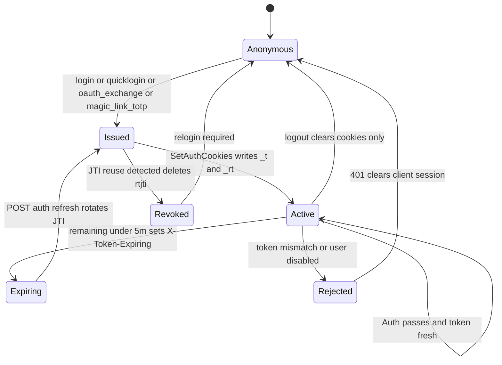
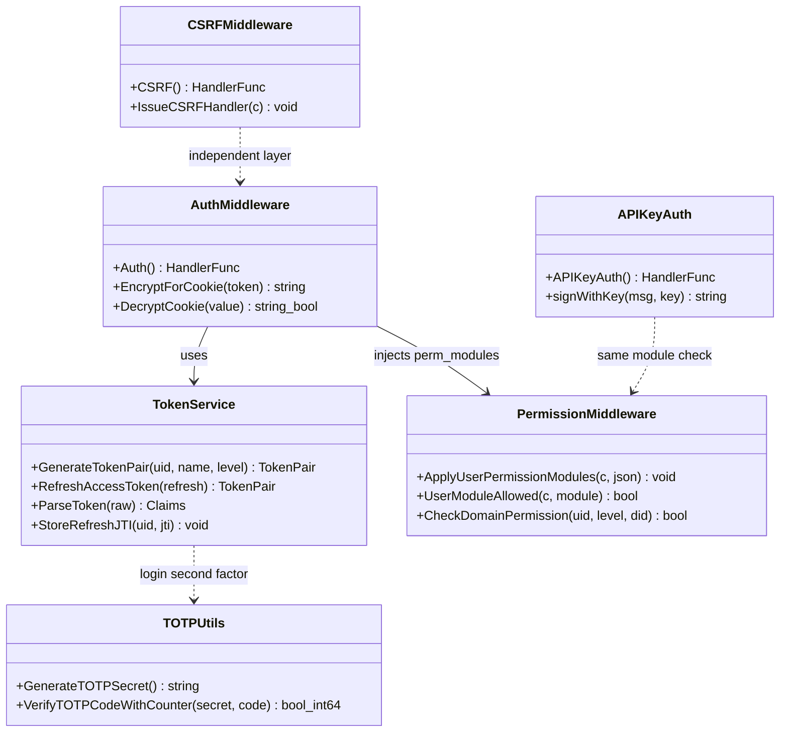
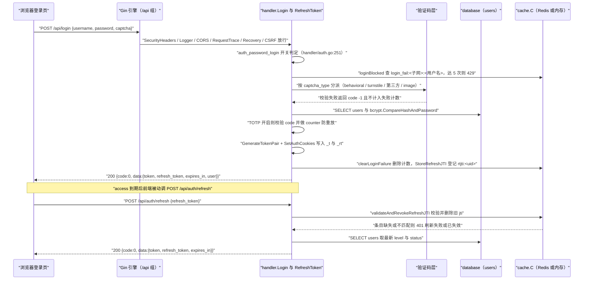
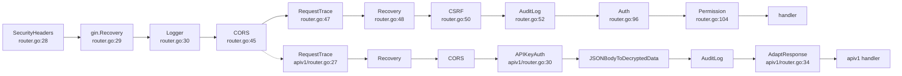
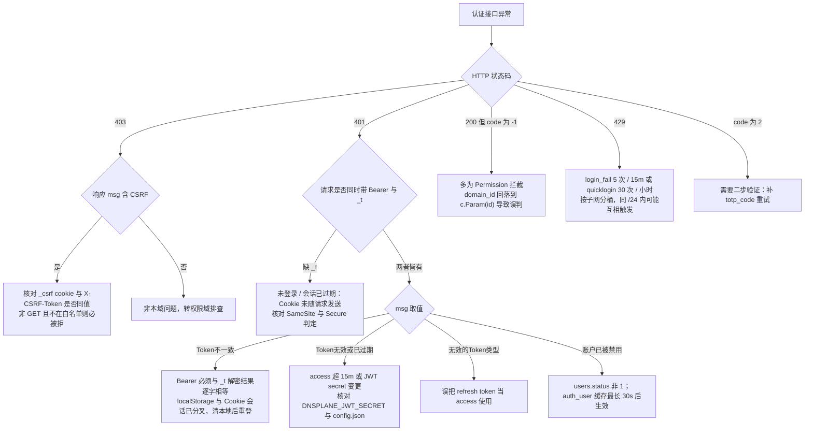

# 认证API

<cite>
**本文档引用的文件**
- [router.go](file://main/internal/api/router.go)
- [auth.go (middleware)](file://main/internal/api/middleware/auth.go)
- [csrf.go](file://main/internal/api/middleware/csrf.go)
- [audit.go](file://main/internal/api/middleware/audit.go)
- [sign.go](file://main/internal/api/middleware/sign.go)
- [permission.go](file://main/internal/api/middleware/permission.go)
- [auth.go (handler)](file://main/internal/api/handler/auth.go)
- [oauth.go (handler)](file://main/internal/api/handler/oauth.go)
- [captcha.go (handler)](file://main/internal/api/handler/captcha.go)
- [behavioral_captcha.go](file://main/internal/api/handler/behavioral_captcha.go)
- [quicklogin.go](file://main/internal/api/handler/quicklogin.go)
- [auth_control.go](file://main/internal/api/handler/auth_control.go)
- [user.go](file://main/internal/api/handler/user.go)
- [account.go](file://main/internal/api/handler/account.go)
- [plan.go](file://main/internal/api/handler/plan.go)
- [captcha.go (internal/captcha)](file://main/internal/captcha/captcha.go)
- [code.go](file://main/internal/verify/code.go)
- [totp.go](file://main/internal/utils/totp.go)
- [auth.go (apiv1)](file://main/internal/apiv1/auth.go)
- [router.go (apiv1)](file://main/internal/apiv1/router.go)
- [errors.go](file://main/internal/apiv1/errors.go)
- [response.go](file://main/internal/apiv1/response.go)
- [oauth.go (internal/oauth)](file://main/internal/oauth/oauth.go)
- [config.go](file://main/internal/config/config.go)
- [api.ts](file://web/lib/api.ts)
</cite>

## 目录

1. [简介](#简介)
2. [项目结构](#项目结构)
3. [核心组件](#核心组件)
4. [架构总览](#架构总览)
5. [详细组件分析](#详细组件分析)
6. [依赖关系分析](#依赖关系分析)
7. [性能考虑](#性能考虑)
8. [故障排查指南](#故障排查指南)
9. [结论](#结论)
10. [附录](#附录)

## 简介

认证 API 是 DNSPlane 全部受保护接口的入口层，负责身份建立、会话维持、二步验证、凭据找回与对外开放接口的签名鉴权。系统存在两条互不相通的链路：**控制台链路** `/api/*` 使用 HS256 JWT 双令牌加三条 Cookie（`_t` / `_rt` / `_csrf`）；**对外链路** `/api/v1/*` 使用 `users.api_key` 派生的 HMAC-SHA256 签名，不签发 JWT。

五条身份建立路径共用同一套签发函数 `middleware.GenerateTokenPair`（`main/internal/api/middleware/auth.go:229`），因此「登录方式」只影响凭据如何被验证，不影响会话结构。

| 认证方式 | 入口 Handler | 关键路由 | 凭据形态 | 生命周期 |
| --- | --- | --- | --- | --- |
| 用户名加口令 | `handler.Login`（`handler/auth.go:239`） | `POST /api/login`（`router.go:70`） | `_t` 与 `_rt`（AES-GCM 密文）加响应体明文 token | access 15m、refresh 7d |
| TOTP 二步验证 | `Login` 内联分支（`handler/auth.go:342`） | `POST /api/user/totp/*`（`router.go:282-285`） | `users.totp_secret`（`enc:v1:` 密文列） | 30s 窗口、前后各 1 格 |
| 邮箱魔法链接 | `RequestMagicLink`（`handler/auth.go:1216`）→ `QuickLogin`（`handler/quicklogin.go:124`） | `POST /api/auth/magic-link`、`GET /api/quicklogin` | cache 键 `ql:<64hex>` 的一次性 token | magic 15m、quicklogin 5m、命中即删 |
| OAuth 五家提供商 | `OAuthLogin`（`handler/oauth.go:71`）→ `OAuthExchange`（`:216`） | `GET /api/auth/oauth/:provider/login`、`POST /api/auth/oauth/exchange` | state 存 `oauth_state:<32hex>`；**响应体不含任何令牌** | state 5m 一次性 |
| API Key（对外 V1） | `apiv1.APIKeyAuth`（`apiv1/auth.go:44`） | `/api/v1` 组级（`apiv1/router.go:30`） | `users.api_key`（64 hex） | 无过期，直至管理员轮转 |

**章节来源**
- [main/internal/api/router.go:64-93](file://main/internal/api/router.go#L64-L93)
- [main/internal/apiv1/auth.go:23-115](file://main/internal/apiv1/auth.go#L23-L115)

## 项目结构

认证能力分布在「路由装配 / 中间件 / Handler / 独立子包」四层，无独立的 `auth` 包；核心九文件合计 3600 行（`wc -l` 实测），占后端非测试代码约 5%。

```text
main/internal/
├── api/
│   ├── router.go                  路由装配 + 中间件挂载顺序
│   ├── middleware/                auth（JWT+Cookie）/ csrf / permission / audit / sign
│   └── handler/                   auth / oauth / captcha / behavioral_captcha /
│                                  quicklogin / auth_control / user
├── apiv1/                         APIKeyAuth、errors.go 错误码、response.go 信封
├── captcha/  verify/  oauth/      行为验证码、邮箱验证码与频控、五家 Provider
└── utils/totp.go                  RFC 6238 口令生成与校验
```

| 文件 | 行数 | 唯一职责 | 关键符号与行号 |
| --- | --- | --- | --- |
| [main/internal/api/router.go](file://main/internal/api/router.go) | 464 | 路由与中间件顺序 | `newBaseEngine:24`、`applyAPIMiddleware:44`、`auth := api.Group(""):95` |
| [main/internal/api/middleware/auth.go](file://main/internal/api/middleware/auth.go) | 572 | 令牌签发与校验、Cookie 加密、CORS | `Auth:125`、`GenerateTokenPair:229`、`SetAuthCookies:296`、`RefreshAccessToken:382` |
| [main/internal/api/middleware/csrf.go](file://main/internal/api/middleware/csrf.go) | 130 | CSRF 校验 | `CSRF:70`、`IssueCSRFHandler:119`、`csrfSkipExact:36` |
| [main/internal/api/handler/auth.go](file://main/internal/api/handler/auth.go) | 1573 | 登录、刷新、注册、安装、TOTP、找回、魔法链接 | `Login:239`、`RefreshToken:417`、`RequestMagicLink:1216`、`Register:1420` |
| [main/internal/api/handler/oauth.go](file://main/internal/api/handler/oauth.go) | 565 | OAuth 登录与绑定 | `OAuthLogin:71`、`OAuthExchange:216`、`establishSession:396` |
| [main/internal/apiv1/auth.go](file://main/internal/apiv1/auth.go) | 165 | V1 HMAC 签名校验 | `APIKeyAuth:44`、`signWithKey:118`、`JSONBodyToDecryptedData:143` |
| [main/internal/captcha/captcha.go](file://main/internal/captcha/captcha.go) | 391 | 行为验证码生成与校验 | `Generate:134`、`Verify:265`、`storeCache:368` |
| [main/internal/verify/code.go](file://main/internal/verify/code.go) | 130 | 邮箱验证码与频控 | `Generate:33`、`Verify:62`、`CheckIPLimit:108`、`AllowPublicEmailRequest:120` |

**章节来源**
- [main/internal/api/router.go:24-53](file://main/internal/api/router.go#L24-L53)
- [main/internal/api/middleware/csrf.go:23-53](file://main/internal/api/middleware/csrf.go#L23-L53)

## 核心组件

### 会话令牌、Cookie 加密与令牌生命周期

`_t` 与 `_rt` 的值**不是** JWT 原文，而是 JWT 经 AES-256-GCM 加密后的 hex 串，密钥为 `sha256(config.jwt.secret)`（`deriveKey:35`）。输出形态为 `hex(nonce ‖ ciphertext ‖ tag)`，外部无法从 Cookie 长度或字符集推断令牌结构（`EncryptForCookie:45`、`DecryptCookie:66`）。

| 参数 | 取值 | 来源 |
| --- | --- | --- |
| `AccessTokenExpire` | `15 * time.Minute` | `middleware/auth.go:91` |
| `RefreshTokenExpire` | `7 * 24 * time.Hour` | `middleware/auth.go:92` |
| `authUserCacheTTL` | `30 * time.Second` | `middleware/auth.go:99` |
| Cookie `_t` | `Path=/`、`HttpOnly`、`SameSite=Strict` | `middleware/auth.go:308` |
| Cookie `_rt` | `Path=/api/auth/refresh`、`HttpOnly`、`SameSite=Strict` | `middleware/auth.go:309` |
| Cookie `_csrf` | `Path=/`、**非 HttpOnly**、TTL 7d | `middleware/csrf.go:66` |
| JWT 签名算法 | 强制 `*jwt.SigningMethodHMAC` | `middleware/auth.go:429` |
| JWT 密钥来源 | `config.jwt.secret`，可被 `DNSPLANE_JWT_SECRET` 覆盖 | `config/config.go:123` |
| `Secure` 属性判定 | `c.Request.TLS != nil` 或 `X-Forwarded-Proto: https` | `middleware/auth.go:324` |

`Auth` 中间件采用**双重持有校验**：`_t` 解密出的 access token 必须与 `Authorization: Bearer` 头逐字相等（`middleware/auth.go:146`）。仅拿到 Cookie 或仅拿到 Header 都不足以通过。refresh 令牌具备**一次性轮转加重用检测**：`validateAndRevokeRefreshJTI`（`middleware/auth.go:353`）在缓存就绪但条目缺失时直接拒绝，在 JTI 不匹配时删除该用户全部 refresh 记录；缓存未初始化时视为服务降级放行。



前端只在被 401 后被动刷新，`X-Token-Expiring` 信号（`middleware/auth.go:194`）从未被消费，因此 `Expiring → Issued` 这条边在当前实现中由 401 触发而非主动续期。

**图表来源**
- [main/internal/api/middleware/auth.go:190-196](file://main/internal/api/middleware/auth.go#L190-L196)
- [main/internal/api/middleware/auth.go:335-421](file://main/internal/api/middleware/auth.go#L335-L421)

**章节来源**
- [main/internal/api/middleware/auth.go:35-150](file://main/internal/api/middleware/auth.go#L35-L150)
- [main/internal/api/middleware/auth.go:314-421](file://main/internal/api/middleware/auth.go#L314-L421)
- [main/web/lib/api.ts:170-237](file://web/lib/api.ts#L170-L237)

### 核心组件契约



`middleware/apikey.go` 与 `apiv1/auth.go` 是同一功能的**两份实现**，前者在全仓无任何调用点，后者为实际生效版本；两者语义已分叉（`apikey.go:83` 一条 SQL 同时校验 `is_api` 与 `status`，`apiv1/auth.go:82-91` 拆成两次判断并给出不同错误码）。阅读代码时以 `apiv1/auth.go` 为准。

**图表来源**
- [main/internal/api/middleware/auth.go:125-229](file://main/internal/api/middleware/auth.go#L125-L229)
- [main/internal/apiv1/auth.go:44-165](file://main/internal/apiv1/auth.go#L44-L165)

**章节来源**
- [main/internal/api/middleware/permission.go:335-392](file://main/internal/api/middleware/permission.go#L335-L392)

## 架构总览



三条影响集成的事实：登录直接用 `c.ShouldBindJSON`（`handler/auth.go:241`）而非 `BindDecryptedData`；登录成功与失败都**不进审计库**（`audit.go:99-100` 前缀跳过）；验证码类失败不累加 `login_fail` 计数（`handler/auth.go:286`、`:293`、`:298`、`:304`、`:308`）。

**图表来源**
- [main/internal/api/handler/auth.go:239-456](file://main/internal/api/handler/auth.go#L239-L456)
- [main/internal/api/middleware/csrf.go:36-53](file://main/internal/api/middleware/csrf.go#L36-L53)
- [main/internal/api/middleware/auth.go:353-421](file://main/internal/api/middleware/auth.go#L353-L421)

**章节来源**
- [main/internal/api/middleware/audit.go:97-122](file://main/internal/api/middleware/audit.go#L97-L122)

## 详细组件分析

### 端点总清单

下表为认证域全部 39 条路由。`认证` 列：`公开` 即不经 `Auth`；`会话` 即经 `Auth` 加 `Permission`（`router.go:96`、`:104`）。`CSRF` 列标注是否命中 `csrfSkipExact`（`csrf.go:36-53`）或 `csrfSkipPrefixes`（`csrf.go:30-34`）。

| # | Method / Path | 认证 | CSRF | Handler（file:line） |
| --- | --- | --- | --- | --- |
| 1 | `GET /api/csrf` | 公开 | 是 | `middleware.IssueCSRFHandler`（`csrf.go:119`） |
| 2 | `POST /api/login` | 公开 | 是 | `handler.Login`（`auth.go:239`） |
| 3 | `POST /api/logout` | 会话 | 否 | `handler.Logout`（`auth.go:406`） |
| 4 | `POST /api/auth/refresh` | 公开 | 是 | `handler.RefreshToken`（`auth.go:417`） |
| 5 | `GET /api/auth/config` | 公开 | 是 | `handler.GetAuthConfig`（`auth.go:173`） |
| 6 | `GET /api/auth/captcha` | 公开 | 是 | `handler.GetCaptcha`（`auth.go:156`） |
| 7 | `GET /api/auth/captcha/behavioral` | 公开 | GET 免校验 | `handler.GetBehavioralCaptcha`（`behavioral_captcha.go:34`） |
| 8 | `POST /api/auth/captcha/behavioral/verify` | 公开 | **否** | `handler.VerifyBehavioralCaptcha`（`behavioral_captcha.go:54`） |
| 9 | `POST /api/install` | 公开 | 是 | `handler.Install`（`auth.go:526`） |
| 10 | `GET /api/install/status` | 公开 | 是 | `handler.InstallStatus`（`auth.go:575`） |
| 11 | `POST /api/auth/register` | 公开 | 是 | `handler.Register`（`auth.go:1420`） |
| 12 | `POST /api/auth/send-code` | 公开 | 是 | `handler.SendAuthCode`（`auth.go:1353`） |
| 13 | `POST /api/auth/forgot-password` | 公开 | 是 | `handler.ForgotPassword`（`auth.go:840`） |
| 14 | `POST /api/auth/reset-password` | 公开 | 是 | `handler.ResetPassword`（`auth.go:893`） |
| 15 | `POST /api/auth/forgot-totp` | 公开 | 是 | `handler.ForgotTOTP`（`auth.go:942`） |
| 16 | `POST /api/auth/reset-totp` | 公开 | 是 | `handler.ResetTOTP`（`auth.go:997`） |
| 17 | `POST /api/auth/magic-link` | 公开 | 是 | `handler.RequestMagicLink`（`auth.go:1216`） |
| 18 | `POST /api/auth/magic-link/totp` | 公开 | 是 | `handler.MagicLinkVerifyTotp`（`auth.go:1271`） |
| 19 | `GET /api/quicklogin` | 一次性 token | 前缀放行 | `handler.QuickLogin`（`quicklogin.go:124`） |
| 20 | `GET /api/auth/oauth/providers` | 公开 | 是 | `handler.GetOAuthProviders`（`oauth.go:65`） |
| 21 | `GET /api/auth/oauth/:provider/login` | 公开 | 前缀放行 | `handler.OAuthLogin`（`oauth.go:71`） |
| 22 | `POST /api/auth/oauth/exchange` | 公开 | 前缀放行 | `handler.OAuthExchange`（`oauth.go:216`） |
| 23 | `GET /api/auth/oauth/:provider/callback` | 公开 | 前缀放行 | `handler.OAuthCallback`（`oauth.go:185`） |
| 24 | `GET /api/user/info` | 会话 | GET 免校验 | `handler.GetUserInfo`（`auth.go:458`） |
| 25 | `GET /api/user/quota` | 会话 | GET 免校验 | `handler.GetMyQuota`（`plan.go:722`） |
| 26 | `POST /api/user/password` | 会话 | 否 | `handler.ChangePassword`（`auth.go:487`） |
| 27 | `POST /api/user/bind-email/send-code` | 会话 | 否 | `handler.SendBindEmailCode`（`auth.go:1507`） |
| 28 | `POST /api/user/bind-email` | 会话 | 否 | `handler.BindEmail`（`auth.go:1544`） |
| 29 | `GET /api/user/totp/status` | 会话 | GET 免校验 | `handler.GetTOTPStatus`（`auth.go:587`） |
| 30 | `POST /api/user/totp/enable` | 会话 | 否 | `handler.EnableTOTP`（`auth.go:605`） |
| 31 | `POST /api/user/totp/verify` | 会话 | 否 | `handler.VerifyAndEnableTOTP`（`auth.go:652`） |
| 32 | `POST /api/user/totp/disable` | 会话 | 否 | `handler.DisableTOTP`（`auth.go:688`） |
| 33 | `GET /api/user/oauth/bindings` | 会话 | GET 免校验 | `handler.GetOAuthBindings`（`oauth.go:423`） |
| 34 | `POST /api/user/oauth/bind-url` | 会话 | 否 | `handler.GetOAuthBindURL`（`oauth.go:431`） |
| 35 | `POST /api/user/oauth/unbind` | 会话 | 否 | `handler.UnbindOAuth`（`oauth.go:468`） |
| 36 | `GET /api/system/auth-control` | 会话 | GET 免校验 | `handler.GetAuthControl`（`auth_control.go:97`） |
| 37 | `POST /api/system/auth-control` | 会话 | 否 | `handler.UpdateAuthControl`（`auth_control.go:124`） |
| 38 | `POST /api/users/:id/send-reset` | 会话（管理员） | 否 | `handler.AdminSendResetEmail`（`auth.go:1039`） |
| 39 | `POST /api/users/:id/reset-totp` | 会话（管理员） | 否 | `handler.AdminResetTOTP`（`auth.go:1103`） |

相邻但属凭据生命周期的 `POST /api/users/:id/reset-apikey`（`router.go:213` → `handler.ResetAPIKey` `user.go:369`）一并纳入排障范围。

**章节来源**
- [main/internal/api/router.go:68-93](file://main/internal/api/router.go#L68-L93)
- [main/internal/api/router.go:213-289](file://main/internal/api/router.go#L213-L289)

### 口令登录、退出与刷新 `POST /api/login`、`POST /api/logout`、`POST /api/auth/refresh`

- **请求参数**：`username`、`password` 必填，另有 `captcha_id`、`captcha_code`、`verify_token`、`totp_code`，加内嵌的 `turnstile_token` / `cf-turnstile-response` 与 `captcha_token` / `g-recaptcha-response` / `h-captcha-response`（`handler/auth.go:143-154`）
- **响应**：`code:0` 加 `data{token, refresh_token, expires_in, user{id, username, level}}`；需二步验证时返回 `code:2` 且**不带 data**，中间态形如 `{ "code": 2, "msg": "需要进行二步验证" }`
- **变体**：`captcha_type=behavioral` 时，`captcha_id` 与 `captcha_code` 换成 `verify_token`
- **错误码**：`code:-1` 配「管理员已关闭密码登录」「用户名或密码错误」「账户已被禁用」「验证码不能为空」「验证码错误」「验证码已使用，请等待下一个周期」；HTTP 429 配「登录失败次数过多，请 15 分钟后再试」
- **Handler**：`handler.Login`（`main/internal/api/handler/auth.go:239`）

```json
{ "username": "ops_admin", "password": "{用户口令}", "captcha_id": "9f1c2e7a-4b6d-4c1e-8a2f-1d0e5b6c7a88", "captcha_code": "K7MD", "totp_code": "481902" }
```

```json
{ "code": 0, "msg": "登录成功", "data": { "token": "eyJhbGciOiJIUzI1NiIsInR5cCI6IkpXVCJ9.{access JWT}", "refresh_token": "eyJhbGciOiJIUzI1NiIsInR5cCI6IkpXVCJ9.{refresh JWT}", "expires_in": 900, "user": { "id": 1, "username": "ops_admin", "level": 2 } } }
```

- **`logout`**：无请求参数，响应 `{code:0, msg:"退出成功"}`。仅调用 `ClearAuthCookies`（`middleware/auth.go:314`）删除 `_t` 与 `_rt`，**不删除** `rtjti:<uid>`——Cookie 被清后，持有旧 refresh token 明文的一方在 7 天内仍可换取全新会话（`handler/auth.go:406-411`）
- **`refresh`**：公开端点，CSRF 精确放行（`csrf.go:47`）。`refresh_token` 可选，缺省时回落到 `_rt` Cookie 并 `DecryptCookie`（`handler/auth.go:425-429`）；失败为 HTTP 401 加 `code:401`，`msg` 为「缺少 refresh token」或「刷新失败或已失效」
- **Handler**：`handler.Logout`（`auth.go:406`）、`handler.RefreshToken`（`auth.go:417`）

```json
{ "code": 0, "msg": "ok", "data": { "token": "eyJhbGciOiJIUzI1NiIsInR5cCI6IkpXVCJ9.{new access JWT}", "refresh_token": "eyJhbGciOiJIUzI1NiIsInR5cCI6IkpXVCJ9.{new refresh JWT}", "expires_in": 900 } }
```

**章节来源**
- [main/internal/api/handler/auth.go:143-404](file://main/internal/api/handler/auth.go#L143-L404)
- [main/internal/api/handler/auth.go:406-456](file://main/internal/api/handler/auth.go#L406-L456)
- [main/internal/api/middleware/auth.go:314-421](file://main/internal/api/middleware/auth.go#L314-L421)

### 认证配置、CSRF 发放与验证码三型 `GET /api/auth/config`、`GET /api/csrf`、`/api/auth/captcha*`

- **`config` 响应字段**（`handler/auth.go:213-231`）：`login_captcha`、`captcha_enabled`、`captcha_type`（缺省 `image`）、`register_enabled`、`password_register_enabled`、`magic_link_login_enabled`、`turnstile_standalone_required`、`captcha_type_turnstile`；`turnstile_site_key` 与 `captcha_site_key` **非空才下发**
- **关键设计**：两个布尔量无条件下发，便于前端区分「未开启」与「后端未实现」；两个站点密钥按 `captcha_type` 收起，避免 Turnstile 拿到 reCAPTCHA 的 key
- **`csrf`**：token 为 32 字节随机 hex（`csrf.go:55-58`）。前端优先读 `document.cookie._csrf`，缺失才调本接口，并用 `csrfInFlight` 合并并发（`web/lib/api.ts:38-62`）
- **Handler**：`handler.GetAuthConfig`（`auth.go:173`）、`middleware.IssueCSRFHandler`（`csrf.go:119`）

```json
{ "code": 0, "data": { "login_captcha": true, "captcha_enabled": true, "captcha_type": "behavioral", "register_enabled": false, "password_register_enabled": false, "magic_link_login_enabled": true, "turnstile_standalone_required": false, "captcha_type_turnstile": false } }
```

`GET /api/csrf` 的响应为 `{ "code": 0, "msg": "ok", "data": { "token": "{64位hex CSRF令牌}" } }`。

| 端点 | 实现 | 响应载荷 | 缓存键与 TTL |
| --- | --- | --- | --- |
| `GET /api/auth/captcha` | `base64Captcha.DefaultMemStore`（`handler/auth.go:32`），60×200、4 字符 | `{captcha_id, captcha_image}` | 进程内 store，无对外 TTL |
| `GET /api/auth/captcha/behavioral?type=click\|slide\|rotate` | `captcha.Generate`（`captcha.go:134`），`type` 缺省随机 | `CaptchaResult{id, type, master_image, thumb_image, thumb_*}`（`captcha.go:103-113`） | `captcha:<uuid>`，5m（`captcha.go:30-31`） |
| `POST /api/auth/captcha/behavioral/verify` | `captcha.Verify`（`captcha.go:265`） | `{verify_token}` | `captcha_verify:<uuid>`，10m（`behavioral_captcha.go:18-19`） |

```json
{ "captcha_id": "0d7f1c6a-3b58-4c12-9f0e-2a6b8d4c1e77", "captcha_type": "slide", "answer": { "x": 132, "y": 0 } }
```

```json
{ "code": 0, "data": { "verify_token": "7c4f1a92-0b6d-4c5e-8f21-3a9d5c7b0e14" } }
```

- **消费**：登录的 `behavioral` / `go-captcha` 分支调用 `ConsumeCaptchaVerifyToken`（`behavioral_captcha.go:88`），读取即删
- **边界**：`captcha.Verify` 按**请求体里的** `captcha_type` 选择校验分支而不读缓存中的 `type`，存在类型混淆绕过，且校验前即删除缓存键（`captcha.go:272`），答错一次就要重取整张验证码；`/api/auth/captcha/behavioral/verify` 不在 `csrfSkipExact` 中（`csrf.go:36-53` 只有 `/api/auth/captcha`），脚本化调用需先取 `_csrf`
- **Handler**：`handler.GetCaptcha`（`auth.go:156`）、`handler.GetBehavioralCaptcha`（`behavioral_captcha.go:34`）、`handler.VerifyBehavioralCaptcha`（`behavioral_captcha.go:54`）

**章节来源**
- [main/internal/api/handler/auth.go:173-237](file://main/internal/api/handler/auth.go#L173-L237)
- [main/internal/api/middleware/csrf.go:55-129](file://main/internal/api/middleware/csrf.go#L55-L129)
- [main/internal/api/handler/behavioral_captcha.go:18-99](file://main/internal/api/handler/behavioral_captcha.go#L18-L99)
- [main/internal/captcha/captcha.go:29-286](file://main/internal/captcha/captcha.go#L29-L286)

### 安装与注册 `POST /api/install`、`GET /api/install/status`、`POST /api/auth/register`、`POST /api/auth/send-code`

- **`install`**：公开且无验证码、无 Origin 校验，仅靠「库中用户数大于 0 即拒绝」（`handler/auth.go:527-533`）作幂等保护；`username` 必填、`password` 必填且 `min=8` 并过 `ValidatePasswordStrength`，写入 `level=2`、`status=1`、bcrypt cost 12（`handler/auth.go:36`）。`install/status` 返回 `{code:0, data:{installed:false}}`
- **注册门禁链**（`handler/auth.go:1433-1464`）：`requireSystemInstalled` → `register_enabled` **且** `auth_password_register` → 用户名长度 2～64 → 邮箱白名单 → `auth_email_verify` 开启时校验验证码 → 强密码 → 用户名与邮箱双查重
- **落库**：`level=0`、`status=1`；成功后 `grantDefaultPlanIfAny`（失败只记日志不回滚）与 `dbcache.BustUserList()`
- **`send-code` 三重门禁**：仅 `scene=register`（`handler/auth.go:1366`）；关闭邮箱验证时返回 `code:0` 并说明「无需验证码」。频控 `reg_code` IP 24 次/小时、邮箱 8 次/小时（`handler/auth.go:1392`）；`verify.Generate` 另有 60s 重发间隔、TTL 5m、错 5 次作废（`verify/code.go:11-15`）
- **Handler**：`handler.Install`（`auth.go:526`）、`handler.InstallStatus`（`auth.go:575`）、`handler.Register`（`auth.go:1420`）、`handler.SendAuthCode`（`auth.go:1353`）

```json
{ "username": "new_operator", "password": "{满足复杂度的口令}", "email": "ops@example.com", "code": "6HJK2M4P" }
```

成功返回 `{ "code": 0, "msg": "注册成功" }`。注册接口在关闭邮箱验证后**没有任何速率限制与人机验证**，可被批量注册，属已知缺口。

**章节来源**
- [main/internal/api/handler/auth.go:526-584](file://main/internal/api/handler/auth.go#L526-L584)
- [main/internal/api/handler/auth.go:1133-1504](file://main/internal/api/handler/auth.go#L1133-L1504)

### 凭据找回与 TOTP 生命周期 `POST /api/auth/{forgot,reset}-{password,totp}`、`GET|POST /api/user/totp/*`

- **顺序固定**：`requireSensitiveCaptcha` **置于限流之前**（`handler/auth.go:852`、`:952`、`:1007`），人机验证失败不消耗 IP 加邮箱配额；`reset-totp` 额外要求再过一次人机验证
- **频控**：`forgot_pw` 与 `forgot_totp` 均为 IP 12 次/小时、邮箱 5 次/小时（`handler/auth.go:857`、`:957`）
- **模糊口径**：无论用户是否存在、邮件是否配置，响应恒为「如果该邮箱已注册，您将收到重置邮件」；`forgot-totp` 还要求 `user.TOTPOpen`（`handler/auth.go:968`）
- **Token 存储**：明文只进邮件正文，落库为 SHA-256 指纹（`hashResetToken` `handler/auth.go:745`），`reset_type` 为 `password` 或 `totp`，有效期 30 分钟；`reset-totp` 写入 `totp_open=false`、`totp_secret=""` 并清空 reset 三列（`handler/auth.go:1026-1032`）
- **Handler**：`handler.ForgotPassword`（`auth.go:840`）、`handler.ResetPassword`（`auth.go:893`）、`handler.ForgotTOTP`（`auth.go:942`）、`handler.ResetTOTP`（`auth.go:997`）

```json
{ "email": "ops@example.com", "turnstile_token": "{Turnstile 令牌}" }
```

```json
{ "token": "{64位hex重置令牌}", "password": "{新口令}" }
```

成功返回 `{ "code": 0, "msg": "二步验证已关闭，请重新登录" }`（密码重置为「密码重置成功」）。两个缺口：改密与重置均不吊销既有会话——既不删 `rtjti:<uid>`，也不调用 `InvalidateAuthUserCache`（`middleware/auth.go:473` 定义后全仓零调用点）；TOTP 重置与密码重置共用同一邮箱信任链，组合即「邮箱可达等于账户完全接管」，且不发安全提醒、不进审计库。

TOTP 四条路由构成「生成 → 验证 → 启用 → 解除」闭环，全部要求会话（`router.go:282-285`）。

| 端点 | 请求参数 | 响应 | 副作用 |
| --- | --- | --- | --- |
| `GET /api/user/totp/status` | 无 | `{totp_open}` | 只读 |
| `POST /api/user/totp/enable` | 无 | `{secret, uri}` | 写 `totp_secret`，**不置** `totp_open` |
| `POST /api/user/totp/verify` | `{code}` | `{code:0, msg}` | 验证通过才 `totp_open=true` |
| `POST /api/user/totp/disable` | `{password, code}` | `{code:0, msg}` | `totp_open=false`、`totp_secret=""` |

```json
{ "code": 0, "data": { "secret": "GEZDGNBVGY3TQOJQGEZDGNBVGY3TQOJQ", "uri": "otpauth://totp/DNSPlane:ops_admin?secret={Base32密钥}&issuer=DNSPlane" } }
```

密钥参数：HMAC-SHA1、30s 周期、6 位、校验窗口正负 1 格（`utils/totp.go:70-82`）；`secret` 为 20 字节随机 Base32（`utils/totp.go:26`）；`uri` 的 Issuer 取 `site_name`、缺省 `DNSPlane`（`handler/auth.go:627-637`）。两点必须注意：`EnableTOTP` 响应中的 `uri` 键名不在脱敏列表内，完整密钥会进入请求日志响应体；前端 `totpApi.regenerateRecovery` 调用的 `POST /user/totp/recovery/regenerate` 在 `router.go` 中**不存在**，`utils.GenerateRecoveryCodes`（`utils/totp.go:136`）零调用点，恢复码功能目前无法兑现。

**章节来源**
- [main/internal/api/handler/auth.go:587-728](file://main/internal/api/handler/auth.go#L587-L728)
- [main/internal/api/handler/auth.go:731-1036](file://main/internal/api/handler/auth.go#L731-L1036)
- [main/internal/api/handler/captcha.go:111-135](file://main/internal/api/handler/captcha.go#L111-L135)
- [main/internal/utils/totp.go:26-148](file://main/internal/utils/totp.go#L26-L148)

### OAuth 登录链与提供商绑定 `GET /api/auth/oauth/:provider/login`、`POST /api/auth/oauth/exchange`、`GET|POST /api/user/oauth/*`

- **认证**：三条均公开；`/api/auth/oauth/` 整体命中 CSRF 前缀放行（`csrf.go:31`），因第三方 302 回跳无法携带自定义头
- **`OAuthLogin`**：校验 `auth_oauth_<provider>_login`，关闭时 307 回 `/login?error=provider_login_off` → 生成 16 字节 hex state 存 `oauth_state:<state>`（TTL 5m）→ 307 跳授权页
- **redirect_uri**：固定 `<site_url>/oauth-callback`（`oauthCallbackPageURL` `handler/oauth.go:166`），授权请求与令牌交换两处必须逐字一致
- **`OAuthExchange`**：入参 `{code, state}`，state 一次性消费；成功响应**不含任何令牌**，只回 `{mode, redirect}`，会话由 HttpOnly Cookie 承载，前端另调 `POST /api/auth/refresh` 取回 access（`web/lib/api.ts:842-850`）
- **`OAuthCallback`**：兼容路径，第三方后台仍配置旧回调地址时由后端直接换会话，成功 302 到 `/dashboard/`
- **自动建号**：`applyOAuthLogin`（`handler/oauth.go:279`）要求 `register_enabled == "true"` **且** `auth_oauth_<provider>_register` 开启，`level=1`、`Password=""`（无法口令登录）
- **Handler**：`handler.OAuthLogin`（`oauth.go:71`）、`handler.OAuthExchange`（`oauth.go:216`）、`handler.OAuthCallback`（`oauth.go:185`）

```json
{ "code": "{第三方授权码}", "state": "3f9a1c7d0b6e4a218c5d7e9f0a1b2c3d" }
```

成功返回 `{ "code": 0, "data": { "mode": "login", "redirect": "/dashboard/" } }`；失败时 `code:-1`、`msg` 为错误码字符串，取值集合（`handler/oauth.go:263-276`）：`invalid_request`、`invalid_state`、`provider_login_off`、`provider_error`、`token_failed`、`userinfo_failed`、`register_disabled`、`email_not_whitelisted`、`account_disabled`、`user_not_found`、`create_failed`、`already_bound_other`。

- `providers`：公开，返回 `[]oauth.ProviderInfo{name, display_name, icon, enabled}`（`internal/oauth/oauth.go:62-67`），不含密钥；工厂覆盖 `github` / `google` / `wechat` / `dingtalk` / `custom`（`oauth.go:70-76`）。`enabled` 只反映是否配置，**不反映** `auth_oauth_<provider>_login` 开关，前端隐藏按钮须自行读 `auth-control`
- `bindings`：会话，返回当前用户全部 `UserOAuth` 行；`bind-url`：入参 `{provider}`，返回 `data{url}`，state 条目携带 `BindUID` 与 `Mode:"bind"`（`handler/oauth.go:452-456`）；`unbind`：入参 `{provider}`，`RowsAffected` 为 0 时报「未找到绑定记录」，成功写审计 `oauth_unbind`
- **Handler**：`handler.GetOAuthProviders`（`oauth.go:65`）、`handler.GetOAuthBindings`（`oauth.go:423`）、`handler.GetOAuthBindURL`（`oauth.go:431`）、`handler.UnbindOAuth`（`oauth.go:468`）

```json
{ "code": 0, "data": [ { "name": "github", "display_name": "GitHub", "icon": "github", "enabled": true }, { "name": "dingtalk", "display_name": "钉钉", "icon": "dingtalk", "enabled": true } ] }
```

`bind-url` 的响应形状为 `{ "code": 0, "data": { "url": "https://github.com/login/oauth/authorize?client_id={ClientID}&redirect_uri={站点地址}%2Foauth-callback&state=3f9a1c7d" } }`。

**章节来源**
- [main/internal/api/handler/oauth.go:24-343](file://main/internal/api/handler/oauth.go#L24-L343)
- [main/internal/api/handler/oauth.go:65-68](file://main/internal/api/handler/oauth.go#L65-L68)
- [main/internal/api/handler/oauth.go:396-420](file://main/internal/api/handler/oauth.go#L396-L420)
- [main/internal/oauth/oauth.go:52-152](file://main/internal/oauth/oauth.go#L52-L152)

### 魔法链接登录 `POST /api/auth/magic-link`、`POST /api/auth/magic-link/totp`、`GET /api/quicklogin`

- **开关**：`auth_magic_link_login` 必须显式为 `true` 或 `1` 才开启（`handler/auth.go:1227`），与其他开关「未配置视为开启」的默认方向相反
- **`magic-link`**：入参 `{email}`；频控 `magic_link` 15/5；token 为 32 字节 hex 存 `ql:<token>`，TTL **15 分钟**（`handler/auth.go:1251-1256`）；链接指向 `<site_url>/magic-login?token=...`
- **`quicklogin`**：注册在 `api` 组内但在 `auth` 组外（`router.go:337`），经全链除 `Auth` 与 `Permission`；IP 限流 30 次/小时（`handler/quicklogin.go:126`）；token 命中即删；无 TOTP 则签发会话并 302，有 TOTP 则写中间态 `mtp:<preauth>`（TTL 10 分钟）并 302 到 `/magic-login/totp/?preauth=...`
- **`magic-link/totp`**：入参 `{preauth_token, totp_code}`；`verify.CheckIPLimit(ip, 60)` 补验限流（调用点 `handler/auth.go:1280`）；通过后签发会话，响应体含 token 明文
- **Handler**：`handler.RequestMagicLink`（`auth.go:1216`）、`handler.MagicLinkVerifyTotp`（`auth.go:1271`）、`handler.QuickLogin`（`quicklogin.go:124`）

```json
{ "code": 0, "msg": "登录成功", "data": { "token": "eyJhbGciOiJIUzI1NiIsInR5cCI6IkpXVCJ9.{access JWT}", "refresh_token": "eyJhbGciOiJIUzI1NiIsInR5cCI6IkpXVCJ9.{refresh JWT}", "expires_in": 900, "redirect": "/dashboard/", "user": { "id": 3, "username": "ops_admin", "level": 2 } } }
```

两点实现现状：`GET /api/quicklogin?token=...` 的查询串未经脱敏即写入请求日志（`middleware/request_trace.go:278`，脱敏列表只作用于 body 与 headers），一次性令牌会长期留存；域名快捷登录 `GET /api/domains/:id/loginurl`（`router.go:274`）的 `GetQuickLoginURLRequest.DomainID`（`handler/quicklogin.go:52`）只有 `json` 标签，而 `BindDecryptedData` 对 GET 走 `ShouldBindQuery`，`?domain_id=` 绑不上，该端点当前必然返回「参数解析失败」。

**章节来源**
- [main/internal/api/handler/auth.go:1212-1350](file://main/internal/api/handler/auth.go#L1212-L1350)
- [main/internal/api/handler/quicklogin.go:23-204](file://main/internal/api/handler/quicklogin.go#L23-L204)

### 会话资料、认证控制与管理员凭据操作 `GET /api/user/info`、`POST /api/user/{password,bind-email*}`、`GET|POST /api/system/auth-control`、`POST /api/users/:id/*`

- **`user/info`**：返回 `id` / `username` / `email` / `level` / `is_api` / `api_key` / `totp_open` / `reg_time` / `last_time`（`handler/auth.go:469-479`）。`api_key` 无条件回传，而该 key 同时是 V1 的 HMAC 签名私钥，泄露等同账户级 API 权限永久泄露
- **`user/password`**：入参 `{old_password, new_password}`，`new_password` 需 `min=8` 且过复杂度校验（`ChangePasswordRequest` `handler/auth.go:482-485`）；改密后不吊销既有会话
- **`bind-email/send-code`**：排除自身的邮箱占用检查（`LOWER(TRIM(email))` 比较，`handler/auth.go:1518`）；频控 `bind_mail` 30/12。`bind-email`：入参 `{email, code}`，`verify.Verify(email, "bindmail", code)` 通过后更新 `users.email`
- **Handler**：`handler.GetUserInfo`（`auth.go:458`）、`handler.ChangePassword`（`auth.go:487`）、`handler.SendBindEmailCode`（`auth.go:1507`）、`handler.BindEmail`（`auth.go:1544`）

```json
{ "old_password": "{原口令}", "new_password": "{新口令}" }
```

```json
{ "code": 0, "data": { "id": 1, "username": "ops_admin", "email": "ops@example.com", "level": 2, "is_api": true, "api_key": "{64位hex API Key，已脱敏}", "totp_open": true, "reg_time": "2026-01-12T09:30:00+08:00", "last_time": "2026-10-11T08:15:22+08:00" } }
```

- **固定键白名单**（`authControlFixedKeys` `handler/auth_control.go:37-47`）：`auth_password_login`、`auth_password_register`、`auth_magic_link_login`、`auth_email_verify`、`auth_email_whitelist_enabled`、`auth_email_whitelist`、`register_enabled`；动态键 `auth_oauth_<provider>_login` / `_register` 按前后缀放行（`auth_control.go:49-64`）
- **写入即失效**：`UpdateAuthControl` 之后调用 `InvalidateSysConfigCache`。本端点键清单是 `InvalidateAllAuthConfigCache` 的子集，`turnstile_secret_key` 等凭据不进入返回体
- **管理员三条**均以 `requireAdmin`（`handler/account.go:43`）为首个分支。`send-reset` 入参 `{type}` 限 `password|totp`，token 有效期 **60 分钟**（比自助流程长，`handler/auth.go:1075`）；`reset-totp` 无请求体，未启用时报「该用户未启用二步验证」；`reset-apikey` 在 `is_api=false` 时报「用户未启用API访问」，成功后回传新 key 并 `dbcache.BustUserList()`（`handler/user.go:369-391`）
- **Handler**：`handler.GetAuthControl`（`auth_control.go:97`）、`handler.UpdateAuthControl`（`auth_control.go:124`）、`handler.AdminSendResetEmail`（`auth.go:1039`）、`handler.AdminResetTOTP`（`auth.go:1103`）、`handler.ResetAPIKey`（`user.go:369`）

```json
{ "code": 0, "data": { "config": { "auth_password_login": "true", "auth_password_register": "false", "auth_magic_link_login": "true", "auth_email_verify": "true", "auth_email_whitelist_enabled": "false", "auth_email_whitelist": "", "register_enabled": "false", "auth_oauth_github_login": "true", "auth_oauth_github_register": "false" } } }
```

`reset-apikey` 成功返回 `{ "code": 0, "msg": "重新生成成功", "data": { "api_key": "{新64位hex API Key，已脱敏}" } }`。各开关缺省语义**不一致**，是配置侧最容易踩的点：

| 开关键 | 缺省语义 | 判定函数 |
| --- | --- | --- |
| `auth_password_login` | 未配置即开 | `handlerSwitchOn`（`handler/auth.go:1142`） |
| `captcha_enabled` 回落 `login_captcha` | 未配置即需要验证码 | `Login` 内联查询（`handler/auth.go:266-276`） |
| `register_enabled` | 未配置即**关**（必须显式 `true`） | `authRegisterPolicy`（`handler/auth.go:1133`） |
| `auth_password_register` | 未配置即关（需 `true` 或 `1`） | `authRegisterPolicy` |
| `auth_email_verify` | 未配置即开 | `authEmailVerifyRequired`（`handler/auth.go:1153`） |
| `auth_email_whitelist_enabled` | 未配置即不限制（需显式 `true`） | `registerEmailPassesWhitelist`（`handler/auth.go:1160`） |
| `auth_magic_link_login` | 未配置即**关**（需 `true` 或 `1`） | `handler/auth.go:1227` |
| `auth_oauth_<provider>_login` / `_register` | 未配置即开 | `handlerSwitchOn`（`handler/oauth.go:83`、`:310`） |

**章节来源**
- [main/internal/api/handler/auth.go:458-524](file://main/internal/api/handler/auth.go#L458-L524)
- [main/internal/api/handler/auth.go:1039-1200](file://main/internal/api/handler/auth.go#L1039-L1200)
- [main/internal/api/handler/auth.go:1507-1573](file://main/internal/api/handler/auth.go#L1507-L1573)
- [main/internal/api/handler/auth_control.go:22-140](file://main/internal/api/handler/auth_control.go#L22-L140)

### 对外 API Key 签名鉴权 `/api/v1/*`

- **认证**：不签发 JWT；`apiv1.APIKeyAuth`（`main/internal/apiv1/auth.go:44`）为组级中间件（`apiv1/router.go:30`）
- **请求头**：`X-API-UID`（站内数字 ID）、`X-API-Timestamp`（Unix 秒）、`X-API-Sign`
- **待签串**：`uid + "\n" + timestamp + "\n" + METHOD + "\n" + PATH`，密钥为 `users.api_key`，HMAC-SHA256 后 hex（`apiv1/auth.go:93-94`、`signWithKey:118`）；窗口正负 5 分钟（`apiKeyTimestampTolerance` `apiv1/auth.go:37`），比较用 `hmac.Equal`
- **注入上下文**：`user_id`（字符串）、`username`、`level`、`auth_type="apikey"`、`ApplyUserPermissionModules`；**无 CSRF**，因 API Key 客户端没有 `_csrf` cookie（`apiv1/router.go:11-15`）
- **响应信封**：`{code, request_id, data}` 或 `{code, request_id, message}`（`apiv1/response.go:26-44`），码值见附录

```go
message := uid + "\n" + timestamp + "\n" + method + "\n" + path
mac := hmac.New(sha256.New, []byte(apiKey))
mac.Write([]byte(message))
sign := hex.EncodeToString(mac.Sum(nil))
```

```json
{ "headers": { "X-API-UID": "3", "X-API-Timestamp": "1762480522", "X-API-Sign": "{HMAC-SHA256 十六进制签名}" }, "path": "/api/v1/domain/list" }
```

失败响应形状：`{ "code": 1003, "request_id": "req-9f1c2e7a4b6d", "message": "签名验证失败" }`。**安全边界**：待签串不覆盖请求体与查询串，且无 nonce。正负 5 分钟窗口内一次抓到的请求可原样重放，也可在保持签名有效的前提下替换请求体。集成方若对写接口有强完整性要求，需在应用层自行加幂等键。

**章节来源**
- [main/internal/apiv1/auth.go:23-122](file://main/internal/apiv1/auth.go#L23-L122)
- [main/internal/apiv1/router.go:9-47](file://main/internal/apiv1/router.go#L9-L47)

## 依赖关系分析

### 中间件执行链

控制台链的挂载顺序在 `router.go:24-53` 与 `:95-104`，不可调整的理由写在源码注释里：内层 `Recovery` 必须紧跟 `RequestTrace`，否则 panic 穿透会让 `c.Next()` 之后的落库代码不执行，请求日志完全丢失。



| 层 | 成功副作用 | 失败响应 |
| --- | --- | --- |
| `CORS` | 命中白名单才回显 `ACAO` 与 `ACAC: true` | 不回显 Origin（不报错），OPTIONS 一律 204 中止 |
| `CSRF` | 安全方法补发 `_csrf` cookie | HTTP 403 加 `{code:403, msg:"CSRF token 缺失"/"CSRF token 不匹配"}` |
| `AuditLog` | `c.Next()` 后异步写 `LogDB.logs` | 不拦截；`user_id` 为空整条不记 |
| `Auth` | 注入 `user_id` / `username` / `level` / `auth_user_model` / `perm_modules*`，附 `X-Token-Expiring` | HTTP 401 加 `code:401`，7 种 `msg` |
| `Permission` | 注入 `perm_read_only` / `perm_domain` / `perm_sub_domain` | **HTTP 200** 加 `code:-1`，4 种文案 |
| `apiv1.APIKeyAuth` | 注入身份与 `auth_type` | HTTP 401 或 403 加 `code:1001`～`1006` |

`Auth` 的 7 种 401 文案（`middleware/auth.go:130-181`）：`未登录`、`会话已过期`、`Token不一致`、`Token无效或已过期`、`无效的Token类型`、`用户不存在`、`账户已被禁用`。

链外路由的实际生效层也不同：`GET /api/quicklogin`（`router.go:337`）经全链除 `Auth` 与 `Permission`；`GET /optimizeip/status` 与 `POST /qqbot/webhook`（`router.go:341-342`）仅链首 3 层；未注册的 `/api/*` 被 `r.NoRoute`（`router.go:411`）回落成 **HTTP 200 加 HTML**，放大一类前端故障。

**图表来源**
- [main/internal/api/router.go:24-53](file://main/internal/api/router.go#L24-L53)
- [main/internal/apiv1/router.go:24-34](file://main/internal/apiv1/router.go#L24-L34)

**章节来源**
- [main/internal/api/middleware/auth.go:125-200](file://main/internal/api/middleware/auth.go#L125-L200)
- [main/internal/api/middleware/permission.go:150-234](file://main/internal/api/middleware/permission.go#L150-L234)
- [main/internal/api/router.go:337-411](file://main/internal/api/router.go#L337-L411)

### 缓存键与频控依赖

认证域对 `cache.C` 的依赖是刚性的，Redis 与内存两种实现均提供原子 `Incr`（`cache/go_redis.go:81-92`、`cache/cache.go:259-281`）。

| 用途 | 键前缀 | 窗口或阈值 | 定义位置 |
| --- | --- | --- | --- |
| 登录爆破锁定 | `login_fail:<子网>:<用户名小写>` | 15m / 5 次 | `handler/auth.go:76-77`、`:99` |
| refresh JTI | `rtjti:<uid>` | TTL 7d，一次性 | `middleware/auth.go:335`、`:353` |
| 认证用户缓存 | `auth_user:<uid>` | 30s | `middleware/auth.go:99`、`:456` |
| TOTP 计数防重放 | `totp_used:<sha256(secret)前16>:<counter>` | 90s | `handler/auth.go:56-70` |
| 行为验证码 | `captcha:<uuid>` | 5m | `internal/captcha/captcha.go:30-31` |
| 验证码通过凭证 | `captcha_verify:<uuid>` | 10m | `handler/behavioral_captcha.go:18-19` |
| 邮箱验证码 | `vcode:<scene>:<email>` | TTL 5m、重发 60s、错 5 次作废 | `verify/code.go:11-15` |
| 公开发信双维 | `rl:pubmail:<kind>:ip` 与 `:em` | `forgot_pw` 12/5、`forgot_totp` 12/5、`magic_link` 15/5、`reg_code` 24/8、`bind_mail` 30/12 | `verify/code.go:120` |
| 魔法补验 IP | `vcode:ip:<ip>` | 1h / 60 次 | `verify/code.go:108` |
| 快速登录 | `rl:quicklogin_<ip>` | 1h / 30 次 | `handler/quicklogin.go:126` |
| OAuth state | `oauth_state:<32hex>` | 5m，一次性 | `handler/oauth.go:28-29` |
| 一次性登录令牌 | `ql:<64hex>` 与 `mtp:<64hex>` | 15m 或 5m / 10m | `handler/quicklogin.go:23-26`、`handler/auth.go:1252` |

**降级方向一致性**是这块的设计特征：`cache.Incr` 出错时限流一律**放行**（`handler/quicklogin.go:113`、`verify/code.go:126-128`），`markTOTPCounterUsed` 与 JTI 校验在 `cache.C == nil` 时也放行，属可用性优先。唯一反向的是 refresh JTI：缓存就绪但条目缺失时**直接拒绝**。

**章节来源**
- [main/internal/api/handler/auth.go:49-141](file://main/internal/api/handler/auth.go#L49-L141)
- [main/internal/verify/code.go:108-135](file://main/internal/verify/code.go#L108-L135)

## 性能考虑

1. **bcrypt cost 12 是登录路径的主要 CPU 成本**（`handler/auth.go:36`）。每提升 1 档耗时约翻倍，12 档在普通 CPU 上约 250ms；失败分支的 50～150ms 随机抖动（`loginDelayJitter:41`）叠加其上，属刻意的时序均衡代价。存量库中 `users.password` 仍为 `$2a$10$` 前缀，因 `Login` 成功后不做 cost 检测与透明重哈希——声明的 12 只对新建号与改密生效。
2. **`Auth` 中间件每请求一次 Cookie 解密加一次 JWT 解析**，用户信息经 `auth_user:<uid>` 缓存 30s（`middleware/auth.go:99`），把受保护请求的 DB 往返摊薄为每用户每 30s 一次。`authUserModelCtxKey` 让 `GetUserInfo` 等 handler 复用已加载模型（`AuthCachedUser:203`），避免二次查库。
3. **AES-GCM 密钥派生无缓存**：`deriveKey()`（`middleware/auth.go:35`）每次 Cookie 加解密都执行一次 SHA-256。单次开销纳秒级，但受保护请求量放大后仍是可测的固定成本，属低风险可优化项。
4. **登录失败的子网分桶限制了缓存基数**（`bucketLoginFailIP:87`，IPv4 /24、IPv6 /64）。原始 IP 作键时海量随机 IP 可不受控撑爆内存 map；分桶后 IPv4 桶数上界为 2 的 24 次方，实际远小于此。
5. **行为验证码生成为 CPU 密集操作**，`Init` 用 `sync.Once` 加载字体与背景图片（`internal/captcha/captcha.go:46-53`），首次调用有一次性冷启动成本。
6. **邮件发送已异步化**：`enqueueNotifyMail`（`handler/auth.go:827`）经 `utils.SafeGo` 投递并由信号量限制并发 32；响应写出刻意在投递之前（如 `handler/auth.go:888-889`、`:1266-1267`），因此本域所有发信端点的客户端可见延迟与邮件服务无关。
7. **请求日志体积上限**由 `RequestTrace` 统一按 64KB 截断 body，认证链路不额外设置读上限（`apiv1/auth.go:138-141` 注释说明理由），避免两处对 body 的处置分叉。

**章节来源**
- [main/internal/api/handler/auth.go:34-97](file://main/internal/api/handler/auth.go#L34-L97)
- [main/internal/api/middleware/auth.go:35-39](file://main/internal/api/middleware/auth.go#L35-L39)
- [main/internal/captcha/captcha.go:42-53](file://main/internal/captcha/captcha.go#L42-L53)

## 故障排查指南



**图表来源**
- [main/internal/api/middleware/auth.go:125-200](file://main/internal/api/middleware/auth.go#L125-L200)
- [main/internal/api/middleware/csrf.go:93-115](file://main/internal/api/middleware/csrf.go#L93-L115)

### 高频问题定位与排障命令

| 现象 | 直接原因 | 定位与处置 |
| --- | --- | --- |
| 登录报「验证码不能为空」但页面没验证码 | `captcha_type` 配成第三方类型后组件不产出 `captcha_id`（`handler/auth.go:280-311`） | 核对 `GET /api/auth/config` 的 `captcha_type`；确认私钥与站点密钥成对配置 |
| 刷新后立刻又被 401 | `rtjti:<uid>` 条目缺失即拒绝（`middleware/auth.go:359-363`）；Redis 重启或 TTL 到期都触发 | 让用户重新登录；长期方案是 JTI 落库或提高容错 |
| 退出后旧 refresh token 仍可用 | `Logout` 只清 Cookie，未删 `rtjti:<uid>`（`handler/auth.go:406-411`） | 已知缺口；需吊销时额外删除该缓存键 |
| 改密、降级、禁用后旧会话仍有效 | `InvalidateAuthUserCache`（`middleware/auth.go:473`）全仓零调用点，缓存 30s 自然过期 | 等待 30s；需即时失效则要补调用点 |
| OAuth 回调页报 `invalid_state` | state 5m TTL 且一次性消费（`handler/oauth.go:51-62`） | 重头发起登录；核对 `site_url` 与实际回调域名一致 |
| OAuth 换取后前端拿不到 token | 设计上响应体不含 token（`handler/oauth.go:209-215`） | 前端必须调 `POST /api/auth/refresh`（`web/lib/api.ts:842-850`） |
| 多实例部署下图形验证码恒失败 | `base64Captcha.DefaultMemStore` 为进程内（`handler/auth.go:32`） | 单实例部署，或把 store 迁到 `cache.C` |
| 行为验证码校验返回 403 | 该路径不在 `csrfSkipExact`（`csrf.go:36-53` 仅有 `/api/auth/captcha`） | 先 GET 任意安全方法拿 `_csrf`，再回显 `X-CSRF-Token` |
| 关闭邮箱验证后被批量注册 | `Register`（`handler/auth.go:1420`）无 `AllowPublicEmailRequest`、无 `CheckIPLimit`、无 `requireSensitiveCaptcha` | 保持 `auth_email_verify` 开启，或前置网关限流 |
| 域名快捷登录报「参数解析失败」 | `DomainID` 只有 `json` 标签，GET 走 `ShouldBindQuery`（`handler/quicklogin.go:52`） | 已知缺陷，端点当前不可用；改用魔法链接 |
| V1 全部请求 `code:1003` | 待签串含 METHOD 与 PATH（`apiv1/auth.go:93`），网关改写路径会使签名失效 | 核对客户端签名路径与实际到达路径一致 |
| V1 `code:1002` | 时间戳超出正负 5 分钟（`apiv1/auth.go:69-73`） | 校时，注意是秒级 Unix 时间戳 |
| 前端报「服务器返回了无效的响应格式」 | 未注册的 `/api/*` 被 `NoRoute` 回落成 200 加 HTML | 用 `X-Request-ID` 查请求日志确认真实路径 |

```bash
# JWT secret 是否被环境变量覆盖（容器化部署）
grep -o 'DNSPLANE_JWT_SECRET' .env 2>/dev/null || echo "未设置，使用 config.json"
# refresh JTI 与登录失败计数（Redis 部署）
redis-cli GET rtjti:1; redis-cli --scan --pattern 'login_fail:*' | head -5
# 用 X-Request-ID 关联一次认证失败的完整请求上下文
curl -s -X POST "${BASE}/api/request-logs/detail" \
  -H "Authorization: Bearer ${ACCESS}" -H "X-CSRF-Token: ${CSRF}" \
  -H 'Content-Type: application/json' -d '{"request_id":"req-9f1c2e7a4b6d"}'
```

**章节来源**
- [main/internal/api/handler/auth.go:280-311](file://main/internal/api/handler/auth.go#L280-L311)
- [main/internal/api/handler/oauth.go:209-245](file://main/internal/api/handler/oauth.go#L209-L245)
- [main/internal/apiv1/auth.go:63-100](file://main/internal/apiv1/auth.go#L63-L100)
- [main/internal/api/router.go:291-295](file://main/internal/api/router.go#L291-L295)
- [main/internal/config/config.go:122-143](file://main/internal/config/config.go#L122-L143)

## 结论

认证域以核心九文件 3600 行 Go 代码支撑了五条登录路径、一套双令牌会话与一套对外签名体系。架构上有三个明确的正确取向：**Cookie 值经 AES-GCM 加密而非裸 JWT**（`middleware/auth.go:45-60`）、**refresh 一次性轮转加重用检测**（`middleware/auth.go:353-373`）、**OAuth 响应体不回传任何令牌**（`handler/oauth.go:209-215`）。第三方回调改走前端页面中转再由 `exchange` 换会话，使授权码不再停留在重定向 URL 里，是本域最有价值的一处设计。

待改进项按影响排序：注销与改密不吊销既有会话（`rtjti` 未删、`InvalidateAuthUserCache` 零调用点）、口令登录完全不进审计库（`audit.go:98-102`）、行为验证码的类型混淆绕过（`captcha.go:265`）、V1 签名不覆盖 body 且无 nonce（`apiv1/auth.go:93`）、`api_key` 随 `user/info` 与用户列表整体下发。前两项属会话治理与可审计性缺口，可在不改变接口契约的前提下修复。

集成侧的一致性代价需要写进团队约定：CSRF 白名单有 16 条精确项加 2 条前缀项，新增公开 POST 端点时**必须**显式登记，否则前端在登录前就会拿到 403；开关缺省语义不统一（`register_enabled` 与 `auth_magic_link_login` 缺省为关，其余缺省为开），配置迁移时不能假设同一方向。

**章节来源**
- [main/internal/api/middleware/auth.go:45-60](file://main/internal/api/middleware/auth.go#L45-L60)
- [main/internal/api/middleware/audit.go:97-122](file://main/internal/api/middleware/audit.go#L97-L122)

## 附录

### 控制台响应信封与业务码

控制台链路统一为 `{code, msg?, data?}`。`code` 只有 `0`、`-1`、`401` 三种取值，另有 `2` 表示「需要二步验证」的过渡态。错误响应经 `middleware.ErrorResponse`（`sign.go:195`）时 HTTP 状态仍为 200，客户端**必须以 `code` 而非 HTTP 状态判断成败**。

| `code` | HTTP | 语义 | 典型 `msg` |
| --- | --- | --- | --- |
| `0` | 200 | 成功 | 「登录成功」「注册成功」「如果该邮箱已注册，您将收到重置邮件」 |
| `2` | 200 | 需要 TOTP 第二因子 | 「需要进行二步验证」 |
| `-1` | 200 | 业务错误（含权限与参数） | 「用户名或密码错误」「账户已被禁用」「参数错误」 |
| `-1` | 400 | JSON 体解析失败 | 「参数错误」「请输入有效的邮箱地址」 |
| `-1` | 404 | 目标用户不存在（管理员操作） | 「用户不存在」 |
| `-1` | 500 | 签发或加密失败 | 「生成Token失败」「密码加密失败」 |
| `-1` | 429 | 触发频控 | 「登录失败次数过多，请 15 分钟后再试」「请求过于频繁，请稍后再试」 |
| `401` | 401 | `Auth` 或 refresh 拒绝 | 7 种文案，见依赖关系分析 |
| `403` | 403 | CSRF 拒绝 | 「CSRF token 缺失」「CSRF token 不匹配」 |

**章节来源**
- [main/internal/api/middleware/sign.go:183-206](file://main/internal/api/middleware/sign.go#L183-L206)
- [main/internal/api/middleware/auth.go:130-181](file://main/internal/api/middleware/auth.go#L130-L181)

### V1 对外错误码枚举

`/api/v1` 与控制台刻意不同：`code` 才是契约，`message` 仅供参考。分段规则为 1xxx 认证与凭据、2xxx 请求参数、3xxx 权限与范围、4xxx 资源与状态、5xxx 业务与外部依赖、9xxx 服务端内部错误（`apiv1/errors.go:6-16`）。**码值一经发布不得复用或改义。**

| 码值 | 常量 | 含义 | HTTP |
| --- | --- | --- | --- |
| `1001` | `CodeUnauthorized` | 缺少 API 凭据 | 401 |
| `1002` | `CodeTimestampInvalid` | 时间戳非法或超出正负 5 分钟窗口 | 401 |
| `1003` | `CodeSignMismatch` | 签名验证失败 | 401 |
| `1004` | `CodeAPIKeyMissing` | 用户未启用 API 访问 | 403 |
| `1005` | `CodeAccountDisabled` | 账户已被禁用 | 403 |
| `1006` | `CodeUserNotFound` | 凭据指向的用户不存在 | 404 |
| `2001` | `CodeParamInvalid` | 参数格式或取值非法 | 400 |
| `2002` | `CodeParamMissing` | 必填参数缺失 | 400 |
| `2003` | `CodeBodyUnreadable` | 请求体无法解析 | 400 |
| `2004` | `CodePageOutOfRange` | 分页参数超出允许范围 | 400 |
| `2005` | `CodeUnsupportedType` | 参数取值不在支持集合内 | 400 |
| `3001` | `CodeModuleDenied` | 无该功能模块的访问权限 | 403 |
| `3002` | `CodeDomainDenied` | 无该域名的操作权限 | 403 |
| `3003` | `CodeSubDomainDenied` | 无该子域名的操作权限 | 403 |
| `3004` | `CodeReadOnly` | 该域名仅授予只读权限 | 403 |
| `3005` | `CodeAdminRequired` | 该接口仅管理员可用 | 403 |
| `3006` | `CodeOwnerRequired` | 仅资源所有者可操作 | 403 |
| `9001` | `CodeInternalError` | 未归类的内部错误 | 500 |
| `9002` | `CodeNotImplemented` | 该能力尚未提供 | 500 |

4xxx 与 5xxx 段（`4001`～`4008`、`5001`～`5006`）属业务域，见同目录其他 API 分册。V1 鉴权失败的响应示例：`{ "code": 1005, "request_id": "req-2b6d8f0a1c3e", "message": "账户已被禁用" }`。

**章节来源**
- [main/internal/apiv1/errors.go:6-90](file://main/internal/apiv1/errors.go#L6-L90)
- [main/internal/apiv1/response.go:17-44](file://main/internal/apiv1/response.go#L17-L44)

### 前端调用约定与集成检查清单

| 约定 | 实现位置 | 说明 |
| --- | --- | --- |
| CSRF 令牌 bootstrap | `web/lib/api.ts:38-62` | 优先读 `document.cookie._csrf`，缺失才请求 `GET /api/csrf`，并发用 `csrfInFlight` 合并 |
| 非 GET 附带头 | `web/lib/api.ts:199` | `X-CSRF-Token` |
| access token 本地持有 | `web/lib/api.ts:70`、`:87` | 写入 `localStorage.token`，与 HttpOnly Cookie 并存 |
| 被动刷新触发 | `web/lib/api.ts:134`、`:220` | 收到 401 后调 `POST /auth/refresh`；`/auth/refresh` 自身不触发递归刷新 |
| OAuth 换会话 | `web/lib/api.ts:842-850` | `exchange` 成功后以 `persist:false` 调 `refreshSession` 取回 access |
| 魔法链接与行为验证码 | `web/lib/api.ts:421`、`:435`、`:441` | `POST /auth/magic-link`、行为验证码生成与校验 |

- 浏览器集成：先任意 GET 一次本域接口取得 `_csrf`，或显式调 `GET /api/csrf`；此后所有非 GET 都回显 `X-CSRF-Token`
- 浏览器集成：`Authorization: Bearer` 与 Cookie `_t` 必须来自同一次登录，两者缺一或分叉即 401；`X-Forwarded-Proto: https` 必须由可信反向代理设置，否则 `Secure` 标记不下发（`middleware/auth.go:324`）；`X-Token-Expiring` 虽已写出并列入 `Access-Control-Expose-Headers`（`middleware/auth.go:194`、`:525`），前端全量检索零消费，主动续期信号丢失，用户会在 access 到期瞬间经历一次可感知的 401 重试往返
- 服务端集成：签名使用**实际到达后端的路径**，代理改写前缀会导致 `1003`；`X-API-Timestamp` 为秒级 Unix 时间戳，客户端必须校时
- 运维：`DNSPLANE_JWT_SECRET` 变更后所有既有会话与 Cookie 立即失效，属计划内中断；多实例部署前确认 Redis 已接入，否则 `DefaultMemStore` 与内存缓存会让验证码与 JTI 轮转跨实例失效

**章节来源**
- [main/web/lib/api.ts:38-237](file://web/lib/api.ts#L38-L237)
- [main/internal/api/middleware/auth.go:190-196](file://main/internal/api/middleware/auth.go#L190-L196)
- [main/internal/config/config.go:122-143](file://main/internal/config/config.go#L122-L143)
