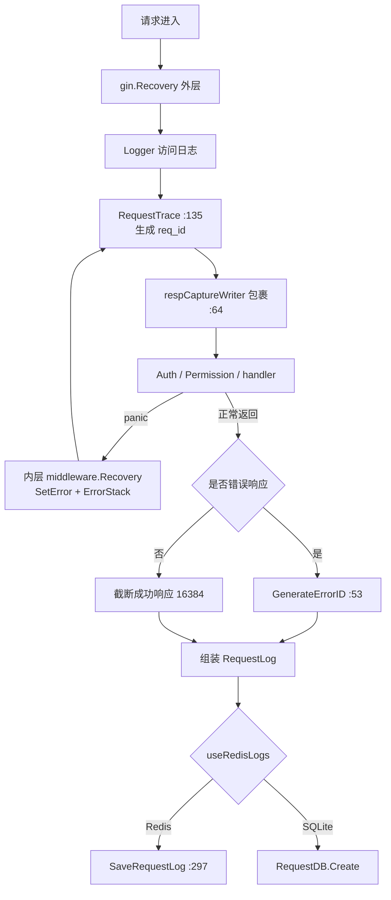
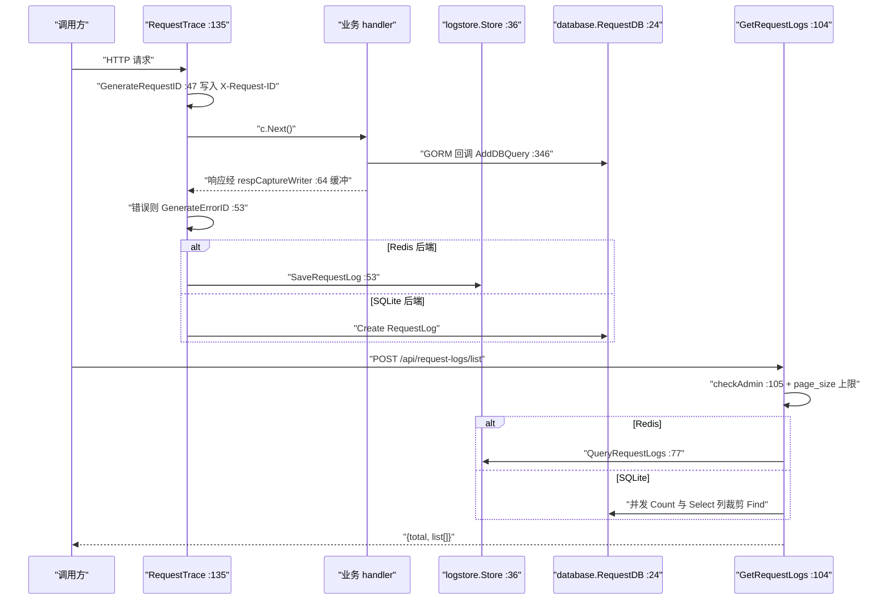
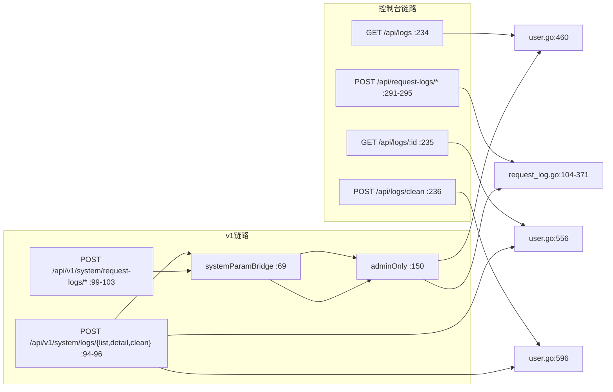
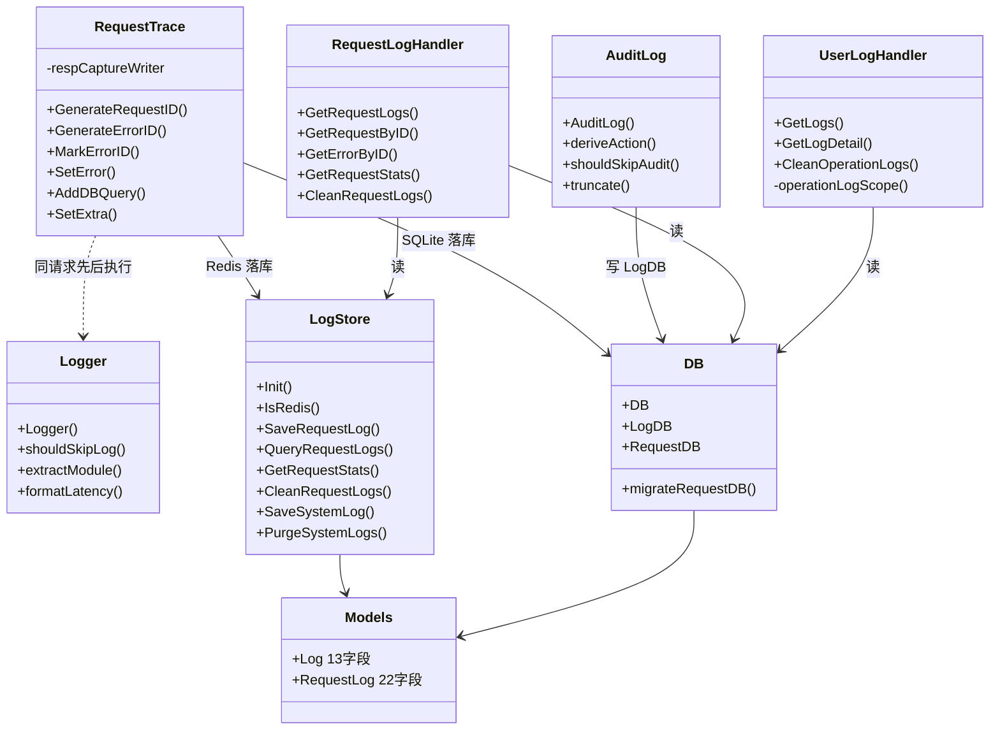

# 请求日志API

<cite>
**本文档引用的文件**
- [router.go](file://main/internal/api/router.go)
- [request_trace.go](file://main/internal/api/middleware/request_trace.go)
- [logger.go](file://main/internal/api/middleware/logger.go)
- [recovery.go](file://main/internal/api/middleware/recovery.go)
- [audit.go](file://main/internal/api/middleware/audit.go)
- [sanitize.go](file://main/internal/api/middleware/sanitize.go)
- [request_log.go](file://main/internal/api/handler/request_log.go)
- [user.go](file://main/internal/api/handler/user.go)
- [store.go](file://main/internal/logstore/store.go)
- [database.go](file://main/internal/database/database.go)
- [maintenance.go](file://main/internal/database/maintenance.go)
- [config.go](file://main/internal/config/config.go)
- [models.go](file://main/internal/models/models.go)
- [routes_batch2.go](file://main/internal/apiv1/routes_batch2.go)
- [bridge.go](file://main/internal/apiv1/bridge.go)
- [errors.go](file://main/internal/apiv1/errors.go)
- [adapt.go](file://main/internal/apiv1/adapt.go)
- [api.ts](file://web/lib/api.ts)
</cite>

## 目录

1. [简介](#简介)
2. [项目结构](#项目结构)
3. [核心组件](#核心组件)
4. [架构总览](#架构总览)
5. [详细组件分析](#详细组件分析)
6. [依赖关系分析](#依赖关系分析)
7. [性能考虑](#性能考虑)
8. [故障排查指南](#故障排查指南)
9. [结论](#结论)
10. [附录](#附录)

## 简介

dnsplane 把「谁在控制台做了什么」与「每个 HTTP 请求发生了什么」分成两套独立日志：

- **操作日志**（`models.Log`，库文件 `data/logs.db`）：由审计中间件按写操作派生，记录 `action`、`entity`、`entity_id`、`domain`、修改前后数据快照。查询端点 3 条：`GET /api/logs`、`GET /api/logs/:id`、`POST /api/logs/clean`。
- **请求日志**（`models.RequestLog`，库文件 `data/request_logs.db`）：由请求追踪中间件对每个 API 请求全量落库，含追踪 ID、载荷、响应、耗时、数据库查询明细与错误堆栈。查询端点 5 条：`POST /api/request-logs/{list,detail,error,stats,clean}`。

两条链路合计 **控制台 8 条**、**v1 对外 8 条**（`/api/v1/system/logs*` 3 条 + `/api/v1/system/request-logs*` 5 条），全部复用同一批 handler。

**明确边界**：`GET /api/domains/:id/logs`（`router.go:273`）、`GET /api/domains/:id/records/logs`（`:151`）、`GET /api/monitor/tasks/:id/logs`（`:175`）是**业务对象自身的变更/探测日志**，不属本文，分别归《域名管理API》《监控告警API》；控制台配置项与运行时指标端点归《系统管理API》。

**章节来源**
- [router.go:234-236](file://main/internal/api/router.go#L234-L236)
- [router.go:291-295](file://main/internal/api/router.go#L291-L295)
- [routes_batch2.go:94-103](file://main/internal/apiv1/routes_batch2.go#L94-L103)

## 项目结构

请求日志是「中间件写、handler 读、存储层双后端」的三层结构：

| 层次 | 文件 | 关键位置 | 职责 |
| --- | --- | --- | --- |
| 路由登记 | `main/internal/api/router.go` | `:29`、`:30`、`:47`、`:234-236`、`:291-295` | 中间件挂载顺序与 8 条端点 |
| 对外路由 | `main/internal/apiv1/routes_batch2.go` | `:94-103` | v1 侧 8 条，全 `adminOnly` |
| v1 参数桥接 | `main/internal/apiv1/bridge.go` | `systemParamBridge()` `:69` | body → query 搬运 |
| 请求追踪 | `main/internal/api/middleware/request_trace.go` | `RequestTrace()` `:135` | 生成 ID、捕获请求响应、落库 |
| 访问日志 | `main/internal/api/middleware/logger.go` | `Logger()` `:170` | 彩色终端一行式访问日志 |
| panic 内层 | `main/internal/api/middleware/recovery.go` | `Recovery()` | 先写错误再放行，保证落库 |
| 操作审计 | `main/internal/api/middleware/audit.go` | `AuditLog()` `:21` | 派生操作日志写 `LogDB` |
| 载荷脱敏 | `main/internal/api/middleware/sanitize.go` | `redactJSON()` `:135-150` | 落库前键值脱敏 |
| 查询 handler | `main/internal/api/handler/request_log.go` | 5 个端点 + 7 个辅助 | 列表/详情/错误/统计/清理 |
| 操作日志 handler | `main/internal/api/handler/user.go` | `:460`、`:556`、`:596` | 列表/详情/清理 |
| Redis 后端 | `main/internal/logstore/store.go` | `LogStore` `:36`、`Init()` `:41` | 请求与系统日志的 Redis 读写 |
| 三库初始化 | `main/internal/database/database.go` | `Init()` `:71`、`:112-128`、`:215-235` | `RequestDB` 独立库与旧表迁移 |
| 数据模型 | `main/internal/models/models.go` | `Log` `:124`、`RequestLog` `:354` | 两张表结构 |
| 前端调用 | `web/lib/api.ts` | 请求日志段 | `request-logs/*` 封装 |

```bash
# 复核中间件挂载顺序（决定 panic 与落库的因果关系）
sed -n '25,50p' main/internal/api/router.go
# 预期输出（节选）：
# r.Use(gin.Recovery())
# r.Use(middleware.Logger())
# api.Use(middleware.RequestTrace())
```

**章节来源**
- [router.go:25-50](file://main/internal/api/router.go#L25-L50)
- [database.go:71-128](file://main/internal/database/database.go#L71-L128)

## 核心组件

### 请求追踪中间件

`RequestTrace()`（`request_trace.go:135`）是请求日志的**唯一写入者**，职责链：

1. `GenerateRequestID()`（`:47`）生成 `req_` 前缀 ID，序号来自 `requestIDSeq`（`:44`），响应头回写 `X-Request-ID`。
2. `GenerateErrorID()`（`:53`）在判定为错误时生成 `err_` 前缀 ID，供 `/request-logs/error` 精确检索。
3. `respCaptureWriter`（`:64`）包装 `ResponseWriter`，缓冲响应体以便落库；成功响应最多保留 `maxSuccessResponseCapture = 16384`（`:60`），请求体最多 `maxRequestLogBodyLen = 8192`（`:57`）。
4. `MarkErrorID()`（`:122`）与 `SetError()`（`:316`）由 handler 或内层恢复中间件主动标注错误。
5. `AddDBQuery()`（`:346`）接收 GORM 回调登记的 SQL、耗时与影响行数，聚合进 `db_queries`；`SetExtra()`（`:363`）写入业务附加上下文。
6. `c.Next()` 返回后组装 `models.RequestLog` 并落库：Redis 后端走 `logstore.Store.SaveRequestLog()`（`:297-298`），否则写 `database.RequestDB`。

**双层 panic 恢复**是该组件的设计要点（`router.go:37-42` 注释）：内层 `middleware.Recovery` 必须紧跟 `RequestTrace`，先 `SetError` 再吞掉 panic，使 `c.Next()` 能正常返回并完成落库；只有外层 `gin.Recovery` 时实测请求日志**零记录**。



**图表来源**
- [router.go:29-47](file://main/internal/api/router.go#L29-L47)
- [request_trace.go:47-135](file://main/internal/api/middleware/request_trace.go#L47-L135)
- [request_trace.go:297-298](file://main/internal/api/middleware/request_trace.go#L297-L298)

**章节来源**
- [request_trace.go:24-122](file://main/internal/api/middleware/request_trace.go#L24-L122)
- [recovery.go](file://main/internal/api/middleware/recovery.go)

### 日志存储后端

`database.go:24` 声明三个独立 GORM 连接：`DB`（主业务）、`LogDB`（操作日志）、`RequestDB`（请求日志）。`RequestDB` 的路径来自 `config.RequestDBPath()`（`config.go:66`，即 `{数据目录}/request_logs.db`），打开后 `applySQLiteConnPool()`（`database.go:118`）设连接池，再 `migrateRequestDB()`（`:128`）建表。

旧版本曾把请求日志放在主库，`database.go:215-235` 是**一次性迁移**：若主库存在 `request_logs` 表则搬运数据、`DELETE` 后 `DROP TABLE`。

Redis 后端由 `logstore.Store`（`store.go:34`）提供，`Init()`（`:41`）在配置了 Redis 时装配，`IsRedis()`（`:49`）是分流开关；handler 侧统一用 `useRedisLogs()`（`request_log.go:17-19`）判定。Redis 键为 `app:request_logs`（`store.go:17`），写入为定长列表，`CleanRequestLogs(keepCount)`（`:245`）按保留条数裁剪。

| 后端 | 写入 | 查询 | 清理 | 适用 |
| --- | --- | --- | --- | --- |
| SQLite `RequestDB` | `Create` | `Count` + `Find`（列裁剪） | `cleanRequestLogsSQLite()` `:317` | 默认单库部署 |
| Redis 列表 | `SaveRequestLog` `:53` | `QueryRequestLogs` `:77` + 内存过滤 `:340` | `CleanRequestLogs` `:245` | 高频写入、可容忍丢明细 |

**章节来源**
- [database.go:24-128](file://main/internal/database/database.go#L24-L128)
- [database.go:215-235](file://main/internal/database/database.go#L215-L235)
- [store.go:16-77](file://main/internal/logstore/store.go#L16-L77)
- [config.go:60-66](file://main/internal/config/config.go#L60-L66)

### 查询处理器

| handler | 行号 | 权限 | 关键点 |
| --- | --- | --- | --- |
| `GetRequestLogs` | `request_log.go:104` | `checkAdmin`（`:105`） | `page_size` 上限 200（`:119`），并发 `Count` + `Find` |
| `GetRequestByID` | `:157` | `checkAdmin`（`:158`） | `request_id` 必填，返回完整大字段 |
| `GetErrorByID` | `:202` | `checkAdmin`（`:203`） | 按 `error_id` 取单条，含 `error_stack` |
| `GetRequestStats` | `:243` | `checkAdmin`（`:244`） | 60 秒结果缓存（`:32`、`:43`） |
| `CleanRequestLogs` | `:371` | `checkAdmin`（`:372`） | 四维清理，Redis 与 SQLite 都执行 |

辅助层：`buildRequestLogsListQuery()`（`:67`）与 `applyRequestLogFilters()`（`:72`）构造过滤链；`requestLogListSelect`（`:22`）显式列出列表页字段，**不含** `body`、`response`、`headers`、`db_queries`；`requestLogRecentErrSelect`（`:24`）为统计的近期错误取更窄列；统计缓存三元函数 `tryRequestStatsCache` / `setRequestStatsCache` / `invalidateRequestStatsCache` 在 `:34`、`:43`、`:50`。

**章节来源**
- [request_log.go:17-104](file://main/internal/api/handler/request_log.go#L17-L104)
- [request_log.go:157-371](file://main/internal/api/handler/request_log.go#L157-L371)

### 操作日志模型与审计

`models.Log`（`models.go:124-138`）13 个字段，`uid` 通过 `gorm:"column:uid"` 映射 JSON 键 `uid`，`before_data` / `after_data` 为修改前后 JSON 快照。写入方是 `AuditLog()`（`audit.go:21`），`deriveAction()`（`:149`）从路径与方法推导动作名，`shouldSkipAudit()`（`:128`）跳过噪声路径，`truncate()`（`:171`）控制 `data` 列长度。

查询侧 `GetLogs`（`user.go:460`）读取 9 个 query 参数（`page`、`page_size`、`keyword`、`entity`、`action`、`user_id` 或 `uid`、`domain`、`date_from`、`date_to`），`LogDB` 未初始化时返回**结构完整的全零响应**（`:477-483`）而不是报错；`operationLogScope()`（`:547`）实现「非管理员只看自己的操作、统计口径同步收窄」。

**章节来源**
- [models.go:124-138](file://main/internal/models/models.go#L124-L138)
- [audit.go:21-171](file://main/internal/api/middleware/audit.go#L21-L171)
- [user.go:460-547](file://main/internal/api/handler/user.go#L460-L547)

## 架构总览



**图表来源**
- [request_trace.go:47-363](file://main/internal/api/middleware/request_trace.go#L47-L363)
- [request_log.go:104-140](file://main/internal/api/handler/request_log.go#L104-L140)
- [store.go:53-120](file://main/internal/logstore/store.go#L53-L120)

控制台与 v1 复用同一 handler，差异集中在桥接：



**图表来源**
- [router.go:234-295](file://main/internal/api/router.go#L234-L295)
- [routes_batch2.go:94-103](file://main/internal/apiv1/routes_batch2.go#L94-L103)
- [bridge.go:69](file://main/internal/apiv1/bridge.go#L69)

## 详细组件分析

### 操作日志查询接口

| 方法 | 路径 | 权限 | handler | 请求要点 | 响应要点 |
| --- | --- | --- | --- | --- | --- |
| GET | `/api/logs` | 仅 Auth（作用域收窄） | `user.go:460` | 9 个 query 参数 | `total`、`list[]`、`records[]`、`stats{today_count,distinct_users,distinct_domains}` |
| GET | `/api/logs/:id` | 作用域内 | `user.go:556` | `:id` | 单对象 |
| POST | `/api/logs/clean` | admin | `user.go:596` | `days` | `deleted`、`msg` |
| POST | `/api/v1/system/logs/list` | `adminOnly` | `user.go:460` | 同名 body 字段 | 同上 |
| POST | `/api/v1/system/logs/detail` | `adminOnly` | `user.go:556` | `log_id` | 单对象，缺失返 `4001` |
| POST | `/api/v1/system/logs/clean` | `adminOnly` | `user.go:596` | `days` | `deleted`、`msg` |

`list` 与 `records` 是同一批数据的两种投影：`list` 为分页页，`records` 为按 `id DESC` 的近期记录，供概览卡片使用（`user.go:477-483` 的空库分支同样返回两个数组，前端无需分情况处理）。

```json
{
  "code": 0,
  "message": "success",
  "data": {
    "total": 1284,
    "list": [
      {
        "id": 1284,
        "uid": 7,
        "username": "{操作者}",
        "action": "domain.create",
        "entity": "domain",
        "entity_id": 331,
        "domain": "{你的域名}",
        "data": "{摘要文本}",
        "before_data": null,
        "after_data": "{\"account_id\":2}",
        "ip": "{客户端IP}",
        "user_agent": "{UA}",
        "created_at": "{时间戳}"
      }
    ],
    "records": [],
    "stats": {"today_count": 26, "distinct_users": 4, "distinct_domains": 11}
  }
}
```

**章节来源**
- [user.go:460-624](file://main/internal/api/handler/user.go#L460-L624)
- [routes_batch2.go:94-96](file://main/internal/apiv1/routes_batch2.go#L94-L96)

### 请求日志列表接口

`POST /api/request-logs/list` 请求体字段：`page`、`page_size`、`keyword`、`is_error`、`method`、`start_date`、`end_date`。`keyword` 同时匹配路径与请求 ID 等文本列（`applyRequestLogFilters()` `:72`）；`is_error` 为字符串开关，配合 `method` 与日期区间形成三向过滤。SQLite 分支用 `sync.WaitGroup` 并发执行 `Count` 与 `Find`（`:130-141`），列表列由 `requestLogListSelect` 裁剪。

```json
{
  "code": 0,
  "message": "success",
  "data": {
    "total": 30215,
    "list": [
      {
        "id": 30215,
        "request_id": "req_{序号}",
        "error_id": "",
        "user_id": 7,
        "username": "{操作者}",
        "method": "POST",
        "path": "/api/domains/331/records",
        "ip": "{客户端IP}",
        "user_agent": "{UA}",
        "status_code": 200,
        "duration": 1843,
        "is_error": false,
        "error_msg": "",
        "created_at": "{时间戳}"
      }
    ]
  }
}
```

```bash
# 取一页错误请求日志（会话 Cookie 以占位符表示）
curl -sS -X POST -b "{会话Cookie}" \
  -H "X-CSRF-Token: {CSRF令牌}" -H "Content-Type: application/json" \
  "https://{你的域名}/api/request-logs/list" \
  -d '{"page":1,"page_size":20,"is_error":"1","method":"POST","start_date":"{起始日}","end_date":"{截止日}"}'
# 预期输出：{"code":0,"message":"success","data":{"total":{总数},"list":[{...}]}}
# 非管理员返回：{"code":1,"message":"无权限，仅管理员可操作"}
```

**章节来源**
- [request_log.go:22-141](file://main/internal/api/handler/request_log.go#L22-L141)

### 请求与错误详情接口

| 方法 | 路径 | 必填 | handler | 额外返回 |
| --- | --- | --- | --- | --- |
| POST | `/api/request-logs/detail` | `request_id` | `request_log.go:157` | `query`、`body`、`headers`、`response`、`db_queries`、`db_query_time`、`extra` |
| POST | `/api/request-logs/error` | `error_id` | `request_log.go:202` | 同上，含 `error_stack` 完整堆栈 |
| POST | `/api/v1/system/request-logs/detail` | `request_id` | `request_log.go:157` | v1 信封，缺失返 `2002` |
| POST | `/api/v1/system/request-logs/error` | `error_id` | `request_log.go:202` | 同上 |

`request_id` / `error_id` 是**唯一稳定关联键**：客户端可从响应头 `X-Request-ID` 直接拿到本次请求的落库记录（`request_trace.go:47`），无需按时间与路径模糊匹配。v1 侧错误码 `2002 CodeParamMissing`（`errors.go:29`）覆盖必填缺失。

**章节来源**
- [request_log.go:155-241](file://main/internal/api/handler/request_log.go#L155-L241)
- [request_trace.go:47-53](file://main/internal/api/middleware/request_trace.go#L47-L53)
- [errors.go:29](file://main/internal/apiv1/errors.go#L29)

### 请求统计接口

`POST /api/request-logs/stats`（`request_log.go:243`）返回 `total_count`、`error_count`、`today_count`、`today_error_count` 与 `recent_errors[]`。60 秒 TTL 的进程内缓存（`requestStatsCacheTTL` `:32`）使该接口在高频刷新下只打一次库；`CleanRequestLogs` 完成后显式 `invalidateRequestStatsCache()`（`:386`）避免脏读。Redis 分支由 `GetRequestStats()`（`store.go:186`）从列表全量解析后聚合。

```json
{
  "code": 0,
  "message": "success",
  "data": {
    "total_count": 30215,
    "error_count": 128,
    "today_count": 1420,
    "today_error_count": 6,
    "recent_errors": [
      {"id": 30201, "request_id": "req_{序号}", "path": "/api/cert/orders", "method": "POST", "status_code": 500, "error_msg": "{错误摘要}", "created_at": "{时间戳}"}
    ]
  }
}
```

**章节来源**
- [request_log.go:24-50](file://main/internal/api/handler/request_log.go#L24-L50)
- [request_log.go:243-309](file://main/internal/api/handler/request_log.go#L243-L309)
- [store.go:174-244](file://main/internal/logstore/store.go#L174-L244)

### 日志清理接口

请求日志清理支持**四个维度**（`CleanRequestLogsRequest` `:310-315`）：

| 字段 | 语义 | 实现位置 |
| --- | --- | --- |
| `days` | 删除 N 天前的记录 | `cleanRequestLogsSQLite()` `:317` 起 |
| `before_date` | 按 `YYYY-MM-DD` 精确日期删除更早记录 | `:320-322`（解析失败则跳过该维度） |
| `success_keep_count` | 成功日志仅保留最新 N 条 | `:340-346` 按 `minKeepID` 批量删除 |
| `error_keep_count` | 错误日志仅保留最新 N 条 | `:348-361` |

```bash
# 保留最近 5000 条成功日志与 2000 条错误日志
curl -sS -X POST -b "{会话Cookie}" \
  -H "X-CSRF-Token: {CSRF令牌}" -H "Content-Type: application/json" \
  "https://{你的域名}/api/request-logs/clean" \
  -d '{"success_keep_count":5000,"error_keep_count":2000}'
# 预期输出：{"code":0,"message":"清理完成","data":{"msg":"清理完成","deleted":{删除条数}}}
```

**章节来源**
- [request_log.go:310-390](file://main/internal/api/handler/request_log.go#L310-L390)

### 日志存储实现

`logstore.LogStore`（`store.go:36`）对请求与系统日志提供成对 API：

| 方法 | 行号 | 对应 SQLite 路径 |
| --- | --- | --- |
| `SaveRequestLog` | `:53` | `RequestDB.Create` |
| `QueryRequestLogs` | `:77` | `buildRequestLogsListQuery` `:67` |
| `GetRequestByID` | `:121` | `:157` handler 内查询 |
| `GetErrorByID` | `:148` | `:202` handler 内查询 |
| `GetRequestStats` | `:186` | `:243` 聚合 |
| `CleanRequestLogs` | `:245` | `cleanRequestLogsSQLite` `:317` |
| `SaveSystemLog` | `:260` | `LogDB.Create` |
| `QuerySystemLogs` | `:275` | `GetLogs` `user.go:460` |
| `PurgeSystemLogs` | `:320` | `CleanOperationLogs` `user.go:596` |

Redis 路径把整条日志序列化为列表元素，读取时 `parseRequestLogs()`（`:329`）反序列化、`filterRequestLogs()`（`:340`）在内存中过滤，因此 Redis 模式的分页是「取回后过滤」而非数据库分页；系统日志同理（`parseSystemLogs` `:384`、`filterSystemLogs` `:395`）。

**章节来源**
- [store.go:36-395](file://main/internal/logstore/store.go#L36-L395)

### 追踪标识与载荷脱敏

`RequestLog`（`models.go:354-377`）22 个字段中，`body`、`headers`、`response`、`db_queries`、`error_stack`、`extra` 均为 `text` 大字段，`request_id`、`error_id`、`user_id`、`is_error`、`created_at` 建索引（`gorm:"index"`）。

载荷在落库前经 `sanitize.go` 的 `redactJSON()`（`:135-150`）处理，但**已核实存在缺口**：该函数只有 `map` 与 `slice` 分支，无字符串内嵌套 JSON 的递归脱敏；`SecretId`、`api_password`、`APIID`、`apisecret`、`api_token`、`client_secret` 等键名不在脱敏表内（`.wiki-context/analysis-api.md` §10.14 实测登记）。后果是 DNS 服务商 `config` 字符串中的密钥可能以明文进入 `request_logs`，并被 `request-logs/detail` 读出。修复方案（字符串递归脱敏 + 键名表补全）在文档中已给出，当前代码未实施。

**章节来源**
- [models.go:354-377](file://main/internal/models/models.go#L354-L377)
- [sanitize.go:135-150](file://main/internal/api/middleware/sanitize.go#L135-L150)

## 依赖关系分析



**图表来源**
- [request_trace.go:47-363](file://main/internal/api/middleware/request_trace.go#L47-L363)
- [store.go:36-320](file://main/internal/logstore/store.go#L36-L320)
- [request_log.go:104-371](file://main/internal/api/handler/request_log.go#L104-L371)
- [user.go:460-596](file://main/internal/api/handler/user.go#L460-L596)

两条链路差异：

| 维度 | 控制台 | v1 对外 | 影响 |
| --- | --- | --- | --- |
| 列表权限 | 作用域收窄（非管理员看自己） | `adminOnly` | v1 无法代表普通用户查询 |
| 参数来源 | `c.Query` / `c.Param` | `systemParamBridge` 搬运 | 搬运不全即静默失效 |
| 详情主键 | 路径 `:id`（操作日志） | body `log_id` | v1 缺失返 `4001` |
| 载荷解析 | 支持加密体 `BindJSONFlexible` | 签名体解密 | 空体短路见「故障排查指南」 |
| 错误码 | `{code:1,message}` | 语义码族 | `adapt.go:120-148` 有损映射 |

**章节来源**
- [bridge.go:69](file://main/internal/apiv1/bridge.go#L69)
- [adapt.go:120-148](file://main/internal/apiv1/adapt.go#L120-L148)

## 性能考虑

| 机制 | 位置 | 效果与代价 |
| --- | --- | --- |
| 三库分离 | `database.go:24`、`config.go:60-66` | 日志写入不与业务写争锁 |
| 独立连接池 | `applySQLiteConnPool(RequestDB)` `:118` | 缓解 `SQLITE_BUSY` |
| 列表列裁剪 | `requestLogListSelect` `:22` | 避免拉取 6 个 `text` 大字段 |
| 统计列更窄 | `requestLogRecentErrSelect` `:24` | 聚合时 IO 最小 |
| 并发计数与取页 | `:130-141` | 一次请求两路并发，但共用同一过滤 |
| 统计 60 秒缓存 | `:32`、`:34-50` | 高频刷新不打库；清理后需显式失效 |
| 页大小上限 | `page_size > 200` 收敛为 200 `:119` | 阻止单次取回过大页 |
| 载荷截断 | `8192` / `16384` `:57`、`:60` | 大表单与大响应不入库存 |
| 索引字段 | `models.go:356-376` | `request_id`、`error_id`、`user_id`、`is_error`、`created_at` |
| Redis 全量解析 | `store.go:329-383` | 列表越长，过滤成本线性上升 |

```bash
# 观察请求日志库体积与索引使用情况（数据库路径按部署调整）
ls -lh data/request_logs.db data/logs.db
# 预期输出：两个文件大小，请求日志通常显著大于操作日志
sqlite3 data/request_logs.db "select count(*) from request_logs; \
  select status_code, count(*) from request_logs group by status_code order by 2 desc limit 5;"
# 预期输出（示例）：
# 30215
# 200|29850
# 500|120
# 401|98
```

**章节来源**
- [request_log.go:22-141](file://main/internal/api/handler/request_log.go#L22-L141)
- [models.go:354-377](file://main/internal/models/models.go#L354-L377)
- [database.go:112-128](file://main/internal/database/database.go#L112-L128)

## 故障排查指南

### 分诊表

| 症状 | 首查位置 | 判定依据 | 处置方向 |
| --- | --- | --- | --- |
| 请求日志完全没有记录 | `router.go:37-42` | 内层 `Recovery` 缺失时 panic 穿透，落库代码不执行 | 核对 `api.Use(middleware.RequestTrace())`（`:47`）与内层恢复顺序 |
| 错误请求有记录但没有堆栈 | `recovery.go` + `SetError()` `:316` | 未经内层恢复的 5xx 不写 `error_stack` | 确认 handler 走统一错误出口 |
| 列表能出但详情缺字段 | `requestLogListSelect` `:22` | 列表刻意不含大字段 | 用 `request-logs/detail` 按 `request_id` 取全量 |
| 过滤条件「不生效」且返回全量 | `sign.go:131` + `apiv1/auth.go:152-161` | `BindJSONFlexible` 空 map 短路，字段全零值（§10.6 未修） | 显式传全部字段；影响点 `request_log.go:111/164/209/378` |
| 清理后统计仍是旧数字 | `invalidateRequestStatsCache()` `:50` | 60 秒 TTL 内命中旧缓存 | 等 TTL 过期或走带失效的 `CleanRequestLogs` |
| `days` 缺省导致日志全清 | `user.go:596` | `cleanOperationLogsQuery(0)` 不带 where（§10.7） | 清理必须显式带 `days`，不可回滚 |
| `before_date` 无效 | `:320-322` | `time.Parse("2006-01-02")` 失败即静默跳过 | 严格使用 `YYYY-MM-DD` |
| 详情里出现明文密钥 | `sanitize.go:135-150` | `redactJSON` 无字符串分支（§10.14） | 视为高危，限制查询权限并补脱敏 |
| `2002 必填参数缺失` | `errors.go:29` | v1 body 未带 `request_id`/`error_id` | 补字段或改用控制台链路 |
| `4001 目标资源不存在` | `errors.go:43` | v1 桥接后仍无对应记录 | 核对 `log_id` 与作用域 |
| 非管理员看不到他人日志 | `operationLogScope()` `:547` | 设计如此，统计同步收窄 | 提升权限或按用户过滤 |
| `LogDB` 未初始化时列表全零 | `user.go:477-483` | 返回空结构而非报错 | 检查 `data/logs.db` 与启动日志 |
| 旧请求日志查不到 | `database.go:215-235` | 主库 `request_logs` 表已迁移并 `DROP` | 只查 `request_logs.db` |

### 通用定位流程

```bash
# 1) 复现并拿到追踪 ID（响应头即索引键）
curl -sS -D /tmp/hdr.txt -o /dev/null -b "{会话Cookie}" \
  -H "X-CSRF-Token: {CSRF令牌}" \
  "https://{你的域名}/api/domains"
rg -i '^x-request-id' /tmp/hdr.txt
# 预期输出：X-Request-ID: req_{序号}

# 2) 按 ID 取完整链路
curl -sS -X POST -b "{会话Cookie}" \
  -H "X-CSRF-Token: {CSRF令牌}" -H "Content-Type: application/json" \
  "https://{你的域名}/api/request-logs/detail" \
  -d '{"request_id":"req_{上一步序号}"}'
# 预期输出：{"code":0,...,"data":{"path":"...","duration":...,"db_queries":"..."}}
# 若 data 为空表示该请求被 shouldSkipLog/静态路由排除，或落库尚未提交

# 3) 反查 SQL 慢点与错误分布
sqlite3 data/request_logs.db \
  "select path, max(duration), avg(duration), count(*) from request_logs \
   group by path order by 3 desc limit 10;"
# 预期输出：按平均耗时降序的路径清单（毫秒）
```

**章节来源**
- [request_trace.go:47-135](file://main/internal/api/middleware/request_trace.go#L47-L135)
- [request_log.go:157-241](file://main/internal/api/handler/request_log.go#L157-L241)

## 结论

请求日志API 由「一个写中间件 + 两套模型 + 五个查询端点」构成，其关键设计取舍：

- **写入完整性优先**：通过 `RequestTrace` 与内层 `Recovery` 的双层结构保证 panic 也能落库，代价是中间件顺序成为硬约束，改动 `router.go:29-47` 必须同步验证。
- **读取分层明确**：列表走列裁剪 + 并发计数，详情才拉全字段，统计走 60 秒缓存，使日志库增长对前端交互影响可控。
- **双后端语义不等价**：Redis 模式为「取回后内存过滤」且保留条数裁剪，SQLite 模式为数据库分页与四维清理；同一份调用代码在两种后端下的分页与保留行为不同。
- **两处已知缺陷未修**：`BindJSONFlexible` 空 map 短路（影响 4 个请求日志调用点）与 `redactJSON` 字符串缺口（凭据明文入库），以及 `logs/clean` 缺省即全清的高危语义，应在接入自动化前逐项评估。

## 附录

### 端点速查

| 链路 | 方法 | 路径 | handler |
| --- | --- | --- | --- |
| 控制台 | GET | `/api/logs` | `user.go:460` |
| 控制台 | GET | `/api/logs/:id` | `user.go:556` |
| 控制台 | POST | `/api/logs/clean` | `user.go:596` |
| 控制台 | POST | `/api/request-logs/list` | `request_log.go:104` |
| 控制台 | POST | `/api/request-logs/detail` | `request_log.go:157` |
| 控制台 | POST | `/api/request-logs/error` | `request_log.go:202` |
| 控制台 | POST | `/api/request-logs/stats` | `request_log.go:243` |
| 控制台 | POST | `/api/request-logs/clean` | `request_log.go:371` |
| v1 | POST | `/api/v1/system/logs/list` | `user.go:460` |
| v1 | POST | `/api/v1/system/logs/detail` | `user.go:556` |
| v1 | POST | `/api/v1/system/logs/clean` | `user.go:596` |
| v1 | POST | `/api/v1/system/request-logs/list` | `request_log.go:104` |
| v1 | POST | `/api/v1/system/request-logs/detail` | `request_log.go:157` |
| v1 | POST | `/api/v1/system/request-logs/error` | `request_log.go:202` |
| v1 | POST | `/api/v1/system/request-logs/stats` | `request_log.go:243` |
| v1 | POST | `/api/v1/system/request-logs/clean` | `request_log.go:371` |

### 字段对照表

| `RequestLog` 字段（`models.go:354-377`） | 产生位置 | 是否在列表返回 |
| --- | --- | --- |
| `request_id` | `GenerateRequestID()` `:47` | 是 |
| `error_id` | `GenerateErrorID()` `:53` | 是 |
| `user_id` / `username` | 会话或 Key 身份注入 | 是 |
| `method` / `path` / `query` | 请求解析 | `method`、`path` 是 |
| `body` / `headers` | `respCaptureWriter` + 截断 `8192` | 否（详情才有） |
| `response` | 成功上限 `16384` | 否 |
| `status_code` / `duration` | 响应写回 | 是 |
| `is_error` / `error_msg` / `error_stack` | `MarkErrorID` / 内层恢复 | `is_error`、`error_msg` 是 |
| `db_queries` / `db_query_time` | `AddDBQuery()` `:346` | 否 |
| `extra` | `SetExtra()` `:363` | 否 |
| `ip` / `user_agent` | 请求头 | 是 |

### 取证与复验命令

| 目的 | 命令 | 预期输出要点 |
| --- | --- | --- |
| 清点控制台端点 | `grep -n 'logs' main/internal/api/router.go` | `:234-236`、`:291-295` |
| 清点 v1 端点 | `sed -n '94,103p' main/internal/apiv1/routes_batch2.go` | 8 条 `g.POST` |
| 核对中间件顺序 | `grep -n 'Use(middleware' main/internal/api/router.go` | `Logger`、`RequestTrace` |
| 确认三库连接 | `grep -n 'RequestDB\|LogDB' main/internal/database/database.go \| head` | 声明与初始化行 |
| 确认列表裁剪列 | `grep -n 'requestLogListSelect' main/internal/api/handler/request_log.go` | 定义 + 2 处引用 |
| 核对空 map 缺口 | `grep -n 'data != nil' main/internal/api/middleware/sign.go` | 仍为 `!= nil` 判据 |
| 核对脱敏缺口 | `grep -n 'case ' main/internal/api/middleware/sanitize.go` | 无字符串递归分支 |
| 库体积监控 | `du -h data/request_logs.db data/logs.db` | 两库大小 |

**章节来源**
- [router.go:234-295](file://main/internal/api/router.go#L234-L295)
- [routes_batch2.go:94-103](file://main/internal/apiv1/routes_batch2.go#L94-L103)
- [sign.go:131](file://main/internal/api/middleware/sign.go#L131)
- [sanitize.go:135-150](file://main/internal/api/middleware/sanitize.go#L135-L150)
