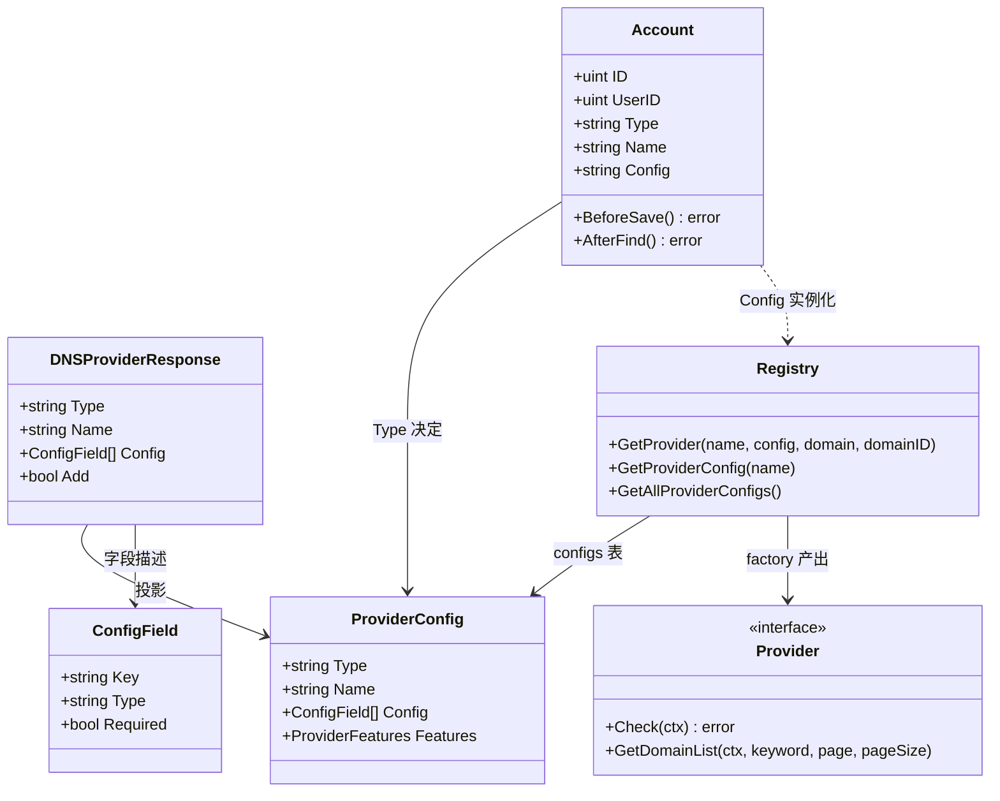
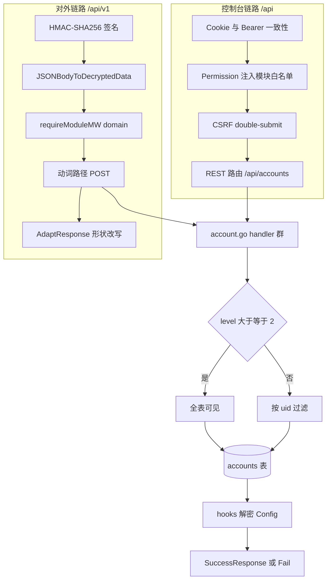
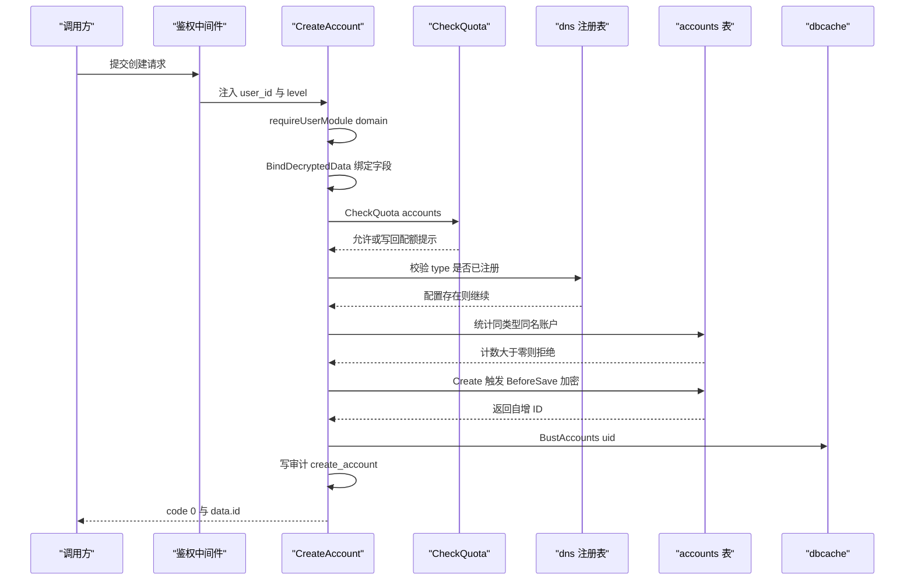
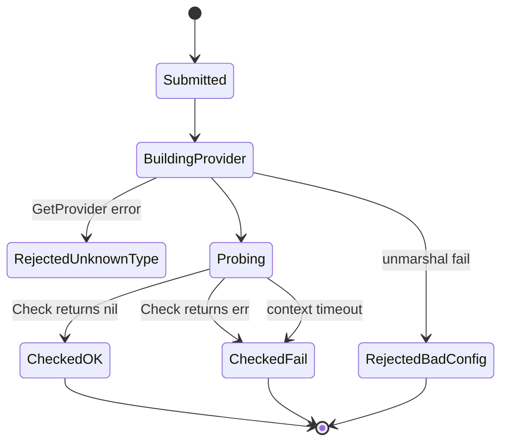
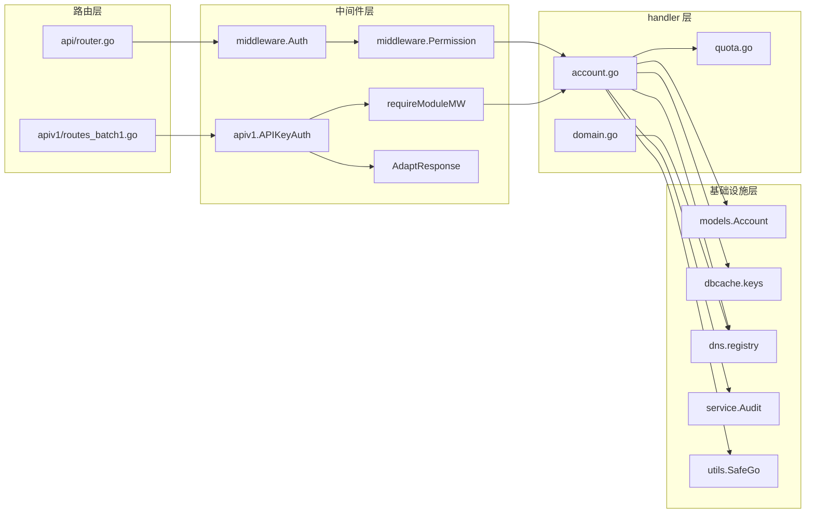
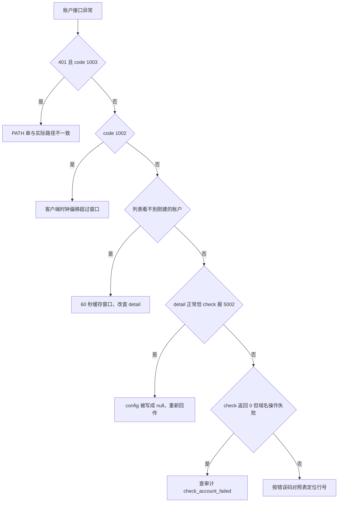

# 账户管理API

<cite>
**本文档引用的文件**
- [account.go](file://main/internal/api/handler/account.go)
- [domain.go](file://main/internal/api/handler/domain.go)
- [quota.go](file://main/internal/api/handler/quota.go)
- [plan.go](file://main/internal/api/handler/plan.go)
- [router.go](file://main/internal/api/router.go)
- [routes_batch1.go](file://main/internal/apiv1/routes_batch1.go)
- [router.go (apiv1)](file://main/internal/apiv1/router.go)
- [auth.go (apiv1)](file://main/internal/apiv1/auth.go)
- [adapt.go](file://main/internal/apiv1/adapt.go)
- [errors.go](file://main/internal/apiv1/errors.go)
- [scope.go](file://main/internal/apiv1/scope.go)
- [domain.go (apiv1)](file://main/internal/apiv1/domain.go)
- [quota_gate.go](file://main/internal/apiv1/quota_gate.go)
- [auth.go (middleware)](file://main/internal/api/middleware/auth.go)
- [permission.go](file://main/internal/api/middleware/permission.go)
- [sign.go](file://main/internal/api/middleware/sign.go)
- [models.go](file://main/internal/models/models.go)
- [hooks.go](file://main/internal/models/hooks.go)
- [dbcache.go](file://main/internal/dbcache/dbcache.go)
- [keys.go](file://main/internal/dbcache/keys.go)
- [registry.go (DNS)](file://main/internal/dns/registry.go)
- [interface.go (DNS)](file://main/internal/dns/interface.go)
- [aliyun.go](file://main/internal/dns/providers/aliyun/aliyun.go)
- [cloudflare.go](file://main/internal/dns/providers/cloudflare/cloudflare.go)
- [dnspod.go](file://main/internal/dns/providers/dnspod/dnspod.go)
- [audit.go](file://main/internal/service/audit.go)
- [safe_go.go](file://main/internal/utils/safe_go.go)
- [api.ts](file://web/lib/api.ts)
- [page.tsx (账户列表)](file://web/app/(dashboard)/dashboard/accounts/page.tsx)
</cite>

## 目录

1. [简介](#简介)
2. [项目结构](#项目结构)
3. [核心组件](#核心组件)
4. [架构总览](#架构总览)
5. [详细组件分析](#详细组件分析)
6. [依赖关系分析](#依赖关系分析)
7. [性能考虑](#性能考虑)
8. [故障排查指南](#故障排查指南)
9. [结论](#结论)
10. [附录](#附录)

## 简介

账户管理是 dnsplane 全部 DNS 操作的**凭据源头**：一条「账户」记录代表一个第三方 DNS 服务商的 API 凭据集合（AccessKey、Secret、Token 或用户名密码），域名与解析记录必须挂靠在某条账户之下才能读写。

本文覆盖两条链路（控制台 `/api/accounts*` 6 条 REST 风格、会话 Cookie 加 Bearer 双凭据鉴权；对外 `/api/v1/accounts*` 6 条全部 `POST`、路径段即动词、HMAC-SHA256 签名鉴权）：

两条链路**复用同一批 handler**（`main/internal/api/handler/account.go`），差异全部收敛在路由与中间件层。另有服务商元数据 `GET /api/dns/providers` 属同一业务闭环，一并收录。

边界：本文只讲 **DNS 服务商账户**（`accounts` 表）。**证书账户**（`cert_accounts`）与**部署账户**由 `handler/cert.go`、`handler/cert_deploy.go` 处理，仅在附录给出对照。

**章节来源**
- [router.go:113-118](file://main/internal/api/router.go#L113-L118)
- [routes_batch1.go:9-19](file://main/internal/apiv1/routes_batch1.go#L9-L19)

## 项目结构

账户管理横跨「路由 → 中间件 → handler → 模型 → 缓存 → 服务商注册表 → 前端」七段：

| 层次 | 文件 | 关键位置 | 职责 |
| --- | --- | --- | --- |
| 控制台路由 | `main/internal/api/router.go` | 6 条（`:113-118`） | REST 路径与 `:id` 语义 |
| 对外路由 | `main/internal/apiv1/routes_batch1.go` | 6 条（`:10-19`） | 全 `POST`、动词路径 |
| 会话门卫 | `api/middleware/auth.go` | `Auth()` 起于 `:125` | Cookie 与 Bearer 一致性 |
| 签名门卫 | `main/internal/apiv1/auth.go` | `APIKeyAuth()` 起于 `:44` | 签名校验与身份注入 |
| 模块权限 | `api/middleware/permission.go` | `UserModuleAllowed()` `:383` | `domain` 模块可见性 |
| 业务处理 | `api/handler/account.go` | 466 行、7 个函数 | 端点实现与元数据 |
| 域名归属 | `api/handler/domain.go` | `GetAccountDomainList` `:1295` | 上游域名清单 |
| 配额 | `api/handler/quota.go` | `CheckQuota()` `:182` | `max_accounts` 门禁 |
| 模型加解密 | `models/models.go`、`hooks.go` | `Account` `models.go:50` | `Config` 透明加解密 |
| 读穿缓存 | `dbcache/dbcache.go`、`keys.go` | TTL `dbcache.go:12` | 列表 60 秒缓存与失效 |
| 服务商注册表 | `main/internal/dns/registry.go` | `GetProvider` `:26` | 类型校验与实例化 |
| 前端封装 | `web/lib/api.ts` | `accountApi` `:475-484` | 类型化客户端 |

显著特征：控制台链路**没有**详情端点，`GetAccountDetail` 只在 v1 暴露（`routes_batch1.go:14`），前端编辑回显依赖列表已带出的 `config` 字段（`api.ts:1062`）。

**章节来源**
- [account.go:97-466](file://main/internal/api/handler/account.go#L97-L466)
- [routes_batch1.go:10-19](file://main/internal/apiv1/routes_batch1.go#L10-L19)
- [api.ts:1058-1067](file://web/lib/api.ts#L1058-L1067)

## 核心组件

### 端点总清单

| # | Method | 路径 | Handler | 权限门槛 | 响应要点 |
| --- | --- | --- | --- | --- | --- |
| 1 | `GET` | `/api/accounts` | `GetAccounts` `:97` | 模块 `domain` | `data.total`、`data.list[]` |
| 2 | `POST` | `/api/accounts` | `CreateAccount` `:196` | 模块 加配额 | `data.id` |
| 3 | `POST` | `/api/accounts/:id` | `UpdateAccount` `:264` | 模块 加归属 | `msg` |
| 4 | `POST` | `/api/accounts/:id/delete` | `DeleteAccount` `:313` | 模块 加归属 | `msg` |
| 5 | `POST` | `/api/accounts/:id/check` | `CheckAccount` `:367` | 模块 加归属 | `msg`（异步） |
| 6 | `GET` | `/api/accounts/:id/domains` | `GetAccountDomainList` `:1295` | 模块 加归属 | `data.total`、`data.list[]` |
| 7 | `GET` | `/api/dns/providers` | `GetDNSProviders` `:445` | 模块 `domain` | `data[]` |
| 8 | `POST` | `/api/v1/accounts/list` | `GetAccounts` `:97` | 模块 `domain` | `data.total`、`data.list[]` |
| 9 | `POST` | `/api/v1/accounts/detail` | `GetAccountDetail` `:145` | 模块 加归属 | 单对象 |
| 10 | `POST` | `/api/v1/accounts/create` | `CreateAccount` `:196` | 模块 加配额 | `data.id` |
| 11 | `POST` | `/api/v1/accounts/update` | `UpdateAccount` `:264` | 模块 加归属 | `data` 为 `null` |
| 12 | `POST` | `/api/v1/accounts/delete` | `DeleteAccount` `:313` | 模块 加归属 | `data` 为 `null` |
| 13 | `POST` | `/api/v1/accounts/check` | `CheckAccount` `:367` | 模块 加归属 | `message`（异步） |

**章节来源**
- [router.go:113-118](file://main/internal/api/router.go#L113-L118)
- [routes_batch1.go:13-18](file://main/internal/apiv1/routes_batch1.go#L13-L18)

### 数据模型与类型关系

对应 `accounts` 表（GORM 默认复数表名，未定义 `TableName`）：

| 字段 | Go 类型 | 列约束 | JSON 键 | 说明 |
| --- | --- | --- | --- | --- |
| `ID` | `uint` | `primaryKey` | `id` | 自增主键，即接口 `:id` |
| `UserID` | `uint` | `column:uid;index` | `uid` | 归属用户，非管理员过滤依据 |
| `Type` | `string` | `size:20;not null` | `type` | 类型键，须命中注册表 |
| `Name` | `string` | `size:255;not null` | `name` | 同 `uid` 同 `type` 唯一 |
| `Config` | `string` | `type:text` | `-` | 凭据 JSON 串，落库前加密 |
| `Remark` | `string` | `size:100` | `remark` | 备注 |
| `DeletedAt` | `gorm.DeletedAt` | `index` | `-` | 软删除标记 |

`Config` 上的 `json:"-"`（`models.go:55`）只约束模型直接序列化。handler 用显式 map 输出（`account.go:132-135`、`:172-181`），因此响应中 `config` 依然为明文。

```go
func (a *Account) BeforeSave(*gorm.DB) error { return encFields(&a.Config) }
func (a *Account) AfterFind(*gorm.DB) error  { decFields(&a.Config); return nil }
```

`encFields` 逐字段调 `crypto.Encrypt`，失败即中断写入；`decFields` 调 `crypto.MustDecrypt`。推论：库中 `config` 为密文；经 GORM 取出的值已是明文 JSON，handler 可直接 `json.Unmarshal`；`Create` 与 `Updates` 都会重写密文。账户 handler 中不存在任何密码学代码。

**章节来源**
- [models.go:50-60](file://main/internal/models/models.go#L50-L60)
- [account.go:130-137](file://main/internal/api/handler/account.go#L130-L137)
- [hooks.go:9-33](file://main/internal/models/hooks.go#L9-L33)



**图表来源**
- [account.go:76-90](file://main/internal/api/handler/account.go#L76-L90)
- [account.go:432-438](file://main/internal/api/handler/account.go#L432-L438)
- [interface.go (DNS):46-49](file://main/internal/dns/interface.go#L46-L49)
- [registry.go:18-56](file://main/internal/dns/registry.go#L18-L56)

**章节来源**
- [registry.go:18-56](file://main/internal/dns/registry.go#L18-L56)

## 架构总览



**图表来源**
- [router.go:44-50](file://main/internal/api/router.go#L44-L50)
- [router.go:95-104](file://main/internal/api/router.go#L95-L104)
- [apiv1/router.go:24-35](file://main/internal/apiv1/router.go#L24-L35)

创建账户链路最长，涉及配额、类型注册表、唯一性、加密落库、缓存失效、审计写入六步：



**图表来源**
- [account.go:196-249](file://main/internal/api/handler/account.go#L196-L249)
- [quota.go:182-201](file://main/internal/api/handler/quota.go#L182-L201)
- [keys.go:27-29](file://main/internal/dbcache/keys.go#L27-L29)

**章节来源**
- [account.go:196-249](file://main/internal/api/handler/account.go#L196-L249)
- [adapt.go:31-40](file://main/internal/apiv1/adapt.go#L31-L40)

## 详细组件分析

### 1. 账户列表 —— `GET /api/accounts` 与 `POST /api/v1/accounts/list`

`GetAccounts`（`account.go:97`）。鉴权为 Cookie `_t` 加 Bearer（`middleware/auth.go:125`），权限为模块 `domain`。

```bash
curl -s 'https://dns.example.com/api/accounts' \
  -H "Authorization: Bearer {access_token}" \
  -H "X-CSRF-Token: {csrf_token}" -b '_t={session_cookie}'
```

```json
{ "code": 0, "data": { "total": 1, "list": [
  { "id": 1, "uid": 7, "type": "aliyun", "type_name": "阿里云",
    "name": "主站生产", "config": "{\"AccessKeyId\":\"{占位}\"}",
    "remark": "域名托管主账号", "created_at": "2026-03-11T09:24:07Z" } ] } }
```

实现要点：管理员走全表 `Find`，普通用户走 `Where("uid = ?")`（`:111-115`）；缓存载荷是自定义 `accountsListCache`（`:76-79`），取出后逐行拼 `gin.H`（`:130-137`）。`type_name` 由 `dns.GetProviderConfig` 查表得（`:118-120`），`type` 已不在注册表时为空串且不报错。`config` 为**明文凭据串**，不应透传或落日志。handler **未读取** `keyword`，前端 `accountApi.list({keyword, page_size: 100})`（`api.ts:476-477`）传了不生效，过滤实际发生在前端渲染阶段。

v1 镜像 `POST /api/v1/accounts/list`（`routes_batch1.go:13`，前置 `requireModuleMW("domain")` `apiv1/domain.go:75-82`）。签名头三个（`apiv1/auth.go:37-42`）：`X-API-UID`、`X-API-Timestamp`（正负 5 分钟窗口）、`X-API-Sign`；待签串含方法与路径、**不含请求体**（`:96`）。签名 curl 示例见 [认证API.md](认证API.md)。请求体可为空对象：`JSONBodyToDecryptedData`（`apiv1/auth.go:143-165`）把 body 灌入 `decrypted_data`，字段与 handler 结构体标签同名即可。响应 `data` 结构与控制台一致，外层换成 `{code, request_id, data}`。

**章节来源**
- [account.go:75-138](file://main/internal/api/handler/account.go#L75-L138)
- [api.ts:475-484](file://web/lib/api.ts#L475-L484)
- [auth.go (apiv1):37-108](file://main/internal/apiv1/auth.go#L37-L108)
- [auth.go (apiv1):143-165](file://main/internal/apiv1/auth.go#L143-L165)

### 2. `POST /api/v1/accounts/detail` —— 账户详情（仅 v1）

`GetAccountDetail`（`account.go:145`），路由 `routes_batch1.go:14`，控制台无对应端点。

| 项目 | 取值 |
| --- | --- |
| 请求 | `{"id":"1"}`，字符串；空串报「缺少账户ID」 |
| 归属 | 非管理员且 `UserID` 不等于当前 `uid` 报「无权限」（`:166-169`） |
| 响应 | `id`、`uid`、`type`、`type_name`、`name`、`config`、`remark`、`created_at` |
| 一致性 | **不经缓存**，直接读库（`:160`），写后读强一致 |

```json
{ "code": 0, "request_id": "7c3a91d4-...",
  "data": { "id": 1, "uid": 7, "type": "aliyun", "type_name": "阿里云",
            "config": "{\"AccessKeyId\":\"{占位}\"}", "created_at": "2026-03-11T09:24:07Z" } }
```

**章节来源**
- [account.go:140-182](file://main/internal/api/handler/account.go#L140-L182)

### 3. 创建账户 —— `POST /api/accounts` 与 `POST /api/v1/accounts/create`

`CreateAccount`（`account.go:196`），路由 `router.go:114`。请求体 `CreateAccountRequest`（`:184-189`）：

| 字段 | 类型 | 必填 | 校验 |
| --- | --- | --- | --- |
| `type` | `string` | 是 | 须命中 `dns` 注册表，否则「不支持的DNS类型」 |
| `name` | `string` | 是 | 与 `type`、`uid` 组成唯一性检查 |
| `config` | `map[string]string` | 是 | **必须是对象**，序列化后加密落库 |
| `remark` | `string` | 否 | 受列长度 100 约束 |

```json
{ "type": "dnspod", "name": "主站生产",
  "config": { "SecretId": "{占位}", "SecretKey": "{占位}" }, "remark": "" }
```

失败顺序（卫语句即短路顺序）：模块校验 → 「参数解析失败」→ 空值「参数错误」→ 配额超限 → 「不支持的DNS类型」→ 「同类型同名账户已存在」→ 「创建失败」。配额检查（`:212`）在类型检查（`:216`）**之前**，用非法 `type` 探测会先返回配额错误。成功响应 `{code:0, data:{id}}`，随后 `BustAccounts(uid)`（`:246`）与 `Audit.LogAction(c, "create_account", ...)`（`:247`）。

v1 镜像路由 `routes_batch1.go:15`，成功响应 `{code:0, request_id, data:{id:12}}`。v1 的 accounts 子组**未挂** `requireQuota`（定义于 `apiv1/quota_gate.go:36`，仅服务域名、记录、证书、任务等子组），配额仍由 handler 内部 `CheckQuota` 承担。

需知悉的行为差异：配额超限时 `CheckQuota` 用 `middleware.ErrorResponse` 写出 `{code:-1, msg:"...配额已达上限..."}`，而 `mapConsoleError`（`adapt.go:121-147`）没有匹配「配额」「上限」的分支，落到 `default` 返回 **`2001`**、HTTP 400。集成方若需按配额退避，应以 `message` 含「配额已达上限」为判据而非 `code`。其余映射：`4007` 冲突、`5003` 不支持。

**章节来源**
- [account.go:184-249](file://main/internal/api/handler/account.go#L184-L249)
- [quota.go:182-201](file://main/internal/api/handler/quota.go#L182-L201)
- [quota_gate.go:21-48](file://main/internal/apiv1/quota_gate.go#L21-L48)
- [adapt.go:113-147](file://main/internal/apiv1/adapt.go#L113-L147)

### 4. 更新账户 —— `POST /api/accounts/:id` 与 `POST /api/v1/accounts/update`

`UpdateAccount`（`account.go:264`），路由 `router.go:117`。ID **只从请求体 `id` 读取**，无 `c.Param("id")` 回落；非管理员须为归属人（`:285-288`）；响应 `{code:0, msg:"更新成功"}`。

两处需知悉行为：

- `updates` map 只含 `name`、`config`、`remark`（`:291-295`），请求体的 `type` 被静默忽略。类型一经创建不可变更，换类型需建新账户再迁域名。
- `config` 无条件 `json.Marshal(req.Config)`。省略时值为 `nil` map，序列化出 `"null"` 并覆盖原凭据（`:290-293`），凭据实际丢失。**调用方必须每次回传完整 `config`**，前端提交整个 `formData.config` 正是此意。

成功后失效**归属人**缓存键（`:298`），管理员代改他人账户时同样正确；改名与他人重名不报错（更新路径无唯一性检查）。v1 镜像路由 `routes_batch1.go:16`，因 handler 只读 body，不存在 `:id` 与 body `id` 一致性问题，响应：

```json
{ "code": 0, "request_id": "9d11...", "data": null, "message": "更新成功" }
```

`data` 为 `null` 且文案落 `message`：控制台 `SuccessMsg` 形状是 `{code, msg}` 无 `data`，`AdaptResponse` 保留该文案（`adapt.go:92-101`），避免调用方丢失「部分失败」类提示。

**章节来源**
- [account.go:251-302](file://main/internal/api/handler/account.go#L251-L302)
- [keys.go:27-29](file://main/internal/dbcache/keys.go#L27-L29)
- [adapt.go:84-105](file://main/internal/apiv1/adapt.go#L84-L105)
- [routes_batch1.go:16](file://main/internal/apiv1/routes_batch1.go#L16)

### 5. 删除账户 —— `POST /api/accounts/:id/delete` 与 `POST /api/v1/accounts/delete`

`DeleteAccount`（`account.go:313`），路由 `router.go:116`。ID 取 body `id`，为空回落 `c.Param("id")`（`:323-325`），前端传空对象 `{}` 依赖该回落（`api.ts:480`）。校验顺序即短路顺序：模块 → ID 非空 → **域名依附检查** → 账户存在 → 归属校验 → 软删除。

需知悉的顺序副作用：域名依附检查（`:331-337`）在归属校验（`:345-348`）之前，对任意 `id` 调用可从文案区分「存在且有域名」「账户不存在」「非本人」，构成轻量存在性探测面，建议对不可信客户端收敛删除入口。

删除为软删除（`models.go:59`），历史行保留；配额统计显式带 `deleted_at IS NULL`（`quota.go:288`），软删行不占额度。响应 `{code:0, msg:"删除成功"}`。v1 镜像路由 `routes_batch1.go:17`，请求体 `{"id":"1"}`；accounts 子组未挂任何参数桥接（`routes_batch1.go:11-18` 无 `paramAlias`），body `id` 由 handler 直接命中，不存在其他子组的桥接缺失问题。

| 场景 | `msg` 关键片段 | v1 `code` | HTTP |
| --- | --- | --- | --- |
| 账户不存在 | 账户不存在 | `4003` | 404 |
| 名下有域名 | 该账户下存在域名 | `2001` 默认分支 | 400 |
| 非归属人 | 无权限 | `3002` | 403 |

第二行是 `mapConsoleError` 有损映射的已知代价，该函数注释自述「这是一层有损映射」（`adapt.go:113-119`）。

**章节来源**
- [account.go:304-356](file://main/internal/api/handler/account.go#L304-L356)
- [quota.go:287-289](file://main/internal/api/handler/quota.go#L287-L289)
- [routes_batch1.go:17](file://main/internal/apiv1/routes_batch1.go#L17)
- [adapt.go:113-147](file://main/internal/apiv1/adapt.go#L113-L147)

### 6. 连通性检测 —— `POST /api/accounts/:id/check` 与 `POST /api/v1/accounts/check`

`CheckAccount`（`account.go:367`），路由 `router.go:115`，账户域唯一的**异步**端点。ID 取 body 优先、回落 `:id`（`:377-379`）。前置：模块、存在性、归属、`config` 可解析、provider 可实例化。



**图表来源**
- [account.go:396-429](file://main/internal/api/handler/account.go#L396-L429)
- [registry.go:26-37](file://main/internal/dns/registry.go#L26-L37)

三点必须理解：`code:0` 加 `msg:"提交成功"` 只表示**任务已提交**，不表示凭据有效，仅同步可判定的失败会报错；探测在 `utils.SafeGo` 的 goroutine 中执行、超时 30 秒（`:418`），上下文先快照到局部变量（`:410-415`）因 `*gin.Context` 不可跨请求使用；结果**无查询端点**，唯一出口是日志与审计动作 `check_account` / `check_account_failed`（`:422`、`:426`），前端用 `checkingId` 状态位做按钮提示而不轮询。 v1 镜像路由 `routes_batch1.go:18`，响应：

```json
{ "code": 0, "request_id": "5a77...", "data": null, "message": "提交成功" }
```

`config` 解析失败的「账户配置解析失败」映射为 `5002`；provider 实例化失败时 handler 把 `err.Error()` 直接当文案写出（`:405`），形如 `unknown DNS provider: xxx`，不含中文关键词，最终落 `default` 即 `2001`。需要精确分支的集成方应按 `message` 原文匹配。

**章节来源**
- [account.go:358-430](file://main/internal/api/handler/account.go#L358-L430)
- [safe_go.go:9-19](file://main/internal/utils/safe_go.go#L9-L19)
- [audit.go:201](file://main/internal/service/audit.go#L201)
- [routes_batch1.go:18](file://main/internal/apiv1/routes_batch1.go#L18)
- [account.go:396-429](file://main/internal/api/handler/account.go#L396-L429)

### 7. `GET /api/accounts/:id/domains` —— 上游域名清单

`GetAccountDomainList`（`domain.go:1295`），路由 `router.go:118`，唯一**打上游**的只读账户端点。

| 项目 | 取值 |
| --- | --- |
| ID 来源 | body 或 query `id`（`:1285-1288` 带 `form` 标签，GET 走 `ShouldBindQuery`），为空回落 `:id`（`:1305-1307`） |
| `keyword` | 透传给 `provider.GetDomainList`（`:1337`），此处**生效** |
| 分页 | 硬编码 `page=1`、`pageSize=500`，调用方不可控 |
| 行字段 | `DomainId`、`Domain`、`RecordCount`、`disabled` |

`disabled` 表示该上游域名已按 `aid` 命中本地 `domains` 表，供导入界面勾选抑制（`:1361-1368`）。

```json
{ "code": 0, "data": { "total": 2, "list": [
  { "DomainId": "123456", "Domain": "example.com", "RecordCount": 18, "disabled": true },
  { "DomainId": "123457", "Domain": "example.net", "RecordCount": 3, "disabled": false } ] } }
```

失败面：上游超时或凭据失效回 `"获取域名列表失败: " + err.Error()`（`:1339`）；`result.Records` 断言 `[]dns.DomainInfo` 失败回「域名列表格式异常」（`:1344-1347`）。

**章节来源**
- [domain.go:1285-1372](file://main/internal/api/handler/domain.go#L1285-L1372)
- [interface.go (DNS):49](file://main/internal/dns/interface.go#L49)

### 8. `GET /api/dns/providers` —— 服务商元数据

`GetDNSProviders`（`account.go:445`），路由 `router.go:244`。路径前缀是 `/api/dns/`，不在 `/api/accounts` 之下，但返回内容正是创建账户所需的 `config` 字段描述表。

| 字段 | 来源 | 用途 |
| --- | --- | --- |
| `type` | `ProviderConfig.Type` | 创建时的 `type` 取值 |
| `name` | `ProviderConfig.Name` | 界面显示名 |
| `config` | `[]ConfigField` | 动态渲染凭据表单 |
| `add` | `ProviderConfig.Features.Add` | 是否支持新增域名 |

输出按 `type` 字典序排序（`:461-463`）保证渲染稳定；无缓存，每次拷贝注册表全量配置（`registry.go:48-56`）。

**章节来源**
- [account.go:432-466](file://main/internal/api/handler/account.go#L432-L466)
- [registry.go:47-56](file://main/internal/dns/registry.go#L47-L56)

## 依赖关系分析



**图表来源**
- [router.go:44-118](file://main/internal/api/router.go#L44-L118)
- [routes_batch1.go:10-19](file://main/internal/apiv1/routes_batch1.go#L10-L19)
- [account.go:11-21](file://main/internal/api/handler/account.go#L11-L21)

### 权限判定矩阵

| 端点 | 模块 | 归属校验 | 配额 |
| --- | --- | --- | --- |
| `GET /api/accounts` | `domain` | 以 `uid` 过滤 | 否 |
| `POST /api/accounts` | `domain` | 写入者即归属人 | 是 |
| `POST /api/accounts/:id` | `domain` | 是 | 否 |
| `POST /api/accounts/:id/delete` | `domain` | 是 | 否 |
| `POST /api/accounts/:id/check` | `domain` | 是 | 否 |
| `GET /api/accounts/:id/domains` | `domain` | 是 | 否 |
| `GET /api/dns/providers` | `domain` | 无记录级概念 | 否 |
| `/api/v1/accounts/list`、`create` | `domain` | 否 | 仅 `create` |
| `/api/v1/accounts/detail`、`update`、`delete`、`check` | `domain` | 是 | 否 |

`requireUserModule` 委托 `middleware.UserModuleAllowed`（`permission.go:383-400`）：`level >= 2` 放行；普通用户在 `perm_modules_configured` 为假（从未配置 `permissions`）时也放行；否则须命中 `domain`。这是「未配置即全允许」的历史兼容语义。管理员门卫 `requireAdmin`（`account.go:43-49`）**未被任何账户 handler 调用**，记录级安全完全依赖 `!isAdmin(c) && account.UserID != currentUIDUint(c)`。

**章节来源**
- [permission.go:383-400](file://main/internal/api/middleware/permission.go#L383-L400)
- [account.go:23-73](file://main/internal/api/handler/account.go#L23-L73)
- [scope.go:28-45](file://main/internal/apiv1/scope.go#L28-L45)

### 配额依赖

`max_accounts` 是八个配额维度之一（`Quota` 结构 `quota.go:30-39`），优先级为「个体覆盖 高于 套餐 高于 系统默认」，管理员取全维度 `-1`（`quotaForUser` `:146-150`）。用量只数本人未软删的行（`quotaUsed` 在 `accounts` 维度的等价查询为 `SELECT COUNT(*) FROM accounts WHERE uid = ? AND deleted_at IS NULL`，`quota.go:288`）。未订阅时基线取系统配置 `quota_default`（`:336`）。当前用量与上限可由控制台 `GET /api/user/quota`（`router.go:107`，`GetMyQuota` 在 `plan.go:722`）查询；**v1 未暴露配额查询端点**，集成方需本地记账。

**章节来源**
- [quota.go:30-201](file://main/internal/api/handler/quota.go#L30-L201)
- [plan.go:722](file://main/internal/api/handler/plan.go#L722)

## 性能考虑

### 缓存与一致性

| 端点 | 是否缓存 | 键与失效 |
| --- | --- | --- |
| `GetAccounts` | 是，TTL 60 秒 | `db:v1:accounts:admin` 或 `db:v1:accounts:user:{uid}` |
| `GetAccountDetail` | 否 | 直读库 |
| `CreateAccount` | 写后失效 | `BustAccounts(uid)` |
| `UpdateAccount`、`DeleteAccount` | 写后失效 | `BustAccounts(归属 uid)` |
| `CheckAccount` | 不读写缓存 | — |
| `GetAccountDomainList` | 否，每次打上游 | — |
| `GetDNSProviders` | 否，每次拷贝注册表 | — |

管理员键是**全局共享**的，任一管理员写操作会失效全部管理员视图，写密集场景命中率偏低。`BustAccounts` 只删「管理员键与该 uid 键」（`keys.go:27-29`），按归属人失效语义正确。缓存后端不可用时 `GetOrSetJSON` 自动直连数据库（`dbcache.go:18-25`），Redis 故障降级为无缓存而非读请求失败。缓存载荷含 `config` 明文序列化结果，等价于凭据在缓存停留最长 60 秒，运维上应按敏感数据对待。

**章节来源**
- [dbcache.go:11-40](file://main/internal/dbcache/dbcache.go#L11-L40)
- [keys.go:14-29](file://main/internal/dbcache/keys.go#L14-L29)

### 上游调用与索引

`GetAccountDomainList` 的 `pageSize` 固定 500，大账户响应体与耗时都偏大且无本地缓存，界面应仅在用户主动点开时调用。`CheckAccount` 后台探测超时 30 秒（`account.go:418`），并发点击会对上游产生同量级请求，而 v1 链路未挂任何限流中间件（`apiv1/router.go:24-35` 无 limiter），客户端需自行节流。`Account` 可用索引为 `uid` 与 `deleted_at`，`WHERE uid = ?` 可命中；管理员全表 `Find` 无索引可用，账户规模增长时应关注该条查询。

**章节来源**
- [account.go:410-427](file://main/internal/api/handler/account.go#L410-L427)
- [apiv1/router.go:24-35](file://main/internal/apiv1/router.go#L24-L35)

## 故障排查指南

### 错误码对照

| 现象文案 | 控制台 `code` | v1 `code` | v1 HTTP | 定位 |
| --- | --- | --- | --- | --- |
| 未登录 | `401` | — | — | `middleware/auth.go:130` |
| Token不一致 | `401` | — | — | `middleware/auth.go:147` |
| 缺少 API 凭据 | — | `1001` | 401 | `apiv1/auth.go:52` |
| 请求时间戳已失效 | — | `1002` | 401 | `apiv1/auth.go:71` |
| 签名验证失败 | — | `1003` | 401 | `apiv1/auth.go:98` |
| 该用户未启用 API 访问 | — | `1004` | 401 | `apiv1/auth.go:81` |
| 无权限访问该功能模块 | `-1` | `3001` 或 `2001` | 403 或 400 | `account.go:69`、`scope.go:32` |
| 缺少账户ID | `-1` | `2001` | 400 | `account.go:155`、`:327`、`:381` |
| 参数解析失败 | `-1` | `2001` | 400 | `account.go:202`、`:270` |
| 账户不存在 | `-1` | `4003` | 404 | `account.go:161`、`:281`、`:341`、`:387` |
| 同类型同名账户已存在 | `-1` | `4007` | 409 | `account.go:226` |
| 不支持的DNS类型 | `-1` | `5003` | 502 | `account.go:218` |
| 账户配置解析失败 | `-1` | `5002` | 502 | `account.go:398` |
| 该账户下存在域名，无法删除 | `-1` | `2001` 默认分支 | 400 | `account.go:335` |
| 配额已达上限 | `-1` | `2001` 默认分支 | 400 | `account.go:212` 经 `quota.go:199` |

码值分段与「码值一经发布不得复用或改义」的约定见 `errors.go:5-16`。表中 `2001` 的四行是中文文案未被 `mapConsoleError` 收录后落默认分支的结果，属已知有损映射。

**章节来源**
- [errors.go:5-95](file://main/internal/apiv1/errors.go#L5-L95)
- [adapt.go:113-147](file://main/internal/apiv1/adapt.go#L113-L147)

### 定位路径与常见问答



**图表来源**
- [apiv1/auth.go:71-101](file://main/internal/apiv1/auth.go#L71-L101)
- [dbcache.go:11-12](file://main/internal/dbcache/dbcache.go#L11-L12)
- [account.go:290-297](file://main/internal/api/handler/account.go#L290-L297)

| 症状 | 直接原因 | 验证方式 |
| --- | --- | --- |
| 输入关键词后列表不变 | `GetAccounts` 未读取 `keyword` | `account.go:97-138` 无该变量 |
| 传 `page_size=100` 仍返回全部 | 列表无分页实现 | `:112` 一次 `Find` 全量 |
| 更新后凭据全部丢失 | 未带 `config`，被写成 `"null"` | 解密 `config` 列核对 |
| `type` 传错却返回配额错误 | 配额检查早于类型检查 | `:212` 早于 `:216` |
| v1 拿到无法解析的密文 | 不应发生，`auth_type=apikey` 时跳过加密 | `sign.go:153-158` |
| 创建后账户 `uid` 为 0 | `user_id` 为字符串，解析失败 | `account.go:61-64` |
| 软删账户出现在列表 | 不应发生，`gorm.DeletedAt` 自动加条件 | 排查裸 `Table("accounts")` 查询 |

**章节来源**
- [account.go:61-138](file://main/internal/api/handler/account.go#L61-L138)
- [account.go:211-297](file://main/internal/api/handler/account.go#L211-L297)
- [sign.go:142-172](file://main/internal/api/middleware/sign.go#L142-L172)

## 结论

账户管理接口的设计核心是**一份 handler、两条链路**：六个函数在控制台与 v1 间完全复用，链路与格式差异全部由中间件吸收——控制台保留 REST 方法与 `:id` 语义，v1 统一为 `POST` 加动词路径与 `{code, request_id, data}` 结构。466 行代码支撑起 12 条契约加 1 条元数据端点。

原则落点：**S** 让路由、鉴权、业务、加解密、缓存、上游适配各自独立，`hooks.go` 把凭据加密从 handler 彻底剥离；**D** 让 handler 只依赖 `dns.Provider` 与 `ProviderConfig` 抽象，22 家服务商与账户接口零耦合，新增服务商不改 `account.go`；**OCP 与 YAGNI** 体现为追加式 `Register` 扩展，同时不做尚不需要的分页与投影；**KISS** 体现为归属校验写成一条布尔表达式而非策略框架。

**章节来源**
- [account.go:97-466](file://main/internal/api/handler/account.go#L97-L466)
- [hooks.go:32-33](file://main/internal/models/hooks.go#L32-L33)
- [registry.go:18-56](file://main/internal/dns/registry.go#L18-L56)

## 附录

### 服务商类型取值域

`type` 必须命中 `dns.Register` 注册的键，当前共 22 个（字典序）。完整字段以 `GET /api/dns/providers` 动态输出为准，本表供离线速查：

| `type` | 显示名 | 主要凭据键（节选） | `type` | 显示名 | 主要凭据键（节选） |
| --- | --- | --- | --- | --- | --- |
| `aliyun` | 阿里云 | `AccessKeyId`、`AccessKeySecret` | `aliyunesa` | 阿里云ESA | `AccessKeyId`、`AccessKeySecret` |
| `aws` | AWS Route 53 | `AccessKeyId`、`SecretAccessKey` | `baidu` | 百度云 | `AccessKeyId`、`SecretAccessKey` |
| `bt` | 宝塔域名 | `AccessKey`、`SecretKey` | `cloudflare` | Cloudflare | `auth`、`email`、`apikey` 或 `token` |
| `dnsla` | DNSLA | `apiid`、`apisecret` | `dnsmgr` | DNSmgr管理系统对接 | `url`、`uid` |
| `dnspod` | 腾讯云 | `SecretId`、`SecretKey` | `dynv6` | dynv6 | `token` |
| `goedge` | GoEdge智能DNS | `base_url` | `henet` | HE DNS | `username`、`password` |
| `huawei` | 华为云 | `AccessKeyId`、`SecretAccessKey` | `huoshan` | 火山引擎 | `AccessKeyId`、`SecretAccessKey` |
| `jdcloud` | 京东云 | `AccessKeyId`、`AccessKeySecret` | `namesilo` | NameSilo | `username`、`apikey` |
| `powerdns` | PowerDNS | `ip`、`port` | `qingcloud` | 青云DNS | `access_key_id`、`secret_access_key` |
| `spaceship` | Spaceship | `apikey`、`apisecret` | `technitium` | Technitium DNS | `url`、`token` |
| `tencenteo` | 腾讯云EO | `SecretId`、`SecretKey` | `west` | 西部数码 | `username`、`api_password` |

注册位置示例见 `aliyun.go:17-23`、`cloudflare.go:20-26`、`dnspod.go:18-24`。

**章节来源**
- [aliyun.go:17-23](file://main/internal/dns/providers/aliyun/aliyun.go#L17-L23)
- [account.go:216-220](file://main/internal/api/handler/account.go#L216-L220)

### 相邻端点与混淆项

以下端点常与账户域混淆，均**不在本文实现范围**内：

| 路径 | 位置 | 说明 |
| --- | --- | --- |
| `POST /api/auth/refresh` | `router.go:89` | 会话令牌续期，与 DNS 账户无关 |
| `GET POST /api/cert/accounts` | `router.go:185-186` | 证书账户（`cert_accounts`） |
| `POST /api/cert/accounts/:id`、`:id/delete` | `router.go:187-188` | 更新与删除证书账户 |
| `/api/v1/cert/accounts/{list,create,update,delete}` | `routes_batch1.go:31-34` | 需 `paramAlias` 把 `id` 换为 `account_id` |
| `/api/v1/cert/deploy-accounts/*` | `routes_batch1.go:60-65` | 部署账户族 6 条 |
| `GET /api/user/quota` | `router.go:107` | 查看 `max_accounts` 用量 |

证书账户与 DNS 账户的差异：表为 `cert_accounts`，多 `ext`、`is_deploy` 两列，权限模块是 `cert` 而非 `domain`。本项目**没有** `/api/accounts/test` 与 `/api/accounts/refresh` 两条路径，连通性验证对应 `POST /api/accounts/:id/check`。

**章节来源**
- [router.go:89](file://main/internal/api/router.go#L89)
- [routes_batch1.go:27-65](file://main/internal/apiv1/routes_batch1.go#L27-L65)
- [models.go:202-214](file://main/internal/models/models.go#L202-L214)

### 凭据面与规避清单

| 面 | 事实 | 建议措施 |
| --- | --- | --- |
| 列表与详情输出 `config` 明文 | `account.go:134`、`:178`，库密文读时解密 | 禁止把响应透传落盘或写日志 |
| 列表整体进缓存 60 秒 | `keys.go:14-15`、`dbcache.go:12` | 缓存层加访问控制 |
| 请求与操作日志按原文入库 | `RequestTrace` 与 `service.Audit` | 日志域按敏感数据管理 |
| 更新省略 `config` 写 `"null"` | `account.go:290-295` | 先 `detail` 回显再整体提交 |
| 检测结果不可回查 | `account.go:417-429` | 以审计 `check_account_failed` 为准 |
| 删除的依附检查早于归属检查 | `account.go:331-348` | 对不可信客户端收敛删除入口 |

**章节来源**
- [account.go:130-137](file://main/internal/api/handler/account.go#L130-L137)
- [account.go:290-348](file://main/internal/api/handler/account.go#L290-L348)

### 契约速查

`web/lib/api.ts` 的 `accountApi`（`:475-484`）与后端契约一一对应，`API_BASE` 为 `/api`（`api.ts:1`），CSRF token 由 `GET /api/csrf` 拉取（`api.ts:47`）。整体契约：

```yaml
account_endpoints_v1:
  group: /api/v1/accounts
  method: POST
  auth:
    type: hmac-sha256
    headers: [X-API-UID, X-API-Timestamp, X-API-Sign]
    string_to_sign: "uid + LF + timestamp + LF + METHOD + LF + PATH"
    window_seconds: 300
    body_signed: false
  module: domain
  param_bridge: none
  endpoints:
    - { path: /list,   body_optional: true, data: "{total, list[]}" }
    - { path: /detail, body: { id: "1" },   data: "object" }
    - { path: /create, body: { type: "aliyun", name: "主站生产", config: { "AccessKeyId": "{占位}" } }, data: "{id}" }
    - { path: /update, body: { id: "1", name: "主站生产", config: { "AccessKeyId": "{占位}" } }, data: null }
    - { path: /delete, body: { id: "1" }, data: null }
    - { path: /check,  body: { id: "1" }, data: null, async: true }
  quota: { dimension: max_accounts, enforced_in: handler, gate_middleware: not_applied }
  rate_limit: not_applied
error_contract:
  shape_ok: { code: 0, request_id: "{uuid}", data: "any", message: "optional" }
  shape_err: { code: "non-zero", request_id: "{uuid}", message: "中文说明" }
  code_ranges: { "1xxx": 认证与凭据, "2xxx": 请求参数, "3xxx": 权限与范围, "4xxx": 资源与状态, "5xxx": 业务与外部依赖, "9xxx": 内部错误 }
```

**章节来源**
- [api.ts:1](file://web/lib/api.ts#L1)
- [api.ts:475-484](file://web/lib/api.ts#L475-L484)
- [apiv1/router.go:24-35](file://main/internal/apiv1/router.go#L24-L35)
- [errors.go:5-95](file://main/internal/apiv1/errors.go#L5-L95)
