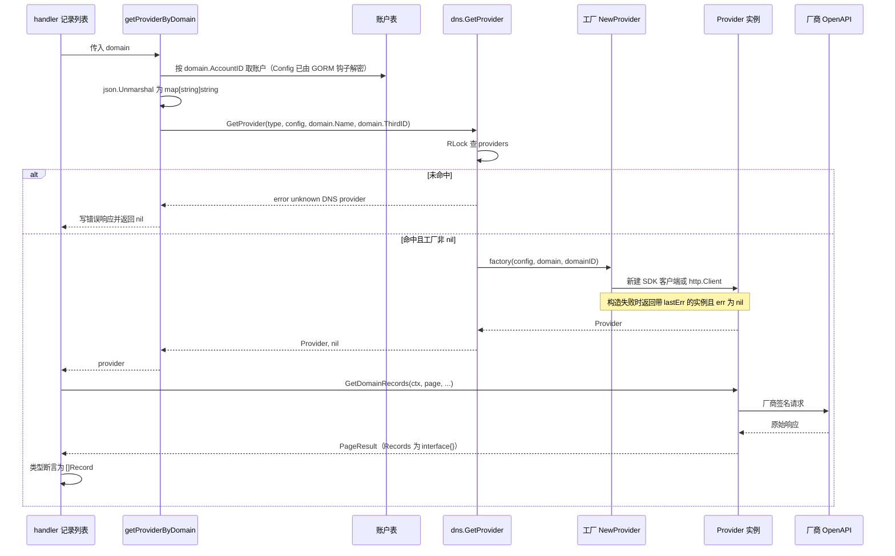
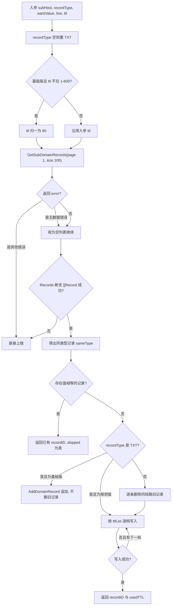
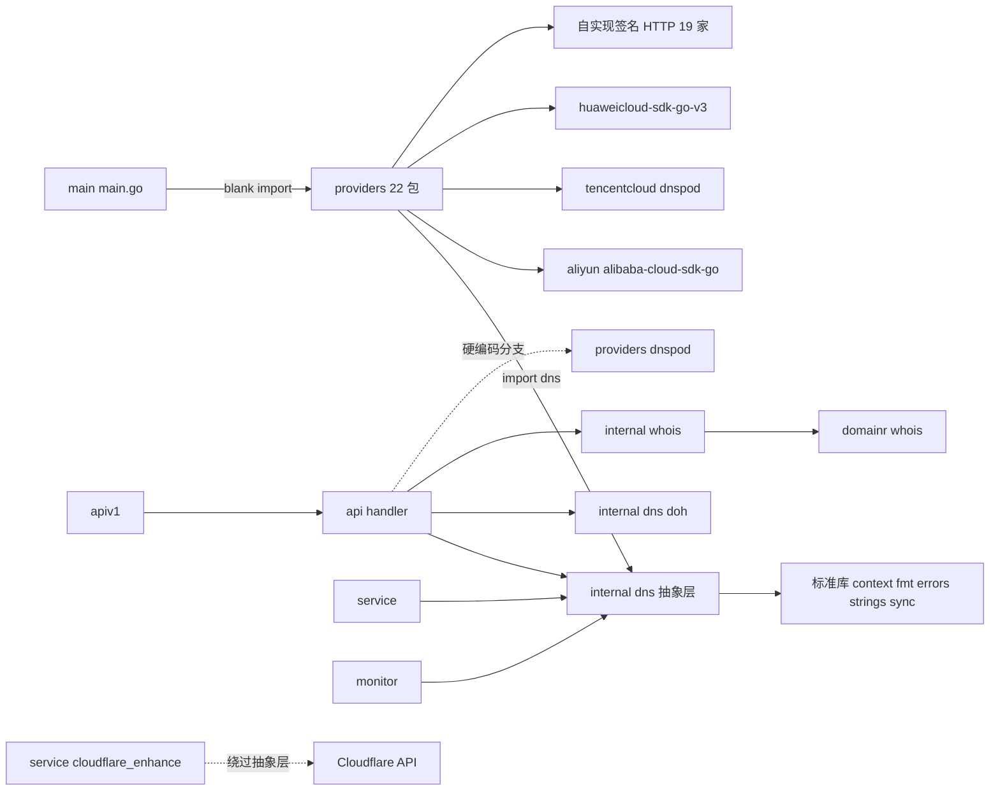

# DNS 提供商抽象层

<cite>
**本文档引用的文件**
- [main.go](file://main/main.go)
- [interface.go](file://main/internal/dns/interface.go)
- [registry.go](file://main/internal/dns/registry.go)
- [ensure_challenge.go](file://main/internal/dns/ensure_challenge.go)
- [empty_record_list.go](file://main/internal/dns/empty_record_list.go)
- [provider_form_test.go](file://main/internal/dns/provider_form_test.go)
- [doh.go](file://main/internal/dns/doh/doh.go)
- [aliyun.go](file://main/internal/dns/providers/aliyun/aliyun.go)
- [dnspod.go](file://main/internal/dns/providers/dnspod/dnspod.go)
- [cloudflare.go](file://main/internal/dns/providers/cloudflare/cloudflare.go)
- [lines.go](file://main/internal/dns/providers/cloudflare/lines.go)
- [namesilo.go](file://main/internal/dns/providers/namesilo/namesilo.go)
- [aws.go](file://main/internal/dns/providers/aws/aws.go)
- [huawei.go](file://main/internal/dns/providers/huawei/huawei.go)
- [powerdns.go](file://main/internal/dns/providers/powerdns/powerdns.go)
- [qingcloud.go](file://main/internal/dns/providers/qingcloud/qingcloud.go)
- [domain.go](file://main/internal/api/handler/domain.go)
- [account.go](file://main/internal/api/handler/account.go)
- [cert.go](file://main/internal/api/handler/cert.go)
- [acceleration.go](file://main/internal/api/handler/acceleration.go)
- [cloudflare.go](file://main/internal/api/handler/cloudflare.go)
- [dns_check.go](file://main/internal/api/handler/dns_check.go)
- [schedule.go](file://main/internal/service/schedule.go)
- [capabilities.go](file://main/internal/monitor/capabilities.go)
- [whois.go](file://main/internal/whois/whois.go)
- [go.mod](file://main/go.mod)
</cite>

## 目录

1. [简介](#简介)
2. [项目结构](#项目结构)
3. [核心组件](#核心组件)
4. [架构总览](#架构总览)
5. [详细组件分析](#详细组件分析)
6. [依赖关系分析](#依赖关系分析)
7. [性能考虑](#性能考虑)
8. [故障排查指南](#故障排查指南)
9. [结论](#结论)
10. [附录](#附录)

## 简介

`main/internal/dns` 是 DNS 管理域唯一的厂商差异收敛点，由三件套构成：**Interface**（`dns.Provider` 单一大接口 + 3 个可选扩展接口）、**Registry**（`Register` / `GetProvider` 双 map 注册中心 + 工厂函数）、**DefaultLineMapping**（21 条静态线路码映射）。三者把 22 家服务商互不兼容的 OpenAPI 语义压平成同一套 Go 方法签名，使 handler、service、monitor、apiv1 四类调用方在编译期看不到任何厂商 SDK 类型。

| 构件 | 载体文件 | 行数 | 关键对外符号 | 缺失后果 |
|------|----------|:----:|--------------|----------|
| Interface | `internal/dns/interface.go` | 167 | `Provider`（`:41-86`） | 编译失败：22 家实现无共同类型 |
| Registry | `internal/dns/registry.go` | 89 | `Register`（`:18-23`）、`GetProvider`（`:26-37`） | 运行期报 `unknown DNS provider` |
| DefaultLineMapping | `internal/dns/registry.go` | 58-80（21 键） | `DefaultDNSLine`（`:82-89`） | 分线路加速直接拒绝 |
| 挑战记录幂等写 | `internal/dns/ensure_challenge.go` | 177 | `EnsureChallengeRecord`（`:48-111`） | ACME 校验无法落记录 |
| 空列表兜底 | `internal/dns/empty_record_list.go` | 31 | `TreatAsEmptySubDomainRecordListError`（`:14-31`） | 首次签发把「无数据」当失败 |
| DoH 解析 | `internal/dns/doh/doh.go` | 163 | `QueryContext`（`:76-108`） | 记录生效性无法自证 |

先纠正一个常见口径错误：**WHOIS 不在 `dns.Provider` 接口内**。15 个方法（`interface.go:41-86`）全是「域名 + 解析记录」语义，没有 `QueryWhois` 之类的方法；域名注册信息走独立包 `main/internal/whois`（`whois.go:25` 的 `Query`，底层 `github.com/domainr/whois`，见 `go.mod:7`）。同理接口也不叫 `ListDomains` / `CreateRecord`，真实签名是 `GetDomainList` / `AddDomainRecord`，全量速查见[附录](#接口方法速查)。

规模感：抽象层自身 464 行（不含 `doh` 的 163 行），它服务的 provider 适配层有 25 个文件、10967 行。1:23 的比例意味着抽象层每一个契约细节都会被放大 22 倍。

**章节来源**
- [interface.go:41-86](file://main/internal/dns/interface.go#L41-L86)
- [registry.go:18-89](file://main/internal/dns/registry.go#L18-L89)
- [whois.go:25](file://main/internal/whois/whois.go#L25)
- [go.mod:7](file://main/go.mod#L7)

## 项目结构

抽象层位于 `main/internal/dns`，与同级的 `providers/`、`doh/` 两个子目录共同组成 DNS 厂商适配域。

```text
main/internal/dns/
├── interface.go            167 行  Provider 15 方法 + 3 扩展接口 + 11 数据结构
├── registry.go              89 行  ProviderFactory / Register / GetProvider / DefaultLineMapping
├── ensure_challenge.go     177 行  ACME 挑战记录幂等写（含 TTL 探测变体）
├── empty_record_list.go     31 行  厂商「无数据」错误归一化
├── provider_form_test.go   104 行  注册表非空转守卫（proxy 字段回归）
├── doh/doh.go              163 行  DoH JSON 查询与 3 家服务器池
└── providers/                    22 个一级子目录，合计 10967 行
    aliyun 470 · aliyunesa 483 · aws 888 · baidu 509 · bt 393
    cloudflare 503（+ lines.go 19 + lines_test.go 59）· dnsla 408 · dnsmgr 467
    dnspod 546 · dynv6 437 · goedge 713 · henet 455 · huawei 394（+ helper.go 5）
    huoshan 478 · jdcloud 412 · namesilo 318 · powerdns 620 · qingcloud 532
    spaceship 389 · technitium 665 · tencenteo 476 · west 328
```

结构上有三点必须掌握。第一，**不存在 `main/internal/dns/providers.go`**：注册入口分散在各 provider 子包的 `init()`，抽象层根包只声明契约与注册容器，这与证书域「`cert/providers.go` 集中定义表单」的写法相反。第二，`providers/` 目录数（22）、`dns.Register` 调用数（22）、`main.go` 中 `_ "main/internal/dns/providers/..."` 空白导入数（`:31-52`，22 行）三者完全一致，任一不等即接入不完整。第三，`doh` 是抽象层目录下的**独立叶子包**，不引用 `dns`、也不被任何 provider 引用，只被两个 handler 消费（`dns_check.go:188`、`cert.go:1509`）；把它算进抽象层是目录习惯，不是依赖关系。

| 路径 | 归属 | 依赖方向 | 判定依据 |
|------|------|----------|----------|
| `internal/dns` | 契约宿主 | 只依赖标准库 | `interface.go:3`、`registry.go:3-6` |
| `internal/dns/doh` | 叶子工具 | 与 `dns` 无相互依赖 | `doh.go:3-15` 导入清单无 `main/internal/dns` |
| `internal/dns/providers/*` | 实现方 | provider → dns（单向） | 各家 `init()` 调 `dns.Register` |
| `internal/api/handler` | 消费方 | handler → dns，另有 2 处硬编码 | `domain.go:48` 走注册表，`:1653` 走具体包 |
| `internal/service` | 消费方 | service → dns | `schedule.go:161` 调 `DefaultDNSLine` |
| `internal/monitor` | 消费方 | monitor → dns（能力位另立一套） | `capabilities.go:10-26` |
| `main.go` | 装配点 | main → providers（仅空白导入） | `main.go:31-52` |

**章节来源**
- [doh.go:3-15](file://main/internal/dns/doh/doh.go#L3-L15)
- [main.go:31-52](file://main/main.go#L31-L52)
- [domain.go:48](file://main/internal/api/handler/domain.go#L48)
- [capabilities.go:10-26](file://main/internal/monitor/capabilities.go#L10-L26)

## 核心组件

### Provider 接口契约

`dns.Provider`（`interface.go:41-86`）是单一大接口，15 个方法，无可选方法、无嵌入基类。Go 的结构化类型检查意味着少实现一个方法就无法通过 `dns.Register` 的类型校验——这是抽象层唯一的强约束，也是它最大的负担来源。

方法按语义分四组，除 `GetMinTTL() int`（`:82`）与 `GetError() string`（`:43`）外全部以 `context.Context` 为首参：

| 分组 | 方法 | 契约强度 |
|------|------|----------|
| 凭据与元信息 | `GetError`、`Check`、`GetMinTTL` | `Check` 各家真实探测，另两个偏弱 |
| 域名读 | `GetDomainList` | `Records` 必须装 `[]DomainInfo` |
| 记录读写 | `GetDomainRecords`、`GetSubDomainRecords`、`GetDomainRecordInfo`、`AddDomainRecord`、`UpdateDomainRecord`、`DeleteDomainRecord` | 唯一不可桩化的核心组 |
| 边缘能力 | `UpdateDomainRecordRemark`、`SetDomainRecordStatus`、`GetDomainRecordLog`、`GetRecordLine`、`AddDomain` | 大量桩实现 |

`Record`（`:6-18`）是记录的唯一领域形态，11 个字段：`ID`/`Name`/`Type`/`Value`/`TTL`/`Line`/`MX`/`Weight`/`Status`/`Remark`/`Updated`。`ID` 允许是厂商原生 ID，也允许是 provider 合成的串（AWS、Spaceship、PowerDNS、宝塔四家为合成）。`PageResult.Records` 被声明为 `interface{}`（`:35-38`），是接口设计唯一的类型让步：同一字段在不同方法里承载 `[]Record` 或 `[]DomainInfo`，消费方必须做断言；抽象层自己在 `ensure_challenge.go:9-18` 写了断言辅助 `recordsFromPageResult`，但未导出，包外无法复用。

**章节来源**
- [interface.go:6-38](file://main/internal/dns/interface.go#L6-L38)
- [interface.go:41-86](file://main/internal/dns/interface.go#L41-L86)
- [ensure_challenge.go:9-18](file://main/internal/dns/ensure_challenge.go#L9-L18)

### Registry 工厂与双 map 注册表

注册中心的全部状态只有三行（`registry.go:11-15`）：一把 `sync.RWMutex` 与两张以服务商名为键的 map——`providers` 存工厂、`configs` 存表单与特性。`ProviderFactory` 的签名（`:9`）是理解后续所有能力边界的钥匙：

```go
type ProviderFactory func(config map[string]string, domain, domainID string) Provider
```

| 环节 | 位置 | 行为 | 隐含约束 |
|------|------|------|----------|
| 注册 | `Register` `:18-23` | 写两张 map，持写锁 | 重复注册静默覆盖，无 panic、无告警 |
| 取实例 | `GetProvider` `:26-37` | 读锁取名 → 判 nil → 调工厂 | 每次调用新建实例，无缓存 |
| 未注册 | `:30-32` | `unknown DNS provider: %s` | 漏空白导入的最终可见形态 |
| 空工厂 | `:33-35` | `%s has no implementation (nil factory)` | 允许注册 nil 工厂，故需显式分支 |
| 单配置读 | `GetProviderConfig` `:40-45` | `(ProviderConfig, bool)` | 账户类型白名单校验用 |
| 全配置读 | `GetAllProviderConfigs` `:48-56` | 逐项浅拷贝到新 map | 防外部改内部 map，切片仍共享 |

`Register` 全程导出且无「仅启动期调用」守卫，实际不变量（`init` 后不再变化）靠约定维持。工厂签名不带 error 通道的直接后果是构造失败无处可报：`aliyun.go:44-45` 与 `dnspod.go:44` 在 SDK 客户端创建失败时返回 `&Provider{lastErr: err.Error()}`，此时 `client` 为 nil 而 `GetProvider` 仍返回 `err == nil`，首次方法调用即空指针解引用。唯一能把该信息取出来的出口是 `GetError()`，而它在生产代码中没有任何调用方。

读取侧集中在 `account.go`：`:216` 用 `GetProviderConfig` 做账户类型白名单，`:445-461` 的 `GetDNSProviders` 遍历 `GetAllProviderConfigs` 输出服务商列表，其中 `:457` 只取 `Features.Add` 一个特性位，`:461` 显式 `sort.Slice` 按 `Type` 排序以抵消 map 遍历无序。

**章节来源**
- [registry.go:9-56](file://main/internal/dns/registry.go#L9-L56)
- [aliyun.go:38-45](file://main/internal/dns/providers/aliyun/aliyun.go#L38-L45)
- [dnspod.go:39-44](file://main/internal/dns/providers/dnspod/dnspod.go#L39-L44)
- [account.go:445-461](file://main/internal/api/handler/account.go#L445-L461)

### DefaultLineMapping 线路静态表

`DefaultLineMapping`（`registry.go:58-80`）是 21 个键的二级 map，外层键为服务商 type，内层键为五个抽象线路代号：`DEF`（默认）、`CT`（电信）、`CU`（联通）、`CM`（移动）、`AB`（境外）。`DefaultDNSLine`（`:82-89`）在缺条目或缺 `DEF` 时回退字面量 `"default"`。

| provider | DEF | CT | CU | CM | AB | 分线路加速 |
|----------|-----|----|----|----|----|:----------:|
| aliyun | `default` | `telecom` | `unicom` | `mobile` | `oversea` | 可用 |
| dnspod | 空串 | `10=0` | `10=1` | `10=3` | `3=0` | 可用 |
| huawei | `default_view` | `Dianxin` | `Liantong` | `Yidong` | `Abroad` | 声明可用但失效 |
| west | 空串 | `LTEL` | `LCNC` | `LMOB` | `LFOR` | 可用 |
| dnsla | 空串 | `84613316902921216` | `84613316923892736` | `84613316953252864` | 空串 | 部分（AB 回落 DEF） |
| huoshan | `default` | `telecom` | `unicom` | `mobile` | `oversea` | 可用 |
| baidu | `default` | `ct` | `cnc` | `cmnet` | 空串 | 部分（AB 回落 DEF） |
| jdcloud | `-1` | `1` | `2` | `3` | `4` | 可用 |
| bt | `0` | `285344768` | `285345792` | `285346816` | 无键 | 部分（AB 回落 DEF） |
| cloudflare / dnsmgr / aliyunesa | `0` | — | — | — | — | 不可用 |
| henet / namesilo / powerdns / spaceship / technitium / dynv6 / goedge / aws | `default` | — | — | — | — | 不可用 |
| tencenteo | `Default` | — | — | — | — | 不可用 |
| qingcloud | **无条目** | — | — | — | — | 不可用 |

三处口径值得盯住。线路码形态完全不统一：语义串（`telecom`）、数字串（`1`）、复合表达式（`10=0`）、超长 ID（`84613316902921216`）、空串五种并存，调用方不能做任何格式化假设。`qingcloud` 是 22 家中唯一缺条目的，`DefaultDNSLine("qingcloud")` 回落到 `"default"`，而该厂商侧线路判定恰好接受 `default`，属巧合而非契约。`DefaultLineMapping` 与各 provider 的 `GetRecordLine` 是**双轨**：前者服务「加速要往哪条线路写」，后者服务「前端下拉展示哪些线路」，两者无任何一致性校验。

**章节来源**
- [registry.go:58-89](file://main/internal/dns/registry.go#L58-L89)
- [qingcloud.go:33](file://main/internal/dns/providers/qingcloud/qingcloud.go#L33)
- [acceleration.go:546](file://main/internal/api/handler/acceleration.go#L546)

### blank import 注册模式与扩展接口

provider 与抽象层之间没有任何显式装配代码，接入全靠 `main.go` 的 22 行空白导入（`:31-52`，按字母序）触发各子包 `init()`：`init()` 调 `dns.Register(name, NewProvider, ProviderConfig)`（`aliyun.go:16-17`）写入 `providers` 与 `configs` 两张 map（`registry.go:18-23`），运行期 `GetProvider` 读 `providers[account.Type]`，命中则调工厂新建实例，未命中则返回 `unknown DNS provider`（`registry.go:26-37`）。同一位置之上是 4 行证书厂商导入（`main.go:27-30`），之下是 4 行部署器导入（`:55-58`），三类扩展点共用同一模式。

三个工程含义：新增服务商只需新建子包并追加一行空白导入，`dns` 包与所有 handler 均无需改动，**开闭原则成立**；注册全部发生在启动期，运行期没有热加载或注销入口，**注册不可延迟**；忘加空白导入时 `init()` 不执行，编译与 `go vet` 全部通过，只在运行期第一次取该类型账户时报错，**漏导入是静默失败**。

`provider_form_test.go` 用另一种方式压制风险：测试文件里再空白导入 16 家（`:11-26`），以 `proxyFormProviders`（`:29-32`）要求 `GetAllProviderConfigs()` 必须命中这些名字，命中不到就报「断言将空转」（`:70-72`）。这是防测试空转的好写法，但覆盖只有 16/22，且断言目标是 `proxy` 字段回归而非注册完整性。

主接口之外还有 3 个可选扩展接口，唯一消费机制是类型断言：

| 扩展接口 | 定义 | 方法数 | 实现方 | 生产消费点 | 状态 |
|----------|------|:------:|--------|------------|------|
| `RecordGrouper` | `interface.go:102-106` | 3 | aliyun、dnspod | 记录分组读写 | 在用 |
| `DomainAliaser` | `interface.go:109-113` | 3 | 仅 dnspod | 无 | 死抽象：别名走本地表 |
| `SubdomainDelegator` | `interface.go:123-127` | 3 | 仅 dnspod | `domain.go:1653` 子域托管 | 在用，硬编码为 dnspod 分支 |

`ProviderFeatures`（`:157-167`）的 9 个特性位与这 3 个扩展接口是两套并行且不同步的能力口径，`monitor/capabilities.go:10-26` 是第三套。实测只有 `Add`（`account.go:457`）与 `Weight` 两位有生产读取点。

**章节来源**
- [main.go:27-58](file://main/main.go#L27-L58)
- [provider_form_test.go:11-32](file://main/internal/dns/provider_form_test.go#L11-L32)
- [provider_form_test.go:66-77](file://main/internal/dns/provider_form_test.go#L66-L77)
- [interface.go:102-167](file://main/internal/dns/interface.go#L102-L167)

## 架构总览

下图把契约与 22 个实现放在一起。类名与成员一律用英文标识符，实现类以 `P_<包名>` 命名以保证标识符唯一；扩展接口只画真实实现方，11 个数据结构不入图（字段清单见「核心组件」与「附录」）。

```mermaid
classDiagram
    class Provider {
        <<interface>>
        +GetError() string
        +Check(ctx) error
        +GetDomainList(ctx, keyword, page, pageSize) PageResult
        +GetDomainRecords(ctx, page, pageSize, filters) PageResult
        +GetSubDomainRecords(ctx, subDomain, page, pageSize, recordType, line) PageResult
        +GetDomainRecordInfo(ctx, recordID) Record
        +AddDomainRecord(ctx, name, type, value, line, ttl, mx, weight, remark) string
        +UpdateDomainRecord(ctx, recordID, name, type, value, line, ttl, mx, weight, remark) error
        +UpdateDomainRecordRemark(ctx, recordID, remark) error
        +DeleteDomainRecord(ctx, recordID) error
        +SetDomainRecordStatus(ctx, recordID, enable) error
        +GetDomainRecordLog(ctx, page, pageSize, keyword, start, end) PageResult
        +GetRecordLine(ctx) RecordLine
        +GetMinTTL() int
        +AddDomain(ctx, domain) error
    }
    class RecordGrouper {
        <<interface>>
        +GetRecordGroups(ctx) RecordGroup
        +ChangeRecordGroup(ctx, recordIDs, groupID) error
        +GetDomainRecordsByGroup(ctx, groupID, page, pageSize, filters) PageResult
    }
    class DomainAliaser {
        <<interface>>
        +GetDomainAliasList(ctx) DomainAlias
        +AddDomainAlias(ctx, alias) error
        +DeleteDomainAlias(ctx, aliasID) error
    }
    class SubdomainDelegator {
        <<interface>>
        +CreateSubdomainValidateTxtValue(ctx, domain) SubdomainValidateResult
        +DescribeSubdomainValidateStatus(ctx, domain) error
        +AddDomainWithNS(ctx, domain) string
    }
    Provider <|.. P_aliyun
    Provider <|.. P_aliyunesa
    Provider <|.. P_aws
    Provider <|.. P_baidu
    Provider <|.. P_bt
    Provider <|.. P_cloudflare
    Provider <|.. P_dnsla
    Provider <|.. P_dnsmgr
    Provider <|.. P_dnspod
    Provider <|.. P_dynv6
    Provider <|.. P_goedge
    Provider <|.. P_henet
    Provider <|.. P_huawei
    Provider <|.. P_huoshan
    Provider <|.. P_jdcloud
    Provider <|.. P_namesilo
    Provider <|.. P_powerdns
    Provider <|.. P_qingcloud
    Provider <|.. P_spaceship
    Provider <|.. P_technitium
    Provider <|.. P_tencenteo
    Provider <|.. P_west
    RecordGrouper <|.. P_aliyun
    RecordGrouper <|.. P_dnspod
    DomainAliaser <|.. P_dnspod
    SubdomainDelegator <|.. P_dnspod
```



**图表来源**
- [interface.go:41-127](file://main/internal/dns/interface.go#L41-L127)
- [registry.go:9-37](file://main/internal/dns/registry.go#L9-L37)
- [main.go:31-52](file://main/main.go#L31-L52)

图中方法参数在 `GetDomainRecords` 上做了简写（`filters` 代表 `keyword, subDomain, value, recordType, line, status` 六个串参），仅为图面可读，签名以 `interface.go:52` 与附录为准。三处结构信号：其一，22 个实现全部指向同一个 `Provider`，没有中间基类或嵌入结构可复用，任何契约变更都是 22 处改动；其二，三个扩展接口都只指向 `P_dnspod`（`RecordGrouper` 另有 `P_aliyun`），说明扩展机制目前收敛在两家头部厂商，第二家接入必然触碰消费侧代码；其三，`Provider` 与实现之间是「工厂返回接口值」的单向关系，`dns` 包不依赖任何 provider 子包，依赖倒置在这一层是干净的——不干净的地方在 handler 侧（见「依赖关系分析」）。

**章节来源**
- [interface.go:41-127](file://main/internal/dns/interface.go#L41-L127)
- [registry.go:9-37](file://main/internal/dns/registry.go#L9-L37)

## 详细组件分析

### 接口方法逐项与实现负担

附录给出 15 个方法的完整签名与逐家锚点，本节回答另一个问题：强制全实现的代价到底有多大。统计 22 家适配层源码中含「不支持」文案的分支（`grep -c` 跨文件求和，实测 51 处）：

| 分布 | 家数 | 具体文件 |
|------|:----:|----------|
| 5 处 | 2 | `namesilo.go`、`dynv6.go`（五个边缘方法全部桩化） |
| 4 处 | 2 | `west.go`、`aliyunesa.go` |
| 3 处 | 8 | `aws.go`、`bt.go`、`dnsla.go`、`henet.go`、`huawei.go`、`powerdns.go`、`spaceship.go`、`tencenteo.go` |
| 2 处 | 2 | `baidu.go`、`huoshan.go` |
| 1 处 | 6 | `cloudflare.go`、`dnsmgr.go`、`goedge.go`、`qingcloud.go`、`technitium.go` 等 |
| 0 处 | 3 | `aliyun.go`、`dnspod.go`、`jdcloud.go` |

22 家 × 15 方法 = 330 个实现位，其中约六分之一是纯占位桩。三个方法的负担最典型。

`GetError()`（`:43`）：22 家全部实现，每家各带一个 `lastErr` 可变字段（`aliyun.go:55`、`dnspod.go:63`），生产代码零调用方。它是接口里唯一「写了却取不出来」的方法，同时又是工厂无 error 通道的唯一补救口。

`SetDomainRecordStatus()`（`:73`）：Cloudflare 的实现是接口语义泄漏标本。`cloudflare.go:460-482` 中停用把主机记录名改为 `xxx_pause`（`:471`）、根域改为 `__root__`（`:469`），启用反向裁剪（`:474-477`），随后走一次 `UpdateDomainRecord`。一次「暂停」在厂商侧产生改名 + 全量覆盖，中途失败留下带 `_pause` 后缀的脏记录名；读侧 `:264-268`、`:334-338` 必须再做反向识别才能还原真实主机记录。`monitor/capabilities.go:13` 对 cloudflare 声明 `Pause: false`，与其 `ProviderFeatures.Status: true` 结论相反。

`GetRecordLine()`（`:79`）：唯一零桩实现的方法，做法分四类——调厂商 API 动态获取（`aliyun.go:318-322` 走 `DescribeSupportLines`；`dnspod.go:309-312` 走线路列表并硬编码 `DomainGrade = "DP_FREE"`，付费套餐自定义线路拿不全）、静态多条、静态单条「默认」、静态常量表。第四类只有 Cloudflare：`cloudflare.go:488` 直接拷贝 `lines.go:16-19` 的 `Lines`，恒两条 `0 仅DNS` / `1 已代理`；`lines.go:5-15` 的注释解释了原因——Cloudflare 不提供按运营商分流，其「线路」实为代理开关。

**章节来源**
- [interface.go:41-86](file://main/internal/dns/interface.go#L41-L86)
- [namesilo.go:298-318](file://main/internal/dns/providers/namesilo/namesilo.go#L298-L318)
- [cloudflare.go:264-338](file://main/internal/dns/providers/cloudflare/cloudflare.go#L264-L338)
- [cloudflare.go:460-495](file://main/internal/dns/providers/cloudflare/cloudflare.go#L460-L495)
- [lines.go:5-19](file://main/internal/dns/providers/cloudflare/lines.go#L5-L19)
- [dnspod.go:309-312](file://main/internal/dns/providers/dnspod/dnspod.go#L309-L312)
- [capabilities.go:10-26](file://main/internal/monitor/capabilities.go#L10-L26)

### 注册机制与实例化链路

一次典型的记录读取请求，从账户密文配置到接口值的过程如下：



**图表来源**
- [domain.go:37-54](file://main/internal/api/handler/domain.go#L37-L54)
- [registry.go:26-37](file://main/internal/dns/registry.go#L26-L37)
- [aliyun.go:38-45](file://main/internal/dns/providers/aliyun/aliyun.go#L38-L45)

装配逻辑在仓库里有 **5 份**同功能实现，是抽象层周边最明显的重复（DRY 违背）：`getProviderByDomain`（`domain.go:37-54`，控制台响应格式、返回 nil）、`getDNSProviderByDomain`（`batch.go`，脱离 `gin.Context`）、`providerForSync`（`service/record_sync.go`）、`getScheduleProvider`（`service/schedule.go`，同文件 `:161` 调 `DefaultDNSLine`）、`providerForDomain`（`apiv1/record_sync.go`，v1 响应格式）。五处的「查账户 → 反序列化配置 → `dns.GetProvider`」三步完全同构，差异只在失败时怎么回响应；由于错误格式已出现分歧，任何一次统一账户配置解析口径的改动都要同时触碰 handler、service、apiv1 三层。

**章节来源**
- [domain.go:37-54](file://main/internal/api/handler/domain.go#L37-L54)
- [domain.go:670](file://main/internal/api/handler/domain.go#L670)
- [domain.go:1305](file://main/internal/api/handler/domain.go#L1305)
- [registry.go:26-37](file://main/internal/dns/registry.go#L26-L37)
- [schedule.go:161](file://main/internal/service/schedule.go#L161)

### 线路映射的双轨问题

抽象层里「线路」有两个互不校验的真相源：`DefaultLineMapping`（`registry.go:58-80`，写侧，静态 Go map，键空间固定为五个代号，覆盖 21/22）与 `GetRecordLine()`（`interface.go:79`，读侧，各家运行时决定，形态为任意 `[]RecordLine{ID,Name}`，覆盖 22/22）。前者服务于加速写入与默认线取值（`acceleration.go:546`、`cert.go:971`、`handler/cloudflare.go:2505`、`domain.go:1676`、`schedule.go:161`），后者服务于前端线路下拉，二者之间没有任何一致性校验。

由此产生一个隐蔽失效模式：加速按 `DefaultLineMapping` 写入的线路码，可能与 `GetRecordLine` 返回给前端的 ID 不属于同一命名空间。Cloudflare 是设计使然（`lines.go:16-19` 的 `0`/`1` 与 `DefaultLineMapping["cloudflare"]["DEF"]="0"` 恰好同源）；huawei 是代码遗留——`huawei.go:124` 的 `request.LineId` 赋值、`:193` 的 `Line: *r.LineId` 回填、`:254-255` 的 weight 读取都被注释掉，读侧记录线路恒为空串，而映射表五个键齐全，映射存在但下游不生效。

`DefaultDNSLine` 的回退策略（`:82-89`）也需记录：它只在「provider 键不存在」或「DEF 键不存在」时回退 `"default"`，不区分「该服务商本就没有分线路概念」，于是 11 家只有 `DEF` 条目的 provider 与 1 家完全缺条目的 qingcloud 得到同一行为，把「缺配置」伪装成「有默认值」。

**章节来源**
- [registry.go:58-89](file://main/internal/dns/registry.go#L58-L89)
- [huawei.go:124](file://main/internal/dns/providers/huawei/huawei.go#L124)
- [huawei.go:254-255](file://main/internal/dns/providers/huawei/huawei.go#L254-L255)
- [cert.go:971](file://main/internal/api/handler/cert.go#L971)
- [lines.go:16-19](file://main/internal/dns/providers/cloudflare/lines.go#L16-L19)

### ensure_challenge 幂等写

`ensure_challenge.go` 是抽象层唯一带业务语义的公共服务，服务于 ACME 校验记录写入。两个导出函数共享同一判定骨架，但对 TXT 的策略不同：



**图表来源**
- [ensure_challenge.go:9-18](file://main/internal/dns/ensure_challenge.go#L9-L18)
- [ensure_challenge.go:48-111](file://main/internal/dns/ensure_challenge.go#L48-L111)
- [ensure_challenge.go:114-177](file://main/internal/dns/ensure_challenge.go#L114-L177)
- [empty_record_list.go:14-31](file://main/internal/dns/empty_record_list.go#L14-L31)

| 项 | `EnsureChallengeRecord` `:48-111` | `EnsureChallengeRecordWithTTLProbe` `:114-177` |
|----|-----------------------------------|-------------------------------------------------|
| TTL 决策 | `ttl<=0` 或 `>600` 时归一为 60（`:55-57`） | 按 `ttlList` 逐档重试（`:169-175`） |
| 已有同值判定 | 不比较线路（`:81`） | 额外要求线路匹配（`:141`） |
| TXT 处理 | 追加新记录、不删旧（`:89-95`） | 不删旧但走统一写入路径（`:149-162`） |
| 返回值 | `(recordID, skipped, err)` | `(recordID, skipped, usedTTL, err)` |
| 生产调用方 | `domain.go:1677`、`cert.go:977` | `acceleration.go:546`、`cloudflare.go:1318` |

`line` 参数在删除分支上的语义是「空则不按线路过滤」（`:101`、`:155` 同形：`if line != "" && rec.Line != "" && rec.Line != line { continue }`）。当调用方传空串时，该子域下**所有线路**的同类型记录都会被删除后重建——`cloudflare.go:1318` 正是传空串。这是为「单线路厂商」设计的宽容，落到多线路厂商即跨线路清除。

值相等判定由 `challengeValuesEqual`（`:31-46`）负责：先经 `normalizeChallengeValue`（`:20-29`）去首尾空白、去尾点、TXT 去成对引号；若仍不等且类型是 TXT，再把全部引号与空格剔除后比较。归一化的必要性来自厂商差异——华为与 dynv6 会给 TXT 值加引号，dynv6 与 PowerDNS 会给 CNAME/MX 自动补尾点。`recordsFromPageResult`（`:9-18`）把 `interface{}` 断言回 `[]Record`，失败返回带 `%T` 的错误；它未导出，包外十余处同类断言只能各写一遍，且多为 `if ok` 后静默当空列表——断言失败在抽象层内是显式错误，在包外是无声降级。

**章节来源**
- [ensure_challenge.go:9-46](file://main/internal/dns/ensure_challenge.go#L9-L46)
- [ensure_challenge.go:48-177](file://main/internal/dns/ensure_challenge.go#L48-L177)
- [cert.go:977](file://main/internal/api/handler/cert.go#L977)
- [cloudflare.go:1318](file://main/internal/api/handler/cloudflare.go#L1318)
- [domain.go:1677](file://main/internal/api/handler/domain.go#L1677)

### empty_record_list 兜底

`TreatAsEmptySubDomainRecordListError`（`empty_record_list.go:14-31`）解决一类极具体的问题：部分厂商在「按子域列举且无匹配记录」时返回业务错误而非空列表，导致「先 List 再 Create」的 ACME 流程在首次签发即失败。实现沿 `errors.Unwrap` 链逐层取 `Error()` 文本，用两个标记串做包含匹配：`ResourceNotFound.NoDataOfRecord` 与 `NoDataOfRecord`（`:18-21`）。

| 设计点 | 现状 | 权衡 |
|--------|------|------|
| 匹配依据 | 错误消息子串 | 无类型化错误常量，厂商文案变更即失效 |
| 遍历方式 | `for e := err; e != nil; e = errors.Unwrap(e)` | 支持包装链，但对非 `%w` 风格包装无效 |
| 大小写 | 严格区分 | 厂商返回小写变体即漏判 |
| 调用点 | 3 处：`ensure_challenge.go:61`、`:122`、`domain.go:1729` | 其余读路径仍把该错误当失败上报 |
| err 为 nil | 显式返回 `false`（`:15-17`） | 调用方须先判 `err != nil` |

注释（`:8-13`）明确说明「已单独处理的实现（如 dnspod）仍可与本函数并存」，即抽象层允许 provider 侧自行归一化、也允许调用侧兜底，两条路径并存但互不校验。新增厂商若返回第三种「无数据」文案（如 `RecordNotFound`），必须修改 `markers`——这是一个需要集中维护的白名单。

**章节来源**
- [empty_record_list.go:8-31](file://main/internal/dns/empty_record_list.go#L8-L31)
- [ensure_challenge.go:61](file://main/internal/dns/ensure_challenge.go#L61)
- [domain.go:1729](file://main/internal/api/handler/domain.go#L1729)

### DOH 客户端

`internal/dns/doh`（163 行单文件）与 `Provider` 接口无编译期关系，但同属 DNS 域，职责是「从解析面而非 API 面验证记录是否已生效」。

| 项 | 值 | 位置 |
|----|----|------|
| 服务器池 | 3 家：`dns.alidns.com` / `doh.pub` / `doh.360.cn` 的 `/resolve` | `doh.go:17-21` |
| 支持类型 | 10 种：A/AAAA/CNAME/MX/TXT/SOA/NS/PTR/SRV/CAA | `doh.go:23-34` |
| 单次超时 | 常量 `Timeout = 3 * time.Second` | `doh.go:41` |
| 调用方预算 | `2 * doh.Timeout` | `dns_check.go:189`、`cert.go:1507` |
| 响应体上限 | `maxRespBytes = 1 << 20`，经 `io.LimitReader` | `doh.go:47`、`:133` |
| User-Agent | 伪装 Chrome 137，注释称部分服务端会校验该头 | `doh.go:43-44`、`:125` |
| 连接复用 | 包级单例 `httpClient` | `doh.go:52` |
| 调度策略 | 首次随机选一家，仅错误为 `errMalformed` 时换一家重试一次 | `doh.go:82-107` |
| 不重试的错误 | 网络错误、空响应体 | `doh.go:87-89`、`:137-139` |
| 结果来源 | `Result.Server` 回显实际响应主机名 | `doh.go:71-74`、`:111-116` |
| 值清洗 | CNAME 去尾点，TXT 去引号 | `doh.go:154-159` |

两个结构性缺口：只重试一次且只在畸形响应时重试，网络超时不换服务器；无健康度、无熔断、无结果缓存，每次查询独立随机。`doh.go:146-150` 记录了已知坑——`doh.pub` 对 CAA(257)/PTR(12) 返回 `{"code":"UrlParameterError"}`，属合法 JSON，因此这两型在该服务器上得到「空结果且不重试」，调用方看到的效果是「查询成功但没有记录」。`errMalformed`（`:49`）以哨兵错误 + `errors.Is`（`:87`）表达重试条件，是抽象层唯一一处规范化的错误分类用法。

**章节来源**
- [doh.go:17-52](file://main/internal/dns/doh/doh.go#L17-L52)
- [doh.go:71-116](file://main/internal/dns/doh/doh.go#L71-L116)
- [doh.go:118-163](file://main/internal/dns/doh/doh.go#L118-L163)
- [dns_check.go:188-194](file://main/internal/api/handler/dns_check.go#L188-L194)
- [cert.go:1507-1509](file://main/internal/api/handler/cert.go#L1507-L1509)

## 依赖关系分析



**图表来源**
- [main.go:31-52](file://main/main.go#L31-L52)
- [aliyun.go:3-14](file://main/internal/dns/providers/aliyun/aliyun.go#L3-L14)
- [go.mod:6-19](file://main/go.mod#L6-L19)
- [whois.go:1-10](file://main/internal/whois/whois.go#L1-L10)

方向性结论：`dns` 包只依赖标准库（`interface.go:3` 单行 import，`registry.go:3-6`、`ensure_challenge.go:3-7`、`empty_record_list.go:3-6`），不引用任何 provider 子包、不引用数据库、不引用 Gin，抽象层是干净的叶子契约；`providers/*` 单向依赖 `dns`，除 dynv6/henet 借用缓存外不依赖其他基础设施包。三条需要盯住的边已在下图与「核心组件」给出：`go.mod` 显示只有 3 家走厂商 SDK（`:6` 阿里云、`:18` 腾讯云 DNSPod、`:13` 华为云），其余 19 家为自实现签名 HTTP，即抽象层之下并存两种传输栈，SDK 的超时与重试语义由厂商库决定，自实现的由各家文件决定，抽象层没有统一出口。

| 依赖边 | 是否破坏倒置 | 证据 | 影响 |
|--------|:------------:|------|------|
| handler → `dns.Provider` 接口 | 否 | `domain.go:48` | 新增服务商无需改 handler |
| handler → `providers/dnspod` 具体包 | 是 | `domain.go:1653` | 第二家接入必须改 handler，违反 OCP |
| handler → `service.EnhanceService` | 是 | `cloudflare.go:1318` 上下文 | 写 DNS 出现第二条通道，本地副本与审计只覆盖第一条 |
| `dns` → 任何 provider | 不存在 | `interface.go:3` | 无环 |
| provider → `internal/cache` | 局部 | dynv6 zone ID、henet 会话 cookie | 实例状态外置，跨请求可见 |

**章节来源**
- [interface.go:3](file://main/internal/dns/interface.go#L3)
- [registry.go:3-6](file://main/internal/dns/registry.go#L3-L6)
- [go.mod:6-19](file://main/go.mod#L6-L19)
- [domain.go:48](file://main/internal/api/handler/domain.go#L48)
- [domain.go:1653](file://main/internal/api/handler/domain.go#L1653)
- [cloudflare.go:1318](file://main/internal/api/handler/cloudflare.go#L1318)
- [cloudflare.go:2505](file://main/internal/api/handler/cloudflare.go#L2505)

## 性能考虑

抽象层的性能特征主要由「每请求新建实例」与「接口宽度导致的额外往返」决定。

| 现象 | 根因位置 | 放大系数 | 可行缓解 |
|------|----------|:--------:|----------|
| TLS 握手与连接池无法复用 | `registry.go:36` 每次新建实例；`domain.go:48` 每请求调用 | 每请求 1 次 | 按 `账户ID + type + domain` 缓存实例，或至少复用 `http.Client` |
| 记录列表每页两次厂商调用 | 列表 handler 额外调 `GetRecordLine` 做线路名映射，错误被忽略 | 页数 × 1 | 线路表按 `账户ID + type` 缓存 |
| 分页参数被忽略导致全量拉取 | AWS / 百度 / NameSilo / PowerDNS / Spaceship 的 `GetDomainRecords` 不分页 | 记录总数 | 对 `Features.Page` 为真的 provider 在 handler 层统一本地分页 |
| 批量权限校验重建全量索引 | 批量子域校验对每个 record_id 重拉全量记录（最多 10 页） | 选中数 × 10 | 索引在循环外构建一次 |
| 无厂商限流与退避 | `internal/dns` 内无 rate/limiter/retry/backoff 实现 | 批量与全量同步时 | 抽象层加令牌桶，至少把限流错误与业务错误分开统计 |
| 服务商列表每次全量浅拷贝 | `GetAllProviderConfigs`（`:48-56`）逐项复制 22 个 `ProviderConfig` | 每次列表请求 | 注册表 `init` 后不变，可用 `sync.Once` 快照 |

前两条与接口设计直接相关。「每请求新建实例」不是实现偷懒，而是工厂签名（`:9`）与 `GetProvider`（`:26-37`）的设计后果：`config` 是 map，实例携带 `domain`/`domainID`，天然与「某账户下的某域名」绑定，缓存键必须包含这三个维度，而当前代码没有缓存层；19 家自实现 HTTP 的 provider 每次都构造 `http.Client`，各家超时值互不相同。`GetRecordLine` 与 `DefaultLineMapping` 的双轨在性能上的代价被隐藏得很好：它不影响正确性，只在每次列表刷新多付一次厂商 RTT，且失败被静默忽略，因此慢与错都不会暴露为故障。

反向的优点有两处值得保留：`GetMinTTL()` 无 ctx、纯静态返回（`interface.go:82`），不产生网络调用，各家实测值从 0（dynv6、technitium 未声明）到 3600（`namesilo.go:312`，全库最大）；`doh` 的包级 `httpClient`（`doh.go:52`）与 1 MiB 响应上限（`:47`）则是全域少见的连接复用与内存防护写法。

**章节来源**
- [registry.go:9-56](file://main/internal/dns/registry.go#L9-L56)
- [interface.go:82](file://main/internal/dns/interface.go#L82)
- [namesilo.go:312](file://main/internal/dns/providers/namesilo/namesilo.go#L312)
- [doh.go:47-52](file://main/internal/dns/doh/doh.go#L47-L52)

## 故障排查指南

### 新增服务商未生效

最常见形态是「代码写完、编译通过、账户表单里没有这家」。按成本从低到高的五步判定：

| 序 | 检查点 | 命令或位置 | 不符时的处置 |
|:-:|--------|------------|--------------|
| 1 | 子包与包名 | `providers/<name>/<name>.go`，22/22 遵循同名单文件 | 修正目录结构 |
| 2 | 注册代码 | 文件内 `func init()` 调 `dns.Register`（参照 `aliyun.go:16-17`） | 补注册块 |
| 3 | 是否进二进制 | `go list -deps . \| grep 'dns/providers/<name>'` | 在 `main.go:31-52` 按字母序补一行空白导入（漏点高发处） |
| 4 | 注册名一致性 | 运行期报 `unknown DNS provider` 即 `registry.go:30-32` 命中 | 核对注册名与 `account.Type` 逐字符一致 |
| 5 | 表单键与线路 | `ConfigField.Key` 与 `NewProvider` 读取的 map 键；`DefaultLineMapping` 是否有条目 | 补键名（`registry.go:58-80`），否则分线路加速不生效 |

`provider_form_test.go:66-77` 提供一层弱守护：它对 16 家断言 `GetAllProviderConfigs()` 必须命中，未命中即报「断言将空转」，但覆盖不全且断言目标是 `proxy` 字段回归，不能替代第 3 步的依赖闭包检查。

**章节来源**
- [main.go:31-52](file://main/main.go#L31-L52)
- [registry.go:18-48](file://main/internal/dns/registry.go#L18-L48)
- [provider_form_test.go:66-77](file://main/internal/dns/provider_form_test.go#L66-L77)
- [aliyun.go:16-29](file://main/internal/dns/providers/aliyun/aliyun.go#L16-L29)

### 线路映射不一致

现象是「加速写了记录但解析不按运营商分流」或「前端线路下拉与实际写入值不同名」。按五条判据排查：

| 判据 | 期望 | 不符后果 | 定位 |
|------|------|----------|------|
| 映射表是否有该 provider 键 | 有 | `DefaultDNSLine` 回退 `"default"`，加速入口对无分线路概念者直接拒绝 | `registry.go:58-80`、`:82-89` |
| 五个线路代号是否齐全 | 支持分线路者应齐 | 缺 `AB` 键（如 `bt`）的境外线路回落默认线 | `registry.go:67` |
| provider 写侧是否真用 line | 用 | 形同虚设：huawei 的 `LineId` 赋值与 `Line` 回填都被注释 | `huawei.go:124`、`:193`、`:254-255` |
| `GetRecordLine` 返回 ID 与映射键是否同域 | 同域 | 下拉选中值与写入值不是同一命名空间 | `interface.go:79` 各家实现 |
| 是否静态特例 | Cloudflare 恒两条 | 把代理开关当运营商线路配置 | `lines.go:16-19` |

qingcloud 是本类问题的标本：映射表无条目 → `DefaultDNSLine` 回退 `"default"` → 恰好匹配该厂商对空串/`default` 的判定 → 结果「看起来能用」，但加速入口按映射表存在性判断仍会拒掉分线路请求。两处口径矛盾，只修一半会更乱。

**章节来源**
- [registry.go:58-89](file://main/internal/dns/registry.go#L58-L89)
- [huawei.go:124](file://main/internal/dns/providers/huawei/huawei.go#L124)
- [huawei.go:254-255](file://main/internal/dns/providers/huawei/huawei.go#L254-L255)
- [lines.go:16-19](file://main/internal/dns/providers/cloudflare/lines.go#L16-L19)

### 其他高频现象速查

| 现象 | 根因 | 证据 | 处置 |
|------|------|------|------|
| 记录列表突然变 0 条 | `PageResult.Records` 断言失败被静默当空列表 | `interface.go:37`、`ensure_challenge.go:13-16` | provider 侧确认返回 `[]Record` 值类型而非指针切片 |
| 账户可用但任何操作即 panic | 工厂构造失败被吞进 `lastErr`，`client` 为 nil 而 `err` 为 nil | `registry.go:36`、`aliyun.go:44-45`、`dnspod.go:44` | 校验凭据格式；长期方案是工厂签名加 error 通道 |
| 首次签发证书失败、重试即成功 | 厂商把「无匹配记录」返回为业务错误 | `empty_record_list.go:18-21` | 把该厂商文案加入 markers 白名单 |
| 暂停记录后主机名变成 `xxx_pause` | Cloudflare 用改名模拟启停 | `cloudflare.go:469-477` | 属预期行为；中途失败需手工改名 |
| 提示支持暂停但接口返回不支持 | 能力探测三套口径互相矛盾 | `interface.go:157-167`、`capabilities.go:13` | 以实际 `SetDomainRecordStatus` 返回为准 |
| ACME 校验记录被跨线路清空 | `line` 传空串时删除分支不按线路过滤 | `ensure_challenge.go:101`、`:155`、`cloudflare.go:1318` | 调用方显式传目标线路 |
| DoH 查 CAA/PTR 恒空 | `doh.pub` 返回合法 JSON 错误码，不触发换服务器 | `doh.go:146-150` | 换类型或按 `Result.Server` 判定来源 |
| 批量或同步撞厂商限流 | 抽象层无令牌桶与退避 | `internal/dns` 内无限流实现 | 降并发；全量同步已改为逐域名串行 |
| TXT 值比对反复不等 | 引号与尾点归一化不足 | `ensure_challenge.go:20-46` | 依赖现有归一化，新增厂商需复核 |
| PowerDNS/青云凭据明文过网 | 两处 endpoint 硬编码 `http://` | `powerdns.go:68`、`qingcloud.go:33` | 与 `aliyun.go:40-42` 的 https 注释口径相反，需改 scheme |

**章节来源**
- [interface.go:37](file://main/internal/dns/interface.go#L37)
- [registry.go:36](file://main/internal/dns/registry.go#L36)
- [aliyun.go:40-45](file://main/internal/dns/providers/aliyun/aliyun.go#L40-L45)
- [empty_record_list.go:18-21](file://main/internal/dns/empty_record_list.go#L18-L21)
- [cloudflare.go:469-477](file://main/internal/dns/providers/cloudflare/cloudflare.go#L469-L477)
- [ensure_challenge.go:20-46](file://main/internal/dns/ensure_challenge.go#L20-L46)
- [doh.go:146-150](file://main/internal/dns/doh/doh.go#L146-L150)
- [powerdns.go:68](file://main/internal/dns/providers/powerdns/powerdns.go#L68)

## 结论

抽象层用 464 行代码压平了 10967 行厂商差异，接口选择是正确的：`dns` 包零基础设施依赖，provider 单向依赖契约，新增服务商在可用性、账户表单、服务商列表三处都表现为「零改动」，开闭原则在主体链路上成立。

代价集中在四处，均可追溯到明确实现位。接口过宽（违反 ISP）：15 个方法强制全实现，实测 51 处「不支持」占位分支，`GetError` 22 家各写一遍却零调用方，同时又是工厂无 error 通道的唯一补救口（`interface.go:43`、`registry.go:9`）。构造错误无处可报：工厂签名不带 error，失败被吞进 `lastErr`，`GetProvider` 仍返回 `err == nil`（`registry.go:36`、`aliyun.go:44-45`）。能力口径三源并存：`ProviderFeatures` 9 位中仅 2 位有生产读取、可选接口类型断言、`monitor/capabilities.go` 独立能力表，同一问题三种答法且互相矛盾。契约让步：`PageResult.Records` 为 `interface{}`（`interface.go:37`），把类型安全推到运行期，断言失败在包外静默降级为空列表。

按收益排序的最小改进：给注册表补一条完整性测试（目录集合与注册键集合相等，治漏导入）、工厂签名引入 `(Provider, error)` 或直接删除 `GetError`、把日志/备注/加域下沉为可选扩展接口（沿用 `RecordGrouper` 模式）、线路映射与 `GetRecordLine` 收敛为单一真相源。

**章节来源**
- [interface.go:37-86](file://main/internal/dns/interface.go#L37-L86)
- [registry.go:9-37](file://main/internal/dns/registry.go#L9-L37)
- [capabilities.go:10-26](file://main/internal/monitor/capabilities.go#L10-L26)
- [provider_form_test.go:29-32](file://main/internal/dns/provider_form_test.go#L29-L32)

## 附录

### 接口方法速查

| # | 方法签名（`interface.go`） | 行 | 返回 | 语义 |
|:-:|----------------------------|:--:|------|------|
| 1 | `GetError() string` | :43 | `string` | 取构造期残留错误，生产零调用 |
| 2 | `Check(ctx context.Context) error` | :46 | `error` | 凭据可用性探测（`account.go:420`） |
| 3 | `GetDomainList(ctx, keyword string, page, pageSize int) (*PageResult, error)` | :49 | `[]DomainInfo` | 厂商侧域名列表 |
| 4 | `GetDomainRecords(ctx, page, pageSize int, keyword, subDomain, value, recordType, line, status string) (*PageResult, error)` | :52 | `[]Record` | 8 个筛选位 |
| 5 | `GetSubDomainRecords(ctx, subDomain string, page, pageSize int, recordType, line string) (*PageResult, error)` | :55 | `[]Record` | 主机记录精查 |
| 6 | `GetDomainRecordInfo(ctx, recordID string) (*Record, error)` | :58 | `*Record` | 单条回读 |
| 7 | `AddDomainRecord(ctx, name, recordType, value, line string, ttl, mx int, weight *int, remark string) (string, error)` | :61 | recordID | `weight` 用指针区分未设置 |
| 8 | `UpdateDomainRecord(ctx, recordID, name, recordType, value, line string, ttl, mx int, weight *int, remark string) error` | :64 | `error` | 全量覆盖，零值会盖原值 |
| 9 | `UpdateDomainRecordRemark(ctx, recordID, remark string) error` | :67 | `error` | 仅 `Remark==1` 有独立 API |
| 10 | `DeleteDomainRecord(ctx, recordID string) error` | :70 | `error` | ID 可为合成串 |
| 11 | `SetDomainRecordStatus(ctx, recordID string, enable bool) error` | :73 | `error` | 启用/暂停 |
| 12 | `GetDomainRecordLog(ctx, page, pageSize int, keyword, startDate, endDate string) (*PageResult, error)` | :76 | `*PageResult` | 多数桩化 |
| 13 | `GetRecordLine(ctx) ([]RecordLine, error)` | :79 | `[]RecordLine` | 与静态映射双轨 |
| 14 | `GetMinTTL() int` | :82 | `int` | 唯一无 ctx 方法 |
| 15 | `AddDomain(ctx, domain string) error` | :85 | `error` | 对应 `Features.Add` |

扩展数据结构：`Record`（`:6-18`）、`DomainInfo`（`:21-26`）、`RecordLine`（`:29-32`）、`PageResult`（`:35-38`）、`RecordGroup`（`:89-92`）、`DomainAlias`（`:95-99`）、`SubdomainValidateResult`（`:116-120`）、`ProviderConfig`（`:130-137`）、`ConfigField`（`:140-148`）、`ConfigOption`（`:151-154`）、`ProviderFeatures`（`:157-167`）。

**章节来源**
- [interface.go:6-167](file://main/internal/dns/interface.go#L6-L167)
- [account.go:420](file://main/internal/api/handler/account.go#L420)

### 服务商实现速查

22 家的注册锚点与工厂位置，逐条实测（`init` 与 `Register` 为该文件内 `func init()` 与 `dns.Register` 所在行）：

| 服务商 | type | init | Register | NewProvider | 行数 |
|--------|------|:----:|:--------:|:-----------:|:----:|
| 阿里云 | `aliyun` | :16 | :17 | :38 | 470 |
| 阿里云 ESA | `aliyunesa` | :23 | :24 | :54 | 483 |
| AWS Route 53 | `aws` | :23 | :24 | :63 | 888 |
| 百度云 | `baidu` | :22 | :23 | :48 | 509 |
| 宝塔域名 | `bt` | :19 | :20 | :48 | 393 |
| Cloudflare | `cloudflare` | :19 | :20 | :48 | 503 |
| DNSLA | `dnsla` | :18 | :19 | :53 | 408 |
| DNSmgr | `dnsmgr` | :17 | :18 | :44 | 467 |
| 腾讯云 DNSPod | `dnspod` | :17 | :18 | :39 | 546 |
| dynv6 | `dynv6` | :20 | :21 | :53 | 437 |
| GoEdge | `goedge` | :18 | :19 | :61 | 713 |
| HE DNS | `henet` | :19 | :20 | :50 | 455 |
| 华为云 | `huawei` | :15 | :16 | :37 | 394 |
| 火山引擎 | `huoshan` | :21 | :22 | :52 | 478 |
| 京东云 | `jdcloud` | :20 | :21 | :59 | 412 |
| NameSilo | `namesilo` | :16 | :17 | :40 | 318 |
| PowerDNS | `powerdns` | :17 | :18 | :66 | 620 |
| 青云 DNS | `qingcloud` | :20 | :21 | :44 | 532 |
| Spaceship | `spaceship` | :21 | :22 | :50 | 389 |
| Technitium | `technitium` | :16 | :17 | :41 | 665 |
| 腾讯云 EO | `tencenteo` | :19 | :20 | :51 | 476 |
| 西部数码 | `west` | :22 | :23 | :48 | 328 |

辅助文件：`cloudflare/lines.go`（19 行）、`cloudflare/lines_test.go`（59 行，provider 侧唯一测试）、`huawei/helper.go`（5 行）。

**章节来源**
- [aliyun.go:16-17](file://main/internal/dns/providers/aliyun/aliyun.go#L16-L17)
- [aws.go:23-24](file://main/internal/dns/providers/aws/aws.go#L23-L24)
- [namesilo.go:16-17](file://main/internal/dns/providers/namesilo/namesilo.go#L16-L17)
- [powerdns.go:17-18](file://main/internal/dns/providers/powerdns/powerdns.go#L17-L18)
- [lines.go:16-19](file://main/internal/dns/providers/cloudflare/lines.go#L16-L19)

### 注册示例与验证清单

最小注册骨架（结构取自 `aliyun.go:16-29` 的真实写法，凭据值以 `{占位}` 脱敏）：

```go
package mydns

import "main/internal/dns"

func init() {
	dns.Register("mydns", NewProvider, dns.ProviderConfig{
		Type: "mydns", Name: "示例 DNS", Icon: "mydns.png",
		Config: []dns.ConfigField{
			{Name: "API Token", Key: "token", Type: "input", Required: true},
		},
		Features: dns.ProviderFeatures{Remark: 1, Status: true, Add: true},
	})
}

type Provider struct {
	token, domain, domainID, lastErr string
}

/* NewProvider 签名必须与 dns.ProviderFactory 逐字符一致（registry.go:9） */
func NewProvider(config map[string]string, domain, domainID string) dns.Provider {
	return &Provider{token: config["token"], domain: domain, domainID: domainID}
}
```

对应 `main.go` 追加一行（按字母序落在 `dynv6` 与 `goedge` 之间）：

```go
_ "main/internal/dns/providers/mydns"
```

若厂商支持分线路解析，再在 `registry.go:58-80` 补一行：

```go
"mydns": {"DEF": "default", "CT": "ct", "CU": "cu", "CM": "cm", "AB": "ab"},
```

验证顺序与预期：

| 序 | 检查点 | 预期 | 失败指向 |
|:-:|--------|------|----------|
| 1 | `go build ./...` | 通过 | 缺方法或签名不符 |
| 2 | `go vet ./internal/dns/...` | 无输出 | 未使用参数、格式串错误 |
| 3 | `go list -deps . \| grep 'dns/providers/mydns'` | 命中一行 | `main.go` 漏空白导入 |
| 4 | 控制台账户表单服务商数 | 与注册数一致 | `configs` 未写入或 `Type` 串不一致 |
| 5 | 对该账户执行连通性检查 | `Check` 返回 nil | 凭据解析或 endpoint 配置 |
| 6 | 读一次记录列表 | 非空且可断言为 `[]Record` | `PageResult.Records` 类型错 |

**章节来源**
- [aliyun.go:16-45](file://main/internal/dns/providers/aliyun/aliyun.go#L16-L45)
- [main.go:31-52](file://main/main.go#L31-L52)
- [registry.go:9-80](file://main/internal/dns/registry.go#L9-L80)
- [interface.go:130-167](file://main/internal/dns/interface.go#L130-L167)
