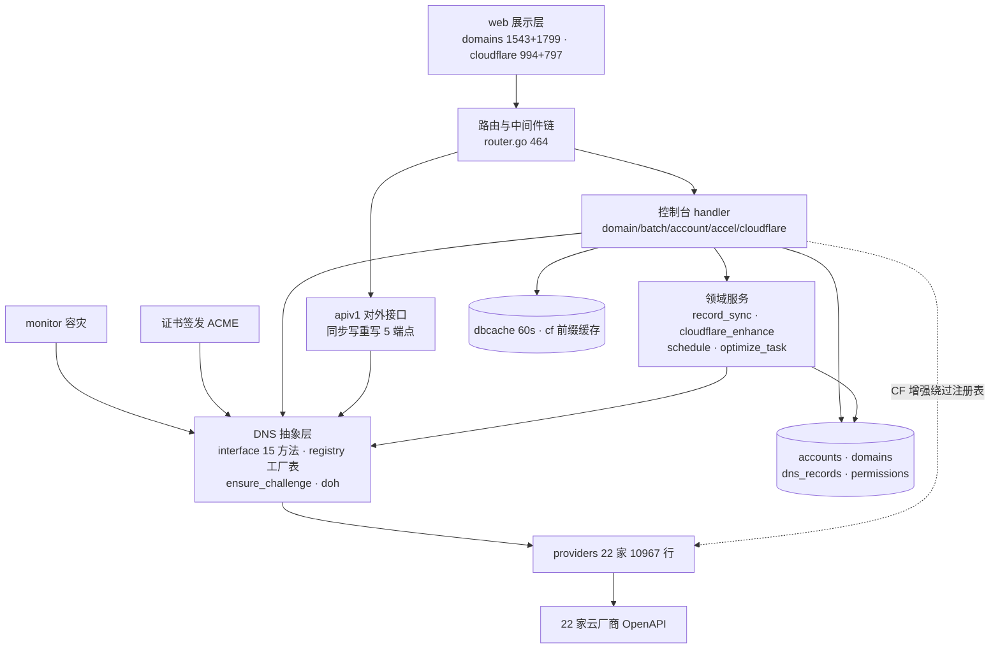
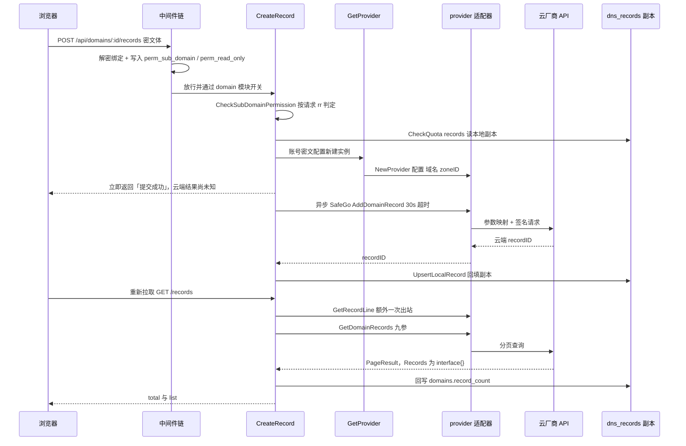
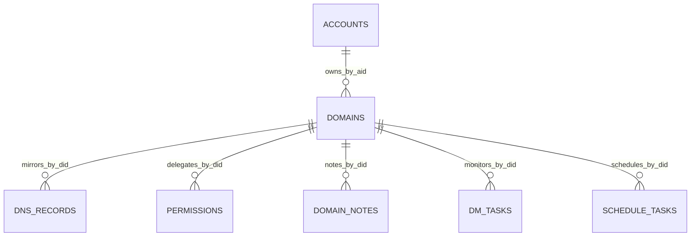
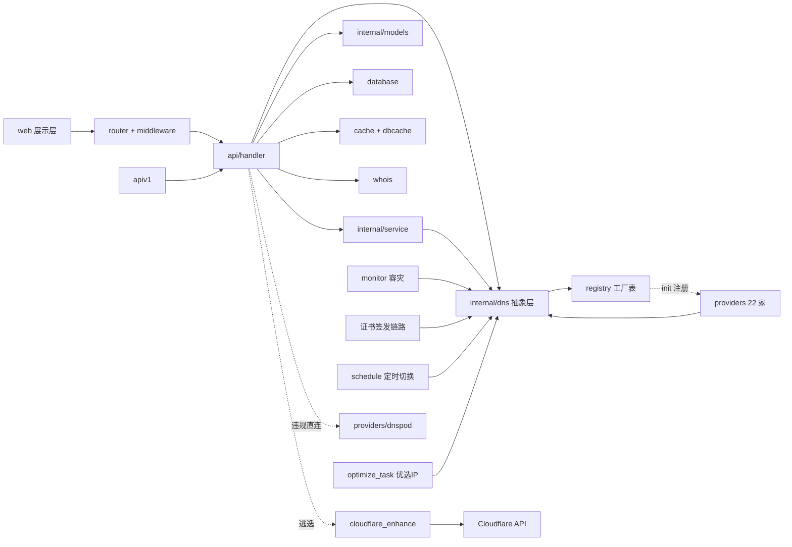
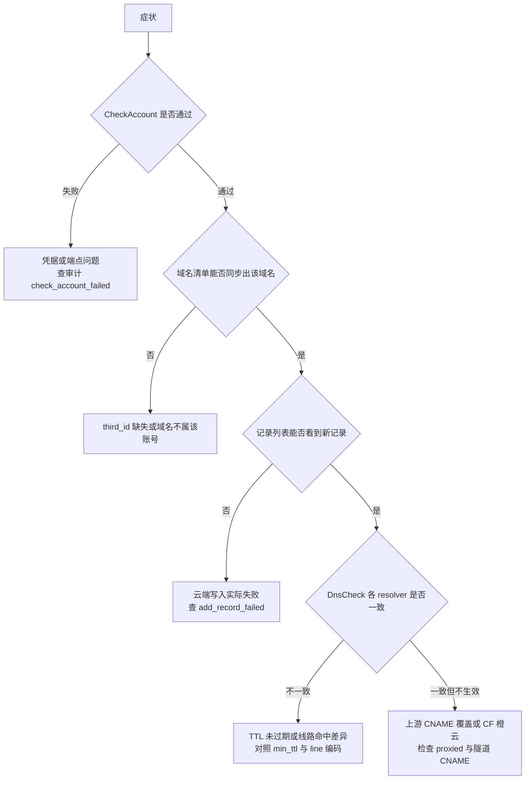

# DNS管理功能

<cite>
**本文档引用的文件**
- [interface.go](file://main/internal/dns/interface.go)
- [registry.go](file://main/internal/dns/registry.go)
- [ensure_challenge.go](file://main/internal/dns/ensure_challenge.go)
- [empty_record_list.go](file://main/internal/dns/empty_record_list.go)
- [doh.go](file://main/internal/dns/doh/doh.go)
- [cloudflare.go (provider)](file://main/internal/dns/providers/cloudflare/cloudflare.go)
- [lines.go](file://main/internal/dns/providers/cloudflare/lines.go)
- [dnspod.go](file://main/internal/dns/providers/dnspod/dnspod.go)
- [aliyun.go](file://main/internal/dns/providers/aliyun/aliyun.go)
- [dnsmgr.go](file://main/internal/dns/providers/dnsmgr/dnsmgr.go)
- [dnsla.go](file://main/internal/dns/providers/dnsla/dnsla.go)
- [aws.go](file://main/internal/dns/providers/aws/aws.go)
- [spaceship.go](file://main/internal/dns/providers/spaceship/spaceship.go)
- [qingcloud.go](file://main/internal/dns/providers/qingcloud/qingcloud.go)
- [domain.go](file://main/internal/api/handler/domain.go)
- [domain_ext.go](file://main/internal/api/handler/domain_ext.go)
- [domain_category.go](file://main/internal/api/handler/domain_category.go)
- [batch.go](file://main/internal/api/handler/batch.go)
- [batch_authz.go](file://main/internal/api/handler/batch_authz.go)
- [account.go](file://main/internal/api/handler/account.go)
- [cloudflare.go (handler)](file://main/internal/api/handler/cloudflare.go)
- [acceleration.go](file://main/internal/api/handler/acceleration.go)
- [dns_check.go](file://main/internal/api/handler/dns_check.go)
- [cname.go](file://main/internal/api/handler/cname.go)
- [cert.go](file://main/internal/api/handler/cert.go)
- [quota.go](file://main/internal/api/handler/quota.go)
- [quicklogin.go](file://main/internal/api/handler/quicklogin.go)
- [permission.go](file://main/internal/api/middleware/permission.go)
- [router.go](file://main/internal/api/router.go)
- [domain.go (apiv1)](file://main/internal/apiv1/domain.go)
- [record.go (apiv1)](file://main/internal/apiv1/record.go)
- [record_sync.go (apiv1)](file://main/internal/apiv1/record_sync.go)
- [record_sync.go](file://main/internal/service/record_sync.go)
- [cloudflare_enhance.go](file://main/internal/service/cloudflare_enhance.go)
- [models.go](file://main/internal/models/models.go)
- [quota.go (模型)](file://main/internal/models/quota.go)
- [cloudflare.go (模型)](file://main/internal/models/cloudflare.go)
- [capabilities.go](file://main/internal/monitor/capabilities.go)
- [whois.go](file://main/internal/whois/whois.go)
- [dbcache.go](file://main/internal/dbcache/dbcache.go)
- [main.go](file://main/main.go)
- [page.tsx (domains)](file://web/app/(dashboard)/dashboard/domains/page.tsx)
- [client.tsx](file://web/app/(dashboard)/dashboard/domains/[id]/client.tsx)
- [account-form.tsx](file://web/components/account-form.tsx)
- [utils.ts](file://web/lib/utils.ts)
</cite>

## 目录
1. [简介](#简介)
2. [项目结构](#项目结构)
3. [核心组件](#核心组件)
4. [架构总览](#架构总览)
5. [详细组件分析](#详细组件分析)
6. [依赖关系分析](#依赖关系分析)
7. [性能考虑](#性能考虑)
8. [故障排查指南](#故障排查指南)
9. [结论](#结论)
10. [附录](#附录)

## 简介

DNS 管理功能域解决一个具体问题：**用户手里有若干家互不兼容的 DNS 服务商账户，界面与 API 只能有一套**。落地的抽象是「账号—域名—记录」三级模型：

- **账号（Account）**：一份服务商凭据。`models.Account` 只存 `type` + `config`（JSON 密文列且 `json:"-"`），凭据键名由服务商注册表的表单声明，面板不猜（`main/internal/models/models.go:50`）
- **域名（Domain）**：账号下的一个 zone，经 `aid` 挂账号、经 `third_id` 挂服务商侧 zone ID（`models.go:72`）
- **记录（Record）**：真正写向云端的解析条目。**云端是唯一事实源**，本地 `dns_records` 只是对账副本（`models/quota.go:75`）

三级的关键不对称：账号与域名在本地有完整生命周期，记录在本地只有副本语义。写操作先出站到服务商、成功后才回填本地，因此「面板显示成功」与「解析已生效」是两个独立事实，后者要靠 DoH/UDP 检测链路（`handler/dns_check.go:57`）确认。

支撑面：22 家适配器（实测 22 个目录 = 22 次 `dns.Register` = `main.go:31-52` 的 22 行 blank import）、1 个 15 方法统一接口（`dns/interface.go:41-86`）、进程启动期填充的注册中心（`dns/registry.go:18`）、控制台与对外 v1 两套路由（`api/router.go:113-334`、`apiv1/domain.go:21`、`apiv1/record.go:25`）。

| 主题 | 本文件覆盖 | 深入归属 |
| --- | --- | --- |
| 功能域全景与分层 | 是 | — |
| 15 方法契约与注册机制 | 摘要 | 《DNS提供商抽象层》 |
| 域名实体、归类、权限、WHOIS | 摘要 | 《域名管理》 |
| 记录读写的逐步骤实现 | 摘要 | 《解析记录管理》 |
| 批量三接口的事务/并发/补偿 | 摘要 | 《批量操作功能》 |
| 22 家逐家能力与限制 | 速查表 | 《支持的DNS服务商》 |

**章节来源**

- [main/internal/dns/interface.go](file://main/internal/dns/interface.go)
- [main/internal/models/models.go](file://main/internal/models/models.go)
- [main/internal/api/handler/dns_check.go](file://main/internal/api/handler/dns_check.go)
- [main/main.go](file://main/main.go)

## 项目结构

四段式：**抽象层（零厂商知识）→ 适配层（每家一包）→ 接口层（handler / apiv1）→ 展示层（web）**。抽象层与适配层之间只有「注册」这一个方向的耦合。

```text
main/internal/dns/          抽象层：interface 167 / registry 89 /
                            ensure_challenge 177 / empty_record_list 31 /
                            doh 163；providers/ 22 家 10967 行（含 2 个测试文件）
main/internal/api/handler/  接口层（控制台），DNS 面 10 文件 7426 行
  domain 1748 · cloudflare 2509 · acceleration 1000 · batch 495
  account 466 · domain_ext 418 · quota 351 · dns_check 197
  batch_authz 155 · logs 87
main/internal/api/handler/  另有 domain_category 187 · cname 179 · quicklogin 204
main/internal/apiv1/        域名 19 条 + 记录 14 条 v1 路由；record_sync 444 行
main/internal/service/      record_sync 663 · cloudflare_enhance 733
                            · schedule 289 · optimize_task 437
web/app/(dashboard)/dashboard/
  domains 1543 + 1799 · cloudflare/{hostnames 994, tunnels 797}
  components/account-form.tsx 538
```

规模全部为 `wc -l` 实测（工作区当前状态）。`cloudflare.go`（2509）与 `domain.go`（1748）都远超项目自身约定的单文件 500 行上限，CF 的一个文件承担了整个增强能力面——这是后文「特例」一节的技术债来源。

**章节来源**

- [main/internal/dns/interface.go](file://main/internal/dns/interface.go)
- [main/internal/api/handler/domain.go](file://main/internal/api/handler/domain.go)
- [main/internal/api/handler/cloudflare.go](file://main/internal/api/handler/cloudflare.go)
- [main/internal/service/record_sync.go](file://main/internal/service/record_sync.go)

## 核心组件

| 组件 | 位置 | 单一职责 | 对外符号 | 规模 |
| --- | --- | --- | --- | --- |
| 抽象契约 | `dns/interface.go:41-86` | 定义一家服务商最少要能做什么 | `Provider`（15 方法） | 167 行 |
| 扩展契约 | `interface.go:102`/`:109`/`:123` | 表达能力不齐的三家独有能力 | `RecordGrouper`/`DomainAliaser`/`SubdomainDelegator` | 同上 |
| 注册中心 | `dns/registry.go:18`/`:26` | 类型名 → 工厂 + 表单；实例按需新建 | `Register`/`GetProvider`/`GetProviderConfig`/`GetAllProviderConfigs` | 89 行 |
| 线路静态映射 | `registry.go:58-80` | 各家默认线路与运营商线路编码 | `DefaultLineMapping`（21 键）/`DefaultDNSLine` | 同上 |
| 挑战记录服务 | `ensure_challenge.go:48`/`:114` | ACME TXT/CNAME 幂等写与 TTL 探测 | `EnsureChallengeRecord*` | 177 行 |
| 空结果归一 | `empty_record_list.go:14` | 厂商「查无数据」转空列表 | `TreatAsEmptySubDomainRecordListError` | 31 行 |
| 22 家适配 | `dns/providers/*` | 参数映射、签名、值格式化、响应解析 | 各家 `Provider`+`NewProvider`+`init()` | 10967 行 |
| 控制台接口层 | `api/handler/{domain,batch,…}.go` | 权限、配额、审计、异步派发、响应格式 | 见「项目结构」 | 7426 行 |
| CF 增强接口层 | `api/handler/cloudflare.go` | 主机名/隧道/CIDR/路由/DCV | 28 个导出 handler | 2509 行 |
| CF 增强服务 | `service/cloudflare_enhance.go:21` | 账户级 CF 客户端与自动翻页 | `EnhanceService` | 733 行 |
| 副本同步器 | `service/record_sync.go:81` | 云端/本地全量对账 | `RecordSyncer`/`SyncDomainRecords` | 663 行 |
| DoH 客户端 | `dns/doh/doh.go:76` | 三池随机 + 畸形响应换池 | `QueryContext`/`Result` | 163 行 |
| Whois 客户端 | `whois/whois.go:25` | 注册商与到期时间解析 | `Query`/`DomainInfo` | 152 行 |

三条不可省略的约束：

- **接口过宽**：新增第 23 家必须实现全部 15 个方法，缺一个即编译失败；22 家实测有 51 处以 `fmt.Errorf` 直接返回「不支持」类错误，纯死方法 `GetError()` 与 `AddDomain()` 也各写了 22 份
- **工厂无 error 通道**：`ProviderFactory` 签名为 `func(config, domain, domainID) Provider`（`registry.go:9`），构造失败只能塞进实例 `lastErr`，而唯一能取回它的 `GetError()` 在生产代码中无人调用
- **实例不缓存**：`GetProvider` 每次调用都新建实例（`registry.go:36`），全仓共 13 处生产调用点：`handler/domain.go:48`、`:375`、`:1305`、`:1672`，`handler/batch.go:432`，`handler/account.go:402`，`handler/acceleration.go:466`，`handler/monitor.go:963`，`handler/cert.go:965`，`service/record_sync.go:545`、`service/schedule.go:280`、`monitor/monitor.go:432`、`apiv1/record_sync.go:106`

**章节来源**

- [main/internal/dns/interface.go](file://main/internal/dns/interface.go)
- [main/internal/dns/registry.go](file://main/internal/dns/registry.go)
- [main/internal/dns/ensure_challenge.go](file://main/internal/dns/ensure_challenge.go)
- [main/internal/dns/empty_record_list.go](file://main/internal/dns/empty_record_list.go)
- [main/internal/service/record_sync.go](file://main/internal/service/record_sync.go)
- [main/internal/dns/doh/doh.go](file://main/internal/dns/doh/doh.go)

## 架构总览

分层视图：展示层只认一种记录形态，抽象层只认一种接口，适配层把「多样性」吸收在最外圈。



**图表来源**

- [main/internal/api/router.go](file://main/internal/api/router.go)
- [main/internal/dns/registry.go](file://main/internal/dns/registry.go)
- [main/internal/api/handler/cloudflare.go](file://main/internal/api/handler/cloudflare.go)

新增一条 A 记录的端到端时序（控制台异步路径，v1 为同步路径）：



**图表来源**

- [main/internal/api/handler/domain.go](file://main/internal/api/handler/domain.go)
- [main/internal/api/handler/quota.go](file://main/internal/api/handler/quota.go)
- [main/internal/api/middleware/permission.go](file://main/internal/api/middleware/permission.go)

三级模型的存储关系（CF 专属 4 张表另见对应小节）：



**图表来源**

- [main/internal/models/models.go](file://main/internal/models/models.go)
- [main/internal/models/quota.go](file://main/internal/models/quota.go)

## 详细组件分析

### 账号管理

账号是唯一的凭据载体，也是唯一的服务商类型声明处。

| 环节 | 端点（`router.go`） | 实现 | 关键行为 |
| --- | --- | --- | --- |
| 列表 | `GET /api/accounts`（`:113`） | `GetAccounts`（`account.go:97`） | `dbcache.GetOrSetJSON` 60 秒读穿，键按管理员/普通用户分岔（`:103-105`） |
| 新建 | `POST /api/accounts`（`:114`） | `CreateAccount`（`:196`） | 先 `dns.GetProviderConfig` 做类型白名单，再查 `accounts` 配额与同名 |
| 更新 | `POST /api/accounts/:id`（`:117`） | `UpdateAccount`（`:264`） | 改 `type` 后既有 `domains.third_id` 口径失效，需重新同步 |
| 删除 | `POST /api/accounts/:id/delete`（`:116`） | `DeleteAccount`（`:313`） | 软删（`DeletedAt`），域名随之不可达但不级联 |
| 连通检测 | `POST /api/accounts/:id/check`（`:115`） | `CheckAccount`（`:367`） | 立即回「提交成功」，后台 30 秒执行 `provider.Check`（`:420`） |
| 服务商清单 | `GET /api/dns/providers`（`:244`） | `GetDNSProviders`（`:445`） | 注册表推导，按 `type` 字典序排序（`:461`），只输出 `Type/Name/Icon/Config/Add` |
| 域名拉取 | `GET /api/accounts/:id/domains`（`:118`） | `GetAccountDomainList`（`domain.go:1269`） | 出站 `GetDomainList`，供「从账户同步」选择 |

新增服务商时 handler 与路由零改动：白名单、表单、账号页图标全由注册表驱动。这是本域唯一完整满足开闭原则的扩展路径。

**章节来源**

- [main/internal/api/handler/account.go](file://main/internal/api/handler/account.go)
- [main/internal/api/router.go](file://main/internal/api/router.go)
- [main/internal/dbcache/dbcache.go](file://main/internal/dbcache/dbcache.go)

### 域名同步

「同步」在本域是两个不同动作，容易混淆：

| 动作 | 触发 | 实现 | 拉取对象 | 写什么 |
| --- | --- | --- | --- | --- |
| 域名清单同步 | `POST /api/domains/sync`（`router.go:129`） | `SyncDomains`（`domain.go:458`） | 服务商 zone 列表 | `domains` 新增与 `third_id`/`record_count` 补齐 |
| 记录副本对账 | 定时 + `apiv1` 触发，无控制台端点 | `SyncDomainRecords`（`record_sync.go:378`） | 某域名全部记录 | `dns_records` 差异增删改 |

`SyncDomains` **只增改不删**（`domain.go:532-559`）：本地有、云端已删的域名不会消失；函数头注释写着「自动创建/删除本地域名记录」，与实现相反，属已知注释漂移。它做了一次显式 N+1 优化——先一次性把该账号已有域名读进 map（`:507-513`）；权限门槛高，`checkAdmin` 直接拦（`:459`）。

记录副本对账的口径：首次延迟 1 分钟避开启动期迁移（`record_sync.go:57`）；间隔默认 30 分钟、可经 `record_sync_interval_min` 覆盖、下限 5 分钟上限 30 天（`:38-50`，上界存在是因为超大会让 `time.Duration` 回绕成负数使「是否到期」恒真）；**逐域名串行**（`:124` 起，规避按账号限流）；分页上限 100 页 × 100 条（`fetchAllRecords` `:485`），超限返回 `errRecordListTruncated` 并计入 `record_sync_truncated`，不把截断当成功；差异判定 `recordChanged`（`:513`）比较 8 个字段但**不含 `Weight`**，而 `UpsertLocalRecord`（`:589`）的更新列含 `weight`，两条路径字段集合不一致。

**章节来源**

- [main/internal/api/handler/domain.go](file://main/internal/api/handler/domain.go)
- [main/internal/service/record_sync.go](file://main/internal/service/record_sync.go)

### 记录 CRUD

读路径（记录列表）的逐步口径：

| 步 | 动作 | 位置 | 失败分支 |
|:--:| --- | --- | --- |
| 1 | 路由与中间件链 | `router.go:136` | 404 |
| 2 | `Permission` 写 `perm_sub_domain`/`perm_read_only` | `permission.go:132` | 拒绝 |
| 3 | 模块开关 + `BindDecryptedData` 绑定分页筛选 | `GetRecords`（`domain.go:640`） | 「参数解析失败」 |
| 4 | 域名加载与域权限 | 同上 | 「域名不存在」/「无权限」 |
| 5 | provider 实例化 | `getProviderByDomain`（`:37` → `:48`） | 账号不存在/配置解析失败 |
| 6 | 线路编目（额外出站） | `:716` | 忽略错误，仅 `lerr == nil` 时用 |
| 7 | 状态归一为厂商口径 | `:57` | 未知值退化为不过滤 |
| 8 | 厂商记录查询 | `:817`；有 `groupID` 且实现 `RecordGrouper` 走 `:814` | 「获取记录失败: …」 |
| 9 | 回写 `record_count` | `:825` | `Total == 0` 跳过，不纠错 |
| 10 | `interface{}` 断言后映射响应 | `:828` | 断言失败静默退化为空列表 |

委派用户走另一条路：对每个授权子域串行调 `GetDomainRecords(ctx, 1, 500, …)`（`:784`），随后本地二次过滤与分页；任一子域失败被 `continue` 吞掉，用户看到「少了几条」而非报错。

写路径（新增）的关键设计是**立即返回 + 异步落地**：

| 步 | 动作 | 位置 | 后果 |
|:--: | --- | --- | --- |
| 1 | 子域权限判定（按请求 `name`） | `:900` | 「无权操作该子域名」 |
| 2 | `CheckQuota(c, "records")` 读副本 | `:906` | 「配额已达上限」 |
| 3 | 默认值补齐 `line=default`、`ttl=600` | `:915-920` | 请求体 |
| 4 | 提取上下文后 `SafeGo` 派发，立即回「提交成功」 | `:929`、`CreateRecord`（`:875`）函数尾 | toast 与云端结果无关 |
| 5 | 厂商写入（30 秒 ctx） | `:932` | 失败写 `add_record_failed` 审计 |
| 6 | 回填 `dns_records` | `:944` | `synced_at` |

`UpdateRecord`（`:972`）、`DeleteRecord`（`:1048`）、`SetRecordStatus`（`:1124`）沿用同一异步骨架，副本写回在 `:1031`、`:1191`。四处口径差异：`UpdateDomainRecord` 是**全量覆盖式**（`interface.go:64`），10 个入参零值会覆盖原值，而防覆盖的 `CurrentRecordTTL`/`CurrentRecordMeta`（`record_sync.go:636`、`:653`）当前无调用方；`DeleteRecord` 与 `SetRecordStatus` 只看域权限与只读位，**不回查记录真实 rr**；`GetRecordLines`（`:1215`）与 `GetRecordQuickInfo`（`domain_ext.go:301`）为纯读端点，后者返回 `min_ttl`（`:321`）供前端预判。

**章节来源**

- [main/internal/api/handler/domain.go](file://main/internal/api/handler/domain.go)
- [main/internal/api/handler/domain_ext.go](file://main/internal/api/handler/domain_ext.go)
- [main/internal/api/middleware/permission.go](file://main/internal/api/middleware/permission.go)
- [main/internal/dns/interface.go](file://main/internal/dns/interface.go)
- [main/internal/service/record_sync.go](file://main/internal/service/record_sync.go)

### 批量操作

三个端点共享「校验同步、执行异步」骨架，但目标 rr 来源不同，直接决定权限强度与出站次数：

| 接口 | 路由 | 实现 | 目标 rr 来源 | 云端调用 | 副本回填 |
| --- | --- | --- | --- | --- | --- |
| `BatchAddRecords` | `POST /domains/:id/records/batch`（`router.go:138`）/ v1 `/records/batch/add` | `batch.go:47` | 请求体（文本一行 `rr value` 或 `items[]`） | N 次 `AddDomainRecord` | `upsertBatchLocalRecord`（`:188`，两分支在 `:154`、`:172`） |
| `BatchEditRecords` | `/records/batch/edit`（`:139`） | `:223` | 云端反查 | 每条 2 次（`GetDomainRecordInfo`+`UpdateDomainRecord`） | 成功后 upsert `line`/`ttl` |
| `BatchActionRecords` | `/records/batch/action`（`:140`） | `:327` | 云端反查 | 每条 1 次 | 删除走 `DeleteLocalRecord`（`:408`），启停走 `LocalRecord`+upsert（`:409-412`） |

文本模式在类型缺省时用 `detectRecordType` 猜（`:197`）：可解析 IPv4 → `A`，含冒号 → `AAAA`，否则 `CNAME`。批量路径四个不变事实：

- **无事务**：都在单个 `utils.SafeGo` goroutine 内 for 循环逐条打下游，无 `Begin`/`Commit`，中途失败即「部分成功」，只落一条 `成功%d, 失败%d` 审计（`:176`）
- **无补偿**：没有回滚、重试、死信队列或任务表，进程重启即丢失；120 秒 ctx 硬编码（`:118`），条目多时后半段被截断仍计入统计
- **无上限与去重**：`records` 行数与 `items` 长度都不校验，同 `rr+type+value` 重复提交会下发多次
- **绕过记录配额**：只查 `CheckFeature(c, "batch_ops")`（`:58`、`:234`、`:338`），不调 `CheckQuota(c, "records")`；`apiv1/record.go:33` 起复用同一实现，对外 API 同样绕过

`switch action` 缺 `default`（`:392-401`），拼错的 action 既不报错也不执行，`opErr` 保持 nil 于是计入 `successCount`——审计写「成功 N 条」而云端毫无变化。子域校验的代价也被低估：`checkBatchRecordSubDomain`（`batch_authz.go:87`）在域主/管理员时短路，否则对每个 `record_id` 调 `fetchCloudRecordRR`（`:77`），后者内部又调 `cloudRecordRRIndex`（`:48`）重建全量索引——索引在循环体内逐条重建，选中 200 条即 200 × 最多 10 页厂商查询。

**章节来源**

- [main/internal/api/handler/batch.go](file://main/internal/api/handler/batch.go)
- [main/internal/api/handler/batch_authz.go](file://main/internal/api/handler/batch_authz.go)
- [main/internal/apiv1/record.go](file://main/internal/apiv1/record.go)

### Cloudflare 加速与 Tunnel

Cloudflare 是本域唯一的双轨服务商：记录读写走 `dns.Provider`（`providers/cloudflare/cloudflare.go:20` 注册），增强能力完全绕过注册表走 `service.EnhanceService`（`cloudflare_enhance.go:21`）。

| 维度 | 其他 21 家 | Cloudflare |
| --- | --- | --- |
| 抽象 | 必须实现 15 方法经 `registry` 取用 | 记录走注册表，增强走自建客户端 |
| 凭据 | 单凭据 | `auth` 0 = Global API Key（配 email）/ 1 = API Token；`DetectAuthMode`（`cloudflare_enhance.go:41`）自动判别 |
| Tunnel 前置 | 无 | 强制 API Token，Global Key 拒绝 |
| 「线路」语义 | 运营商分流 | 代理开关，恒两条 `0=仅DNS`、`1=已代理`（`providers/cloudflare/lines.go:16-19`） |
| 记录启停 | 厂商原生或声明不支持 | 无原生 API，靠主机记录改名 `xxx_pause`（根域 `__root__`）模拟 |
| 缓存 | 仅 dynv6 / henet 局部缓存 | 5 个读接口走 `cache.C`，写按前缀失效（`cfCacheKey`/`cfCacheDelete`，`handler/cloudflare.go:23-41`） |
| 入参绑定 | `BindDecryptedData` + 结构体 | 自研松散 map 读取 `cfRequestBody`/`cfString`（`:142`、`:150`），绕开统一解密链路 |
| 本地表 | 仅 `dns_records` | 额外 4 张（`models/cloudflare.go:6`、`:26`、`:40`、`:51`） |
| 分页 | 各家自理 | `EnhanceService.paginate` 统一自动翻页（`:195`） |

增强面 28 条路由（`router.go:298-325`）对应 28 个导出 handler：自定义主机名 9 个（`:683` 起，含 3 个批量）、Fallback Origin 3 个（`:1395`/`:1434`/`:1469`）、DCV 1 个（`:1498`）、Tunnels 4 个（`:1539`/`:1599`/`:1657`/`:1712`）、CIDR 路由 3 个（`:1767`/`:1810`/`:1868`）、主机名路由 3 个（`:1923`/`:1966`/`:2026`）、隧道公网主机名 3 个（`:2078`/`:2124`/`:2214`）、TXT 候选与刷新 2 个（`:1083`/`:1110`）。其中 `SetupHostnameValidation` 单函数 207 行（`:1153`），全仓最长 handler。

写 DNS 的通道因此有三条：注册表路径、`EnhanceService.UpsertTunnelCnameRecord`（`:549`）与 `DeleteTunnelCnameRecordIfMatch`（`:662`）直连 CF API、以及 EO/ESA 客户端路径。审计与副本回填**只覆盖第一条**。`SetupHostnameValidation` 还需单独警惕：它用 `cfMatchFQDNToDomain`（`:1361`）在全表域名按 FQDN 最长匹配挑目标域名并写入 TXT/CNAME，权限判定覆盖了 CF zone 侧却未覆盖被写入的目标域名。

**章节来源**

- [main/internal/api/handler/cloudflare.go](file://main/internal/api/handler/cloudflare.go)
- [main/internal/service/cloudflare_enhance.go](file://main/internal/service/cloudflare_enhance.go)
- [main/internal/dns/providers/cloudflare/lines.go](file://main/internal/dns/providers/cloudflare/lines.go)
- [main/internal/models/cloudflare.go](file://main/internal/models/cloudflare.go)

### CNAME 优化与证书联动

本域与证书域的耦合点全部落在 DNS 记录上，共三类：

- **ACME 挑战写入**：`handler/cert.go:977` 调 `dns.EnsureChallengeRecord`；`handler/acceleration.go:546` 与 `handler/cloudflare.go:1318` 调 TTL 探测版
- **CNAME 委派托管**：`models.CertCNAME`（`models.go:283`）配 4 个端点（`router.go:276-279`，实现 `handler/cname.go:26` 起）做证书验证 CNAME 的登记与校验
- **子域托管自动委派**：`addDnsPodDelegatedSubdomain`（`domain.go:1640`）是最长一条链——父域写校验 TXT → 轮询验证最多 4 次 × 3 秒（最长约 12 秒同步阻塞）→ 建子域 → `ensureNSRecord`（`:1726`）补 NS

第三条链含一处明确的设计违规：`domain.go:14` 直接 `import dnspodProvider "main/internal/dns/providers/dnspod"`，`:1652` 直接 `dnspodProvider.NewProvider(...)` 再断言 `dns.SubdomainDelegator`。抽象层消费者与具体实现硬绑，新增第二家支持委派的厂商必须改 handler；即使删掉 `main.go` 的 blank import，dnspod 仍会进二进制。正确形态是经 `dns.GetProvider` 取实例再断言。

另有一处相关缺陷：`DomainAliaser` 接口（`interface.go:109`）与 dnspod 的 3 个实现是死抽象，别名实际走本地表 `models.DomainAlias`（`domain_ext.go:89`、`:102`、`:138`），从不调 provider。

**章节来源**

- [main/internal/api/handler/cert.go](file://main/internal/api/handler/cert.go)
- [main/internal/api/handler/cname.go](file://main/internal/api/handler/cname.go)
- [main/internal/api/handler/domain.go](file://main/internal/api/handler/domain.go)
- [main/internal/api/handler/domain_ext.go](file://main/internal/api/handler/domain_ext.go)
- [main/internal/dns/interface.go](file://main/internal/dns/interface.go)

### 一键加速与分线路落点

`AccelerateRecord`（`router.go:158`，实现 `acceleration.go:117`）按平台分派到 `accelerateCF`（`:207`）/ `accelerateEO`（`:269`）/ `accelerateESA`（`:366`），三者的结果统一交给 `configureDNSForAcceleration`（`:450`）落盘：先查 `DefaultLineMapping` 拿该服务商的线路编码，再 `removeConflictingRecords`（`:592`）删冲突条目，然后用 `EnsureChallengeRecordWithTTLProbe`（`ensure_challenge.go:114`）写 CNAME，最后把探测到的可用 TTL 回写 `domains.min_ttl`。批量入口是 `BatchAccelerateRecords`（`:645`），状态与平台查询分别是 `GetAccelStatus`（`:720`）与 `GetAccelPlatforms`（`:745`）。

两处坑：`configureDNSForAcceleration` 在线路映射查不到时直接拒绝，`qingcloud` 因 `DefaultLineMapping` 缺条目（`registry.go:58-80` 只有 21 键）走这条分支；而 `DefaultDNSLine`（`:82`）在缺条目时回退字面量 `"default"`，`providers/qingcloud/qingcloud.go:349`、`:409` 又恰好把 `""` 与 `"default"` 视为同一线路——一处拒绝一处可用，两处口径矛盾。另外 `EnsureChallengeRecordWithTTLProbe` 在调用方传 `line == ""` 时不按线路过滤，该子域下**所有线路**的同类型记录会被删除后重建（`ensure_challenge.go:155` 附近）。

**章节来源**

- [main/internal/api/handler/acceleration.go](file://main/internal/api/handler/acceleration.go)
- [main/internal/dns/registry.go](file://main/internal/dns/registry.go)
- [main/internal/dns/ensure_challenge.go](file://main/internal/dns/ensure_challenge.go)
- [main/internal/dns/providers/qingcloud/qingcloud.go](file://main/internal/dns/providers/qingcloud/qingcloud.go)

### 记录检查与 Whois

`DnsCheck`（`router.go:120`，实现 `dns_check.go:57`）是判断「记录值不生效」的第一工具：对 7 台公共 DNS（`:25-33` 阿里/腾讯/百度/114/Google/Cloudflare/OpenDNS）并发 UDP 查询，5 秒超时，`wg.Wait` 汇总（`:92`）。单台 UDP 失败回退一次 DoH（`:160`），并把来源如实标注为「(DoH回退)」，不伪装成原 UDP 服务器。DoH 客户端（`dns/doh/doh.go`）的调度很克制：

| 项 | 值 | 位置 |
| --- | --- | --- |
| 服务器池 | 3 家 `dns.alidns.com`/`doh.pub`/`doh.360.cn` | `:17-21` |
| 支持类型 | 10 种 A/AAAA/CNAME/MX/TXT/SOA/NS/PTR/SRV/CAA | `:23-34` |
| 单次超时 | `Timeout = 3 * time.Second`，调用方给 2 倍预算 | `:41`、`dns_check.go:189` |
| 换池条件 | 仅当 `errMalformed`（非法 JSON）才剔除该家再随机一次；网络错误与空响应不换池 | `:82-107`、`:87-89` |
| 已知坑 | `doh.pub` 对 CAA(257)/PTR(12) 返回合法 JSON 错误码，该池上为空结果且不重试 | `:146-150` |
| 缺失能力 | 无健康度、无熔断、无结果缓存 | 结构性 |

Whois 走独立包，`Query`（`whois.go:25`）用 goroutine + `select` 把上游阻塞调用置于 ctx 控制下（`:36-52`），因此 ctx 取消能真正中断。`QueryWhois`（`batch.go:444`）30 秒超时（`:474`），拿到 `ExpiryDate` 即回写 `domains.expire_time` 与 `check_time`（`:483-487`），是域名寿命数据的唯一自动来源。

**章节来源**

- [main/internal/api/handler/dns_check.go](file://main/internal/api/handler/dns_check.go)
- [main/internal/dns/doh/doh.go](file://main/internal/dns/doh/doh.go)
- [main/internal/whois/whois.go](file://main/internal/whois/whois.go)
- [main/internal/api/handler/batch.go](file://main/internal/api/handler/batch.go)

### 快速登录

快速登录把「跳到服务商控制台」做成一次性令牌流程，避免浏览器长期持有凭据：

| 步 | 动作 | 位置 |
|:--: | --- | --- |
| 1 | 生成令牌（`GET /domains/:id/loginurl`，`router.go:274`） | `GetQuickLoginURL`（`quicklogin.go:60`） |
| 2 | 域权限校验；64 位随机 hex token 写缓存 5 分钟，前缀 `ql:` | `:84`、`:89-96` |
| 3 | 拼跳转 URL，scheme 由 TLS 或 `X-Forwarded-Proto` 决定 | `:98-104` |
| 4 | 兑换并 302（公开路由 `router.go:337`）；token 一次性消费后删除，IP 限流 30 次/小时 | `QuickLogin`（`:124`）、`:126`、`:138` |

`domain.is_sso`（`models.go:79`）是域级开关，前端域名列表页据此决定是否展示按钮。若启用 TOTP，会走 `magicTotpPreauthPrefix`（`mtp:`，`:26`）中间态而不直接签发 JWT。凭据本身永不出现在 URL 或响应中，此处一律以 `{占位}` 表示。

**章节来源**

- [main/internal/api/handler/quicklogin.go](file://main/internal/api/handler/quicklogin.go)
- [main/internal/api/router.go](file://main/internal/api/router.go)
- [main/internal/models/models.go](file://main/internal/models/models.go)

### 计划与配额

配额是三级归并：`user_quotas`（个体覆盖）> `plans` + 订阅 > 系统默认兜底；`-1` 不限、`0` 禁止、正数为上限；管理员不受限（`quotaForUser` 在 `level >= 2` 直接返回全不限，`quota.go:86`）。

| 维度 | 上限取值点 | 已用统计口径 |
| --- | --- | --- |
| 域名 | `MaxDomains`（`:180`） | `domains` LEFT JOIN `accounts`，自有 + 被授权并计（`:211-216`） |
| 记录 | `MaxRecords`（`:182`） | `COUNT(dns_records)` JOIN 域名与账号（`:217-223`） |
| 账号 | `MaxAccounts`（`:184`） | `accounts` 按 `uid`（`:225`） |
| 容灾任务 | `MaxMonitors`（`:186`） | `dm_tasks` JOIN（`:227-230`） |
| 证书 | `MaxCerts`（`:188`） | `cert_orders` JOIN（`:232-234`） |
| 定时切换 | `MaxSchedules`（`:190`） | `schedule_tasks` JOIN（`:236-239`） |
| 部署 | `MaxDeploys`（`:192`） | `cert_deploys`（`:241`） |
| 优选 IP | `MaxOptimizeIP`（`:194`） | `optimize_ips` JOIN（`:243-246`） |

记录维度刻意读本地副本而非查云端（`:200-205` 注释）：云端查询消耗服务商配额，且创建前判定必须即时；代价是副本滞后让判定偏松。功能位与配额是两套开关——`CheckFeature(c, "batch_ops")`（`:294`）管「能不能用批量」，`CheckQuota` 管「还能建多少」；批量三接口只查前者，于是受配额用户换批量入口即可一次加 500 条。

**章节来源**

- [main/internal/api/handler/quota.go](file://main/internal/api/handler/quota.go)
- [main/internal/api/handler/batch.go](file://main/internal/api/handler/batch.go)
- [main/internal/apiv1/record.go](file://main/internal/apiv1/record.go)

## 依赖关系分析



**图表来源**

- [main/internal/api/handler/domain.go](file://main/internal/api/handler/domain.go)
- [main/internal/service/cloudflare_enhance.go](file://main/internal/service/cloudflare_enhance.go)

模块依赖矩阵（行为调用方，列为被调方；`✓` 有依赖，`✗` 无，`!` 为问题格子）：

| 调用方 ↓ / 被调方 → | dns | doh | providers | handler | apiv1 | service | models | database | cache | middleware |
| --- | --- | --- | --- | --- | --- | --- | --- | --- | --- | --- |
| dns | — | ✗ | ✗ | ✗ | ✗ | ✗ | ✗ | ✗ | ✗ | ✗ |
| doh | ✗ | — | ✗ | ✗ | ✗ | ✗ | ✗ | ✗ | ✗ | ✗ |
| providers | ✓（注册） | ✗ | — | ✗ | ✗ | ✗ | ✗ | ✗ | ✓（dynv6/henet） | ✗ |
| handler | ✓ | ✓ | **!** | — | ✗ | ✓ | ✓ | ✓ | ✓ | ✓ |
| apiv1 | ✓ | ✗ | ✗ | ✓（复用） | — | ✓ | ✓ | ✓ | ✗ | ✓ |
| service | ✓ | ✗ | ✗ | ✗ | ✗ | — | ✓ | ✓ | ✗ | ✗ |
| models | ✗ | ✗ | ✗ | ✗ | ✗ | ✗ | — | ✗ | ✗ | ✗ |

`providers → dns` 且 `dns ↛ providers` 的方向是正确的：抽象层不拥有厂商知识，厂商自注册，链接保证来自 `main.go:31-52`。三个实质问题：依赖倒置被击穿（矩阵 `!`，`handler/domain.go:14`）；抽象被绕过（写 DNS 三条通道只有第一条有审计与副本回填）；能力口径三份并行——`ProviderFeatures` 布尔位（`interface.go:157-167`）、可选接口断言（`:102`/`:109`/`:123`）、`monitor` 独立能力表（`capabilities.go:10-26`，仅 15/22 家，缺项回落 `{Pause:false, Delete:true, Mixed:false}`，`:32`）。

三者会给出矛盾答案：`Features.Status` 在 cloudflare 上为 `true`，而 `capabilities.go:13` 写 `Pause: false`——CF 的暂停本就是改名模拟，容灾侧因此不敢用。当前生产代码只读 `Features.Add`（`account.go:457`）与 `features.Weight`（`domain_ext.go:251`），其余 7 位无读取点。

**章节来源**

- [main/internal/dns/interface.go](file://main/internal/dns/interface.go)
- [main/internal/monitor/capabilities.go](file://main/internal/monitor/capabilities.go)
- [main/internal/api/handler/domain_ext.go](file://main/internal/api/handler/domain_ext.go)
- [main/main.go](file://main/main.go)

## 性能考虑

| 主题 | 现状 | 证据 | 影响 | 改进方向 |
| --- | --- | --- | --- | --- |
| 云 API 串行 | 副本同步逐域名串行 | `record_sync.go:124` 起 | 万级域名一轮可达分钟级 | 按账号并发、账号内令牌桶 |
| 无限流与退避 | 抽象层无 limiter/backoff 原语 | `internal/dns/` 实测 | 429 直接计入 `failCount`，无重放 | 令牌桶 + 限流错误与业务错误分开统计 |
| 批量权限重复建索引 | 每个 record_id 重建全量索引 | `batch_authz.go:77` 调 `:48` | 200 条最多 2000 次厂商查询 | 索引提到循环外构建一次 |
| 列表页额外出站 | 每次翻页都调 `GetRecordLine` | `domain.go:716` | 每页 2 次厂商调用 | 线路表按 `aid+type` 缓存（CF 已有先例） |
| 分页参数被忽略 | 5 家返回全量 | aws、baidu、namesilo、powerdns、spaceship 五家 `GetDomainRecords` 未使用 page/pageSize | 千条记录整表渲染、分页控件失效 | 对 `Features.Page == true` 统一本地分页 |
| 每请求新建 provider | 含 SDK client / `http.Client` | `registry.go:36`、`domain.go:48` | TLS 握手与连接池无法复用 | 按 `aid+type` 实例缓存，至少复用 client |
| 全表载入做最长匹配 | 域名全表 Find | `handler/cloudflare.go:1361`、`domain.go:1599` | 万级域名延迟显著放大 | 按后缀 DB 侧过滤或加缓存 |
| `dbcache` 命中面 | 仅覆盖账户/用户/证书账户列表，TTL 60 秒 | `dbcache.go:12`、`account.go:109` | 域名与记录列表**无缓存**，每次直达云端 | 域名列表纳入 `dbcache`；记录列表不可缓存 |
| CF 读缓存 | 5 个读接口 2 分钟 TTL，写按前缀失效 | `handler/cloudflare.go:23-41` | 仅 CF 受益 | 把该模式推广为通用 provider 缓存 |
| 同步与批量 ctx | 域名写 30 秒、批量 120 秒硬编码 | `domain.go:930`、`batch.go:118` | 后半段被截断仍计入统计 | 超时可配并分片提交 |

**章节来源**

- [main/internal/service/record_sync.go](file://main/internal/service/record_sync.go)
- [main/internal/api/handler/batch_authz.go](file://main/internal/api/handler/batch_authz.go)
- [main/internal/api/handler/domain.go](file://main/internal/api/handler/domain.go)
- [main/internal/dbcache/dbcache.go](file://main/internal/dbcache/dbcache.go)

## 故障排查指南



**图表来源**

- [main/internal/api/handler/account.go](file://main/internal/api/handler/account.go)
- [main/internal/api/handler/dns_check.go](file://main/internal/api/handler/dns_check.go)

### 账号失效

先跑 `POST /api/accounts/:id/check`（`router.go:115`）。它是异步的，立即回「提交成功」，真实结论到操作日志看 `check_account` / `check_account_failed`（`account.go:426`、`:422`）。报「账户配置解析失败」（`:398`）说明 `Account.Config` 不是合法 JSON——通常是直接改库或跨实例导入破坏了密文列。若检测「通过」但所有读写都空指针崩溃并被 `SafeGo` 的 recover 吞成一条 error 日志，这是工厂吞错的已知形态：`providers/aliyun/aliyun.go:44-46` 与 `providers/dnspod/dnspod.go:39-42` 在 SDK client 构造失败时返回带 `lastErr` 的实例且 `client` 为 nil，而 `registry.go:36` 仍返回 `err == nil`。

**章节来源**

- [main/internal/api/handler/account.go](file://main/internal/api/handler/account.go)
- [main/internal/dns/registry.go](file://main/internal/dns/registry.go)
- [main/internal/dns/providers/aliyun/aliyun.go](file://main/internal/dns/providers/aliyun/aliyun.go)

### 域名归属校验失败

「无权操作该域名」来自 `CheckDomainPermission`（`permission.go:335`），「无权操作该子域名」来自 `CheckSubDomainPermission`（`:344`），口径不同不可混用；委派授权存 `permissions` 表，`sub` 为空表示全部子域（`models.go:110`）。

高频误判是**单条与批量校验强度不一致**：批量走 `checkBatchRecordSubDomain`（`batch_authz.go:87`）会回查云端真实 rr，单条删除/启停（`domain.go:1048`、`:1124`）只看域权限与只读位，因此「批量报错但单条能删」是当前实现的真实差异，不是缓存。反向风险同样成立：更新记录时用请求携带的 `name` 判定子域（`:1000`），若 `record_id` 指向别的子域记录，判定会假通过并把该记录改名。域名分类的写端点（`domain_category.go`）则缺少域权限校验，可把任意域名批量改挂到任一分类。

**章节来源**

- [main/internal/api/middleware/permission.go](file://main/internal/api/middleware/permission.go)
- [main/internal/api/handler/batch_authz.go](file://main/internal/api/handler/batch_authz.go)
- [main/internal/api/handler/domain.go](file://main/internal/api/handler/domain.go)
- [main/internal/api/handler/domain_category.go](file://main/internal/api/handler/domain_category.go)

### 记录值不生效

按顺序排除四种可能：

1. **面板假成功**：异步骨架下「提交成功」只表示请求被接收（`domain.go:875` 段、`batch.go:179`），先查审计
2. **action 拼错**：批量 `action` 无白名单且 `switch` 缺 `default`（`batch.go:392-401`），`remove` 这类写法被统计为成功
3. **propagation 未到期**：`POST /api/domains/dns-check`（`router.go:120`）对 7 台 DNS 并发查询，UDP 失败自动回退 DoH（`dns_check.go:160`）；CAA/PTR 在 `doh.pub` 池上为空结果且不重试（`doh.go:146-150`），别当成「记录被删」
4. **厂商侧静默丢弃**：`providers/dnsla/dnsla.go:35-42` 的类型白名单未命中时静默取零值 0 下发；`providers/aws/aws.go` 的 UPSERT 语义下同 name+type 多条值会合并成一个 RRSet，alias/加权/延迟/SOA 记录被跳过不可编辑；华为云写侧 `LineId`/`Weight` 代码被注释掉，记录线路恒为空串

**章节来源**

- [main/internal/api/handler/batch.go](file://main/internal/api/handler/batch.go)
- [main/internal/api/handler/dns_check.go](file://main/internal/api/handler/dns_check.go)
- [main/internal/dns/doh/doh.go](file://main/internal/dns/doh/doh.go)
- [main/internal/dns/providers/dnsla/dnsla.go](file://main/internal/dns/providers/dnsla/dnsla.go)
- [main/internal/dns/providers/aws/aws.go](file://main/internal/dns/providers/aws/aws.go)

### TTL 冲突

`GetMinTTL` 各家返回值差异极大，是最易忽略的配置面（全部取自各家实现，逐家实测）：

| 返回值 | 服务商 | 备注 |
| ---: | --- | --- |
| 3600 | namesilo | 全 22 家最大 |
| 600 | aliyun、dnspod、huoshan、jdcloud、west | 与控制台默认值恰好一致 |
| 300 | bt、henet | — |
| 60 | aws、baidu、cloudflare、dnsla、dnsmgr、powerdns、qingcloud、spaceship、tencenteo | — |
| 1 | aliyunesa、goedge、huawei | 加速 TTL 探测常用 |
| 0 | dynv6、technitium | 未声明最小值，等价于不做下限保护 |

三条规则：`CreateRecord` 在 `TTL == 0` 时补 600（`domain.go:918-920`），批量同理（`batch.go:121-123`、`:160-162`）；`domains.min_ttl` 由加速侧探测回写（`acceleration.go:450` 段），不是人工字段；`UpdateDomainRecord` 全量覆盖，传 0 会真的把原 TTL 覆盖成 0，而防覆盖的 `CurrentRecordTTL`（`record_sync.go:636`）当前无调用方。

**章节来源**

- [main/internal/api/handler/domain.go](file://main/internal/api/handler/domain.go)
- [main/internal/api/handler/batch.go](file://main/internal/api/handler/batch.go)
- [main/internal/api/handler/acceleration.go](file://main/internal/api/handler/acceleration.go)
- [main/internal/service/record_sync.go](file://main/internal/service/record_sync.go)

### Cloudflare Orange Cloud

CF 的「线路」不是运营商分流而是代理开关：`Lines` 恒两条 `0 = 仅DNS`、`1 = 已代理`（`providers/cloudflare/lines.go:16-19`），`AddDomainRecord`/`UpdateDomainRecord` 把 `line == "1"` 翻译成 `proxied = true`，**其余任何值一律视为仅 DNS**。把 `line` 填成 `default` 或 `telecom` 不会报错，只会静默变灰云。

三个次生问题：橙云记录的返回值经 CF 边缘，`DnsCheck` 看到的 A 记录是 CF 的 IP 而非源站；启停靠改名 `xxx_pause`（根域 `__root__`）模拟，改名会连带影响依赖该 FQDN 的证书 CNAME 委派；隧道公网主机名 CNAME 由 `UpsertTunnelCnameRecord`（`cloudflare_enhance.go:549`）直连 CF API 写入，不走注册表，`dns_records` 副本与操作审计都看不到它——排查要以 CF 控制台为准。此外 `DefaultLineMapping["cloudflare"]` 只有 `DEF: "0"` 一键（`registry.go:68`），CF 域名不参与分线路加速。

**章节来源**

- [main/internal/dns/providers/cloudflare/lines.go](file://main/internal/dns/providers/cloudflare/lines.go)
- [main/internal/service/cloudflare_enhance.go](file://main/internal/service/cloudflare_enhance.go)
- [main/internal/dns/registry.go](file://main/internal/dns/registry.go)

## 结论

**做对的事**

- 抽象与实现彻底分离：`internal/dns` 464 行不含一行厂商知识，10967 行全部隔离在 `providers/*`；新增服务商对 handler、路由、前端零改动
- 三级模型清晰，云端为唯一事实源，本地 `dns_records` 明确定位为可丢弃的对账副本，配额与统计建立在副本之上而非云端查询之上
- 写 DNS 的能力被跨域复用：证书签发、容灾切换、定时任务、优选 IP、一键加速都从同一抽象取 provider
- DoH 客户端可作范本：区分「畸形响应」与「网络错误」，只在可判定失败时换池，并如实回显实际来源

**主要技术债（按修复收益排序）**

1. 批量入口绕过记录配额（`batch.go:58`/`:234`/`:338` 只查功能位），受配额用户可从批量端点无上限写入
2. 单条删除/启停不回查真实 rr（`domain.go:1048`、`:1124` 对比 `batch_authz.go:87`），越权面留在单条路径
3. `action` 白名单与 `switch default` 缺失（`batch.go:392-401`），错误静默计入成功
4. 批量权限索引在循环内重建（`batch_authz.go:77` 调 `:48`），最易打满厂商 API 配额
5. 工厂无 error 通道 + `GetError()` 死接口（`registry.go:9`、`:36`），构造失败退化为运行期 panic
6. 能力口径三份并行且互相矛盾（`interface.go:157-167`、可选接口、`capabilities.go:10-26`）
7. `handler/domain.go:14` 直连 `providers/dnspod`，击穿依赖倒置；写 DNS 三条通道只有第一条有审计与副本回填
8. `cloudflare.go` 2509 行、`domain.go` 1748 行远超单文件约定；适配层实际零单测（22 家中仅 `cloudflare/lines_test.go`）

**章节来源**

- [main/internal/dns/interface.go](file://main/internal/dns/interface.go)
- [main/internal/dns/registry.go](file://main/internal/dns/registry.go)
- [main/internal/api/handler/batch.go](file://main/internal/api/handler/batch.go)
- [main/internal/api/handler/domain.go](file://main/internal/api/handler/domain.go)

## 附录

### 22 家服务商速查

列含义：`注册行` = `dns.Register` 所在行；`TTL` = `GetMinTTL()` 返回值；`备注` 为 `ProviderFeatures.Remark`（0 不支持 / 1 独立接口 / 2 随记录一起改）；其余能力位取自各家 `init()` 声明；`SDK` = 是否使用厂商官方 SDK；`分页` = 该家 `GetDomainRecords` 是否真实使用 page/pageSize。行数为 `wc -l`。

| 服务商 | type | 行数 | 注册行 | TTL | 备注 | 启停 | 日志 | 权重 | 加域 | 分组 | 别名 | SDK | 分页 |
| --- | --- | ---: | ---: | ---: | ---: | :-: | :-: | :-: | :-: | :-: | :-: | :-: | :-: |
| 阿里云 | `aliyun` | 470 | :17 | 600 | 1 | ✓ | ✓ | ✗ | ✓ | ✓ | ✗ | ✓ | 真实 |
| 阿里云 ESA | `aliyunesa` | 483 | :24 | 1 | 2 | ✗ | ✗ | ✗ | ✗ | ✗ | ✗ | ✗ | 真实 |
| AWS Route 53 | `aws` | 888 | :24 | 60 | 0 | ✗ | ✗ | ✗ | ✓ | ✗ | ✗ | ✗ | **忽略** |
| 百度云 | `baidu` | 509 | :23 | 60 | 2 | ✗ | ✗ | ✗ | ✓ | ✗ | ✗ | ✗ | **忽略** |
| 宝塔域名 | `bt` | 393 | :20 | 300 | 2 | ✓ | ✗ | ✓ | ✓ | ✗ | ✗ | ✗ | 真实 |
| Cloudflare | `cloudflare` | 503 | :20 | 60 | 2 | ✓\* | ✗ | ✗ | ✓ | ✗ | ✗ | ✗ | 真实 |
| DNSLA | `dnsla` | 408 | :19 | 60 | 0 | ✓ | ✗ | ✓ | ✓ | ✗ | ✗ | ✗ | 真实 |
| DNSmgr | `dnsmgr` | 467 | :18 | 60 | 1 | ✓ | ✗ | ✗\* | ✗ | ✗ | ✗ | ✗ | 真实 |
| 腾讯云 DNSPod | `dnspod` | 546 | :18 | 600 | 1 | ✓ | ✓\* | ✓ | ✓ | ✓ | ✓ | ✓ | 真实 |
| dynv6 | `dynv6` | 437 | :21 | 0 | 0 | ✗ | ✗ | ✗ | ✗ | ✗ | ✗ | ✗ | 真实 |
| GoEdge | `goedge` | 713 | :19 | 1 | 2 | ✓ | ✗ | ✓ | ✓ | ✗ | ✗ | ✗ | 真实 |
| HE DNS | `henet` | 455 | :20 | 300 | 0 | ✗ | ✗ | ✗ | ✓ | ✗ | ✗ | ✗ | 真实 |
| 华为云 | `huawei` | 394 | :16 | 1 | 2 | ✗ | ✗ | ✗\* | ✗ | ✗ | ✗ | ✓ | 真实 |
| 火山引擎 | `huoshan` | 478 | :22 | 600 | 2 | ✓ | ✗ | ✓ | ✓ | ✗ | ✗ | ✗ | 真实 |
| 京东云 | `jdcloud` | 412 | :21 | 600 | 0 | ✓ | ✗ | ✗ | ✓ | ✗ | ✗ | ✗ | 真实 |
| NameSilo | `namesilo` | 318 | :17 | 3600 | 0 | ✗ | ✗ | ✗ | ✗ | ✗ | ✗ | ✗ | **忽略** |
| PowerDNS | `powerdns` | 620 | :18 | 60 | 2 | ✓ | ✗ | ✗ | ✓ | ✗ | ✗ | ✗ | **忽略** |
| 青云 DNS | `qingcloud` | 532 | :21 | 60 | 1 | ✓ | ✗ | ✓ | ✓ | ✗ | ✗ | ✗ | 真实 |
| Spaceship | `spaceship` | 389 | :22 | 60 | 0 | ✗ | ✗\* | ✗ | ✗ | ✗ | ✗ | ✗ | **忽略** |
| Technitium | `technitium` | 665 | :17 | 0 | 2 | ✓ | ✗ | ✗ | ✓ | ✗ | ✗ | ✗ | 真实 |
| 腾讯云 EO | `tencenteo` | 476 | :20 | 60 | 0 | ✓ | ✗ | ✓ | ✗ | ✗ | ✗ | ✗ | 真实 |
| 西部数码 | `west` | 328 | :23 | 600 | 0 | ✓ | ✗ | ✗ | ✗ | ✗ | ✗ | ✗ | 真实 |

合计 10967 行（含 `cloudflare/lines.go` 19、`cloudflare/lines_test.go` 59、`huawei/helper.go` 5）。`*` 标记五处「声明与实现不一致」：cloudflare 启停靠改名模拟（`capabilities.go:13` 又声明 `Pause: false`）；dnspod 声明 `Log: true` 但实现整段被注释、调用即返回 error（`dnspod.go:284-288`）；spaceship 日志接口返回空结果而非 error（`spaceship.go:277-279`）；`dnsmgr` 与 `huawei` 均声明 `Weight: false`，但 `dnsmgr.go:341-342`、`:371-372` 已把 weight 写进厂商参数。

凭据键名族（各家 `init()` 表单声明，值一律 `{占位}`）：AK/SK 族（aliyun、aliyunesa、aws、baidu、huawei、huoshan、jdcloud、qingcloud）、ID + Secret 族（dnspod、tencenteo、dnsla、bt）、Token 族（cloudflare、dynv6、technitium、goedge）、用户名密码族（henet、namesilo、west）、地址 + Key 族（powerdns、dnsmgr、spaceship）。

**章节来源**

- [main/internal/dns/registry.go](file://main/internal/dns/registry.go)
- [main/internal/dns/providers/aliyun/aliyun.go](file://main/internal/dns/providers/aliyun/aliyun.go)
- [main/internal/dns/providers/dnspod/dnspod.go](file://main/internal/dns/providers/dnspod/dnspod.go)
- [main/internal/dns/providers/dnsmgr/dnsmgr.go](file://main/internal/dns/providers/dnsmgr/dnsmgr.go)
- [main/internal/dns/providers/spaceship/spaceship.go](file://main/internal/dns/providers/spaceship/spaceship.go)
- [main/internal/dns/providers/cloudflare/cloudflare.go](file://main/internal/dns/providers/cloudflare/cloudflare.go)

### 支持记录类型枚举

四个层次各有一套口径，互不等价：

| 层次 | 集合 | 位置 |
| --- | --- | --- |
| 抽象层注释基线（8） | A/AAAA/CNAME/MX/TXT/NS/SRV/CAA | `dns/interface.go:9` |
| 前端下拉（9） | 上述 + **PTR** | `web/lib/utils.ts:59`（`DNS_RECORD_TYPES`） |
| DoH 查询（10） | 上述 + SOA + PTR | `dns/doh/doh.go:23-34` |
| 各家实际 | 由厂商 API 决定，抽象层不校验 | `providers/*` |

三处错位：前端没有 `SOA`，面板无法直接查看/编辑 SOA；`ALIAS` 只有 spaceship 支持（`providers/spaceship/spaceship.go:158-160` 的类型分支），前端类型表里没有；DNSLA 的 URL 转发（数字码 256）在抽象层无对应字符串，`REDIRECT_URL`/`FORWARD_URL` 都能映射过去但反向读取会丢失区分度（`providers/dnsla/dnsla.go:35-42`）。批量文本模式的自动推断只覆盖 A/AAAA/CNAME（`batch.go:197-209`）。

**章节来源**

- [main/internal/dns/interface.go](file://main/internal/dns/interface.go)
- [main/internal/dns/doh/doh.go](file://main/internal/dns/doh/doh.go)
- [web/lib/utils.ts](file://web/lib/utils.ts)
- [main/internal/dns/providers/spaceship/spaceship.go](file://main/internal/dns/providers/spaceship/spaceship.go)
- [main/internal/api/handler/batch.go](file://main/internal/api/handler/batch.go)

### 端点分组统计与口径说明

| 分组 | 控制台路由 | v1 路由 | 注册位置 |
| --- | ---: | ---: | --- |
| 账号与服务商清单 | 7 | — | `router.go:113-118`、`:244` |
| 域名与分类 | 20 | 19 | `router.go:121-134`、`apiv1/domain.go:21` |
| 解析记录与扩展 | 16 | 14 | `router.go:136-155`、`apiv1/record.go:25` |
| 一键加速 | 3 | — | `router.go:158-160` |
| Cloudflare 增强 | 28 | — | `router.go:298-325` |
| 优选 IP | 10 | — | `router.go:326-334`、`:341` |
| 域名日志 / 快速登录 | 3 | — | `router.go:273-274`、`:337` |
| 证书 CNAME（DNS 关联） | 4 | — | `router.go:276-279` |

| 验证项 | 结果 |
| --- | --- |
| `go build ./...`（在 `main/`） | 退出码 0，通过 |
| 服务商数量三重核对 | 目录 22 = `dns.Register` 22 = `main.go:31-52` blank import 22 |
| `GetMinTTL` 与 `ProviderFeatures` | 逐家读实现/`init()` 复核；west 为 600（早先素材记 60 有误） |
| 未独立验证 | 各厂商 API 真实响应行为、CF Tunnel 端到端连通性、`dbcache` 在 Redis 后端的命中率——本文只陈述代码层面事实 |
| 脱敏 | 凭据值、`Account.Config` 明文、快速登录 token、CF API Token 一律 `{占位}` |

**章节来源**

- [main/internal/api/router.go](file://main/internal/api/router.go)
- [main/main.go](file://main/main.go)
- [main/internal/apiv1/domain.go](file://main/internal/apiv1/domain.go)
- [main/internal/apiv1/record.go](file://main/internal/apiv1/record.go)
