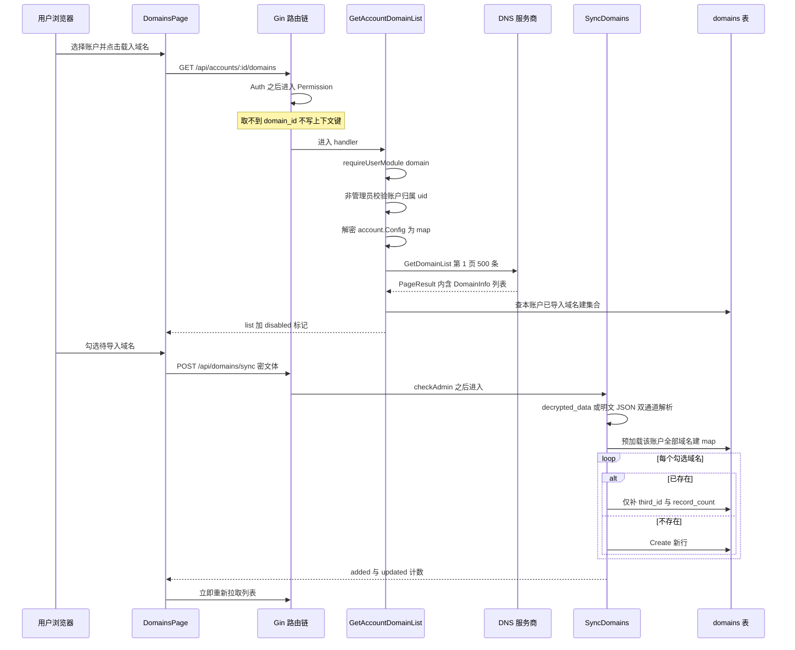
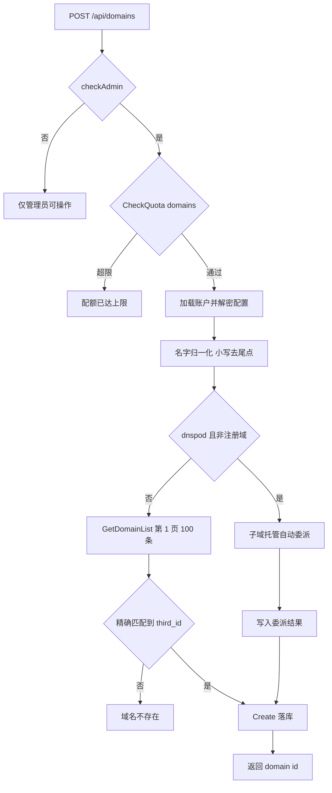
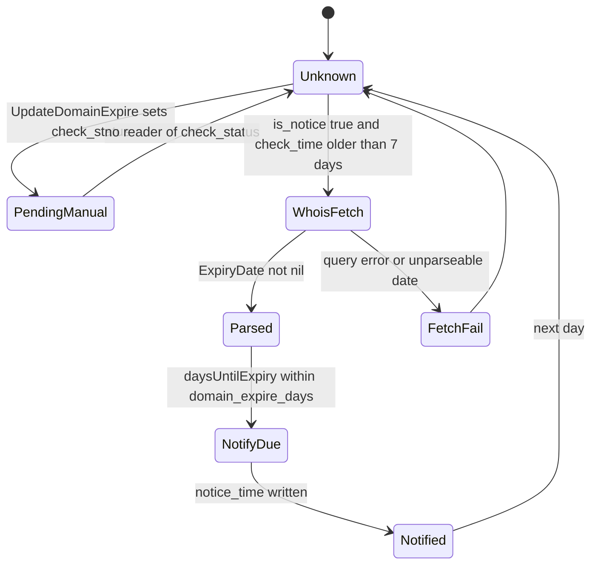
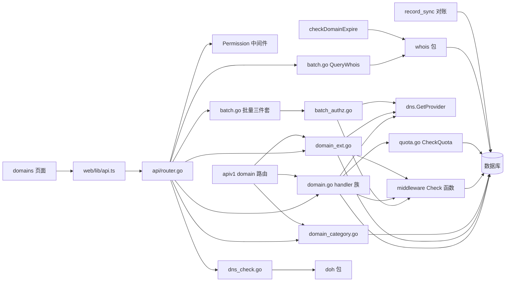

# 域名管理

<cite>
**本文档引用的文件**
- [domain.go](file://main/internal/api/handler/domain.go)
- [domain_ext.go](file://main/internal/api/handler/domain_ext.go)
- [domain_category.go](file://main/internal/api/handler/domain_category.go)
- [dns_check.go](file://main/internal/api/handler/dns_check.go)
- [batch_authz.go](file://main/internal/api/handler/batch_authz.go)
- [batch.go](file://main/internal/api/handler/batch.go)
- [account.go](file://main/internal/api/handler/account.go)
- [quota.go](file://main/internal/api/handler/quota.go)
- [permission.go](file://main/internal/api/middleware/permission.go)
- [router.go](file://main/internal/api/router.go)
- [domain.go (apiv1)](file://main/internal/apiv1/domain.go)
- [record_sync.go (apiv1)](file://main/internal/apiv1/record_sync.go)
- [models.go](file://main/internal/models/models.go)
- [quota.go (模型)](file://main/internal/models/quota.go)
- [cloudflare.go (模型)](file://main/internal/models/cloudflare.go)
- [record_sync.go](file://main/internal/service/record_sync.go)
- [expire_notice.go](file://main/internal/service/expire_notice.go)
- [task_runner.go](file://main/internal/service/task_runner.go)
- [whois.go](file://main/internal/whois/whois.go)
- [dbcache.go](file://main/internal/dbcache/dbcache.go)
- [keys.go](file://main/internal/dbcache/keys.go)
- [page.tsx](file://web/app/(dashboard)/dashboard/domains/page.tsx)
- [client.tsx](file://web/app/(dashboard)/dashboard/domains/[id]/client.tsx)
- [api.ts](file://web/lib/api.ts)
</cite>

## 目录
1. [简介](#简介)
2. [项目结构](#项目结构)
3. [核心组件](#核心组件)
4. [架构总览](#架构总览)
5. [详细组件分析](#详细组件分析)
6. [依赖关系分析](#依赖关系分析)
7. [性能考虑](#性能考虑)
8. [故障排查指南](#故障排查指南)
9. [结论](#结论)
10. [附录](#附录)

## 简介

域名管理是 DNS 管理域里的「实体层」：它不负责解析记录怎么写到云端，而是把一个域名变成平台内**可归属、可归类、可授权、可跟踪寿命**的一等对象。落库形态是 `models.Domain`（`domains` 表，`main/internal/models/models.go:72-92`），一行域名同时携带三类语义不同的信息：来源信息（`aid`、`third_id`、`name`）、控制信息（`is_hide`、`is_sso`、`is_notice`、`min_ttl`、`record_count`、`cid`）、寿命信息（`reg_time`、`expire_time`、`check_time`、`notice_time`、`check_status`）。

域名只有两条入路，且都必须出站换取服务商侧的 `third_id`：

| 入路 | 入口 handler | 服务商调用 | 定位方式 | 幂等策略 |
|------|-------------|-----------|---------|---------|
| 手工添加单个域名 | `CreateDomain`（`domain.go:314`） | `GetDomainList(ctx, name, 1, 100)`（`domain.go:383`） | 按名字精确匹配取 `third_id`（`:395-400`） | 未命中即回「域名不存在」（`:402-405`） |
| 从账户批量导入 | `GetAccountDomainList` 加 `SyncDomains`（`domain.go:1269`、`:458`） | `GetDomainList(ctx, keyword, 1, 500)`（`:1311`） | 不做逐个定位，前端把云端列表原样回填 | 已存在只补 `third_id` 与 `record_count`，不重复建行（`:532-544`） |

四类扩展信息落在不同存储位置，「谁 owns 哪一列」是排查显示异常的前提：

| 扩展信息 | 存储位置 | 写入者 | 作用域 | 读取者 |
|---------|---------|-------|--------|-------|
| 备注（全局） | `domains.remark`（`models.go:81`） | `BatchDomainAction` 的 `set_remark`（`domain.go:1506-1511`） | 所有用户共享 | `GetDomains`（`:213`）、`GetDomainDetail`（`:296`） |
| 备注（按用户） | `domain_notes`，`uid+did` 唯一（`models.go:95-102`） | `UpdateDomain`（`domain.go:1414-1429`） | 单用户 | `GetDomains` 并发回填并覆盖全局（`:181-216`） |
| 归类（标签） | `domains.cid` 加 `domain_categories`（`models.go:63-69`） | `SetDomainCategory`（`domain_category.go:172-187`） | 全局分类表 | `GetDomains` 的 `cid` 过滤（`domain.go:117-119`） |
| 过期时间 | `expire_time`/`reg_time`/`check_time`（`models.go:84-87`） | WHOIS 链路（`task_runner.go:830-839`、`batch.go:483-487`） | 全局 | `GetDomains`（`:228`）、到期通知（`task_runner.go:847-877`） |

**能力边界**：平台内**没有多标签实体**——归类是 `cid` 单值外键（`models.go:75`），一个域名只属于一个分类，`SetDomainCategory` 直接 `Update("cid", …)`（`domain_category.go:185`）。「域名打多个标签」在当前模型下不可表达，属**待实现**项。

**章节来源**
- [domain.go:314-425](file://main/internal/api/handler/domain.go#L314-L425)
- [domain.go:458-563](file://main/internal/api/handler/domain.go#L458-L563)
- [models.go:63-102](file://main/internal/models/models.go#L63-L102)

## 项目结构

域名功能的代码分布在 4 个 handler 文件、2 个门卫与配额文件、1 个中间件、1 个 v1 路由文件、3 个 service 文件与 3 个前端文件里。行数全部 `wc -l` 实测：

| 层 | 文件 | 行数 | 承担的子领域 |
|----|------|:---:|-------------|
| handler | `handler/domain.go` | 1748 | 域名 CRUD、同步、账号侧域名列表、记录读写、子域委派 |
| handler | `handler/domain_ext.go` | 418 | 别名、权重、智能解析、快捷信息、变更日志、记录分组 |
| handler | `handler/domain_category.go` 与 `handler/dns_check.go` | 187、197 | 分类 CRUD 与批量挂类；多公共 DNS 生效探测与 DoH 回退 |
| handler | `handler/batch_authz.go` 与 `handler/batch.go` | 155、495 | 批量接口子域归属校验（安全边界）；`QueryWhois`（`batch.go:444`）与记录批量三件套 |
| handler | `handler/account.go` 与 `handler/quota.go` | 466、351 | 门卫四件套（`account.go:24-73`）；`CheckQuota` 三层配额归并（`quota.go:84-157`） |
| middleware | `middleware/permission.go` | 400 | 域、子域、只读三维判定与 `Permission()` 中间件 |
| apiv1 | `apiv1/domain.go` | 82 | 19 条 v1 域名路由，复用控制台 handler（`apiv1/domain.go:21-72`） |
| models | `models/models.go` 与 `models/quota.go` | 370、93 | `Account`/`DomainCategory`/`Domain`/`DomainNote`/`Permission`/`DNSRecord` |
| service | `service/record_sync.go` 与 `service/task_runner.go` | 663、1015 | 记录副本全量对账；`checkDomainExpire` 到期扫描与 WHOIS 自动刷新（`task_runner.go:802-890`） |
| service | `service/expire_notice.go` | 41 | `CheckDomainWhoisNow` 按需刷新（当前无调用方） |
| web | `domains/page.tsx` 与 `domains/[id]/client.tsx` | 1543、1799 | 域名列表页与域名详情页（解析记录） |
| web | `web/lib/api.ts` | 1743 | `domainApi`（`api.ts:487-547`）与分类 API（`:562-567`） |

路由集中在 `main/internal/api/router.go`，`/domains` 前缀共 39 条：主族 15 条（`:120-134`）、记录与扩展 20 条（`:136-155`）、加速 3 条（`:158-160`）、域名日志与免登 2 条（`:273-274`），另有 1 条挂在 `/accounts/:id/domains`（`:118`）。中间件顺序固定为 `Auth` 再 `Permission`：`router.go:96` 挂 `middleware.Auth()`、`router.go:104` 挂 `middleware.Permission()`。这段顺序有明确背景——`Permission()` 曾长期「只定义未挂载」，导致 `perm_read_only`、`perm_domain`、`perm_sub_domain` 三个上下文键恒不存在，下游三处拦截全部失效（只读用户可删记录、子域受限用户读到全部记录、审计日志 `domain` 恒空），`router.go:97-103` 注释原样记录了这次修复。

**章节来源**
- [router.go:95-160](file://main/internal/api/router.go#L95-L160)
- [domain.go:1-23](file://main/internal/api/handler/domain.go#L1-L23)
- [account.go:23-73](file://main/internal/api/handler/account.go#L23-L73)
- [api.ts:487-567](file://web/lib/api.ts#L487-L567)

## 核心组件

### Domain 模型

`models.Domain`（`models.go:72-92`）是唯一域名实体，`uint` 自增主键加软删除（`models.go:91`）。三点值得注意：**`ThirdID` 是 `string` 而非数字**（`:77`），服务商 zone ID 形态差异极大，`SyncDomainsRequest.Domains[].ID` 因此声明为 `interface{}`，由 `getSyncDomainID` 做 `string` 与 `float64` 双态归一（`domain.go:431`、`:437-451`）——JSON 数字进 Go 一律是 `float64`，直接格式化会写出 `123456.000000` 这种脏 ID；**`RecordCount` 是缓存值**，写入点仅两处：列表查询以云端 `Total` 回写（`domain.go:824-826`，`Total == 0` 时跳过）与同步导入落库（`:538-540`、`:555`）；**`MinTTL` 由 DNS 侧回写**，`domain.go` 内没有它的写入点，实际来源是加速链路的 TTL 探测（`models.go:83`）。

模型层没有任何权限字段：域名与用户的归属要么经 `aid` 走到 `accounts.uid`（`models.go:52`），要么经 `permissions.domain` 这个**字符串**间接建立（`models.go:109`）。

**章节来源**
- [models.go:50-60](file://main/internal/models/models.go#L50-L60)
- [models.go:72-92](file://main/internal/models/models.go#L72-L92)
- [domain.go:427-451](file://main/internal/api/handler/domain.go#L427-L451)

### Category（分类）

`models.DomainCategory`（`models.go:63-69`）是**全局表，没有 `uid` 列**，因此分类由任意有 `domain` 模块权限的用户创建后即对全部用户可见（`domain_category.go:51-79`）；删除前有硬约束——分类下仍有未删除域名即拒绝（`:153-158`）。列表按 `sort ASC, id DESC` 排序并逐分类统计域名数（`:22-37`）。

**章节来源**
- [domain_category.go:13-187](file://main/internal/api/handler/domain_category.go#L13-L187)
- [models.go:63-69](file://main/internal/models/models.go#L63-L69)

### Permission 中间件与判定函数

`middleware.Permission()`（`permission.go:132-207`）是唯一域名级访问控制入口，六步判定：`level>=2` 放行（`:138-141`）→ 提取 `domain_id`，取不到即放行交 handler（`:143-148`，顺序为「解密体 `domain_id`/`did` → query → 路径 `:id`」，`:210-234`）→ 域名不存在即拒（`:152-156`）→ 账户归属者写 `perm_sub_domain="*"` 全量放行（`:159-173`）→ 非归属者挑一条有效委派行（`:175-180`），只读且为写请求即拦（`:183-187`），带 `rr` 且授权为有限列表时做子域二次校验（`:190-199`）→ 落三个上下文键（`:201-203`）。「挑一条」由 `pickDelegatedPermission` 完成（`:93-125`）：单行直接返回，多行时请求带 `rr` 就找覆盖它的那条，否则用 `mergePermissionRows` 把子域列表并成逗号串（`:52-87`）。

handler 侧另有两个直调函数：`CheckDomainPermission`（`:335-341`）与 `CheckSubDomainPermission`（`:344-360`），都建立在 `getDomainPermission`（`:304-322`，走「域名 → 账户归属 → 委派行合并」）之上；`DomainPermissionOf`（`:330-332`）把 `perm`/`isOwner`/`allowed` 明细一并暴露，供批量与 v1 判只读。

**章节来源**
- [permission.go:52-125](file://main/internal/api/middleware/permission.go#L52-L125)
- [permission.go:132-207](file://main/internal/api/middleware/permission.go#L132-L207)
- [permission.go:210-234](file://main/internal/api/middleware/permission.go#L210-L234)
- [permission.go:304-360](file://main/internal/api/middleware/permission.go#L304-L360)

### SyncFromProvider（账号 → 平台）

大纲里的「SyncFromProvider」在仓库内**没有同名符号**（`domain.go` 的函数清单不存在该项）。语义等价物是两段式：`GetAccountDomainList` 读云端并给已导入项打 `disabled` 标记（`domain.go:1330-1345`），前端勾选后把 `{name, id, record_count}` 原样送回 `SyncDomains` 落库（`:458-563`、`page.tsx:358-365`、`:416-423`）。这种「云端读、前端选、本地写」的三段式设计，把服务商侧的分页与字段差异完全挡在落库 handler 之外。本文统一用「远端拉取」与「本地落库」指代后两段。

**章节来源**
- [domain.go:453-563](file://main/internal/api/handler/domain.go#L453-L563)
- [domain.go:1269-1348](file://main/internal/api/handler/domain.go#L1269-L1348)
- [page.tsx:330-436](file://web/app/(dashboard)/dashboard/domains/page.tsx#L330-L436)

## 架构总览

域名同步（批量导入）覆盖前端「添加域名」与「快速同步」两个弹窗共用的同一条链路：

**图表来源**
- [domain.go:453-563](file://main/internal/api/handler/domain.go#L453-L563)
- [domain.go:1269-1348](file://main/internal/api/handler/domain.go#L1269-L1348)
- [router.go:118-129](file://main/internal/api/router.go#L118-L129)
- [page.tsx:330-436](file://web/app/(dashboard)/dashboard/domains/page.tsx#L330-L436)

与请求路径解耦的另有两条后台链：`record_sync` 把云端记录刷进 `dns_records`，这是 `records` 维度配额的唯一数据源（`record_sync.go:317-377`、`quota.go:217-223`）；`task_runner.checkDomainExpire` 按需刷 `expire_time` 并发通知（`task_runner.go:802-890`）。中间件不参与这两条链，因此后台链只有账户凭据语义、没有权限语义。

**章节来源**
- [record_sync.go:309-377](file://main/internal/service/record_sync.go#L309-L377)
- [quota.go:207-249](file://main/internal/api/handler/quota.go#L207-L249)
- [task_runner.go:786-890](file://main/internal/service/task_runner.go#L786-L890)

## 详细组件分析

### 添加域名（CreateDomain）

判定链是「管理员 → 配额 → 账户 → 归一化 → 特例分支 → 云端定位 → 落库」，前六步全部卫语句提前返回（`domain.go:314-425`）：

| 步 | 动作 | 位置 | 失败响应 |
|:--:|------|------|---------|
| 1 | `checkAdmin` 门卫 | `domain.go:315-318` | 无权限，仅管理员可操作 |
| 2 | `BindDecryptedData` 绑定 | `:320-324` | 参数解析失败 |
| 3 | `CheckQuota(c, "domains")` | `:327-329` | 配额已达上限 |
| 4 | 账户加载与配置解密 | `:336-346` | 账户不存在 / 账户配置解析失败 |
| 5 | 名字归一化：小写、去尾点、去空格 | `:348` | — |
| 6 | DNSPod 子域托管特例 | `:351-373` | 委派链路错误原样透出 |
| 7 | `GetDomainList(name, 1, 100)` 定位 `third_id` | `:381-400` | 获取域名失败 / 域名列表格式异常 |
| 8 | `Create` 落库 | `:413-422` | 创建失败 |

两个细节：步骤 3 的 `domains` 用量口径不是「本账户域名数」，而是 `accounts.uid = ? OR domains.name IN (SELECT domain FROM permissions WHERE uid = ?)` 的联表计数（`quota.go:211-216`）——被单独授权的域名同样占额度；步骤 7 只搜第 1 页 100 条（`domain.go:383`）且匹配是**完全相等**（`:395-400`），若服务商关键词检索返回同前缀多个 zone 且目标不在第一页，会误报「域名不存在」。

**图表来源**
- [domain.go:314-425](file://main/internal/api/handler/domain.go#L314-L425)
- [domain.go:1585-1596](file://main/internal/api/handler/domain.go#L1585-L1596)
- [quota.go:178-216](file://main/internal/api/handler/quota.go#L178-L216)

DNSPod 子域委派（`domain.go:1640-1723`）是本文件最复杂的单一路径，六步串行且含同步阻塞轮询：`findManagedParentDomain` 找最长后缀父域（`:1599-1617`）→ `buildRelativeRecordName` 求主机记录（`:1620-1631`）→ 申请校验 TXT（`:1658-1669`，缺省主机记录名是 `_dnsauth.` 加相对名）→ 在父域幂等写 TXT（`:1677`）→ 最多 4 轮每轮 3 秒等验证通过（`:1684-1695`）→ 建子域并把返回的 NS 逐条 `ensureNSRecord` 写回父域（`:1698-1716`、`:1726-1748`）。最坏阻塞 12 秒且发生在 HTTP 请求线程内。两处结构性代价：`findManagedParentDomain` 用 `database.DB.Find(&domains)` 全表载入再在内存做后缀匹配（`:1602-1615`）；provider 构造绕过注册表直接 `import dnspodProvider` 后 `NewProvider`（`:14`、`:1652-1653`），新增第二家支持委派的厂商必须改 handler。

**章节来源**
- [domain.go:314-425](file://main/internal/api/handler/domain.go#L314-L425)
- [domain.go:1585-1748](file://main/internal/api/handler/domain.go#L1585-L1748)
- [quota.go:120-157](file://main/internal/api/handler/quota.go#L120-L157)

### 拉取远端（GetAccountDomainList）

`domain.go:1269-1348` 的读法有四个固定口径：权限只校验「非管理员只能看自己的账户」（`:1294-1297`），因为对象是账户而非域名；云端窗口写死 `page=1, pageSize=500`（`:1311`），`GetAccountDomainListRequest` 只声明 `id` 与 `keyword`（`:1259-1262`），**前端传的 `page_size` 被忽略**（`page.tsx:337` 传 100、`:455` 传 200，实际都拿 500 条）；已导入判定**按账户而非全局**，`existingMap` 用 `Where("aid = ?", req.ID)` 建（`:1323-1328`），同一域名挂在两个账户下时可重复导入；响应字段用服务商风格的大驼峰 `DomainId`、`Domain`、`RecordCount` 加一个小写 `disabled`（`:1330-1335`），前端 `DomainItem` 直接对齐。

**章节来源**
- [domain.go:1259-1348](file://main/internal/api/handler/domain.go#L1259-L1348)
- [page.tsx:330-472](file://web/app/(dashboard)/dashboard/domains/page.tsx#L330-L472)

### 本地落库与删除域名

`SyncDomains`（`domain.go:458-563`）是「只增与补、不删」的实现：入参优先取解密链路的 `decrypted_data`，否则 `ShouldBindJSON` 读明文体（`:464-477`）；账户键同时接受 `aid` 与 `account_id`、值同时接受 `string` 与 `float64`（`:479-492`）；落库前一次性预加载该账户全部域名建 map 消除 N+1（`:507-513`）；已存在只在 `third_id` 为空且远端给了 ID、或 `record_count > 0` 时更新（`:532-544`），否则新建（`:545-559`）。函数注释声明「自动创建/删除本地域名记录」（`:453-457`），但实现只有增与改两个分支、**没有删除段**，因此云端已消失的域名会一直留在本地列表里。

`DeleteDomain`（`:574-620`）仅管理员可用，删除前按序清理关联数据：

| 清理对象 | 条件 | 位置 |
|----------|------|------|
| `permissions` | `domain = 域名名`（按字符串） | `domain.go:602` |
| `dm_logs` / `dm_check_logs` | `task_id IN 该域名任务`，后者走 `database.LogDB` 独立库 | `:605-608` |
| `dm_tasks`、`cert_cnames`、`schedule_tasks`、`optimize_ips`、`domain_notes` | `did = 域名 ID` | `:610-614` |
| `domains` | 主键软删除 | `:616` |
| 审计 | 动作 `delete_domain` | `:618` |

`dns_records` 本地副本**不在清理列表内**，批量删除分支 `BatchDomainAction` 的 `delete` 同样没有清理（`:1480-1499` 清了 `permissions`、`dm_tasks`、`optimize_ips`、`schedule_tasks`、`cert_cnames`、`domain_notes` 六项）。残留对配额的影响方向是偏保守（多算记录），不构成功能缺陷，但重新导入同名域名时会带来统计噪声。

**章节来源**
- [domain.go:427-563](file://main/internal/api/handler/domain.go#L427-L563)
- [domain.go:565-620](file://main/internal/api/handler/domain.go#L565-L620)
- [domain.go:1478-1520](file://main/internal/api/handler/domain.go#L1478-L1520)

### 归类（分类与「标签」）

五个 handler 全在 `domain_category.go`（187 行）：

| 接口 | 函数 | 权限门 | 关键约束 |
|------|------|-------|---------|
| `GET /domains/categories` | `GetDomainCategories`（`:17`） | `requireUserModule("domain")` | 逐分类 `COUNT` 域名（`:30-37`） |
| `POST /domains/categories` | `CreateDomainCategory`（`:51`） | 同上 | 名称全局唯一（`:64-68`） |
| `POST /domains/categories/:id` | `UpdateDomainCategory`（`:91`） | 同上 | 空 `id` 早退（`:102-106`） |
| `POST /domains/categories/:id/delete` | `DeleteDomainCategory`（`:138`） | 同上 | 分类下有域名即拒（`:153-158`） |
| `POST /domains/category` | `SetDomainCategory`（`:172`） | 同上 | `id IN` 批量改 `cid`（`:185`） |

**空 `id` 早退是修过的坑**：`First(&cat, "")` 会退化成不带主键条件的查询、静默命中全表第一条，分类会被改名而不是报「不存在」；而 v1 路由表没有路径参数，`c.Param` 恒为空串，这条退化路径真实可达（`domain_category.go:95-106`、`:142-147`）。v1 侧因此给 `categories/update` 与 `categories/delete` 单独挂 `paramAlias` 桥接（`apiv1/domain.go:63-71`）。

**待实现（归类与标签）**：分类增删改**没有任何域名归属校验**——`SetDomainCategory` 对 `ids` 不做 `CheckDomainPermission` 循环（`domain_category.go:181-186`），对比 `BatchDomainAction` 的逐 ID 判定（`domain.go:1468-1476`），普通用户可把不属于自己的域名的 `cid` 改掉，影响仅限本地归类字段、不出站不改解析，属**低危数据面越权**；**多标签不支持**（`domains.cid` 单值 `uint`，`models.go:75`，无标签关联表）；**分类无用户作用域**（`domain_categories` 无 `uid` 列，`models.go:63-69`）。

**章节来源**
- [domain_category.go:13-187](file://main/internal/api/handler/domain_category.go#L13-L187)
- [apiv1/domain.go:45-71](file://main/internal/apiv1/domain.go#L45-L71)
- [domain.go:1463-1476](file://main/internal/api/handler/domain.go#L1463-L1476)

### 权限：domain 组与 subdomain 组的差异

两个函数**名相似、参数表只差一个 `subDomain`**，但回答的问题不同：一个回答「这个域名归不归你管」，一个回答「这条主机记录归不归你管」。

| 维度 | `CheckDomainPermission` | `CheckSubDomainPermission` |
|------|------------------------|---------------------------|
| 定义 | `permission.go:335-341` | `permission.go:344-360` |
| 入参 | `userID, level, domainID` | `userID, level, domainID, subDomain` |
| 管理员 | `level>=2` 恒 true（`:336`） | `level>=2` 恒 true（`:345`） |
| 账户归属者 | `isOwner` 时 allowed（`:339`） | `isOwner \|\| perm==nil` 时 true（`:352`） |
| 是否看 `read_only` | 否 | 否 |
| 空 `subDomain` | 不适用 | **返回 true**（`:355-358`） |
| 匹配逻辑 | 委派行存在即可 | `subGrantCoversRR` 逗号列表精确匹配（`:34-49`） |
| 委派行过期 | `activeDelegatedPermissionsByUID` 剔除（`:19-31`） | 同左（共用） |

实际挂载情况：

| handler | 域级判定 | 子域级判定 | 只读判定 | 位置 |
|---------|:-------:|:---------:|:-------:|------|
| `GetDomains`、`GetDomainDetail`、`GetAccountDomainList` | SQL 作用域过滤 / `CheckDomainPermission` / 账户归属 | 不适用 | 不适用 | `domain.go:96-121`、`:273`、`:1294` |
| `CreateDomain` / `SyncDomains` / `DeleteDomain` | `checkAdmin` | 不适用 | 不适用 | `:315`、`:459`、`:575` |
| `UpdateDomain`、`BatchDomainAction` | `isAdmin \|\| CheckDomainPermission`；批量为逐 ID 判定 | 不适用 | **不判** | `:1389`、`:1463-1476` |
| `GetRecords` | `CheckDomainPermission` | 经 `perm_sub_domain` 多路合并 | 不适用 | `:665`、`:685-698` |
| `CreateRecord`、`UpdateRecord` | 中间件 | `CheckSubDomainPermission(req.Name)` | 中间件 | `:900`、`:1000` |
| `DeleteRecord`、`SetRecordStatus` | `CheckDomainPermission` | **缺** | `perm_read_only` | `:1076`、`:1081`、`:1155`、`:1159` |
| 记录批量三件套 | `DomainPermissionOf` | `checkBatchRecordSubDomain` | 依 `isOwner` 短路 | `batch_authz.go:95-153` |
| `QueryWhois` | `CheckDomainPermission` | 不适用 | 中间件豁免 | `batch.go:469` |
| `domain_ext` 全部动作 | `loadDomainForAction` 内判定 | 写动作走 `ensureDomainWrite` | `ensureDomainWrite` 内判定 | `domain_ext.go:41-75` |

三条必须一起读才成立的口径：**空 `subDomain` 返回 true 是有意为之**（`permission.go:355-358`），列表类请求不带 `rr`，若空值判 false 就会把「有域名权限但授权是有限子域列表」的用户整体拦掉；代价是任何以「请求里的 name 字段」为判据的写路径都可靠少传 name 退化成域级判定——`domain_ext.go` 里 `ensureDomainWrite(c, id, "")` 传空串是安全的，因为它们操作的对象本来没有 rr 归属问题（别名、分组、权重）。**只读判定不在 `Check*` 函数里**，而在中间件（`permission.go:183-187`）、`ensureDomainWrite`（`domain_ext.go:64-69`）、`DeleteRecord` 与 `SetRecordStatus`（`domain.go:1081`、`:1159`）里各写一份；`UpdateDomain` 与 `BatchDomainAction` 不查只读位（`domain.go:1389`、`:1471`），因此只读授权用户可改域名全局属性与批量操作域名。**中间件把「POST 即写」作为默认口径**（`permission.go:265-279`），唯一豁免是路径以 `/whois` 结尾（`:272`）。

**章节来源**
- [permission.go:34-49](file://main/internal/api/middleware/permission.go#L34-L49)
- [permission.go:183-199](file://main/internal/api/middleware/permission.go#L183-L199)
- [permission.go:265-360](file://main/internal/api/middleware/permission.go#L265-L360)
- [domain.go:1389-1476](file://main/internal/api/handler/domain.go#L1389-L1476)
- [domain_ext.go:41-75](file://main/internal/api/handler/domain_ext.go#L41-L75)
- [batch_authz.go:87-155](file://main/internal/api/handler/batch_authz.go#L87-L155)

### 过期与 Whois

WHOIS 是域名寿命的唯一外部真值源，四条相关路径中**只有两条真正会更新数据**：

| 路径 | 入口 | 执行者 | 写哪些列 | 状态 |
|------|------|-------|---------|------|
| 面板手动查 | `POST /api/domains/:id/whois` | `QueryWhois`（`batch.go:444-489`） | `expire_time`、`check_time`（`:483-487`），整行回显 | 在用 |
| 定时到期扫描 | `executeExpireNotice` 转 `checkDomainExpire` | `task_runner.go:802-890` | `expire_time`、`check_time`、`notice_time` | 在用，仅 `is_notice=true` |
| 单条或批量「更新到期」 | `POST /:id/update-expire`、`POST /batch/update-expire` | `UpdateDomainExpire`（`domain.go:1531`）、`BatchUpdateDomainExpire`（`:1565`） | **只写 `check_status=0`** | 断链 |
| 按需刷新封装 | `service.CheckDomainWhoisNow`（`expire_notice.go:17-41`） | 写 `expire_time`、`reg_time`、`check_time` | **全仓无调用方** | 待接线 |

必须点明的不一致：两个「更新到期时间」接口回的是「已提交更新请求，请稍后刷新」与「已提交 N 个域名，约 M 分钟后刷新完成」（`domain.go:1553`、`:1581`），但它们唯一的动作是把 `check_status` 置 0（`:1552`、`:1580`，批量域名动作的 `update_expire` 分支同理，`:1513`），而全仓检索 `check_status` 与 `CheckStatus` 只有**模型声明加这三处写入**、没有任何读取点；到期扫描的重查判据是 `check_time`（`task_runner.go:822-828`），候选集是 `WHERE is_notice = true`（`:814`）。据此推断：勾选到期通知的域名最迟下一轮扫描刷新且只有距 `check_time` 满 7 天才重查；**未勾选 `is_notice` 的域名点「更新到期时间」不会产生任何 WHOIS 出站**，界面承诺不兑现。修复方向是调用已存在的 `CheckDomainWhoisNow`（`expire_notice.go:17`），或让扫描候选集纳入 `check_status = 0`。

`checkDomainExpire` 的实际参数（`task_runner.go:803-886`）：开关 `domain_expire_notice_enabled`（默认开）、提前量 `domain_expire_days`（默认 30 天）、整批 WHOIS 共用一个 3 分钟 ctx 并串行遍历（`:817-820`）、通知去重窗口「距 `notice_time` 不足 1 天」（`:859-864`）、文案按「已过期 / 7 天内 / 常规」三档（`:868-877`）。

whois 解析层（`main/internal/whois/whois.go`）有两处健壮性设计：**超时兜底靠 goroutine 加 select**，`Fetch` 在独立 goroutine 里跑、`select` 同时等 `ctx.Done()`（`whois.go:33-51`），`QueryWhois` 给 30 秒（`batch.go:474`）、扫描给 3 分钟（`task_runner.go:817`）；**日期解析是 11 种布局顺序尝试加两级回退**（`whois.go:62-74`、`:125-152`），`expir`、`paid-till`、`renewal date` 等键名一律命中过期分支（`:105-109`），解析失败**静默返回 nil**，调用方只在 `info.ExpiryDate != nil` 时写库（`batch.go:483`、`task_runner.go:835`），不支持的注册商表现为「到期时间一直空着」而不是报错。

**图表来源**
- [task_runner.go:802-890](file://main/internal/service/task_runner.go#L802-L890)
- [domain.go:1531-1582](file://main/internal/api/handler/domain.go#L1531-L1582)
- [whois.go:25-52](file://main/internal/whois/whois.go#L25-L52)

**章节来源**
- [batch.go:440-489](file://main/internal/api/handler/batch.go#L440-L489)
- [task_runner.go:786-890](file://main/internal/service/task_runner.go#L786-L890)
- [expire_notice.go:12-41](file://main/internal/service/expire_notice.go#L12-L41)
- [whois.go:12-152](file://main/internal/whois/whois.go#L12-L152)

### 记录搜索与排序

**搜索：域名列表侧是本地 SQL，记录列表侧语义由服务商决定。** `GetDomainsRequest.Keyword` 走 `domains.name LIKE '%kw%'`（`domain.go:111-113`），前端有防抖与显式搜索（`page.tsx:207-216`）。记录侧完全不同——`GetRecordsRequest` 的筛选字段（`domain.go:622-633`）里 `Keyword`、`SubDomain`、`Value`、`RecordType`、`Line`、`Status` **全部原样透传给服务商** `GetDomainRecords`（`:817`）；唯一例外是委派用户分支，先按每个授权子域各拉 500 条（`:781-791`），再在本地做 `filterLocal` 精筛加本地分页（`:749-775`、`:792-803`）。三个可观察后果：关键词命中范围由各服务商自由解释，同一输入在不同账户可能给出不同结果；有服务商忽略分页返回全量而 handler 原样透传（`:828-831`），前端 `filteredRecords = records` 不再切片（`client.tsx:725`），千条记录时整表渲染且分页控件失效；`Status` 需两层归一——下发前 `normalizeDNSListStatusForAPI` 折成 `ENABLE`/`DISABLE`/空（`domain.go:57-76`），本地精筛再用 `recordItemStatusWant` 折成 `"1"`/`"0"`（`:838-856`），同一语义写了两遍，属 DRY 缺口。

**排序：域名有、记录没有。** 域名排序走服务端列名白名单（`name`、`record_count`、`expire_time`、`created_at`，`domain.go:88-94`），在并发取数的 goroutine 内组装 `orderClause`、默认 `domains.id DESC`（`:158-166`）；前端 `SortableHeader` 三态切换（升、降、取消，`page.tsx:231-234`，组件在 `:82` 引入）。记录排序则整条链路都不存在：`GetRecordsRequest` 无 `sort_field` 与 `sort_order`（`domain.go:622-633`），`GetRecords` 未对 `[]dns.Record` 做任何排序（`:740-834`），前端是恒等赋值（`client.tsx:725`）。此外**没有跨域名的记录检索入口**：`dns_records` 已为 `name`、`domain`、`did` 建索引（`models/quota.go:77-88`），但域名管理侧 handler 不以查询为目的读它，读端只出现在对账与配额计数里（`quota.go:217-223`）。

| 缺口 | 现状 | 依据 | 建议方向 |
|------|------|------|---------|
| 记录排序 | 前后端均无 | `domain.go:622-633`、`client.tsx:725` | handler 层本地排序，复用 `domain.go:88-94` 白名单口径 |
| 统一本地分页 | 忽略分页的厂商原样透传 | `domain.go:828-831` | 对不支持服务端分页的 provider 在 handler 层切片 |
| 跨域名记录检索 | 无端点，表与索引已就绪 | `models/quota.go:77-88` | 加一条只读查询端点，不动服务商抽象 |
| 关键词语义 | 依赖服务商解释 | `domain.go:817` | UI 明示依赖，或统一走已有 `filterLocal`（`:749-775`） |
| 状态映射重复 | 两份实现 | `domain.go:57-76`、`:838-856` | 合并为单一函数 |

**章节来源**
- [domain.go:57-76](file://main/internal/api/handler/domain.go#L57-L76)
- [domain.go:88-119](file://main/internal/api/handler/domain.go#L88-L119)
- [domain.go:622-633](file://main/internal/api/handler/domain.go#L622-L633)
- [domain.go:740-856](file://main/internal/api/handler/domain.go#L740-L856)
- [client.tsx:725](file://web/app/(dashboard)/dashboard/domains/[id]/client.tsx#L725)
- [page.tsx:179-234](file://web/app/(dashboard)/dashboard/domains/page.tsx#L179-L234)

### 扩展信息：别名、权重、分组、生效检测

`domain_ext.go` 把不属于核心 CRUD 的能力收在一处，统一走 `loadDomainForAction`（`:41-57`）读域名并判权限，写动作再叠 `ensureDomainWrite`（`:59-75`）：

| 能力 | handler | 存储或通道 | 备注 |
|------|---------|----------|------|
| 域名别名 | `GetDomainAliases`、`AddDomainAlias`、`DeleteDomainAlias`（`:89`、`:102`、`:138`） | 本地模型 `models.DomainAlias`（`models/cloudflare.go:61`） | 查重按 `did` 加 `alias` 列（`:124`），全程不调 provider |
| 记录权重 | `GetRecordWeight`、`UpdateRecordWeight`（`:171`、`:216`） | 服务商 API | 能力位由 `providerFeatureByDomain` 读注册表（`:77-87`） |
| 智能解析 | `SmartParseRecord`（`:276-299`） | 纯本地 | IPv4 转 A、IPv6 转 AAAA、含点且无斜杠转 CNAME，否则 TXT |
| 快捷信息 | `GetRecordQuickInfo`（`:301-327`） | 服务商与注册表 | 一次返回线路、`GetMinTTL`、四个能力位 |
| 变更日志 | `GetRecordChangeLog`（`:329-355`） | 服务商 | 失败**退化为空列表**（`:350-352`） |
| 记录分组 | `GetRecordGroups`、`ChangeRecordGroup`（`:357`、`:387`） | 类型断言 `dns.RecordGrouper` | 不支持时列表回空、改组回错误（`:369-373`、`:407-411`） |

生效检测在 `dns_check.go`：7 家公共 DNS 并发 UDP 直查（`:25-33`、`:81-92`），单台超时 5 秒（`:110`、`:115`），类型白名单只放 A、AAAA、CNAME、MX、TXT、NS 六型（`:72-79`）；某台失败回退一次 DoH，把 `Server` 加注「 (DoH回退)」、`IP` 替换为实际响应的 DoH 主机（`:159-171`），避免把加密通道结果伪装成原 UDP 服务器；DoH 预算给 `2*doh.Timeout`（`:189`），理由写在注释里——`Cost` 要覆盖 UDP 加 DoH 合计耗时（`:185-187`）。该端点**没有** `requireUserModule` 前置（`:57-62`），持有有效会话即可调用，风险限于「被当作公共解析器滥用」，但与域名族其余端点校验口径不一致。

**章节来源**
- [domain_ext.go:41-87](file://main/internal/api/handler/domain_ext.go#L41-L87)
- [domain_ext.go:89-418](file://main/internal/api/handler/domain_ext.go#L89-L418)
- [dns_check.go:25-197](file://main/internal/api/handler/dns_check.go#L25-L197)

## 依赖关系分析

**图表来源**
- [router.go:95-160](file://main/internal/api/router.go#L95-L160)
- [domain.go:11-23](file://main/internal/api/handler/domain.go#L11-L23)
- [batch_authz.go:3-13](file://main/internal/api/handler/batch_authz.go#L3-L13)
- [apiv1/domain.go:1-8](file://main/internal/apiv1/domain.go#L1-L8)

四向依赖矩阵：

| 维度 | domain 依赖对方什么 | 对方依赖 domain 什么 | 契约形态 | 断裂后果 |
|------|-------------------|-------------------|---------|---------|
| account | `aid` 到 `Account.Config` 解密后建 provider（`domain.go:39-48`） | 账户删除会留下孤立域名行 | `getProviderByDomain` 单点装配（`:37`） | 所有 DNS 读写返回「账户不存在」（`:40`） |
| record | `record_count` 由记录侧回写（`:825`），删除不清副本 | 记录页取 `Domain.ThirdID` 定位 zone | provider 的 9 参 `GetDomainRecords`（`:817`） | 列表可取但 `record_count` 长期失真 |
| provider | 工厂三参 `config`、`domain`、`domainID`（`:48`） | 22 家适配器不反向依赖 handler | `dns.GetProvider`（`:48`、`:1305`） | 未知类型报错并写进响应（`:49-52`） |
| permission | 列表 SQL 用 `permissions.domain` 子查询（`:107`） | 域名删除会级联清授权（`:602`） | 按**域名字符串**关联（`models.go:109`） | 改名即断授权 |

实体与键：`Domain.id` 主键、`aid` 索引指向 `Account.id`、`cid` 指向 `DomainCategory.id`（`models.go:74-75`）；`Permission` 到 `Domain` 有两条关联键——`did`（`models.go:108`）与 `domain` 字符串（`:109`），而**查询走字符串**（`permission.go:21`、`domain.go:107`、`:602`），三者共同决定「改名等于丢授权」；`DomainNote` 唯一键 `uid+did`（`models.go:97-98`）；`DNSRecord` 唯一键 `did+record_id`（`models/quota.go:77-78`）、`uid=0` 表示云端直建（`:89`）；`DomainAlias` 按 `did` 关联（`models/cloudflare.go:61`）。

一处**依赖倒置被破坏**的实证：`domain.go:14` 直接 import 具体包 `dnspodProvider`，并在 `:1652-1653` 用具体类型构造再断言 `dns.SubdomainDelegator`；抽象层其余消费点都只依赖 `dns.Provider` 与注册表，唯此一处把消费者与一家实现焊死。一处 **DRY 缺口**：provider 装配（读账户、解 config、`dns.GetProvider`）有 4 份已核实平行实现——`domain.go:37-54`（基于 `gin.Context`，写控制台错误格式）、`batch.go:421`（脱离 `gin.Context`）、`record_sync.go:536`（不写响应）、`apiv1/record_sync.go:93-113`（写 v1 错误码），行为差异体现在响应形状上，这正是 v1 不复用控制台函数的原因（`apiv1/record_sync.go:87-92`、`apiv1/domain.go:9-20` 两处注释均写明）。素材 `analysis-dns.md` 还记录了 `service/schedule.go` 内的第五份实现，本次未读取该文件，故不计入已核实范围。

**章节来源**
- [domain.go:11-54](file://main/internal/api/handler/domain.go#L11-L54)
- [batch.go:420-421](file://main/internal/api/handler/batch.go#L420-L421)
- [record_sync.go:536-540](file://main/internal/service/record_sync.go#L536-L540)
- [record_sync.go (apiv1):87-113](file://main/internal/apiv1/record_sync.go#L87-L113)
- [models.go:97-114](file://main/internal/models/models.go#L97-L114)
## 性能考虑

### 全量拉取与增量对账

系统里同时存在六种「拉云端」策略，代价与截断行为差别很大：

| 场景 | 位置 | 策略 | 窗口 | 截断行为 |
|------|------|------|------|---------|
| 远端域名清单 | `domain.go:1311` | 单页全量 | 1 页 × 500 | 静默丢弃超出部分 |
| 单域名精确定位 | `domain.go:383` | 关键词加第 1 页 | 1 页 × 100 | 未命中即报「域名不存在」 |
| 记录列表（普通用户） | `domain.go:812`、`:814`、`:817` | 服务端分页透传 | 前端 `page_size` 决定 | 服务商口径 |
| 记录列表（委派用户） | `domain.go:781-803` | 每授权子域各取首页 | 每子域 500 | 超出不可见，本地二次分页 |
| 批量授权索引 | `batch_authz.go:48-69` | 全量聚合 | 10 页 × 500 | 任一页失败返回 nil 并判为拒绝 |
| 记录副本对账 | `record_sync.go:485-510` | 全量聚合后差异写入 | 100 页 × 100（1 万条封顶） | 返回截断标记而不报错 |

对账链路是**全量拉取加差异写入**而非增量游标（`record_sync.go:410-467`），原因写在包注释里：配额判定要在创建前知道「该域名现有多少条」，每次查云端会消耗服务商 API 配额，故本地留一份副本、由定时任务以云端为准全量对账（`record_sync.go:23-35`）。为控制代价做了三项约束：**逐域名串行不并发**（`record_sync.go:309-316` 注释：服务商普遍按账户限流，并发会瞬间打满配额反而拖慢整体）；**页数上限 100**，触顶返回截断标记（`:485-509`）且调用方据此**跳过删除段**（`:457-467`），把后果限定为「不更新」而非「按不完整清单误删副本」，批量索引侧同样把「取不回来」判为拒绝而非放行（`batch_authz.go:40-46`、`:136-140`）——两种误差里后者代价更大，这是**宁松勿严**的刻意选择；**无变更只刷 `synced_at`**，不做整行重写（`record_sync.go:426-432`）。

两处仍存的字段口径问题：`recordChanged` 比较 8 个字段但**不含 `Weight`**（`record_sync.go:513-518`），而更新分支的 `updates` map 含 `weight`（`:413-417`），因此「只在云端改权重」不触发更新分支，要靠别的字段变更顺带刷 `synced_at` 掩盖；`remoteStatusDiffers` 在远程 `Status` 为空串时不参与比较（`:520-533`）则是对「少数服务商列表不返回启用状态」的正确规避，否则每轮每条都会判为已变更造成写放大。

单次请求侧的可优化出站四条：`GetRecords` 每次列表都额外调一次 `GetRecordLine`（`domain.go:716`），翻每页都产生 2 次厂商调用；`checkBatchRecordSubDomain` 在 for 循环体内逐条调 `fetchCloudRecordRR`（`batch_authz.go:132-135`），而后者每次重建全量索引（`:77-84`），选 200 条记录即 200 × 最多 10 页厂商查询，索引应提到循环外只建一次；`findManagedParentDomain` 全表载入做后缀匹配（`domain.go:1602-1615`），未过滤软删除行、未按 `uid` 收敛；`GetDomainCategories` 逐分类一次 `COUNT`（`domain_category.go:30-37`），是 N+1 查询。

**章节来源**
- [record_sync.go:23-50](file://main/internal/service/record_sync.go#L23-L50)
- [record_sync.go:309-533](file://main/internal/service/record_sync.go#L309-L533)
- [batch_authz.go:40-84](file://main/internal/api/handler/batch_authz.go#L40-L84)
- [domain.go:716-716](file://main/internal/api/handler/domain.go#L716-L716)
- [domain_category.go:21-37](file://main/internal/api/handler/domain_category.go#L21-L37)

### 并发与缓存：dbcache 键位与域名缺口

并发实践有两处：`GetDomains` 用两个 goroutine 并行跑 `Count` 与 `Find`（`domain.go:150-168`），再用第二组 goroutine 并行拉 `domain_notes` 与 `permissions`（`:180-196`），把 4 次串行查询压成 2 轮并带「空集合不发查询」守卫；`DnsCheck` 按服务器数开 goroutine 并把结果写进预分配定长切片下标，避免加锁（`dns_check.go:81-92`）。批量侧全部走 `IN` 查询（`domain.go:1483-1499`、`domain_category.go:185`）。

`internal/dbcache` 是热点列表的读穿缓存，默认 TTL 60 秒（`dbcache/dbcache.go:11-12`），接口为 `GetOrSetJSON`（`:14`）、`Delete`（`:47`）、`DeletePrefix`（`:61`），键统一带 `db:v1:` 前缀：

| 键族 | 构造函数 | 失效函数 | 使用者 |
|------|----------|----------|--------|
| `db:v1:accounts:admin`、`db:v1:accounts:user:{uid}` | `KeyAccountsAdmin`/`KeyAccountsUser`（`keys.go:14-15`） | `BustAccounts`（`:27-29`） | `GetAccounts`（`account.go:103-109`） |
| `db:v1:users:list:{page}:{size}:{kwHash}` 与 `admin_full` | `KeyUsersList`（`keys.go:16-23`，关键词取 sha256 前 8 字节） | `BustUserList`（`:31-34`） | 用户列表 |
| `db:v1:cert:accounts:list:*` | `KeyCertAccountsList`（`keys.go:36-45`） | `BustCertAccountsList`（`:47-49`） | 证书账户列表 |

**域名列表与分类列表都没有对应键，也未调用 `GetOrSetJSON`**：`keys.go` 全文不存在 domains 相关常量（`keys.go:10-49`），`GetDomains` 每次都实时打库（`domain.go:148-168`）。这属「有意不做」还是「尚未做」，从代码无法判定（**未知**）。可判定的是接入成本：列表 SQL 含一次 `LEFT JOIN accounts` 与两个子查询（`domain.go:100-110`），在域名数上万且非管理员占比高的部署里是可测量开销；但域名写路径分散在 `SyncDomains`、`UpdateDomain`、`BatchDomainAction`、`SetDomainCategory`、`DeleteDomain` 五处，补缓存必须同时补这五处失效，且键必须带 `uid` 维度——列表可见集在 `userLevel < 2` 时走子查询收敛（`domain.go:105-110`），管理员与普通用户的同一页内容完全不同。缺少明确负载证据前保持不缓存更简单也更正确，此处记为**待评估**。

**章节来源**
- [domain.go:145-202](file://main/internal/api/handler/domain.go#L145-L202)
- [dns_check.go:81-93](file://main/internal/api/handler/dns_check.go#L81-L93)
- [dbcache.go:11-61](file://main/internal/dbcache/dbcache.go#L11-L61)
- [keys.go:10-49](file://main/internal/dbcache/keys.go#L10-L49)
- [account.go:103-109](file://main/internal/api/handler/account.go#L103-L109)

## 故障排查指南

### 权限判定失败的定位顺序

域名权限问题的表现全是 `code:-1` 加中文 `msg`，**没有 HTTP 状态码区分**，只能靠提示语回溯判定层：

| 提示语 | 抛出点 | 根因方向 |
|-------|-------|---------|
| 域名不存在 | `permission.go:153`、`domain.go:268`、`:597` | `domain_id` 提取错，或行已软删 |
| 无权限操作该域名 | `permission.go:177`、`batch_authz.go:97`、`domain.go:1390` | 无 `permissions` 行且非账户归属者 |
| 该域名为只读权限，无法执行写操作 | `permission.go:184` | 中间件判为写请求（POST 且路径不以 `/whois` 结尾） |
| 无权限操作该子域名 | `permission.go:194`、`batch_authz.go:112` | `sub` 逗号列表不含目标 rr |
| 无权操作该子域名 | `domain.go:901`、`:1001`、`domain_ext.go:71` | handler 二次判定，判据是**请求里的 name** |
| 无权操作该域名 | `domain.go:1077`、`:1156`、`domain_ext.go:61` | `CheckDomainPermission` 返回 false |
| 您对该域名仅有只读权限 | `domain.go:1082`、`:1160`、`domain_ext.go:66` | 读上下文键 `perm_read_only` |
| 存在无法确认归属的记录，已拒绝执行 | `batch_authz.go:147` | 云端索引取不回该 `record_id` |
| 存在无权限操作的子域名记录，已拒绝执行 | `batch_authz.go:151` | 云端真实 rr 不在授权列表内 |
| 无权限访问该功能模块 | `account.go:69` | `users.permissions` JSON 未含 `domain` key |

排查清单，每步都能独立证伪：确认 `level`，`level>=2` 时中间件与两个 `Check*` 都短路放行（`permission.go:138`、`:336`、`:345`），此时任何权限报错都说明上下文键没被正确注入；确认路由是否挂在 `auth` 组内（`router.go:95-104`），否则 `perm_read_only` 恒不存在、`DeleteRecord` 的只读检查形同虚设（`domain.go:1081`）；确认 `accounts.uid` 是否等于当前用户，相等则**不会读 `permissions` 表**（`permission.go:159-173`、`:312-314`），此时委派行「看起来没生效」是正常的，归属者本来就有全量权限；确认 `permissions.domain` 与 `domains.name` 逐字符一致，因为 `CreateDomain` 会把域名规范化为小写并去尾点（`domain.go:348`）而授权录入侧不做同样规范化；确认 `permissions.expire_time`，过期行被剔除（`permission.go:24-28`）但多行中一行过期不拖垮其它行（`:52-87`）；确认 `permissions.sub` 写法，匹配是**精确逗号列表比对**（`:43-47`），`www` 不覆盖 `api.www`，空串或 `*` 才是全量子域；确认走控制台还是 v1，前者有中间件（`router.go:104`）、后者靠 handler 内部判定加 `paramAlias` 回填 `:id`（`apiv1/domain.go:28`）；最后区分失败在出站还是入库，`getProviderByDomain` 的三种失败响应互不相同（`domain.go:40`、`:45`、`:50`）。

**章节来源**
- [permission.go:19-207](file://main/internal/api/middleware/permission.go#L19-L207)
- [permission.go:265-360](file://main/internal/api/middleware/permission.go#L265-L360)
- [router.go:95-104](file://main/internal/api/router.go#L95-L104)
- [account.go:66-73](file://main/internal/api/handler/account.go#L66-L73)

### CheckDomainPermission 与 CheckSubDomainPermission 混用

`batch_authz.go` 的文件注释原样记录了这次修复：单条接口（`CreateRecord`、`UpdateRecord`）在建写之前一律走 `CheckSubDomainPermission`，批量族（三个）只走 `CheckDomainPermission`——「域级校验只回答『这个域名归不归你管』，回答不了『这条记录归不归你管』。结果是收到 rr 级委派的用户可以把记录增删改到该域名下任意子域」（`batch_authz.go:15-22`）。修复进度分三段：

1. **批量三接口已修**。`BatchAddRecords`、`BatchEditRecords`、`BatchActionRecords` 统一走 `checkBatchRecordSubDomain`（`batch.go:95`、`:259`、`:363`），校验之前先过 `CheckFeature(c, "batch_ops")`（`:58`、`:234`、`:338`）。判据**必须来自云端**：`BatchEditRecords` 与 `BatchActionRecords` 的请求里只有 `record_id`、没有 rr（`batch_authz.go:23-26`），故用 `cloudRecordRRIndex` 反查（`:48-69`）；判定顺序刻意把可本地判定的 `Targets` 放在建 provider 之前（`:104-118`），让越权请求先拒绝、不消耗云端配额。
2. **`SetRecordStatus` 已补但只补到域级**。代码留有审计编号「原实现遗漏权限校验……拥有任意域名读权限的用户可对全站任何记录调启停 → DoS」（`domain.go:1151-1152`），现状是域判定加只读（`:1155-1162`），子域判定仍缺。
3. **`DeleteRecord`、`UpdateRecord`、`SetRecordStatus` 仍未收口**。前两者要么只判域级（`domain.go:1076`）、要么以请求 rr 为准（`:1000`），都没有「以云端真实 rr 为准」的回查。`UpdateRecord` 的绕过形态：请求同时携带授权内的 `name=www` 与指向 `admin` 的 `record_id`，判定通过后 `UpdateDomainRecord` 会把那条记录改写并改名（`:1020`）。修复成本低——`fetchCloudRecordRR`（`batch_authz.go:77-84`）已是现成实现，v1 侧也已这么做（`apiv1/record_sync.go:66-82` 在 `subDomain` 为空且有 `record_id` 时用 `GetDomainRecordInfo` 回查真实名称再判子域），单条场景只需一次回查，不必承担批量那种「N × 10 页」代价。

**注释与实现相反的一处**：`batch_authz.go:28-30` 声明「失败时不整批拒绝」，理由是整批拒绝会形成拒绝服务面；但实现是 `unresolved > 0` 或 `mismatched > 0` 就整批拒绝（`:146-153`）。**以代码为准**：批量确实会整批失败，与该注释担心的效果正好重合。

**章节来源**
- [batch_authz.go:15-155](file://main/internal/api/handler/batch_authz.go#L15-L155)
- [batch.go:47-421](file://main/internal/api/handler/batch.go#L47-L421)
- [domain.go:1000-1162](file://main/internal/api/handler/domain.go#L1000-L1162)
- [record_sync.go (apiv1):48-85](file://main/internal/apiv1/record_sync.go#L48-L85)

### 归类、同步与权限门缺口

| 检查项 | 期望 | 实测 |
|--------|------|------|
| `POST /domains/category` 是否校验目标域名归属 | 应校验 | **未校验**，仅模块开关（`domain_category.go:172-187`） |
| 分类增删改是否限管理员 | 建议限 | **未限**，分类表为全局表（`models.go:63-69`） |
| `POST /domains/sync` 是否校验账户归属 | 应校验 | 只校验管理员（`domain.go:459-462`） |
| `POST /domains/:id/update-expire` 是否校验域名权限 | 应校验 | **未校验**，仅模块开关（`domain.go:1531-1554`） |
| `POST /domains/dns-check` 是否过模块开关 | 建议过 | **未过**（`dns_check.go:57-62`） |

`GetAccountDomainList` 要求非管理员须为账户所有者（`domain.go:1294`），`SyncDomains` 要求仅管理员（`:459-462`），两者口径不一致：普通用户能拉远端清单却提交不了同步，点击后拿到「无权限，仅管理员可操作」，属可接受现状但值得在 UI 层收敛可见性。`UpdateDomainExpire` 与 `BatchUpdateDomainExpire` 只判模块（`:1532`、`:1566`），任何有 `domain` 模块的用户都可对他不可见的域名置 `check_status`；由于该列当前无读取方，实际影响为零，但补刷新链路时必须同时补权限门。

**章节来源**
- [domain.go:458-462](file://main/internal/api/handler/domain.go#L458-L462)
- [domain.go:1287-1297](file://main/internal/api/handler/domain.go#L1287-L1297)
- [domain.go:1531-1582](file://main/internal/api/handler/domain.go#L1531-L1582)
- [domain_category.go:172-187](file://main/internal/api/handler/domain_category.go#L172-L187)
- [dns_check.go:57-62](file://main/internal/api/handler/dns_check.go#L57-L62)

### 同步、分类、到期三类数据面症状

| 症状 | 判据 | 位置 |
|------|------|------|
| 添加域名报「域名不存在」但服务商后台有 | 云端第 1 页 100 条内未精确命中 | `domain.go:383`、`:395-405` |
| 导入后 `third_id` 是 `123456.000000` 这类脏值 | 未走 `getSyncDomainID` 的 `float64` 整数收敛 | `:437-451` |
| 同步显示成功但域名属性没变 | 已存在行**只补** `third_id` 与 `record_count`，后者仅 `>0` 时写 | `:532-544` |
| 云端已删的域名仍在本地列表 | `SyncDomains` **不删本地行**，与注释不符 | `:453-457`、`:515-560` |
| 同一域名出现两次，分属两个账户 | `existingMap` 按 `aid` 建而非全局建 | `:1323-1328`、`:507-513` |
| 前端传了 `page_size` 但仍只拿 500 条；大账户导入漏域名 | 后端写死 `1, 500` 且只取第 1 页，请求结构无分页字段 | `:1259-1262`、`:1311` |
| 记录数为 0 但服务商有记录；`record_count` 长期不回落 | 类型断言失败静默给空列表；`Total == 0` 时跳过回写不纠错 | `:788`、`:828`、`:824-826` |
| 委派用户看到的记录偏少 | 某子域查询失败被 `continue` 静默吞掉，后端无日志 | `:785-787` |
| 改分类改到别的分类 | 空 `id` 使 `First` 退化为全表第一条（已修） | `domain_category.go:102-106`、`:142-147` |
| 记录分组列表恒为空；变更日志永远空白 | 未实现 `dns.RecordGrouper` 按设计回空；上游错误退化为 `{total:0, list:[]}`，无法区分不支持与凭据失效 | `domain_ext.go:369-373`、`:349-353` |
| 列表与详情备注不一致 | 列表读用户级备注、`GetDomainDetail` 只读全局 `Remark` | `domain.go:213-216` 对比 `:296` |
| 点「更新到期时间」无变化 | 扫描候选集是 `is_notice = true`，且 `check_status` 无读取点 | `task_runner.go:814`、`domain.go:1552` |
| WHOIS 有返回但到期时间为空 | `parseDate` 解析失败返回 nil，仅非 nil 时写库 | `whois.go:125-152`、`batch.go:483` |
| 一次慢 WHOIS 挤压后续域名；到期通知每天重复 | 整轮共用 3 分钟 ctx 且串行遍历；去重窗口「不足 1 天」而 `notifyDays` 默认 30 天 | `task_runner.go:817-820`、`:859-864` |
| 生效检测某台显示 DoH 回退；PTR 或 CAA 检测被拒 | UDP/53 出站被阻断而非记录未生效；类型白名单只放 6 型 | `dns_check.go:159-171`、`:72-79` |

**章节来源**
- [domain.go:383-405](file://main/internal/api/handler/domain.go#L383-L405)
- [domain.go:437-560](file://main/internal/api/handler/domain.go#L437-L560)
- [domain.go:785-826](file://main/internal/api/handler/domain.go#L785-L826)
- [domain_ext.go:329-373](file://main/internal/api/handler/domain_ext.go#L329-L373)
- [task_runner.go:814-864](file://main/internal/service/task_runner.go#L814-L864)

## 结论

域名管理这一层的实现是**克制且可验证的**：一条 `domains` 主表加四张按职责拆开的附表（分类、用户备注、权限、别名），两条入路（精确定位添加、两段式批量导入），以及一套在中间件与 handler 两层各写一遍的权限判定。`SyncDomains` 明确只做「补与增」、不做删除（`domain.go:532-559`），把删除权收敛到 `DeleteDomain` 单点，让导入操作可安全重复执行——代价是注释里「自动创建/删除」的说法与实现不符（`:453-457`），读代码的人需以实现为准。

按设计原则回望：**KISS**——同步拆成「读远端」与「写本地」两个正交端点，前端负责编排（`page.tsx:330-436`），后端不做隐式全量比对，失败面清晰；域名排序用列名白名单而非透传排序串，注入面被一个 map 收口（`domain.go:88-94`）。**YAGNI**——`check_status` 与 `service.CheckDomainWhoisNow` 是「预留了但没接」的典型：字段有人写（`domain.go:1513`、`:1552`、`:1580`）、函数没人调（`expire_notice.go:17`）、对用户文案承诺落空，这类预留应补完或删除。**DRY**——provider 装配 4 份已核实平行实现、状态映射 2 份（`domain.go:57-76`、`:838-856`）、单条删与启停的子域判定在批量侧与 v1 侧都已有正确样板却未被复用（`batch_authz.go:77-84`、`apiv1/record_sync.go:66-82`）；前者是可维护性税，后者是实际越权面。**SOLID**——`dns.Provider` 作为抽象边界是正确的，域名管理侧全部记录读写只依赖它（`domain.go:812-830`），但 `domain.go:14` 直接 import `providers/dnspod` 让开闭原则在子域委派这一点失效；`models.DomainAlias` 走本地表而不调 provider（`domain_ext.go:97-135`），说明「别名」不需要抽象层参与。

下一步优先级按风险排序：其一，单条删除与启停复用 `fetchCloudRecordRR` 收口子域判定；其二，`UpdateRecord` 的判定依据从请求 rr 换成云端真实 rr；其三，`SetDomainCategory` 补逐 ID 归属校验并把分类增删改收归管理员；其四，明确 `check_status` 去留；其五，记录排序与跨域名检索补读路径；其六，远端域名清单改为翻页聚合。前四项是安全与数据完整性，后两项是可用性。

**章节来源**
- [domain.go:88-94](file://main/internal/api/handler/domain.go#L88-L94)
- [domain.go:453-560](file://main/internal/api/handler/domain.go#L453-L560)
- [batch_authz.go:77-84](file://main/internal/api/handler/batch_authz.go#L77-L84)
- [expire_notice.go:12-41](file://main/internal/service/expire_notice.go#L12-L41)

## 附录

### 域名相关 API 端点速查（控制台）

「门」列含义：`mod` = `requireUserModule("domain")`（`account.go:67-73`）；`dom` = `CheckDomainPermission`；`sub` = `CheckSubDomainPermission`；`admin` = `checkAdmin`（`account.go:24-37`）；`q:xxx` = `CheckQuota`；`ro` = 读上下文键 `perm_read_only`；`own` = 账户归属；`feat` = `CheckFeature("batch_ops")`。

| 方法与路径 | handler | 门 | 路由行 | 定义位置 |
|-----------|---------|----|:-----:|---------|
| GET `/api/accounts/:id/domains` | `GetAccountDomainList` | mod 加 own | `router.go:118` | `domain.go:1269` |
| POST `/api/domains/dns-check` | `DnsCheck` | 仅 Auth（无 mod） | `:120` | `dns_check.go:57` |
| GET `/api/domains/categories` | `GetDomainCategories` | mod | `:121` | `domain_category.go:17` |
| POST `/api/domains/categories` 与 `categories/:id`、`:id/delete` | 分类建、改名、删除 | mod（**无限管理员**） | `:122-124` | `:51`、`:91`、`:138` |
| POST `/api/domains/category` | `SetDomainCategory` | mod（**不判域**） | `:125` | `:172` |
| GET `/api/domains` 与 `/api/domains/:id` | `GetDomains`、`GetDomainDetail` | mod；后者加 dom | `:126-127` | `domain.go:128`、`:249` |
| POST `/api/domains` | `CreateDomain` | admin 加 `q:domains` | `:128` | `:314` |
| POST `/api/domains/sync` | `SyncDomains` | admin | `:129` | `:458` |
| POST `/api/domains/batch` | `BatchDomainAction` | mod；delete 须 admin，余逐 ID dom | `:130` | `:1447` |
| POST `/api/domains/:id/update-expire` 与批量版 | 到期刷新标记 | mod（**不判域**） | `:131-132` | `:1531`、`:1565` |
| POST `/api/domains/:id/delete` 与 `/api/domains/:id` | `DeleteDomain`、`UpdateDomain` | admin；后者 mod 加 dom（不判 ro） | `:133-134` | `:574`、`:1364` |
| GET 与 POST `/api/domains/:id/records` | `GetRecords`、`CreateRecord` | mod 加 dom；写加 sub 与 `q:records` | `:136-137` | `:640`、`:875` |
| POST `/api/domains/:id/records/batch` 及 `edit`、`action` | 批量三件套 | mod 加 dom 加 feat 加子域回查 | `:138-140` | `batch.go:47`、`:223`、`:327` |
| POST `/api/domains/:id/records/:recordId/status` | `SetRecordStatus` | mod 加 dom 加 ro | `:141` | `domain.go:1124` |
| POST `/api/domains/:id/records/:recordId/delete` | `DeleteRecord` | mod 加 dom 加 ro | `:142` | `:1048` |
| POST `/api/domains/:id/records/:recordId` | `UpdateRecord` | mod 加 sub | `:143` | `:972` |
| GET 与 POST `/api/domains/:id/aliases` | 别名读与写 | mod 加 dom，写加 ro | `:144-145` | `domain_ext.go:89`、`:102` |
| POST `/api/domains/aliases/:aliasId/delete` | `DeleteDomainAlias` | mod 加 dom 加 ro | `:146` | `:138` |
| GET 与 POST `/api/domains/:id/records/weight` | 权重读与写 | mod 加 dom，写加 ro | `:147-148` | `:171`、`:216` |
| GET `/api/domains/records/smartparse` | `SmartParseRecord` | mod | `:149` | `:276` |
| POST `/api/domains/:id/records/quickinfo` | `GetRecordQuickInfo` | mod 加 dom | `:150` | `:301` |
| GET `/api/domains/:id/records/logs` 与 `/api/domains/:id/lines` | `GetRecordChangeLog`、`GetRecordLines` | mod 加 dom | `:151-152` | `:329`、`domain.go:1215` |
| POST `/api/domains/:id/whois` | `QueryWhois` | mod 加 dom，中间件豁免只读 | `:153` | `batch.go:444` |
| GET 与 POST `/api/domains/:id/record-groups` 及 `change` | `GetRecordGroups`、`ChangeRecordGroup` | mod 加 dom，写加 ro | `:154-155` | `domain_ext.go:357`、`:387` |
| GET `/api/domains/:id/logs` 与 `/loginurl` | 域名操作日志、服务商免登 | 日志与免登类端点 | `:273-274` | 本次未核 |

`router.go:158-160` 的一键加速三条属另一子领域，本表不覆盖；最后两行的 handler 实现文件本次未读取，只标注路由声明事实。

**章节来源**
- [router.go:118-160](file://main/internal/api/router.go#L118-L160)
- [router.go:273-274](file://main/internal/api/router.go#L273-L274)
- [domain_ext.go:41-75](file://main/internal/api/handler/domain_ext.go#L41-L75)
- [account.go:23-73](file://main/internal/api/handler/account.go#L23-L73)

### 对外 v1 端点速查

`/api/v1` 下全部为 POST，域名族共 19 条，声明集中在 `apiv1/domain.go:21-72`；路由级模块门由 `requireModuleMW("domain")` 提供（`:74-81`），`:id` 由组级 `paramAlias` 从 body 的 `domain_id` 回填（`:28`）。

| v1 路径 | 复用 handler | 额外门 | 位置 |
|--------|-------------|-------|:----:|
| `/domains/list` | `GetDomains` | — | `apiv1/domain.go:30` |
| `/domains/detail` | `GetDomainDetail` | — | `:31` |
| `/domains/create` | `CreateDomain` | `requireQuota("domains")` | `:32` |
| `/domains/sync` | `SyncDomains` | — | `:33` |
| `/domains/delete` | `DeleteDomain` | — | `:34` |
| `/domains/update` | `UpdateDomain` | — | `:35` |
| `/domains/batch` | `BatchDomainAction` | **不挂配额**，注释说明理由 | `:36-38` |
| `/domains/lines`、`/domains/whois` | `GetRecordLines`、`QueryWhois` | — | `:40-41` |
| `/domains/aliases`、`/domains/aliases/add` | `GetDomainAliases`、`AddDomainAlias` | — | `:42-43` |
| `/domains/aliases/delete` | `DeleteDomainAlias` | 单独桥接 `alias_id` | `:58-61` |
| `/domains/categories`、`create`、`set` | 分类读、建、批量挂类 | — | `:45-47` |
| `/domains/categories/update`、`delete` | 分类改名与删除 | 单独桥接 body 里的 `id` | `:63-71` |
| `/domains/groups`、`/domains/groups/change` | `GetRecordGroups`、`ChangeRecordGroup` | — | `:49-50` |

v1 与控制台的三点结构性差异：路径参数统一从 body 回填（`apiv1/domain.go:28`）；`level` 与 `user_id` 由 API 密钥鉴权注入（`:13-15` 注释）；`utils.SafeGo` 异步写接口在 v1 重写为同步实现以便调用方拿到真实结果（`:17-20`，记录侧同步版 `apiv1/record_sync.go:121-168`）。

**章节来源**
- [apiv1/domain.go:9-81](file://main/internal/apiv1/domain.go#L9-L81)
- [record_sync.go (apiv1):115-168](file://main/internal/apiv1/record_sync.go#L115-L168)

### 配置项与阈值速查

| 键或阈值 | 位置 | 默认值 | 约束 |
|---------|------|-------|------|
| `domain_expire_notice_enabled` | `task_runner.go:803` | 开 | 关掉只停通知，WHOIS 刷新照跑 |
| `domain_expire_days` | `task_runner.go:807-811` | 30 天 | 非法值回退默认 |
| 到期通知去重窗口 | `task_runner.go:859-864` | 1 天 | 硬编码 |
| WHOIS 重查冷却 | `task_runner.go:822-828` | 7 天 | 以 `check_time` 为基准 |
| `record_sync_interval_min` | `record_sync.go:37-50`、`:192-214` | 30 分钟 | 下限 5 分钟、上限 30 天（防 Duration 回绕） |
| 首轮同步延迟与轮询周期 | `record_sync.go:56-59` | 1 分钟、1 分钟 | 测试可覆盖 |
| 副本分页上限 | `record_sync.go:486`、`:49` | 100 页 × 100 条 | 触顶记 truncated 不报错 |
| 批量授权索引上限 | `batch_authz.go:49-50` | 10 页 × 500 条 | 任一页失败判为无法确认 |
| dbcache 默认 TTL | `dbcache.go:12` | 60 秒 | 域名列表当前未使用 |
| WHOIS 出站超时 | `batch.go:474`、`task_runner.go:817` | 30 秒、3 分钟 | 整批共用一个 ctx |
| 域名列表页大小上限 | `domain.go:141-143` | 200 | 超出截断为 200 |
| 远端域名清单窗口 | `domain.go:383`、`:1311` | 100、500 | 均只取第 1 页 |
| 记录写操作超时 | `domain.go:930`、`:1018`、`:1100` | 30 秒 | 异步 goroutine 内独立 ctx |

**章节来源**
- [task_runner.go:803-828](file://main/internal/service/task_runner.go#L803-L828)
- [record_sync.go:37-59](file://main/internal/service/record_sync.go#L37-L59)
- [batch_authz.go:48-50](file://main/internal/api/handler/batch_authz.go#L48-L50)
- [dbcache.go:11-12](file://main/internal/dbcache/dbcache.go#L11-L12)

### 待实现清单汇总

| 项 | 依据 | 建议收敛方向 |
|----|------|-------------|
| 记录排序缺失 | `domain.go:622-633`、`client.tsx:725` | handler 层本地排序，复用 `:88-94` 白名单口径 |
| 忽略分页的厂商原样透传 | `domain.go:828-831` | 在 handler 层按 `page` 与 `page_size` 统一切片 |
| 无跨域名记录检索端点 | `models/quota.go:77-88` 有索引无读路径 | 新增只读查询端点 |
| 多标签与私有分类不支持 | `models.go:63-75` 单值 `cid`、分类表无 `uid` | 需新增关联表与列，属新模型 |
| 归类写接口无域权限 | `domain_category.go:51`、`:91`、`:138`、`:181-186` | 分类管理收归管理员，补逐 ID `CheckDomainPermission` |
| 到期刷新断链：`check_status` 写了没人读，且 `CheckDomainWhoisNow` 无调用方 | `domain.go:1513`、`:1552`、`:1580`、`expire_notice.go:17-41` | 让两个接口调用 `CheckDomainWhoisNow`，或让扫描纳入该列 |
| 到期接口无域名权限门 | `domain.go:1532`、`:1566` | 补 `CheckDomainPermission` 逐 ID 循环 |
| 同步不删本地、注释与实现不符；大账户清单截断 | `domain.go:453-457` 对比 `:515-560`、`:1311` | 改注释或加受控删除段；远端清单改翻页聚合 |
| 单条删与启缺子域判定；更新记录判据可绕 | `domain.go:1076`、`:1155`、`:1000`、`:1020` | 复用 `fetchCloudRecordRR` 或 v1 回查，判据换成云端真实 rr |
| 列表与详情备注口径不一 | `domain.go:213-216` 对比 `:296` | `GetDomainDetail` 补用户级覆盖 |
| 对账不比较权重 | `record_sync.go:513-518` 对比 `:413-417` | 把 `weight` 纳入比较字段集 |
| provider 装配 4 份重复；状态映射 2 份重复 | `domain.go:37`、`batch.go:421`、`record_sync.go:536`、`apiv1/record_sync.go:93`、`domain.go:57-76` 与 `:838-856` | 抽公共装配函数与单一状态映射函数 |
| 批量索引在循环内重建 | `batch_authz.go:77-84`、`:132-135` | 索引提到循环外构建一次 |
| 域名列表未接 dbcache | `keys.go:10-49` 无 domains 键 | 待评估；若做需带 `uid` 维度并补 5 处 bust |
| `DnsCheck` 无模块门；委派子域同步阻塞 12 秒 | `dns_check.go:57-62`、`domain.go:1684-1695` | 补 `mod` 门；委派改异步任务加状态轮询 |

**章节来源**
- [domain.go:88-94](file://main/internal/api/handler/domain.go#L88-L94)
- [domain_category.go:51-187](file://main/internal/api/handler/domain_category.go#L51-L187)
- [expire_notice.go:17-41](file://main/internal/service/expire_notice.go#L17-L41)
- [record_sync.go:413-518](file://main/internal/service/record_sync.go#L413-L518)

### 反幻觉与口径说明

- 本文所有行号取自当前工作区的实际读取结果（`wc -l` 与逐文件读取），工作区为非干净基线，后续若有改动需重跑锚点核对。
- 素材 `analysis-dns.md` 对 `domain.go` 记录过 1716、1728、1748 三次观测，本文采用当前实测的 **1748** 行；对 `batch_authz.go` 记录 154 行、`service/record_sync.go` 记录 397 行，与实测 155 行、663 行不符，本文以实测值为准，说明这两个文件在分析之后被继续扩展过。
- 明确标注「未知」两处：域名列表未接 dbcache 的动机（无法从代码判定）；`logs.go` 与 `quicklogin.go` 的实现行号（本次未读取，附录仅保留 `router.go:273-274` 的路由事实）。
- 明确标注「推断」一处：`check_status` 无读取点导致「到期刷新不兑现」，依据是全仓检索只有模型声明与三处写入。
- 未纳入本次读取的外部依赖：`dns/interface.go`、`dns/registry.go`、`dns/doh/doh.go`、`service/schedule.go`。涉及它们的表述只引用已读文件中的调用点，不给出这些文件的行号。
- 机密值口径：`accounts.config` 内的服务商 AK/SK、Token、口令一律写作 `{占位}`，本文不含任何真实凭据；该列在模型层已标记 `json:"-"`（`models.go:55`），解密后仅在内存中构造 provider（`domain.go:43-48`）。

**章节来源**
- [domain.go:43-48](file://main/internal/api/handler/domain.go#L43-L48)
- [models.go:50-60](file://main/internal/models/models.go#L50-L60)
- [router.go:273-274](file://main/internal/api/router.go#L273-L274)

