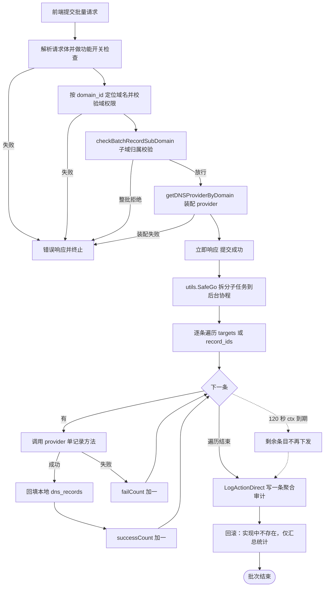
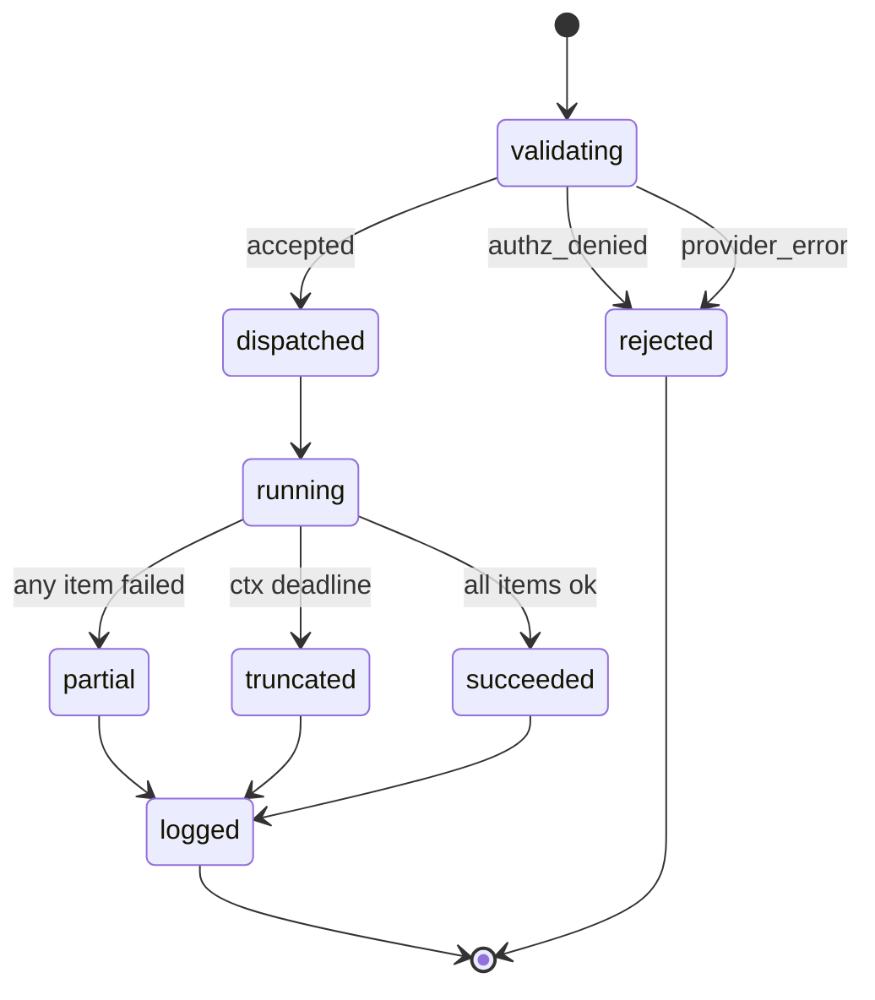
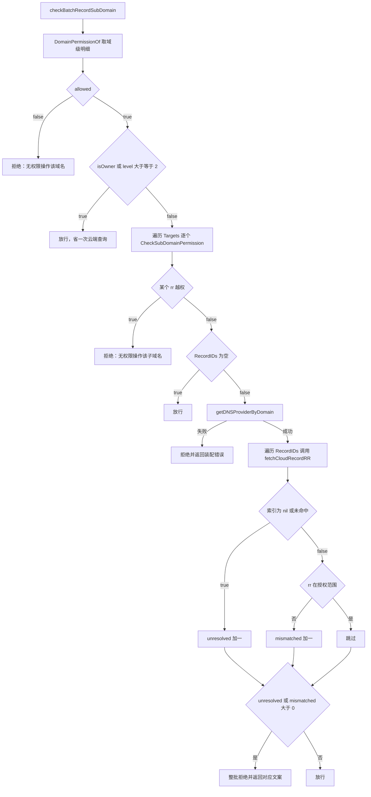

# 批量操作功能

<cite>
**本文档引用的文件**
- [batch.go](file://main/internal/api/handler/batch.go)
- [batch_authz.go](file://main/internal/api/handler/batch_authz.go)
- [batch_authz_test.go](file://main/internal/api/handler/batch_authz_test.go)
- [domain.go](file://main/internal/api/handler/domain.go)
- [cloudflare.go](file://main/internal/api/handler/cloudflare.go)
- [monitor.go](file://main/internal/api/handler/monitor.go)
- [schedule.go](file://main/internal/api/handler/schedule.go)
- [acceleration.go](file://main/internal/api/handler/acceleration.go)
- [quota.go](file://main/internal/api/handler/quota.go)
- [permission.go](file://main/internal/api/middleware/permission.go)
- [interface.go](file://main/internal/dns/interface.go)
- [record_sync.go](file://main/internal/service/record_sync.go)
- [quota.go (models)](file://main/internal/models/quota.go)
- [safe_go.go](file://main/internal/utils/safe_go.go)
- [router.go](file://main/internal/api/router.go)
- [router.go (apiv1)](file://main/internal/apiv1/router.go)
- [domain.go (apiv1)](file://main/internal/apiv1/domain.go)
- [record.go (apiv1)](file://main/internal/apiv1/record.go)
- [quota_gate.go](file://main/internal/apiv1/quota_gate.go)
- [routes_batch1.go](file://main/internal/apiv1/routes_batch1.go)
- [routes_batch2.go](file://main/internal/apiv1/routes_batch2.go)
- [api.ts](file://web/lib/api.ts)
- [client.tsx](<file://web/app/(dashboard)/dashboard/domains/[id]/client.tsx>)
- [page.tsx](<file://web/app/(dashboard)/dashboard/domains/page.tsx>)
</cite>

## 目录

1. [简介](#简介)
2. [项目结构](#项目结构)
3. [核心组件](#核心组件)
4. [架构总览](#架构总览)
5. [详细组件分析](#详细组件分析)
6. [依赖关系分析](#依赖关系分析)
7. [性能考虑](#性能考虑)
8. [故障排查指南](#故障排查指南)
9. [结论](#结论)
10. [附录](#附录)

## 简介

批量操作让运维人员在一次请求里对同一域名下的多条解析记录（或多条域名实体）执行同一动作，覆盖四类场景：**批量导入**（文本模式一行 `rr value`，或结构化模式 `items[]`）、**批量修改**（统一改 TTL / 线路）、**批量删除**、**批量启停**。记录侧由三个接口承担，域名侧由另外两个承担，另有 Cloudflare 自定义主机名、容灾监控、定时切换、一键加速四个「借用批量语义」的接口；三记录接口共享同一骨架：同步鉴权 → 后台协程逐条打下游 → 一条聚合审计。

**本文口径**：行号一律取当前工作区。素材 `.wiki-context/analysis-dns.md` §4 基于早期快照，其中两条已不成立——批量新增的本地回填助手 `upsertBatchLocalRecord` **已有定义**（`batch.go:188-194`），批量删除/启停**已同步清理本地副本**（`batch.go:407-412`）。

| 特征 | 现状 | 证据 |
|------|------|------|
| 执行模型 | 同步校验 + 异步执行：鉴权、域定位、provider 装配在请求内完成，云端逐条下发丢进后台协程 | `batch.go:117`、`:279`、`:382` |
| 响应语义 | 立即回「提交成功」，不返回逐条成败；结果只有一条聚合审计 `成功%d, 失败%d` | `batch.go:179`、`:313`、`:417` |
| 事务与补偿 | 无显式事务（无 `Begin`/`Commit`），无回滚、无重试、无死信队列、无任务表 | `batch.go:117-177`、`:279-311`、`:382-415` |
| 越权防护 | 三接口统一走 `checkBatchRecordSubDomain` | `batch.go:95`、`:259`、`:363` |
| 权限降级 | 功能开关缺失时放行（fail-open），子域判定取不到数据时拒绝（fail-closed） | `quota.go:296-302`、`batch_authz.go:146-149` |

对照之下，域名级批量是**全同步**的：`BatchDomainAction` 在请求内直接跑 `IN` 查询并返回受影响条数（`domain.go:1478-1519`）。两套批量的语义差别是排查时最容易踩坑之处。另需留意 `routes_batch1.go` / `routes_batch2.go` 的命名含义是「V1 路由分批注册」，与「批量操作接口」无关。

**章节来源**
- [batch.go:47-418](file://main/internal/api/handler/batch.go#L47-L418)
- [domain.go:1447-1581](file://main/internal/api/handler/domain.go#L1447-L1581)

## 项目结构

批量操作不是独立子系统，而是散在 handler 层的一组接口加一个专门的鉴权文件。

| 文件 | 行数 | 在批量链路中的职责 | 关键符号 |
|------|-----:|-------------------|----------|
| `handler/batch.go` | 495 | 入参模型、执行循环、本地回填、审计 | `BatchAddRecords:47`、`BatchEditRecords:223`、`BatchActionRecords:327`、`upsertBatchLocalRecord:188`、`detectRecordType:197`、`getDNSProviderByDomain:421`、`QueryWhois:444` |
| `handler/batch_authz.go` | 155 | 子域归属判定（失败即整批拒绝） | `batchRecordAuthReq:34`、`cloudRecordRRIndex:48`、`fetchCloudRecordRR:77`、`checkBatchRecordSubDomain:87` |
| `handler/batch_authz_test.go` | 199 | 锁住越权拒绝、授权内不误拒、上游失败不放行 | `fakeRecordProvider:34`、`seedSubDelegatedUser:56`、6 个 `Test*` |
| `middleware/permission.go` | 400 | 域级与 rr 级判定原语 | `subGrantCoversRR:34`、`DomainPermissionOf:330`、`CheckDomainPermission:335`、`CheckSubDomainPermission:344` |
| `service/record_sync.go` | 663 | 本地副本 `dns_records` 即时回填与删除 | `recordChanged:513`、`UpsertLocalRecord:589`、`DeleteLocalRecord:604`、`LocalRecord:617` |
| `dns/interface.go` | 167 | 批量循环实际调用的 Provider 方法 | `PageResult:35`、`Provider:41`、`GetDomainRecords:52`、`AddDomainRecord:61` |
| `apiv1/record.go` | 58 | V1 侧复用同一批 handler | `registerRecordRoutes:18`、`:40-42` |
| `apiv1/routes_batch1.go` | 103 | V1 迁移第一批路由（监控、定时切换） | `:83`、`:102` |
| `apiv1/routes_batch2.go` | 147 | V1 迁移第二批路由（CF、系统、用户、优选 IP） | `:35-37` |

### 双入口同实现

控制台与 V1 各自注册路由，但复用同一批 handler：

| 能力 | 控制台路由（`router.go`） | V1 路由 |
|------|--------------------------|---------|
| 批量导入 | `:138` `/api/domains/:id/records/batch` | `record.go:40` `/api/v1/records/batch/add` |
| 批量修改 | `:139` `…/batch/edit` | `record.go:41` `/api/v1/records/batch/edit` |
| 批量启停 / 删除 | `:140` `…/batch/action` | `record.go:42` `/api/v1/records/batch/action` |
| 域名批量 | `:130` `/api/domains/batch` | `domain.go (apiv1):38` `/api/v1/domains/batch` |
| 批量到期刷新 | `:132` `/api/domains/batch/update-expire` | 未开放 |

V1 的三条批量接口**直接指向异步版 handler**，与 `apiv1/record.go:9-15` 的注释（「写操作在此重写为同步」）不一致，详见 [V1 侧批量](#v1-侧批量)。

**章节来源**
- [batch.go:1-495](file://main/internal/api/handler/batch.go#L1-L495)
- [batch_authz.go:1-155](file://main/internal/api/handler/batch_authz.go#L1-L155)
- [router.go:130-140](file://main/internal/api/router.go#L130-L140)
- [record.go (apiv1):9-42](file://main/internal/apiv1/record.go#L9-L42)

## 核心组件

### 批量任务模型

记录侧批量没有独立的「任务」实体：请求结构体即任务定义，后台协程即执行体，审计日志即结果记录。

结构体之间的归属关系：`BatchAddRecordsRequest` 内含 `[]BatchRecordReq`（`batch.go:39`）；`BatchEditRecordsRequest` 与 `BatchActionRecordsRequest` 都以 `RecordIDs` 为主体（`:213`、`:318`）；三者都收敛到判定入参 `batchRecordAuthReq`（`batch_authz.go:34-37`），新增类走 `Targets`、改删类走 `RecordIDs`。

两处刻意设计：`BatchEditRecordsRequest` 的 `TTL *int` / `Line *string` 是指针（`batch.go:214-215`），因为批量编辑语义是「只改显式给出的字段」，值类型无法区分「没传」与「传零值」；`batchRecordAuthReq` 只带三个字段（`:34-37`），`Targets` 与 `RecordIDs` 互斥使用——新增类填前者（rr 已知），改删类填后者（rr 需回查）。

必填位由 `binding` tag 决定，且**只约束「有没有」，不约束「有多少」**：

| 字段 | 归属 | 必填 | 缺失语义 | 校验点 |
|------|------|:----:|----------|--------|
| `domain_id` | 三接口 | 否（可由路径 `:id` 回填） | 两者皆空报「缺少域名ID」 | `batch.go:62-68`、`:238-244`、`:342-348` |
| `records` | Add | 否 | 非空即走文本模式，优先于 `items` | `batch.go:131` |
| `items` | Add | 否 | `records` 为空时逐项执行 | `batch.go:157-175` |
| `type` | Add | 否 | `""` 或 `auto` 时按值推断 | `batch.go:146-148` |
| `ttl` / `line` | Add | 否 | 0 / 空 → 600 / `default` | `batch.go:121-126` |
| `record_ids` | Edit / Action | 是 | `binding:"required"` | `batch.go:213`、`:318` |
| `action` | Action | 是 | 无白名单，未知值静默计入成功 | `batch.go:392-401` |
| `ids` | 域名批量 | 是 | `binding:"required"` + 空切片二次判定 | `domain.go:1436`、`:1457-1460` |

**章节来源**
- [batch.go:23-40](file://main/internal/api/handler/batch.go#L23-L40)
- [batch.go:121-216](file://main/internal/api/handler/batch.go#L121-L216)
- [batch_authz.go:33-38](file://main/internal/api/handler/batch_authz.go#L33-L38)
- [domain.go:1435-1460](file://main/internal/api/handler/domain.go#L1435-L1460)

### 事务与补偿边界

| 环节 | 实现 | 位置 | 缺失的后果 |
|------|------|------|------------|
| 逐条下发 | `for` 循环内直接调 provider | `batch.go:133-156`、`:158-174`、`:286-309`、`:389-413` | 第 k 条失败不回滚前 k-1 条 |
| 计数 | `successCount` / `failCount` 局部变量 | `batch.go:128-129`、`:283-284`、`:386-387` | 协程结束即消失，无持久化 |
| 结果记录 | 单条聚合审计 | `batch.go:176`、`:310`、`:414` | 只知「几条成功」，不知是哪几条 |
| 本地副本 | 成功即 upsert / delete，失败不回填 | `batch.go:152-154`、`:304-307`、`:407-412` | 失败条目本地行保持旧值 |
| 进程重启 | 无恢复逻辑 | `safe_go.go:9-19` | 在跑的批次静默丢失 |
| 协程 panic | `recover` 后仅记错误日志 | `safe_go.go:11-17` | 闭包末尾的审计被跳过，批次结果完全不可见 |

隐含判断是：**DNS 写操作天然不可回滚**（`dns.Provider` 没有反向补偿方法），「整批事务」在这里只能实现为「失败即停 + 反向删除已完成条目」，而这会把厂商调用量翻倍并放大限流风险。项目选择了「尽力而为的部分成功」——要求原子性的用法必须在调用方补一层对账。

**章节来源**
- [batch.go:117-179](file://main/internal/api/handler/batch.go#L117-L179)
- [batch.go:382-417](file://main/internal/api/handler/batch.go#L382-L417)
- [safe_go.go:9-19](file://main/internal/utils/safe_go.go#L9-L19)
- [interface.go:41-73](file://main/internal/dns/interface.go#L41-L73)

### 并发控制

| 维度 | 口径 | 位置 |
|------|------|------|
| 单请求内 | 串行逐条下发，无并发 | `batch.go:133`、`:286`、`:389` 的 `for` |
| 跨请求 | 每请求 1 个后台协程，无信号量、无队列、无全局上限 | `batch.go:117`、`:279`、`:382` |
| panic 隔离 | `SafeGo` 内 `recover` 后只记日志，不向上抛 | `safe_go.go:11-17` |
| 执行超时 | 120 秒硬编码，基于 `context.Background()` | `batch.go:118`、`:280`、`:383` |
| 子域判定超时 | 沿用 `c.Request.Context()`，无额外预算 | `batch_authz.go:135` |
| 域名级批量 | 同步执行，无额外超时 | `domain.go:1478-1519` |
| WHOIS 查询 | 30 秒，基于 `c.Request.Context()` | `batch.go:474` |

用 `context.Background()` 而非 `c.Request.Context()` 是有意的：客户端断开不应中断已在下发的云端写入。代价是协程无法被外部取消，只剩 120 秒这一道闸门。串行同样是特性而非缺陷——项目内一致口径就是「逐条串行以规避账户级限流」。

**章节来源**
- [batch.go:117-118](file://main/internal/api/handler/batch.go#L117-L118)
- [batch.go:382-383](file://main/internal/api/handler/batch.go#L382-L383)
- [batch_authz.go:132-145](file://main/internal/api/handler/batch_authz.go#L132-L145)
- [safe_go.go:9-19](file://main/internal/utils/safe_go.go#L9-L19)

### checkBatchRecordSubDomain

`checkBatchRecordSubDomain`（`batch_authz.go:87`）是批量族唯一的 rr 级安全边界，被三接口各调一次（`batch.go:95`、`:259`、`:363`）。其存在理由写在同文件头注释（`:15-31`）：单条接口在建写前一律走 `CheckSubDomainPermission`，批量族若只走 `CheckDomainPermission`，「域级放行」就会被误当成「域内任意 rr 放行」，结果是拿到 rr 级委派的用户可以把记录增删改到该域名下任意子域。

底层三个原语的分工：

| 原语 | 口径 | 位置 |
|------|------|------|
| `CheckDomainPermission` | `level >= 2` 直接 true；其余走 `getDomainPermission` 的账户归属与委派合并 | `permission.go:335-341` |
| `CheckSubDomainPermission` | 域级放行后，再用 `subGrantCoversRR` 比较 `perm.SubDomain` 与目标 rr | `permission.go:344-360` |
| `subGrantCoversRR` | 授权为空或 `*` 全覆盖；rr 为空且授权非空则拒；否则逗号列表逐项精确匹配 | `permission.go:34-49` |

调用侧的 rr 来源分两族：新增类在 `batch.go:86-94` 从 `items[].Name` 与文本行首字段两路收集 `Targets`，保证两种入参形态都被覆盖；改删类只交 `RecordIDs`，由判定链回查云端。

**章节来源**
- [batch_authz.go:15-38](file://main/internal/api/handler/batch_authz.go#L15-L38)
- [batch_authz.go:87-155](file://main/internal/api/handler/batch_authz.go#L87-L155)
- [permission.go:330-360](file://main/internal/api/middleware/permission.go#L330-L360)
- [batch.go:86-95](file://main/internal/api/handler/batch.go#L86-L95)

## 架构总览

一次记录批量请求的生命周期如下。「回滚」分支在实现上**不存在**，图中以虚线标注，避免从图形误推出原子性保证。



**图表来源**
- [batch.go:47-418](file://main/internal/api/handler/batch.go#L47-L418)
- [batch_authz.go:87-155](file://main/internal/api/handler/batch_authz.go#L87-L155)

从状态机视角看，批次没有 `rollback` 状态，也没有 `pending` 队列——请求返回即进入 `dispatched`。



**图表来源**
- [batch.go:117-179](file://main/internal/api/handler/batch.go#L117-L179)
- [batch_authz.go:146-153](file://main/internal/api/handler/batch_authz.go#L146-L153)

`logged` 即终态：批次没有可查询的持久化任务行。且 `partial` 与 `truncated` 在审计文案里被合并成同一种形态（`batch.go:176`、`:310`、`:414`），无法从日志区分，只能靠失败条数与耗时反推。

**章节来源**
- [batch.go:47-418](file://main/internal/api/handler/batch.go#L47-L418)
- [batch_authz.go:87-155](file://main/internal/api/handler/batch_authz.go#L87-L155)

## 详细组件分析

### 批量创建（BatchAddRecords）

入口 `batch.go:47`，路由 `router.go:138` 与 `apiv1/record.go:40`。

前置校验链顺序：模块权限（`:48`）→ `BindDecryptedData`（`:52`）→ `CheckFeature(c, "batch_ops")`（`:58`）→ `domain_id` 兜底取路径参数（`:62-68`）→ 域名存在性（`:70-74`）→ 域权限（`:77`）→ 子域归属（`:86-97`）→ provider 装配（`:99`）→ 上下文快照（`:106-115`）→ 派发（`:117`）→ 响应（`:179`）。

两种入参模式互斥，由 `records` 是否为空决定走哪支（`:131`）：

| 模式 | 入参 | 每行解析 | 记录类型来源 | 位置 |
|------|------|----------|--------------|------|
| 文本模式 | `records` 多行 `rr value` | `strings.Fields` 切分，字段不足 2 个直接计失败 | `type` 为空或 `auto` 时按值猜测 | `batch.go:132-156` |
| 结构模式 | `items[]` | 逐字段取用 | `rec.Type` 必填 | `batch.go:158-175` |

文本模式的类型猜测由 `detectRecordType` 完成（`:197-209`）：`net.ParseIP` 命中且能转 4 字节判 `A`，否则 `AAAA`；含冒号也判 `AAAA`（覆盖缩写 IPv6）；其余一律 `CNAME`。**它不会推断 `TXT` / `MX` / `SRV`**，这类值会被当成 CNAME 下发并被厂商拒绝——「批量导入失败若干条」最常见的成因即在此。

成功后经共用助手 `upsertBatchLocalRecord`（定义 `:188-194`，调用 `:154`、`:172`）转调 `service.UpsertLocalRecord`，固定写 `Status: "enable"`（`:192`）。用 OnConflict 而非裸 `Create` 的理由见 `record_sync.go:594-600`——`did + record_id` 上有唯一索引（`models/quota.go:77-78`），直接 `Create` 会在更新路径撞约束并静默失败。

默认值补齐位置也不同：文本模式在协程开头统一补 `defaultTTL=600` / `defaultLine="default"`（`:121-126`），结构模式在循环内逐条补（`:159-166`），因此结构模式允许逐条覆盖。此外 `records` 行数与 `items` 长度都不校验上限（`:131-175` 全程无长度判断），同 `rr+type+value` 重复提交也不去重（量化影响见 [性能考虑](#性能考虑)）。

**章节来源**
- [batch.go:47-209](file://main/internal/api/handler/batch.go#L47-L209)
- [record_sync.go:589-601](file://main/internal/service/record_sync.go#L589-L601)
- [quota.go (models):75-93](file://main/internal/models/quota.go#L75-L93)

### 批量修改（BatchEditRecords）

入口 `batch.go:223`，路由 `router.go:139` 与 `apiv1/record.go:41`。

它是三接口里唯一**每条打两次上游**的：先 `GetDomainRecordInfo(ctx, recordID)` 取回原记录（`:287`），再把 TTL / Line 按指针覆盖后调 `UpdateDomainRecord`（`:300`）。反查不是为了展示，而是因为 `UpdateDomainRecord` 是**全量覆盖式**更新，10 个入参一律以请求值为准、零值会覆盖原值（签名见 `dns/interface.go:64`）。因此 `:300` 传入的 `record.Name`、`record.Type`、`record.Value`、`record.MX`、`record.Remark` 全部来自上一次反查，只有 `line` 与 `ttl` 可能被指针替换（`:292-299`）。

反查失败即 `failCount++` 并 `continue`（`:288-291`），该条不会被改写。这意味着 22 家厂商中任何在 `GetDomainRecordInfo` 上返回 error 的实现，都会让这个接口成片失败。

成功后的本地回填是「读-改-写」：`LocalRecord` 取本地行（`:304`），仅改 `Line` / `TTL`（`:305`），再 `UpsertLocalRecord` 写回（`:306`），避免把其余字段清成零值——`record_sync.go:611-616` 的注释正是为此而写。

`UpdateDomainRecord` 的 `weight` 位传 `nil`（`:300` 第九个实参），即「本次不改权重」；但各厂商对 `nil` 的解释由实现自行决定，跨厂商一致性属**未知**，需在具体服务商上单点验证后再下结论。

**章节来源**
- [batch.go:211-314](file://main/internal/api/handler/batch.go#L211-L314)
- [interface.go:58-64](file://main/internal/dns/interface.go#L58-L64)
- [record_sync.go:611-627](file://main/internal/service/record_sync.go#L611-L627)

### 批量启停与批量删除（BatchActionRecords）

入口 `batch.go:327`，路由 `router.go:140` 与 `apiv1/record.go:42`。「批量启停」与「批量删除」合并成单一入口，靠 `switch` 分流（`:392-401`）：

| action 值 | 调用的 Provider 方法 | 本地副本处理 | 位置 |
|-----------|---------------------|--------------|------|
| `enable` / `open` | `SetDomainRecordStatus(ctx, id, true)` | `LocalRecord` + `Status="enable"` + `Upsert` | `batch.go:393-395`、`:409-412` |
| `disable` / `pause` | `SetDomainRecordStatus(ctx, id, false)` | `LocalRecord` + `Status="disable"` + `Upsert` | `batch.go:396-398`、`:409-412` |
| `delete` | `DeleteDomainRecord(ctx, id)` | `DeleteLocalRecord` | `batch.go:399-400`、`:407-408` |
| 其它（未知值） | 不调用任何方法 | 仍进入回填分支，`Status` 被写成空串 | `batch.go:392-401` 无 `default` |

`enable` / `open` 与 `disable` / `pause` 是同义别名，两套写法都收敛到同一个 `status` 字符串（`:395`、`:398`）。每条只需 1 次上游调用，是三接口里最省配额的。删除分支走显式删除 `service.DeleteLocalRecord`（`record_sync.go:604-609`），与启停的 upsert 路径分开，两者都不检查错误。

**已知缺陷（幂等与统计口径）**：`switch` 缺 `default`（`:392-401`）。传 `action=remove`（正确值应为 `delete`）时 `opErr` 保持 `nil`、`status` 保持 `""`，于是 `:402` 判定通过、`:406` `successCount++`；又因 `action != "delete"` 走到 `:409-412`，把 `local.Status` 赋空串并落库，而 `UpsertLocalRecord` 的 `DoUpdates` 列集合含 `status`（`record_sync.go:596-599`）。最终效果：**云端毫无变化、审计写「成功 N 条」、本地 `dns_records.status` 被整批清空**。被清空的 `status` 会在下一轮定时对账时被 `recordChanged` 比对出来并修回（`record_sync.go:513-518` 的八个比较字段含状态判定），因此在默认同步间隔下表现为「状态暂时错乱后自愈」。

**章节来源**
- [batch.go:316-418](file://main/internal/api/handler/batch.go#L316-L418)
- [record_sync.go:513-518](file://main/internal/service/record_sync.go#L513-L518)
- [record_sync.go:589-609](file://main/internal/service/record_sync.go#L589-L609)

### 子域归属校验的判定链



**图表来源**
- [batch_authz.go:87-155](file://main/internal/api/handler/batch_authz.go#L87-L155)
- [batch.go:86-95](file://main/internal/api/handler/batch.go#L86-L95)

判定顺序有两个刻意取舍。**先本地后云端**——`Targets` 判定放在建 provider 之前（`batch_authz.go:104-115`），注释说明「越权请求不应在拒绝之前先消耗一次云端配额」（`:107-108`）。**判定依据必须来自云端**——`RecordIDs` 一族不接受请求里的 rr，而回查云端真实 rr（`:126-131`），注释写得很直白：「请求里的 record_id 是攻击者可控的，用它反查 rr 等于让攻击者自证清白」。

**注释与实现相反（已知不一致）**：`batch_authz.go:28-30` 声明「失败时不整批拒绝」，理由是整批拒绝会制造「别人有一条记录就能让你整批失败」的拒绝服务面；但实现是 `unresolved > 0` 或 `mismatched > 0` 即整批拒绝（`:146-153`）。以代码为准，当前行为是 fail-closed 整批拒绝。

**章节来源**
- [batch_authz.go:15-155](file://main/internal/api/handler/batch_authz.go#L15-L155)
- [batch.go:86-95](file://main/internal/api/handler/batch.go#L86-L95)

### 上游失败索引为 nil 的兜底

`cloudRecordRRIndex`（`batch_authz.go:48-69`）把「取不回来」和「不存在」压成同一个信号——返回 `nil`：

```go
const perPage = 500
const maxPages = 10 // 5000 条封顶，与本项目其它分页聚合处一致
idx := map[string]string{}
for page := 1; page <= maxPages; page++ {
    result, err := provider.GetDomainRecords(ctx, page, perPage, "", "", "", "", "", "")
    if err != nil || result == nil { return nil }        // :54-56
    records, ok := result.Records.([]dns.Record)
    if !ok { return nil }                                // :57-60
    for _, r := range records { idx[r.ID] = r.Name }     // :61-63
    if len(records) < perPage { break }                  // :64-66
}
return idx
```

| 触发条件 | 行为 | 位置 |
|----------|------|------|
| 任一页 `GetDomainRecords` 返回 error | `return nil` | `:54-56` |
| 返回的 `result` 为 `nil` | `return nil` | `:54-56` |
| `PageResult.Records` 断言 `[]dns.Record` 失败 | `return nil` | `:57-60` |
| 遍历到 `maxPages` 仍未收尾 | 返回已聚合的**不完整**索引 | `:50`、`:52`、`:64-66` |

`fetchCloudRecordRR` 收到 `nil` 索引时返回 `("", false)`（`:79-81`），调用方计成 `unresolved`（`:136-141`），最终整批拒绝（`:146-149`）。注释定调是「两种情况都不能放行——放行会让一次跨域批量删除静默生效」（`:137-138`）。

第 3 行是易踩的坑：`PageResult.Records` 是 `interface{}`（`interface.go:37`），各厂商塞进去的具体类型必须恰好是 `[]dns.Record`，断言失败会静默退化成「无法判定」——不影响放行判定，但会把本该成功的批量变成整批拒绝，症状为「某一家服务商的批量一直报『存在无法确认归属的记录』」。

`maxPages 10 × perPage 500` 的封顶意味着超过 5000 条记录的域名会**必然出现误拒**：超出部分不在索引内，等同「不属于本域名」。

**章节来源**
- [batch_authz.go:40-84](file://main/internal/api/handler/batch_authz.go#L40-L84)
- [batch_authz.go:126-153](file://main/internal/api/handler/batch_authz.go#L126-L153)
- [interface.go:35-38](file://main/internal/dns/interface.go#L35-L38)

### 权限降级

批量族存在四处「比单条更宽松」或「比预期更宽松」的降级点：

| 降级点 | 触发条件 | 效果 | 位置 |
|--------|----------|------|------|
| 只读授权未判定 | 三接口均无 `read_only` 检查 | 只读委派用户可发起批量写 | `batch.go:77`、`:253`、`:357` |
| 功能开关默认放行 | 未订阅套餐，或套餐 `features` 里没有 `batch_ops` 键 | 视为开启，不做限制 | `quota.go:296-302` |
| 记录配额未参与 | 只调 `CheckFeature("batch_ops")`，未调记录维度配额 | 批量新增绕过 `records` 上限 | `batch.go:58`、`:234`、`:338` |
| 域主与管理员短路 | `isOwner \|\| level >= 2` | 跳过全部子域判定，也跳过云端反查 | `batch_authz.go:100-102` |

`CheckFeature` 的降级是刻意的：注释写明「未订阅套餐或该功能未出现时一律放行——存量实例不应因为新增了功能开关而被静默关掉既有能力」（`quota.go:287-293`）。`loadFeaturesForUser` 在 `userID == 0`、`level >= 2`、无有效订阅、套餐过期、套餐停用、`features` 为空、JSON 解析失败七种情况下都返回 `false`（`:311-331`），`CheckFeature` 随即放行（`:296-298`）。功能名到中文提示的映射在 `featureLabels`（`:334-342`），`batch_ops → "批量操作"`；未登记的 key 退化为原样输出 key 名（`:345-351`）。

第三项的影响面最大，但 V1 侧已部分收敛：控制台批量新增不检查记录配额，而 `apiv1/record.go:40` 额外挂了 `requireQuota("records")`，同文件 `:27-33` 的注释解释了差异——「缺一道门就等于给了绕过的确定性路径」；因此**经 V1 的批量导入会被配额拦，经控制台的不会**。第四项是**性能优化兼语义正确**：`CheckDomainPermission` 本身对 `level >= 2` 直接返回 true（`permission.go:336-338`），`isOwner` 也本就不受子域限制，短路条件与之重合，而 `batch_authz.go:91-93` 解释「分开写是为了让先判域、再判子域的两层结构在调用点上看得见」；短路能省掉最多 10 页的云端全量拉取。

**章节来源**
- [batch.go:58](file://main/internal/api/handler/batch.go#L58)
- [batch_authz.go:88-102](file://main/internal/api/handler/batch_authz.go#L88-L102)
- [quota.go:287-351](file://main/internal/api/handler/quota.go#L287-L351)
- [record.go (apiv1):27-42](file://main/internal/apiv1/record.go#L27-L42)

### V1 侧批量

V1 装配链在 `apiv1/router.go:24-47`，中间件顺序为 `RequestTrace → Recovery → CORS → APIKeyAuth → JSONBodyToDecryptedData → AuditLog → AdaptResponse`（`:27-34`）。`JSONBodyToDecryptedData`（`:31`）是批量族能被两套入口复用的技术前提：它把明文 JSON body 搬运到 `decrypted_data`，使 handler 里的 `middleware.BindDecryptedData`（`batch.go:52`、`:228`、`:332`）在 V1 上原样可用；`AdaptResponse` 放在链末（`:34`），包裹后续所有写出。参数桥接上，记录族整组挂 `paramAlias({"id": "domain_id"})`（`apiv1/record.go:23`），使 V1 的 JSON body 能填上 handler 里读的 `c.Param("id")`（`batch.go:63`、`:239`、`:343`）。

V1 侧与批量相关的注册点分布在三个文件：

| 位置 | 端点 | 附加闸门 |
|------|------|----------|
| `record.go:40-42` | `/records/batch/{add,edit,action}` | add 额外挂 `requireQuota("records")` |
| `routes_batch1.go:83` | `/monitor/tasks/batch` | `requireModuleMW("monitor")` |
| `routes_batch1.go:102` | `/schedule/tasks/batch` | `requireModuleMW("domain")` |
| `routes_batch2.go:35-37` | `/cloudflare/hostnames/batch-{add,update,delete}` | `requireModuleMW("domain")` + `cfDomainBridge()` |

`routes_batch2.go:9-25` 的注释说明了 CF 一族为何不保留控制台的 `:id` 路径段（CF handler 有 27 处 `c.Param("id")`，保留 `:id` 会让签名对象随域名变化）。**已知契约缺口**：V1 把控制台的**单条**写接口在本包重写为同步实现（`apiv1/record.go:34-38` 指向 `CreateRecordSync` 等），但**三个批量接口仍直接复用异步 handler**（`:40-42`）——V1 调用方拿单条写能得到真实结果，拿批量写只能得到「提交成功」。未暴露到 V1 的批量能力：`BatchUpdateDomainExpire`、`BatchAccelerateRecords`。

**章节来源**
- [router.go (apiv1):9-47](file://main/internal/apiv1/router.go#L9-L47)
- [record.go (apiv1):9-58](file://main/internal/apiv1/record.go#L9-L58)
- [routes_batch1.go:70-103](file://main/internal/apiv1/routes_batch1.go#L70-L103)
- [routes_batch2.go:9-64](file://main/internal/apiv1/routes_batch2.go#L9-L64)

### 域名级与扩展对象批量

`BatchDomainAction`（`domain.go:1447-1520`）是同步实现，四种动作全部走 `IN` 查询直接改库，不碰云端：

| action | 行为 | 位置 |
|--------|------|------|
| `delete` | 连带清理 `Permission`（按域名名匹配）、`DMTask` / `DMLog` / `DMCheckLog`、`OptimizeIP`、`ScheduleTask`、`CertCNAME`、`DomainNote` | `domain.go:1480-1499` |
| `set_notice` | `Update("is_notice", *req.IsNotice)`，指针为空则 `success = 0` | `:1500-1505` |
| `set_remark` | `Update("remark", *req.Remark)`，同上 | `:1506-1511` |
| `update_expire` | `Update("check_status", 0)`，交由后台 WHOIS 异步刷新 | `:1512-1513` |
| 其它 | `default` 分支返回「不支持的操作」 | `:1514-1516` |

这里的 `default`（`:1514-1516`）正是记录侧缺失的那道防线，可直接作为修复参照。权限也更严：`delete` 强制管理员（`:1463-1467`），其它动作对非管理员逐个 `id` 校验域权限（`:1468-1475`）。同样**没有事务包裹**：`delete` 分支的九条删除语句若中途失败会留下半套孤儿行，这是「域名删了但监控任务还在」类反馈的来源。`BatchUpdateDomainExpire`（`:1565-1582`）只把 `check_status` 置 0 就返回「已提交%d个域名，约%d分钟后刷新完成」（`:1580-1581`），预估按 `(count/5)+1` 分钟。

| 接口 | 同步/异步 | 逐条失败可见性 | 位置 |
|------|-----------|----------------|------|
| `BatchAccelerateRecords` | 同步 | 逐条结果数组全量回传 | `acceleration.go:645-717` |
| `BatchCreateMonitorTasks` | 同步 | 聚合 `created` / `exist` 计数 | `monitor.go:687-783` |
| `BatchScheduleTaskAction` | 同步 | 逐条 `continue` 吞掉，只报成功数 | `schedule.go:223-258` |
| `BatchAddCustomHostnames` | 同步 | 逐条 `failed[]` 明细回传 | `cloudflare.go:919-980` |
| `BatchUpdateCustomHostnames` | 同步 | 逐条 `failed[]` 明细回传 | `cloudflare.go:982-1048` |
| `BatchDeleteCustomHostnames` | 同步 | 逐条 `failed[]` 明细回传 | `cloudflare.go:1050-1081` |

CF 三件套的「`success` + `failed[]` 明细」形态（如 `cloudflare.go:946-951` 收集、`:979` 回传）比记录侧的聚合计数可诊断性好得多，说明「异步 + 只回提交成功」不是技术必需，而是与控制台交互形态耦合的选择。`BatchScheduleTaskAction` 在每条上做 `ensureDomainWrite` 的 rr 级判定（`schedule.go:242`），说明「批量必须逐条判子域」在项目内已有更直接的范式，但它的 `switch`（`:245-255`）同样缺 `default`；`BatchAccelerateRecords` 的超时同为 120 秒却走 `c.Request.Context()`（`acceleration.go:672`），客户端断开即中断，与记录批量的语义相反。

**章节来源**
- [domain.go:1435-1520](file://main/internal/api/handler/domain.go#L1435-L1520)
- [domain.go:1556-1582](file://main/internal/api/handler/domain.go#L1556-L1582)
- [acceleration.go:645-717](file://main/internal/api/handler/acceleration.go#L645-L717)
- [schedule.go:223-258](file://main/internal/api/handler/schedule.go#L223-L258)
- [cloudflare.go:919-1081](file://main/internal/api/handler/cloudflare.go#L919-L1081)

### 前端批量交互

前端只提供**文本模式**的批量导入与**三种动作**的批量处理，结构化 `items[]` 目前没有 UI 调用方（`api.ts:522-523` 的入参形状是 `{ records, type?, line?, ttl? }`）。

| 交互 | 位置 | 行为 |
|------|------|------|
| 「批量添加」按钮 | `client.tsx:870-871` | 打开弹窗（窄屏文案缩为「批量」） |
| 批量添加弹窗 | `client.tsx:1479-1531` | `Textarea` 每行 `主机名 记录值`，附「快捷：常见 A」「快捷：CNAME」「清空」 |
| `handleBatchAdd` | `client.tsx:647-672` | 按 `res.code === 0` 弹 toast 并 `fetchRecords()` |
| 批量操作栏 | `client.tsx:1068-1093` | 已选 > 0 时浮现，按钮为启用 / 暂停 / 删除 |
| `handleBatchAction` | `client.tsx:674-694` | 传 `record_ids` + `action`，成功后清空选中并刷新 |
| `toggleSelectAll` | `client.tsx:703-709` | 基于 `filteredRecords`，即**全选只覆盖当前筛选结果** |
| 域名页批量 | `page.tsx:564-578`、`:580-598`、`:600-623`、`:625-642` | 到期刷新、通知、备注、删除四个处理函数 |

三点值得记录：**动作值对齐**——前端发送 `open` / `pause` / `delete`（`client.tsx:1079`、`:1083`、`:1087`），落在后端白名单内，因此 UI 不会触发「未知 action 记成功」的缺陷，风险只在直接调 API 的调用方；**结果误读**——`client.tsx:660-663` 把 `res.code === 0` 展示为「批量添加成功」并立即刷新列表，而后端此刻只保证了「已受理」，用户看到的记录数经常少于预期；**契约不一致**——`api.ts:524` 的 `batchEditRecords` 封装**无任何调用点**，且入参类型带了 `action: string`，而后端 `BatchEditRecordsRequest` 没有 `Action` 字段（`batch.go:211-216`），Gin 忽略未知字段所以不报错，接线前需先对齐。

**章节来源**
- [client.tsx:647-709](<file://web/app/(dashboard)/dashboard/domains/[id]/client.tsx#L647-L709>)
- [client.tsx:1068-1093](<file://web/app/(dashboard)/dashboard/domains/[id]/client.tsx#L1068-L1093>)
- [client.tsx:1479-1531](<file://web/app/(dashboard)/dashboard/domains/[id]/client.tsx#L1479-L1531>)
- [api.ts:509-527](file://web/lib/api.ts#L509-L527)
- [page.tsx:564-642](<file://web/app/(dashboard)/dashboard/domains/page.tsx#L564-L642>)

## 依赖关系分析

批量接口的调用面自上而下四层，箭头方向为「依赖」：

```mermaid
graph LR
    FE[前端记录页 client.tsx] --> API[handler batch.go]
    FED[前端域名页 page.tsx] --> DOM[handler domain.go]
    V1[apiv1 record 路由] --> API
    V1 --> DOM
    V1 --> QG[apiv1 quota_gate 配额闸门]
    API --> Z[batch_authz 子域校验]
    Z --> PERM[middleware permission]
    Z --> PROV[dns.Provider 接口]
    API --> PROV
    API --> SG[utils SafeGo 后台协程]
    API --> AUDIT[service Audit 聚合审计]
    API --> LOCAL[service 本地副本读写]
    LOCAL --> DB[(dns_records)]
    API --> DOMT[(domains 与 accounts)]
    DOMT --> REG[dns.GetProvider 注册表]
    REG --> P22[22 家厂商实现]
    PROV --> P22
    P22 --> CLOUD[厂商 DNS API]
    DB --> QUOTA[配额维度计数]
```



**图表来源**
- [batch.go:47-433](file://main/internal/api/handler/batch.go#L47-L433)
- [batch_authz.go:87-155](file://main/internal/api/handler/batch_authz.go#L87-L155)
- [record.go (apiv1):23-42](file://main/internal/apiv1/record.go#L23-L42)

| 被依赖方 | 符号与位置 | 批量侧调用点 | 缺失会怎样 |
|----------|------------|--------------|------------|
| 域级判定 | `DomainPermissionOf` `permission.go:330` | `batch_authz.go:95` | 无法区分域主与委派用户，短路优化失效 |
| rr 级判定 | `CheckSubDomainPermission` `permission.go:344` | `batch_authz.go:111`、`:142` | 越权写入无拦阻 |
| provider 装配 | `getDNSProviderByDomain` `batch.go:421` | `batch.go:99`、`:263`、`:367`、`batch_authz.go:120` | 无法下发任何云端动作 |
| 分页读 | `GetDomainRecords` `interface.go:52` | `batch_authz.go:53` | 索引建不出来，批量改删一律被拒 |
| 单条读 | `GetDomainRecordInfo` `interface.go:58` | `batch.go:287` | 全量覆盖更新时丢字段 |
| 单条写 | `AddDomainRecord` 等 `interface.go:61-73` | `batch.go:149`、`:167`、`:300`、`:394-400` | 批量本身不成立 |
| 本地副本 | `UpsertLocalRecord` 等 `record_sync.go:589-627` | `batch.go:154`、`:172`、`:304-307`、`:408-412` | 配额与列表读到过期数据 |
| 协程包装 | `SafeGo` `safe_go.go:9` | `batch.go:117`、`:279`、`:382` | panic 直接终止进程 |
| 审计 | `LogActionDirect` | `batch.go:176`、`:310`、`:414` | 批量结果完全不可见 |
| 配额闸门 | `requireQuota` `quota_gate.go:36` | `record.go (apiv1):40` | V1 批量导入不受记录上限约束 |

`getDNSProviderByDomain`（`batch.go:421-433`）与 `domain.go` 里的 `getProviderByDomain` 是同一逻辑的两份实现，差异只在前者不吃 `gin.Context`；全仓这类「账户 → Config JSON → provider」装配共 5 份（另三处在 `service/record_sync.go`、`service/schedule.go`、`apiv1/record_sync.go`），是最集中的 DRY 违例。它使用 `database.DB` 而非 `database.WithContext(c)`（`batch.go:423`），因此在异步段调用时不受请求上下文取消影响——这是必需的，否则 goroutine 内的装配会被响应返回打断。

**章节来源**
- [batch.go:421-433](file://main/internal/api/handler/batch.go#L421-L433)
- [record_sync.go:589-627](file://main/internal/service/record_sync.go#L589-L627)
- [quota.go (models):75-93](file://main/internal/models/quota.go#L75-L93)
- [permission.go:34-49](file://main/internal/api/middleware/permission.go#L34-L49)

## 性能考虑

批量开销分三块：权限校验的云端全量拉取、执行阶段的逐条下发、本地副本的逐行读写。

| 项 | 当前值 | 位置 | 影响 |
|----|--------|------|------|
| 索引分页大小 | 500 条/页 | `batch_authz.go:49` | 单次最多覆盖 500 条 |
| 索引分页上限 | 10 页（5000 条封顶） | `:50` | 超出部分进不了索引，被判「无法确认归属」 |
| 索引重建频率 | **每个 record_id 重建一次** | `:77-84` 被 `:134-135` 循环调用 | N 条 = N × 最多 10 页厂商查询 |
| 执行超时 | 120 秒硬编码 | `batch.go:118`、`:280`、`:383` | 条目多时后半段被 ctx 截断 |
| 单请求并发度 | 1（串行） | `batch.go:133`、`:286`、`:389` | 无法利用厂商侧可并行能力 |
| 跨请求并发上限 | 无 | `safe_go.go:9-19` | 多用户同时批量会叠加打满账户配额 |
| 批量导入上游次数 | 每条 1 次 | `batch.go:149`、`:167` | 100 条 = 100 次调用 |
| 批量修改上游次数 | 每条 2 次 | `batch.go:287`、`:300` | 可承载量约为其它两接口的一半 |
| 数量上限 / 去重 | 无 / 无 | `batch.go:131-175` | 任意条数；同 rr+type+value 重复下发 |
| 厂商侧限流与退避 | 无 | `main/internal/dns/` 无 rate / limiter / retry / backoff | 429 直接计入 `failCount` |

最严重的是「索引重建频率」：选中 200 条记录做批量删除，鉴权阶段会发起 200 × 最多 10 = 最多 2000 次厂商查询，而索引只需在循环外构建一次即可覆盖全部判定（`cloudRecordRRIndex` 无内部缓存，`fetchCloudRecordRR` 每次调用都从零重建）。这是批量改/删在大域名上「先卡很久再报无法确认归属」的直接原因。委派用户受影响最大——域主与管理员在 `batch_authz.go:100-102` 就短路了，一次厂商调用都不产生。

第二个坑是**超时截断与统计口径叠加**：`ctx` 到点后剩余条目不再下发，但审计仍只写「成功 N 失败 M」，读日志的人无法区分「云端拒绝」与「根本没跑」；同时 `failCount` 里混有「参数非法」「云端拒绝」「限流 429」「本地断言失败」四种成因（`batch.go:139-142`、`:150-151`、`:288-291`、`:402-404`），限流与业务错误未被分开统计，「失败 M」不具备可归因性。

优化建议按收益排序，均可在不改对外契约的前提下落地：

1. 把 `cloudRecordRRIndex` 提到 `batch_authz.go:134` 循环外调用一次，`fetchCloudRecordRR` 改为纯查表（消除 N×10 放大）。
2. 构建索引时读取分页总数，超过 5000 条明确报「记录数超过校验上限」，而非「无法确认归属」。
3. 控制台批量入口补记录维度配额并按条目数预扣，与 `apiv1/record.go:40` 对齐。
4. `batch.go:392-401` 与 `schedule.go:245-255` 的 `switch` 补 `default`（参照 `domain.go:1514-1516`）。
5. 审计文案增加 `truncated` 标记区分「失败」与「未执行」；条目数与请求体大小一并校验，配合账户级令牌桶收敛并发度。

**章节来源**
- [batch_authz.go:40-84](file://main/internal/api/handler/batch_authz.go#L40-L84)
- [batch_authz.go:126-145](file://main/internal/api/handler/batch_authz.go#L126-L145)
- [batch.go:117-179](file://main/internal/api/handler/batch.go#L117-L179)
- [batch.go:286-300](file://main/internal/api/handler/batch.go#L286-L300)

## 故障排查指南

### 部分成功部分失败如何回滚

**简短回答：不能自动回滚。** 三个接口都没有事务与补偿逻辑（`batch.go:117-177`、`:279-311`、`:382-415`），第 k 条失败时前 k-1 条已在云端生效。可操作的补救路径按成本递增：

| 步骤 | 动作 | 依据 |
|:--:|------|------|
| 1 | 到操作日志找本批次审计，确认是 `batch_add_records` / `batch_edit_records` / `batch_action_records` 中哪一类 | `batch.go:176`、`:310`、`:414` |
| 2 | 用云端记录列表与本地 `dns_records` 对账，找出这次真正生效的条目 | `SyncDomainRecords`（`record_sync.go:378`） |
| 3 | 若只需让本地视图追上云端，等下一轮定时同步或手动触发同步 | `recordChanged` 比较八个字段（`record_sync.go:513-518`） |
| 4 | 若需精确撤销，只能按条目重新发起一次反向批量操作；`delete` 不可逆，只能重新导入 | 批量接口不提供「按批次撤销」 |

要拿到「哪几条失败」，目前只有一条路：发起前把 `record_ids` 拆成小批次（建议每批 10-20 条），用「成功 N 失败 M」二分反推——这也是条目上限缺失带来的连带成本。

整批被拒时按错误文案定位：

| 现象（错误文案） | 根因 | 定位 | 处置 |
|------------------|------|------|------|
| 无权限操作该域名 | 域级判定不通过 | `batch_authz.go:96-99` | 补 `permissions` 行或改为域主账户 |
| 无权限操作该子域名: xxx | `Targets` 里某 rr 不在授权列表 | `:111-114` | 从批次剔除该 rr，或补 `sub_domain` 授权 |
| 存在无法确认归属的记录，已拒绝执行 | 索引为 `nil` 或 record_id 不在索引内 | `:136-149` | 见 [上游失败索引为 nil 的兜底](#上游失败索引为-nil-的兜底) |
| 存在无权限操作的子域名记录，已拒绝执行 | 云端 rr 与授权不匹配 | `:142-153` | 剔除越权条目；注意是整批拒绝 |
| 参数解析失败 | body 未走加密通道或字段名不符 | `batch.go:52`、`:228`、`:332` | 检查前端加密与字段名 |
| 批量操作未包含在当前套餐内 | `CheckFeature("batch_ops")` 显式拒绝 | `quota.go:306`、`:340` | 调整套餐 `features` |
| 审计显示成功但云端没变化 | `action` 拼错，`switch` 无 `default` | `batch.go:392-401` | 校验 `action` 落在白名单内 |
| 仅部分记录可批量操作，其余报无法确认归属 | 域名记录数超过 5000 条封顶 | `batch_authz.go:49-50` | 用第一页内的 record_id 复测即可确认 |

最后一行的对照口径：本地对账侧的分页上限是 100 页（`record_sync.go:486`），与校验侧的 10 页不一致，因此可能出现「对账能同步到的记录，批量校验却查不到」。

**前端看不到批量结果**：`client.tsx:654`（批量新增）与 `:680`（批量动作）都只按 `res.code === 0` 弹成功提示，随后立刻刷新列表——此时后台协程往往还没跑完，界面看到的是**旧状态**。排查时不要以界面刷新结果判定批量失败，应以操作日志的聚合审计为准。若怀疑协程根本没跑完，按两条线核对：`SafeGo` 的 panic 日志（`safe_go.go:12-14` 写 `[SafeGo] goroutine panic recovered`）与审计是否落库——审计缺失即协程异常退出，审计存在则用其中的 `成功N, 失败M` 反推。

**章节来源**
- [batch.go:117-179](file://main/internal/api/handler/batch.go#L117-L179)
- [batch_authz.go:49-52](file://main/internal/api/handler/batch_authz.go#L49-L52)
- [batch_authz.go:96-153](file://main/internal/api/handler/batch_authz.go#L96-L153)
- [record_sync.go:378-518](file://main/internal/service/record_sync.go#L378-L518)

### 攻击者用超时绕过子域校验

结论：**绕过不成立，但拒绝服务面成立。**

判定链用 fail-closed：`cloudRecordRRIndex` 任一步取不到数据就返回 `nil`（`batch_authz.go:54-60`），`fetchCloudRecordRR` 把 `nil` 转成 `known=false`（`:79-81`），调用方计成 `unresolved` 并整批拒绝（`:136-149`）。攻击者制造超时（掐断客户端连接、拖慢厂商响应、触发分页中途失败）只会让自己的请求被拒，不会让校验跳过。

`batch_authz_test.go` 的六个用例是这条边界唯一的回归防线，文件头 `:19-31` 明确了要锁住的三件事。在当前工作区实测通过（`go test ./internal/api/handler/ -run 'TestBatchSubDomainScope|TestCloudRecordRRIndex' -count=1 -v`，6 PASS，`ok main/internal/api/handler 0.100s`）：

| 用例 | 位置 | 锁住的行为 |
|------|------|------------|
| `TestBatchSubDomainScopeRejectsWriteOutsideGrant` | `:96` | 只授权 `www` 时写入 `blog` 必须被拒 |
| `TestBatchSubDomainScopeAllowsWriteInsideGrant` | `:109` | 授权内子域不得被误拒——否则是把越权修成不可用 |
| `TestBatchSubDomainScopeRejectsStranger` | `:122` | 无授权用户不得借他人授权范围放行 |
| `TestBatchSubDomainScopeRejectsForeignRecordID` | `:145` | 混入非本域名 record_id 必须被拒；判定依据取自云端真实 rr |
| `TestCloudRecordRRIndexReturnsNilOnError` | `:177` | 上游失败必须返回 `nil`（不放行） |
| `TestCloudRecordRRIndexIndexesByRecordID` | `:186` | 键为 record_id、值为真实 rr |

用例 5 正是「超时绕过」的否定证明：`fakeRecordProvider{err: errFakeUpstream}`（`:178`）模拟上游不可达，断言索引为 `nil`（`:180-182`）；任何改成「失败返回空索引」的改动都会红。用例 4 的构造值得细看——`seedSubDelegatedUser(t, "www")`（`:56-81`）造出只有 `www` 委派的 `level=1` 用户，域名下唯一记录是 `blog`（`:152-154`），先断言 `blog` 不通过 `CheckSubDomainPermission`（`:162-164`），再用同一判据对 `www` 断言通过（`:167-172`），以证明拒绝来自子域判定而非「一律拒绝」。

真正的风险是反向的：实现选择整批拒绝（`batch_authz.go:146-153`）而注释原本声明要「不整批拒绝」（`:28-30`），一个持有 `record_ids` 输入面的被委派用户可稳定制造拒绝服务——只需混入一条自己无法解析的 ID，就能让受害用户的整批操作每次都失败。缓解方向与 [性能考虑](#性能考虑) 第 1 条一致：索引构建失败与单条查不到应分开处理，前者拒绝、后者剔除该条并继续。

另两点：`Targets` 直接取自请求体（`batch.go:86-94`），文本行首字段即 rr，这条路径不查云端因而判定输入由调用方可控——但判定对象本就是「我要往哪写」，取请求值是正确选择，前提是补上 rr 字符合法性校验（当前无）。测试缺口方面，120 秒超时截断、未知 `action`、条目数无上限、批量绕过配额四项均无覆盖；`maxPages` 截断路径在测试中由桩数据天然走不到（`fakeRecordProvider` 只让第一页有数据，`batch_authz_test.go:45-47`）。

**章节来源**
- [batch_authz.go:28-153](file://main/internal/api/handler/batch_authz.go#L28-L153)
- [batch_authz_test.go:19-51](file://main/internal/api/handler/batch_authz_test.go#L19-L51)
- [batch_authz_test.go:56-199](file://main/internal/api/handler/batch_authz_test.go#L56-L199)
- [batch.go:86-95](file://main/internal/api/handler/batch.go#L86-L95)

## 结论

记录侧批量是「同步鉴权 + 异步尽力而为执行」的三段式结构：鉴权与域名装配决定这批能不能做，后台协程决定做成几条，审计记录唯一的可观测结果。三接口共享同一套骨架，差异集中在两处——目标 rr 的来源（请求体或云端反查）与每条的上游调用次数（1 次或 2 次）。

按设计原则复盘：

- **KISS（做得好）**：请求内串行 + 单一 `successCount/failCount` 聚合，把「不可回滚的分布式写」压缩成一条可理解的循环，没有引入任务表、状态机或补偿框架。
- **YAGNI（做得好）**：没有为批量预留进度查询、暂停、重试接口；`batchRecordAuthReq` 只放判定需要的三个字段（`batch_authz.go:34-37`）。
- **DRY（有欠）**：`upsertBatchLocalRecord` 把两种入参形态的落库合一（`batch.go:188-194`）是正例；provider 装配逻辑五份重复是反例。
- **SOLID（DIP 达标）**：批量族只依赖 `dns.Provider` 抽象（`interface.go:41-73`），22 家厂商无需感知批量的存在；窄结构体体现接口隔离。

已达成：rr 级越权在批量路径被堵住，判定依据取自云端而非请求（`batch_authz.go:126-145`），6 个用例实测全部通过；上游取不到数据时一律 fail-closed（`:54-60`、`:146-149`）；四类批量动作都即时同步本地 `dns_records`（`batch.go:154`、`:172`、`:304-307`、`:408-412`）。

待改进，按严重度排列：

1. 权限校验的索引在每个 record_id 上重建（`batch_authz.go:77-84` 被 `:134-135` 循环调用），N×10 次厂商查询。
2. `switch action` 缺 `default`，未知 action 被记为成功并清空本地 `status`（`batch.go:392-412`）。
3. 控制台批量无条目上限、无去重、不检查记录配额（`batch.go:131-175`、`:58`）。
4. 无事务与补偿，部分成功不可自动回滚，审计只有聚合计数。
5. V1 批量仍复用异步 handler，与同文件声明不一致（`apiv1/record.go:12-14` 对比 `:40-42`）。
6. 单条删除 / 启停未复用子域回查，批量反而拦得更严——修批量而不修单条不等于漏洞已闭合。
7. `batch_authz.go:28-30` 注释与 `:146-153` 实现相反，需以代码为准修订注释。

一句话总结：这套批量用「整批拒绝」换掉了执行原子性缺失带来的越权风险，代价是把拒绝服务面转移给调用方，并放弃了对部分成功的任何修复能力。若只允许改一处，应改 `cloudRecordRRIndex` 的调用位置——它同时缓解性能与拒绝服务两个问题。

> 版本口径：分析期间 `batch.go` 曾被并发修改（素材记录 464 → 472，当前 495 行），行号如与读者本地不一致，请以 `git diff` 为准。本文行号已按当前工作区逐处核对。

**章节来源**
- [batch.go:47-433](file://main/internal/api/handler/batch.go#L47-L433)
- [batch_authz.go:15-155](file://main/internal/api/handler/batch_authz.go#L15-L155)
- [record.go (apiv1):9-42](file://main/internal/apiv1/record.go#L9-L42)

## 附录

### 批量端点清单

控制台侧（挂在 `/api` 分组，认证后进入 `router.go` 的 auth 分组）：

| 方法 | 路径 | handler | 定义位置 | 路由位置 |
|------|------|---------|----------|----------|
| POST | `/api/domains/batch` | `BatchDomainAction` | `domain.go:1447` | `router.go:130` |
| POST | `/api/domains/batch/update-expire` | `BatchUpdateDomainExpire` | `domain.go:1565` | `router.go:132` |
| POST | `/api/domains/:id/records/batch` | `BatchAddRecords` | `batch.go:47` | `router.go:138` |
| POST | `/api/domains/:id/records/batch/edit` | `BatchEditRecords` | `batch.go:223` | `router.go:139` |
| POST | `/api/domains/:id/records/batch/action` | `BatchActionRecords` | `batch.go:327` | `router.go:140` |
| POST | `/api/domains/:id/accel/batch` | `BatchAccelerateRecords` | `acceleration.go:645` | `router.go:159` |
| POST | `/api/monitor/tasks/batch` | `BatchCreateMonitorTasks` | `monitor.go:687` | `router.go:180` |
| POST | `/api/schedule/tasks/batch` | `BatchScheduleTaskAction` | `schedule.go:223` | `router.go:268` |
| POST | `/api/cloudflare/hostnames/batch-add/:id` | `BatchAddCustomHostnames` | `cloudflare.go:919` | `router.go:302` |
| POST | `/api/cloudflare/hostnames/batch-update/:id` | `BatchUpdateCustomHostnames` | `cloudflare.go:982` | `router.go:303` |
| POST | `/api/cloudflare/hostnames/batch-delete/:id` | `BatchDeleteCustomHostnames` | `cloudflare.go:1050` | `router.go:304` |

对外 V1 侧（挂在 `/api/v1`，中间件链见 `apiv1/router.go:27-34`，全部 POST，鉴权走 API Key 签名）：

| 方法 | 路径 | handler | 注册位置 |
|------|------|---------|----------|
| POST | `/api/v1/domains/batch` | `BatchDomainAction` | `domain.go (apiv1):38` |
| POST | `/api/v1/records/batch/add` | `BatchAddRecords` | `record.go (apiv1):40` |
| POST | `/api/v1/records/batch/edit` | `BatchEditRecords` | `record.go (apiv1):41` |
| POST | `/api/v1/records/batch/action` | `BatchActionRecords` | `record.go (apiv1):42` |
| POST | `/api/v1/monitor/tasks/batch` | `BatchCreateMonitorTasks` | `routes_batch1.go:83` |
| POST | `/api/v1/schedule/tasks/batch` | `BatchScheduleTaskAction` | `routes_batch1.go:102` |
| POST | `/api/v1/cloudflare/hostnames/batch-add` | `BatchAddCustomHostnames` | `routes_batch2.go:35` |
| POST | `/api/v1/cloudflare/hostnames/batch-update` | `BatchUpdateCustomHostnames` | `routes_batch2.go:36` |
| POST | `/api/v1/cloudflare/hostnames/batch-delete` | `BatchDeleteCustomHostnames` | `routes_batch2.go:37` |

`BatchUpdateDomainExpire`、`BatchAccelerateRecords` 未提供 V1 形态；两者的控制台口径见 [域名级与扩展对象批量](#域名级与扩展对象批量)。

**章节来源**
- [router.go:130-159](file://main/internal/api/router.go#L130-L159)
- [router.go:180](file://main/internal/api/router.go#L180)
- [router.go:268-304](file://main/internal/api/router.go#L268-L304)
- [router.go (apiv1):24-47](file://main/internal/apiv1/router.go#L24-L47)

### 请求体与审计动作速查

四个记录侧批量请求的最小可用形态（`{占位}` 表示需按实际填写；账户凭据等机密值一律不外泄）。`action` 的合法取值只有 `enable`、`open`、`disable`、`pause`、`delete`（`batch.go:393-400`），传其它值不报错但也不执行，务必在调用方做白名单：

| 场景 | 请求体 |
|------|--------|
| 批量新增（文本模式） | `{ "domain_id": "{域名ID}", "type": "auto", "line": "default", "ttl": 600, "records": "www 203.0.113.10\n@ 198.51.100.7" }` |
| 批量新增（结构模式） | `{ "domain_id": "{域名ID}", "items": [ { "name": "api", "type": "A", "value": "203.0.113.20", "ttl": 300 }, { "name": "mail", "type": "MX", "value": "mx.example.com", "mx": 10 } ] }` |
| 批量修改 | `{ "domain_id": "{域名ID}", "record_ids": ["{recordID-1}"], "ttl": 300, "line": "telecom" }` |
| 批量启停或删除 | `{ "domain_id": "{域名ID}", "record_ids": ["{recordID-1}"], "action": "delete" }` |

| 批次审计 `action` | 产生接口 | 后端写入的文案模板 | 代码位置 |
|---------------|----------|----------|------|
| `batch_add_records` | `BatchAddRecords` | 批量添加记录: 成功%d, 失败%d | `batch.go:176` |
| `batch_edit_records` | `BatchEditRecords` | 批量编辑记录: 成功%d, 失败%d | `batch.go:310` |
| `batch_action_records` | `BatchActionRecords` | 批量操作记录: action=%s, 成功%d, 失败%d | `batch.go:414` |
| 自定义主机名日志 | CF 批量三件套 | 批量添加 / 更新 / 删除自定义主机名 + 成功 %d 个，失败 %d 个 | `cloudflare.go:976`、`:1044`、`:1077` |

**章节来源**
- [batch.go:23-40](file://main/internal/api/handler/batch.go#L23-L40)
- [batch.go:176](file://main/internal/api/handler/batch.go#L176)
- [batch.go:211-320](file://main/internal/api/handler/batch.go#L211-L320)
- [batch.go:393-414](file://main/internal/api/handler/batch.go#L393-L414)

### record_id 形态与术语

批量改 / 删以 `record_id` 为键，具体形态由各厂商决定；索引匹配走 `strings.TrimSpace(recordID)` 后的精确相等（`batch_authz.go:82`），形态不一致会直接判成「无法确认归属」。形态三类：厂商原生记录 ID（多数厂商，来自 `GetDomainRecords` 返回值）、厂商合成 ID（个别采用 UPSERT 语义的厂商由 name、type、value 拼接，无独立 ID 字段）、面板合成 ID（证书校验等自动写入路径）。各厂商 ID 的精确构造规则不在本文范围，统一收录于「支持的 DNS 服务商」相关文档；素材未覆盖的一律标记为**未知**，不做臆测。

| 术语 | 口径 |
|------|------|
| rr | 主机记录（`www` / `@` / `*`），落库为 `dns_records.name` |
| 子域委派 | `Permission.SubDomain` 到 rr 的授权，判定函数为 `subGrantCoversRR`（`permission.go:34-49`） |
| 域主（isOwner） | 域名所属账户的持有者，不受子域限制（`batch_authz.go:100`） |
| 本地副本 | `dns_records` 表，靠 `did + record_id` 唯一索引与云端对齐（`models/quota.go:77-78`） |
| 提交成功 | 仅表示请求已受理并派发，不含任何执行结果（`batch.go:179`） |
| fail-closed / fail-open | 前者取不到判定数据即拒绝（`batch_authz.go:54-60`），后者功能开关未配置即放行（`quota.go:296-302`） |

**章节来源**
- [batch_authz.go:54-84](file://main/internal/api/handler/batch_authz.go#L54-L84)
- [interface.go:35-52](file://main/internal/dns/interface.go#L35-L52)
- [permission.go:34-49](file://main/internal/api/middleware/permission.go#L34-L49)
- [quota.go (models):75-93](file://main/internal/models/quota.go#L75-L93)
