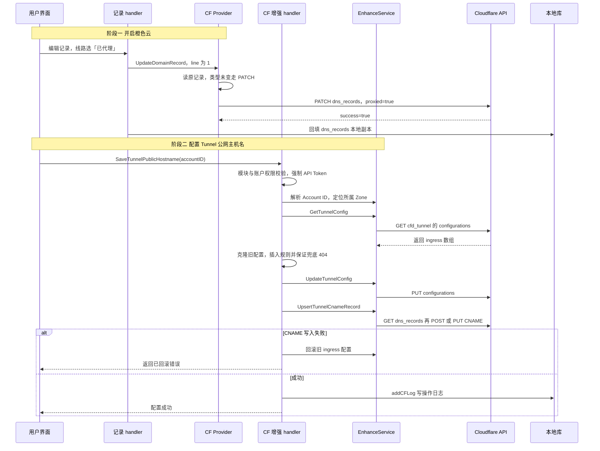
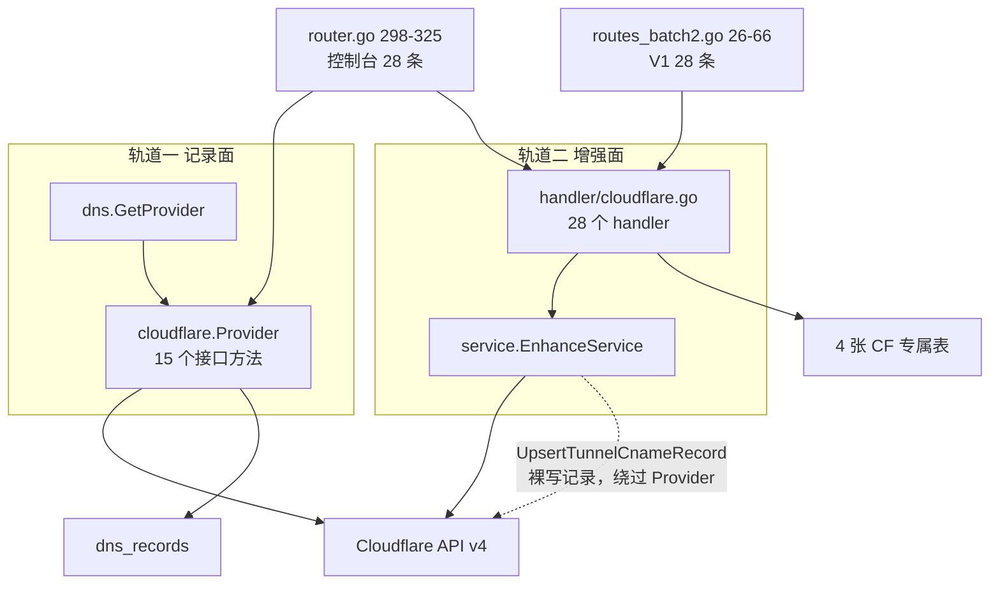
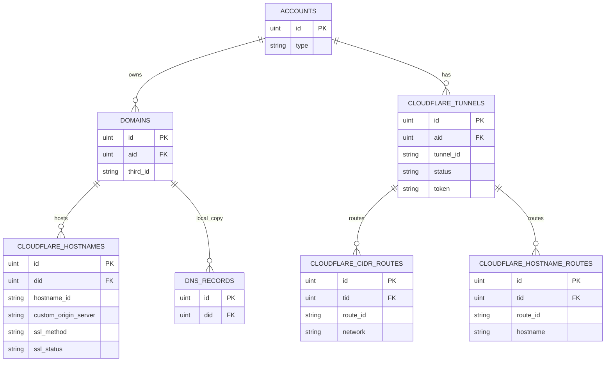
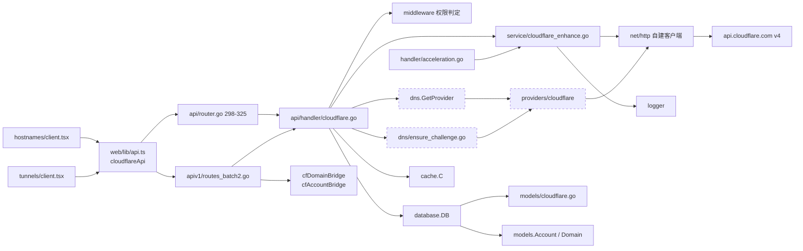

# Cloudflare DNS

<cite>
**本文档引用的文件**
- [cloudflare.go (provider)](file://main/internal/dns/providers/cloudflare/cloudflare.go)
- [lines.go](file://main/internal/dns/providers/cloudflare/lines.go)
- [lines_test.go](file://main/internal/dns/providers/cloudflare/lines_test.go)
- [interface.go](file://main/internal/dns/interface.go)
- [registry.go](file://main/internal/dns/registry.go)
- [ensure_challenge.go](file://main/internal/dns/ensure_challenge.go)
- [cloudflare.go (handler)](file://main/internal/api/handler/cloudflare.go)
- [acceleration.go (handler)](file://main/internal/api/handler/acceleration.go)
- [acceleration.go (service)](file://main/internal/service/acceleration.go)
- [cloudflare_enhance.go](file://main/internal/service/cloudflare_enhance.go)
- [cloudflare.go (models)](file://main/internal/models/cloudflare.go)
- [database.go](file://main/internal/database/database.go)
- [router.go](file://main/internal/api/router.go)
- [routes_batch2.go](file://main/internal/apiv1/routes_batch2.go)
- [capabilities.go](file://main/internal/monitor/capabilities.go)
- [api.ts](file://web/lib/api.ts)
- [utils.ts](file://web/lib/utils.ts)
- [hostnames/client.tsx](file://web/app/(dashboard)/dashboard/cloudflare/hostnames/client.tsx)
- [tunnels/client.tsx](file://web/app/(dashboard)/dashboard/cloudflare/tunnels/client.tsx)
</cite>

## 目录

1. [简介](#简介)
2. [项目结构](#项目结构)
3. [核心组件](#核心组件)
4. [架构总览](#架构总览)
5. [详细组件分析](#详细组件分析)
6. [依赖关系分析](#依赖关系分析)
7. [性能考虑](#性能考虑)
8. [故障排查指南](#故障排查指南)
9. [结论](#结论)
10. [附录](#附录)

## 简介

在 22 家 DNS 服务商适配器中，Cloudflare 是唯一同时拥有「标准 Provider 实现 + 独立 handler 群 + 独立 service 层 + 专属本地表」的特例，功能面最完整。

标准适配器只需实现 `dns.Provider` 的 15 个方法，能力全部收敛在「Zone + 解析记录」。Cloudflare 的实际产品面远超这层抽象：自定义主机名、Cloudflare Tunnel（含公网主机名、CIDR 路由、主机名路由）、回退源、DCV 委派，在 `dns.Provider` 里没有对应位置。项目为此开了受控例外——增强能力绕过 registry，走 `service.EnhanceService` 自建 HTTP 客户端。

本文回答四个问题：双轨实现的分界线在哪里；认证模型如何判别、为什么 Tunnel 只认 API Token；橙色云如何被映射成「线路」语义及其代价；自定义主机名验证记录、Tunnel CNAME、优选加速这三条会写 DNS 的路径分别走哪条通道。

**章节来源**

- [cloudflare.go (provider)](file://main/internal/dns/providers/cloudflare/cloudflare.go#L19-L34)
- [cloudflare.go (handler)](file://main/internal/api/handler/cloudflare.go#L22-L140)

## 项目结构

| 文件 | 规模 | 职责 | 关键位置 |
|------|------|------|----------|
| `providers/cloudflare/cloudflare.go` | 503 行 | 标准 `dns.Provider`：Zone 与记录读写 | 注册 `:19-34`、请求内核 `:98-171` |
| `providers/cloudflare/lines.go` | 19 行 | 线路编目，恒两条 | `:16-19` |
| `providers/cloudflare/lines_test.go` | 59 行 | 锁定线路条数与代理语义 | `:15-32`、`:39-59` |
| `api/handler/cloudflare.go` | 2509 行 | 28 个增强 handler + 装配 + 校验 + ingress 编辑 | 缓存 `:22-41`、上下文 `:43-140` |
| `service/cloudflare_enhance.go` | 733 行 | 增强 API 客户端 | `requestRaw:50`、`paginate:195` |
| `models/cloudflare.go` | 79 行 | 4 张专属表（+1 死模型） | `:5-79` |
| `api/router.go` | 28 条路由 | 控制台 `/api/cloudflare/*` | `:298-325` |
| `apiv1/routes_batch2.go` | 28 条路由 | V1 `/api/v1/cloudflare/*` | `:26-66` |
| `web/lib/api.ts` | 101 行 | 前端 `cloudflareApi` | `:877-977` |
| `dashboard/cloudflare/{hostnames,tunnels}/client.tsx` | 994 + 797 行 | 自定义主机名页与隧道页 | 整文件 |

```
记录面（走 dns.Provider）  providers/cloudflare/  503 + 19 + 59 行
增强面（绕过 Provider）    handler 2509 + service 733 + models 79 + 前端 1801
```

单文件 2509 行是全仓第一大文件，超出项目规范「单文件 500 行」约 5 倍。

**章节来源**

- [cloudflare.go (provider)](file://main/internal/dns/providers/cloudflare/cloudflare.go#L19-L36)
- [router.go](file://main/internal/api/router.go#L298-L325)

## 核心组件

| 组件 | 入口位置 | 职责边界 |
|------|----------|----------|
| `Provider` | `provider:38-46` | Zone 列表、记录增删改查、线路、启停、最小 TTL |
| `Lines` | `lines.go:16` | 代理开关编目，不调 API |
| `EnhanceService` | `enhance:21-27` | 主机名 / Tunnel / CIDR / 主机名路由 / 回退源 / DCV / Zone / Account |
| 上下文装配（4 个） | `handler:44-140` | 从账户或域名解析 `EnhanceService` 并完成权限校验 |
| 入参适配（7 个） | `handler:142-231` | 松散读取 JSON / 表单 / query |
| 校验器群（8 个） | `handler:250-408` | 主机名、源站、SSL 方法、最低 TLS 版本 |
| TXT 目标候选（2 个） | `handler:469-542` | 按主机名反查可写 TXT 的面板域名 |
| ingress 操作（10 个） | `handler:544-678` | 隧道配置解析、克隆、兜底保证、路由归属校验 |
| 缓存三件套 | `handler:23-41` | 前缀 `cf:{handler}:` |
| `accelerateCF` | `handler/acceleration.go:207-267` | CF 加速分支，回 CNAME 到优选域名 |
| `GetDomainDefaultLine` | `handler:2450-2509` | 默认线路三级回退 |

粒度上需注意：`dns.Provider` 只覆盖表格前两行，其余全属增强面。`handler/cloudflare.go` 全文没有任何一处调用 `dns.GetProvider` 来读写记录，它只在自己的上下文函数里直接构造 `EnhanceService`；唯一间接触达 Provider 抽象的是 `cfDefaultLine`（`:2492`）与验证记录写入路径（`:1298`）。

**章节来源**

- [cloudflare.go (handler)](file://main/internal/api/handler/cloudflare.go#L44-L140)
- [cloudflare_enhance.go](file://main/internal/service/cloudflare_enhance.go#L21-L47)

## 架构总览

下面这条时序串起 Cloudflare 最有代表性的两类操作：先用「线路 = 代理开关」的语义开启橙色云（记录面），再在同一账户下创建 Tunnel 并配置公网主机名（增强面），后者会反向写一条 CNAME。



**图表来源**

- [cloudflare.go (provider)](file://main/internal/dns/providers/cloudflare/cloudflare.go#L405-L445)
- [cloudflare.go (handler)](file://main/internal/api/handler/cloudflare.go#L2124-L2212)
- [cloudflare_enhance.go](file://main/internal/service/cloudflare_enhance.go#L549-L657)

## 详细组件分析

### 一、双轨实现与请求内核差异

两条通道物理隔离，连 base URL 常量都各写一份：`provider:36` 的 `baseURL` 与 `enhance:18` 的 `cfBaseURL`，取值同为 `https://api.cloudflare.com/client/v4`。



**图表来源**

- [cloudflare.go (provider)](file://main/internal/dns/providers/cloudflare/cloudflare.go#L36-L46)
- [cloudflare_enhance.go](file://main/internal/service/cloudflare_enhance.go#L18-L27)

| 维度 | `Provider.request`（`:98-171`） | `EnhanceService.requestRaw`（`:50-132`） |
|------|--------------------------------|------------------------------------------|
| 上下文传递 | `NewRequestWithContext`，支持取消 | `http.NewRequest`，不传 ctx |
| 404 语义 | 无特判，靠 `success=false` 解析 | `allowNotFound` 参数放行（`:98-100`） |
| 状态码归类 | 无，统一取 `errors[0].message` | 401 / 403 / 429 / 5xx 各有中文文案（`:102-129`） |
| 错误回显 | 记入 `lastErr`，经 `GetError()` 暴露 | 写 `logger.Error`（`:127`） |
| 分页 | 调用方传 page / per_page | `paginate` 自动翻页，200 页上限 |
| 超时 | 30 秒（`:66`） | 30 秒（`:36`） |

不传 ctx 是增强通道最值得注意的差异：请求一旦发出，客户端断开也无法提前取消，只能等 30 秒超时。

**章节来源**

- [cloudflare.go (provider)](file://main/internal/dns/providers/cloudflare/cloudflare.go#L98-L171)
- [cloudflare_enhance.go](file://main/internal/service/cloudflare_enhance.go#L50-L132)

### 二、API 认证：Global Key 与 API Token

| 认证方式 | `auth` 值 | 凭据组合 | 请求头 |
|----------|-----------|----------|--------|
| Global API Key | `0` | `email` + `apikey`（`{占位}`） | `X-Auth-Email` / `X-Auth-Key` |
| API Token | `1` | `apikey`（`{占位}`） | `Authorization: Bearer {token}` |

判别逻辑写了两遍，正则相同（`^[0-9a-fA-F]+$`）：`provider:55-58` 在 `auth` 缺失时自动推断，`enhance:41-47` 的 `DetectAuthMode` 返回 0 或 1。handler 侧 `:63-68` 优先信任显式 `auth`，只有它不等于 `"1"` 时才退回自动判别。该判据建立在「CF Token 不是纯十六进制串」的假设上，反向风险是一个恰好全由十六进制字符组成的 Token 会被误判为 Global Key，因此 `provider:25` 的显式单选框才是主路径。

Tunnel 族有硬约束，`getCFAccountContextForRequest` 是所有隧道入口的唯一出口：

```go
// api/handler/cloudflare.go:136-138
if !svc.IsApiTokenAuth() {
    return nil, nil, fmt.Errorf("Cloudflare Tunnels 仅支持 API 令牌认证，请将当前账户的认证方式切换为 API令牌")
}
```

`:127-135` 的注释记录了两点意图：与 PHP 上游 `requireTunnelApiToken=true` 同义；刻意不做逐方法重复校验，因为该函数已覆盖全部隧道入口（PHP 侧 `assertTunnelSupported` 的逐方法判定被视为冗余）。

**章节来源**

- [cloudflare.go (provider)](file://main/internal/dns/providers/cloudflare/cloudflare.go#L48-L68)
- [cloudflare.go (handler)](file://main/internal/api/handler/cloudflare.go#L44-L140)
- [cloudflare_enhance.go](file://main/internal/service/cloudflare_enhance.go#L40-L47)

### 三、Zone 与 Account 两级作用域

标准面的 Zone 操作很薄：`Check`（`:173-176`）复用 `GET /zones?page=1&per_page=1` 探活，`GetDomainList`（`:178-216`）用 `name` 传关键词并取 `result_info.total_count`，`AddDomain`（`:499-503`）body 只有 `{"name": domain}`；增强面另有独立的 `GetZone`（`enhance:413-415`）。

增强面对 Zone 的依赖不是列表而是「必须有 Zone ID」，装配函数把约束写成显式错误（`handler:86-92`）：账户类型非 `cloudflare` 报「该域名所属账户不是 Cloudflare 类型」，`domains.third_id` 为空报「域名未绑定 Cloudflare Zone ID」。

Account ID 是另一级作用域：自定义主机名与回退源是 Zone 级资源，Tunnel 与 CIDR / 主机名路由是 Account 级资源，因此 V1 路由拆两个子组各挂一个桥接（`routes_batch2.go:29`、`:50`），注释 `:19-24` 记录了「`:id` 语义分两族」。解析优先取账户配置的 `account_id`，留空时由 `GetDefaultAccountID`（`enhance:381-405`）先查 `/accounts` 取第一个，失败再从 `/zones?per_page=1` 的 `account.id` 兜底。

**章节来源**

- [cloudflare.go (provider)](file://main/internal/dns/providers/cloudflare/cloudflare.go#L173-L216)
- [cloudflare.go (handler)](file://main/internal/api/handler/cloudflare.go#L75-L114)
- [cloudflare_enhance.go](file://main/internal/service/cloudflare_enhance.go#L381-L420)

### 四、线路即代理开关与记录启停

Cloudflare 不提供运营商分流线路，它的「线路」实际是记录的代理开关，编目被硬编码为两条：`{ID: "0", Name: "仅DNS"}` 与 `{ID: "1", Name: "已代理"}`（`lines.go:16-19`）。`lines.go:5-15` 的注释解释了三件事：为什么不可能动态、为什么不需要调 API、取值以 `GetRecordLine` 与写入时的 `proxied` 判定同源。映射是双向的：写入用 `proxied := line == "1"`（`provider:379`、`:429`），其余任何值一律视为仅 DNS；读取入参把 `line` 翻译成 `proxied` 查询参数（`:244-250`）；读取出参把响应 `proxied` 反翻译成 `"1"` / `"0"`（`:273-276`）；`GetRecordLine`（`:488-493`）用 `copy` 返回副本，避免调用方污染包级切片。

`lines_test.go` 锁住语义：`TestLinesCatalogMatchesProxyMapping`（`:15-32`）断言恒 2 条且 id/name 完全匹配；`TestGetRecordLineReturnsCatalogCopy`（`:39-59`）比对后故意改写返回值，再验证包级 `Lines` 未被污染。

CF 也没有单条记录启停 API，项目把「暂停」编码进主机记录名（`provider:460-482`）：

| 原主机记录 | 暂停后 | 恢复后 | 读取时反解 |
|------------|--------|--------|------------|
| `www` | `www_pause` | `www` | `:263-267` 剥后缀并置 `disable` |
| `@` | `__root__` | `@` | `:268-271` 还原为 `@` |
| 已含 `_pause` | 保持不变 | 去后缀 | 同上 |

两个必须知道的副作用：启停实际是一次 `PATCH name`，会把 `content`、`ttl`、`proxied`、`comment` 全部重新下发（`:430-443`），读到的原值与云端有偏差即可能被覆盖；能力位口径冲突——`capabilities.go:13` 把 cloudflare 声明为 `{Pause: false, Delete: true, Mixed: false}`，而 `SetDomainRecordStatus` 实际可用，两处结论相反。

**章节来源**

- [lines.go](file://main/internal/dns/providers/cloudflare/lines.go#L5-L19)
- [lines_test.go](file://main/internal/dns/providers/cloudflare/lines_test.go#L15-L59)
- [cloudflare.go (provider)](file://main/internal/dns/providers/cloudflare/cloudflare.go#L218-L482)
- [capabilities.go](file://main/internal/monitor/capabilities.go#L11-L15)

### 五、记录类型支持范围

Provider 层不做类型白名单，`recordType` 原样透传给 `type` 字段（`:381`、`:433`），合法性由 CF 校验。项目可见的三处声明口径并不一致：

| 来源 | 位置 | 类型集合 |
|------|------|----------|
| `Record.Type` 注释 | `dns/interface.go:8` | A、AAAA、CNAME、MX、TXT、NS、SRV、CAA |
| 前端下拉表 | `web/lib/utils.ts:59` | 上述 8 种 + PTR，共 9 种 |
| DOH 客户端白名单 | `dns/doh/doh.go` | 10 种，含 SOA |

- **CAA、SRV**：接口注释与前端类型表均已声明，可正常创建；CF 特有的 CAA `flags`/`tag` 与 SRV `priority`/`weight`/`port` 由 `content` 单字段承载，本项目未拆分建模
- **TLSA**：provider 层、增强层、接口注释、前端类型表均未出现，能否创建取决于 CF 侧对 `type=TLSA` 的接受度，本文标记为**未知**，原因是不在本仓库可验证范围内，且客户端无 TLSA 专项参数处理
- `MX` 是唯一在代码中显式带 `priority` 分支的类型（`:389-391`、`:439-441`）

其余记录面细节：FQDN 与主机记录互转用 `idna.ToASCII` 兼容 IDN/Emoji、apex 记为 `@`（`:80-96`）；字段映射为 `content`↔`Value`、`comment`↔`Remark`（`:283-298`）；类型变更走删除 + 重建，因 CF 已弃用 PATCH 改类型（`:405-420`）；仅改备注先读全量再 PATCH、权重位传 `nil`（`:447-453`）；解析日志明确返回不支持（`:484-486`）；最小 TTL 固定 60（`:495-497`）。

**章节来源**

- [interface.go](file://main/internal/dns/interface.go#L5-L18)
- [utils.ts](file://web/lib/utils.ts#L58-L59)
- [cloudflare.go (provider)](file://main/internal/dns/providers/cloudflare/cloudflare.go#L371-L453)

### 六、自定义主机名：9 个 handler 与本地镜像

| handler | 行区间 | 上游调用 | 本地库动作 | 缓存动作 |
|---------|--------|----------|------------|----------|
| `GetCustomHostnames` | `683-740` | 列表 | 无 | 读缓存 / 写 2 分钟 |
| `AddCustomHostname` | `743-815` | 创建 | `CloudflareHostname` 落库 | 前缀失效 |
| `UpdateCustomHostname` | `818-880` | PATCH | 无 | 前缀失效 |
| `DeleteCustomHostname` | `883-917` | DELETE | 按 `hostname_id` 删 | 前缀失效 |
| `BatchAdd / BatchUpdate / BatchDelete` | `919-980`、`982-1048`、`1050-1081` | 循环调上游 | 逐条落库或 `Updates` 或删除 | 前缀失效 |
| `GetCustomHostnameTxtTargets` | `1083-1107` | 无 | 无 | 无 |
| `RefreshCustomHostname` | `1110-1150` | 单条查询 | `Save` 回写状态 | 无 |

创建下发 SSL 三元组，`type` 恒为 `dv`，`settings.min_tls_version` 随参下发，`custom_origin_server` 仅在非空时加入 body（`enhance:296-312`）。校验器分工刻意不重叠：

| 校验器 | 位置 | 规则要点 |
|--------|------|----------|
| `cfValidHostname` | `258-281` | 允许 `*.`、至少 2 label、label ≤ 63、总长 ≤ 253、只认 a-z0-9 与连字符 |
| `cfValidateCustomOrigin` | `317-340` | 禁 `://`、通配符、`/`、端口、IP |
| `cfValidOriginDomain` | `390-408` | 长 4–253、必须含点、首尾字符受限、允许下划线 |
| `cfOriginHasPortSuffix` | `369-387` | 端口规则只覆盖带点形式，避免 `2001:db8::1` 末尾段被误判 |
| `cfValidateSSLParams` | `343-351` | `ssl_method` 只允许 txt / http |
| `cfValidMinTLSVersion` | `354-360` | 只允许 1.0 / 1.1 / 1.2 / 1.3 |

`:307-316` 的注释记录了「为什么不复用 `cfValidHostname` 校验源站」：源站是探测域名，单 label 内网源站与含下划线记录名都应放行，而通配符在源站上非法——两者判据相反，强行复用会双向出错。单条更新按必填档校验（`:837`，缺省 `min_tls_version` 为 `"1.0"`），批量允许留空表示保持不变（`:1000-1008`）。

**章节来源**

- [cloudflare.go (handler)](file://main/internal/api/handler/cloudflare.go#L683-L1152)
- [cloudflare.go (handler)](file://main/internal/api/handler/cloudflare.go#L250-L408)
- [cloudflare_enhance.go](file://main/internal/service/cloudflare_enhance.go#L256-L324)

### 七、验证记录自动写入

`SetupHostnameValidation`（`:1153-1358`）207 行，全仓最长 handler，把「用户手动去 DNS 加验证记录」自动化。执行序列：

1. 权限与 Zone 校验（`:1156`）→ 从云端取最新主机名（`:1170`）
2. `ssl.status` 为 `expired` / `deleted` / `validation_timed_out` 时先 PATCH `ssl` 触发重新验证（`:1191-1204`）
3. 按固定顺序收集 DNS 任务，逐条写入（`:1284-1348`）

| 用途 | 来源字段 | 位置 | 类型 |
|------|----------|------|------|
| `ownership_verification` | 顶层同名字段 | `:1216-1229` | TXT |
| `ssl_validation` | `ssl.validation_records[].txt_name/txt_value` | `:1239-1248` | TXT |
| `ssl_validation` | `ssl.validation_records[].cname/cname_target` | `:1249-1258` | CNAME |
| `dcv_delegation` | `_acme-challenge.{hostname}` → `{hostname}.{uuid}.dcv.cloudflare.com` | `:1264-1274` | CNAME |

写入端不是 CF provider，而是按目标域名动态选 provider（`:1298`），因此验证记录可落到任意服务商名下——这既是价值也是风险。TTL 复用 `dns` 包探测工具（`:1313-1333`）：已存 `MinTTL` 则单值下发，否则按 `1 → 60 → 600` 逐档试，成功后回写 `domains.min_ttl`。第 6 个参数 `line` 传空串（`:1318`），按 `ensure_challenge.go:114-177` 约定会把匹配放宽到该子域下所有线路。

`GetCustomHostnameTxtTargets`（`:1083-1107`）是配套的提示器：`cfFindTxtRecordTargetDomains`（`:469-522`）做一次 `domains JOIN accounts` 投影扫描，逐行反推记录名，只保留最长匹配集合，按「当前域名优先 → 服务商显示名 → 账户显示名 → 域名」四级排序，每行都跑 `CheckDomainPermission`（`:479-481`）。候选为空时用 `allowRelative=true` 对当前域名再匹配一次（`:496-507`）。

**风险确认（本次未修改代码）**：`cfMatchFQDNToDomain:1364-1365` 用 `DB.Find(&domains)` 载入全部域名后做最长匹配，未按当前用户过滤；权限判定只覆盖 CF Zone 侧，未覆盖被写入的目标域名。同一个「按主机名找域名」问题，读路径做了权限过滤而写路径没有。建议候选集按可见域名收敛，且目标域名同样过 `CheckDomainPermission`。

**章节来源**

- [cloudflare.go (handler)](file://main/internal/api/handler/cloudflare.go#L410-L542)
- [cloudflare.go (handler)](file://main/internal/api/handler/cloudflare.go#L1083-L1390)
- [ensure_challenge.go](file://main/internal/dns/ensure_challenge.go#L114-L150)

### 八、Tunnel、公网主机名与两类路由

隧道族 7 个 handler 全部经 `getCFAccountContextForRequest`，入参是账户 ID：

| handler | 行区间 | 上游端点 | 本地库 | 缓存 |
|---------|--------|----------|--------|------|
| `GetTunnels` | `1539-1596` | `GET cfd_tunnel`（翻页） | 无 | 2 分钟 |
| `AddTunnel` | `1599-1654` | `POST cfd_tunnel` | `CloudflareTunnel` 落库 | 精确失效 |
| `DeleteTunnel` | `1657-1709` | `DELETE cfd_tunnel/{t}` | 删隧道 + 级联删两张路由表 | 列表 + Token |
| `GetTunnelToken` | `1712-1762` | `GET .../token` | 无 | 60 秒 |
| `GetTunnelPublicHostnames` | `2078-2122` | `GET .../configurations` | 无 | 无 |
| `SaveTunnelPublicHostname` | `2124-2212` | `PUT configurations` + CNAME 同步 | 操作日志 | 无 |
| `DeleteTunnelPublicHostname` | `2214-2277` | `PUT configurations` + CNAME 删除 | 操作日志 | 无 |

创建隧道时本地生成 32 字节随机 secret（`enhance:439-442`）。Token 的落库与传输都被隔离：`models/cloudflare.go:32` 的 `Token` 带 `json:"-"`，不进任何响应体；实际 Token 现取现用，缓存仅 60 秒。

ingress 是有序数组，CF 要求末条必须是兜底规则（无 `hostname` 也无 `path`）。6 个私有函数保证这点：`cfTunnelConfig`（`:579`）兼容两种响应形状，`cfCloneConfig`（`:586`）JSON 往返深拷贝用于回滚，`cfFindPublicHostnameIndex`（`:617`）按 hostname + path 精确定位，`cfFindFallbackIngressIndex`（`:608`）与 `cfIsFallbackIngressRule`（`:603`）识别兜底，`cfEnsureFallbackIngress`（`:630-641`）在末条不是兜底时补 `{"service":"http_status:404"}`。

保存的三分支插入（`:2180-2196`）：命中同 hostname + path 原地合并；否则插到兜底之前；再否则追加末尾。写云端配置成功后才同步 DNS，CNAME 失败即整体回滚（`:2203-2208`）。`UpsertTunnelCnameRecord`（`enhance:549-657`）判定链：目标恒为 `{tunnelID}.cfargotunnel.com`（`:551`）→ 拉同名全部记录 → 存在非 CNAME 即报错并列出冲突类型（`:578-587`）→ 已有 CNAME 且内容一致且 `proxied` 为真返回 `unchanged`（`:621-623`）→ 否则 PUT、无则 POST，两者都强制 `proxied: true, ttl: 1`。删除侧对称保守：`DeleteTunnelCnameRecordIfMatch`（`:662-704`）只在 name 与 content 都匹配时才 DELETE。

CIDR 路由与主机名路由各 3 个 handler：

| 特性 | CIDR 路由 | 主机名路由 |
|------|-----------|------------|
| 列表 | `enhance:482`，带 `is_deleted=false` | `enhance:519`，不带 `is_deleted` |
| 创建校验 | `net.ParseCIDR` 前置（`enhance:491-495`） | 仅 `cfValidHostname`（`handler:1984-1987`） |
| 额外入参 | `virtual_network_id` 可选 | 无 |
| 归属校验 | `cfRouteExists`（`:1901-1904`） | 同（`:2059-2062`） |
| 本地落库 | `localTunnelID > 0` 才写（`:1856-1858`） | 同规则（`:2014-2016`） |

`cfRouteExists`（`:663-678`）存在的原因是上游 DELETE 端点只认 `route_id`，不先确认归属就会删错资源；它同时兼容 `id` 与 `hostname_route_id` 两种字段名，说明两个端点响应并不统一。`cfResolveTunnel`（`:544-559`）解决前端可能传 CF UUID 或本地自增 ID 的问题：先按 `aid + tunnel_id` 查，未命中把入参当数字按 `aid + id` 再查，仍未命中则原样透传。

**章节来源**

- [cloudflare.go (handler)](file://main/internal/api/handler/cloudflare.go#L544-L678)
- [cloudflare.go (handler)](file://main/internal/api/handler/cloudflare.go#L1539-L2277)
- [cloudflare_enhance.go](file://main/internal/service/cloudflare_enhance.go#L428-L704)

### 九、回退源、DCV、Origin 保护与优选加速

| 能力 | handler | service 方法 | 缓存 |
|------|---------|--------------|------|
| 回退源查询 | `GetFallbackOrigin:1395` | `enhance:329`（放行 404） | 60 秒 |
| 回退源设置 | `SetFallbackOrigin:1434` | `enhance:350` | 精确失效 |
| 回退源删除 | `DeleteFallbackOrigin:1469` | `enhance:357`（放行 404） | 精确失效 |
| DCV 委派 | `GetDcvDelegationUUID:1498` | `enhance:365` | 60 秒 |

回退源解决「未接入的 SaaS 主机名访问时返回什么」：没有它，任何客户域名都会把流量打到 CF 默认源并产生错误页；查询把「未配置」当正常空值返回而非错误（`enhance:330`）。Origin 保护散落在主机名校验中：`cfValidateCustomOrigin`（`:317-340`）逐项拒绝 URL 前缀、通配符、路径、端口与 IP，把源站约束成纯域名——防止用户填入 `https://origin:8443/path` 后 CF 侧静默创建出永远无法回源的配置。DCV 联动是最后一环：证书失效时先 PATCH `ssl` 触发重验证，再在验证记录缺失时补一条 `_acme-challenge` CNAME 指向 `{hostname}.{uuid}.dcv.cloudflare.com`，把签发完全委派给 Cloudflare。

优选加速不走独立网关客户端，而是复用自定义主机名：

```go
// api/handler/acceleration.go:242
result, err := svc.CreateCustomHostname(cfg.CFZoneID, fqdn, "", "http", "1.0")
```

`:240-241` 的注释点明顺序约束：必须在 CF 侧真正创建出主机名后才写 CNAME，否则解析指向一个云端并不存在的接入点。分支如下：

| 分支条件 | 结果 | 位置 |
|----------|------|------|
| `!CFEnabled` 或 `CFPreferDomain` 为空 | `skipped`，线路 AB / 海外 | `:208-216` |
| `CFDomainID <= 0` 或 `CFZoneID` 为空 | `error`，提示到系统设置补全 | `:219-227` |
| `getCFDomainContext` 失败 | `error`，「CF 加速域名不可用」 | `:229-238` |
| 创建主机名失败 | `error`，透传上游错误 | `:243-251` |
| 成功 | `success`，`CNAME` 为优选域名，`msg` 回显主机名 ID | `:254-266` |

三点值得强调：验证方式硬编码 `http`、最低 TLS 硬编码 `1.0`，与主机名页允许自选 `txt/http` + `1.0-1.3` 不同，加速走「尽量宽松、一次成功」路线；CF 分支用无 gin 上下文的 `getCFDomainContext`，因为加速是批量后台流程、权限已在入口校验；`service/acceleration.go` 内没有任何 CF 实现（该文件只有 `EOClient` 与 `ESAClient`），CF 加速编排完全落在 handler 层，这是三家加速平台中唯一的结构差异。

**章节来源**

- [cloudflare.go (handler)](file://main/internal/api/handler/cloudflare.go#L307-L340)
- [cloudflare.go (handler)](file://main/internal/api/handler/cloudflare.go#L1392-L1534)
- [acceleration.go (handler)](file://main/internal/api/handler/acceleration.go#L190-L267)
- [acceleration.go (service)](file://main/internal/service/acceleration.go#L69-L83)

### 十、本地数据模型

4 张专属表全部参与 AutoMigrate（`database.go:260-263`）。



**图表来源**

- [cloudflare.go (models)](file://main/internal/models/cloudflare.go#L5-L58)
- [database.go](file://main/internal/database/database.go#L260-L264)

| 表 | 模型位置 | 外键 | 写入点 | 删除点 |
|----|----------|------|--------|--------|
| `CloudflareHostname` | `models:6-23` | `did` | `handler:802`、`:972` | `:906`、`:1073` |
| `CloudflareTunnel` | `models:26-37` | `aid` | `:1644` | `:1697` |
| `CloudflareCIDRRoute` | `models:40-48` | `tid` | `:1857` | `:1698`、`:1912` |
| `CloudflareHostnameRoute` | `models:51-58` | `tid` | `:2015` | `:1699`、`:2070` |

三条镜像一致性弱点（如实记录，未做修改）：`RefreshCustomHostname` 只在本地记录已存在时才回写状态（`:1134-1144`），本地缺失则仅返回云端数据；`DeletedAt`（`models:36`）是普通列而非 GORM 软删除类型，删除走硬删，该字段实际未启用；`models:70-79` 的 `RecordLog` 不在 AutoMigrate 列表内，表不会被创建，属死模型。

**章节来源**

- [cloudflare.go (models)](file://main/internal/models/cloudflare.go#L1-L79)
- [database.go](file://main/internal/database/database.go#L260-L264)
- [cloudflare.go (handler)](file://main/internal/api/handler/cloudflare.go#L1132-L1144)

### 十一、与其他 21 家的差异化能力对照

| 维度 | 其他服务商 | Cloudflare | 位置 |
|------|------------|------------|------|
| 抽象层 | 必须实现 15 方法，经 registry 取用 | 双轨：记录面走 Provider，增强面走 `EnhanceService` | `provider:20`、`enhance:21` |
| 凭据模型 | 单凭据 | `auth` 0/1 双模式 + 自动判别 | `handler:63-68`、`enhance:41-47` |
| Tunnel 前置约束 | 无 | 强制 API Token，Global Key 直接拒绝 | `handler:136-138` |
| 线路语义 | 运营商分流，条数不定 | 代理开关，恒两条 | `lines.go:16-19` |
| 本地表 | 仅 `dns_records` | 额外 4 张专属表 | `models:6-58` |
| 能力位 | 与实现基本一致 | `Status:true` 与 `Pause:false` 互相矛盾 | `provider:31`、`capabilities.go:13` |
| 一键加速 | 走各自网关客户端 | 复用自定义主机名，无独立 SDK | `acceleration.go:207-267` |

其余差异同样可在代码中定位：类型变更走删除 + 重建（`provider:405-420`）、入参绑定用自研松散 map 读取（`handler:142-231`）、分页统一交给 `paginate`（`enhance:195-254`）、解析日志明确返回不支持（`provider:484-486`）。

`provider:31` 的 `Features` 声明 `Remark: 2, Status: true, Redirect: false, Log: false, Weight: false, Page: false, Add: true`，是全 22 家中唯一在 Status / Pause 上给出相反结论的一家：启停调用依赖 `Status` 位放行，`monitor` 侧又依 `Pause:false` 跳过暂停逻辑。默认线路映射见 `registry.go:68` 的 `"cloudflare": {"DEF": "0"}`。

**章节来源**

- [cloudflare.go (provider)](file://main/internal/dns/providers/cloudflare/cloudflare.go#L30-L33)
- [capabilities.go](file://main/internal/monitor/capabilities.go#L11-L15)
- [registry.go](file://main/internal/dns/registry.go#L68-L68)

### 十二、入参适配与缓存策略

CF handler 不用统一解密链路：`cfRequestBody`（`:142-148`）仅在 `Content-Type` 含 `application/json` 时才 `ShouldBindJSON`，失败静默返回空 map；`cfString`（`:150-165`）三级回退 JSON → `GetPostForm` → `Query`；`cfStringList`（`:174-210`）额外支持逗号 / 空格 / 换行混合分隔。代价是增强接口无法复用加解密与结构校验，参数错误只能以「字段为空」形式暴露；收益是同一批 handler 可同时服务控制台（路径参数）与 V1（固定路径 + body），这正是 `routes_batch2.go:10-24` 记录的动机。

| 缓存前缀 | 命中接口 | TTL | 失效方式 | 位置 |
|----------|----------|-----|----------|------|
| `cf:hostnames:{domain:zone:page:size}` | `GetCustomHostnames` | 2 分钟 | 前缀整体清空 | `:705-712`、`:808` |
| `cf:fallback:{domainID}` | `GetFallbackOrigin` | 60 秒 | 精确失效 | `:1405-1411`、`:1459` |
| `cf:dcv:{domainID}` | `GetDcvDelegationUUID` | 60 秒 | 无主动失效 | `:1508-1514` |
| `cf:tunnels:{accountID}` | `GetTunnels` | 2 分钟 | 精确失效 | `:1561-1567`、`:1647` |
| `cf:tunnel_token:{aid}:{tid}` | `GetTunnelToken` | 60 秒 | 精确失效 | `:1736-1742`、`:1703` |

TTL 选择有清晰规律：稳定低频的列表用 2 分钟，一次性凭据（回退源、DCV、隧道 Token）用 60 秒。失效粒度取决于 key 维度——主机名 key 含分页参数，一次写要清掉所有分页组合，故走前缀失效；隧道 key 只有账户维度，走精确失效。两个删除函数都以 `cache.C == nil` 卫语句开头（`:29-31`、`:37-39`），缓存未初始化不会中断主流程。

**章节来源**

- [cloudflare.go (handler)](file://main/internal/api/handler/cloudflare.go#L23-L41)
- [cloudflare.go (handler)](file://main/internal/api/handler/cloudflare.go#L142-L231)
- [routes_batch2.go](file://main/internal/apiv1/routes_batch2.go#L10-L24)

## 依赖关系分析



**图表来源**

- [router.go](file://main/internal/api/router.go#L298-L325)
- [routes_batch2.go](file://main/internal/apiv1/routes_batch2.go#L26-L66)
- [api.ts](file://web/lib/api.ts#L877-L977)

三处需要重点关注的依赖特征：

1. **双向依赖同一服务商**：`handler` 包同时依赖 `dns` 抽象（取 Provider）与 `service`（增强层），CF 是唯一让这两条链在同一家服务商上并存的案例
2. **写 DNS 的三条通道**：`dns.Provider`（受控、有本地副本回填）、`UpsertTunnelCnameRecord` 与 `DeleteTunnelCnameRecordIfMatch`（绕过 Provider 的裸 API 写）、`accelerateCF` 间接触发的 CNAME 写入；审计与 `dns_records` 副本只覆盖第一条
3. **`service/acceleration.go` 不依赖 CF**：CF 加速编排留在 handler 层，导致 `service` 无法独立复用该逻辑

前端 `cloudflareApi`（`web/lib/api.ts:877-977`）覆盖 28 个方法，与控制台路由一一对应，V1 侧复用同一批 handler，无独立实现。

**章节来源**

- [cloudflare.go (handler)](file://main/internal/api/handler/cloudflare.go#L1-L20)
- [acceleration.go (service)](file://main/internal/service/acceleration.go#L69-L83)

## 性能考虑

### 一、限流与批量

| 位置 | 429 处理 | 退避重试 | `Retry-After` 解析 |
|------|----------|----------|---------------------|
| `enhance:108-109` | 映射为「请求频率超限」 | 无 | 无 |
| `provider:157-168` | 落入 `errors[0].message` 原样返回 | 无 | 无 |

CF 相关文件中不存在任何退避或 `Retry-After` 处理（全库检索 `429` 在 CF 代码里仅上述一处命中）。风险集中在批量 handler：`BatchAddCustomHostnames`（`:948-974`）与 `BatchUpdateCustomHostnames`（`:1031-1042`）串行循环逐条调上游，列表越长越易撞限，且中途失败不回滚已成功项，只在返回体区分 `success` / `failed` 数组。

`paginate`（`enhance:195-254`）有两条退出条件避免无限翻页：`per_page=100` 且单页不足 100 即 break（`:235-237`）；`maxPages` 缺省 200 页硬上限（`:196-198`），配合 `total_pages` 双条件（`:247`）。单次列表最多拉 2 万条，`GetTunnels`、`ListCidrRoutes`、`ListHostnameRoutes` 都走它。相对地，两个 CNAME 同步函数只取第一页（`enhance:554-558`、`:666-671`），同名记录超过 100 条时冲突检测可能漏判。

**章节来源**

- [cloudflare_enhance.go](file://main/internal/service/cloudflare_enhance.go#L102-L132)
- [cloudflare_enhance.go](file://main/internal/service/cloudflare_enhance.go#L194-L254)
- [cloudflare.go (handler)](file://main/internal/api/handler/cloudflare.go#L919-L1048)

### 二、全表扫描与连接复用

| 函数 | 位置 | 查询形态 | 触发频率 |
|------|------|----------|----------|
| `cfFindTxtRecordTargetDomains` | `:471-474` | `domains JOIN accounts` 全表投影 + 逐行权限判定 | 每次打开 TXT 提示 |
| `cfMatchFQDNToDomain` | `:1364-1365` | `DB.Find(&domains)` 全表 | 循环内每条验证记录一次 |
| `cfFindBestMatchingDomain` | `:526` | 按 `aid` 过滤，非全表 | 每次公网主机名读写 |

第二处最糟：它在 `SetupHostnameValidation` 的任务循环内被调用，一个主机名最多 3 类验证记录，单次请求可能触发多次全表加载。域名到万级时这两处应改为按候选父域后缀做 DB 侧 `LIKE` 过滤或加缓存。

Provider 与 EnhanceService 各自 `new` 一个 `http.Client{Timeout: 30s}`（`provider:66`、`enhance:36`），而 `getCFEnhanceService`（`handler:70`）在每个请求入口被调用，因此每次请求都新建 client；没有共享 transport，也没有 `MaxIdleConns` 配置。叠加效应：一次公网主机名保存最多含 4 次上游串行调用，理论上限接近 120 秒，远超常规网关超时；且增强通道不传 ctx，客户端断开也无法提前取消。

**章节来源**

- [cloudflare.go (handler)](file://main/internal/api/handler/cloudflare.go#L469-L542)
- [cloudflare.go (handler)](file://main/internal/api/handler/cloudflare.go#L1361-L1390)
- [cloudflare_enhance.go](file://main/internal/service/cloudflare_enhance.go#L30-L38)

## 故障排查指南

### 一、认证、权限与凭据类

| 现象 | 根因 | 定位 | 处理 |
|------|------|------|------|
| 「Cloudflare Tunnels 仅支持 API 令牌认证」 | 账户用 Global API Key | `handler:136-138` | 账户表单切到 API Token |
| 「认证失败：凭证无效」 | 上游 401 | `enhance:104-105` | 核对 `apikey`（`{占位}`），注意构造时会剥掉全部空格（`enhance:33`） |
| 「权限不足」 | 上游 403，Token scope 不足 | `enhance:106-107` | Token 需含 Zone.DNS / Zone.Zone / Account 编辑权，隧道另需 Tunnel 权限 |
| 「请求频率超限」 | 上游 429 | `enhance:108-109` | 无自动退避，缩小批量列表后重试 |
| 「该账户不是 Cloudflare 类型」 | `account.Type` 不匹配 | `handler:50-52`、`:86-88` | 确认账户类型 |
| 「域名未绑定 Cloudflare Zone ID」 | `domains.third_id` 为空 | `handler:90-92` | 重新导入域名回写 Zone ID |
| 「无法获取 Cloudflare Account ID」 | 未填且两级兜底都失败 | `handler:233-248`、`enhance:381-405` | 账户配置显式填 Account ID |
| 「无权限操作该域名 / 该账户」 | 面板两层 RBAC 判定 | `handler:110-112`、`:124-126` | 与上游 403 是不同问题，前者为本地权限 |
| 列表或隧道 Token 显示旧数据 | 读缓存未过期（2 分钟 / 60 秒） | `handler:705-712`、`:1561`、`:1736-1742` | 等 TTL，或触发任一写操作失效（删除隧道会一并清 Token 缓存 `:1703`） |

**章节来源**

- [cloudflare.go (handler)](file://main/internal/api/handler/cloudflare.go#L44-L140)
- [cloudflare_enhance.go](file://main/internal/service/cloudflare_enhance.go#L102-L132)

### 二、Zone 与资源归属类

| 现象 | 根因 | 定位 |
|------|------|------|
| 「主机名已存在非 CNAME 记录（…），无法同步 Tunnel CNAME」 | 同名记录冲突保护 | `enhance:578-587` |
| 「CIDR 路由不存在或不属于当前 Tunnel」 | `cfRouteExists` 归属校验 | `handler:1901-1904` |
| 「主机名路由不存在或不属于当前 Tunnel」 | 同上 | `handler:2059-2062` |
| 「未找到匹配的本地域名，请先在当前 Cloudflare 账户下导入该主机名所属主域」 | 只在同 `aid` 域名中匹配 | `handler:2146-2154`、`:524-542` |
| 「Public Hostname 已回滚：…」 | ingress 成功但 CNAME 失败 | `handler:2203-2208` |
| 「无效的 CIDR 格式」 | `net.ParseCIDR` 前置校验 | `enhance:491-495` |
| 「主机名格式不正确」 | 拒绝中文 / 下划线 / 单 label | `handler:258-281` |
| 「自定义源站不支持 IP 地址，请填写域名」 | 源站禁 IP | `handler:333-335` |
| 「证书验证方法无效」「最低 TLS 版本无效」 | SSL 参数校验 | `handler:343-360` |
| 删除隧道后云端仍有路由 | 本地级联删表但不同步删云端路由 | `handler:1697-1699` |

隧道类还有两个易误判点：前端传错 ID 类型时，`cfResolveTunnel`（`:544-559`）两种查法都未命中会原样透传上游，错误表现为 CF 的 404 而非本地提示，排查应先看 `cloudflare_tunnels` 表的 `aid + tunnel_id`；若上游删除失败而本地已删，会形成「本地无记录、云端仍有路由」的不一致。

**章节来源**

- [cloudflare.go (handler)](file://main/internal/api/handler/cloudflare.go#L544-L678)
- [cloudflare.go (handler)](file://main/internal/api/handler/cloudflare.go#L1657-L2277)

### 三、验证记录写入结果解读

按 `SetupHostnameValidation` 返回的 `results` 数组逐条判定：

| status | 含义 | 下一步 |
|--------|------|--------|
| `skipped` | `cfMatchFQDNToDomain` 未找到托管域名 | 确认主机名所属主域已导入面板 |
| `error` +「获取DNS服务商失败」 | 目标域名服务商不可用 | 检查该域名的账户凭据 |
| `error` + 上游报错 | 三档 TTL 全部失败 | 检查该服务商的最小 TTL 与类型限制 |
| `exists` | 同名同值记录已存在 | 正常幂等，无需处理 |
| `added` | 新增成功 | 回主机名页点刷新（`RefreshCustomHostname`） |

「无需配置验证记录（可能已验证通过或验证信息为空）」（`:1276-1279`）有两种成因：真的已验证，或三类任务收集全为空，区分办法是看 `RefreshCustomHostname` 返回的 `ssl.status`。若记录已写入但 CF 侧迟迟不变为 `active`，注意验证方式选 `http` 时要求源站可达，而 `txt` 不依赖源站——该约束来自创建时传入的 `ssl_method`（`enhance:296-312`）。

**章节来源**

- [cloudflare.go (handler)](file://main/internal/api/handler/cloudflare.go#L1153-L1358)
- [ensure_challenge.go](file://main/internal/dns/ensure_challenge.go#L114-L150)

## 结论

Cloudflare 适合作为「抽象层该在何处开例外」的样本：项目没有为了统一把自定义主机名、隧道、回退源硬塞进 `dns.Provider`，而是放进独立的 `EnhanceService`，并在 Tunnel 入口做单点强制校验。收益（28 个能力端点、4 张专属表、两个专用前端页）与代价（双份 base URL、双份认证判别、两条写 DNS 的通道）在代码里都可直接核对。

| 原则 | 评价 | 依据 |
|------|------|------|
| KISS | 记录面简洁；增强面因业务复杂度天然分层 | provider 503 行无框架式抽象 |
| YAGNI | `RecordLog` 死模型、`DeletedAt` 未启用属预留过度 | `models:70-79`、`:36` |
| DRY | base URL、认证正则、错误解析各写两遍 | `provider:36` 与 `enhance:18` 等 |
| SRP | handler 单文件承担装配 / 校验 / ingress 编辑 / 格式化四类职责 | 77 个函数集中在 2509 行 |
| OCP | 新增增强能力必须改 `handler/cloudflare.go` | 28 个 handler 硬编码 |
| DIP | 记录面依赖抽象，增强面直接依赖具体 service 与裸 API | `handler:44-72` |

后续迭代优先级最高的三项（均为报告性质，本次未改动代码）：能力位口径统一（`provider:31` 的 `Status:true` 与 `capabilities.go:13` 的 `Pause:false` 收敛到单一来源）；`SetupHostnameValidation` 的写入候选集按当前用户可见域名收敛；`handler/cloudflare.go` 按四类职责拆分到 500 行以内。

**章节来源**

- [cloudflare.go (provider)](file://main/internal/dns/providers/cloudflare/cloudflare.go#L19-L34)
- [cloudflare.go (handler)](file://main/internal/api/handler/cloudflare.go#L1153-L1390)
- [cloudflare.go (models)](file://main/internal/models/cloudflare.go#L36-L79)

## 附录

### 附录 A：Cloudflare API 端点使用清单

| 端点 | 方法 | 层 | 调用位置 | 用途 |
|------|------|----|----------|------|
| `/zones` | GET / POST | P | `provider:187` / `:501` | Zone 列表与探活 / 添加 Zone |
| `/zones/{z}/dns_records` | GET / POST | P・E | `provider:252`、`:393`；`enhance:554`、`:666`、`:652` | 记录列表（带 `proxied` 过滤）、新增；CNAME 冲突检测与隧道 CNAME |
| `/zones/{z}/dns_records/{r}` | GET / PATCH / PUT / DELETE | P・E | `provider:321`、`:443`、`:456`；`enhance:637`、`:695` | 单条详情、更新、删除；隧道 CNAME 覆盖与匹配删除 |
| `/accounts` | GET | E | `enhance:383`、`:409` | 账户列表 / 自动解析 Account ID |
| `/zones/{z}` | GET | E | `enhance:414` | Zone 详情 |
| `/zones/{z}/custom_hostnames`（含 `/{h}`） | GET / POST / PATCH / DELETE | E | `enhance:265`、`:312`、`:292`、`:317`、`:322` | 主机名列表 / 创建（含 SSL 三元组）/ 详情（验证信息来源）/ 更新与触发重验证 / 删除（放行 404） |
| `/zones/{z}/custom_hostnames/fallback_origin` | GET / PUT / DELETE | E | `enhance:330`、`:352`、`:358` | 回退源取设删（GET 与 DELETE 放行 404） |
| `/zones/{z}/dcv_delegation/uuid` | GET | E | `enhance:366` | DCV 委派 UUID |
| `/accounts/{a}/cfd_tunnel` | GET / POST / DELETE | E | `enhance:430`、`:444`、`:449` | 隧道列表（翻页）/ 创建（随机 32 字节 secret）/ 删除（放行 404） |
| `/accounts/{a}/cfd_tunnel/{t}/token` | GET | E | `enhance:455` | 隧道 Token |
| `/accounts/{a}/cfd_tunnel/{t}/configurations` | GET / PUT | E | `enhance:469`、`:475` | ingress 配置读写 |
| `/accounts/{a}/teamnet/routes`（含 `/{r}`） | GET / POST / DELETE | E | `enhance:487`、`:507`、`:512` | CIDR 路由列（翻页）/ 创 / 删（放行 404） |
| `/accounts/{a}/zerotrust/routes/hostname`（含 `/{r}`） | GET / POST / DELETE | E | `enhance:524`、`:535`、`:540` | 主机名路由列（翻页）/ 创 / 删（放行 404） |

统计：Provider 层 7 个调用点（表中 P 行），EnhanceService 层 30 个调用点（表中 E 行）；6 处带 `allowNotFound` 语义，3 处列表走自动翻页；隧道 CNAME 的读写是增强层唯一直接操作 DNS 记录的位置。

**章节来源**

- [cloudflare.go (provider)](file://main/internal/dns/providers/cloudflare/cloudflare.go#L173-L503)
- [cloudflare_enhance.go](file://main/internal/service/cloudflare_enhance.go#L256-L704)

### 附录 B：handler 2509 行分组索引

| 分组 | 行区间 | 内容 |
|------|--------|------|
| 缓存基础设施 | `22-41` | `cfCacheKey`、`cfCacheDelete`、`cfCacheDeletePrefix` |
| 上下文装配 | `43-140` | 两个装配函数 + 两个 ForRequest 变体 |
| 入参适配 | `142-231` | `cfRequestBody`、`cfString`、`cfStringDefault`、`cfStringList`、`cfSplitList`、`cfHostnamesText` |
| Account ID 解析 | `233-248` | `cfAccountID` |
| 校验器群 | `250-408` | 主机名、记录名映射、源站、SSL、TLS 版本、端口 |
| TXT 目标候选 | `410-542` | 结构体、格式化、两级域名匹配 |
| 隧道 ingress 操作 | `544-678` | 隧道解析、形状兼容、深拷贝、兜底保证、归属校验 |
| 自定义主机名 | `680-1152` | 9 个 handler：`683`、`743`、`818`、`883`、`919`、`982`、`1050`、`1083`、`1110` |
| 验证记录自动写入 | `1153-1358` | `SetupHostnameValidation` |
| FQDN 域名匹配 | `1360-1390` | `cfMatchFQDNToDomain` |
| 回退源 | `1392-1493` | `1395`、`1434`、`1469` |
| DCV 委派 | `1495-1534` | `GetDcvDelegationUUID` |
| Tunnels | `1536-1762` | `1539`、`1599`、`1657`、`1712` |
| CIDR 路由 | `1764-1918` | `1767`、`1810`、`1868` |
| 主机名路由 | `1920-2076` | `1923`、`1966`、`2026` |
| 公网主机名 | `2078-2277` | `2078`、`2124`、`2214` |
| 行格式化 | `2279-2432` | 主机名 / 隧道 / CIDR / 主机名路由四函数 |
| 日志与默认线路 | `2434-2509` | `addCFLog`、`GetDomainDefaultLine`、`cfDefaultLine` |

导出 handler 共 28 个，私有函数 49 个，全文 77 个函数定义。控制台 28 条路由（`router.go:298-325`）与 V1 28 条路由（`routes_batch2.go:29-65`）双挂同一批 handler，V1 侧分为 15 条域名族 + 13 条隧道族，分别经 `cfDomainBridge` 与 `cfAccountBridge` 把 body 中的 `domain_id` / `account_id` 桥接为 `:id` 路径参数。`GetDomainDefaultLine`（`:2450-2509`）是全模块唯一不依赖上游 API 的读接口，三级回退链为：`provider.GetRecordLine` 首条 → `maindns.DefaultDNSLine(account.Type)`（`registry.go:68` 的 `{"DEF": "0"}`）→ 常量 `"0"`；三级取值一致，但只有前两级会随服务商能力变化。

**章节来源**

- [cloudflare.go (handler)](file://main/internal/api/handler/cloudflare.go#L1-L2509)
- [router.go](file://main/internal/api/router.go#L298-L325)
- [routes_batch2.go](file://main/internal/apiv1/routes_batch2.go#L26-L66)
