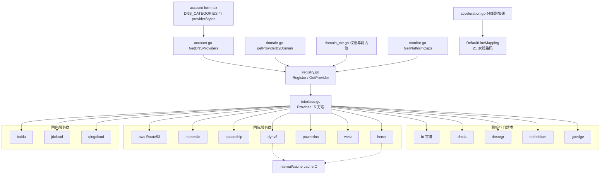
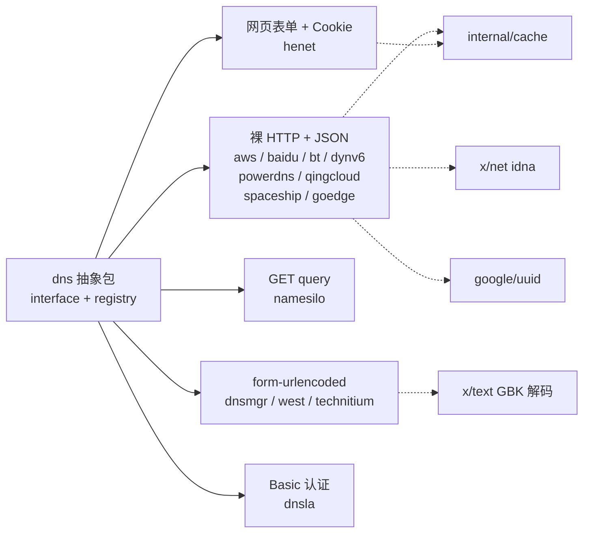
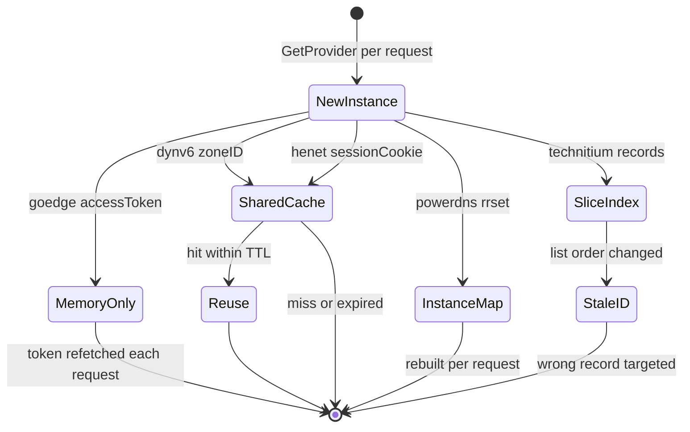
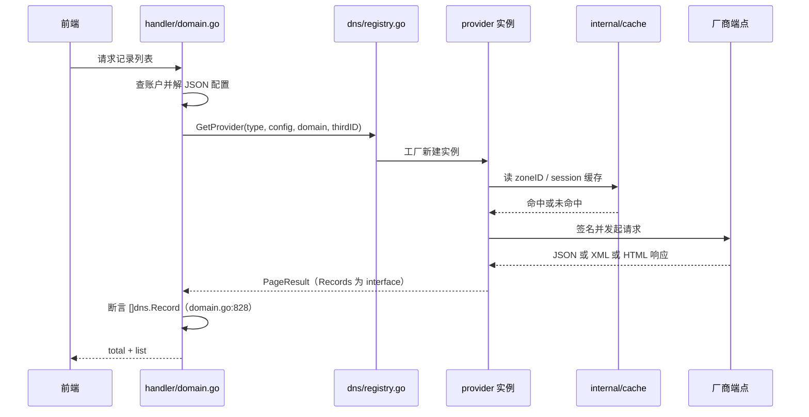
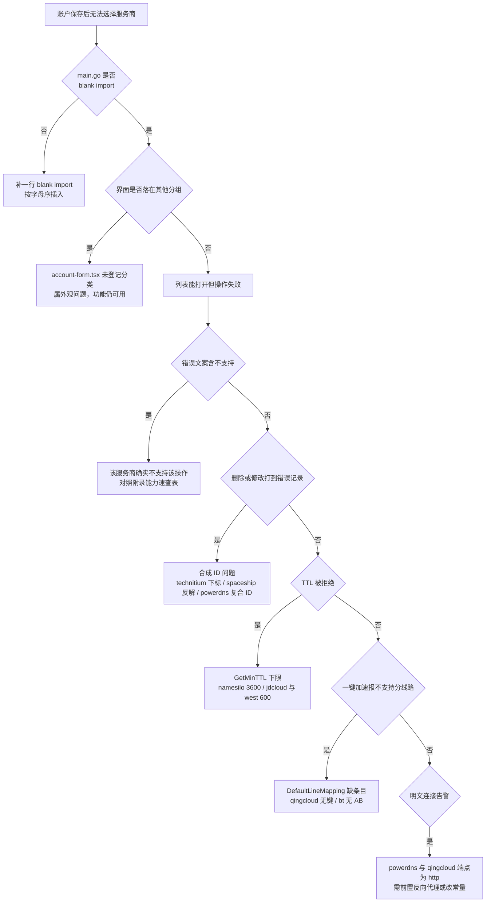

# 其他DNS服务商

<cite>
**本文档引用的文件**
- [main.go](file://main/main.go)
- [interface.go](file://main/internal/dns/interface.go)
- [registry.go](file://main/internal/dns/registry.go)
- [aws.go](file://main/internal/dns/providers/aws/aws.go)
- [baidu.go](file://main/internal/dns/providers/baidu/baidu.go)
- [bt.go](file://main/internal/dns/providers/bt/bt.go)
- [dnsla.go](file://main/internal/dns/providers/dnsla/dnsla.go)
- [dnsmgr.go](file://main/internal/dns/providers/dnsmgr/dnsmgr.go)
- [dynv6.go](file://main/internal/dns/providers/dynv6/dynv6.go)
- [goedge.go](file://main/internal/dns/providers/goedge/goedge.go)
- [henet.go](file://main/internal/dns/providers/henet/henet.go)
- [jdcloud.go](file://main/internal/dns/providers/jdcloud/jdcloud.go)
- [namesilo.go](file://main/internal/dns/providers/namesilo/namesilo.go)
- [powerdns.go](file://main/internal/dns/providers/powerdns/powerdns.go)
- [qingcloud.go](file://main/internal/dns/providers/qingcloud/qingcloud.go)
- [spaceship.go](file://main/internal/dns/providers/spaceship/spaceship.go)
- [technitium.go](file://main/internal/dns/providers/technitium/technitium.go)
- [west.go](file://main/internal/dns/providers/west/west.go)
- [capabilities.go](file://main/internal/monitor/capabilities.go)
- [record_sync.go](file://main/internal/service/record_sync.go)
- [monitor.go](file://main/internal/monitor/monitor.go)
- [account.go](file://main/internal/api/handler/account.go)
- [domain.go](file://main/internal/api/handler/domain.go)
- [domain_ext.go](file://main/internal/api/handler/domain_ext.go)
- [acceleration.go](file://main/internal/api/handler/acceleration.go)
- [account-form.tsx](file://web/components/account-form.tsx)
</cite>

## 目录

1. [简介](#简介)
2. [项目结构](#项目结构)
3. [核心组件](#核心组件)
4. [架构总览](#架构总览)
5. [详细组件分析](#详细组件分析)
6. [依赖关系分析](#依赖关系分析)
7. [性能考虑](#性能考虑)
8. [故障排查指南](#故障排查指南)
9. [结论](#结论)
10. [附录](#附录)

## 简介

`dnsplane` 一共适配 22 家 DNS 服务商。除阿里云、阿里云 ESA、腾讯云 DNSPod、腾讯云 EO、华为云、火山引擎、Cloudflare 这 7 家之外，其余 **15 家**由本文覆盖：

- **面板 / 自建类（5 家）**：`bt`（宝塔域名）、`dnsla`（DNSLA）、`dnsmgr`（DNSmgr 管理系统对接）、`technitium`（Technitium DNS）、`goedge`（GoEdge 智能 DNS）
- **国际服务商（6 家）**：`aws`（Route 53）、`namesilo`、`spaceship`、`dynv6`、`powerdns`、`henet`（HE DNS）
- **国内服务商（4 家）**：`baidu`（百度云）、`jdcloud`（京东云）、`qingcloud`（青云 DNS）、`west`（西部数码）

已验证的规模事实：`main/internal/dns/providers/` 下 25 个 `.go` 文件合计 **10967 行**，其中本文 15 家的 15 个主文件合计 **7534 行**，占比约 68.7%。单文件规模从 `namesilo.go` 的 318 行到 `aws.go` 的 888 行不等，`aws.go`、`goedge.go`、`technitium.go`、`powerdns.go`、`qingcloud.go`、`baidu.go` 是这批适配器里最长的 6 个。

这 15 家的共同约束是同一份抽象契约：`dns.Provider` 接口 15 个方法（`interface.go:41-86`），注册入口 `dns.Register`（`registry.go:18-23`），实例工厂签名 `func(config map[string]string, domain, domainID string) Provider`（`registry.go:9`）。差异全部收敛在两处：`ProviderConfig.Config` 字段表（决定账户表单）与 `ProviderFeatures` 能力位（决定前端可操作的按钮），二者都在各家 `init()` 里一次性声明。

## 项目结构

每家服务商独占一个包目录，目录名与注册键完全一致，包内单文件同名。22 家全部在 `main.go:31-52` 以 blank import 方式引入，靠 `init()` 完成注册；**漏加一行 blank import 就会静默不注册**，这是该结构唯一的隐性契约。

| 服务商 | type | 文件 | 行数 | 注册行号 | main.go 引入行号 |
|--------|------|------|-----:|---------:|-----------------:|
| AWS Route 53 | aws | `providers/aws/aws.go` | 888 | `:24` | `:33` |
| 百度云 | baidu | `providers/baidu/baidu.go` | 509 | `:23` | `:34` |
| 宝塔域名 | bt | `providers/bt/bt.go` | 393 | `:20` | `:35` |
| DNSLA | dnsla | `providers/dnsla/dnsla.go` | 408 | `:19` | `:37` |
| DNSmgr | dnsmgr | `providers/dnsmgr/dnsmgr.go` | 467 | `:18` | `:38` |
| dynv6 | dynv6 | `providers/dynv6/dynv6.go` | 437 | `:21` | `:40` |
| GoEdge | goedge | `providers/goedge/goedge.go` | 713 | `:19` | `:41` |
| HE DNS | henet | `providers/henet/henet.go` | 455 | `:20` | `:42` |
| 京东云 | jdcloud | `providers/jdcloud/jdcloud.go` | 412 | `:21` | `:45` |
| NameSilo | namesilo | `providers/namesilo/namesilo.go` | 318 | `:17` | `:46` |
| PowerDNS | powerdns | `providers/powerdns/powerdns.go` | 620 | `:18` | `:47` |
| 青云DNS | qingcloud | `providers/qingcloud/qingcloud.go` | 532 | `:21` | `:48` |
| Spaceship | spaceship | `providers/spaceship/spaceship.go` | 389 | `:22` | `:49` |
| Technitium | technitium | `providers/technitium/technitium.go` | 665 | `:17` | `:50` |
| 西部数码 | west | `providers/west/west.go` | 328 | `:23` | `:52` |

前端侧的分类与图标并不覆盖全部 15 家。`DNS_CATEGORIES`（`account-form.tsx:23-27`）登记了 22 家 DNS 服务商中的 15 家，本文 15 家里被登记的只有 8 家：`baidu`/`jdcloud`/`west`/`dnsla`/`bt`（国内组）、`namesilo`/`spaceship`（国际组）、`powerdns`（专业解决方案组）。`aws`、`dnsmgr`、`dynv6`、`goedge`、`henet`、`qingcloud`、`technitium` 落入未分类回退分支（`account-form.tsx:287-290`），在界面上显示为「其他」。图标同理，`providerStyles` 只为本文 10 家提供了条目（`:75`、`:77-82`、`:85`、`:105`、`:120`），其余 5 家走字母首字回退（`account-form.tsx:293-300`）。

## 核心组件

三家「组件」视角决定了这 15 家适配器的全部行为差异：**认证形态**、**能力位声明**、**线路码体系**。

### 认证与协议形态

| 服务商 | 协议形态 | 认证方式 | 签名/凭据落点 | 传输 |
|--------|----------|----------|----------------|------|
| aws | HTTPS + XML（API 版本 `2013-04-01`） | AWS SigV4 | `aws.go:223` 自实现签名，端点 `:40-44` | https |
| baidu | HTTPS + JSON | BCE `bce-auth-v1`（HMAC-SHA256） | `baidu.go:122-123`，端点 `:37` | https |
| bt | HTTPS + JSON POST | AK/SK + AccountID，HMAC-SHA256 | `bt.go:75-90`，端点 `:35` | https |
| dnsla | HTTPS + JSON | HTTP Basic（`apiid:apisecret` Base64） | `dnsla.go:78-80`、`:107`，端点 `:33` | https |
| dnsmgr | HTTP + form-urlencoded | MD5(`uid`+`timestamp`+`apikey`) | `dnsmgr.go:65-68`，地址由用户填写 `:46` | **由用户决定** |
| dynv6 | HTTPS + JSON | Bearer Token | `dynv6.go:129`，端点 `:35` | https |
| goedge | HTTPS + JSON（protobuf-over-JSON envelope） | AK/SK 换 AccessToken，头部回传 | `goedge.go:207-219`、`:235` | https |
| henet | HTTPS 网页表单 | 用户名密码登录换会话 Cookie | `henet.go:84-94`、Cookie 缓存 `:71-80`/`:101-110` | https |
| jdcloud | HTTPS + JSON | JDCLOUD2 HMAC-SHA256 四级派生密钥 | `jdcloud.go:112-120`，端点 `:36-38` | https |
| namesilo | HTTPS GET query | `key` 参数直传 API Key | `namesilo.go:52-62`，端点 `:31` | https |
| powerdns | HTTP + JSON（REST rrset） | `X-API-Key` 请求头 | `powerdns.go:96`，URL 硬编码 `http://` `:68` | **明文 http** |
| qingcloud | HTTP + JSON | `QC-HMAC-SHA256` + `Date` 头 | `qingcloud.go:65-68`、`:87-88`，端点 `:33` | **明文 http** |
| spaceship | HTTPS + JSON | `X-API-Key` + `X-API-Secret` 双头 | `spaceship.go:357-358`，端点 `:18` | https |
| technitium | HTTPS + form-urlencoded | `token` 查询参数 | `technitium.go:60`、`:91`，URL 拼接 `:42` | https |
| west | HTTPS + form-urlencoded | MD5(`username`+`apiPassword`+`timestamp`) | `west.go:65-71`，端点 `:37`；响应 GBK 解码 `:97-99` | https |

**章节来源**
- [aws.go](file://main/internal/dns/providers/aws/aws.go)
- [baidu.go](file://main/internal/dns/providers/baidu/baidu.go)
- [bt.go](file://main/internal/dns/providers/bt/bt.go)
- [dnsla.go](file://main/internal/dns/providers/dnsla/dnsla.go)
- [dnsmgr.go](file://main/internal/dns/providers/dnsmgr/dnsmgr.go)
- [dynv6.go](file://main/internal/dns/providers/dynv6/dynv6.go)
- [goedge.go](file://main/internal/dns/providers/goedge/goedge.go)
- [henet.go](file://main/internal/dns/providers/henet/henet.go)
- [jdcloud.go](file://main/internal/dns/providers/jdcloud/jdcloud.go)
- [namesilo.go](file://main/internal/dns/providers/namesilo/namesilo.go)
- [powerdns.go](file://main/internal/dns/providers/powerdns/powerdns.go)
- [qingcloud.go](file://main/internal/dns/providers/qingcloud/qingcloud.go)
- [spaceship.go](file://main/internal/dns/providers/spaceship/spaceship.go)
- [technitium.go](file://main/internal/dns/providers/technitium/technitium.go)
- [west.go](file://main/internal/dns/providers/west/west.go)

### 能力矩阵

`ProviderFeatures` 定义见 `interface.go:157-167`。`Remark` 为三态整型：`0` 不支持、`1` 独立接口改、`2` 随记录一起改。下表全部取自各家 `init()` 的字面声明。

| 服务商 | type | Remark | Status | Redirect | Log | Weight | Page | Add | 声明行号 |
|--------|------|:------:|:------:|:--------:|:---:|:------:|:----:|:---:|---------:|
| AWS Route 53 | aws | 0 | ✗ | ✗ | ✗ | ✗ | ✓ | ✓ | `aws.go:34` |
| 百度云 | baidu | 2 | ✗ | ✗ | ✗ | ✗ | ✓ | ✓ | `baidu.go:32` |
| 宝塔域名 | bt | 2 | ✓ | ✗ | ✗ | ✓ | ✗ | ✓ | `bt.go:30` |
| DNSLA | dnsla | 0 | ✓ | ✓ | ✗ | ✓ | ✗ | ✓ | `dnsla.go:28` |
| DNSmgr | dnsmgr | 1 | ✓ | ✗ | ✗ | ✗ | ✗ | ✗ | `dnsmgr.go:28` |
| dynv6 | dynv6 | 0 | ✗ | ✗ | ✗ | ✗ | ✗ | ✗ | `dynv6.go:29` |
| GoEdge | goedge | 2 | ✓ | ✗ | ✗ | ✓ | ✗ | ✓ | `goedge.go:36` |
| HE DNS | henet | 0 | ✗ | ✗ | ✗ | ✗ | ✓ | ✓ | `henet.go:29` |
| 京东云 | jdcloud | 0 | ✓ | ✗ | ✗ | ✗ | ✗ | ✓ | `jdcloud.go:30` |
| NameSilo | namesilo | 0 | ✗ | ✗ | ✗ | ✗ | ✓ | ✗ | `namesilo.go:26` |
| PowerDNS | powerdns | 2 | ✓ | ✗ | ✗ | ✗ | ✓ | ✓ | `powerdns.go:28` |
| 青云DNS | qingcloud | 1 | ✓ | ✗ | ✗ | ✓ | ✗ | ✓ | `qingcloud.go:29` |
| Spaceship | spaceship | 0 | ✗ | ✗ | ✗ | ✗ | ✓ | ✗ | `spaceship.go:31-38` |
| Technitium | technitium | 2 | ✓ | ✗ | ✗ | ✗ | ✗ | ✓ | `technitium.go:26` |
| 西部数码 | west | 0 | ✓ | ✗ | ✗ | ✗ | ✗ | ✗ | `west.go:32` |

15 家里没有任何一家声明 `Log=true`，也没有任何一家声明 `RecordGroup` / `DomainAlias`（字段定义在 `interface.go:165-166`，只有 aliyun 与 dnspod 会置位）。因此本文 15 家的「解析日志」「记录分组」「域名别名」三个入口在能力口径上全部为不可用。

后端实际读取能力位的点很少，可验证的只有三处：`account.go:457` 读 `Features.Add` 决定账户列表是否允许加域；`domain_ext.go:251-252` 读 `features.Weight` 作为权重接口的准入判定；`domain_ext.go:318-324` 把 `Weight`/`Remark`/`Log` 三个位原样输出为 `supports_weight`/`supports_remark`/`supports_log` 给前端。`Redirect`、`Page`、`RecordGroup`、`DomainAlias` 四个位在 Go 侧没有读取点。

**章节来源**
- [interface.go](file://main/internal/dns/interface.go)
- [account.go](file://main/internal/api/handler/account.go)
- [domain_ext.go](file://main/internal/api/handler/domain_ext.go)

### 线路码体系

`registry.go:58-80` 的 `DefaultLineMapping` 为 21 家提供了静态线路码（缺 `qingcloud`），`DefaultDNSLine`（`registry.go:82-89`）在缺条目时回退字面量 `"default"`。

| 服务商 | DEF | CT | CU | CM | AB | 分线路加速可用 |
|--------|-----|----|----|----|----|----------------|
| west | `""` | LTEL | LCNC | LMOB | LFOR | 是 |
| dnsla | `""` | 84613316902921216 | 84613316923892736 | 84613316953252864 | `""` | 部分（AB 回落 DEF） |
| baidu | `default` | ct | cnc | cmnet | `""` | 部分（AB 回落 DEF） |
| jdcloud | `-1` | 1 | 2 | 3 | 4 | 是 |
| bt | `0` | 285344768 | 285345792 | 285346816 | 无键 | 部分（AB 回落 DEF） |
| dnsmgr | `0` | - | - | - | - | 否（仅默认线路） |
| aws / dynv6 / goedge / henet / namesilo / powerdns / spaceship / technitium | `default` | - | - | - | - | 否 |
| qingcloud | 无条目 | - | - | - | - | 否（加速直接拒绝） |

qingcloud 的口径存在两处矛盾：`acceleration.go:456-458` 因 `DefaultLineMapping` 无条目而返回「DNS 服务商不支持分线路解析」，但 `qingcloud.go:349` 与 `:409` 的线路判定又接受 `line == "" || line == "default"`，恰好与 `DefaultDNSLine` 的字面回退吻合。该一致性属巧合，不构成契约。

**章节来源**
- [registry.go](file://main/internal/dns/registry.go)
- [acceleration.go](file://main/internal/api/handler/acceleration.go)
- [qingcloud.go](file://main/internal/dns/providers/qingcloud/qingcloud.go)

## 架构总览

15 家适配器在依赖图上是同一层级的叶子节点：向上只依赖 `main/internal/dns` 抽象包，向下直接出站到厂商端点。例外是 `dynv6` 与 `henet`——两家额外依赖 `main/internal/cache`，把局部状态写进进程级共享缓存 `cache.C`。

**图表来源**
- [main.go](file://main/main.go)
- [registry.go](file://main/internal/dns/registry.go)
- [interface.go](file://main/internal/dns/interface.go)
- [account-form.tsx](file://web/components/account-form.tsx)
- [dynv6.go](file://main/internal/dns/providers/dynv6/dynv6.go)
- [henet.go](file://main/internal/dns/providers/henet/henet.go)

分组口径说明：`west`（西部数码）与 `henet`/`powerdns` 按业务归属应属国内与自建，此处按接入形态把 `west` 与 `henet`/`powerdns` 并入「国际服务商」同一类「裸 HTTP + 无线路编目能力受限」的形态组，仅为图上聚类的简洁；权威分类以大纲口径为准——面板类 bt/dnsla/dnsmgr/technitium/goedge，国际类 aws/namesilo/spaceship/dynv6/powerdns/west，国内类 baidu/jdcloud/qingcloud/henet。

实例生命周期是这套结构的关键性质：`getProviderByDomain`（`domain.go:37-54`）每次请求都「查账户 → 解 JSON 配置 → 调 `dns.GetProvider` 新建实例」。`registry.go:26-37` 的注释路径显示工厂返回值没有 error 通道，因此实例内的构造失败只能靠 `GetError()` 取出，而各家 `GetError()` 在 handler 侧没有被调用。

## 详细组件分析

以下按三个分组逐家展开，每家覆盖：注册位置 / 认证 / 关键 API / 限制 / 文件行数。

### 面板与自建类：bt（宝塔域名）

- **注册位置**：`bt/bt.go:20` → `dns.Register("bt", NewProvider, ...)`，字段表 `:25-27` 要求 `AccessKey`、`SecretKey`、`AccountID` 三项均必填；能力位 `:30`。
- **认证**：`bt.go:75-90` 拼接待签字符串 `accountID\ntimestamp\nPOST\npath\nbody`，用 `SecretKey` 做 HMAC-SHA256 后 hex 编码，随请求体提交。端点常量 `https://dmp.bt.cn`（`:35`）。
- **关键 API**：`/api/v1/dns/manage/list_domains`（`:146`）、`/api/v1/dns/record/list`（`:202`）、`record/create`（`:285`）、`record/update`（`:314`）、`record/delete`（`:329`）、`record/pause` 与 `record/start`（`:340`/`:342`）、`record/get_views`（`:354`）、`manage/add_external_domain`（`:391`）。分页参数为 `p` + `rows`（`:174-175`），属服务端分页。
- **限制**：
  - `domainID` 是 `本地ID|域名类型` 的复合串（`:158` 生成、`:58-64` 反解），厂商侧更换域名类型会让历史 ID 失效。
  - `weight` 与厂商 `mx` 复用同一字段：读侧 `bt.go:216-219` 把 `MX` 同时赋给 `mx` 与 `weight`，写侧 `:275-282` 在非 MX 类型时把 weight 塞进 `mx` 参数，且 weight 为空或 0 时强制回填 `1`。
  - `AddDomainRecord` 不回传记录 ID（`:286` `return "", err`），本地副本只能依赖后续列表拉取补齐。
  - `GetDomainRecordInfo`（`:254`）、`UpdateDomainRecordRemark`（`:318`）、`GetDomainRecordLog`（`:349`）三家方法直接返回不支持。
  - 线路 `GetRecordLine` 只保留 `free == true` 的 view 并递归子节点（`:367-381`），付费线路不会出现在下拉里。
  - `DefaultLineMapping["bt"]` 没有 `AB` 键（`registry.go:67`），海外线路在加速流程中回落默认线路。
- **文件行数**：393 行。

**章节来源**
- [bt.go](file://main/internal/dns/providers/bt/bt.go)
- [registry.go](file://main/internal/dns/registry.go)

### 面板与自建类：dnsla（DNSLA）

- **注册位置**：`dnsla/dnsla.go:19`，字段表 `:24-25` 为 `apiid` / `apisecret`；能力位 `:28`（15 家里唯一声明 `Redirect=true` 的一家）。
- **认证**：`dnsla.go:78-80` 将 `apiID:apiSecret` 做 Base64，`:107` 写入 `Authorization: Basic`。凭据会先 `strings.TrimSpace`（`:74-76`）。
- **关键 API**：`/api/domainList`（`:167`）、`/api/recordList`（`:228`）、`/api/record` 增删改（`:315`/`:347`/`:357`）、`/api/recordDisable`（`:366`）、`/api/availableLine`（`:376`）、`/api/domain`（`:406`）。分页 `pageIndex` + `pageSize`（`:207`）。
- **限制**：
  - 记录类型走数字码白名单：`typeList`（`:35-37`）与 `typeListReverse`（`:39-42`）只覆盖 A/NS/CNAME/MX/TXT/AAAA/SRV/CAA/URL 转发。未命中白名单的类型（例如 PTR）在 `:288-295` 会静默取零值 `0` 下发，厂商侧报错而非本地拦截。
  - `GetRecordLine`（`:374-398`）把厂商返回的 `"0"` 归一为空串（`:388-390`），与 `DefaultLineMapping["dnsla"].DEF` 的空串一致，但与其他服务商的 `"default"` 字面量不同。
  - 不支持单条查询（`:284`）、备注（`:351`）、日志（`:370`）。
  - `Redirect=true` 位在整个 Go 侧没有读取点，转发记录的入口实际不存在。
- **文件行数**：408 行。

**章节来源**
- [dnsla.go](file://main/internal/dns/providers/dnsla/dnsla.go)
- [registry.go](file://main/internal/dns/registry.go)

### 面板与自建类：dnsmgr（DNSmgr 管理系统对接）

- **注册位置**：`dnsmgr/dnsmgr.go:18`，字段表 `:23-25` 为 `url`（占位提示写作 `如 http://xxx.com`）、`uid`、`apikey`；能力位 `:28`。
- **认证**：`dnsmgr.go:65-68` 计算 `md5(uid + timestamp + apikey)`，`:70-79` 以 `application/x-www-form-urlencoded` POST 提交 `uid`/`timestamp`/`sign` 加业务参数。`md5` 属于弱摘要，且地址由用户填写，提示语直接引导 `http://`。
- **关键 API**：统一挂在 `/api/domain` 前缀下——域名列表 `:145`，记录列表请求 `:231`（`offset`/`limit` 参数在 `:207-209` 组装）、`record/add?id=`（`:348`）、`record/edit?id=`（`:378`）、`record/remark?id=`（`:387`）、`record/del?id=`（`:393`）、`record/status?id=`（`:406`）、`record/log?id=`（`:420`）、`record/line?id=`（`:429`）。`Check` 复用 `GetDomainList`（`:59-62`）。
- **限制**：
  - 该适配器定位是「第三方 DNS 管理系统的旁路接口」，`AddDomain` 明确不支持（`:465-467`），域名必须先在 DNSmgr 侧存在。
  - 能力位与代码不一致：`Features.Weight` 声明为 `false`（`:28`），但 `dnsmgr.go:341-342`（新增）与 `:371-372`（修改）已经把 `weight` 写入厂商参数，读侧 `:297-298` 也会回填，走 `handler` 权重入口却被 `domain_ext.go:252` 的能力判定挡掉。
  - `GetRecordLine` 在厂商返回空集时兜底一条 `{ID:"0", Name:"默认"}`（`:455-456`），与 `DefaultLineMapping["dnsmgr"].DEF == "0"` 呼应。
  - 响应解析失败时错误信息包含完整响应体（`:105`），可能把上游内部报文带入前端错误提示。
- **文件行数**：467 行。

**章节来源**
- [dnsmgr.go](file://main/internal/dns/providers/dnsmgr/dnsmgr.go)
- [registry.go](file://main/internal/dns/registry.go)
- [domain_ext.go](file://main/internal/api/handler/domain_ext.go)

### 面板与自建类：technitium（Technitium DNS）

- **注册位置**：`technitium/technitium.go:17`，字段表 `:22-23` 为 `url`（占位 `https://dns.example.com`）与 `token`；能力位 `:26`。
- **认证**：`technitium.go:42` 把用户地址规范化为 `{url}/api`，`:60` 将 `token` 作为查询参数注入，`:91` 以 form-urlencoded POST 提交。没有签名，令牌即凭据。
- **关键 API**：`/zones/list`（`:128`）、`/zones/records/get`（`:163`）、`/zones/records/add`（`:449`）、`/zones/records/update`（`:523`/`:560`/`:629`）、`/zones/records/delete`（`:591`）、`/zones/create`（`:653`）。`AddDomain` 建的是 `type=Primary` 的 zone（`:647-653`）。
- **限制**：
  - **记录 ID 是数组下标**：`p.records`（`:38`）缓存 `/zones/records/get` 的顺序结果，`AddDomainRecord` 返回 `strconv.Itoa(len(p.records) - 1)`（`:457`），读侧也按下标定位（`:383-387`、`:466-470`）。由于 provider 实例每请求新建，任何并发写入或列表顺序变化都会让已保存的下标 ID 指向另一条记录，删除/修改打到错误对象。
  - 不支持服务端分页：`GetDomainRecords`（`:304-370`）返回全量并令 `Total = len(records)`，`Features.Page` 声明为 `false`（`:26`）。
  - 类型分支覆盖 A/AAAA/CNAME/NS/MX/TXT/SRV/PTR/CAA/ANAME/DNAME 共 11 种（`:191-297` 读侧解析、`:267-297` 写侧参数构造），是 15 家里类型面最宽的。
  - `GetMinTTL()` 返回 `0`（`:643-645`），表示不声明最小 TTL，TTL 校验退化为无下限。
  - 不支持日志（`:633`）。`SetDomainRecordStatus` 通过 `records/update` 切换 `disabled` 实现（`:595`、`:629`），能力位 `Status=true` 与实现一致。
- **文件行数**：665 行。

**章节来源**
- [technitium.go](file://main/internal/dns/providers/technitium/technitium.go)

### 面板与自建类：goedge（GoEdge 智能 DNS）

- **注册位置**：`goedge/goedge.go:19`，字段表 `:25-33` 共 6 项：`base_url`、`accessKeyId`、`accessKey`、`type`（radio：admin/user）、`nsClusterId`（必填）、`userId`（可选）。`ProviderConfig.Note`（`:23`）显式提示「需要填写 GoEdge HTTP API 节点地址，不是管理后台地址或 gRPC 地址」。
- **认证**：`goedge.go:207-219` 调 `/APIAccessTokenService/getAPIAccessToken` 用 AK/SK 换 AccessToken，`:235` 用自定义头 `X-Edge-Access-Token` 回传。令牌惰性获取由 `tokenMu`（`:56-57`）保护，实例内存态、不落缓存。
- **关键 API**：`/NSClusterService/findNSCluster`（`:353`）、`/NSDomainService/countAllNSDomains` 与 `listNSDomains`（`:367`/`:375`）、`/NSRecordService/listNSRecords`（`:433`）、`findNSRecord`（`:488`）、`createNSRecord`（`:522`）、`updateNSRecord`（`:562`/`:592`）、`deleteNSRecord`（`:610`）。线路来自 4 个路由集合 `findAllDefaultWorldRegionRoutes`、`findAllDefaultChinaProvinceRoutes`、`findAllDefaultISPRoutes`、`findAllAgentNSRoutes`（`:657-660`），有 `domainID` 时再补 `findAllNSRoutes`（`:672`）。
- **限制**：
  - 线路编目要发 4~5 次串行请求（`:655-675`），是 15 家里 `GetRecordLine` 最贵的一个；`handler/domain.go:715-720` 每次打开记录列表都会调一次，翻页时叠加。
  - `GetRecordLine` 对空条件查询做了兼容注释（v1.3.x 带条件查询返回空结果），并强制把 `default` 线路置于首位（`:678-688`）。
  - 分页是混合模式：`keyword` 为空时走服务端 `offset`/`size`（`:417-420`），有关键字时改为本地下标切片（`:461-465`）。
  - `GetMinTTL()` 返回 `1`（`:695-697`），下限极低，误填 1 秒 TTL 不会被本地拦住。
  - 集群 ID/用户 ID 在 `NewProvider` 里用 `strconv.Atoi` 静默忽略错误（`:66-67`），填错会退化为 0 而不是报错。
  - 不支持日志（`:622`）。
- **文件行数**：713 行，本文 15 家里第二长。

**章节来源**
- [goedge.go](file://main/internal/dns/providers/goedge/goedge.go)
- [domain.go](file://main/internal/api/handler/domain.go)

### 国际服务商：aws（AWS Route 53）

- **注册位置**：`aws/aws.go:24`，字段表 `:30-31` 为 `AccessKeyId` / `SecretAccessKey`；能力位 `:34`。`Note` 说明 AccessKey 需具备 Route 53 权限。
- **认证**：`:223` 起自实现 AWS SigV4（canonical request → string to sign → 派生密钥），端点常量 `route53.amazonaws.com`、service `route53`、region `us-east-1`、API 版本 `2013-04-01`（`:40-44`），无官方 SDK 依赖。
- **关键 API**：`GET /hostedzone`（列表，`:341`）、`GET /hostedzone/{id}/rrset`（`:358`）、`POST /hostedzone/{id}/rrset` 变更集（`:383`/`:423`）、`POST /hostedzone` 建域（`:871-880`，`CallerReference` 用 `dnsmgr-{domain}-{unixNano}`）。
- **限制**：
  - **没有原生记录 ID**：`encodeRecordID`（`:537`）用控制字符 `\x1e`（`:46`）拼 `name|type|value`。注释明确「取值须稳定否则历史记录 ID 解析错位」，一旦该分隔符变更，已存的 `record_id` 全部失效。
  - **UPSERT 语义**：`AddDomainRecord`（`:681-721`）先读现有 RRSet，重复值直接报「已存在相同记录」（`:697-700`），否则把新值并入集合整体 UPSERT。同 name+type 的多条值会合并成一个 RRSet，批量添加 N 条同类型记录只产生 1 次变更集合；返回的合成 ID 与厂商状态无绑定。
  - 别名记录、带 `SetIdentifier` 的加权/延迟路由记录、SOA 在读取阶段被跳过（`:609-611`），不可编辑也不可删除。
  - `GetDomainRecords` 完全忽略 `page`/`pageSize`（`:652` 返回全量），但 `Features.Page=true`（`:34`）。
  - TTL 为 0 时兜底为 300（`:613-615`），已有集合在显式 TTL 为 0 时沿用原 TTL（`:704-707`）。
  - 不支持备注（`:795`）、启停（`:853`）、日志（`:857`）。
  - 引入 `golang.org/x/net/idna` 做域名 ASCII 兼容转换，是 15 家里唯一做 IDNA 处理的。
- **文件行数**：888 行，`providers/` 目录内最长。

**章节来源**
- [aws.go](file://main/internal/dns/providers/aws/aws.go)

### 国际服务商：namesilo

- **注册位置**：`namesilo/namesilo.go:17`，字段表 `:22-23` 为 `username` / `apikey`；能力位 `:26`。
- **认证**：`:52-62` 组装 GET query，固定注入 `version=1`、`type=json`、`key=<apikey>`，再拼操作名形成 `https://www.namesilo.com/api/{operation}?...`（`:31`、`:62`）。凭据出现在 URL 查询串里。
- **关键 API**：`listDomains`（`:114`）、`dnsListRecords`（`:147`）、`dnsAddRecord`（`:250`）、`dnsUpdateRecord`（`:280`）、`dnsDeleteRecord`（`:294`）。
- **限制**：
  - `GetMinTTL()` 返回 **3600**（`:312-314`），是全部 22 家里最大的下限，任何 1 小时以下的 TTL 都会被本地约束。
  - 忽略分页，`dnsListRecords` 一次拉全量并令 `Total = len(records)`（`:222`），但 `Features.Page=true`（`:26`）。
  - 响应字段用无保护类型断言取值：`:156`（`rec["host"].(string)`）、`:170`（`rec["record_id"].(string)`）、`:172-175`（`type`/`value`/`ttl`）。厂商一旦把某字段返回为 `null` 或改变类型，这里会 panic 而不是返回 error。
  - `GetRecordLine` 只回一条 `default`（`:306-309`），但 `DefaultLineMapping["namesilo"].DEF` 也是 `default`（`registry.go:71`），一致。
  - 单条查询（`:229`）、备注（`:284`）、启停（`:298`）、日志（`:302`）、加域（`:316`）全部不支持，是 15 家里的功能下限。
- **文件行数**：318 行，本文 15 家里最短。

**章节来源**
- [namesilo.go](file://main/internal/dns/providers/namesilo/namesilo.go)
- [registry.go](file://main/internal/dns/registry.go)

### 国际服务商：spaceship

- **注册位置**：`spaceship/spaceship.go:22`，字段表 `:27-28` 为 `apikey` / `apisecret`；能力位以多行形式写在 `:31-38`。
- **认证**：`:357-358` 同时下发 `X-API-Key` 与 `X-API-Secret` 两个自定义头，端点 `https://spaceship.dev/api/v1`（`:18`）。
- **关键 API**：`/domains`（`:82`）、`GET /dns/records/{domain}`（`:135`）、`PUT /dns/records/{domain}`（`:230` 新增 `force:false`、`:245` 修改 `force:true`）、`POST /dns/records/{domain}/delete`（`:270`）。分页用 `take`/`skip`（`:105`/`:108`），另有 `:72` 的域名列表分页。
- **限制**：
  - 记录 ID 是合成串 `type|name|address|mx`（`:172`），删除时在 `:252-263` 反解回 `convertRecordItem` 的参数。任何会影响 `address` 归一化的改动（例如厂商返回值的空格或尾点变化）都会导致删不掉记录。
  - `GetDomainRecordLog` 返回**空结果而非 error**（`:277-278`），`Features.Log` 又声明 `false`，前端会显示「暂无日志」而不是「不支持」，与其他 14 家的行为不一致。
  - 支持 `ALIAS` 类型（`:160` 的读取分支），但那是 CNAME 扁平化的记录，前端类型表里没有该条目，只能在厂商侧已存在时被动显示。
  - 内部错误字段命名为 `lastError`（`:46`、`:61`），与其余 14 家的 `lastErr` 不同名，`GetError()` 语义一致但字段名不统一。
  - 不支持备注（`:248`）、启停（`:273`）、加域（`:289`）。
  - `monitor` 能力表把 spaceship 标为 `Delete:false`（`capabilities.go:22`），是 15 家里唯一被判定「不支持删除」的，主备切换流程不会尝试删除它的记录。
- **文件行数**：389 行。

**章节来源**
- [spaceship.go](file://main/internal/dns/providers/spaceship/spaceship.go)
- [capabilities.go](file://main/internal/monitor/capabilities.go)

### 国际服务商：dynv6

- **注册位置**：`dynv6/dynv6.go:21`，字段表 `:26` 只有 `token` 一项；能力位 `:29`——**8 个位全为 0/false**，是 15 家里唯一「零能力声明」的适配器。
- **认证**：`:129` 写 `Authorization: Bearer {token}`，端点 `https://dynv6.com/api/v2`（`:35`）。
- **关键 API**：`GET /zones/by-name/{domain}`（`:186`）解析 zone ID，`/zones`（`:277`）列表，`/zones/{id}/records`（`:307`/`:376`）读写，`/zones/{id}/records/{rid}`（`:399`/`:413`）改删。
- **限制**：
  - **依赖共享缓存**：`zoneID`（`:178-203`）把域名 → zone ID 的映射写入 `cache.C`，TTL 10 分钟（`:36-38`）。缓存键由 `sha256(token)` 前 8 字节 + 域名构成（`:172-175`），做了凭据隔离，是 15 家里唯一按凭据维度分键的写法。缓存不可用时退化为每次多一跳请求（`:181`、`:199` 都有 `cache.C != nil` 判空）。
  - `GetMinTTL()` 返回 `0`（`:431-433`），不声明下限。
  - CNAME/MX 的自动补尾点由 `formatValue`（`:238-246`）实现：已带尾点或不含点的相对名不处理。
  - 忽略分页，`:354` 返回全量（`Features.Page=false`，声明与实现一致）。
  - 单条查询（`:361`）、备注（`:404`）、启停（`:417`）、日志（`:421`）、加域（`:435`）全部不支持，因此它只能管理已在 dynv6 建好的 zone。
- **文件行数**：437 行。

**章节来源**
- [dynv6.go](file://main/internal/dns/providers/dynv6/dynv6.go)

### 国际服务商：powerdns

- **注册位置**：`powerdns/powerdns.go:18`，字段表 `:23-25` 为 `ip` / `port` / `apikey`；能力位 `:28`。
- **认证**：`:96` 写 `X-API-Key`。URL 在 `:68` 以字符串字面量拼成 `"http://" + ip + ":" + port + "/api/v1"`，**没有 https 分支也没有开关**，API Key 与全部解析变更明文过网；`serverID` 硬编码 `"localhost"`（`:70`），只适配单机 Authoritative Server 的默认配置。
- **关键 API**：`GET /servers/localhost/zones`（`:142`）、`GET /servers/localhost/zones/{domain}`（`:172`）、`PATCH .../zones/{domain}`（`:372`/`:399` 的 rrset 替换）、`POST .../zones`（`:618`，`kind=Native`、`soa_edit_api=INCREASE`）。
- **限制**：
  - 记录 ID 是 `rrsetID_recID` 合成（`:273` 生成，`:557-563` 按下划线反解），依赖实例内 `cache map[string][]rrset`（`:74`），而实例每请求新建，缓存等于无效预热，`loadRRSets` 会在一次操作里被反复调用。
  - 值格式化：TXT 自动加引号（`:409-410`）、CNAME/MX 强制补尾点（`:412-414`）、MX 前缀优先级（`:415-417`）。
  - `AddDomainRecord` 走「读全量 rrset → 追加一条 → 整体 PATCH」，重复值直接报「已存在相同记录」（`:425-427`），且不回传新记录 ID（`:443`）。
  - 忽略分页，`:334` 返回全量，但 `Features.Page=true`（`:28`）。
  - 单条查询（`:341`）、备注（`:513`）、日志（`:595`）不支持。
  - 能力口径三方冲突：`Features.Status=true` 且 `SetDomainRecordStatus` 确实通过 `disabled` 位实现（`:557`起），但 `monitor` 侧能力表把 powerdns 标为 `Pause:false`（`capabilities.go:21`），`monitor.go:437` 取的是后者，主备切换不会尝试暂停它的记录。
- **文件行数**：620 行。

**章节来源**
- [powerdns.go](file://main/internal/dns/providers/powerdns/powerdns.go)
- [capabilities.go](file://main/internal/monitor/capabilities.go)
- [monitor.go](file://main/internal/monitor/monitor.go)

### 国际服务商：west（西部数码）

- **注册位置**：`west/west.go:23`，字段表 `:28-29` 为 `username` / `api_password`；能力位 `:32`。
- **认证**：`:65-71` 计算 `md5(username + apiPassword + timestamp)`，以 `username` / `time`（毫秒时间戳）/ `token` 三个参数随 form POST 提交（`:73-84`）。摘要算法为 MD5。
- **关键 API**：全部走 `/domain/` 单端点，用 `act` 参数区分动作——域名列表 `:135`、记录列表 `:158-162`（`pageno` + `limit` 服务端分页）、`act=adddnsrecord`（`:229-244`）、`moddnsrecord`（`:254-271`）、删除 `:279-286`、启停 `:290-302`。
- **限制**：
  - **响应编码为 GBK**，`west.go:97-99` 用 `golang.org/x/text/encoding/simplifiedchinese` 显式解码为 UTF-8；这是 15 家里唯一需要字符集转换的适配器，中文备注与线路名依赖这段转换。
  - 默认线路 ID 是**空串**：`GetRecordLine` 返回 `{ID:"", Name:"默认"}`（`:310-320`），`DefaultLineMapping["west"].DEF` 同样是 `""`（`registry.go:62`）；写侧在 `:230-232` 把 `""`/`default` 转换为中文 `默认` 再下发。
  - 线路表包含 `LEDU`（教育网）、`LSEO`（搜索引擎）、`LFOR`（境外）三类，但静态映射只登记了 LTEL/LCNC/LMOB/LFOR 四个（`registry.go:62`），教育线与搜索线只能靠 `GetRecordLine` 动态取。
  - `GetMinTTL()` 返回 **600**（`:322-324`），与 `DefaultLineMapping` 无关但会限制 TTL 下限。
  - 单条查询（`:225`）、备注（`:275`）、日志（`:306`）、加域（`:326`）不支持。`Features.Status=true` 且启停确实由 `/domain/` 的 `act` 分支实现（`:290-302`），`monitor` 侧 `west` 标为 `Pause:true`（`capabilities.go:17`），口径一致。
- **文件行数**：328 行。

**章节来源**
- [west.go](file://main/internal/dns/providers/west/west.go)
- [registry.go](file://main/internal/dns/registry.go)
- [capabilities.go](file://main/internal/monitor/capabilities.go)

### 国内服务商：baidu（百度云）

- **注册位置**：`baidu/baidu.go:23`，字段表 `:28-29` 为 `AccessKeyId` / `SecretAccessKey`；能力位 `:32`。
- **认证**：`:122-123` 起自实现 BCE 签名 `bce-auth-v1`（HMAC-SHA256 四级派生），`:174-175` 注入 `Authorization`。签名前对 URI/query 做定制转义（`:58-80`：`+`→`%20`、`*`→`%2A`、`%7E`→`~`、`%2F`→`/`）。端点 `dns.baidubce.com`（`:37`）。
- **关键 API**：`/v1/dns/zone`（`:244` 列表、`:502-507` 建域带 `clientToken` UUID）、`/v1/dns/zone/{domain}/record`（`:273` 读、`:432` 增）、`record/{id}`（`:456` 改、`:466` 删、`:479` 启停 query 带 `enable`/`disable` 空值参数）。
- **限制**：
  - `GetDomainRecords` 忽略 `page`/`pageSize`，`:362` 返回全量，`Features.Page=true`（`:32`）与实现冲突。
  - 子域过滤是唯一的服务端下推：`:269-271` 把 `subDomain` 小写后作为 `rr` 参数，其余关键字/类型/状态过滤都在本地完成。
  - 能力口径冲突：`Features.Status=false`（`:32`），但 `SetDomainRecordStatus` 在 `:470-481` 是**已实现**的；`monitor` 侧 `baidu` 标为 `Pause:true`（`capabilities.go:19`）。三方各不相同。
  - `GetRecordLine` 返回硬编码 6 条（`:487-496`：default/ct/cnc/cmnet/edu/search），不请求厂商；`DefaultLineMapping` 缺 `AB` 键（`registry.go:65`），海外线回落。
  - 备注（`:460`）与日志（`:483`）不支持；建域用 UUID `clientToken` 做幂等（`:503-505`），是 15 家里唯一显式带幂等键的。
- **文件行数**：509 行。

**章节来源**
- [baidu.go](file://main/internal/dns/providers/baidu/baidu.go)
- [registry.go](file://main/internal/dns/registry.go)
- [capabilities.go](file://main/internal/monitor/capabilities.go)

### 国内服务商：jdcloud（京东云）

- **注册位置**：`jdcloud/jdcloud.go:21`，字段表 `:26-27` 为 `AccessKeyId` / `AccessKeySecret`；能力位 `:30`。
- **认证**：`:112-120` 实现 JDCLOUD2 签名，派生链为 `JDCLOUD2{secret}` → date → `cn-north-1` → `domainservice` → `jdcloud2_request`，端点常量集中在 `:36-38`（`domainservice.jdcloud-api.com`）。凭据键名做了三选兼容：`:50` 定义 `configPick`，`:61-62` 依次尝试 `AccessKeyId`/`access_key_id`/`access_key` 与 `AccessKeySecret`/`secret_access_key`/`secret_key`/`access_key_secret`，用于兼容历史账户。
- **关键 API**：`/v2/regions/cn-north-1/domain`（`:183` 校验、`:188` 列表、`:377` 建域固定 `packId:1`）、`/domain/{id}/RR`（`:223` 列表带 `pageNumber`/`pageSize`、`:291` 新增）、`/RR/{rid}`（`:273` 单条、`:321` 修改、`:343` 删除）、`/RR/{rid}/operate`（`:349-354` 启停，body 为 `{"action":"enable|disable"}`）。
- **限制**：
  - region 硬编码 `cn-north-1`（`:37`），且 `:183` 的连通性检查与 `:223` 的列表都写死了该路径段，无法接入其他 region。
  - 线路码用 `-1`~`4` 的数字（`registry.go:66`），`GetRecordLine` 又返回 `default/telecom/unicom/mobile/oversea` 语义名（`:362-370`）。两套口径并存，写入时以哪个为准取决于调用方是否显式传 line。
  - `GetDomainRecordLog` 返回**空结果而非 error**（`:358-360`），与 spaceship 同类行为。
  - `GetMinTTL()` 返回 **600**（`:372-374`）。
  - 备注不支持（`:338`）。`Features.Weight=false` 与实现一致（无 weight 参数）。
- **文件行数**：412 行。

**章节来源**
- [jdcloud.go](file://main/internal/dns/providers/jdcloud/jdcloud.go)
- [registry.go](file://main/internal/dns/registry.go)

### 国内服务商：qingcloud（青云DNS）

- **注册位置**：`qingcloud/qingcloud.go:21`，字段表 `:26-27` 为 `access_key_id` / `secret_access_key`；能力位 `:29` 单行紧凑写法。
- **认证**：`:65-68` 对 `method\n date\n path[?query]` 做 HMAC-SHA256 后 Base64，`:87-88` 下发 `Authorization: QC-HMAC-SHA256 {akId}:{sig}` 与 `Date` 头。**端点常量为 `http://api.routewize.com`（`:33`）**，AK 签名与请求体明文过网。
- **关键 API**：`/v1/user/zones`（`:143`）、`/v1/dns/host/`（`:169`/`:422`）、`/v1/dns/host_info/{id}`（`:200`/`:276`）、`/v1/record/`（`:353` 新增）、`/v1/dr_id/{id}`（`:374` 与 `:436` 是改/删前的原记录读取、`:413` 是修改提交）；备注走 `/v1/dns/host/`（`:422`）；启停走 `/v1/change_record_status/`（`:464`）、`/v1/zone/view/`（`:499` 线路）、`/v1/zone/`（`:520` 建域）。多数写接口以 `dr_id` 定位单条记录。
- **限制**：
  - 权重模式是隐式的：`:332-334` 仅在 `recordType` 为 A 或 CNAME 且 `*weight > 0` 时置 `mode=3`，`:344-347` 才把 weight 写入；其他类型即使前端传了 weight 也被丢弃；`:343-346` 组装的 `record` 数组因此对非 A/CNAME 恒为 `weight:0`。`Features.Weight=true`（`:29`）比实际支持面宽。
  - 记录体是 JSON 字符串套字符串：`:348` 把 `record` 数组 `mustJSON` 后再作为普通表单字段下发，`auto_merge:2` 固定。
  - 值格式化：MX 拼 `优先级 + 空格 + 值`（`:335-336`），TXT 自动补引号（`:337-339`），逗号会被拆成多条值（`:340-343`）。
  - **`DefaultLineMapping` 无 qingcloud 条目**（`registry.go:58-80` 只 21 家），一键加速在 `acceleration.go:456-458` 被直接拒绝，错误文案是「DNS 服务商不支持分线路解析」。
  - `GetDomainRecordLog` 不支持（`:493`）。`UpdateDomainRecordRemark`（`:420`）是独立接口，与 `Features.Remark=1` 一致。
  - 线路 `view_id` 为空或 `default` 时映射为 `"0"`（`:349-351`），但 `GetRecordLine` 返回的是厂商 view 的自增 ID 且把 `*` 改名为「默认」（`:506-511`），两套默认值表达不同。
- **文件行数**：532 行。

**章节来源**
- [qingcloud.go](file://main/internal/dns/providers/qingcloud/qingcloud.go)
- [registry.go](file://main/internal/dns/registry.go)
- [acceleration.go](file://main/internal/api/handler/acceleration.go)

### 国内服务商：henet（HE DNS）

- **注册位置**：`henet/henet.go:20`，字段表 `:25-26` 为 `username` / `password`；能力位 `:29`。
- **认证**：**没有 OpenAPI**。`:84-94` 向 `https://dns.he.net/`（`:35`）POST `email` + `pass` 表单登录，`:101-110` 从 `client.Jar` 取会话 Cookie 并序列化写入 `cache.C`，键前缀 `henet_session:`（`:37`），TTL **12 小时**（`:36`）；`:71-80` 在读缓存后回灌 Cookie Jar。`password` 以明文表单字段提交，凭据本身按账户加密存储后仅在内存解出。
- **关键 API**：全部是 `index.cgi` 的表单交互——记录列表页 `index.cgi?hosted_dns_zoneid={zone}&menu=edit_zone&hosted_dns_editzone=`（`:248`/`:298`），新增字段 `account`/`menu=edit_zone`/`Type`/`hosted_dns_zoneid`/`Name`/`Content`/`TTL`（`:327-335`），修改走 `hosted_dns_editrecord`（`:370-379`），删除走 `hosted_dns_delrecord` + `hosted_dns_delconfirm=delete`（`:403-406`），建域走 `retmain=0` + `domain`（`:437` 函数、`:442-444` 参数）。
- **限制**：
  - 结果靠解析 HTML 得到，`AddDomain` 的成功判定是字符串包含 `"successfully"` 或域名本身（`:451-454`），`parseRecords` 依赖三条正则（`:155`、`:197-198`、`:239`），页面文案变更即误判。
  - **会话 Cookie 落共享缓存 12 小时且键只含用户名**（`:37`、`:71`、`:110`），不含账户 ID 维度；多用户配置同名 HE 账号会互相复用会话，Redis 场景下 Cookie 会明文持久化。
  - 分页是本地切片：`:182-186`（域名）与 `:274-278`（记录）都按 `start/end` 下标截取，厂商侧仍返回全量；`Features.Page=true`（`:29`）如实描述了这一点。
  - `GetMinTTL()` 返回 **300**（`:433-435`）。
  - 备注（`:393`）、启停（`:419`）、日志（`:423`）不支持，与能力位一致。
- **文件行数**：455 行。

**章节来源**
- [henet.go](file://main/internal/dns/providers/henet/henet.go)

## 依赖关系分析

15 家适配器的出站依赖可归为四类协议形态，横向没有任何一家依赖厂商官方 SDK——全部是自实现 HTTP + 自实现签名，这是它与 aliyun / dnspod / huawei（三家官方 SDK）最重要的结构差异。

**图表来源**
- [aws.go](file://main/internal/dns/providers/aws/aws.go)
- [baidu.go](file://main/internal/dns/providers/baidu/baidu.go)
- [west.go](file://main/internal/dns/providers/west/west.go)
- [dynv6.go](file://main/internal/dns/providers/dynv6/dynv6.go)
- [henet.go](file://main/internal/dns/providers/henet/henet.go)

### 协议 × 服务商依赖矩阵

| 依赖项 | 使用方（本文 15 家） | 关键点 |
|--------|---------------------|--------|
| 标准库 `net/http` | 全部 15 家 | 各家自建 `http.Client{Timeout: 30 * time.Second}`，例如 `aws.go:69`、`baidu.go:54`、`bt.go:55`、`west.go:54`、`namesilo.go:44`、`powerdns.go:73` |
| `crypto/hmac` + `crypto/sha256` | aws、baidu、bt、jdcloud、qingcloud、dynv6（键摘要） | 5 家用于请求签名，dynv6 只用于缓存键（`dynv6.go:173`） |
| `crypto/md5` | dnsmgr、west | 弱摘要，`:65-68` / `:65-67` |
| `encoding/xml` | aws | Route 53 XML API（`aws.go` 头部 import，`:408` 附近声明命名空间） |
| `encoding/base64` | dnsla、dynv6、qingcloud、goedge | Basic 凭据 / 签名编码 |
| `main/internal/cache` | dynv6、henet | import 见 `dynv6.go:16`、`henet.go:15`；仅这两家借用共享缓存，是 15 家里唯一有跨包依赖的 |
| `golang.org/x/text/encoding/simplifiedchinese` | west | 响应 GBK → UTF-8（`west.go:18-19`、`:97-99`）；15 家里唯一的字符集转换 |
| `golang.org/x/net/idna` | aws | 域名 ASCII 转换（`aws.go:18`） |
| `github.com/google/uuid` | baidu、jdcloud | baidu 用于 `clientToken` 幂等键（import `baidu.go:19`，使用点 `:431`、`:455`、`:465`、`:477`、`:504`）；jdcloud 用于 `x-jdcloud-nonce` 请求头（import `jdcloud.go:17`，使用点 `:90`） |
| `sync.Mutex` | goedge | `tokenMu` 保护令牌惰性获取（`goedge.go:56-57`） |

抽象层对被依赖方向（上游）暴露给 handler 的接口点固定为 5 个：`GetProvider`（`domain.go:48`、`monitor.go:432`）、`GetProviderConfig`（`domain_ext.go:82`）、`GetAllProviderConfigs`（`account.go:449`）、`DefaultLineMapping`（`acceleration.go:456`）、`DefaultDNSLine`（`registry.go:82`）。15 家与 7 家在这一点上完全同构，handler 侧不存在按 type 分支的适配（`dnspod` 的子域委派是唯一例外，不在本文范围内）。

**章节来源**
- [registry.go](file://main/internal/dns/registry.go)
- [interface.go](file://main/internal/dns/interface.go)
- [domain.go](file://main/internal/api/handler/domain.go)
- [domain_ext.go](file://main/internal/api/handler/domain_ext.go)
- [account.go](file://main/internal/api/handler/account.go)
- [acceleration.go](file://main/internal/api/handler/acceleration.go)
- [monitor.go](file://main/internal/monitor/monitor.go)

### 会话与令牌生命周期

`goedge`、`henet`、`dynv6`、`technitium`、`powerdns` 五家存在「实例内状态」，其有效性直接受"每请求新建实例"约束。

**图表来源**
- [goedge.go](file://main/internal/dns/providers/goedge/goedge.go)
- [dynv6.go](file://main/internal/dns/providers/dynv6/dynv6.go)
- [henet.go](file://main/internal/dns/providers/henet/henet.go)
- [powerdns.go](file://main/internal/dns/providers/powerdns/powerdns.go)
- [technitium.go](file://main/internal/dns/providers/technitium/technitium.go)
- [registry.go](file://main/internal/dns/registry.go)

一次典型请求的依赖顺序如下（以 dynv6 为例，其余 14 家仅少一次缓存读）：

**图表来源**
- [domain.go](file://main/internal/api/handler/domain.go)
- [registry.go](file://main/internal/dns/registry.go)
- [dynv6.go](file://main/internal/dns/providers/dynv6/dynv6.go)

**章节来源**
- [goedge.go](file://main/internal/dns/providers/goedge/goedge.go)
- [henet.go](file://main/internal/dns/providers/henet/henet.go)
- [dynv6.go](file://main/internal/dns/providers/dynv6/dynv6.go)
- [powerdns.go](file://main/internal/dns/providers/powerdns/powerdns.go)
- [technitium.go](file://main/internal/dns/providers/technitium/technitium.go)
- [registry.go](file://main/internal/dns/registry.go)

## 性能考虑

1. **分页行为三分法决定了列表接口的实际往返成本。** 15 家里的分布是：服务端分页 8 家（bt `p/rows` `:174-175`、dnsla `:207`、dnsmgr `:207-209`、goedge `:417-420`、jdcloud `:223`、qingcloud `:165`、spaceship `:105-108`、west `:162-163`），本地下标切片 1 家（henet `:182-186`、`:274-278`），全量返回 6 家（aws `:652`、baidu `:362`、dynv6 `:354`、namesilo `:222`、powerdns `:334`、technitium `:368`）。全量返回的 6 家在千条记录域名下，`handler/domain.go:828-831` 原样透传结果，前端不再二次切片，翻页控件与真实数据量会不一致。goedge 是混合模式：无关键字走服务端，有关键字走本地切片（`:461-465`）。

2. **`GetRecordLine` 在列表页被无条件调用。** `domain.go:715-720` 每次拉记录都先取一次线路表。15 家里 10 家返回常量表（aws `:861`、baidu `:487`、dynv6 `:425`、henet `:427`、jdcloud `:362`、namesilo `:306`、powerdns `:599`、spaceship `:281`、technitium `:637`、west `:310`），成本可忽略；另外 5 家真实出站——bt（`get_views` `:354`）、dnsla（`availableLine` `:376`）、dnsmgr（`record/line` `:429`）、qingcloud（`/v1/zone/view/` `:499`）、goedge（4~5 次串行请求 `:655-675`），翻页时逐页叠加，且各家内部都没有线路表缓存。

3. **实例每请求重建使实例内缓存失效。** `powerdns`（`:74` 的 `cache map[string][]rrset`）与 `technitium`（`:38` 的 `records`）都把中间态存在实例字段里，`registry.go:36` 每次新建实例即清零，一次「读—改—写」流程里会重复调用 `loadRRSets` / `loadRecords`。`dynv6` 是唯一把 zone ID 外置到共享缓存并给了 10 分钟 TTL 的做法（`:36-38`、`:199-201`），因此它在同账户反复操作时往返最少。

4. **签名成本集中在 5 家自实现签名的云厂商。** aws/baidu/jdcloud 的 SigV4 与 BCE、JDCLOUD2 都是多级 HMAC 派生（`aws.go:223`起、`baidu.go:122`起、`jdcloud.go:112-120`），每次请求都要做 body 的 SHA-256；west/dnsmgr 用 MD5（`west.go:65-67`、`dnsmgr.go:66`），计算便宜但安全强度低。dynv6/goedge/henet/spaceship/technitium/powerdns/dnsla 只是把头或参数拼上凭据，成本可忽略。

5. **编码转换与 HTML 解析是隐藏 CPU 项。** west 每次响应都走一次 `transform.NewReader` GBK 解码（`:97-99`）。henet 完全没有 JSON 接口，`GetDomainRecords`（`:243`起）取回 `index.cgi` 整页 HTML 后交给 `parseRecords`，靠三条正则定位记录行与单元格（`recordRowRe` `:197`、`recordTdRe` `:198`、标签剥离 `:239`），页面体积远大于等价 JSON，域名页与记录页各一条正则（`domainListRe` `:155`）。

6. **串行限流假设。** 记录同步链路按域名串行执行，`service/record_sync.go:312` 的注释写明原因是「DNS 服务商普遍按账户限流，并发会把配额瞬间打满」，上述 6 家全量返回的适配器在批量同步时，单域名成本等于一次全表拉取，放大效应最直接。

## 故障排查指南

**图表来源**
- [main.go](file://main/main.go)
- [account-form.tsx](file://web/components/account-form.tsx)
- [registry.go](file://main/internal/dns/registry.go)
- [technitium.go](file://main/internal/dns/providers/technitium/technitium.go)
- [spaceship.go](file://main/internal/dns/providers/spaceship/spaceship.go)
- [powerdns.go](file://main/internal/dns/providers/powerdns/powerdns.go)
- [qingcloud.go](file://main/internal/dns/providers/qingcloud/qingcloud.go)

### 常见症状与定位点

| 症状 | 涉及服务商 | 定位位置 | 判定依据 |
|------|-----------|----------|----------|
| 翻页无效、一次返回全部记录 | aws、baidu、dynv6、namesilo、powerdns、technitium | `aws.go:652`、`baidu.go:362`、`dynv6.go:354`、`namesilo.go:222`、`powerdns.go:334`、`technitium.go:368` | `Total = len(records)` 且未使用 page/pageSize |
| 提示「不支持单独修改备注」 | aws、baidu、bt、dnsla、dynv6、henet、jdcloud、namesilo、powerdns、spaceship、west | 各家 `UpdateDomainRecordRemark` | baidu（`baidu.go:460`）、bt（`bt.go:318`）、powerdns（`powerdns.go:513`）虽无独立接口，但备注随记录一起写入（分别见 `baidu.go:424`、`bt.go:273`、`powerdns.go:443`）；真正实现了独立备注的只有 dnsmgr（`:382`）、qingcloud（`:420`）、goedge（`:596`）、technitium（`:527`）4 家 |
| 提示「不支持添加域名」 | dnsmgr、dynv6、namesilo、spaceship、west、tencenteo 同类 | `dnsmgr.go:465`、`dynv6.go:435`、`namesilo.go:316`、`spaceship.go:289`、`west.go:326` | 该域名必须已在厂商侧存在 |
| 日志页显示「暂无数据」而非「不支持」 | jdcloud、spaceship | `jdcloud.go:358-360`、`spaceship.go:277-278` | 返回空 `PageResult` 且 `err == nil` |
| PTR/未知类型记录添加后异常 | dnsla | `dnsla.go:35-42`、`:288-295` | 白名单未命中时数字码静默取 0 |
| 权重填了但不生效 | qingcloud、bt、dnsmgr、goedge、dnsla | `qingcloud.go:332-347`、`bt.go:275-282`、`dnsmgr.go:341-342`、`:371-372` | qingcloud 仅限 A/CNAME；dnsmgr 因 `Weight=false` 被 handler 挡在外 |
| 修改/删除打到另一条记录 | technitium | `technitium.go:38`、`:457`、`:383-387` | 记录 ID 是数组下标，非厂商主键 |
| 记录删不掉 | spaceship | `spaceship.go:172`、`:252-263` | 合成 ID 反解出的 address 与厂商当前值不一致 |
| 会话失效或跨账户串号 | henet | `henet.go:36-37`、`:71-80`、`:101-110` | Cookie 键只含用户名，TTL 12 小时 |
| 中文线路名/备注乱码 | west | `west.go:97-99` | GBK 解码路径未覆盖或上游改成 UTF-8 |
| 主备切换不暂停记录 | powerdns | `capabilities.go:21` vs `powerdns.go:557` | monitor 走 `GetPlatformCaps`，不看 `Features.Status` |
| 一键加速报「不支持分线路解析」 | qingcloud | `acceleration.go:456-458` + `registry.go:58-80` | 映射表无 qingcloud 键 |
| 填错集群 ID 不报错 | goedge | `goedge.go:66-67` | `strconv.Atoi` 错误被丢弃，值退化为 0 |
| 记录列表出现空列表且无错误 | 全部（`PageResult.Records` 断言） | `domain.go:828` | 断言 `[]dns.Record` 失败时走 `if ok` 的 else 分支 |

15 家 provider 包目前**没有一家有单元测试**（`providers/` 下唯一的测试文件属于 cloudflare），`provider_form_test.go` 只测表单结构。参数映射、类型分支、值格式化这三类逻辑改动后没有回归保护，修改时应以手工验证为主。

**章节来源**
- [aws.go](file://main/internal/dns/providers/aws/aws.go)
- [dnsla.go](file://main/internal/dns/providers/dnsla/dnsla.go)
- [technitium.go](file://main/internal/dns/providers/technitium/technitium.go)
- [henet.go](file://main/internal/dns/providers/henet/henet.go)
- [west.go](file://main/internal/dns/providers/west/west.go)
- [goedge.go](file://main/internal/dns/providers/goedge/goedge.go)
- [domain.go](file://main/internal/api/handler/domain.go)

## 结论

这 15 家适配器体现的是同一套抽象在极大差异下的适配能力：15 个方法、一张注册表、一份线路码静态表，就承载了 XML/JSON/form/HTML 四种载荷、SigV4/BCE/JDCLOUD2/QC-HMAC/Bearer/Basic/双自定义头/MD5/Cookie 九种认证形态，以及 GBK 解码、IDNA 转换、下标 ID、复合 ID 四类厂商侧特殊约定。全部适配器**不依赖任何厂商官方 SDK**，签名一律自实现，这带来依赖收敛的好处，也意味着签名细节的正确性只能靠实测保证。

三条结构性问题需要在后续迭代中正视：

1. **能力口径三源不一致**：`ProviderFeatures`（`interface.go:157-167`）、`monitor` 的 `platformCapabilities`（`capabilities.go:10-26`）、各家方法的实际实现互相矛盾，可验证的冲突点是 baidu（`Status=false` 但 `baidu.go:470` 已实现且 caps `Pause=true`）与 powerdns（`Status=true` 且已实现但 caps `Pause=false`）；dnsmgr 的 `Weight=false` 与 `:341-343` 的已实现也是同类问题。
2. **明文传输**：`powerdns.go:68` 与 `qingcloud.go:33` 把端点常量写死为 `http://`，凭据与解析变更可被中间人读取或重放；`dnsmgr.go:22` 的占位提示也在引导 http。`west`/`dnsmgr` 的 MD5 签名属于弱摘要，但因走 https，风险等级低于前两者。
3. **合成 ID 的稳定性契约没有测试保护**：aws 的 `\x1e` 分隔符（`aws.go:45-46` 已加注释）、spaceship 的 `type|name|address|mx`（`:172`）、powerdns 的 `rrsetID_recID`（`:273`）、technitium 的数组下标（`:457`）都不可持久化依赖，technitium 一项尤其危险。

下一步建议：把能力位收敛到注册表单一来源并让 `monitor` 侧改读注册表；给 `powerdns`/`qingcloud` 增加 scheme 配置项并默认 https；给 `DefaultLineMapping` 显式补 qingcloud 条目或在注释中写明「缺条目即不支持分线路」；优先给 `formatValue`/`parseValue`/类型映射补表驱动测试。

## 附录：15 家能力速查表

| 服务商 | type | 端点 | 认证 | 分页 | MinTTL | 默认线路码 | 备注 | 启停 | 日志 | 加域 | 行数 |
|--------|------|------|------|------|-------:|-----------|:----:|:----:|:----:|:----:|-----:|
| AWS Route 53 | aws | `route53.amazonaws.com` | SigV4 + XML | 全量（`:652`） | 60 | `default` | ✗ | ✗ | ✗ | ✓ | 888 |
| 百度云 | baidu | `dns.baidubce.com` | bce-auth-v1 | 全量（`:362`） | 60 | `default` | ✓ | 实现有/声明无 | ✗ | ✓ | 509 |
| 宝塔域名 | bt | `dmp.bt.cn` | HMAC-SHA256 | 服务端 | 300 | `0` | ✓ | ✓ | ✗ | ✓ | 393 |
| DNSLA | dnsla | `api.dns.la` | Basic | 服务端 | 60 | `""` | ✗ | ✓ | ✗ | ✓ | 408 |
| DNSmgr | dnsmgr | 用户填写 | MD5 | 服务端 | 60 | `0` | ✓ | ✓ | ✓ | ✗ | 467 |
| dynv6 | dynv6 | `dynv6.com/api/v2` | Bearer | 全量（`:354`） | 0 | `default` | ✗ | ✗ | ✗ | ✗ | 437 |
| GoEdge | goedge | 用户填写 API 节点 | AK/SK 换 Token | 服务端+本地 | 1 | `default` | ✓ | ✓ | ✗ | ✓ | 713 |
| HE DNS | henet | `dns.he.net` | 表单 + Cookie | 本地切片 | 300 | `default` | ✗ | ✗ | ✗ | ✓ | 455 |
| 京东云 | jdcloud | `domainservice.jdcloud-api.com` | JDCLOUD2 | 服务端 | 600 | `-1` | ✗ | ✓ | 空结果 | ✓ | 412 |
| NameSilo | namesilo | `namesilo.com/api/` | key 参数 | 全量（`:222`） | 3600 | `default` | ✗ | ✗ | ✗ | ✗ | 318 |
| PowerDNS | powerdns | `http://{ip}:{port}/api/v1` | X-API-Key | 全量（`:334`） | 60 | `default` | ✓ | ✓（monitor 判无） | ✗ | ✓ | 620 |
| 青云DNS | qingcloud | `http://api.routewize.com` | QC-HMAC-SHA256 | 服务端 | 60 | 无条目 | ✓ | ✓ | ✗ | ✓ | 532 |
| Spaceship | spaceship | `spaceship.dev/api/v1` | 双自定义头 | 服务端 | 60 | `default` | ✗ | ✗ | 空结果 | ✗ | 389 |
| Technitium | technitium | `{url}/api` | token 参数 | 全量（`:368`） | 0 | `default` | ✓ | ✓ | ✗ | ✓ | 665 |
| 西部数码 | west | `api.west.cn/api/v2` | MD5 token + GBK | 服务端 | 600 | `""` | ✗ | ✓ | ✗ | ✗ | 328 |

注：`备注` 列按 `ProviderFeatures.Remark` 的实际取值口径填写，`✓` 表示有可用路径（1 独立接口 / 2 随记录一起改），`✗` 表示 `0` 或方法直接返回不支持。`启停` 列同时标注 `Status` 声明、代码实现与 `monitor` 能力表三方的冲突点。`dnsmgr` 的日志走 `record/log`（`:410-426`），尽管 `Features.Log=false`。所有端点与凭据值均为公开常量或用户配置项，账户密文列中的真实凭据不参与文档。
