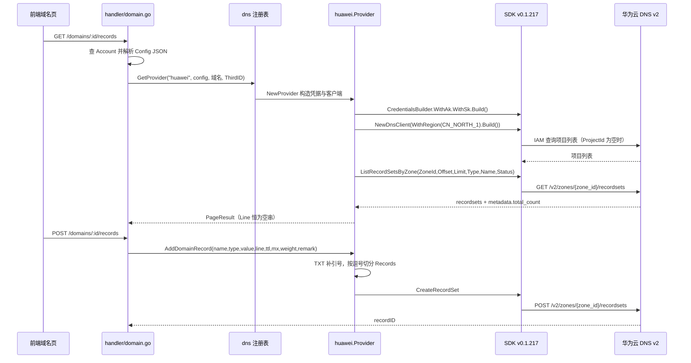
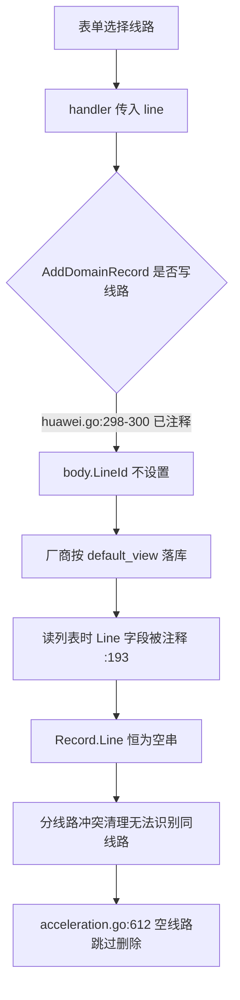
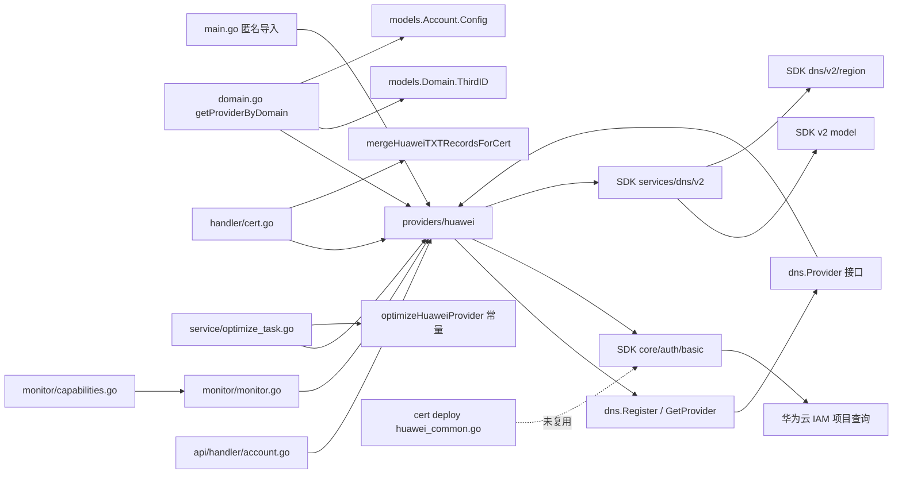
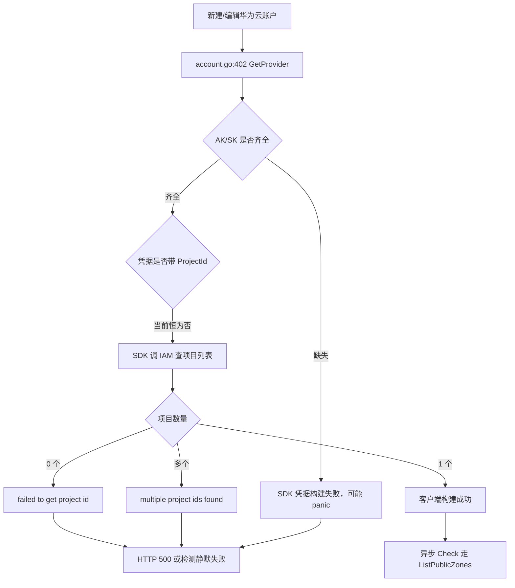
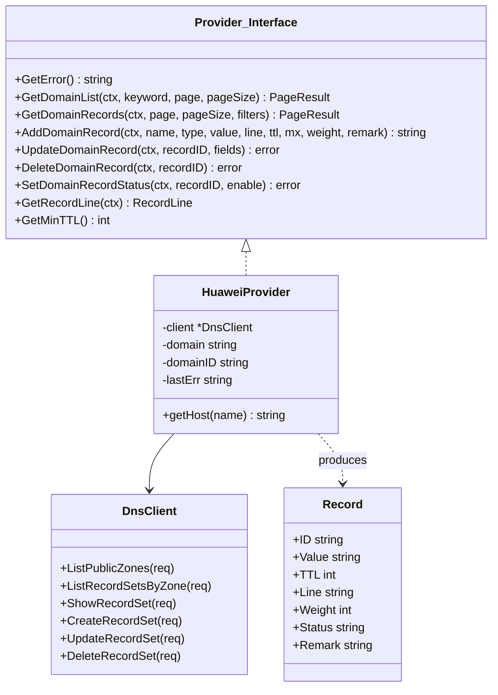

# 华为云DNS

<cite>
**本文档引用的文件**
- [main.go](file://main/main.go)
- [go.mod](file://main/go.mod)
- [interface.go](file://main/internal/dns/interface.go)
- [registry.go](file://main/internal/dns/registry.go)
- [huawei.go](file://main/internal/dns/providers/huawei/huawei.go)
- [aliyun.go](file://main/internal/dns/providers/aliyun/aliyun.go)
- [dnspod.go](file://main/internal/dns/providers/dnspod/dnspod.go)
- [namesilo.go](file://main/internal/dns/providers/namesilo/namesilo.go)
- [helper.go](file://main/internal/dns/providers/huawei/helper.go)
- [models.go](file://main/internal/models/models.go)
- [domain.go](file://main/internal/api/handler/domain.go)
- [domain_ext.go](file://main/internal/api/handler/domain_ext.go)
- [account.go](file://main/internal/api/handler/account.go)
- [acceleration.go](file://main/internal/api/handler/acceleration.go)
- [acceleration_conflict_test.go](file://main/internal/api/handler/acceleration_conflict_test.go)
- [cert.go](file://main/internal/api/handler/cert.go)
- [router.go](file://main/internal/api/router.go)
- [recovery.go](file://main/internal/api/middleware/recovery.go)
- [safe_go.go](file://main/internal/utils/safe_go.go)
- [record_sync.go (apiv1)](file://main/internal/apiv1/record_sync.go)
- [record_sync.go (service)](file://main/internal/service/record_sync.go)
- [optimize_task.go](file://main/internal/service/optimize_task.go)
- [capabilities.go](file://main/internal/monitor/capabilities.go)
- [monitor.go](file://main/internal/monitor/monitor.go)
- [huawei_common.go](file://main/internal/cert/deploy/providers/huawei_common.go)
- [config_cloud.go](file://main/internal/cert/deploy/config_cloud.go)
- [providers.go](file://main/internal/cert/providers.go)
- [account-form.tsx](file://web/components/account-form.tsx)
- [page.tsx (accounts/add)](file://web/app/(dashboard)/dashboard/accounts/add/page.tsx)
</cite>

## 目录

1. [简介](#简介)
2. [项目结构](#项目结构)
3. [核心组件](#核心组件)
4. [架构总览](#架构总览)
5. [详细组件分析](#详细组件分析)
6. [依赖关系分析](#依赖关系分析)
7. [性能考虑](#性能考虑)
8. [故障排查指南](#故障排查指南)
9. [结论](#结论)
10. [附录](#附录)

## 简介

华为云（注册名 `huawei`，显示名"华为云"）是 DNSPlane 22 个 DNS 服务商适配器之一，也是**仅存 3 个官方 SDK 使用者之一**（另两家为阿里云、DNSPod），对接华为云公网权威解析（Public Zone，DNS v2 OpenAPI）。实现集中在 `main/internal/dns/providers/huawei/huawei.go`（395 行）与 `helper.go`（5 行）。

代码事实给出的画像是：**读侧可用、写侧基本可用、分线路与权重被整体关闭**。

| 维度 | 实际状态 | 证据 |
|------|----------|------|
| 账户凭据 | 仅 `AccessKeyId`/`SecretAccessKey` 两项，**无** ProjectID、Region 配置 | `huawei.go:20-23` |
| 接入端点 | 硬编码 `region.CN_NORTH_1` | `huawei.go:45` |
| 线路能力 | `GetRecordLine` 返回 6 条静态线路，但读写两侧线路代码全被注释，记录线路恒为空串 | `:369-378`、`:123-125`、`:193`、`:269` |
| 权重能力 | `Features.Weight = false`，读写两处 `Weight` 均注释 | `:25`、`:178-180`、`:304-306` |
| 记录启停 | 返回错误"华为云不支持设置记录状态"；解析日志同样返回错误 | `:361-367` |
| 最小 TTL | `GetMinTTL() == 1`，全平台最松一档（`aliyun.go:338` 与 `dnspod.go:330` 为 600，`namesilo.go:312` 为 3600） | `:380-382` |

关键在于**能力声明与厂商真实能力的落差**：关闭线路与权重不是因为华为云不支持，而是当前所用 SDK 的 v2 请求/响应模型没有这些字段——分线路与权重要走 `v2.1` 接口；"不支持启停"同样如此，SDK 存在批量启停接口 `PUT /v2.1/recordsets/statuses`。

另一特征是跨模块耦合：华为云"一个主机名的多个 TXT 值聚合为一条记录集"的语义，迫使证书侧写特例 `mergeHuaweiTXTRecordsForCert`（`cert.go:689-691`、`:824-848`）、优选 IP 任务写特例分支（`optimize_task.go:22-23`、`:128-137`）。这是全系统**仅按服务商类型特殊处理的两处业务逻辑**。

**章节来源**
- [huawei.go](file://main/internal/dns/providers/huawei/huawei.go)
- [cert.go](file://main/internal/api/handler/cert.go)
- [optimize_task.go](file://main/internal/service/optimize_task.go)

## 项目结构

### 文件清单与职责

华为云是文件数最少的服务商包之一：一个实现文件加一个指针辅助函数，没有 `lines.go`、没有常量文件、**没有测试文件**。

| 文件 | 行数 | 职责 | 关键符号 |
|------|------|------|----------|
| `internal/dns/providers/huawei/huawei.go` | 395 | 注册、构造客户端、15 个接口方法 | `init`、`NewProvider`、`Provider`、`getHost` |
| `internal/dns/providers/huawei/helper.go` | 5 | 生成 SDK 需要的 `*int32` 指针 | `int32Ptr` |

`helper.go` 只为一个语法问题存在：SDK 的 `Ttl` 字段是 `*int32`，Go 不能对字面量取址，于是包一层（`helper.go:3-5`，调用点 `huawei.go:295`、`:336`）。

SDK 引用面极窄，仅挂 4 个包（`huawei.go:9-12`）：`core/auth/basic`、`services/dns/v2`（别名 `dns_sdk`）、`services/dns/v2/model`、`services/dns/v2/region`。`go.mod:13` 锁定 `huaweicloud-sdk-go-v3 v0.1.217`。

**章节来源**
- [huawei.go](file://main/internal/dns/providers/huawei/huawei.go)
- [helper.go](file://main/internal/dns/providers/huawei/helper.go)
- [go.mod](file://main/go.mod)

### 注册与装载链路

| 阶段 | 位置 | 动作 |
|------|------|------|
| 编译期挂包 | `main.go:43` | `_ "main/internal/dns/providers/huawei"` |
| 运行期注册 | `huawei.go:15-28` | `dns.Register("huawei", NewProvider, ProviderConfig{...})` |
| 注册表写入 | `registry.go:18-23` | 工厂入 `providers`，配置入 `configs` |
| 线路映射 | `registry.go:61` | `DEF=default_view`、`CT=Dianxin`、`CU=Liantong`、`CM=Yidong`、`AB=Abroad` |
| 实例化 | `registry.go:26-37` | `GetProvider(name, config, domain, domainID)` |

注册的 `Icon: "huawei.png"`（`huawei.go:19`）与仓库实际存在的静态图标 `web/public/icons/huawei.ico` 后缀不一致；前端展示走组件内硬编码路径（`account-form.tsx:74`），后端字段经 `p.icon` 透传（`page.tsx:25`）但是否参与最终渲染未逐行确认，记为**未知**。

**章节来源**
- [main.go](file://main/main.go)
- [huawei.go](file://main/internal/dns/providers/huawei/huawei.go)
- [registry.go](file://main/internal/dns/registry.go)
- [account-form.tsx](file://web/components/account-form.tsx)
- [page.tsx (accounts/add)](file://web/app/(dashboard)/dashboard/accounts/add/page.tsx)

## 核心组件

### 组件一：AK/SK 凭据（不含 ProjectID）

```go
// huawei.go:38-41
auth := basic.NewCredentialsBuilder().
    WithAk(config["AccessKeyId"]).
    WithSk(config["SecretAccessKey"]).
    Build()
```

三点事实：

1. **配置项只有 2 个**，均 `Required: true`（`huawei.go:21-22`），注册表没有 `project_id`/`region_id`。对比证书部署侧：`config_cloud.go:138-139` 给 ELB/WAF 任务显式声明了"项目ID""区域ID"输入项。
2. **无空值校验**：AK 或 SK 为空不会提前返回错误，交给 SDK 处理。证书侧则显式校验（`huawei_common.go:32-34`）。
3. **使用被标记 Deprecated 的 `Build()`**：SDK 侧对应"may panic under certain circumstances. Use SafeBuild instead"；证书侧统一用 `SafeBuild()` 并包装成"华为云凭据初始化失败"（`huawei_common.go:41-44`）。

`ProjectId` 是 SDK 凭据的可选字段，证书侧按需设置（`huawei_common.go:36-39`），DNS 侧完全未传。后果不是立即报错，而是让 SDK 在建客户端时**自动查一次 IAM 项目列表**，多项目账号直接失败（机制见[故障排查指南](#故障排查指南)）。

**章节来源**
- [huawei.go](file://main/internal/dns/providers/huawei/huawei.go)
- [huawei_common.go](file://main/internal/cert/deploy/providers/huawei_common.go)
- [config_cloud.go](file://main/internal/cert/deploy/config_cloud.go)

### 组件二：Region（硬编码 cn-north-1）

| 项 | 取值 | 证据 |
|----|------|------|
| 客户端区域 | `region.CN_NORTH_1` | `huawei.go:45` |
| 对应端点 | `https://dns.cn-north-1.myhuaweicloud.com` | SDK `services/dns/v2/region`（依赖模块，不在本仓库） |
| SDK 可用区域 | 27 个 `NewRegion` 定义 | 同上 |
| 按 ID 取区域 | `region.ValueOf` / `SafeValueOf` 现成可用 | 同上 |
| 本仓库是否可配 | 否 | `huawei.go:20-23` |

v2 模型无线路与权重，v2.1 有 `Line`、`Weight`、批量启停与线路枚举。由于 SDK 已提供按 ID 查表的 `region.ValueOf`，"把 region 做成配置字段"的成本仅是一个 `ConfigField`；当前缺失属于**未推进**而非做不到。`Provider` 结构体也没有区域字段（`huawei.go:30-35` 仅 `client`/`domain`/`domainID`/`lastErr`），客户端一旦构建，区域即固化在 SDK 端点表内。

**章节来源**
- [huawei.go](file://main/internal/dns/providers/huawei/huawei.go)

### 组件三：记录接口（15 方法落点）

`dns.Provider` 接口共 15 个方法（`interface.go:41-86`），华为云全部给出实现，其中 4 个是"返回不支持"的桩：

| 方法 | 行 | 形态 | 说明 |
|------|----|------|------|
| `GetError` | `:56-58` | 返回 `lastErr` | 全文无赋值点，且无调用方 |
| `Check` | `:60-63` | 委托 `GetDomainList("", 1, 1)` | 以能否列 zone 作连通判据 |
| `GetDomainList` | `:65-101` | 真实 | `ListPublicZones`，`limit`/`offset` 分页 |
| `GetDomainRecords` | `:112-210` | 真实（线路过滤注释） | `ListRecordSetsByZone` |
| `GetSubDomainRecords` | `:212-214` | 复用上一个 | `subDomain` 转 FQDN 后下传 |
| `GetDomainRecordInfo` | `:216-275` | 真实 | `ShowRecordSet` |
| `AddDomainRecord` | `:277-315` | 真实（线路/权重注释） | `CreateRecordSet` |
| `UpdateDomainRecord` | `:317-346` | 真实 | `UpdateRecordSet` |
| `UpdateDomainRecordRemark` | `:348-350` | 复用更新 | 仅传 remark，其余入参留空 |
| `DeleteDomainRecord` | `:352-359` | 真实 | `DeleteRecordSet` |
| `SetDomainRecordStatus` | `:361-363` | **桩** | 未接批量启停 |
| `GetDomainRecordLog` | `:365-367` | **桩** | 未使用任何日志类接口 |
| `GetRecordLine` | `:369-378` | 静态 6 条 | 不调厂商线路接口 |
| `GetMinTTL` | `:380-382` | 常量 1 | 经 `domain_ext.go:321` 透出前端 |
| `AddDomain` | `:384-394` | **桩** | 真实实现以注释块保留（`:386-393`） |

**章节来源**
- [huawei.go](file://main/internal/dns/providers/huawei/huawei.go)
- [interface.go](file://main/internal/dns/interface.go)
- [domain_ext.go](file://main/internal/api/handler/domain_ext.go)

## 架构总览

下图覆盖"读记录 → 写记录"的完整链路，含注册表、适配器与厂商 v2 API 的调用次序：



**图表来源**
- [huawei.go](file://main/internal/dns/providers/huawei/huawei.go)
- [domain.go](file://main/internal/api/handler/domain.go)
- [registry.go](file://main/internal/dns/registry.go)

三个由代码决定的结构性事实：

1. **provider 每请求重建**。`getProviderByDomain`（`domain.go:37-54`）每个请求都"查账户 → 解 JSON → 建 provider"，`Account.Config` 是整段 JSON 文本（`models.go:55`），`domain.go:44` 直接反序列化为 `map[string]string`。
2. **ZoneID 来自本地库**。`domain.go:48` 传 `domain.ThirdID`（`models.go:77`，`size:60`），适配器原样作为所有请求的 `ZoneId`（`huawei.go:114`、`:218`、`:279`、`:319`、`:354`）；本地缺失时以空 zone id 下发。
3. **构建期可能有外部调用与 panic**。凭据无 ProjectId 时 SDK 在 `Build()` 内查 IAM，失败路径为 panic；HTTP 由 `router.go:29` 的 `gin.Recovery()` 与 `router.go:48` 的 `middleware.Recovery()` 兜住。

**章节来源**
- [domain.go](file://main/internal/api/handler/domain.go)
- [models.go](file://main/internal/models/models.go)
- [router.go](file://main/internal/api/router.go)

## 详细组件分析

### 认证与凭据生命周期

认证路径完整可贴（`huawei.go:37-54`）：先建凭据，再建客户端并固定 `CN_NORTH_1`，最后返回仅含 4 个字段的 `Provider`。与同一仓库证书侧的同一功能对照：

| 关注点 | DNS 侧 `huawei.go` | 证书侧 `huawei_common.go` |
|--------|--------------------|---------------------------|
| AK/SK 键名兼容 | 只认标准两键（`:39-40`） | 兼容 `access_key`/`secret_key`（`:17-24`） |
| 空凭据校验 | 无 | 显式报错（`:32-34`） |
| ProjectId | 从不设置 | 非空时 `WithProjectId`（`:37-39`） |
| 构建方式 | `Build()`，可能 panic（`:41`、`:47`） | `SafeBuild()` + 错误包装（`:41-44`） |
| 区域来源 | SDK 常量（`:45`） | 由 `region_id`/`endpoint` 动态构造（`:81-83`） |

同一厂商、同一 SDK、两套凭据装配质量，是"公共能力未下沉"的典型样本：证书侧已把踩过的坑（键名别名、ProjectId、SafeBuild、endpoint 补 scheme）固化进 `huawei_common.go`，DNS 侧一行未复用。二者分层上也不可达——`huawei_common.go:10` 只依赖 `cert/deploy/base`，不存在被 `internal/dns` 反向引用的通道。

`lastErr` 被声明并被 `GetError()` 返回（`huawei.go:34`、`:56-58`），但全文无赋值点，错误一律经方法返回值上抛；`GetError()` 在本仓库也没有任何调用方。

**章节来源**
- [huawei.go](file://main/internal/dns/providers/huawei/huawei.go)
- [huawei_common.go](file://main/internal/cert/deploy/providers/huawei_common.go)

### Zone 与域名映射

```go
// huawei.go:82-90
for _, z := range *response.Zones {
    name := *z.Name
    name = strings.TrimSuffix(name, ".")
    domains = append(domains, dns.DomainInfo{
        ID:          *z.Id,
        Name:        name,
        RecordCount: int(*z.RecordNum),
    })
}
```

映射丢失的厂商字段直接决定排障口径：

| 厂商 Zone 字段 | 是否映射 | 影响 |
|----------------|----------|------|
| `Id` | 是 → `DomainInfo.ID` | 写入 `Domain.ThirdID`，是 zone id 唯一来源 |
| `Name` | 是（去尾点） | 主机记录反解依赖它 |
| `RecordNum` | 是 → `RecordCount` | 列表页记录数 |
| `Status` | 否 | 前端无法显示 zone 暂停/冻结 |
| `ProjectId` | 否 | 无法按 zone 归属项目装配凭据 |
| `EnterpriseProjectId` | 否 | 企业项目维度丢失 |
| `Ttl`（SOA 默认值） | 否 | `Domain.MinTTL` 需其他路径填充 |
| `Description` | 否 | 备注单向：写 `remark → Description`，不回读 |

分页总数取法是安全的（`huawei.go:92-95`、`:201-204`）：`Metadata` 与 `TotalCount` 都判空。但 `:82` 的 `*response.Zones` 与 `:149` 的 `*response.Recordsets` **未判空**，而 SDK 侧两者均声明为 `*[]T json:"...,omitempty"`，即缺字段时得到 nil 切片指针，解引用即 panic——本适配器最主要的健壮性缺口。

**章节来源**
- [huawei.go](file://main/internal/dns/providers/huawei/huawei.go)
- [models.go](file://main/internal/models/models.go)
- [interface.go](file://main/internal/dns/interface.go)

### Record 读写：多值与逗号切分

核心语义是**一个记录集承载多个值**，适配器把它压扁成本系统单值字符串：

| 方向 | 代码 | 行为 | 风险 |
|------|------|------|------|
| 读 | `huawei.go:168` | `strings.Join(*r.Records, ",")` | 多值 RRSet 变逗号串 |
| 写 | `:286`、`:327` | `strings.Split(value, ",")` | 含逗号的单值被拆成多条 |
| 读 MX | `:162-166` | `SplitN(records[0], " ", 2)`，只取首值 | 多条 MX 静默丢弃 |
| 写 MX | `:287-289` | `fmt.Sprintf("%d %s", mx, value)` | 强制单值 |
| 读单条 | `:236-246` | 与列表逻辑重复一份 | 违反 DRY，易分叉 |
| 写 TXT | `:282-284`、`:323-325` | 不以 `"` 开头则补首尾引号 | 只判前缀不判后缀 |

读写对称的逗号切分带来必须写进文档的副作用：**任何值内含逗号的记录都会被拆成多条**。SDK 对 `Records` 的说明仅为"不同类型解析记录对应的值的规则不同"，未把逗号定义为分隔符，因此 TXT、SPF-like 文本等可能误拆。

主机名规范化由 `getHost` 完成（`huawei.go:103-110`）：`@` 转空串，其余加 `.` 后拼 `domain + "."`，与 SDK 对 `Name` 的 FQDN 约束一致；反方向 `:150-155` 用 `TrimSuffix(name, "."+zoneName)` 还原，空串归一为 `@`，同样正确。

但 `getHost` 未覆盖**空字符串**入参，而 `UpdateDomainRecordRemark` 恰好以空 name 调用更新（`huawei.go:348-350`）：`""` 变成 `".example.com."`（多点前缀），`recordType == ""` 使 `:327` 得到 `[""]`，`ttl` 为 `0` 低于厂商下限。因此 `record_sync.go (apiv1):360` 的"仅改备注"接口在华为云上大概率失败。此条标注为**推断**：代码路径确证，厂商返回文案未实测。

**章节来源**
- [huawei.go](file://main/internal/dns/providers/huawei/huawei.go)
- [record_sync.go (apiv1)](file://main/internal/apiv1/record_sync.go)

### 线路：声明可用、链路失效

线路是误读最多的部分，因为系统里有**多处彼此矛盾的口径**：

| 位置 | 内容 | 是否生效 |
|------|------|----------|
| `huawei.go:369-378` | 静态返回 `default_view`/`Dianxin`/`Liantong`/`Yidong`/`Jiaoyuwang`/`Abroad` | 生效（下拉 6 项） |
| `registry.go:61` | DEF/CT/CU/CM/AB 5 个线路码 | 生效（优选 IP、分线路加速） |
| `huawei.go:123-125` | `request.LineId = &line` 注释 | 失效（不能按线路过滤） |
| `:193`、`:269` | 读侧 `Line: *r.LineId` 注释 | 失效（`Record.Line` 恒空） |
| `:298-300`、`:304-306` | 写侧 `body.LineId`、`body.Weight` 注释 | 失效（新增/更新不带线路与权重） |
| `:25` | `Features.Weight = false` | 生效（`domain_ext.go:322` 报 `supports_weight: false`） |

注释掉的代码不是"待开启"，而是**在当前 SDK 模型上无法编译**：`CreateRecordSetRequestBody` 只有 `Name`/`Description`/`Type`/`Status`/`Ttl`/`Records`/`Tags` 七个字段，`UpdateRecordSetReq` 更少（无 `Status`），`ListRecordSetsByZoneRequest` 无线路参数，列表项模型 `ListRecordSets` 也没有线路与权重字段。带 `Line`、`Weight` 的模型集中在 v2.1（`CreateRecordSetWithLineRequestBody`），对应 `POST /v2.1/zones/{zone_id}/recordsets`。

线路枚举侧同样有现成能力未用：`GET /v2.1/zones/{zone_id}/lines`（`ListPublicZoneLines`）返回真实线路 ID 与名称，`GetRecordLine` 可不硬编码。当前 6 条里的 `Jiaoyuwang`（`:375`）在 `registry.go:61` 中**没有对应键**，属两份静态表不一致。



**图表来源**
- [huawei.go](file://main/internal/dns/providers/huawei/huawei.go)
- [acceleration.go](file://main/internal/api/handler/acceleration.go)

`acceleration.go:612` 的 `if rec.Line == "" || rec.Line != line { continue }` 是该链的下游兜底，并由 `acceleration_conflict_test.go:213` 的 `TestRemoveConflictingRecordsTreatsEmptyRecordLineAsUnmatched` 显式覆盖——测试注释直接点名"记录自身线路未知（如 huawei 的 provider 不返回线路字段）"。即：**华为云记录在线路上"看不见"是被测试固化的既定行为**，保守放过而非误删。

**章节来源**
- [huawei.go](file://main/internal/dns/providers/huawei/huawei.go)
- [registry.go](file://main/internal/dns/registry.go)
- [acceleration.go](file://main/internal/api/handler/acceleration.go)
- [acceleration_conflict_test.go](file://main/internal/api/handler/acceleration_conflict_test.go)

### TTL 与记录类型约束

| 约束项 | 厂商规定（SDK 模型说明） | 本适配器落地 | 证据 |
|--------|--------------------------|--------------|------|
| TTL 范围 | 1~2147483647 秒，默认 300 | `GetMinTTL()==1`，透传前端 | `huawei.go:380-382`、`domain_ext.go:321` |
| TTL 为 0 | 非法 | 不校验，`int32Ptr(int32(ttl))` 直接下发 | `:295`、`:336` |
| 记录类型 | A/AAAA/MX/CNAME/TXT/NS/SOA/CAA（PTR 仅内网） | 无白名单，原样透传 | `:293`、`:334` |
| Name | 以 zone name 结尾的 FQDN，带尾点 | `getHost` 保证 | `:103-110` |
| Description | ≤255 字符 | 无截断无校验 | `:301-303`、`:339-341` |
| 状态取值 | ENABLE/DISABLE，默认 ENABLE | 读侧只解析 `ACTIVE` | `:172-175` |

反直觉但重要的一点：`GetMinTTL()==1` 让华为云成为系统里允许最小 TTL 的平台之一，前端不做下限拦截，而 `:295` 在 `ttl` 未传（0）时仍下发 `ttl: 0`，落到厂商侧即非法值——"最小 1"这一声明没有被用来做任何兜底钳制。

状态字段另一处不一致：读取时把 `ACTIVE` 认作启用、其余归 `disable`（`:172-175`、`:248-251`），过滤时却生成 `ACTIVE`/`DISABLE`（`:129-137`）。这与本仓库多数云厂商统一使用 `ENABLE`/`DISABLE` 的口径（`normalizeDNSListStatusForAPI`，`domain.go:56-73`）不同，但恰好与 `capabilities.go:14` 的 `Pause: false` 一致；该处 `Mixed: true`（同线路 A 与 CNAME 可并存）也与厂商行为相符。

**章节来源**
- [huawei.go](file://main/internal/dns/providers/huawei/huawei.go)
- [domain.go](file://main/internal/api/handler/domain.go)
- [capabilities.go](file://main/internal/monitor/capabilities.go)

### 与证书、优选 IP 链路的耦合

| 链路 | 特例位置 | 内容 |
|------|----------|------|
| 证书 DNS-01 | `cert.go:689-691` | 仅当账户 `Type == "huawei"` 才调用合并函数 |
| TXT 合并实现 | `cert.go:824-848` | 同主机名 TXT 合并为 `"a","b"` 单值，非 TXT 原样保留，主机名字典序重排 |
| 优选 IP 写入 | `optimize_task.go:128-137` | 多 IP 排序、按 `recordNum` 截断后 `Join(",")` 成单条，并强制 `recordNum=1` |
| 证书部署侧凭据 | `providers.go:532-537`、`config_cloud.go:117-142` | `huawei_cdn` 等部署器与 DNS 适配器不共享代码 |

优选 IP 这段特例解释了 `huawei.go:286` 的逗号切分为何"看似危险却必要"：任务层拼出 `1.1.1.1,2.2.2.2` 的单值，靠适配器 `Split` 还原为厂商多值 RRSet。一拼一切构成**跨模块隐式契约**，任一侧改动都会静默破坏另一侧。

**章节来源**
- [cert.go](file://main/internal/api/handler/cert.go)
- [optimize_task.go](file://main/internal/service/optimize_task.go)
- [providers.go](file://main/internal/cert/providers.go)
- [config_cloud.go](file://main/internal/cert/deploy/config_cloud.go)
- [huawei.go](file://main/internal/dns/providers/huawei/huawei.go)

## 依赖关系分析



**图表来源**
- [huawei.go](file://main/internal/dns/providers/huawei/huawei.go)
- [registry.go](file://main/internal/dns/registry.go)
- [interface.go](file://main/internal/dns/interface.go)
- [cert.go](file://main/internal/api/handler/cert.go)
- [optimize_task.go](file://main/internal/service/optimize_task.go)
- [huawei_common.go](file://main/internal/cert/deploy/providers/huawei_common.go)

反向依赖（谁会碰到华为云适配器）：

| 调用点 | 文件:行 | 华为云下的结果 |
|--------|---------|----------------|
| 记录 CRUD | `domain.go:48`、`:932`、`:1020` | 正常，线路/权重字段为空 |
| 仅改备注 | `record_sync.go (apiv1):360` | 大概率失败（空 name/ttl 下发） |
| 账户连通检测 | `account.go:402`、`:420` | 走 `GetDomainList` |
| 服务商元数据下发 | `account.go:445-466` | 2 个必填字段、`Add: false` |
| 线路与特性查询 | `domain_ext.go:313`、`:321-325` | 6 条线路、`supports_*` 全 false |
| 优选 IP | `optimize_task.go:128` | 每线路一条聚合记录 |
| 分线路加速 | `acceleration.go:612` | 读不到线路，删除保守跳过 |
| 证书签发 | `cert.go:689-691`、`:965` | TXT 自动加引号并合并 |

**章节来源**
- [domain.go](file://main/internal/api/handler/domain.go)
- [account.go](file://main/internal/api/handler/account.go)
- [domain_ext.go](file://main/internal/api/handler/domain_ext.go)
- [monitor.go](file://main/internal/monitor/monitor.go)
- [acceleration.go](file://main/internal/api/handler/acceleration.go)
- [record_sync.go (service)](file://main/internal/service/record_sync.go)

## 性能考虑

### SDK 版本与接口代际

依赖锁定 `v0.1.217`（`go.mod:13`）。版本不是瓶颈，**接口代际选择**才同时决定性能与能力面：

| 代际 | 本适配器 | 特性 | 代价 |
|------|----------|------|------|
| v2 `/v2/zones/...` | 使用 | 模型无线路、无权重 | 线路与权重功能整体缺失 |
| v2.1 `/v2.1/...` | 未使用 | 支持 `Line`、`Weight`、批量启停、线路查询 | 需换模型并处理任务型接口异步返回 |

结论："补齐线路/权重/启停"不是加两个 if，而是**把适配器迁到 v2.1 模型**，属中等规模改造。

**章节来源**
- [huawei.go](file://main/internal/dns/providers/huawei/huawei.go)
- [go.mod](file://main/go.mod)

### 每请求构建客户端的开销与 panic 面

`getProviderByDomain`（`domain.go:37-54`）不做 provider 缓存，华为云每个请求都要重跑 `NewProvider`，即重建凭据与 SDK 客户端。SDK 侧两个直接影响：

1. **构建期 IAM 往返**。凭据未设 `ProjectId` 且使用 `WithRegion` 时，SDK 在客户端构建阶段调 IAM 项目列表接口补齐项目 ID；SDK 以 `AK + region` 为键做进程级缓存，故同一账户通常只付一次代价。但该缓存是**进程全局、无过期时间**的映射，项目变更后需重启进程才会重新查询。
2. **失败以 panic 出现**。`DnsClientBuilder().Build()` 是"内部 `SafeBuild()` 出错即 panic"的封装（SDK 已标记 Deprecated）。HTTP 由 `router.go:29`、`router.go:48` 两层 Recovery 兜住（`recovery.go:16-21` 说明与默认实现的差异），后台各有 recover：`monitor.go:185-190`、`optimize_task.go:351-356`、`utils/safe_go.go`（`account.go:417` 用的 `SafeGo`）。因此 **panic 不会打挂进程，但表现为 500 或"任务静默失败 + 堆栈日志"**，很难与"配置错误"关联。

**章节来源**
- [domain.go](file://main/internal/api/handler/domain.go)
- [router.go](file://main/internal/api/router.go)
- [recovery.go](file://main/internal/api/middleware/recovery.go)
- [safe_go.go](file://main/internal/utils/safe_go.go)

### 分页行为

`GetDomainList`（`huawei.go:67-70`）与 `GetDomainRecords`（`:115-118`）都正确换算 `limit`/`offset` 交由厂商分页，`GetSubDomainRecords`（`:213`）转调而不额外拉全量。华为云在这一点上优于 AWS、百度云（这两家忽略分页返回全量），大批量记录场景的内存与延迟表现更可控。

**章节来源**
- [go.mod](file://main/go.mod)
- [huawei.go](file://main/internal/dns/providers/huawei/huawei.go)
- [domain.go](file://main/internal/api/handler/domain.go)
- [router.go](file://main/internal/api/router.go)
- [recovery.go](file://main/internal/api/middleware/recovery.go)
- [safe_go.go](file://main/internal/utils/safe_go.go)

## 故障排查指南

### 陷阱一：ProjectID 缺失引发 IAM 自动查询失败

这是最需要写进运维手册的一条。注册表未暴露项目 ID（`huawei.go:20-23`）、`NewProvider` 也不设置（`:38-41`），SDK 只能在构建客户端时代为查询 IAM：

| SDK 判定 | 表现 | 触发条件 |
|----------|------|----------|
| 恰好 1 个项目 | 静默成功 | 单项目账号（最常见） |
| 0 个项目 | `failed to get project id of region '...' automatically`，提示确认项目存在或显式设置 project id | 账号在该区域无项目、AK/SK 无权列项目 |
| 多个项目 | `multiple project ids found: [...]`，要求初始化凭据时二选一 | 账号存在多区域/企业项目 |
| IAM 调用失败 | 同上自动查询错误 | IAM 不可达、AK/SK 无效 |

四类中后三类的共同表现是：**适配器代码里一行错误处理都没有**，异常从 SDK 构建路径以 panic 抛出，HTTP 侧变 500，前端只见"服务异常"。

处置顺序：

1. 先确认账号在**华北-北京一（cn-north-1）**是否有可用项目；若无，问题在账号侧而非代码侧。
2. 若存在多项目，短期只能把 AK/SK 换绑到单项目权限凭据；长期修复是给注册表补可选 `ProjectId` 并在 `NewProvider` 里按需 `WithProjectId`，同时把 `Build()` 换成 `SafeBuild()` 以拿到可读错误——参考实现已在本仓库（`huawei_common.go:31-46`）。
3. "改完配置仍报同样错"要记得 SDK 项目缓存无过期时间，重启服务后再验证。



**图表来源**
- [account.go](file://main/internal/api/handler/account.go)
- [huawei.go](file://main/internal/dns/providers/huawei/huawei.go)

**章节来源**
- [huawei.go](file://main/internal/dns/providers/huawei/huawei.go)
- [account.go](file://main/internal/api/handler/account.go)
- [huawei_common.go](file://main/internal/cert/deploy/providers/huawei_common.go)

### 陷阱二：Zone 能列出但记录列表 500 或空

优先怀疑 **`Domain.ThirdID` 为空**。适配器把 `domainID` 原样塞进所有请求（`huawei.go:114`、`:218`、`:279`、`:319`、`:354`），空值会打到 `/v2/zones//recordsets` 这类畸形路径；ThirdID 来自 `GetDomainList` 的 `*z.Id`（`:86`），因此**手工录入而未走同步的域名**最易出现该状态。另一分支是响应缺字段导致的 nil 解引用（`:82`、`:149` 未判空）。

**章节来源**
- [huawei.go](file://main/internal/dns/providers/huawei/huawei.go)
- [models.go](file://main/internal/models/models.go)

### 陷阱三：记录建好了但线路不对

现象是表单选了电信/联通/移动、云端却落在默认线路，根因即 `huawei.go:298-300` 的 `body.LineId` 被注释，且用户侧**无任何提示**（`GetRecordLine` 照旧返回 6 条可选项）。验证方法：新增后立刻读回该记录，`Line` 字段恒为空串（读侧 `:193` 同样被注释）。

**章节来源**
- [huawei.go](file://main/internal/dns/providers/huawei/huawei.go)

### 陷阱四：启用/暂停与解析日志报"不支持"

`SetDomainRecordStatus` 是桩（`huawei.go:361-363`），文案"华为云不支持设置记录状态"；路由 `router.go:141` 把错误原样返回。`GetDomainRecordLog` 同理（`:365-367`，路由 `router.go:151`）。`capabilities.go:14` 的 `Pause: false` 是同一结论的第二份口径。需说明：厂商侧并非无解——v2 创建请求体本身可带 `Status`，SDK 亦有批量启停接口，因此准确表述是"当前实现不支持"。

**章节来源**
- [huawei.go](file://main/internal/dns/providers/huawei/huawei.go)
- [router.go](file://main/internal/api/router.go)
- [capabilities.go](file://main/internal/monitor/capabilities.go)

### 陷阱五：TXT 值多引号或被拆成多条

| 现象 | 根因 | 证据 |
|------|------|------|
| 值两端出现引号或引号重复 | TXT 且不以 `"` 开头则补引号 | `huawei.go:282-284`、`:323-325` |
| 一条记录变多条 / 逗号消失 | `strings.Split(value, ",")` | `:286`、`:327` |
| 证书验证需多条 TXT 合并 | 证书侧特例处理 | `cert.go:689-691`、`:824-848` |
| 优选 IP 只写一条记录 | 任务侧聚合成单值 | `optimize_task.go:128-137` |

手工录入含逗号的 TXT（例如带参数的校验串）需按厂商规则改写成带引号的多段字符串，本适配器不代为判断。

**章节来源**
- [huawei.go](file://main/internal/dns/providers/huawei/huawei.go)
- [cert.go](file://main/internal/api/handler/cert.go)
- [optimize_task.go](file://main/internal/service/optimize_task.go)

### 陷阱六：只改备注的接口失败

`record_sync.go (apiv1):360` 走 `UpdateDomainRecordRemark`，其实现是"其余参数留空的整条更新"（`huawei.go:348-350`），会下发畸形 `name`、空 `type`、`ttl: 0`。标注**推断**：代码路径确证，厂商实际文案未实测。规避方式是走整条记录编辑（`router.go:143`）。

**章节来源**
- [record_sync.go (apiv1)](file://main/internal/apiv1/record_sync.go)
- [huawei.go](file://main/internal/dns/providers/huawei/huawei.go)
- [router.go](file://main/internal/api/router.go)

### 常见现象速查表

| 现象 | 首查项 | 相关位置 |
|------|--------|----------|
| 添加账户后一直"服务异常" | 账号是否有多个项目、AK/SK 权限 | `huawei.go:38-47` |
| 域名列表为空但账号有效 | 域名是否在其他区域（只打 cn-north-1） | `:45` |
| 记录能读不能删 | zone id 是否缺失 | `:114`、`:354` |
| 线路下拉 6 项但无效 | 写侧 LineId 注释 | `:298-300` |
| 权重输入框消失 | `Features.Weight=false` | `:25`、`domain_ext.go:322` |
| 启停/日志报不支持 | 桩实现 | `:361-363`、`:365-367` |
| 添加域名按钮不可用 | `Features.Add=false` 且 `AddDomain` 返回错误 | `:25`、`:384-394` |
| 分线路加速不删旧记录 | 记录线路为空被保守跳过 | `acceleration.go:612` |
| 优选 IP 后同主机仅一条 A | 华为云聚合写单条 | `optimize_task.go:128-137` |

**章节来源**
- [huawei.go](file://main/internal/dns/providers/huawei/huawei.go)
- [acceleration.go](file://main/internal/api/handler/acceleration.go)
- [optimize_task.go](file://main/internal/service/optimize_task.go)
- [domain_ext.go](file://main/internal/api/handler/domain_ext.go)

## 结论

华为云适配器是"最小可用 + 明显欠账"的组合。zone 列表、按 zone 查记录（厂商侧分页）、单条查询、增删改、备注映射到 `Description`、MX 优先级双向转换、FQDN 拼接与反解都正确落地；`GetMinTTL()==1` 与厂商下限一致，状态字符串也符合 `DISABLE` 而非 `PAUSE` 的厂商口径。

三条能力线是断的，且断法不同：

- **线路与权重**：注释代码在 v2 模型上无法编译，缺的是接口代际（v2 → v2.1），不是开关。
- **记录启停**：厂商有可用接口，当前是纯桩。
- **ProjectID 与 Region**：注册表无字段，区域锁死 cn-north-1、项目靠 SDK 推断，多项目账号撞上 hard fail。

优先级最高的三件事都不涉及新功能：（1）`NewProvider` 的凭据与客户端构建改 `SafeBuild()` 并返回可读错误，同时给 `huawei.go:82`、`:149` 补 nil 判断——收益最高、风险最低；（2）注册表补可选 `ProjectId`/`Region`，用 `region.ValueOf` 落地以消除隐式 IAM 查询，参考实现已在同仓库；（3）把证书侧与优选 IP 侧对"多值单记录"的隐式契约显式化，目前靠"一边 Join 一边 Split"跨模块配合（`optimize_task.go:135` 与 `huawei.go:286`），任一侧改动都会静默破坏另一侧。

**章节来源**
- [huawei.go](file://main/internal/dns/providers/huawei/huawei.go)
- [huawei_common.go](file://main/internal/cert/deploy/providers/huawei_common.go)
- [optimize_task.go](file://main/internal/service/optimize_task.go)

## 附录

### 附录 A：接口结构（类型视角）



**图表来源**
- [interface.go](file://main/internal/dns/interface.go)
- [huawei.go](file://main/internal/dns/providers/huawei/huawei.go)

**章节来源**
- [interface.go](file://main/internal/dns/interface.go)
- [huawei.go](file://main/internal/dns/providers/huawei/huawei.go)

### 附录 B：字段映射总表

| 本系统字段 | 厂商字段 | 写方向 | 读方向 | 证据 |
|-----------|----------|--------|--------|------|
| `Record.ID` | `recordset.id` | 不写 | `*r.Id` | `huawei.go:188`、`:264` |
| `Record.Name` | `recordset.name`（FQDN） | `getHost` 拼接 | `TrimSuffix` 还原 | `:103-110`、`:150-155` |
| `Record.Value` | `records[]`（多值） | `Split(",")` | `Join(",")` | `:286`、`:168` |
| `Record.TTL` | `ttl`（1~2147483647） | `int32Ptr` | `int(*r.Ttl)` | `:295`、`:192` |
| `Record.Line` | `line`（v2.1） | **不写** | **不读** | `:298-300`、`:193` |
| `Record.Weight` | `weight`（v2.1） | **不写** | **不读** | `:304-306`、`:178-180` |
| `Record.MX` | `records[0]` 前缀数字 | `"%d %s"` | `SplitN(...,2)` | `:288`、`:162-165` |
| `Record.Status` | `status`（ACTIVE/…） | 不写 | `ACTIVE→enable` | `:172-175` |
| `Record.Remark` | `description`（≤255） | 非空才写 | `*r.Description` | `:301-303`、`:182-185` |
| `DomainInfo.ID` | `zone.id` | — | `*z.Id` | `:86` |
| `DomainInfo.Status` | `zone.status` | — | **不映射** | SDK `PublicZoneResp` |
| （无对应字段） | `zone.project_id` | — | **不映射** | SDK `PublicZoneResp` |
| `PageResult.Total` | `metadata.total_count` | — | 判空后取 | `:92-95`、`:201-204` |

**章节来源**
- [huawei.go](file://main/internal/dns/providers/huawei/huawei.go)
- [interface.go](file://main/internal/dns/interface.go)

### 附录 C：厂商接口调用清单

| 适配器方法 | SDK 方法 | HTTP 路径 | 代际 |
|-----------|----------|-----------|------|
| `GetDomainList` | `ListPublicZones` | `GET /v2/zones` | v2 |
| `GetDomainRecords` / `GetSubDomainRecords` | `ListRecordSetsByZone` | `GET /v2/zones/{zone_id}/recordsets` | v2 |
| `GetDomainRecordInfo` | `ShowRecordSet` | `GET /v2/zones/{zone_id}/recordsets/{recordset_id}` | v2 |
| `AddDomainRecord` | `CreateRecordSet` | `POST /v2/zones/{zone_id}/recordsets` | v2 |
| `UpdateDomainRecord` / `UpdateDomainRecordRemark` | `UpdateRecordSet` | `PUT /v2/zones/{zone_id}/recordsets/{recordset_id}` | v2 |
| `DeleteDomainRecord` | `DeleteRecordSet` | `DELETE /v2/zones/{zone_id}/recordsets/{recordset_id}` | v2 |
| `AddDomain`（注释保留） | `CreatePublicZone` | `POST /v2/zones` | v2 |
| 未使用（可支持线路/权重） | `CreateRecordSetWithLine` | `POST /v2.1/zones/{zone_id}/recordsets` | v2.1 |
| 未使用（可支持启停） | `BatchSetRecordSetsStatus` | `PUT /v2.1/recordsets/statuses` | v2.1 |
| 未使用（可支持线路枚举） | `ListPublicZoneLines` | `GET /v2.1/zones/{zone_id}/lines` | v2.1 |

v2/v2.1 的路径与模型取自依赖模块 `huaweicloud-sdk-go-v3 v0.1.217` 的 `services/dns/v2` 源码（Go module 缓存路径，不属于本仓库，故不列入 `<cite>`）；本仓库调用点见 `huawei.go`。

**章节来源**
- [huawei.go](file://main/internal/dns/providers/huawei/huawei.go)
- [go.mod](file://main/go.mod)

### 附录 D：与其他 SDK 型服务商对照

| 维度 | `huawei` | `aliyun` | `dnspod` |
|------|----------|----------|----------|
| SDK | `huaweicloud-sdk-go-v3`（`go.mod:13`） | `alibaba-cloud-sdk-go` | `tencentcloud-sdk-go/dnspod`（`go.mod:18`） |
| 记录启停 | 不支持（`:361-363`） | 支持 | 支持 |
| 权重 | 关闭（`:25`） | 支持 | 支持 |
| 解析日志 | 不支持（`:365-367`） | 支持 | 声明支持但实现被注释 |
| `GetMinTTL` | 1（`huawei.go:380-382`） | 600（`aliyun.go:338`） | 600（`dnspod.go:330`） |

**章节来源**
- [huawei.go](file://main/internal/dns/providers/huawei/huawei.go)
- [go.mod](file://main/go.mod)

### 附录 E：已知不一致清单

| 编号 | 类型 | 描述 | 位置 |
|------|------|------|------|
| H-01 | 能力声明 | `GetRecordLine` 返回 6 条线路，读写两侧均不落地 | `huawei.go:369-378`、`:298-300`、`:193` |
| H-02 | 表间不一致 | `Jiaoyuwang` 在线路枚举中，但 `DefaultLineMapping` 无对应键 | `:375`、`registry.go:61` |
| H-03 | 能力声明 | `Features.Status=false` 表述成"厂商不支持"，实为"实现未接" | `:25`、`:361-363` |
| H-05 | DRY | 列表与单条查询的解析逻辑重复两份 | `:149-199`、`:226-274` |
| H-06 | 健壮性 | `*response.Zones`、`*response.Recordsets` 未判 nil | `:82`、`:149` |
| H-07 | 凭据质量 | 未复用证书侧的键名兼容与 `SafeBuild` | `:38-47`、`huawei_common.go:16-46` |
| H-09 | 测试缺口 | `providers/huawei` 无单元测试，仅被加速冲突测试间接引用 | `acceleration_conflict_test.go:213` |
| H-10 | 未验证项 | 其他区域端点覆盖情况、多值 RRSet 的厂商配额 | 未知（未实测厂商 API） |

**章节来源**
- [huawei.go](file://main/internal/dns/providers/huawei/huawei.go)
- [registry.go](file://main/internal/dns/registry.go)
- [huawei_common.go](file://main/internal/cert/deploy/providers/huawei_common.go)
- [acceleration_conflict_test.go](file://main/internal/api/handler/acceleration_conflict_test.go)

### 附录 F：术语

| 术语 | 含义 |
|------|------|
| Zone / 公网域名 | 华为云权威解析顶层容器，对应 `Domain.ThirdID`（`models.go:77`） |
| RecordSet / 记录集 | 同主机名 + 同类型 + 同线路的一组记录值，`records` 为多值数组（`huawei.go:286`） |
| Line / 线路 | 分线路解析，v2 模型不暴露，需 v2.1；`default_view` 为默认线路标识（`registry.go:61`） |
| ProjectID | 华为云区域项目标识，SDK 凭据可选字段，本适配器未设置 |
| `ACTIVE` / `DISABLE` | 华为云记录集状态取值（`huawei.go:131-135`、`:172-175`） |

**章节来源**
- [huawei.go](file://main/internal/dns/providers/huawei/huawei.go)
- [registry.go](file://main/internal/dns/registry.go)
- [models.go](file://main/internal/models/models.go)
