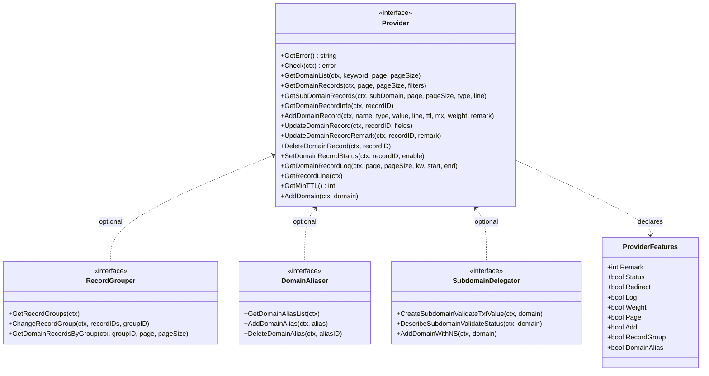
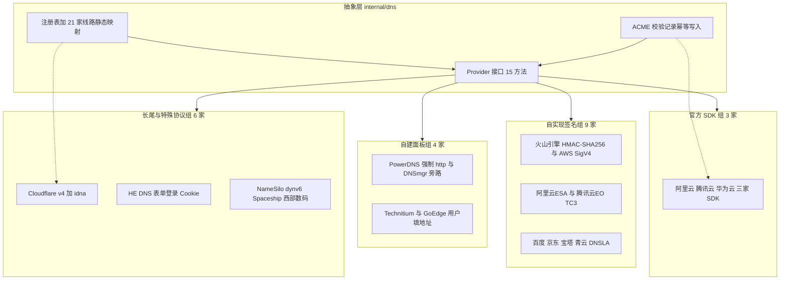
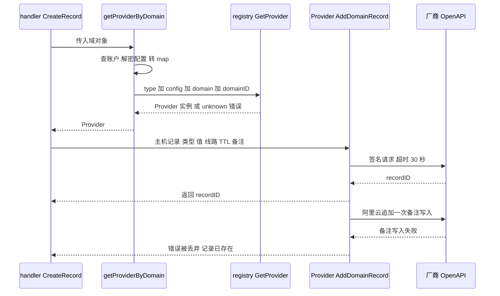
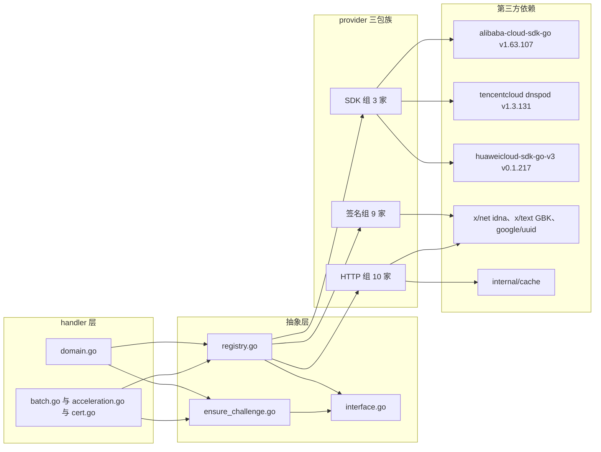
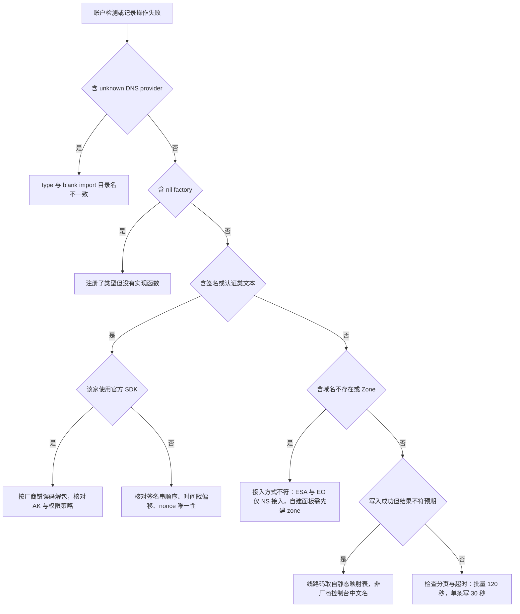

# 支持的DNS服务商

<cite>
**本文档引用的文件**
- [main.go](file://main/main.go)
- [go.mod](file://main/go.mod)
- [interface.go](file://main/internal/dns/interface.go)
- [registry.go](file://main/internal/dns/registry.go)
- [ensure_challenge.go](file://main/internal/dns/ensure_challenge.go)
- [empty_record_list.go](file://main/internal/dns/empty_record_list.go)
- [aliyun.go](file://main/internal/dns/providers/aliyun/aliyun.go)
- [aliyunesa.go](file://main/internal/dns/providers/aliyunesa/aliyunesa.go)
- [aws.go](file://main/internal/dns/providers/aws/aws.go)
- [baidu.go](file://main/internal/dns/providers/baidu/baidu.go)
- [bt.go](file://main/internal/dns/providers/bt/bt.go)
- [cloudflare.go](file://main/internal/dns/providers/cloudflare/cloudflare.go)
- [lines.go](file://main/internal/dns/providers/cloudflare/lines.go)
- [dnsla.go](file://main/internal/dns/providers/dnsla/dnsla.go)
- [dnsmgr.go](file://main/internal/dns/providers/dnsmgr/dnsmgr.go)
- [dnspod.go](file://main/internal/dns/providers/dnspod/dnspod.go)
- [dynv6.go](file://main/internal/dns/providers/dynv6/dynv6.go)
- [goedge.go](file://main/internal/dns/providers/goedge/goedge.go)
- [henet.go](file://main/internal/dns/providers/henet/henet.go)
- [huawei.go](file://main/internal/dns/providers/huawei/huawei.go)
- [helper.go](file://main/internal/dns/providers/huawei/helper.go)
- [huoshan.go](file://main/internal/dns/providers/huoshan/huoshan.go)
- [jdcloud.go](file://main/internal/dns/providers/jdcloud/jdcloud.go)
- [namesilo.go](file://main/internal/dns/providers/namesilo/namesilo.go)
- [powerdns.go](file://main/internal/dns/providers/powerdns/powerdns.go)
- [qingcloud.go](file://main/internal/dns/providers/qingcloud/qingcloud.go)
- [spaceship.go](file://main/internal/dns/providers/spaceship/spaceship.go)
- [technitium.go](file://main/internal/dns/providers/technitium/technitium.go)
- [tencenteo.go](file://main/internal/dns/providers/tencenteo/tencenteo.go)
- [west.go](file://main/internal/dns/providers/west/west.go)
- [account.go](file://main/internal/api/handler/account.go)
- [domain.go](file://main/internal/api/handler/domain.go)
- [domain_ext.go](file://main/internal/api/handler/domain_ext.go)
- [batch.go](file://main/internal/api/handler/batch.go)
- [acceleration.go](file://main/internal/api/handler/acceleration.go)
- [cert.go](file://main/internal/api/handler/cert.go)
- [cloudflare.go](file://main/internal/api/handler/cloudflare.go)
- [record_sync.go](file://main/internal/service/record_sync.go)
- [capabilities.go](file://main/internal/monitor/capabilities.go)
- [provider-icon.tsx](file://web/components/provider-icon.tsx)
</cite>

## 目录

1. [简介](#简介)
2. [项目结构](#项目结构)
3. [核心组件](#核心组件)
4. [架构总览](#架构总览)
5. [详细组件分析](#详细组件分析)
6. [依赖关系分析](#依赖关系分析)
7. [性能考虑](#性能考虑)
8. [故障排查指南](#故障排查指南)
9. [结论](#结论)
10. [附录](#附录)

## 简介

`main/internal/dns/providers/` 下并列实现了 **22 家 DNS 服务商适配器**，覆盖国内公有云、国际云与加速平台、自管 DNS 面板，以及只有网页表单没有 OpenAPI 的「协议逆向」型服务商。三处计数彼此核对一致：目录数 22 = `dns.Register` 调用数 22 = blank import 数 22。

| 指标 | 实测值 | 取证方式 |
|------|--------|----------|
| 服务商目录数 | 22 | `providers/` 一级子目录计数 |
| 非测试 Go 文件数 | 24 | 20 家各 1 个，`cloudflare` 与 `huawei` 各 2 个 |
| 非测试代码行数 | 10908 | 逐文件累加，平均每包 496 行 |
| 测试文件与行数 | 1 个 / 59 行 | 仅 `cloudflare/lines_test.go` |
| 抽象层自身行数 | 464，含测试 568 | `internal/dns/` 五个文件 |
| 注册与装配入口 | 各包 `init()` 加 blank import 22 行 | `registry.go:18`、`main.go:31-52` |

**章节来源**
- [registry.go](file://main/internal/dns/registry.go)
- [main.go](file://main/main.go)

### 选型建议速查

按业务场景选，比按厂商知名度选更省事，因为当前实现的能力位分布很不均匀。

| 场景 | 唯一或优先选择 | 不建议 | 依据 |
|------|----------------|--------|------|
| 记录分组归档 | 阿里云、腾讯云 | 其余 20 家 | `RecordGroup` 仅这两家为真 |
| 子域单独托管给客户 | 腾讯云 | 其余 21 家 | 仅 DNSPod 实现 `SubdomainDelegator` |
| 分线路 CNAME 加速 | 阿里云、腾讯云、华为云、火山、百度云、京东云、西部数码、DNSLA、宝塔（9 家） | 其余 13 家，其中 12 家仅有默认线路、青云DNS 无条目 | `registry.go:58-80` 条目差异 |
| 记录启停 | 阿里云、腾讯云、火山、腾讯云EO、京东云、宝塔、DNSLA、西部数码、青云DNS、Cloudflare、GoEdge、DNSmgr、PowerDNS、Technitium（14 家） | 华为云、阿里云ESA、百度云、AWS、NameSilo、Spaceship、HE DNS、dynv6（8 家） | `Features.Status` 位 |
| ACME DNS-01 自动签发 | 阿里云、腾讯云、Cloudflare、火山 | NameSilo，TTL 下限 3600 | `ensure_challenge.go:48`、`cert.go:973` |

**章节来源**
- [registry.go](file://main/internal/dns/registry.go)
- [interface.go](file://main/internal/dns/interface.go)
- [cert.go](file://main/internal/api/handler/cert.go)

## 项目结构

适配层是严格的「一包一家」：没有公共基类包，也没有共享签名工具包，每家把 HTTP 客户端、签名、响应解析写在自己的文件里。抽象层与适配层的边界如下。

```text
main/internal/dns/
├── interface.go        167 行  15 方法 Provider 加 3 扩展接口 加 特性结构，PageResult.Records 为 interface{}
├── registry.go          89 行  注册表、工厂、21 家线路静态映射
├── ensure_challenge.go 177 行  ACME 校验记录幂等写入，两个变体
├── empty_record_list.go 31 行  厂商「无数据」错误归一为空列表
├── provider_form_test.go 104 行  账户表单字段回归断言
└── providers/          22 个平级子包、24 个非测试文件、10908 行
```

**章节来源**
- [interface.go](file://main/internal/dns/interface.go)
- [ensure_challenge.go](file://main/internal/dns/ensure_challenge.go)
- [empty_record_list.go](file://main/internal/dns/empty_record_list.go)

### 逐家目录规模

按行数降序，行数为该包非测试 Go 文件之和。`显示名` 与 `图标` 由 `ProviderConfig` 下发给前端，`provider-icon.tsx` 另有一套按 `type` 索引的名称、主色、背景色、短标映射，两者互不依赖：后端决定「有没有这家」，前端决定「长什么样」。

| 服务商 | type | 显示名 | 图标 | 文件 | 行数 | Register |
|--------|------|--------|------|:----:|:----:|:--------:|
| AWS Route 53 | `aws` | AWS Route 53 | aws.png | 1 | 888 | :24 |
| GoEdge | `goedge` | GoEdge智能DNS | logo.png | 1 | 713 | :19 |
| Technitium | `technitium` | Technitium DNS | technitium.ico | 1 | 665 | :17 |
| PowerDNS | `powerdns` | PowerDNS | powerdns.png | 1 | 620 | :18 |
| 腾讯云 | `dnspod` | 腾讯云 | dnspod.ico | 1 | 546 | :18 |
| 青云DNS | `qingcloud` | 青云DNS | qingcloud.png | 1 | 532 | :21 |
| Cloudflare | `cloudflare` | Cloudflare | cloudflare.ico | 2 | 522 | :20 |
| 百度云 | `baidu` | 百度云 | baidu.png | 1 | 509 | :23 |
| 阿里云ESA | `aliyunesa` | 阿里云ESA | aliyun.png | 1 | 483 | :24 |
| 火山引擎 | `huoshan` | 火山引擎 | huoshan.png | 1 | 478 | :22 |
| 腾讯云EO | `tencenteo` | 腾讯云EO | tencent.png | 1 | 476 | :20 |
| 阿里云 | `aliyun` | 阿里云 | aliyun.png | 1 | 470 | :17 |
| DNSmgr | `dnsmgr` | DNSmgr管理系统对接 | dnsmgr.ico | 1 | 467 | :18 |
| HE DNS | `henet` | HE DNS | henet.png | 1 | 455 | :20 |
| dynv6 | `dynv6` | dynv6 | dynv6.ico | 1 | 437 | :21 |
| 京东云 | `jdcloud` | 京东云 | jdcloud.png | 1 | 412 | :21 |
| DNSLA | `dnsla` | DNSLA | dnsla.png | 1 | 408 | :19 |
| 华为云 | `huawei` | 华为云 | huawei.png | 2 | 399 | :16 |
| 宝塔域名 | `bt` | 宝塔域名 | bt.png | 1 | 393 | :20 |
| Spaceship | `spaceship` | Spaceship | spaceship.ico | 1 | 389 | :22 |
| 西部数码 | `west` | 西部数码 | west.png | 1 | 328 | :23 |
| NameSilo | `namesilo` | NameSilo | namesilo.png | 1 | 318 | :17 |
| **合计** | 22 家 | — | — | **24** | **10908** | — |

**章节来源**
- [provider-icon.tsx](file://web/components/provider-icon.tsx)
- [aws.go](file://main/internal/dns/providers/aws/aws.go)

## 核心组件

全部 22 家共享同一份接口契约。`ProviderConfig`（`interface.go:130-137`）承载 `Type`、`Name`、`Icon`、`Note`、`Config`、`Features` 六项，直接驱动账户表单渲染；三个扩展接口是唯一的可选能力面，靠类型断言接入。



**图表来源**

`Provider` 的 15 个方法逐条取自 `interface.go:41-86`；三个扩展接口分别是 `interface.go:102-106`、`:109-113`、`:123-127`；`ProviderFeatures` 的 9 个字段取自 `interface.go:157-167`；工厂函数签名在 `registry.go:9`，注册签名在 `registry.go:18`，取实例签名在 `registry.go:26`。

### 能力矩阵（22 家 × 9 维）

`Remark` 为三态整数：0 不支持、1 走独立备注接口、2 随记录一起写。「独立 handler」列不来自 `Features`，取自 handler 层是否对该 `type` 有专属代码路径。

| 服务商 | Remark | Status | Redirect | Log | Weight | Page | Add | Group | Alias | 独立 handler |
|--------|:------:|:------:|:--------:|:---:|:------:|:----:|:---:|:-----:|:-----:|:------------:|
| 阿里云 | 1 | ✓ | ✓ | ✓ | ✗ | ✗ | ✓ | ✓ | ✗ | ✗ |
| 腾讯云 DNSPod | 1 | ✓ | ✓ | ✓ | ✓ | ✗ | ✓ | ✓ | ✓ | ✓ |
| 华为云 | 2 | ✗ | ✗ | ✗ | ✗ | ✗ | ✗ | ✗ | ✗ | ✓ |
| 火山引擎 | 2 | ✓ | ✗ | ✗ | ✓ | ✗ | ✓ | ✗ | ✗ | ✗ |
| 阿里云ESA | 2 | ✗ | ✗ | ✗ | ✗ | ✗ | ✗ | ✗ | ✗ | ✓ |
| 腾讯云EO | 0 | ✓ | ✗ | ✗ | ✓ | ✗ | ✗ | ✗ | ✗ | ✓ |
| 百度云 | 2 | ✗ | ✗ | ✗ | ✗ | ✓ | ✓ | ✗ | ✗ | ✗ |
| 京东云 | 0 | ✓ | ✗ | ✗ | ✗ | ✗ | ✓ | ✗ | ✗ | ✗ |
| 宝塔域名 | 2 | ✓ | ✗ | ✗ | ✓ | ✗ | ✓ | ✗ | ✗ | ✗ |
| DNSLA | 0 | ✓ | ✓ | ✗ | ✓ | ✗ | ✓ | ✗ | ✗ | ✗ |
| 西部数码 | 0 | ✓ | ✗ | ✗ | ✗ | ✗ | ✗ | ✗ | ✗ | ✗ |
| 青云DNS | 1 | ✓ | ✗ | ✗ | ✓ | ✗ | ✓ | ✗ | ✗ | ✗ |
| Cloudflare | 2 | ✓ | ✗ | ✗ | ✗ | ✗ | ✓ | ✗ | ✗ | ✓ |
| AWS Route 53 | 0 | ✗ | ✗ | ✗ | ✗ | ✓ | ✓ | ✗ | ✗ | ✗ |
| NameSilo | 0 | ✗ | ✗ | ✗ | ✗ | ✓ | ✗ | ✗ | ✗ | ✓ |
| Spaceship | 0 | ✗ | ✗ | ✗ | ✗ | ✓ | ✗ | ✗ | ✗ | ✗ |
| HE DNS | 0 | ✗ | ✗ | ✗ | ✗ | ✓ | ✓ | ✗ | ✗ | ✗ |
| dynv6 | 0 | ✗ | ✗ | ✗ | ✗ | ✗ | ✗ | ✗ | ✗ | ✗ |
| GoEdge | 2 | ✓ | ✗ | ✗ | ✓ | ✗ | ✓ | ✗ | ✗ | ✗ |
| DNSmgr | 1 | ✓ | ✗ | ✗ | ✗ | ✗ | ✗ | ✗ | ✗ | ✗ |
| PowerDNS | 2 | ✓ | ✗ | ✗ | ✗ | ✓ | ✓ | ✗ | ✗ | ✗ |
| Technitium | 2 | ✓ | ✗ | ✗ | ✗ | ✗ | ✓ | ✗ | ✗ | ✗ |
| **✓ 计数** | — | 14 | 3 | 2 | 7 | 6 | 13 | 2 | 1 | 5 |

「独立 handler」的实测落点：Cloudflare 有专属 handler 文件（2509 行，自定义主机名、Tunnel、回退源、DCV）；DNSPod 的子域委派分支在 `domain.go:351` 与 `:1640`；华为云的同主机多条 TXT 合并在 `cert.go:689`；NameSilo 的 ACME TTL 特判在 `cert.go:973`；ESA 与 EO 的一键加速平台策略在 `acceleration.go:176-191`。

读矩阵必须带着四处「声明与实现不一致」：DNSPod 声明 `Log=true` 但 `GetDomainRecordLog`（`dnspod.go:284`）实现被注释；华为云声明 `Weight=false`，且线路与权重的读写三段代码同样被注释，实际行为是静默不下发；DNSmgr 声明 `Weight=false`，代码却已把 weight 写进厂商参数（`dnsmgr.go:341-342`、`:371-372`）；`capabilities.go:10-26` 的 `Pause` 位与 `Features.Status` 在 Cloudflare、百度云、PowerDNS 三家上结论相反。

**章节来源**
- [interface.go](file://main/internal/dns/interface.go)
- [dnspod.go](file://main/internal/dns/providers/dnspod/dnspod.go)
- [dnsmgr.go](file://main/internal/dns/providers/dnsmgr/dnsmgr.go)
- [capabilities.go](file://main/internal/monitor/capabilities.go)

### 批量、加速、DNSSEC 的真实口径

九个特性位回答不了「能不能批量、能不能加速、有没有 DNSSEC」，这三项的判定来源完全不同。

| 维度 | 判定依据 | 实测结论 |
|------|----------|----------|
| 批量操作 | `Provider` 方法清单 | 22 家**全部没有**批量方法。批量在 `batch.go:47`、`:223`、`:327` 做单条循环，N 条即 N 次厂商调用；编辑与启停先 `GetDomainRecordInfo` 反查，实际 2N 次 |
| CNAME 一键加速 | `DefaultLineMapping` 是否有该 type 条目 | 有条目才放行。`acceleration.go:456-460` 是硬门控，`lineMapping == nil` 直接返回「DNS 服务商不支持分线路解析」，青云DNS 是唯一无条目的一家 |
| DNSSEC | 方法清单加特性位 | **22 家全部不支持**。15 方法与 9 特性位中均无 DNSSEC 项，适配层没有任何 DS、DNSKEY、RRSIG 参数映射 |
| 特殊线路 | 线路表的 CT、CU、CM、AB 四键 | 含运营商分流 9 家，其中境外 AB 可用 6 家；仅默认线路 12 家；无条目 1 家 |

界面「批量成功」与厂商侧「逐条串行」的落差是这套适配层最反直觉的一点：三个批量入口都用 120 秒 ctx（`batch.go:118`、`:280`、`:383`），条目多时后半段被截断，但截断前已完成的调用仍计入成功数。

**章节来源**
- [registry.go](file://main/internal/dns/registry.go)
- [batch.go](file://main/internal/api/handler/batch.go)
- [acceleration.go](file://main/internal/api/handler/acceleration.go)

### 线路静态映射

`DefaultLineMapping`（`registry.go:58-80`）是 21 条目的静态表，值为 `DEF`、`CT`、`CU`、`CM`、`AB` 到厂商线路码的映射，同时被一键加速、证书默认线路、记录默认线路三处消费，是「特殊线路」的唯一真相来源。

| 服务商 | DEF | CT | CU | CM | AB | 分线路加速 |
|--------|-----|----|----|----|----|:----------:|
| 阿里云 | default | telecom | unicom | mobile | oversea | ✓ |
| 腾讯云 | `""` | 10=0 | 10=1 | 10=3 | 3=0 | ✓ |
| 华为云 | default_view | Dianxin | Liantong | Yidong | Abroad | 声明可用但写侧失效 |
| 西部数码 | `""` | LTEL | LCNC | LMOB | LFOR | ✓ |
| DNSLA | `""` | 84613316902921216 | 84613316923892736 | 84613316953252864 | `""` | AB 回落 DEF |
| 火山引擎 | default | telecom | unicom | mobile | oversea | ✓ |
| 百度云 | default | ct | cnc | cmnet | `""` | AB 回落 DEF |
| 京东云 | -1 | 1 | 2 | 3 | 4 | ✓ |
| 宝塔域名 | 0 | 285344768 | 285345792 | 285346816 | 无键 | AB 回落 DEF |
| Cloudflare、DNSmgr、阿里云ESA、HE DNS、NameSilo、PowerDNS、Spaceship、Technitium、dynv6、GoEdge、AWS | 0 或 default | — | — | — | — | ✗ |
| 腾讯云EO | Default | — | — | — | — | ✗ |
| 青云DNS | **无条目** | — | — | — | — | ✗，被硬拒 |

`DefaultDNSLine`（`registry.go:82-89`）在缺条目时回退字面量 `"default"`，青云DNS 因此走 `"default"` 分支，与该家内部 `line == "" || line == "default"` 的判定恰好吻合，属巧合而非契约。Cloudflare 是唯一把「线路」重定义为代理开关的一家：`lines.go:16-19` 硬编码恒两条 `{0: 仅DNS, 1: 已代理}`，因此 `GetRecordLine` 无需调 API。

**章节来源**
- [registry.go](file://main/internal/dns/registry.go)
- [lines.go](file://main/internal/dns/providers/cloudflare/lines.go)
- [qingcloud.go](file://main/internal/dns/providers/qingcloud/qingcloud.go)

## 架构总览

22 家按「接入门槛」分组比按「厂商国籍」分组更有解释力：同组内的实现套路、失败模式、限流形态几乎一致。



**图表来源**

分组判据全部来自 import 实测。SDK 组：`aliyun.go:10-13`、`dnspod.go:11-14`、`huawei.go:9-12` 引用三家官方 SDK，是全项目仅有的 SDK 用户。签名组依据是 import 中的 `crypto/hmac` 与 `crypto/sha256`（`huoshan.go`、`baidu.go`、`jdcloud.go`、`aws.go`、`aliyunesa.go`、`tencenteo.go`、`bt.go`、`qingcloud.go`）以及 `dnsla.go` 的 `encoding/base64`。面板组的地址由用户配置：`powerdns.go:68`、`technitium.go:42`、`goedge.go:69`、`dnsmgr.go:46`。长尾依据：`henet.go:69-110` 表单登录换 cookie、`west.go:98` GBK 解码、`dynv6.go:178-201` Zone 缓存、`cloudflare.go:81` 与 `aws.go:502` 的 `idna.ToASCII`。

### 四组的行为差异

四组的差异可归结为一句话：官方 SDK 组（3 家）用 SDK 自带客户端且代码未显式设置超时，失败模式是厂商错误码解包；自实现签名组（9 家）与自建面板组（4 家）统一用 30 秒 `http.Client`，前者败在签名串顺序、时间戳漂移与 nonce 重复，后者败在用户填错服务地址；长尾与特殊协议组（6 家）成本最高，因为它们没有版本契约。

HE DNS 是风险最集中的一家：`henet.go:35` 的 `baseURL` 是控制台地址而非 API 地址，`henet.go:69-110` 用用户名密码 POST 表单换会话 cookie，再把 cookie 序列化存入共享缓存 12 小时（`sessionTTL` 与 `cachePrefix = "henet_session:"`，`henet.go:36-37`）。页面结构一变即失效。

**章节来源**
- [henet.go](file://main/internal/dns/providers/henet/henet.go)
- [aliyun.go](file://main/internal/dns/providers/aliyun/aliyun.go)
- [powerdns.go](file://main/internal/dns/providers/powerdns/powerdns.go)

## 详细组件分析

### 国内四强

**阿里云**（470 行）能力最全：15 方法全部有真实实现，附录 A 的五个「不支持」分支一个都没有，并额外实现 `RecordGrouper`（`aliyun.go:350`、`:389`、`:410`）。三处细节：SDK 构造必须显式指定 https，`aliyun.go:40-41` 是全项目唯一一处「凭据必须走 https」的显式说明，因为 SDK 的 `NewConfig` 默认 Scheme 是 HTTP 而这条路径携带 AccessKey 签名凭据；region 硬编码 `cn-hangzhou`（`:43`），表单没有接入点选项；备注走两次写，`AddDomainRecord`（`:205`）拿到 `RecordId` 后再调 `UpdateDomainRecordRemark`，第二次错误被 `_ =` 丢弃（`:224-226`），「记录建好但备注静默丢失」是可能发生的。

**腾讯云 DNSPod**（546 行）是唯一实现全部三个扩展接口的一家，也是唯一能把子域单独托管给客户的一家（`dnspod.go:342`、`:366`、`:375`）。代价是两处限制：`GetRecordLine` 硬编码 `DomainGrade = "DP_FREE"`（`:312`），付费套餐的自定义线路拿不全；`GetDomainRecordLog` 声明支持但实现被注释。

**华为云**（394 行加 5 行 helper）用官方 SDK 的 DNS v2 客户端，region 硬编码 `region.CN_NORTH_1`（`huawei.go:45`）。问题最特殊：写侧线路与权重两段被注释、读侧线路字段同样被注释，结果是**矩阵里 Dianxin、Liantong、Yidong、Abroad 四个线路码全部不可达**，记录 `Line` 恒为空串。`helper.go` 只提供一个 `int32Ptr` 函数。

**火山引擎**（478 行）未用官方 SDK，自行实现 HMAC-SHA256 签名；端点 `open.volcengineapi.com`、服务名 `DNS`、版本 `2018-08-01`、region `cn-north-1` 四个常量硬编码在 `huoshan.go:36-41`。能力仅次于阿里与腾讯，支持启停、权重、加域。

| 服务商 | Check | GetDomainRecords | AddDomainRecord | UpdateDomainRecord | GetMinTTL |
|--------|:-----:|:----------------:|:---------------:|:------------------:|:---------:|
| 阿里云 | :59 | :95 | :205 | :231 | :338 得 600 |
| 腾讯云 | :67 | :100 | :187 | :217 | :330 得 600 |
| 华为云 | :60 | :112 | :277 | :317 | :380 得 1 |
| 火山引擎 | :211 | :247 | :381 | :412 | :470 得 600 |

一次记录写入要跨五层，阿里云的「两次写」在这条链路上最清楚：



**图表来源**

`getProviderByDomain` 定义在 `domain.go:37`，`CreateRecord` 在 `domain.go:875` 且其 ctx 超时在 `domain.go:930`；`GetProvider` 在 `registry.go:26`，未注册错误文本在 `:30`；阿里云的 `AddDomainRecord` 在 `aliyun.go:205`，SDK 请求参数装配在 `:206-216`，二次备注写与丢弃在 `:224-226`。同一家换服务商时的对应入口为 `dnspod.go:187`、`huawei.go:277`、`huoshan.go:381`。

**章节来源**
- [aliyun.go](file://main/internal/dns/providers/aliyun/aliyun.go)
- [dnspod.go](file://main/internal/dns/providers/dnspod/dnspod.go)
- [huawei.go](file://main/internal/dns/providers/huawei/huawei.go)
- [huoshan.go](file://main/internal/dns/providers/huoshan/huoshan.go)
- [domain.go](file://main/internal/api/handler/domain.go)

### Cloudflare

`cloudflare.go`（503 行）加 `lines.go`（19 行）是唯一在 handler 层有同名巨型文件（2509 行）的一家，因此它的「DNS 服务商」身份与其他 21 家不在同一层次。

| 维度 | 其他 21 家 | Cloudflare |
|------|-----------|------------|
| 认证 | AK/SK 或单一 token | `auth` 单选二模式：Global API Key 需配 `email`，或 API Token |
| 线路语义 | 运营商分流 | 代理开关，恒两条（`lines.go:16-19`） |
| 记录启停 | 厂商原生接口或返回不支持 | **改名模拟**：主机记录改成 `xxx_pause`，根域改成 `__root__` |
| 添加域名 | 厂商直接受理 | 需 `account_id`，留空自动获取 |
| IDN 域名 | 未处理 | `idna.ToASCII` 显式转换（`cloudflare.go:81`、`:234`） |
| 周边能力 | 无 | 自定义主机名、Tunnel、CIDR 路由、回退源、DCV 委派 |

「改名模拟启停」是与监控模块冲突的根源：`capabilities.go:13` 声明 `Pause: false`，而适配层 `Features.Status` 为 `true`。上层按哪个判断，取决于它读的是监控能力表还是 provider 特性位，两处都有真实调用点。

**章节来源**
- [cloudflare.go](file://main/internal/dns/providers/cloudflare/cloudflare.go)
- [lines.go](file://main/internal/dns/providers/cloudflare/lines.go)
- [capabilities.go](file://main/internal/monitor/capabilities.go)

### 国际云与注册商

**AWS Route 53**（888 行）是最大的适配器，也是唯一没用官方 SDK 的国际云：手写 SigV4 加 XML 编解码，端点 `route53.amazonaws.com`、API 版本 `2013-04-01`、region `us-east-1` 三个常量在 `aws.go:39-44`。Route 53 无「记录 ID」概念，适配层用控制字符 `\x1e` 拼 name、type、value 合成 recordID（`:46`），删除时反解。三个连带后果：UPSERT 语义下同 name 加同 type 的多条值合并为一个 RRSet，批量添加 N 条同类型记录只产生 1 次变更集合；`GetDomainRecords`（`:599`）忽略 `page` 与 `pageSize` 返回全量并以 `len(records)` 作 Total，`Features.Page = true` 的声明在此不生效；别名、加权、延迟、SOA 记录被 `continue` 跳过不可编辑（`:608-611`）。

**NameSilo**（318 行）是最小的适配器，也是 `GetMinTTL()` 返回 **3600** 的唯一一家（`namesilo.go:312`），这迫使证书签发路径为它单开分支。全 GET query 形态，端点 `https://www.namesilo.com/api/`（`:31`），不支持单条查询、备注、启停、加域。**Spaceship**（389 行）端点 `https://spaceship.dev/api/v1`（`:18`），recordID 是四段合成串、删除靠反解，且有一处「伪装成功」：`GetDomainRecordLog` 返回 `Total: 0` 的空结果而非 error（`:277`），上层无法区分「无日志」与「未实现」。

**dynv6**（437 行）与 **HE DNS**（455 行）是全项目仅有的两家跨请求状态持有者，都借用 `internal/cache`：前者反查 Zone ID 并缓存 10 分钟（`dynv6.go:36-37`、`:178-201`），后者缓存整个登录会话 cookie 12 小时。

**章节来源**
- [aws.go](file://main/internal/dns/providers/aws/aws.go)
- [namesilo.go](file://main/internal/dns/providers/namesilo/namesilo.go)
- [spaceship.go](file://main/internal/dns/providers/spaceship/spaceship.go)
- [dynv6.go](file://main/internal/dns/providers/dynv6/dynv6.go)

### 自建面板与旁路对接

这一组的共同点是**端点由用户填写**，因此第一大故障源是「配置写错」而不是凭据过期。

| 服务商 | 地址来源 | 认证 | 协议特性 | MinTTL |
|--------|----------|------|----------|:------:|
| PowerDNS | `ip` 加 `port` 拼成 `http://ip:port/api/v1`（`powerdns.go:68`） | `apikey` | **强制 http**，API Key 明文过网；recordID 是 `rrsetID_recID` 合成；`serverID` 硬编码 `localhost`（`:70`）；rrset 缓存在实例 map 每请求重建 | 60 |
| Technitium | `url` 加固定后缀 `/api`（`technitium.go:42`） | `token` | 类型分支覆盖 A、AAAA、CNAME、NS、MX、TXT、SRV、PTR、CAA、ANAME、DNAME 共 11 种，为全项目最宽 | 0 |
| GoEdge | `base_url` 用户填（`goedge.go:69`） | `accessKeyId`、`accessKey`、`type` | 令牌惰性换取，`sync.Mutex` 保护避免并发重复换（`:56-58`）；必须填 HTTP API 节点，填成管理后台或 gRPC 即失败 | 1 |
| DNSmgr | `url` 用户填，提示 `如 http://xxx.com`（`dnsmgr.go:23`、`:46`） | `uid`、`apikey` | 对接第三方 DNS 管理系统的旁路接口，路径 `/api/domain/record/...`；不支持添加域名 | 60 |

同一份代码里存在两种相反的安全口径：阿里云因「凭据不能明文」显式强制 https（`aliyun.go:40-41`），PowerDNS 与青云DNS 却把 `http://` 写死在 URL 拼接第一段（`powerdns.go:68`、`qingcloud.go:33`）。

**章节来源**
- [powerdns.go](file://main/internal/dns/providers/powerdns/powerdns.go)
- [technitium.go](file://main/internal/dns/providers/technitium/technitium.go)
- [goedge.go](file://main/internal/dns/providers/goedge/goedge.go)
- [dnsmgr.go](file://main/internal/dns/providers/dnsmgr/dnsmgr.go)

### 加速平台与长尾

**阿里云ESA**（483 行）与**腾讯云EO**（476 行）本质是「边缘加速平台的 DNS 侧」，两家都只接受以 NS 方式接入平台的域名（`aliyunesa.go:28`、`tencenteo.go:24` 的 `Note` 明示），都不是传统权威 DNS。实现套路几乎一致：自实现 RPC 签名加表单提供接入点单选。ESA 端点拼为 `esa.{region}.aliyuncs.com`（`aliyunesa.go:62`），`region` 可选 `cn-hangzhou` 与 `ap-southeast-1`，nonce 用 `uuid.New().String()`（`:81`），`GetMinTTL()` 返回 **1**；EO 端点按 `site_type` 在 `teo.tencentcloudapi.com` 与 `teo.intl.tencentcloudapi.com` 间二选一，支持权重但不支持启停。接入点选择与一键加速策略一一对应：`acceleration.go:176-191` 的五个分支里，`esa_only` 与 `mixed_cf_esa` 走 `accelerateESA`，`eo_only` 与 `mixed_cf_eo` 走 `accelerateEO`，`cf_only` 与 `default` 走 Cloudflare。

**百度云**（509 行）端点 `dns.baidubce.com`（`baidu.go:37`），写操作带 uuid 生成的 `clientToken`，`GetDomainRecords`（`:267`）与 AWS 一样忽略分页返回全量。**京东云**（412 行）端点 `domainservice.jdcloud-api.com` 加 `cn-north-1`（`jdcloud.go:35-38`），nonce 用 uuid（`:90`），是唯一对配置键名做三选兼容的一家，线路码用 `-1` 到 `4`，是 22 家里最特别的一套编码。**宝塔域名**（393 行）端点 `https://dmp.bt.cn`（`bt.go:35`），需三元组凭据，`weight` 与厂商 `mx` 参数复用同一字段，`domainID` 是「本地 ID 加域名类型」的复合串，这两点让它在 MX 与权重混用的域名上行为难以预测。

**DNSLA**（408 行）端点 `https://api.dns.la`（`dnsla.go:33`），记录类型走数字码白名单，未命中的类型如 PTR 会静默取零值 0 下发，即「下发一条类型未知的记录」而不是报错；它支持重定向与权重，是长尾里能力最接近国内四强的一家。**西部数码**（328 行）端点 `https://api.west.cn/api/v2`（`west.go:37`）走 MD5 签名，是唯一需要处理响应字符集的一家：响应体走 `simplifiedchinese.GBK.NewDecoder()`（`:98`），这是 `golang.org/x/text` 在 DNS 侧的唯一用途，且默认线路为空串。**青云DNS**（532 行）端点 `http://api.routewize.com`（`qingcloud.go:33`）走 HTTP 明文，线路表无条目导致一键加速被硬拒，权重仅对 A 与 CNAME 且特定模式生效。

**章节来源**
- [aliyunesa.go](file://main/internal/dns/providers/aliyunesa/aliyunesa.go)
- [tencenteo.go](file://main/internal/dns/providers/tencenteo/tencenteo.go)
- [acceleration.go](file://main/internal/api/handler/acceleration.go)
- [jdcloud.go](file://main/internal/dns/providers/jdcloud/jdcloud.go)
- [west.go](file://main/internal/dns/providers/west/west.go)

### 扩展接口的落地与消费点

三个扩展接口只被两家实现、四处消费，类型断言是全项目唯一的扩展点机制，没有插件也没有反射注册。

| 扩展接口 | 实现方 | 方法落点 | handler 断言点 |
|----------|--------|----------|----------------|
| `RecordGrouper` | 阿里云 | `aliyun.go:350`、`:389`、`:410` | `domain.go:811`、`domain_ext.go:369`、`:407` |
| `RecordGrouper` | 腾讯云 | `dnspod.go:400`、`:420`、`:437` | 同上 |
| `DomainAliaser` | 腾讯云 | `dnspod.go:503`、`:524`、`:534` | **无断言点** |
| `SubdomainDelegator` | 腾讯云 | `dnspod.go:342`、`:366`、`:375` | `domain.go:1653` |

`DomainAliaser` 一行值得单独强调：`Features.DomainAlias` 只有 DNSPod 为真，三个方法也都实现齐备，但 handler 层检索不到对应的类型断言，界面上走不通——这属于「代码已就位、链路未接通」，与其他「未实现」的能力位性质不同。

**章节来源**
- [dnspod.go](file://main/internal/dns/providers/dnspod/dnspod.go)
- [domain_ext.go](file://main/internal/api/handler/domain_ext.go)

## 依赖关系分析

依赖方向高度单向：provider 包依赖 `internal/dns`（契约）与官方 SDK 或标准库，不反向依赖 handler、不依赖 database、不依赖 models。唯一例外是 `dynv6` 与 `henet` 两家 import 了 `internal/cache`。



**图表来源**

依赖边取自 import 实测与 `go.mod` require 段：`alibaba-cloud-sdk-go v1.63.107`、`tencentcloud-sdk-go/.../dnspod v1.3.131`、`.../common v1.3.191`、`huaweicloud-sdk-go-v3 v0.1.217`、`golang.org/x/net v0.59.0`、`golang.org/x/text v0.42.0`、`github.com/google/uuid v1.6.0`。`x/net/idna` 使用点是 `aws.go:502` 与 `cloudflare.go:81`、`:234`；`x/text` 的 GBK 解码使用点只有 `west.go:98`；`uuid` 的三类使用点是 `baidu.go:431` 的 `clientToken`、`jdcloud.go:90` 的 `x-jdcloud-nonce`、`aliyunesa.go:81` 的 `SignatureNonce`。handler 侧消费点为 `domain.go:37`、`batch.go:421`、`acceleration.go:456`、`cert.go:973`。

### 第三方依赖使用矩阵

| 依赖 | 版本 | 使用方（家数） | 用途 | 缺失或升级失败的影响 |
|------|------|----------------|------|----------------------|
| `alibaba-cloud-sdk-go` | v1.63.107 | 阿里云（1） | `services/alidns`、`auth/credentials`、`requests` | 阿里云整家不可用 |
| `tencentcloud-sdk-go` | dnspod v1.3.131 加 common v1.3.191 | 腾讯云（1） | API 版本 `v20210323` 全部请求与错误解包 | 腾讯云整家不可用 |
| `huaweicloud-sdk-go-v3` | v0.1.217 | 华为云（1） | DNS v2 client 与 `core/auth/basic` | 华为云整家不可用 |
| `golang.org/x/net` | v0.59.0 | AWS、Cloudflare（2） | 仅 `idna.ToASCII` 做 Punycode | 中文域名两家失效 |
| `golang.org/x/text` | v0.42.0 | 西部数码（1） | 仅 GBK 解码 | 响应乱码 |
| `google/uuid` | v1.6.0 | 百度、京东、ESA（3） | 签名 nonce 与 clientToken | 三家签名失败 |
| `internal/cache` | 项目内 | dynv6、HE DNS（2） | Zone ID 与会话 cookie 跨请求缓存 | 两家每次请求重新查询或登录 |
| 标准库 `net/http` | Go 1.26.2 | 其余 19 家 | 自建 `http.Client` | — |

3 家官方 SDK、12 家自实现签名（HMAC-SHA256、TC3、SigV4、MD5、Base64 五类算法）、19 家自建 `http.Client`，三组数字互相印证：22 = 3 + 19。

**章节来源**
- [go.mod](file://main/go.mod)
- [aws.go](file://main/internal/dns/providers/aws/aws.go)
- [west.go](file://main/internal/dns/providers/west/west.go)
- [baidu.go](file://main/internal/dns/providers/baidu/baidu.go)

### 注册与装配链

服务商从「代码存在」到「界面可选」要过四步，任一步缺失都会让该家静默不可见。

| 步 | 位置 | 机制 | 缺失后果 |
|:--:|------|------|----------|
| 1 | `providers/{type}/{type}.go` 的 `init()` | `dns.Register(type, NewProvider, ProviderConfig)` | 该家完全不存在 |
| 2 | `main.go:31-52` | blank import 触发 `init()` | 同上，且编译期不报错 |
| 3 | `registry.go:18-23` | 写 `providers` 与 `configs` 两张 map，`sync.RWMutex` 保护 | 同名条目被覆盖 |
| 4 | `account.go:445` | `GetDNSProviders` 遍历 `GetAllProviderConfigs()`，输出 `Type`、`Name`、`Icon`、`Config`、`Add` 并按 `Type` 排序 | 表单不渲染该家 |

`GetProvider`（`registry.go:26-37`）有两个显式错误分支：未注册返回 `unknown DNS provider: {type}`（`:30`），factory 为 nil 返回 `has no implementation (nil factory)`（`:33-35`）。注册表无卸载与热加载机制，进程启动期一次性定型；实例化是「每次调用新建」，账户配置以密文列存库，解密后 `json.Unmarshal` 成 `map[string]string` 交给工厂，凭据仅在内存中存活。

**章节来源**
- [registry.go](file://main/internal/dns/registry.go)
- [account.go](file://main/internal/api/handler/account.go)

## 性能考虑

适配层的性能问题集中在串行下发、全量拉取、实例重建三点，三者都是「为正确性牺牲吞吐」的主动选择。30 秒超时对单条写操作充裕，但批量编辑 100 条按 2N 次调用计算，平均单次必须控制在 1.2 秒内才不撞 120 秒 ctx，这是「条目多时后半段被截断」的数学根因。

| 问题 | 现象 | 现状与约束 | 预期效果 |
|------|------|------------|----------|
| 批量逐条下发 | N 条记录等于 N 次调用，编辑类 2N 次 | 22 家均无批量方法，适配层无法解决；三入口 ctx 上限 120 秒 | 单请求耗时与 N 线性相关 |
| 记录同步串行 | 逐域名而非并发 | `record_sync.go:312` 注释明示「DNS 服务商普遍按账户限流，并发会把配额瞬间打满」；间隔配置下界 5 分钟、上界 30 天 | 尊重账户级限流，大账户同步周期长 |
| 分页拉取封顶 | 单域最多 100 页乘 100 条 | `fetchAllRecords` 以 `maxPages = 100` 封顶（`record_sync.go:485-488`），超限返回 `errRecordListTruncated`，只告警不报错 | 约一万条封顶，超出即部分同步 |
| 实例每次重建 | 3 家 SDK 每次重新构造 client | 全链路无实例缓存，仅 dynv6 与 henet 缓存局部状态；账户密文列解密后逐次交给工厂 | 可削减构造开销，但须谨慎处理凭据轮换 |
| 未显式配置 Transport | 19 家统一 30 秒超时 | 走 Go 默认传输层，代理只能靠环境变量 | 无法为单个账户指定出口 |
| 声明分页但不生效 | AWS 与百度云返回全量 | `aws.go:599`、`baidu.go:267` 均以 `len(records)` 作 Total | 上层不能依赖 `Features.Page` 判断 |
| 空状态导致写放大 | 两家列表接口不返回启用状态 | `remoteStatusDiffers`（`record_sync.go:531-533`）规定远程缺字段时不参与比较 | 消掉「每轮每条都判定已变更」的空写 |

**章节来源**
- [record_sync.go](file://main/internal/service/record_sync.go)
- [batch.go](file://main/internal/api/handler/batch.go)
- [baidu.go](file://main/internal/dns/providers/baidu/baidu.go)

### SDK 版本与区域端点

区域端点的三种形态直接决定跨区域账户能否使用。阿里云、华为云、火山引擎、京东云四家把区域钉死在中国侧，海外账户无法切换——这是国内云四强共同的架构性限制，不是配置疏忽。

| 形态 | 服务商 | 端点与区域 | 可切换 |
|------|--------|------------|:------:|
| 硬编码单区域 | 阿里云 | `cn-hangzhou`（`aliyun.go:43`） | ✗ |
| 硬编码单区域 | 华为云 | `region.CN_NORTH_1`（`huawei.go:45`） | ✗ |
| 硬编码单区域 | 火山引擎 | `open.volcengineapi.com` 加 `cn-north-1`（`huoshan.go:36-40`） | ✗ |
| 硬编码单区域 | 京东云 | `domainservice.jdcloud-api.com` 加 `cn-north-1`（`jdcloud.go:35-37`） | ✗ |
| 硬编码全局端点 | AWS | `route53.amazonaws.com` 加 `us-east-1`（`aws.go:40-44`），全局服务 | ✗ 但等价可用 |
| 表单可选两区域 | 阿里云ESA | `esa.{region}.aliyuncs.com`（`aliyunesa.go:62`） | ✓ |
| 表单可选两区域 | 腾讯云EO | `teo` 与 `teo.intl` 二选一 | ✓ |
| 无区域概念 | 其余 14 家 | 各自固定端点或用户自填 | — |

**章节来源**
- [aliyun.go](file://main/internal/dns/providers/aliyun/aliyun.go)
- [huawei.go](file://main/internal/dns/providers/huawei/huawei.go)
- [aliyunesa.go](file://main/internal/dns/providers/aliyunesa/aliyunesa.go)
- [go.mod](file://main/go.mod)

## 故障排查指南

适配层错误全部通过方法返回值上抛。`Provider.GetError()` 在生产代码中**没有任何调用点**（22 家均为死实现），因此排查必须依赖方法返回的错误文本，而不是账户状态位。



**图表来源**

五个判据均有代码依据：`unknown DNS provider` 文本在 `registry.go:30`，`nil factory` 分支在 `:33-35`，`GetError` 无调用点由 `interface.go:43` 结合全仓检索确认；签名算法差异见 `huoshan.go`（HMAC-SHA256）、`aws.go`（SigV4 加 XML）、`jdcloud.go:90`（`x-jdcloud-nonce`）、`aliyunesa.go:81`（`SignatureNonce`）、`west.go` 与 `dnsmgr.go`（MD5）；NS 接入限制见 `aliyunesa.go:28` 与 `tencenteo.go:24`；dynv6 的 zone 反查失败文本见 `dynv6.go:193`、`:197`；两处 ctx 见 `batch.go:118` 与 `domain.go:930`。

### 常见故障与定位路径

| 症状 | 直接原因 | 定位方法 | 处置 |
|------|----------|----------|------|
| 检测失败且提示区域类错误 | 国内云四家区域硬编码 | 核对 AK 在厂商控制台可用的地域 | 无法用配置绕过，需换服务商 |
| 签名错误但 AK/SK 正确 | 时间戳漂移，自实现签名 12 家全依赖本机时钟 | 比对系统时间与 UTC 偏差 | 校准 NTP，而非重配密钥 |
| 凭据明文过网风险 | 两家的 URL 前缀写死 `http://` | `powerdns.go:68`、`qingcloud.go:33` | 仅内网使用，或加反向代理终结 TLS |
| 记录线路列全为空 | 华为云读写三处被注释；西部数码默认线路是空串 | `huawei.go` 注释段、`registry.go:62` | 属已知行为，非故障 |
| 启停后主机名变了 | Cloudflare 用改名模拟启停 | `cloudflare.go` 的状态设置方法 | 已知设计，需向用户解释 |
| 删除记录失败或删错 | 多家 recordID 是合成串，反解依赖分隔符稳定 | AWS 用 `\x1e`（`aws.go:46`），PowerDNS 用 `rrsetID_recID`，Spaceship 用四段 `\|` 拼接 | 不要手工拼 recordID，一律用列表返回值 |
| 批量结果条数不符 | 无事务、无回滚、无去重，120 秒 ctx 截断 | `batch.go:117-118` | 拆小批次，逐批核对操作日志 |
| 加速被拒「不支持分线路解析」 | 该 type 在线路表无条目 | `acceleration.go:456-460` | 补条目，或改用其他服务商 |
| 记录副本长期不更新 | 超过分页上限只告警不报错，本地是部分数据 | `record_sync.go:485-508` 截断路径 | 核对云端记录总数是否超过 10000 |
| 自定义线路拿不全 | 硬编码免费档域名等级 | `dnspod.go:312` | 付费套餐线路需手工录入 |
| 下发了一条类型未知的记录 | 白名单未命中时静默取零值 | `dnsla.go` 类型映射段 | 该家只提交白名单内类型 |

**章节来源**
- [registry.go](file://main/internal/dns/registry.go)
- [powerdns.go](file://main/internal/dns/providers/powerdns/powerdns.go)
- [aws.go](file://main/internal/dns/providers/aws/aws.go)
- [batch.go](file://main/internal/api/handler/batch.go)
- [record_sync.go](file://main/internal/service/record_sync.go)
- [dnspod.go](file://main/internal/dns/providers/dnspod/dnspod.go)

### 新增一家服务商的最小改动集

按当前架构，接入第 23 家需要且仅需要四处后端改动，这正是「一包一家」的收益。前端另需两处：`provider-icon.tsx` 的 `providerConfig` 补名称、主色、背景色、短标，`public/icons/` 放同名图标文件。

| 步 | 改动位置 | 内容 | 验证点 |
|:--:|----------|------|--------|
| 1 | 新建 `providers/{type}/{type}.go` | 实现 15 方法，无对应能力的方法显式返回错误 | 编译期接口满足 |
| 2 | 同文件 `init()` | 调 `dns.Register`，填 `Type`、`Name`、`Icon`、`Config`、`Features` | 表单字段数与 `Config` 条目数一致 |
| 3 | `main.go:31-52` 段末追加 blank import | `_ "main/internal/dns/providers/{type}"` | 缺失则整家不可见，编译不报错 |
| 4 | `registry.go:58-80` 加线路条目 | 至少给 `DEF`，需分线路则补 CT、CU、CM、AB | 缺失则一键加速被拒 |

**章节来源**
- [interface.go](file://main/internal/dns/interface.go)
- [registry.go](file://main/internal/dns/registry.go)
- [main.go](file://main/main.go)
- [provider-icon.tsx](file://web/components/provider-icon.tsx)

## 结论

22 家适配器构成「单接口 + 可选扩展 + 静态线路表」的统一接入层。10908 行分布在 24 个文件，平均每包 496 行，无公共基类、无共享签名库、无插件机制。

| 维度 | 评价 | 证据 |
|------|------|------|
| 接口统一度 | 高。15 方法覆盖全部 22 家，无一家需要新增方法 | `interface.go:41-86` |
| 能力表达力 | 中。9 位特性声明足以驱动表单与功能开关，但有四处声明与实现相反 | DNSPod、华为云、DNSmgr、监控能力表 |
| 扩展机制 | 极简。类型断言是唯一扩展点，3 个接口只被 2 家实现 | `aliyun.go:350`、`dnspod.go:342-534` |
| 接入成本 | 单家 318 至 888 行，四处改动即可完成注册 | `main.go:31-52`、`registry.go:18` |
| 可测试性 | 弱。适配层只有 1 个测试文件 59 行，无厂商侧契约测试 | `cloudflare/lines_test.go` |
| 安全口径 | 不统一。一家显式强制 https，两家把 http 写死在 URL 首段 | `aliyun.go:40-41`、`powerdns.go:68` |

### 值得优先改进的方向

1. **把批量语义显式化**。界面「批量」与厂商侧「逐条串行」的落差是认知成本最高的设计债，短期可在前端标注条数与建议批次。
2. **补齐线路表**。青云DNS 是唯一无条目的一家，补一条 `DEF` 即解锁一键加速；华为云的四个线路码存在但写侧失效，恢复注释代码即成。
3. **统一凭据传输口径**。按 https 收口并允许自建面板配置协议与端口，是低成本修法。
4. **消除四处声明冲突**。以声明为准回改实现，或以实现为准回改声明，两者都比「互相矛盾」好。
5. **给覆盖最广的三家补契约测试**。阿里云、腾讯云、Cloudflare 承载大多数真实账户，优先做记录结构归一的单元测试。

使用本矩阵时须记住：✓ 与 ✗ 描述的是**代码是否实现**，不是**厂商是否有该能力**。厂商控制台里存在、适配层没写的方法，界面上就是不可用。

**章节来源**
- [interface.go](file://main/internal/dns/interface.go)
- [registry.go](file://main/internal/dns/registry.go)

## 附录

### A. 服务商 × 能力 完整矩阵

本表把「实现文件、行数」与「能力、接入参数」合并为一张速查页，路径前缀为 `main/internal/dns/`，`Reg` 为 `dns.Register` 所在行。`不支持` 列列出显式返回错误的方法族，「无」表示 15 方法全部实现；`线路族` 引用 `registry.go:58-80` 的条目形态。凭据值一律脱敏为 `{占位}`。

| 实现文件 | 行数 | Reg | MinTTL | 端点或地址来源 | 凭据键 | 线路族 | 不支持 |
|----------|:----:|:---:|:------:|----------------|--------|--------|--------|
| `providers/aliyun/aliyun.go` | 470 | :17 | 600 | AliDNS，SDK 走 `cn-hangzhou` | `AccessKeyId`、`AccessKeySecret` | 五键齐备 | 无 |
| `providers/dnspod/dnspod.go` | 546 | :18 | 600 | dnspod，SDK `v20210323` | `SecretId`、`SecretKey` | 五键齐备 | 日志，实现被注释 |
| `providers/huawei/huawei.go` | 394 | :16 | 1 | 华为云 DNS v2，SDK `CN_NORTH_1` | `AccessKeyId`、`SecretAccessKey` | 五键齐备但失效 | 启停、日志、加域 |
| `providers/huoshan/huoshan.go` | 478 | :22 | 600 | `open.volcengineapi.com` 加 `cn-north-1` | `AccessKeyId`、`SecretAccessKey` | 五键齐备 | 备注、日志 |
| `providers/aliyunesa/aliyunesa.go` | 483 | :24 | 1 | `esa.{region}.aliyuncs.com` | AK、SK、`region` 单选 | 仅 DEF | 备注、启停、日志、加域 |
| `providers/tencenteo/tencenteo.go` | 476 | :20 | 60 | `teo` 与 `teo.intl` 二选一 | `SecretId`、`SecretKey`、`site_type` | 仅 DEF | 备注、日志、加域 |
| `providers/baidu/baidu.go` | 509 | :23 | 60 | `dns.baidubce.com` | `AccessKeyId`、`SecretAccessKey` | CT/CU/CM，AB 空 | 备注、日志 |
| `providers/jdcloud/jdcloud.go` | 412 | :21 | 600 | `domainservice.jdcloud-api.com` | AK、SK，键名三选兼容 | 五键齐备 | 无 |
| `providers/bt/bt.go` | 393 | :20 | 300 | `https://dmp.bt.cn` | `AccessKey`、`SecretKey`、`AccountID` | CT/CU/CM，无 AB 键 | 单条、备注、日志 |
| `providers/dnsla/dnsla.go` | 408 | :19 | 60 | `https://api.dns.la` | `apiid`、`apisecret` | CT/CU/CM，AB 空 | 单条、备注、日志 |
| `providers/west/west.go` | 328 | :23 | 600 | `https://api.west.cn/api/v2` | `username`、`api_password` | 五键齐备 | 单条、备注、日志、加域 |
| `providers/qingcloud/qingcloud.go` | 532 | :21 | 60 | `http://api.routewize.com` | `access_key_id`、`secret_access_key` | **无条目** | 日志 |
| `providers/cloudflare/cloudflare.go` | 503 | :20 | 60 | `api.cloudflare.com/client/v4` | `auth`、`email`、`apikey`、`account_id` | 代理开关两条 | 日志 |
| `providers/aws/aws.go` | 888 | :24 | 60 | `route53.amazonaws.com`，XML `2013-04-01` | `AccessKeyId`、`SecretAccessKey` | 仅 DEF | 备注、启停、日志 |
| `providers/namesilo/namesilo.go` | 318 | :17 | 3600 | `www.namesilo.com/api/` | `username`、`apikey` | 仅 DEF | 五项全缺 |
| `providers/spaceship/spaceship.go` | 389 | :22 | 60 | `spaceship.dev/api/v1` | `apikey`、`apisecret` | 仅 DEF | 备注、启停、加域 |
| `providers/henet/henet.go` | 455 | :20 | 300 | `dns.he.net/`，控制台地址 | `username`、`password` | 仅 DEF | 备注、启停、日志 |
| `providers/dynv6/dynv6.go` | 437 | :21 | 0 | `dynv6.com/api/v2` | `token` | 仅 DEF | 五项全缺 |
| `providers/goedge/goedge.go` | 713 | :19 | 1 | `base_url` 用户填，HTTP API 节点 | `base_url`、`accessKeyId`、`accessKey`、`type`、`nsClusterId`、`userId` | 仅 DEF | 日志 |
| `providers/dnsmgr/dnsmgr.go` | 467 | :18 | 60 | `url` 用户填 | `url`、`uid`、`apikey` | 仅 DEF | 加域 |
| `providers/powerdns/powerdns.go` | 620 | :18 | 60 | `http://ip:port/api/v1` 用户填 | `ip`、`port`、`apikey` | 仅 DEF | 单条、备注、日志 |
| `providers/technitium/technitium.go` | 665 | :17 | 0 | `{url}/api` 用户填 | `url`、`token` | 仅 DEF | 日志 |

主文件之外还有四个附属文件：`providers/cloudflare/lines.go`（19 行，代理开关两线路）、`providers/cloudflare/lines_test.go`（59 行，适配层唯一测试）、`providers/huawei/helper.go`（5 行，`int32Ptr`），以及抽象层的 `interface.go`（167 行）、`registry.go`（89 行）、`ensure_challenge.go`（177 行）、`empty_record_list.go`（31 行）、`provider_form_test.go`（104 行）。三处需额外解释：`MinTTL` 为 0 的两家（dynv6、Technitium）表示未声明最小值，上层 TTL 校验对其不生效；`henet` 的端点是控制台地址而非 API 地址；`aliyunesa` 与 `tencenteo` 都不是传统权威 DNS。阿里云与京东云两家在五个高难方法上全部支持，是长尾能力最完整的两家。

**章节来源**
- [registry.go](file://main/internal/dns/registry.go)
- [interface.go](file://main/internal/dns/interface.go)
- [aliyun.go](file://main/internal/dns/providers/aliyun/aliyun.go)
- [helper.go](file://main/internal/dns/providers/huawei/helper.go)

### B. 术语与关联文档

| 术语 | 含义 |
|------|------|
| `type` | 服务商标识串，同时是注册表键、`accounts.type` 列值、线路映射表键 |
| `domainID` 与 `recordID` | 厂商侧域名（Zone）与记录的唯一标识，本地 `domains.third_id` 存前者副本；两者在多家均为合成串且拼法各不相同 |
| `DEF` `CT` `CU` `CM` `AB` | 线路表五键：默认、电信、联通、移动、境外 |
| ESA 与 EO | 阿里云边缘安全加速平台、腾讯云边缘安全加速平台 |
| 一键加速 | `acceleration.go` 的 CNAME 编排，五种策略：`cf_only`、`eo_only`、`esa_only`、`mixed_cf_eo`、`mixed_cf_esa` |
| `{占位}` | 本篇对凭据样例的统一脱敏写法，实际值加密后落库 |

关联文档：单家深度实现见「阿里云DNS」；provider 之上的业务层见「域名与解析记录管理」；串行与分页策略见「记录同步机制」；三平台编排见「一键加速」；无批量方法的完整论证见「批量操作」；两处 type 特判见「证书管理与 DNS 验证」；「最小改动集」的开发者视角版见「新增 DNS 服务商」。

**章节来源**
- [interface.go](file://main/internal/dns/interface.go)
- [registry.go](file://main/internal/dns/registry.go)
- [acceleration.go](file://main/internal/api/handler/acceleration.go)
