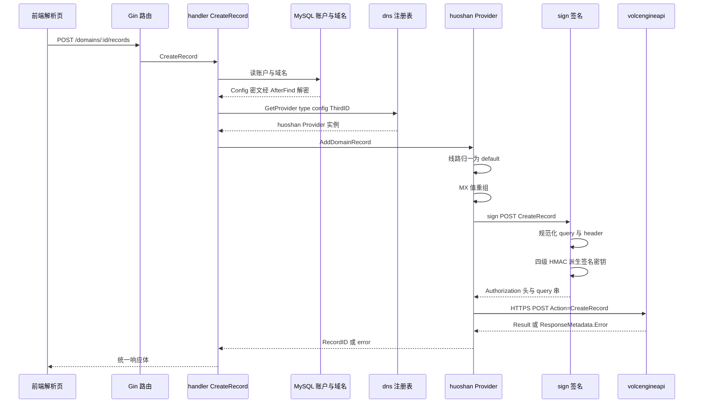
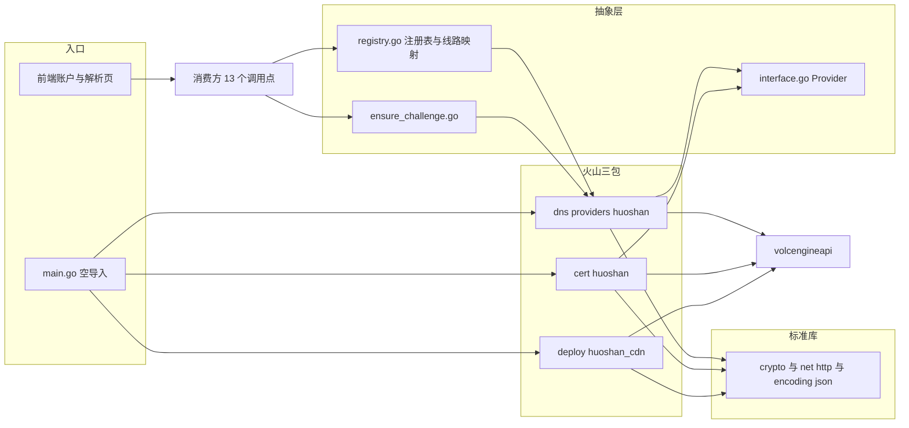
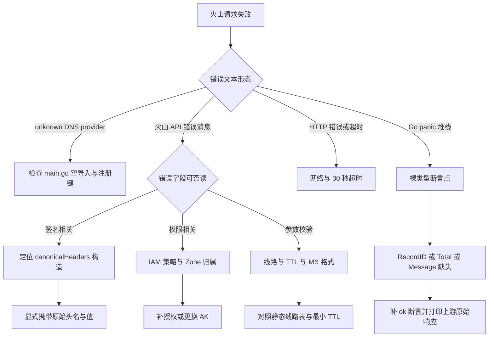

# 火山云DNS

<cite>
**本文档引用的文件**
- [huoshan.go (dns provider)](file://main/internal/dns/providers/huoshan/huoshan.go)
- [interface.go](file://main/internal/dns/interface.go)
- [registry.go](file://main/internal/dns/registry.go)
- [ensure_challenge.go](file://main/internal/dns/ensure_challenge.go)
- [provider_form_test.go](file://main/internal/dns/provider_form_test.go)
- [huoshan.go (cert provider)](file://main/internal/cert/huoshan/huoshan.go)
- [huoshan_cdn.go](file://main/internal/cert/deploy/providers/huoshan_cdn.go)
- [config_cloud.go](file://main/internal/cert/deploy/config_cloud.go)
- [domain.go](file://main/internal/api/handler/domain.go)
- [domain_ext.go](file://main/internal/api/handler/domain_ext.go)
- [account.go](file://main/internal/api/handler/account.go)
- [cert.go](file://main/internal/api/handler/cert.go)
- [router.go](file://main/internal/api/router.go)
- [models.go](file://main/internal/models/models.go)
- [hooks.go](file://main/internal/models/hooks.go)
- [capabilities.go](file://main/internal/monitor/capabilities.go)
- [main.go](file://main/main.go)
- [account-form.tsx](file://web/components/account-form.tsx)
- [provider-icon.tsx](file://web/components/provider-icon.tsx)
</cite>

## 目录

1. [简介](#简介)
2. [项目结构](#项目结构)
3. [核心组件](#核心组件)
4. [架构总览](#架构总览)
5. [详细组件分析](#详细组件分析)
6. [依赖关系分析](#依赖关系分析)
7. [性能考虑](#性能考虑)
8. [故障排查指南](#故障排查指南)
9. [结论](#结论)
10. [附录](#附录)

## 简介

本文覆盖 dnsplane 中「火山引擎」（内部 type 标识 `huoshan`）的三级实现：DNS 解析侧的
`main/internal/dns/providers/huoshan`、证书签发侧的 `main/internal/cert/huoshan`、证书部署侧的
`main/internal/cert/deploy/providers/huoshan_cdn`。三者共用同一上游网关
`open.volcengineapi.com` 与同一套 HMAC-SHA256 签名协议，但代码上**互不引用**。

DNS 侧是本文主线，三条硬事实：

- **未使用官方 SDK**：全仓仅阿里云、腾讯云 DNSPod、华为云引用厂商 SDK，火山自实现签名，import 只有标准库与 `main/internal/dns`（`huoshan.go:3-19`）。
- **能力位居国内第二梯队**：支持启停、权重、随记录改备注、添加域名；不支持日志、重定向、客户端分页（`huoshan.go:31`）。
- **单区域钉死**：`endpoint`/`service`/`version`/`region` 四个常量硬编码（`huoshan.go:36-41`），表单无法切换 Region，是该适配器最主要的架构约束。

火山在本系统中的三条真实业务路径：

| 路径 | 触发方 | 实际参与者 | 说明 |
|------|--------|------------|------|
| 解析记录增删改查 | 前端解析页 → `handler.CreateRecord` | `dns/providers/huoshan` | 唯一面向用户的 DNS 路径 |
| 证书 DNS-01 验证 | `handler/cert.go` 签发流程 | `cert/huoshan` 下单 + `dns/providers/huoshan` 写记录 | 域名托管在火山时，验证记录由 DNS 适配器写入 |
| 证书部署到 CDN/CLB 等 | 部署任务 | `cert/deploy/providers/huoshan_cdn` | 独立签名实现，按 `product` 分派 9 个产品 |

> 关于大纲提到的 `project_name`：已在 `dns/providers/huoshan`、`cert/huoshan`、
> `cert/deploy/providers/huoshan_cdn`、`cert/deploy/config_cloud.go` 四处检索
> `project_name`/`ProjectName`/`projectName`，**均无命中**。火山用于资源归属的项目名参数在本实现中
> 不存在，账户表单只有 AK/SK 两项，Region 走常量；下文按此事实展开，不做推测性补全。

## 项目结构

火山代码分布在 3 个 provider 包 + 抽象层 + handler + 前端 2 个组件：

```text
main/
├── main.go                                # 空导入触发 init 注册（:29 证书 / :44 DNS）
├── internal/
│   ├── dns/
│   │   ├── interface.go                   # Provider 接口 15 个方法（:41-86）
│   │   ├── registry.go                    # 注册表 + 线路静态映射（:58-80）
│   │   ├── ensure_challenge.go            # ACME 挑战记录幂等写入（:44 起）
│   │   ├── provider_form_test.go          # 表单键名回归（:18/:31 含 huoshan）
│   │   └── providers/huoshan/huoshan.go    # 本文主线，478 行
│   ├── cert/huoshan/huoshan.go             # 证书渠道，488 行
│   ├── cert/deploy/config_cloud.go         # 部署表单（huoshan 块 :242-268）
│   ├── cert/deploy/providers/huoshan_cdn.go # 部署实现 + Volcengine 客户端
│   ├── api/handler/{domain,domain_ext,account,cert}.go
│   └── monitor/capabilities.go             # 监控平台能力位（:15）
web/
└── components/{account-form,provider-icon}.tsx   # 分类、品牌与图标（:24/:31/:76 / :38-43）
```

| 包 | 规模 | 注册键 | 职责 | 被其他火山包引用 |
|----|:----:|--------|------|:----------------:|
| `dns/providers/huoshan` | 478 行 | `huoshan` | Zone/Record 全量 CRUD、启停、线路、加域 | 否 |
| `cert/huoshan` | 488 行 | `huoshan` | 免费 DV 下单、DCV 参数、状态轮询、取链 | 否 |
| `cert/deploy/providers/huoshan_cdn` | 700+ 行 | `huoshan_cdn` | 9 产品证书部署 | 否 |

结构结论：**三包三实现，没有共享的 Volc 签名工具包**。DNS 侧 `sign()`
（`huoshan.go:78-145`）、证书侧内联签名（`cert/huoshan/huoshan.go:351-438`）、部署侧
`Volcengine.signRequest()`（`huoshan_cdn.go:172-238`）是同协议的三份独立实现。

## 核心组件

### 凭据模型：AK/SK 两字段

DNS 侧表单只声明两个必填输入，键名即上游 IAM 凭据名：

```go
Config: []dns.ConfigField{
    {Name: "AccessKeyId", Key: "AccessKeyId", Type: "input", Required: true},
    {Name: "SecretAccessKey", Key: "SecretAccessKey", Type: "input", Required: true},
},
```

声明位置 `huoshan.go:26-29`，工厂读取位置 `huoshan.go:54-55`。三处火山表单的键名并不统一：

| 场景 | 声明位置 | AK 键名 | SK 键名 | Region 项 |
|------|----------|---------|---------|:---------:|
| DNS 账户 | `dns/providers/huoshan/huoshan.go:27-28` | `AccessKeyId` | `SecretAccessKey` | ✗ |
| 证书账户 | `cert/huoshan/huoshan.go:32-33` | `AccessKeyId` | `SecretAccessKey` | ✗ |
| 部署账户（新式表单） | `cert/deploy/config_cloud.go:249-250` | `AccessKeyId` | `SecretAccessKey` | ✗ |
| 部署账户（旧式注册） | `cert/deploy/providers/huoshan_cdn.go:31-32` | `access_key_id` | `access_key_secret` | ✗ |

键名不是可随手改的显示文案：`provider_form_test.go:31` 把 `huoshan` 列入回归名单，断言其 DNS
表单不得出现 `proxy` 键；部署侧读取用另一套 snake_case（`huoshan_cdn.go:254-255`、`:264-265`），
改任一处都会静默破坏对应链路。

凭据的存储与传输保护分三点：`Account.BeforeSave` 对 `Config` 做 AES-256-GCM 字段级加密
（`hooks.go:28`，密文前缀 `enc:v1:`）、`Account.AfterFind` 读时解密（`hooks.go:29`）、
`Config` 的 JSON tag 为 `json:"-"` 因而不回传前端（`models.go:55`）。handler 内先
`json.Unmarshal(account.Config, &config)` 得到 `map[string]string` 再交工厂
（`domain.go:44-48`）。内存中的配置形态为 `{ "AccessKeyId": "{占位}", "SecretAccessKey": "{占位}" }`（**已脱敏**）。

**章节来源**

- [huoshan.go (dns provider)](file://main/internal/dns/providers/huoshan/huoshan.go#L26-L60)
- [huoshan.go (cert provider)](file://main/internal/cert/huoshan/huoshan.go#L26-L59)
- [huoshan_cdn.go](file://main/internal/cert/deploy/providers/huoshan_cdn.go#L22-L54)
- [config_cloud.go](file://main/internal/cert/deploy/config_cloud.go#L242-L268)
- [provider_form_test.go](file://main/internal/dns/provider_form_test.go#L18-L33)
- [models.go](file://main/internal/models/models.go#L50-L60)
- [hooks.go](file://main/internal/models/hooks.go#L28-L29)
- [domain.go](file://main/internal/api/handler/domain.go#L37-L54)

### Region 与上游协议常量

| 常量 | 值 | 位置 | 可配置 | 影响 |
|------|-----|------|:------:|------|
| `endpoint` | `open.volcengineapi.com` | `huoshan.go:37` | 否 | 海外账户走同一网关 |
| `service` | `DNS` | `huoshan.go:38` | 否 | 参与 credential scope |
| `version` | `2018-08-01` | `huoshan.go:39` | 否 | 拼入每次请求的 `Version` |
| `region` | `cn-north-1` | `huoshan.go:40` | 否 | 参与签名与密钥派生 |

scope 直接由常量拼接：`credentialScope := shortDate + "/" + region + "/" + service + "/request"`
（`huoshan.go:131`）。因此**改 `region` 常量而不改上游实际归属区域会造成签名域不匹配**，
`service` 同理。证书侧常量为 `certificate_service` + `2021-06-01` + `cn-north-1`
（`cert/huoshan/huoshan.go:19-24`）；部署侧则逐次传入不同坐标（`getClient`，
`huoshan_cdn.go:252-260`），其中 `clb`/`alb`/证书中心用 `cn-beijing`
（`huoshan_cdn.go:320`、`:567`、`:598`）。可见火山各产品的区域并不统一，DNS 侧的
单值假设是固有边界。

**章节来源**

- [huoshan.go (dns provider)](file://main/internal/dns/providers/huoshan/huoshan.go#L36-L41)
- [huoshan.go (dns provider)](file://main/internal/dns/providers/huoshan/huoshan.go#L124-L145)
- [huoshan.go (cert provider)](file://main/internal/cert/huoshan/huoshan.go#L19-L24)
- [huoshan_cdn.go](file://main/internal/cert/deploy/providers/huoshan_cdn.go#L252-L276)

### 能力声明与散点登记

`init()` 里的特性位是与前端、监控协商火山能力的唯一入口（`huoshan.go:30-32`）：

| 特性位 | 值 | 语义 | 是否兑现 |
|--------|:--:|------|----------|
| `Remark` | 2 | 备注随记录一起改 | 是：`:400-402`、`:428-430` |
| `Status` | true | 记录启停 | 是：`UpdateRecordStatus`（`:446-453`） |
| `Redirect` | false | 域名转发 | 接口无对应方法 |
| `Log` | false | 解析日志 | 一致：`:455-457` 返回 error |
| `Weight` | true | 权重 | 是：`*weight > 0` 才写（`:397-399`）、读回（`:299-302`） |
| `Page` | false | 客户端分页 | 一致：分页参数透传上游（`:218-220`） |
| `Add` | true | 添加域名 | 是：`CreateZone`（`:474-478`） |

四位会被 `providerFeatureByDomain` 从注册表反查后输出给前端
（`domain_ext.go:77-87`、`:319-326`），写错的表现是「前端有按钮但点击报错」或「能力存在却不显示」。

另两张表也各自登记火山，构成同一问题的多份答案：

| 判定表 | 位置 | 火山取值 | 与 Features 的关系 |
|--------|------|----------|--------------------|
| 线路静态映射 | `registry.go:64` | DEF=default、CT=telecom、CU=unicom、CM=mobile、AB=oversea | 与 `GetRecordLine` 返回 ID 一致，属两份事实来源 |
| 监控平台能力 | `capabilities.go:15` | `Pause: true, Delete: true, Mixed: false` | Pause 与 `Status` 同结论；`Mixed` 无 Features 对应位 |

**章节来源**

- [huoshan.go (dns provider)](file://main/internal/dns/providers/huoshan/huoshan.go#L21-L34)
- [huoshan.go (dns provider)](file://main/internal/dns/providers/huoshan/huoshan.go#L381-L478)
- [interface.go](file://main/internal/dns/interface.go#L156-L167)
- [registry.go](file://main/internal/dns/registry.go#L58-L89)
- [domain_ext.go](file://main/internal/api/handler/domain_ext.go#L77-L87)
- [capabilities.go](file://main/internal/monitor/capabilities.go#L10-L26)

## 架构总览

从点击「新增记录」到拿回 `RecordID` 的完整链路，图中每个节点都是已读取的真实函数：



**图表来源**

- [router.go](file://main/internal/api/router.go#L136-L147)
- [domain.go](file://main/internal/api/handler/domain.go#L37-L54)
- [domain.go](file://main/internal/api/handler/domain.go#L875-L932)
- [huoshan.go (dns provider)](file://main/internal/dns/providers/huoshan/huoshan.go#L78-L209)
- [huoshan.go (dns provider)](file://main/internal/dns/providers/huoshan/huoshan.go#L381-L410)

形态概括为「薄适配层 + 自实现签名层」：`Provider` 的 15 个方法全部收敛到唯一出口 `request`
（`huoshan.go:147-209`），`request` 又收敛到 `sign`（`huoshan.go:78-145`）。协议层修复只需动
2 个函数，但上游字段变更也会同时打击 15 个方法。

## 详细组件分析

### 认证与签名实现

`sign` 被 `request` 唯一调用（`huoshan.go:162`），流程严格对齐火山 V4 系签名：

| 步骤 | 位置 | 细节 |
|------|------|------|
| 时间戳格式化 | `:79-80` | UTC，长式 `20060102T150405Z` 与短日期 `20060102` |
| 注入协议参数并排序转义 | `:82-97` | `Action`、`Version` 塞进 query，`sort.Strings` + `url.QueryEscape` 逐键拼接 |
| 初始头集合与排序 | `:99-112` | `Host`、`X-Date`、`X-Content-Sha256`，有 body 追加 `Content-Type`；头名小写后排序 |
| 规范化头与签名头列表 | `:114-122` | 反查原始键名取值（见下） |
| canonicalRequest 与 stringToSign | `:124-132` | 六段式 + `HMAC-SHA256` 前缀 + scope + canonicalRequest 哈希 |
| 密钥派生与 Authorization | `:134-143` | `SK → date → region → service → "request"` 四级派生，hex 签名拼三段 |

**已实测的签名缺陷**：`huoshan.go:117` 用
`strings.Title(strings.ReplaceAll(k, "-", " "))` 从小写头名反查原键名，带连字符的头名无法还原。
把该表达式与包内同名头集合单独编译运行，实测输出：

```text
lower=host               reverse="Host"               hit="open.volcengineapi.com"
lower=x-date             reverse="X Date"             hit=""
lower=x-content-sha256   reverse="X Content Sha256"   hit=""
lower=content-type       reverse="Content Type"       hit=""
```

结论分三层标注：

- 已验证：反查未命中，只有 `host` 的值进入 canonicalHeaders，其余三个头的值为空串，但它们仍全部出现在 `signedHeaders` 列表里。
- 推断：服务端按实际发出的头值重算 canonical request，签名必然不一致，上游应回签名校验类错误。**该结论未用真实 AK/SK 联调验证**，验证方法见「附录」。
- 附带问题：`strings.Title` 已被标准库标注弃用，`go vet` 不报但 staticcheck 会报 SA1019。

修复方向是放弃字符串反推，改为显式携带「原名 + 值」。部署侧的写法可直接作为唯一正确参考：
`huoshan_cdn.go:178-201` 遍历固定头名列表，用 `req.Header.Get(h)` 读真实值、跳过空值，再分别拼 canonicalHeaders 与 signedHeaders。

三份签名实现的差异对照：

| 维度 | DNS `sign` | 证书 `request` | 部署 `signRequest` |
|------|------------|----------------|--------------------|
| 位置 | `dns:78-145` | `cert:351-438` | `deploy:172-238` |
| 头取值 | 小写名反查原键名（存在未命中） | canonical 头串硬编码 | `req.Header.Get` 读实际值 |
| query 规范化 | 手写 `sort` + `QueryEscape` | `Encode()` 再把 `+` 换成 `%20`（`:382-386`） | 直接用 `req.URL.RawQuery`（`:98`） |
| signedHeaders | 由头集合推出 | 硬编码字符串（`:390-395`） | 过滤空值后重拼（`:191-201`） |
| 算法名 | `HMAC-SHA256` | `HMAC-SHA256` | `HMAC-SHA256` |
| 密钥派生函数 | `hmacSHA256(key []byte, data string)` | `hmacSHA256(key, data []byte)` | `hmacSHA256Raw(data, key []byte)`，**形参顺序相反** |
| 错误判定 | 只看 `ResponseMetadata.Error` | 先看 `resp.StatusCode >= 400`（`:471`） | 只看 `ResponseMetadata.Error` |
| 空值防护 | 无 | 无 | 有 |

派生函数形参顺序相反，跨文件复制粘贴即产生**静默错误密钥**，这是 DRY 缺失的直接代价。

统一出口 `request` 的其余要点：

| 要点 | 位置 | 说明 |
|------|------|------|
| GET/POST 分流 | `:153-160` | GET 把参数当 query，POST `json.Marshal` 成 body |
| URL 拼装 | `:164` | 强制 `https://` |
| 错误提取 | `:196-202` | `errInfo["Message"].(string)` **未带 ok 断言**，字段缺失或类型不符即 panic |
| 结果解包 | `:204-208` | 有 `Result` 取 `Result`，否则返回整个响应 |
| 错误暂存 | `:199`、`:62-64` | 写入 `lastErr`，但 `GetError()` 全仓无消费方，属死接口 |

**章节来源**

- [huoshan.go (dns provider)](file://main/internal/dns/providers/huoshan/huoshan.go#L66-L209)
- [huoshan.go (cert provider)](file://main/internal/cert/huoshan/huoshan.go#L351-L488)
- [huoshan_cdn.go](file://main/internal/cert/deploy/providers/huoshan_cdn.go#L92-L247)

### Zone（域名）管理

| 抽象方法 | 上游 Action | 位置 | 关键映射 |
|----------|-------------|------|----------|
| `Check` | `ListZones` | `:211-214` | 无专用探活接口，借 `GetDomainList(page=1,size=1)` 判活 |
| `GetDomainList` | `ListZones` | `:216-245` | `ZID → ID`、`ZoneName → Name`、`RecordCount → RecordCount`、`Total → Total` |
| `AddDomain` | `CreateZone` | `:474-478` | 仅传 `ZoneName`，不带实例/套餐等附加参数 |

`Check` 的实现选择需要强调：账户连通性检测（`account.go:402` 造 provider，异步执行，
ctx 超时 30 秒见 `account.go:418`）在火山侧等价一次最小 `ListZones`。因此 **AK 有效但域名列表为空
时检测仍通过**，只有 AK 无权访问 DNS 才失败——「检测通过」不等于「有可管理域名」。

`ZID` 是火山侧域名主键，落地为 `domains.third_id`（定义 `models.go:77`，长度 60）。添加域名时
系统不直接建 Zone，而是先反查：`domain.go:375` 用
`GetProvider(account.Type, config, domainName, "")` 造实例（`domainID` 为空串），再以域名作关键词
调 `GetDomainList`（`domain.go:383`），比对 `d.Name == domainName` 取 `thirdID`
（`domain.go:394-400`）后落库。含义是：**控制台已存在同名 Zone 才能被「添加/同步」识别**，
`AddDomain` 仅在需要新建时使用。

之后所有记录操作的 `ZID` 均来自实例化入参（`:57`），并在 `GetDomainRecords` 作必需参数（`:249`）。
若 `domains.third_id` 为空（手工导入历史数据、或添加时反查未命中），`ListRecords` 会因缺 `ZID`
被上游拒绝。

**章节来源**

- [huoshan.go (dns provider)](file://main/internal/dns/providers/huoshan/huoshan.go#L211-L245)
- [huoshan.go (dns provider)](file://main/internal/dns/providers/huoshan/huoshan.go#L474-L478)
- [domain.go](file://main/internal/api/handler/domain.go#L375-L400)
- [account.go](file://main/internal/api/handler/account.go#L396-L425)
- [models.go](file://main/internal/models/models.go#L72-L90)

### Record（解析记录）管理

读取侧 `GetDomainRecords` 的查询装配反映火山检索语义：

| 入参 | 上游参数 | 位置 | 备注 |
|------|----------|------|------|
| `page`/`pageSize` | `PageNumber`/`PageSize` | `:249-251` | 直传 |
| 固定 | `SearchOrder=desc` | `:252` | 恒倒序 |
| `subDomain` | `Host` | `:256-258` | 与类型/线路/值同现时启用精确模式 |
| `value`/`recordType`/`line` | `Value`/`Type`/`Line` | `:259-267` | 同上 |
| 精确开关 | `SearchMode=exact` | `:268` | 仅上述任一非空时设置 |
| `keyword` | `Host` | `:269-271` | 与精确模式互斥（`else if`） |
| `status` | 未使用 | 全函数 | 形参存在但**不写入 params** |

`status` 被忽略是明确的代码事实：`:247-327` 无任何位置把 `status` 写入 `params`。上层
`GetRecords` 会先用 `normalizeDNSListStatusForAPI` 归一状态（`domain.go:722`），但该结果在火山
路径上不下发，只能靠分页后本地过滤，表现为**按状态筛选时「本页无匹配但总数非 0」**。

字段回填映射：

| `dns.Record` | 上游字段 | 位置 | 转换 |
|--------------|----------|------|------|
| `ID`/`Name`/`Type`/`Value` | `RecordID`/`Host`/`Type`/`Value` | `:282-283`、`:310-313` | 全部裸断言，无 ok |
| `MX` + `Value` | `Value` | `:286-292` | MX 按首个空格拆「优先级 + 主机名」 |
| `TTL`/`Line` | `TTL`/`Line` | `:314-315` | `float64 → int` 与字符串，均裸断言 |
| `Status` | `Enable` | `:294-297` | `true → enable`，缺省/false → `disable` |
| `Weight`/`Remark` | `Weight`/`Remark` | `:299-307` | 带 ok 断言，缺失即 0 或空串 |
| `PageResult.Total` | `TotalCount` | `:325` | 与 Zone 列表用的 `Total` 字段名不同 |

写入侧三个方法行为不对称：

| 操作 | Action | 线路处理 | 备注 | 风险 |
|------|--------|----------|------|------|
| `AddDomainRecord` | `CreateRecord`（`:404`） | 空或 `default` 归一为 `default`（`:382-384`） | 非空才带（`:400-402`） | 返回 `result["RecordID"].(string)` 无 ok（`:409`） |
| `UpdateDomainRecord` | `UpdateRecord`（`:432`） | **不归一**，原样透传（`:416`） | 非空才带（`:428-430`） | 空线路会发给上游 |
| `UpdateDomainRecordRemark` | 未实现 | — | — | 固定 error（`:437`） |

上层取线路的口径各不相同：批量新增用 `defaultLine`（`batch.go:149`）、定时任务用记录原线路
（`schedule.go:174`）、监控回切用 `record.Line`（`monitor.go:626`）。只要上游回传 `Line` 恒非空
（`:315` 的读取正依赖该假设），不对称就不会暴露；一旦某链路传入空串，新增与更新的结果将不同。

删除与启停：`DeleteDomainRecord` → `DeleteRecord`（`:440-444`）；
`SetDomainRecordStatus` → `UpdateRecordStatus`，`Enable` 用 `strconv.FormatBool`（`:446-453`）。

**章节来源**

- [huoshan.go (dns provider)](file://main/internal/dns/providers/huoshan/huoshan.go#L247-L453)
- [domain.go](file://main/internal/api/handler/domain.go#L700-L760)
- [domain.go](file://main/internal/api/handler/domain.go#L875-L1048)
- [interface.go](file://main/internal/dns/interface.go#L5-L38)

### 线路、TTL 与权重

`GetRecordLine` 返回**静态硬编码**的 6 条线路，不请求上游（`:459-468`）：

| 线路 ID | 中文名 | 与 `registry.go:64` 的关系 |
|---------|--------|----------------------------|
| `default` | 默认 | `DEF` |
| `telecom` | 电信 | `CT` |
| `unicom` | 联通 | `CU` |
| `mobile` | 移动 | `CM` |
| `edu` | 教育网 | **无映射键** |
| `oversea` | 海外 | `AB` |

`edu` 在映射表中无位置（该表只有 DEF/CT/CU/CM/AB 五个键，`registry.go:58-80`）。影响面是
**分线路加速**：加速靠映射表把通用线路名翻译成厂商线路，教育网无法经该表表达，只能由用户在记录
表单直接选择；展示名仍正常，因为 `domain.go:714-720` 用 `lineNameByID` 反查 `GetRecordLine`。

TTL 相关约定：

| 项 | 取值 | 位置 |
|----|------|------|
| `GetMinTTL` | 600 | `huoshan.go:470-472` |
| 挑战写入默认 TTL | 600 | `cert.go:971` |
| 挑战 TTL 夹取 | `ttl <= 0 \|\| ttl > 600` 时改 60 | `ensure_challenge.go:51-54` |

火山恰落在夹取边界：600 不大于 600，挑战记录**保持 600 秒**，既不会被厂商拒也未被无谓下调。
但若上层传入 >600 的值（例如抄自其他厂商的 3600），会被降到 60，反而低于火山最小值——
这是当前规则里可预见的边界冲突。

权重是火山的加分项：`*weight > 0` 才写入（`:397-399`），读取回填（`:299-302`），
`Features.Weight = true` 使前端暴露权重输入（`domain_ext.go:322`）。权重快捷接口
`GET/POST /domains/:id/records/weight`（`router.go:147-148`，实现起于 `domain_ext.go:171`）
走通用 `UpdateDomainRecord` 通路，火山可直接复用。

**章节来源**

- [huoshan.go (dns provider)](file://main/internal/dns/providers/huoshan/huoshan.go#L381-L472)
- [registry.go](file://main/internal/dns/registry.go#L58-L89)
- [ensure_challenge.go](file://main/internal/dns/ensure_challenge.go#L44-L70)
- [cert.go](file://main/internal/api/handler/cert.go#L960-L985)
- [domain_ext.go](file://main/internal/api/handler/domain_ext.go#L171-L327)
- [router.go](file://main/internal/api/router.go#L147-L152)

### 与 cert huoshan 及部署渠道的关系

火山证书渠道与火山 DNS 渠道在**代码上零共享**，在**业务流程上强耦合**。证书链路各环节的执行者：

| 阶段 | 执行者 | 位置 | 说明 |
|------|--------|------|------|
| 账户连通性 | `cert/huoshan.Register` | `cert:78-85` | 用 `CertificateGetInstance` 带 `limit=1` 探活 |
| 信息模板校验 | `BuyCert` | `cert:87-112` | 只校验控制台已有模板，不落组织 ID |
| 下单与取 DCV | `CreateOrder` | `cert:114-210` | `QuickApplyCertificate` + 3 秒等待 + `CertificateGetDcvParam` |
| 写验证记录 | `dns/providers/huoshan` | `cert.go:965` → `ensure_challenge.go:44` | **DNS 适配器参与证书流程的唯一点** |
| 触发校验与轮询 | `AuthOrder`/`GetAuthStatus` | `cert:212-253` | `CertificateProgressInstanceOrder`（`action` 空串）；`order_status == 300 && certificate_exist == 1` 为成功，`302` 为失败 |
| 取证书与回收 | `FinalizeOrder`/`Revoke`/`Cancel` | `cert:255-331` | 拼 `ssl.certificate.chain`，毫秒时间戳除 1000；`reason=UserRequest`；**Cancel 丢弃返回值**（`:329`） |

四个复用判断要点：

- **表单不复用**：证书侧 `cert.Register("huoshan", ...)` 显式 `CNAME: false`、`IsDeploy: false`
  （`cert/huoshan/huoshan.go:40-41`），注释说明部署用途由 `config_cloud.go` 的火山块
  （`config_cloud.go:242-268`）提供，经 `MergeDeployProviderConfigsForAPI` 输出到
  `/api/cert/providers` 的 deploy 视图。
- **签名不复用**：证书侧 canonical 头是硬编码字符串（`cert/huoshan/huoshan.go:390-395`），不含
  `X-Content-Sha256`，因此不受 DNS 侧 `strings.Title` 缺陷影响——同一服务商三套正确性状态。
- **DCV 记录类型可协商**：证书侧按上游 `validation_type` 决定 TXT 或 CNAME
  （`cert/huoshan/huoshan.go:181-185`），域名托管在火山时 `EnsureChallengeRecord` 收到的
  `recordType` 不一定是 TXT。
- **算法固定项**：证书下单写 `plan: digicert_free_standard_dv`（`cert:146`），
  `ec`/`ecdsa` 映射为厂商认得的 `ecc`（`cert:141-143`）。

部署侧按 `product` 分派 9 个产品，接入坐标逐产品不同，与 DNS 侧的单常量模式形成对照：
`cdn` 探活（`huoshan_cdn.go:271`）、证书中心（`:320`，`cn-beijing`）、CDN 部署（`:372`）、
`dcdn`（`:416`）、`live`（`:470`）、`imagex`（`:524`）、`clb`（`:567`，`cn-beijing`）、
`alb`（`:598`，`cn-beijing`）、`vod`（`:642`）。表单侧的产品枚举与条件显示字段见
`config_cloud.go:252-267`。

**章节来源**

- [huoshan.go (cert provider)](file://main/internal/cert/huoshan/huoshan.go#L19-L482)
- [huoshan.go (dns provider)](file://main/internal/dns/providers/huoshan/huoshan.go#L247-L331)
- [config_cloud.go](file://main/internal/cert/deploy/config_cloud.go#L242-L268)
- [huoshan_cdn.go](file://main/internal/cert/deploy/providers/huoshan_cdn.go#L22-L276)
- [huoshan_cdn.go](file://main/internal/cert/deploy/providers/huoshan_cdn.go#L314-L668)
- [ensure_challenge.go](file://main/internal/dns/ensure_challenge.go#L44-L111)
- [cert.go](file://main/internal/api/handler/cert.go#L960-L985)

### 前端呈现与图标契约

| 项 | 位置 | 值 |
|----|------|-----|
| DNS 分类归属 | `account-form.tsx:24` | 「国内DNS服务商」数组含 `huoshan` |
| 证书分类归属 | `account-form.tsx:31` | 「云厂商证书」数组含 `huoshan` |
| 品牌样式 | `account-form.tsx:76` | `#3370FF`、`bg-blue-50`、字标「火」、`/icons/huoshan.ico` |
| 图标组件 | `provider-icon.tsx:38-43` | 名称「火山引擎」，色值与字标重复定义 |

后端 `ProviderConfig.Icon` 的值是 `huoshan.png`（`dns:25`、`cert:30`、`deploy:28`），但仓库内实际
存在的图标资源只有 `huoshan.ico`（`web/public/icons/`、`web/out/icons/`、`main/web/icons/`），
没有同名 `.png`。前端渲染走硬编码 `image` 字段而非后端 `icon` 字段，故当前显示正常；但对火山而言
后端 `Icon` 是**未实现的契约**，改它不影响显示，删它也不会被测试拦住。

**章节来源**

- [account-form.tsx](file://web/components/account-form.tsx#L23-L32)
- [account-form.tsx](file://web/components/account-form.tsx#L76-L76)
- [provider-icon.tsx](file://web/components/provider-icon.tsx#L38-L43)
- [huoshan.go (dns provider)](file://main/internal/dns/providers/huoshan/huoshan.go#L21-L34)

## 依赖关系分析

火山的依赖呈「上游扇出、横向零耦合」：



**图表来源**

- [main.go](file://main/main.go#L20-L60)
- [registry.go](file://main/internal/dns/registry.go#L18-L45)
- [huoshan.go (dns provider)](file://main/internal/dns/providers/huoshan/huoshan.go#L1-L34)
- [ensure_challenge.go](file://main/internal/dns/ensure_challenge.go#L44-L111)
- [domain.go](file://main/internal/api/handler/domain.go#L37-L54)

四条关键依赖判断：

| 依赖方向 | 事实 | 风险 |
|----------|------|------|
| 火山 → 标准库 | 三包各自引 `crypto/hmac`、`crypto/sha256`、`net/http`、`encoding/json`，无厂商 SDK | 协议升级需改三处 |
| 消费方 → 火山 | 全部经 `dns.GetProvider(account.Type, ...)` 间接寻址，13 个调用点：`domain.go:48/375/1305/1672`、`account.go:402`、`cert.go:965`、`batch.go:432`、`acceleration.go:466`、`monitor/monitor.go:432`、`service/schedule.go:280`、`service/record_sync.go:545`、`apiv1/record_sync.go:106` | 火山侧无需为新调用点改动 |
| 抽象层 → 火山 | 仅靠 `dns.Register`（`registry.go:18-23`）与 `main.go:44` 空导入建立链接 | 漏空导入即注册表无该键，`registry.go:31` 报 `unknown DNS provider` |
| 火山 ↔ 火山 | 三包零交叉引用，`cert/huoshan` 只 import `main/internal/cert` | 一处签名修复不自动惠及另两处 |

`main.go:29`（证书）与 `main.go:44`（DNS）是火山的两条链接线；另有四处散点登记
（`registry.go:64`、`capabilities.go:15`、`provider_form_test.go:18` 与 `:31`），缺少统一门禁保证同步。

**章节来源**

- [main.go](file://main/main.go#L20-L60)
- [registry.go](file://main/internal/dns/registry.go#L18-L37)
- [capabilities.go](file://main/internal/monitor/capabilities.go#L10-L26)
- [provider_form_test.go](file://main/internal/dns/provider_form_test.go#L10-L33)

## 性能考虑

| 维度 | 取值 | 位置 | 评价 |
|------|------|------|------|
| HTTP 超时 | 30 秒 | `dns:58` | 与证书（`cert:56`）、部署（`huoshan_cdn.go:90`）一致；handler 另有 30 秒 ctx（`account.go:418`、`domain.go:381`） |
| 连接复用 | 每次 `NewProvider` 新建 `http.Client` | `dns:58` | 抽象层无 provider 缓存，同账户连续操作重复建连；22 家同构，属架构取舍 |
| 分页 | 上游原生分页 | `dns:218-220`、`:250-251` | `Page: false` 声明正确，不做客户端全量拉取 |
| 单页大小 | 挑战查询固定 `1,100` | `ensure_challenge.go:61`、`:122` | 火山走 `GetSubDomainRecords` → 精确模式 `ListRecords`（`:329-331`、`:255-268`），100 条够用 |
| 串行等待 | 下单后 `Sleep(3s)` | `cert:168` | 签发链路唯一硬等待，占该请求耗时大头 |
| 请求次数 | 一次业务操作 1 次调用 | `dns:147-209` | 无重试，上游抖动直接透传 |
| 计算开销 | 每请求 5 次 HMAC + 2 次 SHA256 | `dns:102`、`:129-138` | 可忽略，瓶颈在 RTT |
| 线路查询 | 静态返回，0 次网络请求 | `dns:459-468` | 解析页首屏比需查线路的厂商少一次外部调用 |

三点火山特有的权衡：

- **无重试无退避**：`request` 对 `p.client.Do` 失败即返回（`:180-183`）。监控自动切换这类「必须写成」的场景（`monitor.go:543`、`:652`）遇一次网络抖动就失败，由上层任务重试兜底。
- **`Check` 复用列表接口**（`:211-214`）：开销最小（`PageSize=1`），但不校验目标 Zone 归属。
- **响应体无上限**：`io.ReadAll(resp.Body)`（`:186`）不限制读取字节数，极端分页参数会放大内存占用。

> 数值全部读自源码，未做压测；「瓶颈在 RTT」是基于单请求一次外部调用的推断，非实测结论。

**章节来源**

- [huoshan.go (dns provider)](file://main/internal/dns/providers/huoshan/huoshan.go#L52-L209)
- [huoshan.go (cert provider)](file://main/internal/cert/huoshan/huoshan.go#L52-L170)
- [ensure_challenge.go](file://main/internal/dns/ensure_challenge.go#L44-L125)
- [monitor.go](file://main/internal/monitor/monitor.go#L430-L545)

## 故障排查指南

### 症状到定位

| 症状 | 首查位置 | 已验证判据 | 处置 |
|------|----------|------------|------|
| 检测报 `unknown DNS provider: huoshan` | `main.go` 空导入 | 文本出自 `registry.go:31` | 确认 DNS provider 子包在链接列表内 |
| 检测失败但控制台可登录 | `Check` → `ListZones` | `:211-214` 只证明 AK 可调 DNS | 检查子用户的 DNS 读写权限 |
| 上游拒签名 | canonicalHeaders 构造 | `:117` 反查未命中（本地实跑确认） | 改为显式携带原始头名与值后复测 |
| 记录页整片空白、日志有 panic | 裸类型断言 | `:282-283`、`:310-315`、`:325` 无 ok | 先确认上游是否改字段名/类型，再补断言与缺省 |
| 报字段缺失类错误 | `ResponseMetadata.Error` 提取 | `:198` 对 `Message` 裸断言 | 参考 `huoshan_cdn.go:152-160` 的安全取值 |
| 更新后线路被清空 | 新增/更新归一不对称 | `:382-384` 有归一，`:412-420` 无 | 在更新路径补同一归一 |
| 「修改备注」或「解析日志」报错 | 未实现方法 | `:437`、`:456` 固定文案；`Features.Log = false`（`:31`） | 备注走整条更新（`:428-430`）；日志入口按特性位隐藏 |
| 按状态筛选无效 | `status` 未下发 | `:247-327` 未写入 params | 依赖上层本地过滤或补上游参数 |
| 证书长期停在待验证 | DCV 类型与记录类型不匹配 | `cert:181-185` 可能返回 CNAME；`CNAME: false`（`cert:40`） | 核对上游 `validation_type` 与账户类型支持 |
| 取消订单后状态未变 | `Cancel` 吞错 | `cert:329` 返回值未接收 | 以控制台为准，修复为返回 error |
| 大 TTL 记录被写成 60 秒 | 挑战 TTL 夹取 | `ensure_challenge.go:51-54` | 火山最小值 600（`:471`），>600 入参会被降到 60 |

**章节来源**

- [huoshan.go (dns provider)](file://main/internal/dns/providers/huoshan/huoshan.go#L196-L456)
- [huoshan.go (cert provider)](file://main/internal/cert/huoshan/huoshan.go#L181-L331)
- [ensure_challenge.go](file://main/internal/dns/ensure_challenge.go#L44-L70)
- [registry.go](file://main/internal/dns/registry.go#L26-L37)

### 排障决策路径



**图表来源**

- [registry.go](file://main/internal/dns/registry.go#L26-L37)
- [huoshan.go (dns provider)](file://main/internal/dns/providers/huoshan/huoshan.go#L147-L330)
- [huoshan_cdn.go](file://main/internal/cert/deploy/providers/huoshan_cdn.go#L148-L170)

**章节来源**

- [huoshan.go (dns provider)](file://main/internal/dns/providers/huoshan/huoshan.go#L92-L456)
- [huoshan_cdn.go](file://main/internal/cert/deploy/providers/huoshan_cdn.go#L148-L170)

### 最小验证手段

| 目的 | 命令或位置 | 预期 |
|------|------------|------|
| 确认注册表含火山 | `go list -deps .` 检索 `dns/providers/huoshan` | 命中，否则未链接 |
| 确认表单键名未被改 | `go test ./internal/dns/ -run TestDNSProviderFormsCarryNoProxyField` | PASS，火山在名单内（`provider_form_test.go:31`） |
| 复现签名头反查未命中 | 单独编译 `:99-122` 的头集合与反查表达式 | 仅 `host` 命中，其余为空串 |
| 观察上游真实响应 | 在 `request` 的 `json.Unmarshal` 之后临时打印 `respBody` | 可见 `ResponseMetadata.Error.Code` |

火山侧**没有包内单元测试**：`huoshan` 目录仅 1 个 `huoshan.go`；`internal/dns/providers/` 下
只有 `cloudflare/lines_test.go` 一个 provider 测试。上述验证均需手工执行，不能依赖 CI 拦回归。

**章节来源**

- [provider_form_test.go](file://main/internal/dns/provider_form_test.go#L30-L104)
- [huoshan.go (dns provider)](file://main/internal/dns/providers/huoshan/huoshan.go#L92-L209)
- [registry.go](file://main/internal/dns/registry.go#L26-L37)
- [ensure_challenge.go](file://main/internal/dns/ensure_challenge.go#L44-L70)

## 结论

火山引擎是 22 家 DNS 服务商里签名最复杂、代码最紧凑的一档：478 行覆盖 `Provider` 的 15 个方法，
未引 SDK、未做重试、未加缓存，复杂度全压在一处自实现签名上。结论分三层：

1. **能力面完整且诚实**。`Features` 七位与实现一一对应（`:31` 对照 `:437`、`:456` 两处
   「不支持」），是少数不存在「声明与实现冲突」的适配器；`registry.go:64` 与 `GetRecordLine`
   也保持一致（除无映射键的 `edu`）。
2. **KISS 的代价集中在重复**。同一 Volc V4 签名写三遍，且 `hmacSHA256` 与 `hmacSHA256Raw`
   形参顺序相反；表单键名有两套风格。抽一个 Volc 签名包是最小消除方案，部署侧的
   `req.Header.Get` + 空值过滤可直接作为唯一正确参考。
3. **正确性风险集中在「裸断言 + 反查式签名」**。`:117` 的键名反查经本地实跑证实对三个连字符头
   均未命中；`Message`（`:198`）、`RecordID`（`:310`、`:409`）、`Total`/`TotalCount`
   （`:243`、`:325`）等裸断言构成上游字段变更时的 panic 面。签名端到端结果尚未用真实凭据验证。

改进优先级：签名头集合显式携带原键名（消除反查）→ 裸断言改带 ok 并保留 Code →
新增与更新的线路归一对齐 → 抽公共 Volc 签名包（DRY，三包同时受益）。

## 附录

### 接口方法落点总表

| 接口方法 | 上游 Action | HTTP | 位置 | 状态 |
|----------|-------------|:----:|------|------|
| `GetError` | — | — | `:62-64` | 有实现，无消费方 |
| `Check` / `GetDomainList` | `ListZones` | GET | `:211-214`、`:216-245` | `Check` 复用列表接口 |
| `GetDomainRecords` / `GetSubDomainRecords` | `ListRecords` | GET | `:247-327`、`:329-331` | 忽略 `status` 形参；后者转调前者 |
| `GetDomainRecordInfo` | `QueryRecord` | GET | `:333-379` | 完整 |
| `AddDomainRecord` | `CreateRecord` | POST | `:381-410` | 线路归一、MX 重组、权重条件写入 |
| `UpdateDomainRecord` | `UpdateRecord` | POST | `:412-434` | 无线路归一 |
| `UpdateDomainRecordRemark` / `GetDomainRecordLog` | — | — | `:436-438`、`:455-457` | 均返回「不支持」 |
| `DeleteDomainRecord` / `SetDomainRecordStatus` | `DeleteRecord`/`UpdateRecordStatus` | POST | `:440-444`、`:446-453` | 完整 |
| `GetRecordLine` / `GetMinTTL` | 静态 / 常量 | — | `:459-468`、`:470-472` | 6 条线路、TTL 600 |
| `AddDomain` | `CreateZone` | POST | `:474-478` | 仅 `ZoneName` |

**章节来源**

- [huoshan.go (dns provider)](file://main/internal/dns/providers/huoshan/huoshan.go#L62-L478)
- [interface.go](file://main/internal/dns/interface.go#L41-L86)

### 相关 HTTP 路由

| 路由 | handler | 位置 | 火山生效点 |
|------|---------|------|------------|
| `GET`/`POST /domains/:id/records` | `GetRecords`/`CreateRecord` | `router.go:136-137` | `ListRecords`/`CreateRecord` |
| `POST /domains/:id/records/batch` | `BatchAddRecords`/`BatchEditRecords`/`BatchActionRecords` | `router.go:138-140` | 批量新增/更新（无线路归一）/启停删除 |
| `POST /domains/:id/records/:recordId/status` | `SetRecordStatus` | `router.go:141` | `UpdateRecordStatus` |
| `POST /domains/:id/records/:recordId` 及其 `delete` | `UpdateRecord`/`DeleteRecord` | `router.go:142-143` | `UpdateRecord`/`DeleteRecord` |
| `GET`/`POST /domains/:id/records/weight` | `GetRecordWeight`/`UpdateRecordWeight` | `router.go:147-148` | 权重读写 |
| `GET /domains/:id/lines` | `GetRecordLines` | `router.go:152` | 静态线路表 |
| `GET /accounts/:id/domains` | `GetAccountDomainList` | `router.go:118` | `ListZones` |

**章节来源**

- [router.go](file://main/internal/api/router.go#L118-L152)
- [domain.go](file://main/internal/api/handler/domain.go#L640-L1215)

### 术语

| 术语 | 含义 | 代码对应 |
|------|------|----------|
| Zone / ZID | 火山侧托管域名及其主键 | `ListZones`/`CreateZone`；`DomainInfo.ID` ← `ZID`（`:235`），落 `domains.third_id` |
| Host | 主机记录（RR） | `dns.Record.Name`（`:311`） |
| Line / Enable | 解析线路 / 记录启停 | `dns.Record.Line`（`:315`）；`dns.Record.Status` 的 `enable`/`disable`（`:294-297`） |
| credential scope | 签名域 | `日期/cn-north-1/DNS/request`（`:131`） |

**章节来源**

- [huoshan.go (dns provider)](file://main/internal/dns/providers/huoshan/huoshan.go#L124-L330)
- [models.go](file://main/internal/models/models.go#L72-L90)

### 未验证与未知事项

| 项 | 状态 | 说明 |
|----|------|------|
| 火山真实 API 联调结果 | 未知 | 本环境无可用合法 AK/SK，签名失败结论仅为推断 |
| 上游是否要求 `X-Content-Sha256` 必须参与签名 | 未知 | 需以真实请求响应为准 |
| `edu` 线路在分线路加速上的可用性 | 未知 | `registry.go:64` 无对应键，加速链路未覆盖 |
| `project_name` 类资源归属参数 | 未使用 | 四处相关文件检索无命中，本实现未暴露 |
| 火山 DNS 适配器的单元测试 | 不存在 | `providers/huoshan/` 目录下仅 `huoshan.go` |

**章节来源**

- [huoshan.go (dns provider)](file://main/internal/dns/providers/huoshan/huoshan.go#L117-L198)
- [registry.go](file://main/internal/dns/registry.go#L58-L80)
