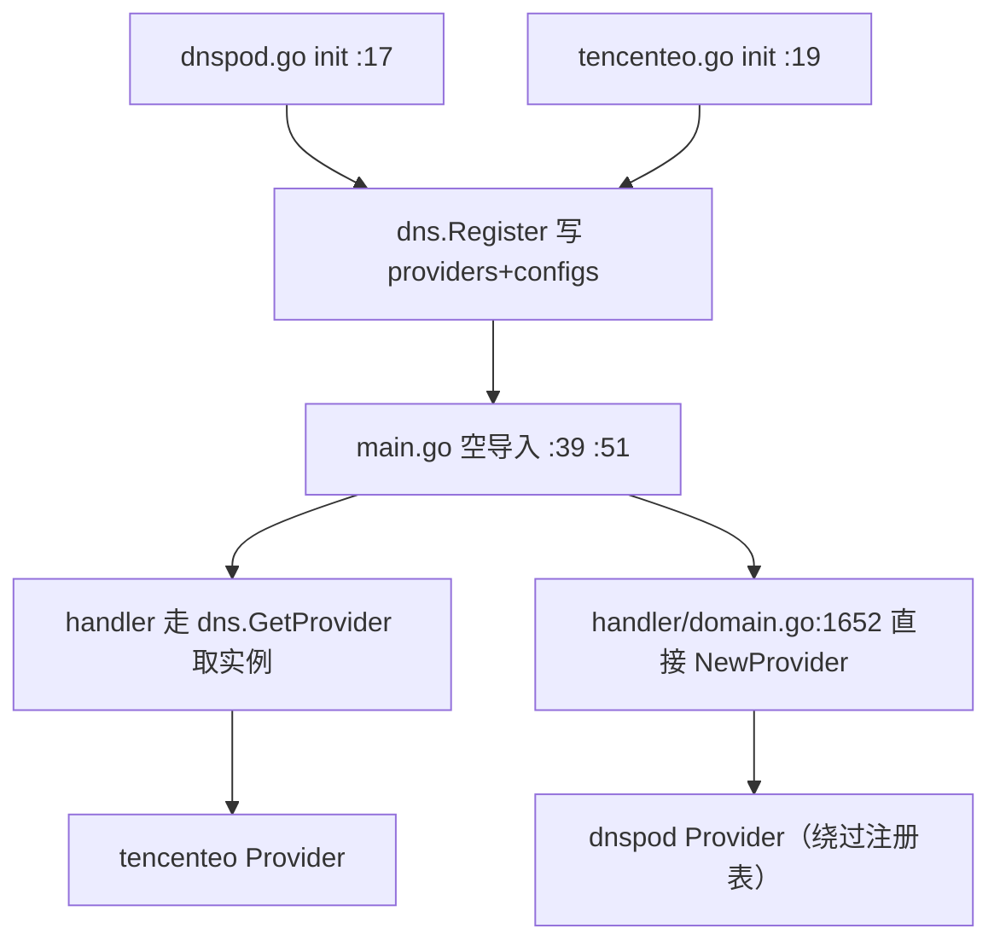
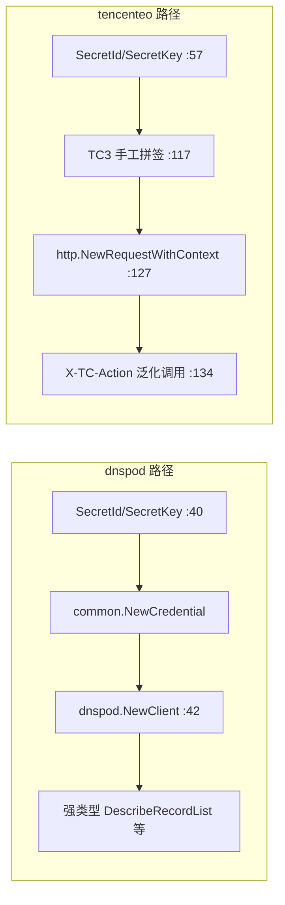
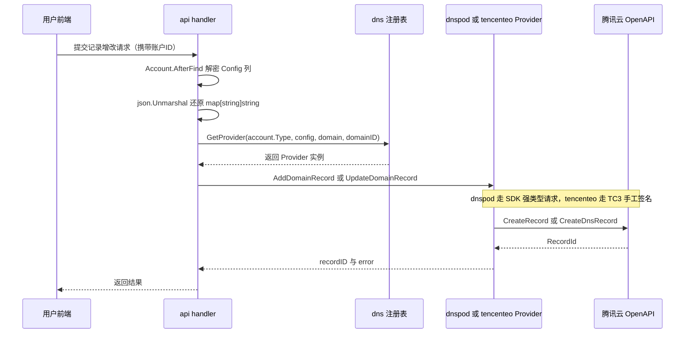
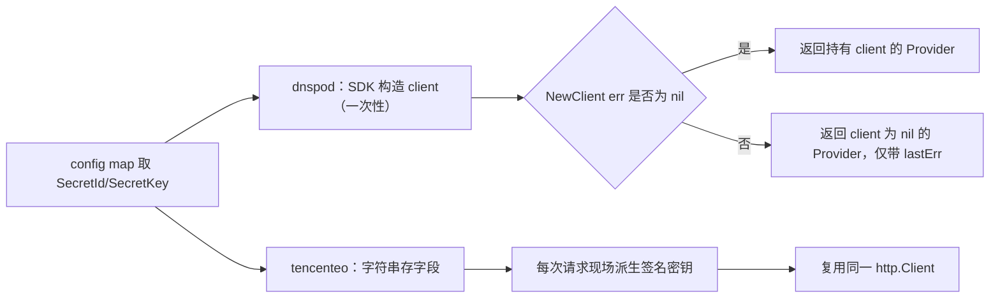
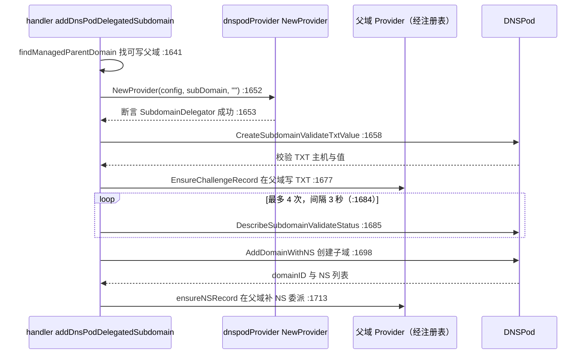
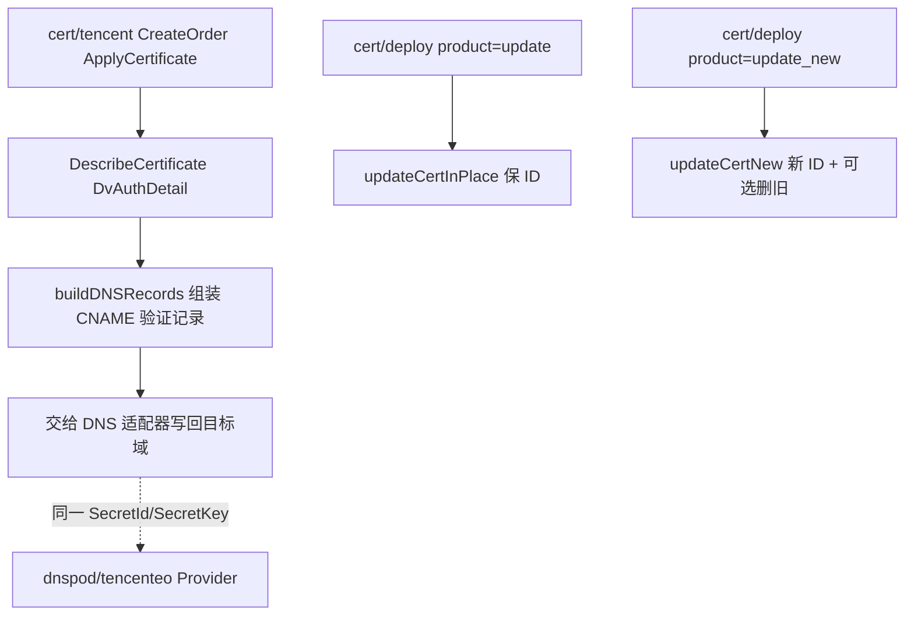
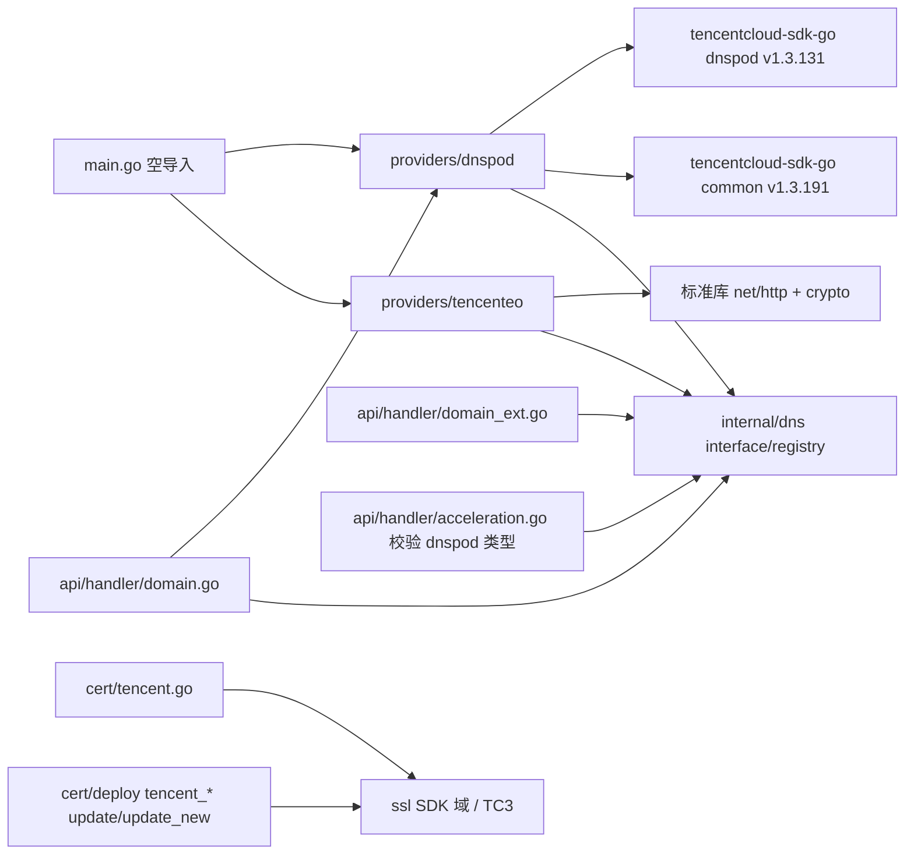

# 腾讯云DNS

<cite>
**本文档引用的文件**
- [main.go](file://main/main.go)
- [go.mod](file://main/go.mod)
- [interface.go](file://main/internal/dns/interface.go)
- [registry.go](file://main/internal/dns/registry.go)
- [ensure_challenge.go](file://main/internal/dns/ensure_challenge.go)
- [dnspod.go](file://main/internal/dns/providers/dnspod/dnspod.go)
- [tencenteo.go](file://main/internal/dns/providers/tencenteo/tencenteo.go)
- [domain.go (handler)](file://main/internal/api/handler/domain.go)
- [domain_ext.go (handler)](file://main/internal/api/handler/domain_ext.go)
- [acceleration.go (handler)](file://main/internal/api/handler/acceleration.go)
- [tencent.go (cert)](file://main/internal/cert/tencent/tencent.go)
- [config_cloud.go](file://main/internal/cert/deploy/config_cloud.go)
- [tencent_cdn.go](file://main/internal/cert/deploy/providers/tencent_cdn.go)
- [tencent_update.go](file://main/internal/cert/deploy/providers/tencent_update.go)
- [cloudflare.go (models)](file://main/internal/models/cloudflare.go)
- [utils.ts](file://web/lib/utils.ts)
- [account-form.tsx](file://web/components/account-form.tsx)
</cite>

## 目录

1. [简介](#简介)
2. [项目结构](#项目结构)
3. [核心组件](#核心组件)
4. [架构总览](#架构总览)
5. [详细组件分析](#详细组件分析)
6. [依赖关系分析](#依赖关系分析)
7. [性能考虑](#性能考虑)
8. [故障排查指南](#故障排查指南)
9. [结论](#结论)
10. [附录](#附录)

## 简介

DNSPlane 对腾讯云生态的 DNS 侧支持由**两个互相独立的适配器包**构成，它们对接的是腾讯云两条定位完全不同的产品线：

| 注册名（type） | 显示名 | 上游产品 | API 版本 | 接入端点 | 客户端形态 |
|----------------|--------|----------|----------|----------|------------|
| `dnspod` | 腾讯云 | DNSPod 云解析 | `2021-03-23` | SDK 内置 | 官方 SDK `tencentcloud-sdk-go/tencentcloud/dnspod` |
| `tencenteo` | 腾讯云EO | EdgeOne（EO）边缘安全加速 | `2022-09-01` | `teo.tencentcloudapi.com` / `teo.intl.tencentcloudapi.com` | 自实现 TC3-HMAC-SHA256 签名 + 裸 `net/http` |

二者虽然共用同一套 `SecretId` / `SecretKey` 凭据体系（`dnspod.go:23-24`、`tencenteo.go:26-27`），但能力边界差异极大：`dnspod` 是 22 家适配器里**能力最全的一家**，独占记录分组、域名别名、子域托管自动委派三项扩展接口能力；`tencenteo` 则是**能力最受限的一家**，仅支持以 NS 方式接入 EO 的域名，添加域名、修改备注、查看日志三条主流程方法直接返回 error（`tencenteo.go:432-434`、`:460-462`、`:474-476`）。

前端把两家分置于不同的分组与配色下：`dnspod` 归入「国内 DNS 服务商」（`account-form.tsx:24`），`tencenteo` 归入「专业 DNS 解决方案」（`account-form.tsx:26`）；图标分别是 `/icons/dnspod.ico` 与 `/icons/tencent.png`（`account-form.tsx:73`、`:84`）。

**章节来源**
- [dnspod.go](file://main/internal/dns/providers/dnspod/dnspod.go)
- [tencenteo.go](file://main/internal/dns/providers/tencenteo/tencenteo.go)
- [account-form.tsx](file://web/components/account-form.tsx)

## 项目结构

腾讯云 DNS 侧的代码分布在 DNS 适配器、证书签发、证书部署三条链路上，本文覆盖前两条的主体与第三条的联动点：

| 文件 | 相对路径 | 行数 | 职责 |
|------|----------|:----:|------|
| `dnspod.go` | `internal/dns/providers/dnspod/dnspod.go` | 546 | DNSPod 云解析适配器，基于官方 SDK |
| `tencenteo.go` | `internal/dns/providers/tencenteo/tencenteo.go` | 476 | EdgeOne 适配器，自实现 TC3 签名 |
| `interface.go` | `internal/dns/interface.go` | 168 | 统一 Provider 接口 + 三个扩展接口定义 |
| `registry.go` | `internal/dns/registry.go` | 90+ | 注册表、工厂、默认线路映射 |
| `ensure_challenge.go` | `internal/dns/ensure_challenge.go` | 130+ | 挑战/校验记录幂等写入工具 |
| `domain.go` | `internal/api/handler/domain.go` | 1700+ | 子域托管委派编排（直接依赖 dnspod 包） |
| `domain_ext.go` | `internal/api/handler/domain_ext.go` | — | 记录分组接口的消费方 |
| `acceleration.go` | `internal/api/handler/acceleration.go` | — | EO 加速对 dnspod 账户类型的硬校验 |
| `tencent.go` | `internal/cert/tencent/tencent.go` | 495 | 腾讯云免费 SSL 签发（`ssl` SDK 域） |

装载方式遵循全项目一致的"包 `init()` → `dns.Register` → 工厂"三级链路。两家适配器都在 `main.go` 以空导入触发注册：

- `_ "main/internal/dns/providers/dnspod"`（`main.go:39`）
- `_ "main/internal/dns/providers/tencenteo"`（`main.go:51`）

需要特别指出一个结构性事实：`dnspod` 是 22 家中**唯一被 handler 层直接硬 import 具体实现包**的适配器。`domain.go:14` 出现 `dnspodProvider "main/internal/dns/providers/dnspod"`，随后 `domain.go:1652` 直接 `dnspodProvider.NewProvider(config, domain, "")` 构造实例，绕过了 `dns.GetProvider` 注册表。这是依赖倒置被破坏的一处，本文在[依赖关系分析](#依赖关系分析)中详述。

**图表来源**
- [dnspod.go](file://main/internal/dns/providers/dnspod/dnspod.go)
- [tencenteo.go](file://main/internal/dns/providers/tencenteo/tencenteo.go)
- [registry.go](file://main/internal/dns/registry.go)
- [main.go](file://main/main.go)
- [domain.go (handler)](file://main/internal/api/handler/domain.go)

**章节来源**
- [main.go](file://main/main.go)
- [dnspod.go](file://main/internal/dns/providers/dnspod/dnspod.go)
- [tencenteo.go](file://main/internal/dns/providers/tencenteo/tencenteo.go)

## 核心组件

### SDK 与签名层

`dnspod` 是本项目仅有的三家走厂商 SDK 的适配器之一（另外两家是 aliyun、huawei）。它在 `dnspod.go:11-14` 引入四个 `tencentcloud` 子包：`common`、`common/errors`、`common/profile`、`dnspod/v20210323`。依赖版本在 `go.mod` 中固定：

| SDK 模块 | import 路径尾段 | go.mod 版本 | 引用行 | 用途 |
|----------|-----------------|-------------|--------|------|
| common | `tencentcloud/common` | `v1.3.191` | `go.mod:17` | 凭据与 `StringPtr`/`Int64Ptr` 包装 |
| dnspod | `tencentcloud/dnspod` | `v1.3.131` | `go.mod:18` | 云解析强类型请求/响应 |
| ssl | `tencentcloud/ssl` | `v1.3.147` | `go.mod:19` | 证书签发/部署链（`cert` 与 `deploy` 侧） |

`dnspod.NewClient(credential, "", cpf)`（`dnspod.go:42`）的第二个 region 参数传空串，端点由 SDK 内部解析；`credential` 由 `common.NewCredential(config["SecretId"], config["SecretKey"])` 生成（`dnspod.go:40`）。

`tencenteo` **不使用任何 SDK**，`tencenteo.go:3-17` 只 import 标准库（`crypto/hmac`、`crypto/sha256`、`net/http` 等），全部签名与请求组装在 `p.request`（`tencenteo.go:84-165`）里手搓。这与 `cert/tencent.go` 的 SSL 签发路径是同一种模式：两者都自实现 TC3-HMAC-SHA256（`tencenteo.go:109`、`tencent.go:360`），只是 `cert` 侧的目标服务是 `ssl.tencentcloudapi.com`（`tencent.go:30`）而 DNS 侧是 `teo.tencentcloudapi.com`（`tencenteo.go:52`）。

**图表来源**
- [dnspod.go](file://main/internal/dns/providers/dnspod/dnspod.go)
- [tencenteo.go](file://main/internal/dns/providers/tencenteo/tencenteo.go)
- [go.mod](file://main/go.mod)

### 泛化调用入口 request

`tencenteo` 的所有 API 都经由单一方法 `p.request(ctx, action, params)` 下发（`tencenteo.go:84`）。它的流程是：先按 TC3 规范构造 canonical request（`tencenteo.go:101-106`），拼 stringToSign（`tencenteo.go:111-114`），按「日期 → 服务 → tc3_request」三级派生签名密钥（`tencenteo.go:117-120`），最终生成 `Authorization` 头（`tencenteo.go:123-125`）。请求头里 `X-TC-Action` 决定实际调用的接口名（`tencenteo.go:134`），因此 `GetDomainList` 传 `"DescribeZones"`（`tencenteo.go:189`）、`GetDomainRecords` 传 `"DescribeDnsRecords"`（`tencenteo.go:254`）、`AddDomainRecord` 传 `"CreateDnsRecord"`（`tencenteo.go:389`）。

响应统一从 `result["Response"]` 取值，若内层出现 `Error` 字段则把 `Message` 塞进 `p.lastErr` 并返回 error（`tencenteo.go:155-160`）。

**章节来源**
- [dnspod.go](file://main/internal/dns/providers/dnspod/dnspod.go)
- [tencenteo.go](file://main/internal/dns/providers/tencenteo/tencenteo.go)
- [go.mod](file://main/go.mod)
- [tencent.go (cert)](file://main/internal/cert/tencent/tencent.go)

## 架构总览

下图是一次典型的「用户在 DNSPlane 前端编辑腾讯云 DNS 记录」端到端时序，覆盖账户配置解密、工厂取实例、SDK 往返三个边界，`dnspod` 与 `tencenteo` 在时序结构上一致，差异只在 SDK 调用与手工签名两步：

**图表来源**
- [dnspod.go](file://main/internal/dns/providers/dnspod/dnspod.go)
- [tencenteo.go](file://main/internal/dns/providers/tencenteo/tencenteo.go)
- [registry.go](file://main/internal/dns/registry.go)
- [interface.go](file://main/internal/dns/interface.go)

从接口契约看，两家都实现了 `dns.Provider` 的 15 个方法（`interface.go:41-86`），但 `dnspod` 额外实现了 `RecordGrouper`（`interface.go:101-106`）、`DomainAliaser`（`interface.go:108-113`）、`SubdomainDelegator`（`interface.go:122-127`）三个扩展接口，`tencenteo` 一个都没有。这决定了 handler 侧对二者的类型断言结果不同——`domain_ext.go:369` 的 `provider.(dns.RecordGrouper)` 对 dnspod 成立、对 tencenteo 失败。

**章节来源**
- [dnspod.go](file://main/internal/dns/providers/dnspod/dnspod.go)
- [tencenteo.go](file://main/internal/dns/providers/tencenteo/tencenteo.go)
- [interface.go](file://main/internal/dns/interface.go)
- [domain_ext.go (handler)](file://main/internal/api/handler/domain_ext.go)

## 详细组件分析

### SecretId / SecretKey 与凭据生命周期

两家都只吃 `SecretId` + `SecretKey` 两个键，但消费方式根本不同：

- `dnspod` 在构造期把凭据一次性喂给 SDK：`common.NewCredential(config["SecretId"], config["SecretKey"])`（`dnspod.go:40`），随后 `dnspod.NewClient` 若返回 error，就构造一个 `client` 为 nil、仅带 `lastErr` 的实例（`dnspod.go:43-45`）。凭据在实例生命周期内不再参与拼装，签名由 SDK 每次请求内部完成。
- `tencenteo` 把 `secretID`/`secretKey` 以裸字符串存进 Provider 字段（`tencenteo.go:57-58`），每次 `p.request` 现场派生签名密钥（`tencenteo.go:117-120`），并复用同一个 `http.Client{Timeout: 30 * time.Second}`（`tencenteo.go:64`）。

`SecretKey` 属于敏感值，落库与出参一律脱敏：账户 `Config` 列由 GORM 钩子透明加解密，`acceleration.go:40-41`、`:97` 在读取展示时也把 `accel_eo_secret_key` 覆写为 `******`。本文所有涉及密钥的地方均以 `{占位}` 表示，实际值不落文档。

**图表来源**
- [dnspod.go](file://main/internal/dns/providers/dnspod/dnspod.go)
- [tencenteo.go](file://main/internal/dns/providers/tencenteo/tencenteo.go)

一个必须记录的缺陷（登记为 I-16）：`ProviderFactory` 的签名是 `func(...) Provider`，**没有 error 通道**（`registry.go:9`）。当 `dnspod.go:42` 的 SDK 客户端构造失败时（凭据格式异常、region 不可用），`GetProvider` 返回的 `err` 依旧是 `nil`，但实例的 `client` 为空；首个方法调用即空指针 panic，被上层 `SafeGo` 的 recover 吞成一条 error 日志。`tencenteo` 因为不在构造期建连接，没有这条失败路径，这是二者在健壮性上的实际差异。

`GetError()` 是这套「吞错误」机制的读取口：两家都实现了它（`dnspod.go:63-65`、`tencenteo.go:68-70`）返回 `p.lastErr`，但 `interface.go:43` 把它定义为接口方法后，注册表 `GetProvider` 并未在构造后检查它（`registry.go:26-38` 只判 `nil` 工厂），因此错误位形同虚设。

**章节来源**
- [dnspod.go](file://main/internal/dns/providers/dnspod/dnspod.go)
- [tencenteo.go](file://main/internal/dns/providers/tencenteo/tencenteo.go)
- [registry.go](file://main/internal/dns/registry.go)
- [interface.go](file://main/internal/dns/interface.go)
- [acceleration.go (handler)](file://main/internal/api/handler/acceleration.go)

### 记录接口：读、写、线路归一

`dnspod` 的记录读写走 SDK 强类型方法。读侧 `GetDomainRecords`（`dnspod.go:100-159`）组装 `DescribeRecordListRequest`，把 SDK 返回的 `RecordList` 逐条映射成统一 `dns.Record`（`dnspod.go:134-153`），其中 `Status` 从 `"ENABLE"`/其它翻译成 `enable`/`disable`（`dnspod.go:144-148`），`Weight` 做非空判断后取值（`dnspod.go:149-151`）。

这里藏着一处关键容错：按子域等条件查询时，若无任何记录，DNSPod 返回的是 `ResourceNotFound.NoDataOfRecord` 错误码而非空列表。`dnspod.go:121-129` 用 `errors.As` 捕获 `*tcerr.TencentCloudSDKError` 并判定该 code，把它转成 `Total: 0` 的空结果。注释明确说明动机——ACME 自动写 `_acme-challenge` 前会先 List 再 Create，若不当作 0 条则无法创建。同样的兜底在分组查询 `GetDomainRecordsByGroup`（`dnspod.go:463-472`）里重复了一次。

写侧 `AddDomainRecord`（`dnspod.go:187-215`）与 `UpdateDomainRecord`（`dnspod.go:217-246`）对 `MX` 与 `weight` 做了条件赋值：仅当 `recordType == "MX"` 才带上 `MX` 优先级（`dnspod.go:197-199`），仅当 `weight != nil` 才带权重（`dnspod.go:200-202`）。备注是「二次写」——Create/Modify 成功后再单独调 `UpdateDomainRecordRemark`（`dnspod.go:210-212`），且返回值被 `_ =` 丢弃，即备注写失败不影响主记录。

线路归一是 dnspod 的特色。v20210323 的 `RecordLine` 是线路名称（如「默认」）而非数字 ID，但历史配置曾用 `"0"` 表示默认。`normalizeRecordLine`（`dnspod.go:55-61`）把空串、`default`（大小写不敏感）、`"0"` 统一归一为 `"默认"`，读写两侧（`:116`、`:188`、`:218`、`:459`）都先过这一层。

`tencenteo` 的记录接口结构类似但差异明显：

| 维度 | dnspod | tencenteo |
|------|--------|-----------|
| 读接口落点 | `GetDomainRecords :100` SDK `DescribeRecordList` | `GetDomainRecords :211` `DescribeDnsRecords` |
| 线路语义 | `normalizeRecordLine :55` 归一为「默认」 | 恒返回单条 `Default`（`:464-468`） |
| 主机名拼接 | 由 SDK 处理 `SubDomain` | 手工拼 `subDomain + "." + domain`，`@` 映射为裸域（`:216-224`） |
| 权重缺省 | `weight == nil` 不下发（`:200`） | `weight == nil` 下发 `-1`（`:371-374`） |
| 记录不存在 | SDK 错误码原样返回 | `GetDomainRecordInfo` 返回 `"记录不存在"`（`:360`） |

`tencenteo` 用 `Filters` 数组表达查询条件（`tencenteo.go:174-187`、`:214-252`），`GetDomainList` 强制带 `zone-type=full` 过滤（`tencenteo.go:174-176`），只认全量接入的 zone；`RecordCount` 恒填 0（`tencenteo.go:201`），因为 EO 列表接口不返回记录数。

**章节来源**
- [dnspod.go](file://main/internal/dns/providers/dnspod/dnspod.go)
- [tencenteo.go](file://main/internal/dns/providers/tencenteo/tencenteo.go)

### tencenteo 读写路径与三处显式不支持

`tencenteo` 的读侧把查询条件翻译成 EO 的 `Filters` 数组，这是它与 dnspod 最大的实现差异。`GetDomainRecords`（`tencenteo.go:211-301`）针对 `subDomain`/`keyword`/`value`/`recordType` 分别拼 `name`/`content`/`type` 过滤器（`tencenteo.go:214-245`）：主机名手工拼成 `subDomain + "." + domain`，`@` 归一为裸域（`tencenteo.go:216-224`）；按记录值查询时给 `content` 过滤器额外带 `"Fuzzy": true`（`tencenteo.go:236-240`）走模糊匹配。返回时把全限定名反向裁掉 `.`+domain 前缀，裁空则回落为 `@`（`tencenteo.go:263-267`），状态把 EO 的 `"enable"` 映射为 `enable`、其余为 `disable`（`tencenteo.go:269-272`）。分页靠 `Offset`/`Limit` 参数下传（`tencenteo.go:247-251`），`total` 取 `TotalCount`（`tencenteo.go:299`）。

`tencenteo` 明确拒绝三条主流程方法，都以 `fmt.Errorf` 直接返回，不做任何网络调用：

| 方法 | 落点 | 返回 | 触发条件 |
|------|------|------|----------|
| `UpdateDomainRecordRemark` | `tencenteo.go:432-434` | `"腾讯云EO不支持修改备注"` | 恒不支持（`Features.Remark=0`） |
| `GetDomainRecordLog` | `tencenteo.go:460-462` | `"腾讯云EO不支持查看解析日志"` | 恒不支持（`Features.Log=false`） |
| `AddDomain` | `tencenteo.go:474-476` | `"腾讯云EO不支持添加域名"` | 恒不支持（`Features.Add=false`） |

这三处与 dnspod 的「声明支持但实现缺失」正好互补：`tencenteo` 的 `Features` 位（`tencenteo.go:33-35`）与其 error 返回完全自洽，反而是 dnspod 的 `Log=true` 名不副实。此外 `tencenteo` 未实现任何扩展接口，`GetSubDomainRecords` 只是把 `subDomain` 兜底为 `@` 后转调 `GetDomainRecords`（`tencenteo.go:303-308`），`GetMinTTL` 返回 60（`tencenteo.go:470-472`），比 dnspod 的 600（`dnspod.go:330-332`）更激进，意味着 EO 侧挑战记录可用更小 TTL 加快生效。

**章节来源**
- [tencenteo.go](file://main/internal/dns/providers/tencenteo/tencenteo.go)
- [dnspod.go](file://main/internal/dns/providers/dnspod/dnspod.go)

### 特性位与线路映射对照

两家在 `ProviderFeatures`（`interface.go:157-167`）里的声明，直接决定前端能开放哪些操作：

| 特性位 | dnspod（`dnspod.go:26-28`） | tencenteo（`tencenteo.go:33-35`） | 含义 |
|--------|:--:|:--:|------|
| Remark | 1（单独设置） | 0（不支持） | 备注模式 |
| Status | true | true | 启用/暂停 |
| Redirect | true | false | 域名转发 |
| Log | true | false | 查看日志 |
| Weight | true | true | 权重 |
| Page | false | false | 客户端分页 |
| Add | true | false | 添加域名 |
| RecordGroup | true | 默认 false | 记录分组 |
| DomainAlias | true | 默认 false | 域名别名 |

存在一处**声明与实现的矛盾**（登记为 I-07）：dnspod 的 `Log=true`（`dnspod.go:27`），但 `GetDomainRecordLog` 的实现整段被注释掉、直接返回 `fmt.Errorf("DNSPod log not supported")`（`dnspod.go:284-307`，error 在 `:306`）。任意读取 `Features.Log` 的消费方都会对 dnspod 得出「支持日志」的错误结论。

默认线路映射在 `registry.go:58-80` 的 `DefaultLineMapping`：

| type | DEF | CT | CU | CM | AB |
|------|-----|-----|-----|-----|-----|
| `dnspod`（`:60`） | `""` | `10=0` | `10=1` | `10=3` | `3=0` |
| `tencenteo`（`:76`） | `Default` | — | — | — | — |

`DefaultDNSLine`（`registry.go:82`）取 `DEF` 项，dnspod 的默认线路是空串、tencenteo 是 `Default`。这解释了为什么 dnspod 的分线路加速可用（有多条运营商线路映射），而 tencenteo 只有单一默认线路。此外 `GetRecordLine` 对 dnspod 硬编码 `DomainGrade: "DP_FREE"`（`dnspod.go:312`），意味着付费套餐下的自定义线路拿不全——这是 dnspod 特有的功能局限。

**章节来源**
- [dnspod.go](file://main/internal/dns/providers/dnspod/dnspod.go)
- [tencenteo.go](file://main/internal/dns/providers/tencenteo/tencenteo.go)
- [interface.go](file://main/internal/dns/interface.go)
- [registry.go](file://main/internal/dns/registry.go)

### 子域权限：DNSPod 独有的自动委派

`dnspod` 是 22 家中唯一实现 `SubdomainDelegator`（`interface.go:122-127`）的适配器，三个方法分别对应 SDK 的 `CreateSubdomainValidateTXTValue`（`dnspod.go:342-363`）、`DescribeSubdomainValidateStatus`（`dnspod.go:366-372`）、`AddDomainWithNS`（`dnspod.go:375-397`）。这套能力让「把一个子域托管到 DNSPod」可以自动完成父域 TXT 校验 + NS 委派，无需人工。

编排发生在 handler 层。当账户类型是 `dnspod` 且输入的域名相对主域是一个子域时（`domain.go:351`：`account.Type == "dnspod" && getMainDomainByPSL(domainName) != domainName`），走 `addDnsPodDelegatedSubdomain`（`domain.go:1640`）而非普通加域流程：

**图表来源**
- [domain.go (handler)](file://main/internal/api/handler/domain.go)
- [dnspod.go](file://main/internal/dns/providers/dnspod/dnspod.go)
- [ensure_challenge.go](file://main/internal/dns/ensure_challenge.go)

这条链路有三个值得警惕的取舍：

- **同步阻塞轮询**：验证状态用 `for i := 0; i < 4` 循环、每轮 `time.Sleep(3 * time.Second)`（`domain.go:1684-1690`），最长阻塞约 12 秒。若 4 轮都未通过，返回一条包含校验主机与值的提示（`domain.go:1692`），要求用户等 DNS 生效后再点。
- **绕过注册表**：委派用的 `delegator` 由 `dnspodProvider.NewProvider` 直接构造（`domain.go:1652`），而父域写入用的 `parentProvider` 却经 `dns.GetProvider(account.Type, ...)`（`domain.go:1672`）。同一函数内并存两条实例获取路径，前者是编译期硬依赖。
- **NS 记录不覆盖**：`ensureNSRecord`（`domain.go:1726`）的注释明确「不删除已有的其他 NS 记录」，是追加语义而非替换，避免误删父域既有委派。

**章节来源**
- [domain.go (handler)](file://main/internal/api/handler/domain.go)
- [dnspod.go](file://main/internal/dns/providers/dnspod/dnspod.go)

### 记录分组与域名别名：一个在用、一个死代码

`dnspod` 同时实现了 `RecordGrouper` 和 `DomainAliaser`，但两者的实际命运截然不同：

- **记录分组在用**。handler 的 `GetRecordGroups`（`domain_ext.go:357`）与 `ChangeRecordGroup`（`domain_ext.go:387`）通过 `provider.(dns.RecordGrouper)` 断言（`domain_ext.go:369`、`:407`）后调用 dnspod 的 `GetRecordGroups`（`dnspod.go:400-417`）与 `ChangeRecordGroup`（`dnspod.go:420-434`）。后者支持批量：把多个 recordID 用 `|` 拼串下发（`dnspod.go:426`）。
- **域名别名是死代码**。`GetDomainAliasList`/`AddDomainAlias`/`DeleteDomainAlias`（`dnspod.go:503-546`）虽有实现，但 handler 层的别名读写走的是**本地数据库表** `models.DomainAlias`（`domain_ext.go:97`、`:129`，模型定义在 `cloudflare.go:61`），从未对 provider 做过 `dns.DomainAliaser` 断言。`Features.DomainAlias=true`（`dnspod.go:27`）与那 3 个方法共同构成一处约 45 行的死抽象。

同理，`models.RecordLog`（`cloudflare.go:70`）配合 dnspod 被注释掉的日志实现，容易让读者误以为存在厂商侧记录日志能力，实际并不参与 AutoMigrate。

**章节来源**
- [dnspod.go](file://main/internal/dns/providers/dnspod/dnspod.go)
- [domain_ext.go (handler)](file://main/internal/api/handler/domain_ext.go)
- [cloudflare.go (models)](file://main/internal/models/cloudflare.go)

### 与 cert 模块的联动

腾讯云 DNS 侧并非孤立存在，它与证书域 `cert/tencent.go` 通过「凭据同源 + 域名归属」两条纽带联动。

- **同一套凭据用于 SSL 签发**。`cert/tencent.go` 注册名为 `tencent`（`tencent.go:41`），端点是 `ssl.tencentcloudapi.com`、服务名 `ssl`、版本 `2019-12-05`（`tencent.go:30-34`），同样吃 SecretId/SecretKey（`tencent.go:48-49`），同样自实现 TC3-HMAC-SHA256 签名（`tencent.go:355-376`）。签发流程 `CreateOrder` 调 `ApplyCertificate`（`tencent.go:134`），再 `DescribeCertificate`（`tencent.go:145`），`buildDNSRecords`（`tencent.go:158`）从 `DvAuthDetail` 组装出 DNS 验证记录——`DvAuthVerifyType` 为空时默认落到 `CNAME`（`tencent.go:180-183`）。这些验证记录最终要由 DNS 适配器写回目标域，形成签发→解析→校验的闭环。
- **部署侧 update 与 update_new 两条语义**。`cert/deploy/providers/tencent_cdn.go:36-51` 用同一个 `NewTencentProvider` 注册了 16 个 `tencent_*` 键，其中包括 `tencent_update`（`:50`）与 `tencent_update_new`（`:51`）。二者的分流在 `DeployWithInfo`（`tencent_update.go:48-55`）：`update` 走 `updateCertInPlace`（原地保 ID 更新），`update_new` 走 `updateCertNew`（生成新 ID、可选删除旧证书）。对应表单在 `config_cloud.go`：`cert_id` 字段对 `update` 与 `update_new` 同时显示且必填（`config_cloud.go:111`），`delete_old_cert` 单选仅在 `product=='update_new'` 时出现（`config_cloud.go:112`），文案注明「如果使用证书ID不变接口更新，则需联系加白使用」。

**图表来源**
- [tencent.go (cert)](file://main/internal/cert/tencent/tencent.go)
- [tencent_cdn.go](file://main/internal/cert/deploy/providers/tencent_cdn.go)
- [tencent_update.go](file://main/internal/cert/deploy/providers/tencent_update.go)
- [config_cloud.go](file://main/internal/cert/deploy/config_cloud.go)

需要澄清一点命名易混：证书**签发**域叫 `tencent`（`cert/tencent.go`），证书**部署到 EO** 的键叫 `tencent_teo`（`tencent_cdn.go:37`），而 DNS **解析**适配器叫 `tencenteo`（`tencenteo.go:20`）。三者名字相近但分属不同注册表（`cert.Register` / `base.Register` / `dns.Register`），职责互不重叠。

**章节来源**
- [tencent.go (cert)](file://main/internal/cert/tencent/tencent.go)
- [tencent_cdn.go](file://main/internal/cert/deploy/providers/tencent_cdn.go)
- [tencent_update.go](file://main/internal/cert/deploy/providers/tencent_update.go)
- [config_cloud.go](file://main/internal/cert/deploy/config_cloud.go)

## 依赖关系分析

从编译期依赖看，两家适配器的对外耦合面差异显著：

**图表来源**
- [dnspod.go](file://main/internal/dns/providers/dnspod/dnspod.go)
- [tencenteo.go](file://main/internal/dns/providers/tencenteo/tencenteo.go)
- [domain.go (handler)](file://main/internal/api/handler/domain.go)
- [acceleration.go (handler)](file://main/internal/api/handler/acceleration.go)
- [go.mod](file://main/go.mod)

依赖面有三处值得记录的事实：

- **SDK 依赖只落在 dnspod**：`go.mod:17-18` 的 `tencentcloud/common`、`tencentcloud/dnspod` 仅被 `dnspod.go:11-14` 使用；`tencenteo.go` 零厂商 SDK 依赖，纯标准库（`tencenteo.go:3-17`）。这意味着 dnspod 的接口形状受 SDK 版本约束，而 tencenteo 完全自持。
- **handler 对 dnspod 的编译期硬依赖**：`domain.go:14` 直接 import `providers/dnspod`，副作用是即便删掉 `main.go:39` 的空导入，dnspod 仍会进二进制。理论上子域委派完全可以改走已存在的 `SubdomainDelegator` + `dns.GetProvider`，去掉这条具体包依赖。
- **EO 加速复用的是 dnspod 账户**：`acceleration.go:968-969` 中 `case "eo"` 要求 `account.Type != "dnspod"` 即拒绝，说明 EO 加速读的是 DNSPod 账户的 SecretId/SecretKey（`acceleration.go:973-979`），而非 `tencenteo` 适配器的账户。`:901-913` 还维护了一份 `cloudflare`/`dnspod`/`aliyun` 三平台白名单。这是一处容易误解的关联：`tencenteo` 解析适配器与 `eo` 加速并不共用账户类型。

**章节来源**
- [dnspod.go](file://main/internal/dns/providers/dnspod/dnspod.go)
- [tencenteo.go](file://main/internal/dns/providers/tencenteo/tencenteo.go)
- [domain.go (handler)](file://main/internal/api/handler/domain.go)
- [acceleration.go (handler)](file://main/internal/api/handler/acceleration.go)
- [go.mod](file://main/go.mod)

## 性能考虑

### SDK 版本与调用形态

性能相关的最大变量是**客户端构造成本**。`analysis-ext` 素材记录了一个事实：`aliyun`/`dnspod` 每次取用都重建 SDK client，没有实例缓存。落到代码上，`dns.GetProvider`（`registry.go:26-38`）每次调用都会执行工厂，`dnspod` 工厂每次都 `dnspod.NewClient(...)`（`dnspod.go:42`），`tencenteo` 工厂每次都 `&http.Client{...}`（`tencenteo.go:64`）。在高频解析场景下，dnspod 的 SDK client 重建开销高于 tencenteo 的裸 http.Client——这是 SDK 强类型路径换来的代价。

SDK 版本方面，`go.mod:18` 的 `tencentcloud/dnspod` 固定为 `v1.3.131`，而 `common` 是更新的 `v1.3.191`（`go.mod:17`），两者存在版本落差。`ssl` SDK 是 `v1.3.147`（`go.mod:19`）。版本落差本身不构成错误（common 通常向后兼容），但升级时三者需要作为一个腾讯云 SDK 家族一起对齐，否则可能出现类型定义不一致——本文将其登记为需持续关注项而非缺陷。

超时策略不对称：`tencenteo` 显式设置了 30 秒 HTTP 超时（`tencenteo.go:64`），`dnspod` 没有传自定义 profile 超时（`profile.NewClientProfile()` 于 `dnspod.go:41`，走 SDK 默认值）。`cert/tencent.go:35` 同样把 SSL 请求超时设为 30 秒，与 tencenteo 一致。dnspod 依赖 SDK 默认超时这一点，在网络抖动时行为不可由适配器层控制。

批量写入方面，dnspod 的 `ChangeRecordGroup` 支持把多个 recordID 用 `|` 合并成一次 `ModifyRecordToGroup` 调用（`dnspod.go:426-432`），这是 dnspod 相对单条接口的一个吞吐优势；`tencenteo` 的删除同样支持批量 `RecordIds` 数组（`tencenteo.go:437-442`）。

**章节来源**
- [dnspod.go](file://main/internal/dns/providers/dnspod/dnspod.go)
- [tencenteo.go](file://main/internal/dns/providers/tencenteo/tencenteo.go)
- [go.mod](file://main/go.mod)
- [registry.go](file://main/internal/dns/registry.go)
- [tencent.go (cert)](file://main/internal/cert/tencent/tencent.go)

## 故障排查指南

### 域名归属与接入前提

腾讯云两家适配器最高频的故障根因是「域名归属/接入方式不对」，且各自表现不同：

| 症状 | 根因 | 证据 | 处置方向 |
|------|------|------|----------|
| 建账户校验失败、记录列表空 | DNSPod 下该主域不存在或不属于当前 SecretId | `Check`→`GetDomainList :67-69`/`:72-98` | 确认 SecretId/SecretKey 归属，先在 DNSPod 添加主域 |
| 子域托管报「未找到可写的父域名」 | 父域未先录入系统 | `findManagedParentDomain :1641`；文案 `domain.go:1642` | 先把父域按普通新域名添加到系统 |
| 子域托管「腾讯云暂未检测到生效」 | 父域校验 TXT 尚未生效 | 轮询失败分支 `domain.go:1692` | 等 DNS 生效后重试；核对返回的校验主机/值 |
| tencenteo 拉不到域名 | 该域未以 NS 方式全量接入 EO | `Note :24`；`zone-type=full` 过滤 `:174-176` | 确认域名以 NS 全量接入腾讯云 EdgeOne |
| tencenteo 添加域名失败 | 设计上不支持 | `AddDomain` 返回 error `:474-476` | 只能在 EO 控制台加域 |
| 日志页无内容/报错 | dnspod `Log=true` 但实现未接 | `GetDomainRecordLog :306`（实现注释 `:285-305`） | 属已知矛盾（I-07），当前无厂商日志读取能力 |
| 查询子域时 SDK 报错而非空列表 | `ResourceNotFound.NoDataOfRecord` | 兜底分支 `dnspod.go:121-129`/`:463-472` | 已内建处理，若仍异常检查错误码匹配 |

关于「域名归属」的一个隐蔽点：`dnspod` 的 `normalizeRecordLine`（`dnspod.go:55-61`）会把 `""`/`"0"`/`default` 都归一成「默认」。若历史配置存的是 `"0"` 而当前记录实际挂在其它自定义线路下，读写会落到不同线路，表现为「明明存在却查不到」——排查时应对照 DNSPod 控制台的实际线路名。

### 构造期 nil client 的 panic 吞没

前述 I-16 的落地表现值得单独提示：如果 SecretId/SecretKey 格式异常导致 `dnspod.NewClient` 返回 error（`dnspod.go:42-45`），`GetProvider` 仍返回 `err == nil`，真正的崩溃发生在第一个业务方法调用时的空 `client`。日志里表现为一条被 recover 吞掉的 error，而非明确的凭据错误。定位时应优先读 `Provider.GetError()`（`dnspod.go:63-65`）里的 `lastErr`，它保存了构造期吞下的原始错误串（脱敏后）。

**章节来源**
- [dnspod.go](file://main/internal/dns/providers/dnspod/dnspod.go)
- [tencenteo.go](file://main/internal/dns/providers/tencenteo/tencenteo.go)
- [domain.go (handler)](file://main/internal/api/handler/domain.go)

## 结论

腾讯云 DNS 侧是「一家能力封顶、一家能力触底」的对照样本。`dnspod` 借官方 SDK `tencentcloud/dnspod v1.3.131` 实现了全部 15 个接口方法外加 3 个扩展接口，独占记录分组（在用）、域名别名（死代码）、子域托管自动委派（在用且被 handler 硬编码调用）三项差异化能力，同时背着 `Log=true` 与实现被注释掉的自相矛盾（I-07）、以及构造失败吞进 `lastErr` 的 nil client 陷阱（I-16）。`tencenteo` 走纯标准库 TC3 手工签名，只覆盖读与部分写，三条主流程方法直接返回 error，且强制要求域名以 NS 全量接入 EO。

与证书域的联动体现在三处：SecretId/SecretKey 与 `cert/tencent.go` 的 SSL 签发同源、签发出来的 `CNAME` 验证记录需回落到 DNS 适配器写回、部署侧 `update`（保 ID）与 `update_new`（新 ID 可选删旧）的分流由 `product` 字段驱动。清理建议明确：`DomainAliaser` 及其 3 个 dnspod 方法、`models.RecordLog` 是可安全移除的死抽象；子域委派可改走 `dns.GetProvider` 以消除 handler 对 `providers/dnspod` 的编译期硬依赖。上述均为当前需求内的收敛方向，不涉及功能扩张。

## 附录

### dnspod 记录类型对照

`Provider.Record.Type` 在接口层是自由字符串（`interface.go:9` 注释列举 `A, AAAA, CNAME, MX, TXT, NS, SRV, CAA`），`dnspod` 适配器对 `recordType` 是**原样透传**给 SDK 的 `RecordType` 字段（`dnspod.go:192`、`:224`），没有本地白名单。真正被适配器特殊处理的只有两类：`MX` 触发优先级字段（`dnspod.go:197-199`、`:229-231`），以及 `weight != nil` 触发权重字段（`dnspod.go:200-202`、`:232-234`）。前端下拉可选的记录类型来自 `web/lib/utils.ts:59`：

| 记录类型 | 来源与处理 | 备注 |
|----------|------------|------|
| A / AAAA | `interface.go:9`、`utils.ts:59`；透传 SDK | 常规解析 |
| CNAME | 同上；透传 | SSL 签发验证默认为此类（`tencent.go:180-183`） |
| MX | 透传 + 适配器显式带 `MX` 优先级（`dnspod.go:197`） | 唯一带额外参数的类型 |
| TXT | 透传；子域委派与 ACME 校验使用 | `dnspod.go:342-363` 的校验值经 `EnsureChallengeRecord` 写入 |
| NS | 透传；父域委派使用（`domain.go:1726`） | 追加语义，不覆盖既有 NS |
| SRV / CAA | `interface.go:9`、`utils.ts:59`；透传 | 无适配器特殊分支 |
| PTR | `utils.ts:59` 列出；dnspod 侧无专门分支 | 是否可用由上游 handler 与 DNSPod 套餐决定（本文档未取证，记为未知） |
| URL 转发（显性/隐藏） | `Features.Redirect=true`（`dnspod.go:27`）声明支持 | Provider 代码未见 URL 类型分支，具体 RecordType 取值未知 |

`tencenteo` 一侧不做线路归一，`GetRecordLine` 恒返回单条 `Default`（`tencenteo.go:464-468`）；其对 MX 的处理是把 `Priority` 字段读写透传（`tencenteo.go:279-282`、`:385-387`、`:424-426`），权重用 `-1` 表示未设置（`tencenteo.go:275`、`:371-374`），与 dnspod 的 `weight==nil 不下发` 语义相反，迁移记录时需注意这一差异。

**章节来源**
- [interface.go](file://main/internal/dns/interface.go)
- [dnspod.go](file://main/internal/dns/providers/dnspod/dnspod.go)
- [tencenteo.go](file://main/internal/dns/providers/tencenteo/tencenteo.go)
- [utils.ts](file://web/lib/utils.ts)
- [tencent.go (cert)](file://main/internal/cert/tencent/tencent.go)
