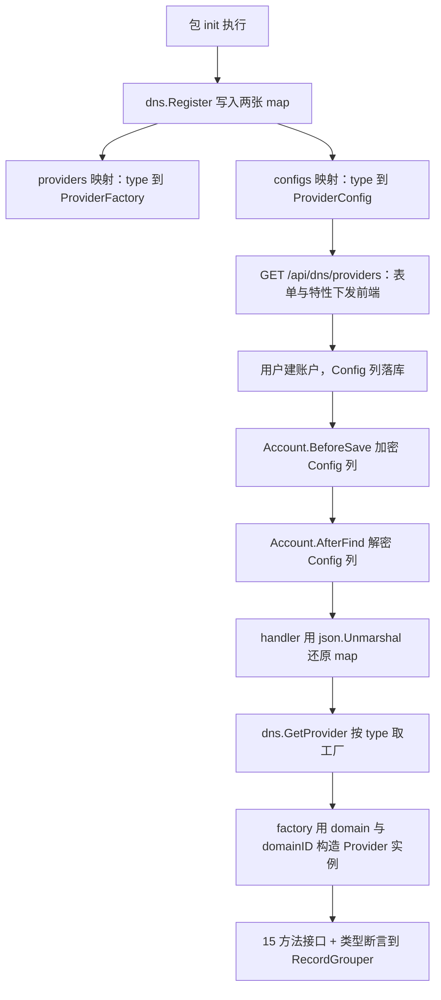
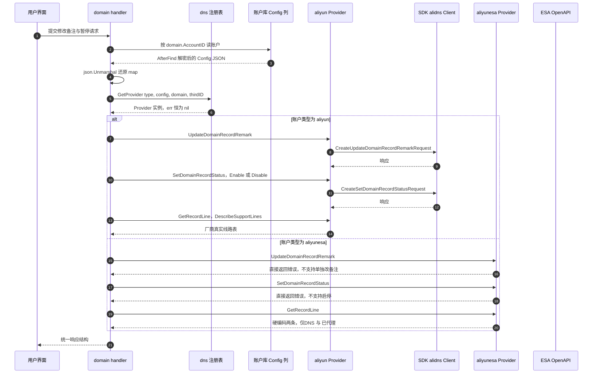
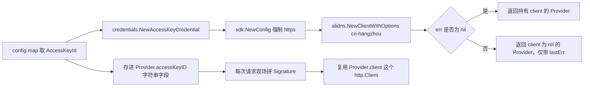
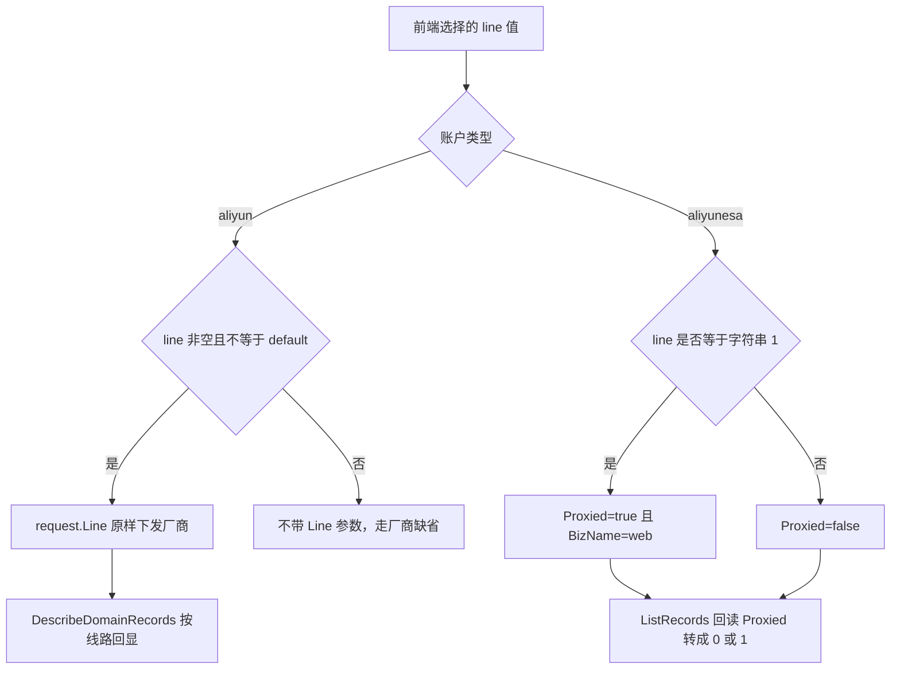
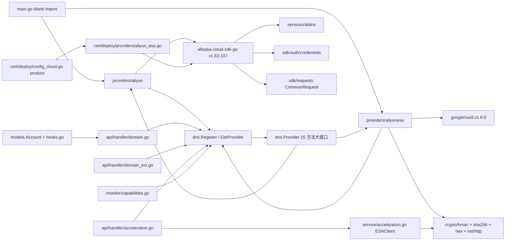

# 阿里云DNS

<cite>
**本文档引用的文件**
- [main.go](file://main/main.go)
- [go.mod](file://main/go.mod)
- [interface.go](file://main/internal/dns/interface.go)
- [registry.go](file://main/internal/dns/registry.go)
- [provider_form_test.go](file://main/internal/dns/provider_form_test.go)
- [doh.go](file://main/internal/dns/doh/doh.go)
- [aliyun.go](file://main/internal/dns/providers/aliyun/aliyun.go)
- [aliyunesa.go](file://main/internal/dns/providers/aliyunesa/aliyunesa.go)
- [domain.go](file://main/internal/api/handler/domain.go)
- [domain_ext.go](file://main/internal/api/handler/domain_ext.go)
- [acceleration.go (handler)](file://main/internal/api/handler/acceleration.go)
- [acceleration.go (service)](file://main/internal/service/acceleration.go)
- [domain.go (apiv1)](file://main/internal/apiv1/domain.go)
- [capabilities.go](file://main/internal/monitor/capabilities.go)
- [hooks.go](file://main/internal/models/hooks.go)
- [models.go](file://main/internal/models/models.go)
- [aliyun_base.go](file://main/internal/cert/deploy/providers/aliyun_base.go)
- [aliyun_esa.go](file://main/internal/cert/deploy/providers/aliyun_esa.go)
- [aliyun_cas.go](file://main/internal/cert/deploy/providers/aliyun_cas.go)
- [aliyun_media.go](file://main/internal/cert/deploy/providers/aliyun_media.go)
- [config_cloud.go](file://main/internal/cert/deploy/config_cloud.go)
- [config.go](file://main/internal/cert/deploy/config.go)
- [cert_deploy.go](file://main/internal/api/handler/cert_deploy.go)
- [providers.go](file://main/internal/cert/providers.go)
- [aliyun.go (cert)](file://main/internal/cert/aliyun/aliyun.go)
- [account-form.tsx](file://web/components/account-form.tsx)
- [provider-icon.tsx](file://web/components/provider-icon.tsx)
</cite>

## 目录

1. [简介](#简介)
2. [项目结构](#项目结构)
3. [核心组件](#核心组件)
4. [架构总览](#架构总览)
5. [详细组件分析](#详细组件分析)
6. [依赖关系分析](#依赖关系分析)
7. [性能考虑](#性能考虑)
8. [故障排查指南](#故障排查指南)
9. [结论](#结论)
10. [附录](#附录)

## 简介

DNSPlane 对阿里云的 DNS 侧支持由**两个互相独立的适配器包**构成，它们对接的是阿里云两条完全不同的产品线：

| 注册名（type） | 显示名 | 上游产品 | OpenAPI 版本 | 接入端点 | 客户端形态 |
|----------------|--------|----------|--------------|----------|------------|
| `aliyun` | 阿里云 | 云解析 DNS（Alidns） | `2015-01-09` | SDK 内置（按 region `cn-hangzhou` 解析） | 官方 SDK `alibaba-cloud-sdk-go/services/alidns` |
| `aliyunesa` | 阿里云ESA | 边缘安全加速 ESA | `2024-09-10` | `https://esa.{region}.aliyuncs.com` | 自实现 RPC 签名 + 裸 `net/http` |

两者虽然都叫"阿里云"，但在代码层面**没有一行共享实现**：`aliyun` 是 22 家服务商中仅存的 3 家官方 SDK 使用者之一（另两家为 DNSPod、华为云），`aliyunesa` 则与其余 19 家一样走自实现签名路径。这个分裂不是设计选择的结果，而是上游产品形态决定的——云解析 DNS 是"域名-记录"模型，ESA 是"站点（Site）-记录（Record）+代理（Proxied）"模型，二者的记录语义甚至不兼容（详见[详细组件分析](#详细组件分析)）。

从能力面看，`aliyun` 是全项目**功能最完整的适配器**：15 个接口方法全部为真实实现，0 个"返回不支持"的桩，且额外实现了可选接口 `dns.RecordGrouper`（记录分组），与 DNSPod 并列全项目仅有的两家。`aliyunesa` 则是**功能最受限的适配器之一**：`UpdateDomainRecordRemark`、`SetDomainRecordStatus`、`GetDomainRecordLog`、`AddDomain` 四个方法直接返回错误，且仅支持以 NS 方式接入 ESA 的站点（`aliyunesa.go:28` 的 `Note` 字段就是给用户的显式警告）。

除 DNS 解析本身之外，阿里云还与系统的另外两条链路耦合：

- **证书部署侧**：账户类型 `aliyun` 在部署配置里带一个 `product` 参数，当前工作区实测展开为 **19 个产品取值**（`config_cloud.go:22-42`），其中 `esa`、`esa_saas` 两项与 ESA 直接相关。
- **一键加速侧**：`internal/service/acceleration.go:256-498` 另有一个 `ESAClient`，它和 DNS 侧的 `aliyunesa.Provider` 是两套独立签名实现（差异见[故障排查指南](#故障排查指南)）。

本文只覆盖 **DNS 服务商适配器**这一层，证书部署与一键加速仅在必要处交叉引用，不展开为独立章节。全部凭据字段一律以 `{占位}` 表示，文中不出现任何真实密钥值。

**章节来源**
- [aliyun.go](file://main/internal/dns/providers/aliyun/aliyun.go)
- [aliyunesa.go](file://main/internal/dns/providers/aliyunesa/aliyunesa.go)
- [interface.go](file://main/internal/dns/interface.go)
- [config_cloud.go](file://main/internal/cert/deploy/config_cloud.go)
- [acceleration.go (service)](file://main/internal/service/acceleration.go)

## 项目结构

### 两个包的物理形态

阿里云在 `main/internal/dns/providers/` 下占两个目录，目录名 = 包名 = 注册名 = 主文件名，四个标识完全一致，符合适配层"按厂商切模块"的统一约定。

| 维度 | `providers/aliyun` | `providers/aliyunesa` |
|------|--------------------|------------------------|
| 文件数 | 1（`aliyun.go`） | 1（`aliyunesa.go`） |
| 行数（当前工作区 `wc -l` 实测） | 470 | 483 |
| 是否满足单文件 500 行约束 | 是 | 是 |
| 外部依赖 | `alibaba-cloud-sdk-go`（`sdk`/`auth/credentials`/`requests`/`services/alidns` 四个子包） | `google/uuid` + 标准库 `crypto/hmac`、`crypto/sha256`、`encoding/hex`、`net/http` |
| 结构体字段数 | 4（`client`、`domain`、`domainID`、`lastErr`） | 8（多 `accessKeyID`、`accessKeySecret`、`endpoint`、`version`、`client`） |
| 是否实现可选接口 | 是，`dns.RecordGrouper` | 否 |
| 返回"不支持"的方法数 | 0 | 4 |
| 是否声明 proxy 表单字段 | 否 | 是（历史上声明过，现已被测试锁死为禁止，见 `provider_form_test.go:30-33`） |

两个包都没有独立的测试文件。`provider_form_test.go` 只空导入 `aliyunesa`（`:11`）而不导入 `aliyun`——这意味着 `aliyun` 包的注册在 `internal/dns` 包的测试进程里不参与断言，只在 `main` 二进制构建时通过 `main.go:31` 的 blank import 生效。

**章节来源**
- [aliyun.go](file://main/internal/dns/providers/aliyun/aliyun.go)
- [aliyunesa.go](file://main/internal/dns/providers/aliyunesa/aliyunesa.go)
- [provider_form_test.go](file://main/internal/dns/provider_form_test.go)
- [main.go](file://main/main.go)

### 注册与装载链路

适配器不是被直接调用的，而是经过"注册表 → 工厂 → handler"三级装载。两个阿里云包在这条链路上的位置完全相同：



**图表来源**

对应实测位置：`dns.Register` 定义在 `registry.go:18-23`，两张全局 map 在 `registry.go:11-15`；`GetProvider` 在 `registry.go:26-37`；凭据加解密钩子在 `models/hooks.go:32-33`（`Account.Config` 列）；provider 实例构造统一收口在 `domain.go:37-54` 的 `getProviderByDomain`，它把 `domain.Name` 与 `domain.ThirdID` 分别作为 `domain`、`domainID` 传给工厂。

值得强调的一点：`aliyun.go:38` 与 `aliyunesa.go:54` 的 `NewProvider` 签名返回的是**单个 `dns.Provider`，没有 error 通道**（`ProviderFactory` 的定义就是 `registry.go:9`）。SDK 客户端构造失败时，`aliyun` 只能把错误塞进 `lastErr` 字段并返回一个 `client` 为 nil 的实例（`aliyun.go:44-46`），调用方在 `GetProvider` 处看到的 `err` 依然是 `nil`。这是本文在[故障排查指南](#故障排查指南)中列出的第一个陷阱。

**章节来源**
- [registry.go](file://main/internal/dns/registry.go)
- [hooks.go](file://main/internal/models/hooks.go)
- [domain.go](file://main/internal/api/handler/domain.go)
- [aliyun.go](file://main/internal/dns/providers/aliyun/aliyun.go)
- [aliyunesa.go](file://main/internal/dns/providers/aliyunesa/aliyunesa.go)

## 核心组件

### 组件一：alibaba-cloud-sdk-go（仅 aliyun 使用）

`aliyun` 包共引入四个 SDK 子包（`aliyun.go:10-13`），依赖声明为 `github.com/aliyun/alibaba-cloud-sdk-go v1.63.107`（`go.mod:6`）。它是 22 家适配器里唯一的 `alidns` 强类型用户，因此也独占了 SDK 带来的三个特性：

- **请求对象由工厂函数生成**：`CreateDescribeDomainsRequest()`、`CreateAddDomainRecordRequest()` 等 14 处 `alidns.Create*Request()` 调用（`:60`、`:68`、`:96`、`:151`、`:187`、`:206`、`:232`、`:258`、`:267`、`:275`、`:288`、`:319`、`:343`、`:411`），字段类型是 `requests.Integer`/`requests.Integer64` 这类带自定义序列化的包装类型，而非裸 `int`。
- **端点解析交给 SDK**：`alidns.NewClientWithOptions("cn-hangzhou", conf, cred)`（`aliyun.go:43`）把 region 硬编码为 `cn-hangzhou`，端点由 SDK 内部 location 服务解析。适配器层没有任何暴露 region 的表单字段。
- **TLS 强制靠一行注释与一行代码**：`aliyun.go:40-42` 是全项目**唯一**一处显式解释"凭据必须走 https"的位置，配套动作是 `sdk.NewConfig().WithScheme("https")`。作者的理由很直接——SDK 的 `NewConfig` 默认 Scheme 为 HTTP，而这条路径携带 AccessKey 签名，明文传输可被中间人重放。

同时，`aliyun` 也**绕开了 SDK** 两次：记录分组的两个 Action（`DescribeRecordGroups`、`ChangeRecordGroup`）在 SDK 中没有对应方法，改用 `requests.NewCommonRequest()` + `client.ProcessCommonRequest()` 手写（`aliyun.go:351-361`、`:395-405`），并硬编码 `req.Domain = "alidns.aliyuncs.com"`。也就是说同一个 Provider 实例内部实际存在**两个不同的接入地址**：SDK 路径按 region 解析，CommonRequest 路径固定域名。

**章节来源**
- [aliyun.go](file://main/internal/dns/providers/aliyun/aliyun.go)
- [go.mod](file://main/go.mod)

### 组件二：账户参数 product（属于证书部署侧，不属于 DNS）

这是阅读本目录文档最容易产生误解的一处，必须澄清：

- **DNS 侧的 `aliyun` 与 `aliyunesa` 都没有 `product` 参数。** `aliyun` 的表单只有 `AccessKeyId`、`AccessKeySecret` 两项（`aliyun.go:22-23`），`aliyunesa` 多一项 `region`（`aliyunesa.go:30-35`），共 3 项，且都是**接入点选择**而不是产品选择。
- **`product` 参数存在于证书部署侧的阿里云统一账户**，定义在 `config_cloud.go:22-42`，`Type: "select"`、`Required: true`、默认值 `cdn`，展开共 **19 个取值**（完整清单见[附录](#附录)）。它由部署任务读取（例如 `aliyun_media.go:166-174` 依据 `product` 选函数计算接口版本），DNS 适配层从不读取它。

因此本文把 `product` 定位为**同名部署器的旁路能力**：部署侧的阿里云配置块与 DNS 侧共用 `Type: "aliyun"` 这个标识（`config_cloud.go:12`），但它挂在部署模块自己的注册表上（`registerDeployConfig`，`config_cloud.go:11`），字段分成账户级 `Inputs` 与任务级 `TaskInputs` 两段（`config.go:27-28`），`product` 属于后者，由前端按 `Show` 表达式条件渲染后随部署任务提交（`cert_deploy.go:1059` 把 `cfg.TaskInputs` 原样下发）。

凭据键名的真实分歧不在 DNS 与部署之间——两侧都是大驼峰 `AccessKeyId`（`aliyun.go:22-23`、`config_cloud.go:18-19`）——而在**证书签发账户**：`aliyun_cert` 用小写下划线 `access_key_id`/`access_key_secret`（`providers.go:71-72`），部署专用通道 `aliyun_cdn`/`aliyun_dcdn` 同样是小写下划线（`providers.go:165-166`、`:181-182`）。两套键名不能互换，属于已知的历史包袱；本文把它登记为"跨模块同名账户的键名约定不统一"，而不是"部署侧读错了键名"。

**章节来源**
- [aliyun.go](file://main/internal/dns/providers/aliyun/aliyun.go)
- [aliyunesa.go](file://main/internal/dns/providers/aliyunesa/aliyunesa.go)
- [config_cloud.go](file://main/internal/cert/deploy/config_cloud.go)
- [config.go](file://main/internal/cert/deploy/config.go)
- [cert_deploy.go](file://main/internal/api/handler/cert_deploy.go)
- [aliyun_media.go](file://main/internal/cert/deploy/providers/aliyun_media.go)
- [providers.go](file://main/internal/cert/providers.go)

### 组件三：ESA 的"站点即域名"模型

`aliyunesa` 把 ESA 的 Site 概念映射到本项目的 Domain 实体上，这是它与 `aliyun` 最根本的差异，也是它限制最多的地方：

| 概念 | aliyun 的映射 | aliyunesa 的映射 | 代码依据 |
|------|---------------|------------------|----------|
| 域名标识 | `DomainId`（字符串） | `SiteId`（数字，`fmt.Sprintf("%v", ...)` 转字符串） | `aliyun.go:83`、`aliyunesa.go:177` |
| 记录归属 | 按 `DomainName` 字符串查 | 按 `SiteId` 查，`SiteId` 取自 `domainID` 参数 | `aliyun.go:97`、`aliyunesa.go:192` |
| 主机记录 | 直接用厂商返回的 `RR` | 从完整 `RecordName` 反向裁掉 `.{domain}` 后缀 | `aliyun.go:129`、`aliyunesa.go:240-243` |
| 接入方式 | 不区分 | 强制 `AccessType = "NS"` 过滤站点列表 | `aliyunesa.go:161` |
| 记录条数 | 厂商返回 `RecordCount` | 恒为 `0`，硬编码 | `aliyun.go:85`、`aliyunesa.go:179` |

`SiteId` 来自 `domain.ThirdID`，而 `ThirdID` 只在域名同步时写入、且**仅当原值为空时才补**（`domain.go:535-536`、`:551-556`，模型列定义 `models.go:77` 为 `size:60`）。这条链路是 `aliyunesa` 最容易出问题的地方，详见[故障排查指南](#故障排查指南)。

**章节来源**
- [aliyun.go](file://main/internal/dns/providers/aliyun/aliyun.go)
- [aliyunesa.go](file://main/internal/dns/providers/aliyunesa/aliyunesa.go)
- [config_cloud.go](file://main/internal/cert/deploy/config_cloud.go)
- [go.mod](file://main/go.mod)
- [domain.go](file://main/internal/api/handler/domain.go)
- [models.go](file://main/internal/models/models.go)

## 架构总览

下图描述一次"用户在记录列表改一条 A 记录的备注并暂停它"的完整调用链，覆盖 handler → 注册表 → 工厂 → 厂商 API 四段，并把 `aliyun` 与 `aliyunesa` 的差异画进同一条链路的两个分支。



**图表来源**

架构上有三个必须从图中读出来的事实：

1. **注册表是唯一的解耦点。** handler 侧完全不认识"阿里云"，`domain.go:37-54` 的 `getProviderByDomain` 只做三件事：读账户、解 JSON、按 `account.Type` 取工厂。新增一家厂商不需要改 handler。
2. **`GetProvider` 的错误通道形同虚设。** 图中第 6 步"err 恒为 nil"是当前实现的真实行为：`registry.go:36` 直接 `return factory(config, domain, domainID), nil`，而 `aliyun.go:44-46` 把 SDK 构造失败吞进 `lastErr`。接口里唯一能取出这个信息的 `GetError()`（`interface.go:43`）在 DNS 链路侧没有任何调用者。
3. **两个分支的能力差被接口强制填平。** `dns.Provider` 是 15 方法单一大接口（`interface.go:41-86`），Go 编译期要求 `aliyunesa` 也必须提供 `SetDomainRecordStatus` 等方法，于是它只能写返回 error 的桩（`:462-464`）。特性声明位 `ProviderFeatures`（`interface.go:157-167`）本意是让前端隐藏这些操作，但 `Remark`/`Status`/`Log` 这些位在后端从未被读取用于拦截，只下发给前端。

一次成功的 `aliyun` 记录新增还会触发**第二次独立请求**：`AddDomainRecord` 拿到 RecordId 后再调 `UpdateDomainRecordRemark`，且第二次的错误被 `_ =` 显式丢弃（`aliyun.go:224-226`）。这条隐含的"两次写"路径在图中没有单独画出，是[详细组件分析](#详细组件分析)的重点。

**章节来源**
- [domain.go](file://main/internal/api/handler/domain.go)
- [registry.go](file://main/internal/dns/registry.go)
- [interface.go](file://main/internal/dns/interface.go)
- [aliyun.go](file://main/internal/dns/providers/aliyun/aliyun.go)
- [aliyunesa.go](file://main/internal/dns/providers/aliyunesa/aliyunesa.go)

## 详细组件分析

### AccessKey 与凭据生命周期

两个 Provider 都只吃 `AccessKeyId` + `AccessKeySecret` 两个键，但消费方式不同：



**图表来源**

实测位置：`aliyun.go:39-46`（`credentials.NewAccessKeyCredential` → `sdk.NewConfig().WithScheme("https")` → `NewClientWithOptions` 的失败分支）、`aliyunesa.go:54-68`（凭据以裸字符串存字段）、`:66`（`http.Client{Timeout: 30 * time.Second}`）。

三个安全相关的确定事实：

- **传输层**：`aliyun` 显式锁 https；`aliyunesa` 的 URL 是字符串拼出来的 `https://` 前缀（`:109`、`:114`），没有可配置成 http 的路径。这两条都满足"带签名凭据必须走 TLS"。
- **静态存储**：`Account.Config` 是 GORM `BeforeSave`/`AfterFind` 透明加解密覆盖的 7 个敏感列之一（`hooks.go:32-33`），因此 AccessKeySecret 不以明文落库。
- **签名密钥的拼法**：`aliyunesa` 用 `[]byte(p.accessKeySecret + "&")` 作为 HMAC key（`:100`），这是阿里云 RPC 风格签名的标准做法（key 末尾必须带 `&`，因为 `SignatureNonce` 之后没有 security token）；`aliyun` 走 SDK，`&` 的处理在 SDK 内部。

`region` 的处境在两个包里完全不同：`aliyun` **没有** region 配置项，`cn-hangzhou` 是 `aliyun.go:43` 的硬编码字面量；`aliyunesa` 把 region 做成必选下拉（`aliyunesa.go:32-35`），两个选项 `cn-hangzhou`（中国内地）与 `ap-southeast-1`（非中国内地），默认值 `cn-hangzhou`，并在 `:55-58` 做了空值兜底。云解析 DNS 是全局服务、没有真实的多 region 语义，因此这个差异是合理的；但记录分组路径绕过 SDK 直连 `alidns.aliyuncs.com`（`:353`、`:397`）使得同一个 Provider 内部实际使用了两个不同的接入地址，这一点在跨账号资源组或国际站场景下值得警惕。

**章节来源**
- [aliyun.go](file://main/internal/dns/providers/aliyun/aliyun.go)
- [aliyunesa.go](file://main/internal/dns/providers/aliyunesa/aliyunesa.go)
- [hooks.go](file://main/internal/models/hooks.go)

### 记录接口：15 方法的落点差异

两个 Provider 对同一套 15 方法的实现强度差别极大。下表为逐方法实测（"桩"= 直接 `return fmt.Errorf(...)`）。

| 接口方法 | aliyun 落点 | aliyun 厂商 Action | aliyunesa 落点 | aliyunesa Action |
|----------|-------------|--------------------|----------------|------------------|
| `GetError` | `:55` | 无（读 lastErr） | `:70` | 无 |
| `Check` | `:59` | `DescribeDomains`（PageSize=1） | `:151` | `ListSites`（间接经 GetDomainList） |
| `GetDomainList` | `:67` | `DescribeDomains` | `:156` | `ListSites` + `AccessType=NS` |
| `GetDomainRecords` | `:95` | `DescribeDomainRecords` | `:189` | `ListRecords` |
| `GetSubDomainRecords` | `:150` | `DescribeSubDomainRecords` | `:294` | 复用 `ListRecords`（`:295` 一行委托） |
| `GetDomainRecordInfo` | `:186` | `DescribeDomainRecordInfo` | `:298` | `GetRecord` |
| `AddDomainRecord` | `:205` | `AddDomainRecord` + `UpdateDomainRecordRemark` | `:362` | `CreateRecord` |
| `UpdateDomainRecord` | `:231` | `UpdateDomainRecord` + `UpdateDomainRecordRemark` | `:413` | `UpdateRecord` |
| `UpdateDomainRecordRemark` | `:257` | `UpdateDomainRecordRemark` | `:448` | **桩** |
| `DeleteDomainRecord` | `:266` | `DeleteDomainRecord` | `:452` | `DeleteRecord` |
| `SetDomainRecordStatus` | `:274` | `SetDomainRecordStatus` | `:462` | **桩** |
| `GetDomainRecordLog` | `:287` | `DescribeRecordLogs` | `:466` | **桩** |
| `GetRecordLine` | `:318` | `DescribeSupportLines` | `:470` | 无请求，硬编码 2 条 |
| `GetMinTTL` | `:338` → 600 | 无请求 | `:477` → 1 | 无请求 |
| `AddDomain` | `:342` | `AddDomain` | `:481` | **桩** |
| 额外：`RecordGrouper` 三方法 | `:350`/`:389`/`:410` | 2 个 CommonRequest + 1 个 SDK | 未实现 | —— |

`aliyun` 是唯一一个 15 方法零桩的适配器。反过来看，`aliyunesa` 的 4 个桩占全项目 52 个"不支持"分支的约 8%。

**读侧字段归一的细节差异**（这两处最容易被误认为 bug）：

- **状态**：`aliyun` 把厂商的 `ENABLE`/其他值映射成 `enable`/`disable`（`aliyun.go:136-140`），`GetDomainRecords` 的过滤参数则反向 `strings.ToUpper(status)`（`:117`）。`aliyunesa` **没有任何状态字段**，读回的每条记录一律硬编码 `Status: "enable"`（`aliyunesa.go:283`、`:354`），这也是它 `Features.Status = false` 的真实含义。
- **TTL 类型**：`aliyun` 用 SDK 包装类型 `requests.NewInteger(ttl)` 下发（`:211`），读回是 `int(r.TTL)`；`aliyunesa` 下发 `strconv.Itoa(ttl)`，读回是 `int(rec["Ttl"].(float64))`——JSON 数字统一落成 `float64`，`aliyunesa.go:280`、`GetDomainList` 的 `TotalCount` 同理（`:185`）。这些裸类型断言（`. (string)`、`. (float64)`）在字段缺失或类型变化时会直接 panic，`aliyunesa.go:239`、`:245`、`:250`、`:290` 都是这样的点。

**写侧的两次请求问题**：`aliyun.AddDomainRecord`（`:205-229`）在厂商侧成功建记录**之后**才调 `UpdateDomainRecordRemark` 写备注，并用 `_ =` 丢弃第二次的错误（`:224-226`）。`UpdateDomainRecord`（`:231-255`）同样如此（`:250-252`）。后果是：记录已建成但备注丢失，而调用方拿到的是 `nil` 错误，界面显示"成功"。`aliyunesa` 反而没有这个问题——它把备注作为 `Comment` 参数与记录一次性下发（`:394-396`、`:437-439`），代价是失去了独立改备注的接口。这是"两次请求换更完整能力"与"一次请求换更原子性"的直接权衡，`Remark` 特性位 `1` 与 `2` 的语义（`interface.go:158` 注释：1 单独设置、2 和记录一起设置）正是在区分这两者。

**章节来源**
- [aliyun.go](file://main/internal/dns/providers/aliyun/aliyun.go)
- [aliyunesa.go](file://main/internal/dns/providers/aliyunesa/aliyunesa.go)
- [interface.go](file://main/internal/dns/interface.go)

### 线路映射：语义完全不同的一字段两用法

`dns.Record.Line` 这一个字符串字段，在两家身上承载了两种语义。`registry.go:58-80` 的静态线路映射表 `DefaultLineMapping` 是"分线路解析"的权威口径：

| provider | DEF（默认线路） | CT（电信） | CU（联通） | CM（移动） | AB（境外） | 分线路能力 |
|----------|-----------------|------------|------------|------------|------------|:----------:|
| `aliyun` | `default` | `telecom` | `unicom` | `mobile` | `oversea` | 可用 |
| `aliyunesa` | `0` | 无条目 | 无条目 | 无条目 | 无条目 | 不可用（仅默认） |

实测位置：`registry.go:59`（aliyun 五个键齐全）、`registry.go:75`（aliyunesa 只有 `DEF: "0"`）。`DefaultDNSLine`（`registry.go:82-89`）在查不到条目时回退字面量 `"default"`，但两家都在表里有条目，不会走到回退分支。

运行时线路的三条真实路径：

1. **动态线路表**：`aliyun.GetRecordLine`（`:318-336`）调 `DescribeSupportLines`，把厂商的 `LineCode`/`LineName` 映射到 `RecordLine.ID`/`Name`。线路名以厂商返回为准，云解析 DNS 的增值线路（如"搜索行业""教育行业"）会如实出现在下拉里。`aliyunesa.GetRecordLine`（`:470-475`）**不发请求**，固定返回 `{"0": "仅DNS", "1": "已代理"}` 两条。
2. **下发侧的 default 吞并**：`aliyun` 在 Add/Update 两处都判定 `if line != "" && line != "default"` 才赋值 `request.Line`（`:212-214`、`:238-240`）。也就是说用户选"默认线路"时，请求里根本没有 `Line` 参数，由厂商按缺省处理。这与查询侧把 `line == "default"` 原样传给 `request.Line` 做过滤（`:113-115`）是不对称的——**同一个值在读和写两条路径上语义不同**，用 `default` 去过滤可能一条也查不到，取决于厂商侧对空 `Line` 与 `Line=default` 是否等价处理（本文未实测厂商侧行为，标记为未知）。
3. **线路位复用为代理开关**：`aliyunesa` 把 `Line` 字段挪用作"是否走 ESA 代理"：`line == "1"` → `Proxied=true` 且额外下发 `BizName="web"`，否则 `Proxied=false`（`:380-383`、`:397-399`）。读回时反向：`Proxied` 为 true → `Line="1"`，否则 `"0"`（`:265-268`）。这与 Cloudflare 适配器的做法同构（Cloudflare 也是 0 仅 DNS、1 已代理），属于跨厂商的字段挪用惯例，不是阿里云特有。



**图表来源**

图中三个判定的实测落点：`aliyun` 的 `line != "" && line != "default"` 出现在 `aliyun.go:212-214`（新增）与 `:238-240`（更新）两处，查询侧的 `request.Line = line` 在 `:113-115`；`aliyunesa` 的 `line == "1"` 判定出现在 `aliyunesa.go:380-383`（推导 `Proxied`）、`:397-399`（追加 `BizName`）、`:222-228`（查询过滤）、`:265-268`（回读还原）。线路缺省值口径由 `registry.go:59`（`default`）与 `registry.go:75`（`0`）分别给出。

**章节来源**
- [registry.go](file://main/internal/dns/registry.go)
- [aliyun.go](file://main/internal/dns/providers/aliyun/aliyun.go)
- [aliyunesa.go](file://main/internal/dns/providers/aliyunesa/aliyunesa.go)

### 记录类型与主机记录的规范化

两家都需要把本项目的 `A`/`AAAA` 二分模型与厂商模型对齐，方式相反：

- **aliyun**：类型直通，`request.Type = recordType`（`:209`、`:235`）不做任何映射；MX 优先级通过 `request.Priority` 单独下发，且仅在 `recordType == "MX"` 时设置（`:215-217`、`:241-243`）。主机记录 `name` 原样赋给 `request.RR`，根域由厂商侧约定为 `@`，适配器不做转换。`GetSubDomainRecords` 会拼成完整子域 `subDomain + "." + p.domain` 再查（`:152`）。
- **aliyunesa**：`A` 与 `AAAA` 在 ESA 侧是同一个类型 `A/AAAA`。写侧合并：`if recordType == "A" || recordType == "AAAA" { recordType = "A/AAAA" }`（`:370-372`、`:414-416`）；读侧**按值反推**——若 `Data.Value` 含冒号则判为 `AAAA`，否则 `A`（`:252-258`、`:323-329`）。这意味着一条 `A/AAAA` 记录里同时含 IPv4 和 IPv6 多个值时，本侧只能展示成单一类型，因为反推只看第一个 `Value`。主机记录要显式处理根域：`@` → 裸域名，其他 → `name + "." + domain`（`:363-368`），读回时 `TrimSuffix` 后若为空串或等于裸域名则还原成 `@`（`:240-243`）。MX 优先级塞进 `Data` 这个 JSON 结构体的 `Priority` 键（`:375-377`、`:419-421`），与 `Value` 同级。

`Data` 是 ESA 记录的唯一值容器，代码里现场 `json.Marshal(map[string]interface{}{"Value": ..., "Priority": ...})` 并**忽略 Marshal 错误**（`dataJSON, _ := json.Marshal(data)`，`:378`、`:422`）。该错误在当前构造下确实不可能发生（map 值类型全是 `string`/`int`），但这是一处无注释的错误丢弃。

作为参照，同一个 `A/AAAA` 合并语义在加速链路里被重复实现了一次：`service/acceleration.go:361-363` 的 `CreateESARecord` 也做同样的类型合并，并且固定 `Proxied="true"`、`BizName="web"`、`Ttl="1"`（`:365-374`），与 `aliyunesa.AddDomainRecord` 是两份独立代码。

**章节来源**
- [aliyun.go](file://main/internal/dns/providers/aliyun/aliyun.go)
- [aliyunesa.go](file://main/internal/dns/providers/aliyunesa/aliyunesa.go)
- [acceleration.go (service)](file://main/internal/service/acceleration.go)

### 记录分组：aliyun 独有的第三能力

`dns.RecordGrouper`（`interface.go:102-106`）是三个可选扩展接口之一，全项目只有 `aliyun` 与 `dnspod` 实现。`aliyun` 的三个方法落点：

| 方法 | 位置 | 传输方式 | 关键点 |
|------|------|----------|--------|
| `GetRecordGroups` | `:350-386` | `ProcessCommonRequest` 手写 `DescribeRecordGroups` | `PageSize` 硬编码 100（`:358`）、`Lang=zh`（`:359`）、POST（`:352`） |
| `ChangeRecordGroup` | `:389-407` | `ProcessCommonRequest` 手写 `ChangeRecordGroup` | `RecordIdList` 是 `json.Marshal([]string)` 的结果串（`:390-402`） |
| `GetDomainRecordsByGroup` | `:410-464` | SDK `DescribeDomainRecords` + `GroupId` | `requests.NewInteger64(parseInt64(groupID))`（`:415`） |

第三条方法的实现体（`:441-463`）与 `GetDomainRecords` 的解析体（`:125-147`）几乎逐行相同，唯一区别是多设一个 `GroupId`——这是全仓可见的一处明显重复（约 22 行），可抽成一个共用 `parseDomainRecords(response)` 函数。

风险集中在 `parseInt64`（`:466-470`）：

```go
func parseInt64(s string) int64 {
	var n int64
	fmt.Sscanf(s, "%d", &n)
	return n
}
```

`fmt.Sscanf` 的返回值（读取成功个数）与 error 都被丢弃。传入非数字的 `groupID` 时函数静默返回 `0`，随后 `GroupId=0` 下发厂商。结合调用侧——`domain.go:811-812` 直接透传前端给的 `groupID` 字符串，不做校验——一条非法分组 ID 会表现为"查询返回空列表"而不是"参数错误"。这是本文列出的第二个排查陷阱。

消费侧的入口有两个 HTTP 端点，均要求 `domain` 模块权限，`ChangeRecordGroup` 还额外要求域名写权限并落审计：`domain_ext.go:357-380`（`GetRecordGroups`，非 `RecordGrouper` 时返回空列表而非报错）、`domain_ext.go:387-418`（`ChangeRecordGroup`，非 `RecordGrouper` 时报"当前DNS服务商不支持记录分组"，成功后 `Audit.LogAction` 记录移动条数）。路由注册在 `apiv1/domain.go:49-50`。

**章节来源**
- [aliyun.go](file://main/internal/dns/providers/aliyun/aliyun.go)
- [interface.go](file://main/internal/dns/interface.go)
- [domain_ext.go](file://main/internal/api/handler/domain_ext.go)
- [domain.go](file://main/internal/api/handler/domain.go)

### ESA 的特殊字段

`aliyunesa.go` 中没有任何名为 `project_name` 的参数（全仓检索 `project_name`/`ProjectName` 零命中；只有华为云侧存在 `project_id`，见 `config_cloud.go:138`）。ESA 侧真正的"特殊字段"是下面这组，它们在阿里云 OpenAPI 里的名字与本项目里的落点必须对齐：

| 厂商参数 | 取值来源 | 出现位置 | 语义 |
|----------|----------|----------|------|
| `SiteId` | `domain.ThirdID`（即 `domainID` 形参） | `:192`、`:387` | 站点唯一标识，缺失则查询/写入全部失败 |
| `AccessType` | 硬编码 `"NS"` | `:161` | 只列 NS 接入的站点，CNAME 接入站点被排除 |
| `RecordName` | `subDomain`/`keyword` 拼 `.{domain}`，`@` 换成裸域 | `:197-213`、`:363-368` | 记录必须是完整域名 |
| `Type` | `A`/`AAAA` 合并成 `A/AAAA` | `:216-218`、`:370-372` | ESA 的二合一类型 |
| `Data` | JSON 字符串，含 `Value` 与可选 `Priority` | `:374-378`、`:418-422` | 记录值容器，读回是 `map[string]interface{}` |
| `Proxied` | 由 `line == "1"` 推导 | `:380-383`、`:265-268` | 是否走 ESA 边缘代理 |
| `BizName` | `line == "1"` 时硬编码 `"web"` | `:397-399`、`:440-442` | 代理业务类型，非代理时不下发 |
| `Ttl` | 用户输入 `strconv.Itoa`；`GetMinTTL` 返回 1 | `:391`、`:434`、`:477-479` | 代理记录要求 TTL=1（自动） |
| `Comment` | 用户输入的 remark（非空才下发） | `:394-396`、`:437-439` | 备注，随记录一次性写入 |
| `Version` | 硬编码 `"2024-09-10"` | `:63` | ESA OpenAPI 版本 |
| `region` | 账户表单下拉 | `:32-35`、`:55-62` | 决定 `esa.{region}.aliyuncs.com` |

`BizName` 值得单独说明：它只在开启代理时才带上，且值恒为 `web`。ESA 的 `BizName` 支持多种业务类型（视频、网页等），本项目没有暴露该选择，`aliyun_esa.go` 部署侧同样不读它。若用户的站点上代理策略依赖 `BizName` 区分加速规则，这里会一律按 `web` 下发——属于当前实现的一个明确简化。

**章节来源**
- [aliyunesa.go](file://main/internal/dns/providers/aliyunesa/aliyunesa.go)
- [aliyun_esa.go](file://main/internal/cert/deploy/providers/aliyun_esa.go)
- [config_cloud.go](file://main/internal/cert/deploy/config_cloud.go)

## 依赖关系分析



**图表来源**

依赖面可以分成三层来读：

- **适配层内部**：`aliyun` 与 `aliyunesa` **互不引用**，且都不引用任何 handler。两家只依赖 `main/internal/dns` 这一个包（`aliyun.go:7`、`aliyunesa.go:18`），符合"厂商之间零耦合、可独立替换"的模块化目标。这是全适配层最理想的一类结构。
- **横向重复**：真正的问题在**跨层重复**。同一个 ESA RPC 签名逻辑存在**三份**独立实现——`aliyunesa.go:74-105`（hex 编码签名）、`service/acceleration.go:278-308`（base64 编码签名）、`cert/deploy/providers/aliyun_base.go:246-276`（`ACS3-HMAC-SHA256` 的 V3 签名，也是 hex）。前两份都是 RPC `SignatureVersion=1.0` 风格却给出不同编码结果，这是 DRY 违背叠加**正确性存疑**的组合，详见[故障排查指南](#故障排查指南)。ESA 端点常量也重复：`aliyunesa.go:62` 拼 `esa.{region}.aliyuncs.com`，`aliyun_esa.go:15-17` 用两个常量表达同样两个地址。
- **能力事实来源分散**：`aliyun` 的能力在三处各说一遍——`ProviderFeatures`（`aliyun.go:25-27`，`Status: true`、`RecordGroup: true`）、接口类型断言（`RecordGrouper` 是否实现）、容灾能力表（`capabilities.go:12`，`aliyun: {Pause: true, Delete: true, Mixed: false}`）。`aliyunesa` 在 `capabilities.go:25` 是 `{Pause: false, Delete: true, Mixed: false}`，与它 `Features.Status = false` 恰好一致，这一点是巧合而非约束保证。
- **前端依赖**：`account-form.tsx:24` 把 `aliyun` 归入"国内DNS服务商"、`:26` 把 `aliyunesa` 归入"专业DNS解决方案"，两家的分类不同框。图标由 `provider-icon.tsx:14-19`（aliyun，字母"阿"）与 `:80-85`（aliyunesa，字母"EA"）分别硬编码，两家主色都是 `#FF6A00`、底色都是 `bg-orange-50 dark:bg-orange-950`。后端 `ProviderConfig.Icon` 声明的 `aliyun.png`（`aliyun.go:20`、`aliyunesa.go:27`）在这条渲染路径上不被读取。

**章节来源**
- [main.go](file://main/main.go)
- [aliyun.go](file://main/internal/dns/providers/aliyun/aliyun.go)
- [aliyunesa.go](file://main/internal/dns/providers/aliyunesa/aliyunesa.go)
- [acceleration.go (service)](file://main/internal/service/acceleration.go)
- [aliyun_base.go](file://main/internal/cert/deploy/providers/aliyun_base.go)
- [aliyun_esa.go](file://main/internal/cert/deploy/providers/aliyun_esa.go)
- [capabilities.go](file://main/internal/monitor/capabilities.go)
- [account-form.tsx](file://web/components/account-form.tsx)
- [provider-icon.tsx](file://web/components/provider-icon.tsx)
- [go.mod](file://main/go.mod)

## 性能考虑

以下每一条都对应实际代码位置，不按"通用最佳实践"罗列。

| 关注点 | 当前行为 | 位置 | 影响判断 |
|--------|----------|------|----------|
| Provider 实例复用 | 每次请求重建（读账户 → 解 JSON → 新建 SDK client 或 http.Client） | `domain.go:37-54`、`registry.go:36` | 高频轮询场景下 SDK client 重建开销最大，全适配层无实例缓存 |
| HTTP 超时 | `aliyun` 用 SDK 默认超时（未在代码中显式设置）；`aliyunesa` 显式 30 秒 | `aliyunesa.go:66` | 30 秒对单次记录写操作偏长，批量任务会放大等待 |
| SDK 版本 | `v1.63.107`（v1 系列） | `go.mod:6` | 阿里云已主推 v2 系列 SDK，v1 的 location 端点解析路径与依赖体积都偏重 |
| 备注写两次 | Add/Update 之后额外一次 `UpdateDomainRecordRemark` | `aliyun.go:224-226`、`:250-252` | 单条记录 = 2 次 API 调用，批量 500 条即 1000 次请求，直接顶到云解析的接口频控 |
| 分组列表页大小 | `PageSize` 硬编码 `100`，不翻页 | `aliyun.go:358` | 站点分组超过 100 个时前端下拉会缺项，且无任何提示 |
| 全量拉取 | 两家都正确透传 `page`/`pageSize`，未出现"忽略分页返回全量"（对比 AWS、百度两家） | `aliyun.go:98-99`、`aliyunesa.go:193-194` | 分页侧无性能陷阱，这是阿里云优于部分厂商的点 |
| 域名列表 `RecordCount` | `aliyun` 直接取厂商 `RecordCount`；`aliyunesa` 恒填 0 | `aliyun.go:85`、`aliyunesa.go:179` | ESA 域名列表的"记录数"列永远是 0，若前端展示需知悉 |
| 连接复用 | 两份独立 `http.Client`，无共享 Transport | `aliyunesa.go:66` | 每次新建 Provider 都新建 Client，连接池无法跨请求复用 |
| 无重试 | 两家都没有任何退避重试；`aliyunesa` 的 `Code` 分支一次即失败 | `aliyunesa.go:142-146` | 频控报错（`Throttling`）会原样冒到用户界面 |

三条需要展开的判断：

**请求合并的机会是存在的，但不在读侧。** 读侧分页已正确实现，性能瓶颈集中在写侧。`aliyun` 的备注双写是唯一一处"一个用户动作产生两次云端请求"的实现。要消除它，得把 `Remark` 特性位从 `1`（单独设置）改成 `2`（随记录一起设置）——但云解析 DNS 的 `AddDomainRecord` 本身**不接受** `Remark` 参数，`UpdateDomainRecord` 也不接受，这是厂商 API 的硬限制，因此双写不是实现偷懒而是被迫。合理的改进方向不是合并请求，而是**把第二次的错误上报出来**（去掉 `_ =`），至少在响应里回显"记录已保存、备注写入失败"。

**实例缓存的收益对 `aliyun` 明显高于 `aliyunesa`。** 前者每次构造要走 SDK 的 region 定位与凭证装配，后者只是填几个字符串字段。当前适配层只有 `dynv6`（zone ID）和 `henet`（会话 cookie）借用 `cache.C` 缓存局部状态，没有任何一家缓存 Provider 实例本身。若要做，正确的键是 `(accountID, domainID)`，并必须处理账户 Config 被编辑后的失效——这是一个跨全适配层的改动，不应只为阿里云两家单独做。

**SDK 版本是长期成本项。** `v1.63.107` 属于 alibaba-cloud-sdk-go 的 v1 单体大库（一个模块内含所有产品），依赖树与编译产物体积都由它承担。同一仓库里证书部署侧已经改用手写 `ACS3-HMAC-SHA256`（V3 签名）+ `ProcessCommonRequest` 的轻量路线（`aliyun_base.go:101-121`、`:246-276`），实际上给出了"不依赖 SDK 也能对接阿里云"的可行样本。但把 `aliyun` 适配器迁到这条路线属于破坏性重构，收益（体积、超时可控、可加重试）与风险（15 个方法的回归）需要单独评估，本文不作为建议强推。

**章节来源**
- [domain.go](file://main/internal/api/handler/domain.go)
- [registry.go](file://main/internal/dns/registry.go)
- [aliyun.go](file://main/internal/dns/providers/aliyun/aliyun.go)
- [aliyunesa.go](file://main/internal/dns/providers/aliyunesa/aliyunesa.go)
- [aliyun_base.go](file://main/internal/cert/deploy/providers/aliyun_base.go)
- [go.mod](file://main/go.mod)

## 故障排查指南

### 陷阱一：AccessKey 无效时错误信息可能被"吞掉"

这是两个包行为不同的地方，必须先分清：

| 场景 | 表现 | 位置 |
|------|------|------|
| AK 字符串本身格式非法导致 SDK 构造失败（`aliyun`） | `GetProvider` 返回 `err == nil` 但实例的 `client` 为 nil；首个方法调用即空指针 panic，被上层 `SafeGo` 的 recover 收为一条 error 日志，界面无明确提示 | `aliyun.go:44-46`、`registry.go:36` |
| AK 无权限 / 已禁用 / 密钥错误（`aliyun`） | 走正常 error 通道：`Check` 里 `DescribeDomains` 返回的 SDK error 原样上抛 | `aliyun.go:59-65` |
| AK 无效（`aliyunesa`） | `request` 检查响应里的 `Code` 字段，把 `Message` 存进 `lastErr` 并返回 `"{Code}: {Message}"` 格式错误 | `aliyunesa.go:142-146` |

排查动作：`aliyun` 账户先用"测试连接"走一次 `Check`（`DescribeDomains` PageSize=1 是最便宜的连通性探针）。若界面无响应或日志出现 panic 栈，优先怀疑凭据字符串里带了空格/换行/BOM 等不可见字符导致 SDK 侧构造失败——因为这条路径的错误只能通过 `GetError()` 取，而 **`GetError()` 在 DNS 链路没有任何调用者**（接口声明 `interface.go:43`）。这是已知缺陷，不是配置问题。

**章节来源**
- [aliyun.go](file://main/internal/dns/providers/aliyun/aliyun.go)
- [aliyunesa.go](file://main/internal/dns/providers/aliyunesa/aliyunesa.go)
- [registry.go](file://main/internal/dns/registry.go)
- [interface.go](file://main/internal/dns/interface.go)

### 陷阱二：region 缺失或错误

- **`aliyun` 没有 region 配置项，也无需配置。** region 恒为 `cn-hangzhou`（`aliyun.go:43`）。若出现"国内可用、国际站账号连不上"，方向应查 RAM 授权与账号站点，而不是 region。但要留意记录分组路径固定打 `alidns.aliyuncs.com`（`:353`、`:397`），它与 SDK 解析出的端点不是同一个，若网络策略只放通了其中一个，会出现"普通记录增删正常、分组操作失败"的组合症状。
- **`aliyunesa` 的 region 只影响端点域名，不影响可选站点。** 两个合法值 `cn-hangzhou`（中国内地）与 `ap-southeast-1`（非中国内地）分别对应 `esa.cn-hangzhou.aliyuncs.com` 与 `esa.ap-southeast-1.aliyuncs.com`（`:33-34`、`:62`）。选错的表现是域名列表**直接空**而不是报错，因为 `ListSites` 对空结果不返回 `Code`。空值有兜底：`region` 缺失时自动落到 `cn-hangzhou`（`:55-58`）。
- **证书部署侧的 region 与 DNS 侧的 region 是不同字段。** 部署侧 `region` 是 `product` 条件必填（`config_cloud.go:47`，只在 `waf`/`wafres`/`waf2`/`esa`/`esa_saas`/`ddoscoo` 时出现），另有 `regionid`（`:48`）与 `region` 并存。把 `esa` 产品的 region 逻辑套到 DNS 侧会得出错误结论。

**章节来源**
- [aliyun.go](file://main/internal/dns/providers/aliyun/aliyun.go)
- [aliyunesa.go](file://main/internal/dns/providers/aliyunesa/aliyunesa.go)
- [config_cloud.go](file://main/internal/cert/deploy/config_cloud.go)

### 陷阱三：aliyunesa 的 "SiteId 为空" 家族症状

`aliyunesa` 的所有记录级操作都以 `SiteId = p.domainID` 为参数（`:192`、`:387`），而 `domainID` 来自 `domain.ThirdID`。同步逻辑只在 `ThirdID` 为空时写入（`domain.go:535-536`），且域名若是手工添加而非从厂商同步而来，`ThirdID` 会一直是空串。此时请求会带一个空 `SiteId`，厂商侧返回业务错误，落到 `lastErr` 与 error 通道。

对照 `aliyun`：它的 `GetDomainRecords` 用 `p.domain`（域名字符串）查询（`aliyun.go:97`），`domainID` 在整个记录流程里都没被使用，只有 `AddDomain` 场景才依赖 `DomainId`。因此同一个"手工添加域名"的操作，在 `aliyun` 上正常、在 `aliyunesa` 上失败，是设计使然而非偶发 bug。

排查顺序建议：确认站点是否 **NS 接入**（`aliyunesa.go:161` 的 `AccessType="NS"` 过滤会隐藏 CNAME 接入站点，与 `:28` 的 Note 呼应）→ 确认域名列表能否看到该站点 → 检查 `domains.third_id` 是否已落值（列定义 `models.go:77`）→ 若为空，重新执行一次域名同步。

**章节来源**
- [aliyunesa.go](file://main/internal/dns/providers/aliyunesa/aliyunesa.go)
- [aliyun.go](file://main/internal/dns/providers/aliyun/aliyun.go)
- [domain.go](file://main/internal/api/handler/domain.go)
- [models.go](file://main/internal/models/models.go)

### 陷阱四：签名实现不一致（影响 aliyunesa 与加速侧）

同一套"RPC 风格 + HMAC-SHA256 + `SignatureVersion=1.0`"签名，项目里有两份且**摘要编码不同**：

| 实现 | 位置 | 摘要编码 | 转义函数 |
|------|------|----------|----------|
| DNS 侧 `aliyunesa` | `:99-104` | `hex.EncodeToString`（十六进制小写） | 标准库 `url.QueryEscape` |
| 加速侧 `ESAClient` | `service/acceleration.go:303-308` | `base64.StdEncoding.EncodeToString` | 自定义 `aliEncode`（`+`→`%20`、`*`→`%2A`、`%7E`→`~`，`:492-498`） |

阿里云 RPC 风格的公开规范要求 base64，且转义规则需要额外处理 `*` 与 `~`；DNS 侧的 `url.QueryEscape` 不做 `*`/`~` 归一、摘要用 hex。这两点叠加意味着两份实现不可能同时正确。本文**没有对真实阿里云端点做过验证**，因此不下"哪一份错了"的结论，只登记为必须实测确认的差异项：若 `aliyunesa` 账户能正常签发请求，说明 ESA 侧接受了该形式（未知，需厂商确认）；若不能，则以 `ESAClient` 的实现为准修 `aliyunesa.go:99-104`。`cert/deploy/providers/aliyun_base.go:246-276` 的 `ACS3-HMAC-SHA256` 是**另一套签名体系（V3）**，hex 编码在 V3 下是规范要求，不能与上述两份混为一谈。

**章节来源**
- [aliyunesa.go](file://main/internal/dns/providers/aliyunesa/aliyunesa.go)
- [acceleration.go (service)](file://main/internal/service/acceleration.go)
- [aliyun_base.go](file://main/internal/cert/deploy/providers/aliyun_base.go)

### 陷阱五：分组查询返回空列表但没有报错

前端传入的 `groupID` 会被 `parseInt64` 用 `fmt.Sscanf` 转换且忽略错误（`aliyun.go:466-470`），非数字输入静默变成 `0`，随后 `GroupId=0` 下发（`:415`）。调用侧 `domain.go:811-812` 不做参数校验。表现为"切换分组后记录列表空，但请求 200"。定位方式：直接抓 `DescribeDomainRecords` 请求里的 `GroupId` 值，与厂商控制台上的分组 ID 比对。

同类空列表还有一个正常来源：`GetRecordGroups` 的 `PageSize` 固定 100（`:358`），分组多于 100 个时下拉缺项，缺的那一项被选中后同样落到"未知分组"路径。

**章节来源**
- [aliyun.go](file://main/internal/dns/providers/aliyun/aliyun.go)
- [domain.go](file://main/internal/api/handler/domain.go)

### 常见现象速查表

| 现象 | 最可能原因 | 证据位置 |
|------|-----------|----------|
| 备注没保存但提示成功 | 第二次 `UpdateDomainRecordRemark` 失败被 `_ =` 丢弃 | `aliyun.go:224-226`、`:250-252` |
| 记录已停用但列表显示启用 | 厂商状态非 `ENABLE` 一律映射成 `disable`，读侧过滤又强制 `ToUpper`，大小写语义不对称 | `aliyun.go:117`、`:136-140`；下发用的是 `Enable`/`Disable` 首字母大写（`:278`、`:280`） |
| 默认线路的记录查不到 | 写侧吞掉 `default` 不下发，读侧原样下发做过滤 | `aliyun.go:212-214` 对比 `:113-115` |
| 选"已代理"后 ESA 记录 TTL 不生效 | `BizName=web` 与 `Proxied=true` 会改写业务侧默认值 | `aliyunesa.go:380-383`、`:397-399` |
| ESA 域名列表记录数恒为 0 | 硬编码 `RecordCount: 0` | `aliyunesa.go:179` |
| ESA 改备注报"不支持单独修改备注" | 特性位为 2（随记录一起改），独立接口是桩 | `aliyunesa.go:448-450`、`:38` |
| 解析日志页报"不支持查看解析日志" | `aliyunesa` 该方法是桩 | `aliyunesa.go:466-468` |
| 添加域名按钮报错 | `aliyunesa.AddDomain` 是桩 | `aliyunesa.go:481-483` |
| 同一 A/AAAA 记录类型显示与厂商侧不符 | 读侧按 `Value` 是否含冒号反推类型 | `aliyunesa.go:252-258` |
| 分组移动后部分记录丢失 | `RecordIdList` 是 JSON 字符串整体下发，前端截断或超长会被厂商拒 | `aliyun.go:390-402` |

**章节来源**
- [aliyun.go](file://main/internal/dns/providers/aliyun/aliyun.go)
- [aliyunesa.go](file://main/internal/dns/providers/aliyunesa/aliyunesa.go)
- [acceleration.go (service)](file://main/internal/service/acceleration.go)
- [aliyun_base.go](file://main/internal/cert/deploy/providers/aliyun_base.go)
- [registry.go](file://main/internal/dns/registry.go)
- [interface.go](file://main/internal/dns/interface.go)
- [domain.go](file://main/internal/api/handler/domain.go)
- [models.go](file://main/internal/models/models.go)
- [config_cloud.go](file://main/internal/cert/deploy/config_cloud.go)

## 结论

阿里云在 DNS 适配层是**一强一弱两个适配器**的组合，而不是一个厂商的一套实现。`aliyun` 是全项目功能面最广的一家：15 方法零桩、唯一的动态线路表来源、仅有的两家记录分组实现之一，也是唯一在代码里显式论证"凭据必须走 https"的一家。`aliyunesa` 则是 ESA 这类"站点+代理"产品强行塞进 15 方法接口后的最小可用切片：4 个桩方法、线路字段被挪用为代理开关、`GetMinTTL` 返回 1、只认 NS 接入站点。

本次梳理的三点主要结论：

1. **能力声明的可信度取决于代码而非布尔位。** `ProviderFeatures`、可选接口类型断言、`monitor/capabilities.go` 三处对"这家能不能做 X"各有各的答案，`aliyun` 与 `aliyunesa` 恰好是三份一致的正面样本（`Status: true` ↔ `SetDomainRecordStatus` 真实实现 ↔ `Pause: true`；`Status: false` ↔ 桩 ↔ `Pause: false`），但这没有任何测试或类型系统保证，换成 dnspod/huawei/dnsmgr 就会出现矛盾。
2. **重复实现集中在两处，且一处带正确性风险。** 22 行的记录解析体在 `GetDomainRecords` 与 `GetDomainRecordsByGroup` 各存一份；ESA 签名存在三份实现，其中两份同为 RPC v1 风格却摘要编码不同（hex vs base64），转义规则也不同。后者必须实测裁决，不宜长期并存。
3. **`product` 参数不属于 DNS。** 这是本次梳理纠正的最重要口径：DNS 侧两个包的表单只有 AccessKey 两项（aliyun）或三项（aliyunesa，多出 `region`），`product` 属于证书部署侧同名部署器的**任务级**字段（`config_cloud.go:21` 的 `TaskInputs`），当前展开为 19 个取值；同理 `project_name` 在阿里云相关代码中不存在。

关于下一步，有三项低风险、可独立验证的改进值得优先做：把 `_ =` 丢弃的备注错误改为可感知（不改厂商调用次数，只改错误传播）；`parseInt64` 改为显式校验并在非法时返回错误而不是 `0`；抽出一个 `parseDomainRecords` 消除 22 行重复。三项都不触碰接口签名，也不改变正常路径行为，可用现有 handler 层回归验证。至于 SDK v1 → V3 签名/轻量客户端的迁移，收益明确但影响面覆盖 15 个方法，应作为独立评估项，不与上述三项混做。

**章节来源**
- [aliyun.go](file://main/internal/dns/providers/aliyun/aliyun.go)
- [aliyunesa.go](file://main/internal/dns/providers/aliyunesa/aliyunesa.go)
- [interface.go](file://main/internal/dns/interface.go)
- [capabilities.go](file://main/internal/monitor/capabilities.go)
- [config_cloud.go](file://main/internal/cert/deploy/config_cloud.go)

## 附录

### 附录 A：阿里云 product 参数清单

来源 `config_cloud.go:22-42`，字段名 `product`，`Type: select`，`Required: true`，默认值 `cdn`，归属证书部署侧账户类型 `aliyun`（`config_cloud.go:12`）。共 **19 项**，按代码顺序完整列出；"关联条件参数"列取自同文件 `Show` 表达式。

| # | product 值 | 显示名 | 关联条件参数 | 与 DNS/ESA 的关系 |
|:-:|------------|--------|--------------|-------------------|
| 1 | `cdn` | 内容分发CDN | `domain` | 无 |
| 2 | `dcdn` | 全站加速DCDN | `domain` | 无 |
| 3 | `esa` | 边缘安全加速ESA | `esa_sitename`、`region` | 与 `aliyunesa` 同一产品线 |
| 4 | `esa_saas` | ESA SAAS自定义域名 | `esa_sitename`、`esa_saas_sitename`、`region` | ESA SaaS 多域名（见附录 C） |
| 5 | `oss` | 对象存储OSS | `oss_endpoint`、`oss_bucket` | 无 |
| 6 | `waf` | Web应用防火墙3.0 | `region` | 无 |
| 7 | `wafres` | Web应用防火墙3.0(云产品接入) | `region`、`waf_resource_id`、`deploy_type` | 无 |
| 8 | `waf2` | Web应用防火墙2.0 | `region` | 无 |
| 9 | `ddoscoo` | DDoS高防 | `region` | 无 |
| 10 | `ga` | 全球加速GA | `ga_id`、`ga_listener_id`、`deploy_type`、`ga_domain` | 无 |
| 11 | `clb` | 传统型负载均衡CLB | `regionid`、`clb_id`、`clb_port`、`deploy_type`、`clb_domain` | 无 |
| 12 | `alb` | 应用型负载均衡ALB | `regionid`、`alb_listener_id`、`deploy_type` | 无 |
| 13 | `nlb` | 网络型负载均衡NLB | `regionid`、`nlb_listener_id`、`deploy_type` | 无 |
| 14 | `api` | API网关 | `regionid`、`api_groupid` | 无 |
| 15 | `live` | 视频直播 | `domain` | 无 |
| 16 | `vod` | 视频点播 | `domain` | 无 |
| 17 | `fc` | 函数计算3.0 | `fc_cname`、`domain` | 接口版本由 product 决定（`aliyun_media.go:166-174`） |
| 18 | `fc2` | 函数计算2.0 | `fc_cname`、`domain` | 同上 |
| 19 | `upload` | 上传到证书管理 | 无 | 无 |

需要注意 product 与部署器的解析规则是 `{type}_{product}` 字符串拼接，因此 `esa` 会解析到 `aliyun_esa`、`esa_saas` 到 `aliyun_esa_saas`（`aliyun_esa.go:60-62`）。这条拼接规则意味着**空的 `product` 会解析失败**，历史上留下的账户级类型 + 空 product 的旧数据会报 `unknown deploy provider`。

**章节来源**
- [config_cloud.go](file://main/internal/cert/deploy/config_cloud.go)
- [aliyun_esa.go](file://main/internal/cert/deploy/providers/aliyun_esa.go)
- [aliyun_media.go](file://main/internal/cert/deploy/providers/aliyun_media.go)

### 附录 B：两家能力对照速查

| 维度 | `aliyun` | `aliyunesa` | 依据 |
|------|----------|-------------|------|
| 账户表单字段数 | 2 | 3 | `aliyun.go:22-23`、`aliyunesa.go:30-35` |
| `Remark` 特性位 | 1（独立接口） | 2（随记录一起） | `interface.go:158` 语义注释 |
| `Status` / `Log` / `Redirect` | true / true / true | false / false / false | `aliyun.go:26`、`aliyunesa.go:38` |
| `Weight` / `Page` / `Add` | false / false / true | false / false / false | 同上 |
| `RecordGroup` | true | 未声明（默认 false） | `aliyun.go:26` |
| `GetMinTTL` | 600 | 1 | `aliyun.go:338-340`、`aliyunesa.go:477-479` |
| 线路映射条目 | DEF/CT/CU/CM/AB 五项 | 仅 DEF 一项 | `registry.go:59`、`:75` |
| `GetRecordLine` 是否发请求 | 是 | 否，硬编码 2 条 | `aliyun.go:318-336`、`aliyunesa.go:470-475` |
| 桩方法数 | 0 | 4 | `aliyunesa.go:448`、`:462`、`:466`、`:481` |
| 容灾能力表 | Pause/Delete/Mixed = true/true/false | false/true/false | `capabilities.go:12`、`:25` |
| 图标字母 | 阿 | EA | `provider-icon.tsx:14-19`、`:80-85` |
| 前端分类 | 国内DNS服务商 | 专业DNS解决方案 | `account-form.tsx:24`、`:26` |
| 备注说明（Note） | 空 | "仅支持以NS方式接入阿里云ESA的域名" | `aliyunesa.go:28` |

**章节来源**
- [aliyun.go](file://main/internal/dns/providers/aliyun/aliyun.go)
- [aliyunesa.go](file://main/internal/dns/providers/aliyunesa/aliyunesa.go)
- [interface.go](file://main/internal/dns/interface.go)
- [registry.go](file://main/internal/dns/registry.go)
- [capabilities.go](file://main/internal/monitor/capabilities.go)
- [provider-icon.tsx](file://web/components/provider-icon.tsx)
- [account-form.tsx](file://web/components/account-form.tsx)

### 附录 C：ESA SaaS 多域名的落地位置

"ESA SaaS 多域名"能力**不在 DNS 侧**，在证书部署侧，链路如下（均在 `aliyun_esa.go`）：

1. 表单入口：`config_cloud.go:44` 定义 `esa_saas_sitename`，`Type: textarea`、`Show: product=='esa_saas'`、`Required: true`，提示语"每行一个域名"。
2. 域名列表解析：`aliyunSaaSDomainList`（`:413-425`）按行切分后转小写，用 `seen` map 去重，返回切片；空列表直接报错（`:279-280`）。
3. 站点定位：`aliyunESASiteID`（`:33-57`）用 `ListSites` + `SiteSearchType=exact` 精确匹配，要求 `TotalCount` 非零且首个 `SiteId` 不小于 1。
4. 逐域名处理：`findSaaSHostname`（`:336-380`）调 `ListCustomHostnames` + `NameMatchType=exact`，再本地二次校验 `Hostname` 大小写不敏感相等且 `SiteId` 匹配；命中 0 条报"域名不存在"，**命中多条直接报错**"返回多个匹配域名，无法确定部署目标"，不做猜测选择。
5. 下发：`updateSaaSHostname`（`:383-407`）调 `UpdateCustomHostname`，参数固定 `SslFlag=on`、`CertType=cas`、`CasId={证书ID}`、`CasRegion={region}`。
6. 证书来源：`getAliyunCertID` 走证书管理服务，端点 `cas.aliyuncs.com` 或 `cas.ap-southeast-1.aliyuncs.com`、版本 `2020-04-07`，Action 为 `ListUserCertificateOrder` 与 `UploadUserCertificate`（`aliyun_cas.go:13-18`、`:58-60`、`:67`、`:95`）。

这条链路与 DNS 侧 `aliyunesa` 唯一的交集是**同一对 AccessKey 与同一套 ESA 端点命名**，代码零共享。

**章节来源**
- [config_cloud.go](file://main/internal/cert/deploy/config_cloud.go)
- [aliyun_esa.go](file://main/internal/cert/deploy/providers/aliyun_esa.go)
- [aliyun_cas.go](file://main/internal/cert/deploy/providers/aliyun_cas.go)

### 附录 D：与本项目其他阿里云角色的边界

| 角色 | type / 包 | 本文是否覆盖 | 备注 |
|------|-----------|:------------:|------|
| DNS 解析适配器 | `aliyun` | 是 | 云解析 DNS |
| DNS 解析适配器 | `aliyunesa` | 是 | ESA 站点记录 |
| 证书签发提供商 | `aliyun_cert`（`cert/aliyun/aliyun.go:37`） | 否 | 属证书模块 |
| 证书部署账户（多产品） | `aliyun` + `product` | 部分（附录 A/C） | 属部署模块 |
| 证书部署账户（专用通道） | `aliyun_cdn`、`aliyun_dcdn`（`cert/providers.go:158`、`:174`） | 否 | 与多产品通道并存 |
| 一键加速上游客户端 | `service.ESAClient` | 部分（签名差异） | 属加速模块 |
| DoH 公共解析器 | `https://dns.alidns.com/resolve` | 否 | 只读探测，无需凭据（`doh/doh.go:18`） |

**章节来源**
- [aliyun.go](file://main/internal/dns/providers/aliyun/aliyun.go)
- [aliyunesa.go](file://main/internal/dns/providers/aliyunesa/aliyunesa.go)
- [providers.go](file://main/internal/cert/providers.go)
- [aliyun.go (cert)](file://main/internal/cert/aliyun/aliyun.go)
- [doh.go](file://main/internal/dns/doh/doh.go)

### 附录 E：术语

| 术语 | 含义 |
|------|------|
| Alidns | 阿里云云解析 DNS 产品的 OpenAPI 命名空间，版本 `2015-01-09` |
| ESA | 边缘安全加速 Edge Security Acceleration，OpenAPI 版本 `2024-09-10` |
| Site（站点） | ESA 的管理单元，一个主域名对应一个 `SiteId`；本项目映射为 Domain 实体 |
| NS 接入 | 把域名 NS 记录整体交给 ESA 的接入方式；`aliyunesa` 仅支持这一种 |
| Proxied | ESA 记录的边缘代理开关，本项目复用 `Record.Line` 字段承载 |
| BizName | ESA 代理业务类型标识，本项目在非代理时不下发、代理时恒为 `web` |
| CAS | 阿里云证书管理服务，`esa_saas` 部署路径的证书来源 |
| CommonRequest | SDK 的通用请求通道，用于没有强类型方法的 Action |
| `RecordGrouper` | 本项目定义的记录分组可选接口，仅 `aliyun`、`dnspod` 实现 |

**章节来源**
- [interface.go](file://main/internal/dns/interface.go)
- [registry.go](file://main/internal/dns/registry.go)
- [aliyun.go](file://main/internal/dns/providers/aliyun/aliyun.go)
- [aliyunesa.go](file://main/internal/dns/providers/aliyunesa/aliyunesa.go)
- [aliyun_esa.go](file://main/internal/cert/deploy/providers/aliyun_esa.go)
- [aliyun_cas.go](file://main/internal/cert/deploy/providers/aliyun_cas.go)
- [config_cloud.go](file://main/internal/cert/deploy/config_cloud.go)
