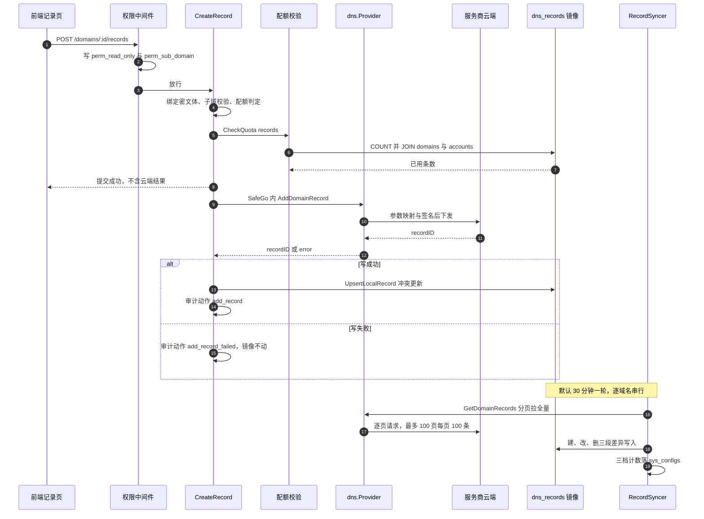
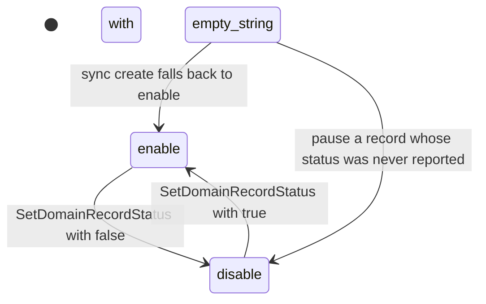
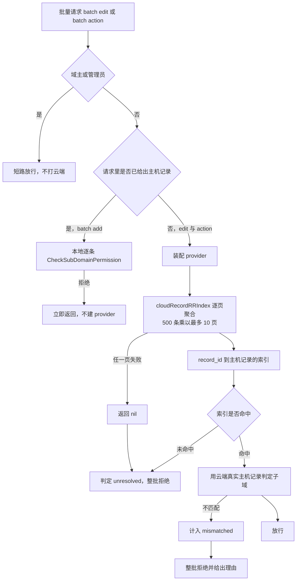
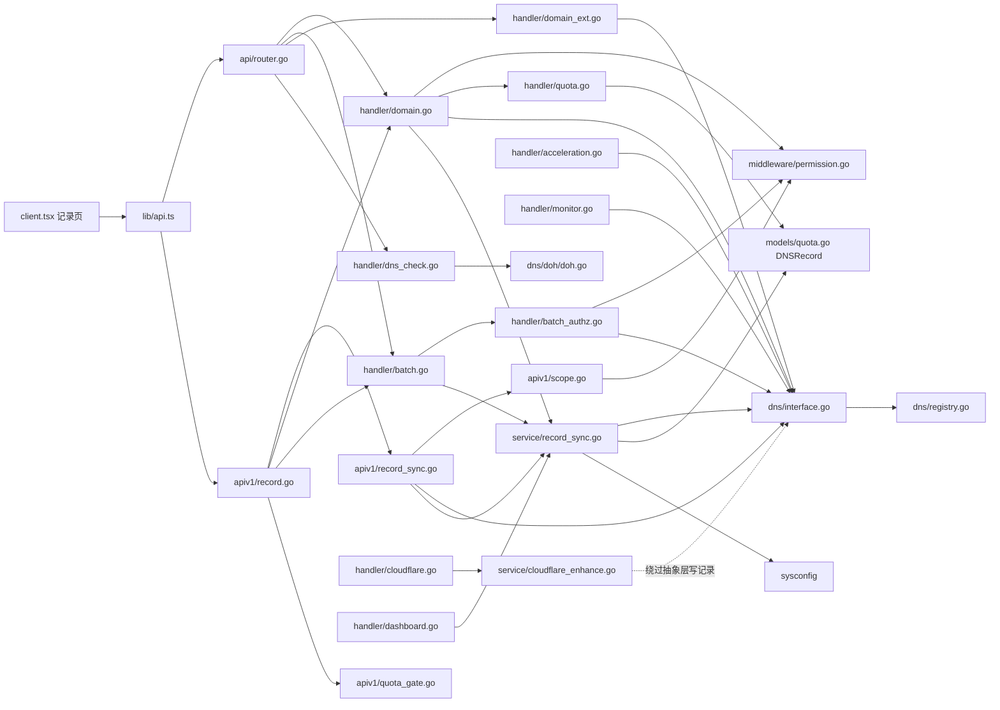

# 解析记录管理

<cite>
**本文档引用的文件**
- [domain.go](file://main/internal/api/handler/domain.go)
- [batch.go](file://main/internal/api/handler/batch.go)
- [batch_authz.go](file://main/internal/api/handler/batch_authz.go)
- [domain_ext.go](file://main/internal/api/handler/domain_ext.go)
- [quota.go](file://main/internal/api/handler/quota.go)
- [dns_check.go](file://main/internal/api/handler/dns_check.go)
- [acceleration.go](file://main/internal/api/handler/acceleration.go)
- [monitor.go](file://main/internal/api/handler/monitor.go)
- [cloudflare.go](file://main/internal/api/handler/cloudflare.go)
- [dashboard.go](file://main/internal/api/handler/dashboard.go)
- [router.go](file://main/internal/api/router.go)
- [permission.go](file://main/internal/api/middleware/permission.go)
- [record.go](file://main/internal/apiv1/record.go)
- [record_sync.go](file://main/internal/apiv1/record_sync.go)
- [scope.go](file://main/internal/apiv1/scope.go)
- [record_sync.go](file://main/internal/service/record_sync.go)
- [cloudflare_enhance.go](file://main/internal/service/cloudflare_enhance.go)
- [interface.go](file://main/internal/dns/interface.go)
- [registry.go](file://main/internal/dns/registry.go)
- [doh.go](file://main/internal/dns/doh/doh.go)
- [cloudflare.go](file://main/internal/dns/providers/cloudflare/cloudflare.go)
- [lines.go](file://main/internal/dns/providers/cloudflare/lines.go)
- [aliyun.go](file://main/internal/dns/providers/aliyun/aliyun.go)
- [aliyunesa.go](file://main/internal/dns/providers/aliyunesa/aliyunesa.go)
- [aws.go](file://main/internal/dns/providers/aws/aws.go)
- [baidu.go](file://main/internal/dns/providers/baidu/baidu.go)
- [bt.go](file://main/internal/dns/providers/bt/bt.go)
- [dnsla.go](file://main/internal/dns/providers/dnsla/dnsla.go)
- [dnsmgr.go](file://main/internal/dns/providers/dnsmgr/dnsmgr.go)
- [dnspod.go](file://main/internal/dns/providers/dnspod/dnspod.go)
- [dynv6.go](file://main/internal/dns/providers/dynv6/dynv6.go)
- [goedge.go](file://main/internal/dns/providers/goedge/goedge.go)
- [henet.go](file://main/internal/dns/providers/henet/henet.go)
- [huawei.go](file://main/internal/dns/providers/huawei/huawei.go)
- [huoshan.go](file://main/internal/dns/providers/huoshan/huoshan.go)
- [jdcloud.go](file://main/internal/dns/providers/jdcloud/jdcloud.go)
- [namesilo.go](file://main/internal/dns/providers/namesilo/namesilo.go)
- [powerdns.go](file://main/internal/dns/providers/powerdns/powerdns.go)
- [qingcloud.go](file://main/internal/dns/providers/qingcloud/qingcloud.go)
- [spaceship.go](file://main/internal/dns/providers/spaceship/spaceship.go)
- [technitium.go](file://main/internal/dns/providers/technitium/technitium.go)
- [tencenteo.go](file://main/internal/dns/providers/tencenteo/tencenteo.go)
- [west.go](file://main/internal/dns/providers/west/west.go)
- [quota.go](file://main/internal/models/quota.go)
- [main.go](file://main/main.go)
- [local_record_sync_test.go](file://main/internal/api/handler/local_record_sync_test.go)
- [batch_authz_test.go](file://main/internal/api/handler/batch_authz_test.go)
- [record_sync_test.go](file://main/internal/service/record_sync_test.go)
- [client.tsx](file://web/app/(dashboard)/dashboard/domains/[id]/client.tsx)
- [api.ts](file://web/lib/api.ts)
- [utils.ts](file://web/lib/utils.ts)
</cite>

## 目录

1. [简介](#简介)
2. [项目结构](#项目结构)
3. [核心组件](#核心组件)
4. [架构总览](#架构总览)
5. [详细组件分析](#详细组件分析)
6. [依赖关系分析](#依赖关系分析)
7. [性能考虑](#性能考虑)
8. [故障排查指南](#故障排查指南)
9. [结论](#结论)
10. [附录](#附录)

## 简介

解析记录是 DNS 面板写入最频繁的能力族。本系统对记录不做权威存储，**云端服务商是唯一事实源**，本地只保留一份用于配额判定与对账的镜像副本（`dns_records` 表）：所有增删改直接落服务商 API，读列表也直接打云端。抽象是 11 字段的 `dns.Record`，向下映射到 22 家各不相同的 API，向上为控制台与对外 v1 提供同一套 CRUD、TTL、线路、启停、备注、权重操作。

| 能力 | 落地位置 | 当前状态 |
|------|----------|----------|
| 列表读取（分页加 7 个筛选维度） | `handler.GetRecords`，`main/internal/api/handler/domain.go:640` | 已实现 |
| 单条新增、修改、启停、删除 | `domain.go:875`、`:972`、`:1124`、`:1048` | 已实现，异步回「提交成功」 |
| 批量新增、编辑、动作 | `batch.go:47`、`:223`、`:327` | 已实现，异步 |
| 线路编目、权重、分组、厂商日志 | `domain.go:1215`；`domain_ext.go:171`、`:216`、`:357`、`:387`、`:329` | 已实现；权重仅 A 与 AAAA，分组仅阿里云与 DNSPod |
| 本地镜像与定时对账、对外 v1 同步写 | `service/record_sync.go:317`、`:378`；`apiv1/record_sync.go:121-368` | 已实现；对账默认 30 分钟一轮，v1 有 5 个同步接口 |
| 记录值搜索的统一语义 | `domain.go:749-775` 仅在子域受限分支生效 | 待实现 |

四条设计前提贯穿全模块：云端优先（`domain.go:817`）；异步写加即时回填（`domain.go:929-951`）；子域授权是二级门禁（`permission.go:335`、`:344`）；写路径与验证路径分成两条——记录接口回答「云端接受了吗」，公网是否生效由 DoH 与本机递归回答（`dns_check.go:100-196`）。

**章节来源**
- [domain.go:640-835](file://main/internal/api/handler/domain.go#L640-L835)
- [record_sync.go:317-476](file://main/internal/service/record_sync.go#L317-L476)

## 项目结构

| 层 | 文件 | 行数 | 记录相关职责 |
|----|------|:----:|--------------|
| handler | `api/handler/domain.go` | 1748 | 记录列表、4 个单条写、线路编目、状态归一 |
| handler | `api/handler/batch.go` | 495 | 批量三接口、类型自动识别 |
| handler | `api/handler/batch_authz.go` | 155 | 批量操作的云端主机记录回查与子域判定 |
| handler | `api/handler/domain_ext.go` | 418 | 权重、智能识别、快速信息、日志、分组 |
| handler | `api/handler/acceleration.go` | 1000 | 加速写记录、冲突记录清理 |
| handler | `api/handler/monitor.go` | 1270 | `LookupRecord` 反查、智能建任务 |
| handler | `api/handler/dns_check.go` | 197 | 公共 DNS 查询与 DoH 回退 |
| apiv1 | `apiv1/record.go` | 58 | 14 条对外路由与配额门禁 |
| apiv1 | `apiv1/record_sync.go` | 444 | 5 个同步写实现与镜像回填 |
| apiv1 | `apiv1/scope.go` | 132 | 域、子域、只读三段门禁组合 |
| service | `service/record_sync.go` | 663 | 定时对账、镜像增删改、状态上报 |
| dns | `dns/interface.go` / `registry.go` / `doh/doh.go` | 167 / 89 / 163 | 抽象、线路映射、DoH 通道 |
| models | `models/quota.go` | 93 | `DNSRecord` 镜像表 |
| web | `domains/[id]/client.tsx` / `lib/api.ts` | 1799 / 1743 | 记录页与请求封装 |

`domain.go` 是三段合一的大文件：域名段（`128-620`）、记录段（`622-1260`）、子域委派段（`1585-1748`）。控制台路由集中在 `main/internal/api/router.go:136-155`（记录主体 8 条 `:136-143`，扩展 7 条 `:147-155`）；对外 v1 在 `main/internal/apiv1/record.go:18-58`，其中 5 个写接口指向本包同步实现。同步任务由 `main/main.go:125` 拉起、`:126` 注册停止。

**章节来源**
- [router.go:136-155](file://main/internal/api/router.go#L136-L155)
- [record.go:18-58](file://main/internal/apiv1/record.go#L18-L58)
- [main.go:125-126](file://main/main.go#L125-L126)

## 核心组件

### Record 抽象与 Provider 记录族

`dns.Record`（`main/internal/dns/interface.go:6-18`）是唯一的记录领域结构，11 个字段全部由各家适配器从厂商响应回填。

| 字段 | 类型 | 语义 | 关键约束 |
|------|------|------|----------|
| `ID` | string | 云端记录标识 | 3 家为合成串（AWS、PowerDNS、Spaceship），删除时反解 |
| `Name` | string | 主机记录 | 根域各家取值不一（`@`、空串、域名本身） |
| `Type` | string | 记录类型 | 枚举见附录 |
| `Value` | string | 记录值 | 部分厂商对 CNAME 与 MX 自动补尾点 |
| `TTL` | int | 生存时间 | 各家 `GetMinTTL()` 返回 0 到 3600 |
| `Line` | string | 线路编码 | Cloudflare 语义是代理开关，华为恒为空串 |
| `MX` / `Weight` | int | 优先级与权重 | 权重仅 7 家声明支持，`recordChanged` 不比对它 |
| `Status` | string | `enable` 或 `disable` | 2 家列表接口不返回该字段，留空 |
| `Remark` / `Updated` | string | 备注与更新时间 | `Remark` 三态；时间多数厂商未回填 |

`PageResult.Records` 声明为 `interface{}`（`interface.go:35-38`），消费侧一律要做 `result.Records.([]dns.Record)` 断言：`domain.go:788`、`:828`、`domain_ext.go:196`、`batch_authz.go:57`、`service/record_sync.go:498`、`acceleration.go:601`。失败行为不统一——`domain.go:828` 走 `if ok` 分支静默给出空列表，`record_sync.go:498-501` 显式返回「记录列表类型异常」。

抽象层结构如下：`Provider` 持有 15 个方法（`interface.go:41-86`），其中 8 个直接操作记录、2 个服务于记录读写前置（线路编目与最小 TTL）；`PageResult` 承载 `Total` 与 `Records`（`interface.go:34-38`），`Records` 到 `[]Record` 的还原靠消费侧断言；可选扩展接口 `RecordGrouper`（`interface.go:102-106`）由运行时类型断言接入（`domain.go:811`、`domain_ext.go:369`、`:407`），是这套抽象唯一的扩展点机制。

| 方法 | 声明 | 主要调用点 |
|------|------|------------|
| `GetDomainRecords` 9 参 | `interface.go:52` | `domain.go:784`、`:814`、`:817`、`batch_authz.go:53`、`record_sync.go:494`、`monitor.go:969` |
| `GetSubDomainRecords` 6 参 | `interface.go:55` | `domain_ext.go:191`、`acceleration.go:597` |
| `GetDomainRecordInfo` | `interface.go:58` | `batch.go:287`、`domain_ext.go:262`、`apiv1/record_sync.go:73`、`:203` |
| `AddDomainRecord` 返回 recordID | `interface.go:61` | `domain.go:932`、`batch.go:149`、`:167`、`apiv1/record_sync.go:148` |
| `UpdateDomainRecord` 全量覆盖 | `interface.go:64` | `domain.go:1020`、`batch.go:300`、`domain_ext.go:268`、`apiv1/record_sync.go:227` |
| `UpdateDomainRecordRemark` | `interface.go:67` | 仅 `apiv1/record_sync.go:360`，控制台无调用方 |
| `DeleteDomainRecord` | `interface.go:70` | `domain.go:1102`、`batch.go:400`、`apiv1/record_sync.go:275`、`acceleration.go:615` |
| `SetDomainRecordStatus` | `interface.go:73` | `domain.go:1184`、`batch.go:394`、`:397`、`apiv1/record_sync.go:316` |

`weight` 用 `*int`（`interface.go:61`、`:64`）区分「未设置」与「显式为 0」，其余入参全是值类型，零值会真实下发。`UpdateDomainRecord` 是**全量覆盖式**更新——这个契约决定了所有「只改一个字段」的调用都必须先回查，`batch.go:287`、`domain_ext.go:262`、`apiv1/record_sync.go:203` 三处都做了，`domain.go:1020` 没有。

**章节来源**
- [interface.go:41-106](file://main/internal/dns/interface.go#L41-L106)
- [domain.go:1020-1020](file://main/internal/api/handler/domain.go#L1020-L1020)
- [batch.go:287-300](file://main/internal/api/handler/batch.go#L287-L300)

### 本地镜像副本

`models.DNSRecord`（`main/internal/models/quota.go:75-93`）是云端记录的本地镜像，`did` 与 `record_id` 上有联合唯一索引 `idx_dns_record_remote`（`:77-78`），所有写入统一走 `UpsertLocalRecord` 的冲突更新（`service/record_sync.go:589-601`）。表头注释把动机写得很直白：配额判定要在创建前知道「该域名现有多少条记录」，每次查云端会消耗服务商 API 配额（`models/quota.go:65-74`，与 `service/record_sync.go:23-35` 同口径）。`uid` 的语义是「本面板内创建者，0 表示云端直接创建」（`models/quota.go:89`），是区分记录来源的唯一线索。

| 写入通道 | 位置 | 触发时机 |
|----------|------|----------|
| 单条新增回填 | `domain.go:944-948`、`apiv1/record_sync.go:390` | 云端写成功之后 |
| 单条更新回填 | `domain.go:1025-1031`、`apiv1/record_sync.go:421-423` | 先读原行再改字段 |
| 启停回填 | `domain.go:1189-1191`、`apiv1/record_sync.go:332` | 状态经 `recordStatusValue` |
| 删除移除 | `domain.go:1107`、`apiv1/record_sync.go:283`、`batch.go:408` | 云端删成功之后 |
| 批量新增回填 | `batch.go:154`、`:172` 调 `upsertBatchLocalRecord`（`:188`） | 逐条成功逐条写 |
| 定时全量对账 | `service/record_sync.go:378-476` | 默认 30 分钟一轮 |

回写通道字段集合不齐：单条新增写全字段含 `weight` 与 `uid`；批量新增的助手签名里**没有权重项**（`batch.go:188`），落库时 Go 零值补 0；批量编辑只刷 `line` 与 `ttl`（`:304-306`）。`recordChanged`（`record_sync.go:513-518`）比对 Name、Type、Value、Line、TTL、MX、Status、Remark 共 8 项，**不含 Weight**——只有权重变化时走「仅刷新 `synced_at`」分支（`:426-431`），本地停在旧值；而对账更新分支的字段表里确实写了 `weight`（`:415`），只要有别的字段同时变化就被顺带纠正，这掩盖了缺口。

同步侧由 `RecordSyncer`（`record_sync.go:81-88`）承担：启动后延迟 1 分钟做首轮（`:57`、`:128`），之后以 1 分钟 tick 轮询「是否到期」（`:144`、`:153-159`），每轮重读配置，间隔改动下一个 tick 即生效。间隔由 `record_sync_interval_min` 控制，默认 30 分钟、下限 5 分钟、上限 30 天（`:38-50`、`:192-205`）：上界不是装饰，`time.Duration(n)*time.Minute` 在 int64 纳秒会回绕，注释给出两个实测回绕值并说明后果是「把同步变成每轮 tick 都跑」（`:41-48`、`:186-190`）；整数解析用 `strconv.Atoi` 而非 `fmt.Sscanf`，因为后者会把脏值解析出前缀数字且不报错（`:182-185`）；到期判定优先用进程内 `lastRun`，因为持久化时间戳只有秒精度（`:85-87`、`:207-224`）。

整轮结果落 `sys_configs` 的 5 个键（`:66-73`、`:294-307`），经 `RecordSyncStatus()`（`:277-285`）由仪表盘透出（`handler/dashboard.go:377`），前端契约在 `web/lib/api.ts:765-773`。三档计数为成功、失败、**不完整**：分页被截断的域名单列一档，注释明确「不能与整轮成功混为一谈」（`:71-72`、`:354-358`）；落盘在 `defer` 里执行，同步任务 panic 时计数仍写入（`:320-326`）。

**章节来源**
- [quota.go:65-93](file://main/internal/models/quota.go#L65-L93)
- [record_sync.go:38-88](file://main/internal/service/record_sync.go#L38-L88)
- [record_sync.go:179-224](file://main/internal/service/record_sync.go#L179-L224)
- [record_sync.go:277-326](file://main/internal/service/record_sync.go#L277-L326)
- [record_sync.go:410-431](file://main/internal/service/record_sync.go#L410-L431)
- [record_sync.go:513-533](file://main/internal/service/record_sync.go#L513-L533)
- [batch.go:188-194](file://main/internal/api/handler/batch.go#L188-L194)
- [dashboard.go:377-377](file://main/internal/api/handler/dashboard.go#L377-L377)

## 架构总览

一次「新增记录」从点击到镜像落库，包含异步写与定时对账两条并行路径。



**图表来源**
- [domain.go:875-952](file://main/internal/api/handler/domain.go#L875-L952)
- [permission.go:132-207](file://main/internal/api/middleware/permission.go#L132-L207)
- [quota.go:217-223](file://main/internal/api/handler/quota.go#L217-L223)
- [record_sync.go:317-476](file://main/internal/service/record_sync.go#L317-L476)

两条时间线唯一的耦合点是本地镜像：写路径即时回填，同步器周期性覆盖。读路径由控制台与 v1 共用（`apiv1/record.go:25` 复用 `handler.GetRecords`），写路径分叉为控制台异步与 v1 同步。「不等云端」的三条后果：返回成功不等于写入成功，失败只落 `*_failed` 审计（`domain.go:934`、`:1021`、`:1103`、`:1185`）；配额判定读镜像而镜像只在写成功后更新，并发创建存在两次都过校验的窗口（`apiv1/record_sync.go:159-164` 的注释点名此窗口并以即时回填为对策）；对账以云端为准会删除云端已不存在的本地行（`record_sync.go:457-467`），手工往镜像插数据无意义。

**章节来源**
- [domain.go:929-951](file://main/internal/api/handler/domain.go#L929-L951)
- [record_sync.go:159-165](file://main/internal/apiv1/record_sync.go#L159-L165)
- [record_sync.go:457-467](file://main/internal/service/record_sync.go#L457-L467)

## 详细组件分析

### 记录读取链路

`GetRecords`（`domain.go:640-835`）是唯一读列表入口，被 `router.go:136` 与 `apiv1/record.go:25` 共用。入参 `GetRecordsRequest`（`:622-633`）带 7 个筛选维度加 `group_id`。顺序：模块门禁（`:641`）→ 绑定（`:645`）→ 域名 ID 二选一兜底（`:650-656`）→ 域级权限（`:665`）→ 读 `perm_sub_domain` 拆 `allowedSubs`（`:685-698`）→ 线路名映射与状态归一（`:715-722`）→ 分支。

| 维度 | 子域受限分支 `:781-803` | 默认分支 `:804-832` |
|------|------------------------|---------------------|
| 厂商调用次数 | 每授权子域一次，`perSubLimit` 为 500 | 一次，page 与 pageSize 原样透传 |
| 单路失败 | `continue` 跳过该子域（`:785-787`） | 返回「获取记录失败」 |
| 本地精筛 `filterLocal` | 生效（`:792`） | 不生效 |
| total 来源 | `len(list)`（`:793`） | `result.Total`（`:831`） |
| 分页 | 本地切片（`:794-803`） | 由服务商分页 |
| 回写 `record_count` | 不回写 | `Total > 0` 时回写（`:824-826`） |

`filterLocal`（`:749-775`）对 SubDomain 用 `EqualFold`、对 Value 用小写包含（`:758-761`）、对 Line 精确、对 Status 经 `recordItemStatusWant`（`:838-856`）归一、对 Type 用 `EqualFold`；注释说明不再按 keyword 缩窄以避免与服务商语义重复（`:748`）。`RecordItem`（`:701-713`）是响应序列化视图而非领域模型，字段用 PascalCase 对齐前端契约；`LineName` 取不到时回落线路编码原值（`:729-732`）。

`perm_sub_domain` 由 `middleware.Permission()` 写入，该中间件挂在控制台 `auth` 组（`router.go:104`，其上方 `:99-103` 记录了补挂动机：此前从未挂载，导致只读拦截、子域过滤、审计域名三处依赖同时失效）。v1 的中间件链（`apiv1/router.go:27-34`）**不含** `Permission()`，因此 v1 侧 `perm_sub_domain` 恒不存在，子域受限用户会读到该域名全部记录；域级权限仍由 `domain.go:665` 兜住。

**章节来源**
- [domain.go:622-856](file://main/internal/api/handler/domain.go#L622-L856)
- [router.go:99-104](file://main/internal/api/router.go#L99-L104)
- [permission.go:132-207](file://main/internal/api/middleware/permission.go#L132-L207)

### 创建记录

`CreateRecord`（`domain.go:875-952`）的校验顺序固定：模块门禁（`:876-878`）→ `BindDecryptedData`（`:880`）→ 域名 ID 兜底与加载（`:885-897`，失败回「域名不存在」）→ `CheckSubDomainPermission`（`:900`，失败回「无权操作该子域名」）→ `CheckQuota(c, "records")`（`:906`）→ provider 装配（`:910`）→ 线路与 TTL 兜底（`:915-920`）→ 派发 `utils.SafeGo` 后立即回「提交成功」（`:929-951`）。

`CreateRecordRequest`（`domain.go:858-868`）里 `Name`、`Type`、`Value` 带 `binding:"required"`，`Weight` 是 `*int`。goroutine 内 30 秒超时与响应时间解耦（`:930`），失败写 `add_record_failed` 后 `return`（`:933-936`），成功写 `add_record` 再回填（`:937-948`），而 `UpsertLocalRecord` 无返回值，回填是否成功不可观测。

兜底与服务商能力无关：`domain.go:915-917` 把空线路填成字面量 `"default"`，`:918-920` 把 TTL 为 0 填成 600；`GetMinTTL()` 只在 `domain_ext.go:321` 回显给前端提示，**写路径从不校正**，因此返回 3600 的 NameSilo 会拒绝该默认值，返回 0 的 dynv6 与 Technitium 则被过于保守的 600 限制。v1 的 `CreateRecordSync`（`apiv1/record_sync.go:121-168`）把同一套规则改为同步：等云端返回（`:148`）、失败回原因与错误码并 `Abort`（`:150-154`）、成功回带 `record_id`（`:167`）；`:115-120` 说明为什么必须回传 ID——「列表是最终一致的，刚写入的记录未必立刻可见」。

`RecordExistsLocally`（`record_sync.go:554-563`）的注释承诺「供创建前的重名判定使用」，`CurrentRecordTTL`（`:636-646`）与 `CurrentRecordMeta`（`:653-663`）承诺「更新前取回原值防零值覆盖」，但四个导出函数（另含 `CountDomainRecords`，`:571-578`）在全仓无任何生产调用点——注释承诺的两项保护实际未生效。

**章节来源**
- [domain.go:858-952](file://main/internal/api/handler/domain.go#L858-L952)
- [record_sync.go:115-168](file://main/internal/apiv1/record_sync.go#L115-L168)
- [record_sync.go:554-663](file://main/internal/service/record_sync.go#L554-L663)

### 更新记录

`UpdateRecord`（`domain.go:972-1036`）与创建同构，差异两点：子域判定用**请求里的 `req.Name`**（`:1000`）而非云端真实主机记录；`UpdateDomainRecord` 覆盖式写入（`:1020`），未传字段以零值下发。

| 维度 | 控制台 | v1 |
|------|--------|----|
| 子域判定依据 | 请求 `req.Name`（`domain.go:1000`） | 云端回查的真实名称（`apiv1/record_sync.go:70-82`） |
| 未传字段兜底 | 无，零值原样下发（`domain.go:1020`） | 回查原记录逐字段兜底（`:203-225`） |
| 失败可见性 | 仅审计（`domain.go:1021-1022`） | 错误码加原因（`apiv1/record_sync.go:228-232`） |

两点叠加产生一条越权改写路径：请求携带授权内的 `name=www`，但 `record_id` 指向同域名下另一子域记录，`CheckSubDomainPermission` 通过后 `UpdateDomainRecord` 把目标记录改名并覆盖——既有权限绕过，又有静默改名。「只想改记录值」的调用则把 TTL 写成 0、线路写成空串。仓库里三处是正确做法：

| 位置 | 回查 | 零值防护 |
|------|------|----------|
| `batch.go:287`、`:300` 批量编辑 | `GetDomainRecordInfo` | `ttl` 与 `line` 取回查原值（`:292-299`） |
| `domain_ext.go:262`、`:268` 权重更新 | `GetDomainRecordInfo` | 全字段取原值，只替换 weight |
| `apiv1/record_sync.go:73`、`:203`、`:227` | 两次 `GetDomainRecordInfo` | `:217-225` 未传字段用原值兜底 |

`apiv1/record_sync.go:210-216` 的注释记录了同类缺陷形态与后果（「只想改记录值的调用会把 TTL 从自定义值改成 600、把类型清空」）。镜像回填侧反而比云端正确：`domain.go:1025-1031` 先 `LocalRecord` 取原行，只覆盖显式给出的字段，`Weight` 为 nil 时保留原值，下一轮对账会把云端错值覆盖回来，形成一次自纠错。

**章节来源**
- [domain.go:972-1036](file://main/internal/api/handler/domain.go#L972-L1036)
- [batch.go:287-307](file://main/internal/api/handler/batch.go#L287-L307)
- [domain_ext.go:262-268](file://main/internal/api/handler/domain_ext.go#L262-L268)
- [record_sync.go:203-247](file://main/internal/apiv1/record_sync.go#L203-L247)

### 启用与暂停

状态在四层各有字面量：下发 provider 是 `bool`（`interface.go:73`），领域层是 `enable` 与 `disable`（`interface.go:15`），写镜像同样是 `enable` 与 `disable`（`recordStatusValue`，`domain.go:1199-1204`），返回前端是 `"1"` 与 `"0"`（`:725-728`）。`normalizeDNSListStatusForAPI`（`:57`）把前端口径翻译成厂商状态值作为查询条件下发，`recordItemStatusWant`（`:838-856`）负责本地精筛侧的同款翻译——同一语义两套函数，一个用于请求、一个用于响应。



**图表来源**
- [interface.go:15-15](file://main/internal/dns/interface.go#L15-L15)
- [domain.go:724-728](file://main/internal/api/handler/domain.go#L724-L728)
- [record_sync.go:442-445](file://main/internal/service/record_sync.go#L442-L445)

入参不对称：控制台 `Enable` 是 `bool`（`domain.go:1116`），不传等价于「暂停」；v1 是 `*bool`（`apiv1/record_sync.go:45`），不传直接回参数缺失（`:302-306`）——后者更安全，误漏字段不会静默把记录停掉。

对账时的空状态处理很讲究：`remoteStatusDiffers`（`record_sync.go:531-533`）规定「远程未提供该字段时不参与比较」，注释点名 henet 与 jdcloud 的 `dns.Record` 构造里没有 Status 字段——直接比较会让空串永远不等于本地 `enable`，每轮对每条记录空写一次库，在 SQLite 上形成写放大且写失败会把整个域名计入失败数（`:520-530`）。新建分支把空状态归一为 `enable`（`:442-445`），更新分支保留本地值不下发空串（`:418-421`）。`ProviderFeatures.Status` 为 false 的有 8 家（见附录），这些家的 `SetDomainRecordStatus` 是恒返回不支持的桩实现。

**章节来源**
- [domain.go:1113-1204](file://main/internal/api/handler/domain.go#L1113-L1204)
- [record_sync.go:418-445](file://main/internal/service/record_sync.go#L418-L445)
- [record_sync.go:520-533](file://main/internal/service/record_sync.go#L520-L533)

### 删除记录

`DeleteRecord`（`domain.go:1048-1111`）权限链三段：模块门禁（`:1049`）、域级权限（`:1076`）、只读检查（`:1081`），**没有子域校验**；`recordID` 取自请求（`:1061-1063`）原样传给 provider（`:1102`），因此拿到某域名单个主机记录委派的用户可删除该域名下任意子域记录。批量族反而堵住了这个口——`BatchActionRecords` 的 delete 分支前置 `checkBatchRecordSubDomain`（`batch.go:363`）。

镜像处理只有一行 `service.DeleteLocalRecord(domain.ID, recordID)`（`domain.go:1107`），其 `WHERE` 刻意带 `did`（`record_sync.go:608`），测试 `TestDeleteLocalRecordScopedByDomain`（`local_record_sync_test.go:101`）锁定的正是「不能跨域名误删同 `record_id` 记录」；批量删除（`batch.go:408`）与 v1 删除（`apiv1/record_sync.go:283`）同样清理。

`recordID` 形态各家不唯一，删除必须能反解：AWS 由名称、类型、值合成且云端无原生 ID，同 RRSet 多条值被合并成一次变更；PowerDNS 是 rrset ID 与记录 ID 的组合串，rrset 缓存在 provider 实例 map 中且每请求重建；Spaceship 是类型、名称、地址、mx 四段合成串，任一段变化即失配。另一处遗留：`DeleteDomain` 连带清理 8 类关联数据（`domain.go:602-614`）却不含 `DNSRecord`；域名软删除、配额计数按 `domains.deleted_at IS NULL` 过滤（`handler/quota.go:219-222`），因此配额不受影响，但表会长期堆积孤儿镜像。

**章节来源**
- [domain.go:600-620](file://main/internal/api/handler/domain.go#L600-L620)
- [domain.go:1048-1111](file://main/internal/api/handler/domain.go#L1048-L1111)
- [batch.go:363-408](file://main/internal/api/handler/batch.go#L363-L408)
- [local_record_sync_test.go:101-117](file://main/internal/api/handler/local_record_sync_test.go#L101-L117)

### 子域权限校验



**图表来源**
- [batch_authz.go:15-155](file://main/internal/api/handler/batch_authz.go#L15-L155)
- [batch.go:82-97](file://main/internal/api/handler/batch.go#L82-L97)

| 接口族 | 判定函数 | 判定依据 | 缺依据时 | 位置 |
|--------|----------|----------|----------|------|
| 单条新增与修改 | `CheckSubDomainPermission` | 请求 `name` | 无兜底，可借道 | `domain.go:900`、`:1000` |
| 单条删除与启停 | `CheckDomainPermission` | 域名 ID | 不判子域 | `domain.go:1076`、`:1155` |
| 批量新增 | `checkBatchRecordSubDomain` | 请求主机记录列表 | 无兜底 | `batch_authz.go:110-115` |
| 批量编辑与动作 | `checkBatchRecordSubDomain` | 云端反查 | 反查不到整批拒 | `batch_authz.go:132-153` |
| v1 单条写 | `resolveRecordScope` | 请求值或云端反查 | 恒回查 | `apiv1/record_sync.go:70-82` |

四个设计决策都写在 `batch_authz.go` 文件头注释里（`:15-31`）：判定依据必须是云端真实值，因为 edit 与 action 的请求里只有 `record_id`、add 的文本模式一行是「主机记录 记录值」，从请求取参两族各缺一半（`:23-26`）；索引截断本身也是判定的一部分，5000 条封顶，截断会把属于本域名的记录误判为不属于（`:43-45`）；能本地判定的先判掉，`BatchAddRecords` 的目标校验刻意放在建 provider 之前，越权请求不消耗上游配额（`:104-109`）；取不回来不放行，任一页失败返回 nil 并整批拒绝，行内注释直言「放行会让一次跨域批量删除静默生效」（`:46-47`、`:137-141`）。头注释声明的「失败时不整批拒绝」（`:28-30`）与实现（`:146-153`）相反——实现更保守，注释未同步。

中间件层还有第三道子域校验（`permission.go:188-198`），只在能解析出主机记录时生效，而删除与启停的请求体只有 `record_id`，故对这两族恒不触发。`CheckSubDomainPermission` 在主机记录为空串时**直接返回 true**（`permission.go:355-358`）——空值被当成「不限制」而非「必须提供」，这是漏校验能长期存在的根因。测试在 `batch_authz_test.go`：`:96`、`:109`、`:122`、`:145` 四条范围断言加 `:177`、`:186` 两条索引断言，锁定「取不回来不放行」。

**章节来源**
- [batch_authz.go:15-155](file://main/internal/api/handler/batch_authz.go#L15-L155)
- [permission.go:188-198](file://main/internal/api/middleware/permission.go#L188-L198)
- [permission.go:344-360](file://main/internal/api/middleware/permission.go#L344-L360)
- [batch_authz_test.go:96-186](file://main/internal/api/handler/batch_authz_test.go#L96-L186)

### 记录冲突

| 场景 | 位置 | 处理策略 |
|------|------|----------|
| 一键加速写 CNAME | `acceleration.go:592-621` 的 `removeConflictingRecords` | 删同线路上 A 与 AAAA，再建 CNAME |
| Cloudflare 隧道主机名 | `cloudflare_enhance.go:563-587` | 存在非 CNAME 记录时**直接报错**，不删 |
| 控制台手工建记录 | `domain.go:875` | 无本地冲突预检，交给厂商拒绝 |

`removeConflictingRecords` 的兜底值得单独说：入参线路为空串时**整体跳过删除**并返回 `skippedCleanup` 为 true（`:593-595`）。注释给的理由是 dnspod、west、dnsla 的默认线路就是空串（`registry.go:60-63`），此时无法判断哪些记录与目标线路冲突，全删会连用户其他线路的记录一起清空（`:587-590`）；记录自身线路为空时同样放过（`:612`）。函数返回三元组 `(deleted, skippedCleanup, cleanupErr)`，把「跳过」与「失败」分成两个信号，调用点 `:534` 据此给出不同提示。

线路映射 `DefaultLineMapping`（`registry.go:58-80`）共 21 家条目，**没有青云DNS**；`configureDNSForAcceleration` 在映射缺失时拒绝分线路加速（`acceleration.go:456-459`），而 `DefaultDNSLine` 对未知厂商回落 `"default"`（`:82-89`）——两个函数对同一缺失键给出不同答案，前者拒绝、后者兜底。`batch.go:131-175` 两个循环都没有「同主机记录加类型加值已存在」判断，重复提交会下发多次。

**章节来源**
- [acceleration.go:450-459](file://main/internal/api/handler/acceleration.go#L450-L459)
- [acceleration.go:585-621](file://main/internal/api/handler/acceleration.go#L585-L621)
- [cloudflare_enhance.go:563-587](file://main/internal/service/cloudflare_enhance.go#L563-L587)
- [registry.go:58-89](file://main/internal/dns/registry.go#L58-L89)

### Cloudflare 特例

**线路语义不是线路。** `lines.go` 文件头注释说明 Cloudflare 不提供按运营商分线路的解析，其「线路」实际是代理开关——0 灰云直接回源、1 橙云流量经边缘（`lines.go:5-15`），因此编目不可能是动态列表，也不需要调 API：`Lines` 恒两条（`:17-20`），`GetRecordLine` 返回该表副本（`cloudflare.go:488-493`），`GetMinTTL` 恒返回 60（`:495-497`）。写侧把 `line == "1"` 译成 `proxied=true`、其余一律仅 DNS（`:379`、`:429`），读侧反向映射（`:273-276`、`:343-346`），灰云记录的线路恒为 `"0"`。`keyword` 与 `value` 在该家互相覆盖：两者都映射到 `search`，后写的 `value` 顶掉 `keyword`（`:224-229`）。备注走 `comment` 字段（`:283-286`、`:386`），因此单独改备注要整条重写（`:447-453`）；`weight` 形参不出现在载荷里（`:371-403`），传入被静默忽略。

**启停用改名模拟。** 暂停时子域记录加 `_pause`、根域改 `__root__`（`:468-471`），启用时反向还原（`:473-479`），读侧 `GetDomainRecords` 与 `GetDomainRecordInfo` 都做同样的还原并置 `disable`（`:264-271`、`:334-341`）。后果有二：v1 的子域回查依赖这个还原，否则会拿 `www_pause` 去比授权子域而误拒；被暂停的记录在 Cloudflare 控制台上看起来是「不存在的主机记录」。

**类型变更致 recordID 漂移。** `UpdateDomainRecord` 先回查，类型不同则删除再新建并返回 `nil`（`:406-420`，Cloudflare 已弃用 PATCH 改类型）。调用方无从得知 ID 已变，仍按旧 ID 回填镜像（`domain.go:1025-1031`、`apiv1/record_sync.go:237-247`），v1 还把旧 ID 当结果返回（`:248`）。另一处连带：回查返回的名称已被还原成不带 `_pause` 的形式，因此对已暂停记录做更新会**顺带把它启用**。

**origin 与 tunnel 绕过抽象层。** 自定义主机名的回退源与隧道 CNAME 由 `EnhanceService` 直连云端 API：`GetFallbackOrigin`（`cloudflare_enhance.go:329`）读 zone 回退源，handler 侧带 60 秒缓存（`cloudflare.go:1404-1425`）；`UpsertTunnelCnameRecord`（`:549-657`）建指向 `<tunnelID>.cfargotunnel.com` 的 CNAME（`:551`）并**强制 `proxied=true` 与 `ttl=1`**（`:630-636`、`:645-651`，隧道要求橙云），同内容且已代理时返回 `unchanged`（`:621-623`），同名非 CNAME 存在时拒绝写入并点名冲突类型（`:585-587`）；`DeleteTunnelCnameRecordIfMatch`（`:662`）只在内容匹配时才删。调用点在 `cloudflare.go:2203` 与 `:2268`。这条通道既不写 `add_record` 审计，也不回填镜像——隧道 CNAME 要等下一轮对账才进入配额计数。

**章节来源**
- [lines.go:1-21](file://main/internal/dns/providers/cloudflare/lines.go#L1-L21)
- [cloudflare.go:218-320](file://main/internal/dns/providers/cloudflare/cloudflare.go#L218-L320)
- [cloudflare.go:406-479](file://main/internal/dns/providers/cloudflare/cloudflare.go#L406-L479)
- [cloudflare_enhance.go:549-657](file://main/internal/service/cloudflare_enhance.go#L549-L657)
- [cloudflare.go:1395-1425](file://main/internal/api/handler/cloudflare.go#L1395-L1425)

### DoH 查询

`main/internal/dns/doh/doh.go`（163 行单文件包）不参与记录 CRUD，它回答「记录是否已在公网生效」。查询流程是四步：`QueryContext` 先把类型名过 `dohTypeNumbers` 映射表，未命中直接返回错误（`doh.go:76-80`）；随后从池里随机选一家发起 GET（`:82-83`）；只有响应体 JSON 解析失败（`errMalformed`）才剔除该家、从剩余池再随机一次（`:87-107`）；网络错误、空响应、状态码异常一律原样返回不重试（`:87-89`、`:137-139`）。

取值：服务器池 3 家（`doh.go:17-21`）、类型表 10 项（`:23-34`）、单次超时 3 秒（`:41`）、响应上限 1 MiB（`:46-47`）、全局 client 保留连接池（`:51-52`）。`Result` 携带 `Server` 字段以「如实标注结果来源，避免把随机选中的服务器写成固定值」（`:65-74`）；CNAME 剥尾点、TXT 剥引号（`:151-161`）。一个反例值得记住：doh.pub 对 CAA(257) 与 PTR(12) 返回 `{"code":"UrlParameterError"}`，那是**合法 JSON**，因此这两种类型在该服务器得到空结果而不触发换服务器（`:146-150`）。

`dns_check.go` 接入有两个细节：回退后把服务器名标注为「原名加 (DoH回退)」并用 DoH 主机名覆盖 IP 字段（`:165-167`），让结果来源可见；`queryDNSViaDoH` 给 `2*doh.Timeout`（`:189`），注释说明 Cost 语义要求记录两段合计耗时，避免上下文提前取消掩盖真实耗时（`:183-187`）。`LookupRecord`（`monitor.go:923-980`）是另一条读路径，走服务商抽象：先做域级与子域级双重校验（`:946-954`），再调 `GetDomainRecords`——但该调用把 `req.SubDomain` 放进了 **keyword** 槽位（`:969`，签名见 `interface.go:52`），各家对 keyword 解释不一，跨厂商结果不可比，且使用 `context.Background()` 无超时约束。

**章节来源**
- [doh.go:17-163](file://main/internal/dns/doh/doh.go#L17-L163)
- [dns_check.go:159-196](file://main/internal/api/handler/dns_check.go#L159-L196)
- [monitor.go:923-980](file://main/internal/api/handler/monitor.go#L923-L980)

### 对外 v1 的同步写重写

控制台版 4 个写接口把云端调用丢进后台并立即回「提交成功」，程序化调用方拿不到成败、失败原因和新记录 ID。`apiv1/record.go:9-15` 的注释以此为由在本包重写为同步实现。

| v1 接口 | 实现 | 位置 | 与控制台的关键差异 |
|---------|------|------|--------------------|
| `/records/create` | `CreateRecordSync` | `record_sync.go:121` | 返回 `record_id`，失败回原因，带配额门禁 |
| `/records/update` | `UpdateRecordSync` | `:177` | 先回查原记录，未传字段用原值兜底 |
| `/records/delete` | `DeleteRecordSync` | `:252` | 同步等云端结果再响应 |
| `/records/status` | `SetRecordStatusSync` | `:288` | `enable` 必填，缺失即拒（`:302-306`） |
| `/records/remark` | `UpdateRecordRemarkSync` | `:337` | 控制台完全没有单独改备注能力 |
| 3 个批量接口 | 复用控制台 handler | `record.go:40-42` | 仍是异步语义 |

批量这一条的两处口径相反：`record.go:27-33` 说「批量族没有配额门禁是控制台的既有缺口，不该复制到对外接口」并给 `/batch/add` 补上 `requireQuota("records")`（`:40`）；但被复用的 `handler.BatchAddRecords` 自身只做 `CheckFeature(c, "batch_ops")`（`batch.go:58`），`/batch/edit` 与 `/batch/action` 也没有配额位（`record.go:41-42`）。对记录维度只有新增消耗额度，这一点倒是一致。

`resolveRecordScope`（`record_sync.go:55-85`）是 v1 统一的权限编排：`scopeDomain` 做「加载域名、域权限、子域、只读」四步（`scope.go:117-132`），请求只给 `record_id` 时补一次云端回查并用真实名称判子域（`record_sync.go:70-82`）。`requireWritable`（`scope.go:94-109`）刻意不读 `perm_read_only` 而直接查权限表，注释的理由是该键「由控制台的 Permission 中间件写入，而那个中间件从未被挂载」（`:87-92`）——此说法已过时（控制台侧现挂于 `router.go:104`），但关于 v1 的部分成立：v1 链确实不含 `Permission()`（`apiv1/router.go:27-34`），直接查表是必要的。镜像回填有两个助手：`syncCreatedRecord`（`:382-405`）用于新建，字段全来自请求；`syncRecordToLocal`（`:417-433`）用于更新类，注释说明「不依赖本地已有该行」，取不到原行时补一行由对账在一轮内校正。审计统一走 `logRecordAction`（`:436-442`），与控制台同表同命名。

**章节来源**
- [record.go:9-58](file://main/internal/apiv1/record.go#L9-L58)
- [record_sync.go:55-85](file://main/internal/apiv1/record_sync.go#L55-L85)
- [record_sync.go:382-442](file://main/internal/apiv1/record_sync.go#L382-L442)
- [scope.go:87-132](file://main/internal/apiv1/scope.go#L87-L132)

### 记录值搜索（待实现）

`GetDomainRecords` 的签名里带 `value` 形参（`interface.go:52`），但 22 家适配器的实现分成四类，语义互不兼容。

| 语义档位 | 服务商与证据 | 用户体感 |
|----------|--------------|----------|
| 厂商侧关键字，多半模糊 | 阿里云 `aliyun.go:110`（`ValueKeyWord`）、Cloudflare `cloudflare.go:227`（`search`）、腾讯云EO `tencenteo.go:236`（显式 `Fuzzy`）、西部数码 `west.go:174`、DNSLA `dnsla.go:224`、DNSmgr `dnsmgr.go:218`、火山引擎 `huoshan.go:259` | 输入片段能命中 |
| 本地精确等值 | AWS `aws.go:644`、百度 `baidu.go:333`、dynv6 `dynv6.go:346`、PowerDNS `powerdns.go:305`、NameSilo `namesilo.go:202`、京东云 `jdcloud.go:251`、Technitium `technitium.go:354` | 差一个字符就 0 条 |
| 本地包含匹配 | GoEdge `goedge.go:449`、HE DNS `henet.go:264` | 片段能命中 |
| 参数被完全忽略 | 阿里云ESA `aliyunesa.go:189`、DNSPod `dnspod.go:100`、华为云 `huawei.go:112`、青云DNS `qingcloud.go:161`、Spaceship `spaceship.go:102`（函数体内不引用该形参） | 填什么都返回全量 |

三处二次退化让分岔更细：宝塔的 `searchKey` 在 subDomain、keyword、value、recordType、status 之间**互斥单选**，只有前面都为空时 value 才生效（`bt.go:184-186`）；青云DNS 在 subDomain 非空时转调 `GetSubDomainRecords`（`qingcloud.go:162-164`），而后者签名里没有 value（`interface.go:55`），条件在转调中丢失；阿里云ESA 把 keyword 当 `RecordName` 用（`aliyunesa.go:198-213`），与 value 完全无关。

面板层缺口是：唯一做本地统一语义的 `filterLocal`（`domain.go:749-775`）只在子域受限分支被调用（`:792`），默认分支原样透出（`:828-831`）。前端默认开启「宽泛模糊」，把关键词同时塞进 `value`（`client.tsx:451-452`，开关 `:138`、`:1012`），且 `filterValue` 优先于关键词，于是同一次搜索在 22 家里得到 4 种以上结果。

**待实现项**（当前代码里没有对应实现）。

1. 在 handler 普通分支同样调用 `filterLocal`，并把 `result.Total` 换成过滤后长度；代价是退化为本地分页，逻辑与 `domain.go:794-803` 已有实现相同。
2. 对忽略 `value` 的 5 家做本地筛选兜底。可用 `ProviderFeatures.Page`（`interface.go:163`）推断，但更可靠的做法是为「记录值过滤能力与语义」补显式能力位。
3. `filteredRecords = records`（`client.tsx:725`）是空转发，前端不做二次切片，因此「后端漏筛」直接表现为「搜不到」而非「搜不全」。若要前端兜底，这一行是唯一改点。

**章节来源**
- [interface.go:52-55](file://main/internal/dns/interface.go#L52-L55)
- [domain.go:749-831](file://main/internal/api/handler/domain.go#L749-L831)
- [qingcloud.go:161-164](file://main/internal/dns/providers/qingcloud/qingcloud.go#L161-L164)
- [client.tsx:451-452](file://web/app/(dashboard)/dashboard/domains/[id]/client.tsx#L451-L452)
- [client.tsx:725-725](file://web/app/(dashboard)/dashboard/domains/[id]/client.tsx#L725-L725)

## 依赖关系分析



**图表来源**
- [domain.go:1-23](file://main/internal/api/handler/domain.go#L1-L23)
- [batch_authz.go:1-13](file://main/internal/api/handler/batch_authz.go#L1-L13)
- [record_sync.go:1-21](file://main/internal/service/record_sync.go#L1-L21)
- [record_sync.go:1-17](file://main/internal/apiv1/record_sync.go#L1-L17)

写记录到云端的通道共 **3 条**，审计与镜像回填只覆盖第 1 条：`dns.Provider` 抽象（`domain.go`、`batch.go`、`apiv1/record_sync.go`，两者都写）；`EnhanceService` 直连 CF API（`cloudflare_enhance.go:549`、`:662`，两者都不写）；加速客户端配合抽象层删冲突记录（`acceleration.go:592` 起，删除段不回填）。`apiv1/record_sync.go:444` 的 `var _ = handler.GetRecords` 是无副作用引用锚点，声明 v1 有意复用控制台读实现。

provider 装配逻辑有 **4 份**独立实现：`getProviderByDomain`（`domain.go:37`，直接写控制台格式响应）、`getDNSProviderByDomain`（`batch.go:421`，返回 error）、`providerForSync`（`service/record_sync.go:536`，返回 error）、`providerForDomain`（`apiv1/record_sync.go:93`，写 v1 错误码）。`apiv1/record_sync.go:87-92` 说明成因——控制台版本未导出且响应 shape 不兼容。账户配置解析口径一旦变化需同时触碰 4 个文件，且四处错误格式已各不相同。

| 能力 | 控制台路由 | 行号 | v1 路由 | 行号 | v1 实现 |
|------|-----------|:----:|---------|:----:|---------|
| 记录列表 | `GET /domains/:id/records` | `router.go:136` | `POST /records/list` | `record.go:25` | 复用控制台 |
| 新增 | `POST /domains/:id/records` | `:137` | `/records/create` | `:34` | 同步，带配额 |
| 批量三项 | `.../records/batch`、`/batch/edit`、`/batch/action` | `:138-140` | `/batch/add`、`/batch/edit`、`/batch/action` | `:40-42` | 复用控制台，仅 add 带配额 |
| 启停与删除 | `.../:recordId/status`、`.../:recordId/delete` | `:141`、`:142` | `/records/status`、`/records/delete` | `:37`、`:36` | 同步 |
| 修改与备注 | `POST .../:recordId`；备注无控制台端点 | `:143` | `/records/update`、`/records/remark` | `:35`、`:38` | 同步 |
| 权重两项 | `GET` 与 `POST .../records/weight` | `:147`、`:148` | `/weight`、`/weight/update` | `:44`、`:45` | 复用控制台 |
| 智能识别 | `GET /domains/records/smartparse` | `:149` | `/records/smartparse` | `:54-57` | 复用控制台，单挂 `paramBridge` |
| 快速信息与日志 | `POST .../quickinfo`、`GET .../logs` | `:150`、`:151` | `/quickinfo`、`/logs` | `:46`、`:47` | 复用控制台 |
| 线路与分组 | `GET /domains/:id/lines`、`.../record-groups[/change]` | `:152`、`:154`、`:155` | `/domains/lines`、`/domains/groups[/change]` | `apiv1/domain.go:38`、`:47-48` | 复用控制台 |

`smartparse` 是唯一单独挂完整 `paramBridge` 的记录接口（`record.go:49-57`）：它只读 `c.Query("value")`（`domain_ext.go:280-283`），而桥接的请求体转 query 搬运正是为这一处准备（`:50-53`）。v1 的 14 条路由里 5 个单条写指向本包同步实现，`:12-14` 声明「写操作在此重写为同步」，但批量三接口仍异步——注释与实现不完全一致。

**章节来源**
- [router.go:136-155](file://main/internal/api/router.go#L136-L155)
- [record.go:18-58](file://main/internal/apiv1/record.go#L18-L58)
- [domain_ext.go:276-299](file://main/internal/api/handler/domain_ext.go#L276-L299)
- [record_sync.go:87-113](file://main/internal/apiv1/record_sync.go#L87-L113)

## 性能考虑

| 操作 | 厂商 API 次数 | 证据 |
|------|---------------|------|
| 读列表（域主或管理员） | 2 次：线路编目 1 加记录 1 | `domain.go:716`、`:817` |
| 读列表（子域受限，n 个子域） | 1 加 n 次，每次 500 条 | `domain.go:783-784` |
| 单条写，或 v1 单条更新 | 1 次写加 1 次镜像写；v1 更新是 2 次读加 1 次写 | `domain.go:932`、`:944`；`apiv1/record_sync.go:73`、`:203`、`:227` |
| 批量编辑 N 条 | 索引 1 到 10 页加 N 乘（1 重建加 2 次调用） | `batch_authz.go:135`、`batch.go:287`、`:300` |
| 批量启停或删除 N 条 | 索引 1 到 10 页加 N 乘（1 重建加 1 次调用） | `batch_authz.go:77-84`、`:134-145` |
| 单域名对账 | ceil(记录数 / 100)，最多 100 页 | `record_sync.go:486`、`:494` |

**批量权限校验的索引重建**是最突出的一处。`fetchCloudRecordRR`（`batch_authz.go:77-84`）内部调用 `cloudRecordRRIndex`，后者逐页打厂商（`:52-53`），而它在 `checkBatchRecordSubDomain` 的循环体内被逐条调用（`:134-135`），于是**每个 record_id 都重建一次全量索引**：选中 200 条做批量删除时理论上限 2000 次调用，配额瞬间打满且必然超时。修法很小——`cloudRecordRRIndex` 已是完整的索引构造函数，只需在循环外调用一次、循环体查表（`:116-145` 结构不变）。属「实现正确但调用方式不对」。

**批量创建并发**刻意不做：`BatchAddRecords` 在**一个** `utils.SafeGo` 协程里串行遍历（`batch.go:117-175`），整批共用 120 秒超时（`:118`），编辑与动作同样各 120 秒（`:280`、`:383`）。隐性上限是：单条平均耗时超过「120 除以条目数」秒时，后续条目在已取消的上下文里全部失败，而失败只计入 `failCount`（`:151`），审计里只有「成功 x, 失败 y」（`:176`），看不出是云端拒绝还是超时截断。文本模式与结构模式都没有条目数上限（`:131-174`），跨请求也无账户级并发闸。`BatchActionRecords` 另有可观测性缺陷：`switch action` 缺 `default`（`:392-401`），未知 action 时 `opErr` 恒 nil，走成功路径 `successCount++`（`:406`），既不报错也不改数据。

`SyncAllDomainRecords` 逐域名**串行**（`record_sync.go:343-364`），理由写在注释里——服务商普遍按账户限流，并发会打满配额反而拖慢整体（`:309-316`）。多域名下一轮对账耗时线性增长，因此同步器自持可取消上下文（`:97-100`），`fetchAllRecords` 每页检查 `ctx.Err()`（`:491-493`），保证关停不拖住 `StopRecordSync` 的 `wg.Wait`（`:108-122`）。测试锚点是 `TestStopRecordSyncInterruptsInFlightSync`（`record_sync_test.go:90`）与 `TestFetchAllRecordsStopsWhenContextCanceled`（`:176`）。`recordChanged` 的另一层价值是让未变化记录只刷时间戳（`:426-431`），配合空状态豁免（`:531-533`）把一轮写事务压到「真实变化数」。

**分页处理实测**：`ProviderFeatures.Page` 为 true 的有 6 家，但真正忽略分页参数的只有 4 家——两者不能互推。AWS（`aws.go:599-652`）、百度（`baidu.go:267-364`）、NameSilo（`namesilo.go:144-232`）、PowerDNS（`powerdns.go:243-340`）的函数体内均无页切片，返回全量；HE DNS 本地切片（`henet.go:274-278`），Spaceship 透传 skip 与 take（`spaceship.go:108-109`），青云DNS 透传 offset 与 limit（`qingcloud.go:165`）。handler 默认分支不做本地二次分页（`domain.go:816-831`），`pageSize` 只兜下界不封上界（`:675-682`），因此前 4 家在千条记录域名下整表返回且分页控件失效，与 `client.tsx:725` 的空转发叠加。

**上游取不回来的兜底**分布不均：

| 位置 | 兜底动作 | 评价 |
|------|----------|------|
| `batch_authz.go:54-56` 索引任一页失败 | 返回 nil，整批拒绝 | 符合，宁可误拒 |
| `domain.go:785-787` 子域多路某路失败 | `continue` 跳过 | 危险，部分结果被当成全部 |
| `domain.go:715-720` 线路编目失败 | `LineName` 回落原值 | 符合，降级可见 |
| `domain_ext.go:350-353` 日志失败 | 返回空列表 | 可接受，多数厂商本无日志 |
| `record_sync.go:385-388` 拉取被截断 | 增量写入，跳过删除段 | 符合，误删代价高于漏更 |
| `record_sync.go:469-471`、`:498-501` 写失败或断言失败 | 聚合错误，计入失败档 | 符合 |
| `record_sync.go:571-578` 本地无该行 | 返回 0 而非报错 | 宁松勿严，可用性优先 |
| `monitor.go:969` 用 `context.Background()` | 无超时，厂商卡住则挂起 | 待改进 |

兜底原则整体写在注释里——判定宁松勿严，可用性优先于精确（`record_sync.go:567-570`）。唯一偏严的是批量归属校验（`batch_authz.go:146-149`），代价是云端分页取不全时批量操作反复失败。`domain.go:785-793` 最需留意：某一路静默失败后 `total` 等于成功那几路之和，用户看到「记录比预期少」而非「查询出错」，UI 上无法区分。截断保护有专门测试：`TestSyncDomainRecordsKeepsLocalWhenRemoteTruncated`（`record_sync_test.go:228`）、`TestSyncAllDomainRecordsRecordsStatusAndWriteFailures`（`:288`）、`TestRecordSyncIntervalBounds`（`:437`）、`TestRecordSyncIntervalRejectsDirtyAndOverflow`（`:502`）。

**章节来源**
- [batch_authz.go:48-84](file://main/internal/api/handler/batch_authz.go#L48-L84)
- [batch.go:117-176](file://main/internal/api/handler/batch.go#L117-L176)
- [batch.go:389-412](file://main/internal/api/handler/batch.go#L389-L412)
- [record_sync.go:309-364](file://main/internal/service/record_sync.go#L309-L364)
- [record_sync_test.go:90-502](file://main/internal/service/record_sync_test.go#L90-L502)

## 故障排查指南

| 症状 | 直接原因 | 证据 | 处置 |
|------|----------|------|------|
| 提示「提交成功」但云端没有记录 | 控制台写接口本就异步，失败只落审计 | `domain.go:929-951`、`:934` | 查 `add_record_failed`，或改用 v1 |
| 子域受限用户能删或停任意子域记录 | 单条删除与启停只有域级校验 | `domain.go:1076`、`:1155` | 见专项一 |
| 更新一条记录时把别人的改了 | 子域判定用请求里的名称 | `domain.go:1000`、`:1020` | 判定依据换成云端回查 |
| 只想改记录值，TTL 变成 0 | 全量覆盖加无原值兜底 | `domain.go:1020` 对照 `apiv1/record_sync.go:210-225` | 提交时带全字段 |
| 走 v1 时子域用户读到全部记录 | v1 链路不写 `perm_sub_domain` | `apiv1/router.go:27-34`、`domain.go:685` | 缺列表侧子域过滤 |
| 批量操作 200 条时超时，或整批被拒 | 索引逐条重建；存在无法确认归属的记录 | `batch_authz.go:134-135`、`:146-149` | 索引移到循环外；分页取全再试 |
| 未知 action 报成功但无变化 | `switch` 缺 `default` | `batch.go:392-406` | 入口白名单加 default |
| 搜索记录值 0 结果但云端确有 | 7 家精确匹配、5 家忽略参数 | 见「记录值搜索（待实现）」 | 用全称或等归一实现 |
| 配额形同虚设，或与可见记录数不符 | 批量入口未调 `CheckQuota("records")`；records 维度只统计自有账户域名 | `batch.go:58`、`:234`、`:338` 对比 `domain.go:906`；`quota.go:217-223` | v1 侧已补，控制台仍缺；后者属预期 |
| 镜像里权重或新增记录的属性不对 | `recordChanged` 不比对 Weight；批量回填助手无 weight 项 | `record_sync.go:513-518`；`batch.go:188-194` | 补比较项与参数 |
| 记录超一万条后不再完整 | 100 页乘 100 条上限 | `record_sync.go:486`、`:507-509` | 看 `record_sync.truncated` |
| 对账每轮都写全表 | 远程不返回状态字段恒判已变更 | `record_sync.go:520-533` | 已由 `remoteStatusDiffers` 修掉 |
| 记录数与厂商控制台不符，或翻不动页 | `record_count` 仅在 `Total > 0` 时更新；4 家忽略分页返回全量 | `domain.go:824-826`；见「分页处理实测」 | 与 `client.tsx:725` 空转发叠加 |
| Cloudflare 记录名带 `_pause`，或改类型后镜像陈旧，或暂停记录被悄悄启用 | 启停改名模拟；删加建致 recordID 漂移；回查已还原名称 | `cloudflare.go:460-479`、`:406-420`、`:334-341` | 属既有设计，改前先确认状态 |
| 隧道主机名生效后配额没变 | `EnhanceService` 不回填镜像 | `cloudflare_enhance.go:549-657` | 等下一轮对账 |
| CAA 或 PTR 的 DoH 查询恒空 | doh.pub 返回合法 JSON 错误体 | `doh.go:146-150` | 属该服务器限制 |
| NameSilo 建记录被厂商拒绝 | 兜底 TTL 600 低于下限 3600 | `domain.go:918-920`、`namesilo.go:313` | 显式传 TTL |

### 专项一：SetRecordStatus 缺子域校验

`SetRecordStatus`（`domain.go:1124-1196`）在安全审计后补齐了域级权限与只读检查——`:1151-1152` 的注释写明「原实现遗漏权限校验，与 CreateRecord、UpdateRecord、DeleteRecord 不一致；拥有任意域名读权限的用户可对全站任何记录调启停 → DoS」。但**子域校验仍未补**：与 `CreateRecord`（`:900`）、`UpdateRecord`（`:1000`）不同，这里没有任何 `CheckSubDomainPermission` 调用，`DeleteRecord` 同样如此（`:1076` 只有域级）。

入参结构解释了原因：`SetRecordStatusRequest` 只有 `DomainID`、`RecordID`、`Enable`（`domain.go:1113-1117`），请求里没有主机记录，无法本地判子域；批量族已用云端反查补上此口（`batch_authz.go:132-145`），单条路径未复用。`batch_authz.go:18-21` 的文件头注释登记了这个不对称——「单条接口在建写之前一律走 `CheckSubDomainPermission`」对 add 与 edit 成立，对 delete 与 status 并不成立。

修复素材仓库里已有两份：`batch_authz.fetchCloudRecordRR`（`:77-84`）与 `apiv1/record_sync.go:70-82`。取舍要说明：前者每次调用重建全量索引，搬到单条路径会让「暂停一条记录」变成最多 10 页厂商查询；更合适的是复用 `GetDomainRecordInfo`（`apiv1/record_sync.go:73` 正是这么做的），成本恒定 1 次调用。另外 `CheckSubDomainPermission` 对空主机记录返回 true（`permission.go:355-358`），「不传就等于不限」，补校验时必须先确认能拿到非空判定依据，否则加了调用也是空转。

**章节来源**
- [domain.go:1113-1196](file://main/internal/api/handler/domain.go#L1113-L1196)
- [domain.go:1068-1079](file://main/internal/api/handler/domain.go#L1068-L1079)
- [batch_authz.go:15-31](file://main/internal/api/handler/batch_authz.go#L15-L31)
- [record_sync.go:70-82](file://main/internal/apiv1/record_sync.go#L70-L82)
- [permission.go:344-360](file://main/internal/api/middleware/permission.go#L344-L360)

### 专项二：只读判定无类型断言保护

`domain.go:1081` 与 `domain.go:1159` 写法完全相同：

```go
if readOnly, exists := c.Get("perm_read_only"); exists && readOnly.(bool) {
```

三个可验证事实：`exists &&` 有短路保护，键不存在时不执行断言，不会因「未写入」而 panic；键是否存在取决于中间件是否走到写入分支——管理员在 `permission.go:138-141` 提前返回，无域名 ID 的请求在 `:144-148` 提前返回，只有 `:168`（自有账户写 `false`）与 `:201`（委派写 `perm.ReadOnly`）两处写入；断言本身无 comma-ok，当前两处写的都是布尔值故**不构成在线缺陷**，属健壮性问题——任何后续写入方（例如把权限对象整体塞进上下文）都会让这两行 panic，被 Recovery 转成 500，而非「拒绝写入」这一安全语义。

同仓库已有正确写法：`domain_ext.go:63-68` 的受检断言 `if ro, ok := readOnly.(bool); ok && ro`；`permission.go:387-393` 的 `UserModuleAllowed` 全程用带第二返回值的断言。更实质的问题是判定重复且口径不一：中间件已在 `permission.go:183-187` 按只读拦截过一次，handler 又各自判一次，v1 走 `requireWritable`（`scope.go:94-109`）直接查权限表——三处判同一件事、用两套数据源，这是「只读用户仍能写」难以一次修干净的结构原因。两处应改为受检断言或直接复用 `ensureDomainWrite`（`domain_ext.go:59-76`），后者一次完成「域级、只读、子域」三段检查，能同时解决专项一的缺口。

**章节来源**
- [domain.go:1081-1081](file://main/internal/api/handler/domain.go#L1081-L1081)
- [domain.go:1159-1159](file://main/internal/api/handler/domain.go#L1159-L1159)
- [domain_ext.go:59-76](file://main/internal/api/handler/domain_ext.go#L59-L76)
- [permission.go:132-207](file://main/internal/api/middleware/permission.go#L132-L207)
- [scope.go:94-109](file://main/internal/apiv1/scope.go#L94-L109)

### 排障顺序

1. **分清是哪一层**：面板镜像、厂商云端、公网递归结果三者可能互不一致。用 `POST /api/domains/dns-check`（`router.go:120`）看公网侧，用记录列表看厂商侧，查 `dns_records` 表看镜像侧。
2. **看同步状态**：仪表盘 `record_sync` 段（`dashboard.go:377`）七字段 `last_time`、`ok`、`fail`、`truncated`、`last_error`、`interval_minutes`、`next_time`（`record_sync.go:245-261`）。`fail` 非零是有账户装配失败，`truncated` 非零是有域名超一万条。
3. **看审计动作名**：`add_record`、`add_record_failed`、`update_record`、`update_record_failed`、`delete_record`、`delete_record_failed`、`set_record_status`、`set_record_status_failed`、`batch_add_records`、`batch_edit_records`、`batch_action_records`、`update_record_weight`、`change_record_group`，散见 `domain.go:934-1188`、`batch.go:176-414`、`domain_ext.go:272-416`、`apiv1/record_sync.go:151-326`；同步看 `[RecordSync] 本轮同步完成`（`record_sync.go:365-366`）与截断告警（`:507-509`）；镜像新鲜度与创建者看 `dns_records.synced_at` 与 `uid`（`models/quota.go:89-90`）。
4. **确认特性位**：`POST /api/domains/:id/records/quickinfo` 一次返回 `min_ttl`、`supports_weight`、`supports_remark`、`supports_log`、`supports_status`（`domain_ext.go:319-326`）。另注意同步间隔无管理界面——`record_sync_interval_min` 只被读取（`record_sync.go:196`），全仓无写入方，前端只在 `web/lib/api.ts:765` 读状态，要改间隔需直接写 `sys_configs` 表。

**章节来源**
- [dashboard.go:377-377](file://main/internal/api/handler/dashboard.go#L377-L377)
- [record_sync.go:196-261](file://main/internal/service/record_sync.go#L196-L261)
- [domain_ext.go:301-327](file://main/internal/api/handler/domain_ext.go#L301-L327)
- [api.ts:760-774](file://web/lib/api.ts#L760-L774)

## 结论

本模块骨架清晰：`dns.Provider` 定义 8 个记录方法，22 家适配器落到厂商 API，handler 层做权限与配额，service 层维护一份以云端为准的镜像副本。KISS 与 YAGNI 的取舍在几处刻意设计上看得见——镜像不参与读链路、异步写加即时回填、v1 单独重写为同步而不改控制台行为。成立之处值得保留：本地镜像承担配额判定避免每次创建消耗上游配额（`record_sync.go:23-35`）；以云端为准的三段差异对账穷举两边差集（`:410-467`）；v1 同步让程序化调用方拿得到成败与 recordID（`apiv1/record_sync.go:19-28`）；批量族判定依据不取自请求，攻击者不能自证清白（`batch_authz.go:23-31`）；空状态豁免比较避免每轮空写（`record_sync.go:520-533`）；截断时跳过删除段而非贸然对齐（`:457-467`）。

| 编号 | 严重度 | 问题 | 位置 |
|------|:------:|------|------|
| R-1 | 高 | 单条删除与启停无子域校验，批量已补而单条未补 | `domain.go:1076`、`:1155` |
| R-2 | 高 | 更新的子域判定依据取自请求字段，可借道改写 | `domain.go:1000`、`:1020` |
| R-3 | 高 | 控制台更新不做原值兜底，零值覆盖云端字段 | `domain.go:1020` |
| R-4 | 高 | 批量校验逐条重建全量索引 | `batch_authz.go:134-135` |
| R-5 | 中 | 批量入口绕过记录配额 | `batch.go:58`、`:234`、`:338` |
| R-6 | 中 | `readOnly.(bool)` 无 comma-ok 保护 | `domain.go:1081`、`:1159` |
| R-7 | 中 | 记录值搜索四类语义，5 家完全失效 | `interface.go:52` 与各 provider |
| R-8 | 中 | CF 类型变更致 recordID 漂移，镜像回填旧 ID | `cloudflare.go:406-420` |
| R-9 | 中 | 子域多路某路失败静默跳过，结果不完整不可观测 | `domain.go:785-793` |
| R-10 | 中 | 只读与子域判定三处重复、两套数据源 | `permission.go:183-198`、`domain.go:1081`、`scope.go:94-109` |
| R-11 | 低 | `recordChanged` 不比对 Weight | `record_sync.go:513-518` |
| R-12 | 低 | 批量未知 action 报成功但无变化 | `batch.go:392-406` |
| R-13 | 低 | 4 个镜像助手无生产调用方，承诺的保护未接线 | `record_sync.go:554`、`:571`、`:636`、`:653` |
| R-14 | 低 | 注释滞后于实现三处 | `record.go:12-14`、`scope.go:87-92`、`batch_authz.go:28-30` |

R-1 至 R-4 属安全、数据正确性与可用性，优先处置。最小改动清单：单条删除与启停接入 `GetDomainRecordInfo` 回查；更新前用 `CurrentRecordTTL` 与 `CurrentRecordMeta` 兜底（顺带让两个无生产调用者的函数真正生效，`record_sync.go:636`、`:653`）；索引提到循环外构建一次；普通分支同样调用 `filterLocal`；只读判定改 comma-ok 或直接复用 `ensureDomainWrite`。

原则层面的收敛方向有三条。**DRY**：`LocalRecord` 加 `UpsertLocalRecord` 的组合在 5 处重复（`domain.go:1025-1031`、`:1189-1191`、`batch.go:304-306`、`:409-411`、`apiv1/record_sync.go:421-423`），v1 已抽成 `syncRecordToLocal`（`:417-433`），控制台侧尚未收敛；provider 装配 4 份实现应收成一个解析函数，错误呈现交给调用方。**ISP**：`RecordGrouper` 的可选扩展接口模式（`interface.go:102-106`）是本仓库已验证可行的做法，记录值过滤语义与 Status 可得性这两类厂商差异同样适合按此拆成能力接口，而不是塞进 15 方法大接口。**KISS**：`interface{}` 承载记录列表是十余处断言与两种失败行为的共同源头，把 `PageResult` 改为具体类型或导出一个转换助手即可消除。

**章节来源**
- [domain.go:37-37](file://main/internal/api/handler/domain.go#L37-L37)
- [batch.go:421-421](file://main/internal/api/handler/batch.go#L421-L421)
- [interface.go:35-38](file://main/internal/dns/interface.go#L35-L38)
- [record_sync.go:417-433](file://main/internal/apiv1/record_sync.go#L417-L433)

## 附录

### 支持的记录类型枚举

不同来源的清单不一致：`dns.Record` 字段注释列 8 种（`interface.go:9`）、DoH 可查询 10 种（`doh.go:23-34`，多 SOA）、Technitium 写侧 11 种（`technitium.go:191-297`，多 ANAME 与 DNAME）、批量自动判定只认 3 种（`batch.go:197-209`）。真正决定「用户能建什么」的是前端表 `web/lib/utils.ts:59` 的 9 项，渲染于 `client.tsx:975`、`:1385`、`:1544`。

| 类型 | 用途 | 相关约束 |
|------|------|----------|
| A / AAAA | 主机名到 IPv4 / IPv6 | 权重仅 7 家声明支持，且只有这两类可改权重（`domain_ext.go:199`） |
| CNAME | 别名 | 与 A 或 AAAA 在同线路上冲突，见「记录冲突」 |
| MX | 邮件交换 | 使用 `MX` 优先级字段，部分厂商自动补尾点 |
| TXT | 文本 | ACME 挑战使用，同子域允许多条 |
| NS | 名称服务器 | 子域委派使用 |
| SRV / CAA | 服务定位 / 证书签发授权 | Technitium 与 DNSLA 支持 SRV；doh.pub 对 CAA 返回错误体，见「DoH 查询」 |
| PTR | 反向解析 | Technitium 支持，DNSLA 白名单里没有 |

三个类型在特定服务商处可用但前端表里没有，创建入口不可达：ALIAS（Spaceship，`spaceship.go:156-160`）、ANAME 与 DNAME（Technitium，`technitium.go:191-297`）、URL 转发（DNSLA 类型码 256，`dnsla.go:35-37`；能力位见 `interface.go:160` 的 Redirect）。DNSLA 白名单只有 9 项，未命中的类型反查表返回零值并原样下发，属静默错误而非显式拒绝。

批量文本模式不显式指定 `type` 时走 `detectRecordType`（`batch.go:146-148`、`:197-209`）：`net.ParseIP` 成功得 A 或 AAAA，含冒号得 AAAA，其余一律得 CNAME——因此一条 MX 或 TXT 在批量文本模式下会被误判成 CNAME，除非调用方显式带 `type`（`auto` 与空串等价）。`SmartParseRecord` 是另一套规则：可解析为 IP 得 A 或 AAAA，含点且不含空格斜杠反斜杠得 CNAME，**其余一律 TXT**（`domain_ext.go:276-299`）。另有 `IsIPValue`（`monitor.go:1218`）与 `isIPv4`（`acceleration.go:631-642`）两份独立 IP 判定实现，是剩余重复点。

**章节来源**
- [utils.ts:59-59](file://web/lib/utils.ts#L59-L59)
- [interface.go:9-9](file://main/internal/dns/interface.go#L9-L9)
- [batch.go:146-209](file://main/internal/api/handler/batch.go#L146-L209)
- [dnsla.go:35-37](file://main/internal/dns/providers/dnsla/dnsla.go#L35-L37)
- [domain_ext.go:276-299](file://main/internal/api/handler/domain_ext.go#L276-L299)

### 各家最小 TTL 与特性位

`GetMinTTL()` 是接口里唯一不带上下文参数的方法（`interface.go:82`），返回 0 表示厂商未声明最小值。实测 22 家取值分档：0 为 dynv6（`dynv6.go:432`）与 Technitium（`technitium.go:644`）；1 为阿里云ESA（`aliyunesa.go:478`）、GoEdge（`goedge.go:696`）、华为云（`huawei.go:381`）；60 为 Cloudflare（`cloudflare.go:496`）、DNSmgr（`dnsmgr.go:462`）、百度（`baidu.go:499`）、PowerDNS（`powerdns.go:606`）、青云DNS（`qingcloud.go:516`）、Spaceship（`spaceship.go:286`）、AWS（`aws.go:868`）、DNSLA（`dnsla.go:401`）、腾讯云EO（`tencenteo.go:471`）；300 为 HE DNS（`henet.go:434`）与宝塔（`bt.go:384`）；600 为阿里云（`aliyun.go:339`）、DNSPod（`dnspod.go:331`）、京东云（`jdcloud.go:373`）、西部数码（`west.go:323`）、火山引擎（`huoshan.go:471`）；3600 为 NameSilo（`namesilo.go:313`），全仓最大。控制台创建记录的兜底 TTL 恒为 600（`domain.go:918-920`）且不做上界校正，`GetMinTTL()` 只在快速信息里回显（`domain_ext.go:321`）——对 NameSilo 域名该默认值低于厂商下限，对返回 1 的三家又过于保守。

`ProviderFeatures`（`interface.go:157-167`）里与记录直接相关的位取自各家 `Register` 的 `Features` 字面量（例如 `aliyun.go:25-27`、`dnspod.go:27-28`、`cloudflare.go:31-32`、`spaceship.go:30-39`）。汇总：`Status` 为真 14 家（为假的 8 家是阿里云ESA、AWS、百度云、dynv6、HE DNS、华为云、NameSilo、Spaceship）；`Weight` 为真 7 家（宝塔、DNSLA、DNSPod、GoEdge、火山引擎、青云DNS、腾讯云EO）；`Page` 为真 6 家（AWS、百度云、HE DNS、NameSilo、PowerDNS、Spaceship）；`Log` 为真仅阿里云与 DNSPod；`Remark` 为 1 的 4 家（阿里云、DNSmgr、DNSPod、青云DNS）、为 2 的 9 家（阿里云ESA、百度云、宝塔、Cloudflare、GoEdge、华为云、火山引擎、PowerDNS、Technitium）、其余 9 家为 0。

两类声明都**不能只信字面值**：`Page` 与「忽略分页」不能互推——声明为真的 6 家里 Spaceship 与 HE DNS 实际处理了分页，忽略参数的是另外 4 家（见「分页处理实测」）；`Log` 声明为真的 DNSPod，其 `GetDomainRecordLog` 实现整段被注释、返回错误（`dnspod.go:306` 附近）。以特性位驱动 UI 时应回到各家方法实现二次确认。

**章节来源**
- [interface.go:82-82](file://main/internal/dns/interface.go#L82-L82)
- [interface.go:157-167](file://main/internal/dns/interface.go#L157-L167)
- [namesilo.go:313-313](file://main/internal/dns/providers/namesilo/namesilo.go#L313-L313)
- [domain_ext.go:313-326](file://main/internal/api/handler/domain_ext.go#L313-L326)

### 验证锚点

镜像与授权两条主线已有可复现测试。

| 主题 | 测试 | 位置 |
|------|------|------|
| 镜像写入与删除：回填后配额立即可见、二次写入是更新、删除按域名限定、更新前取回原行 | `TestUpsertLocalRecord*` 两条、`TestDeleteLocalRecord*` 两条、`TestLocalRecordReturnsStoredRow`、`TestCurrentRecordMetaFallsBackWhenMissing` | `local_record_sync_test.go:41`、`:58`、`:83`、`:101`、`:127`、`:146` |
| 批量授权：越权拒、授权内放行、外人拒、跨域 record_id 拒、索引失败返回 nil、按 record_id 建索引 | `TestBatchSubDomainScope*` 四条加 `TestCloudRecordRRIndex*` 两条 | `batch_authz_test.go:96`、`:109`、`:122`、`:145`、`:177`、`:186` |
| 对账与配置：关停打断、取消退出翻页、截断不删本地行、三档计数、间隔上下界、脏值与溢出拒绝 | 六条 | `record_sync_test.go:90`、`:176`、`:228`、`:288`、`:437`、`:502` |

最大缺口：`interface.go:52` 的 8 个筛选位在多数 provider 上没有参数映射测试，本文「记录值搜索四类语义」与「分页处理实测」两张表的分类依据全部来自源码通读而非断言。其次，`RecordExistsLocally` 等 4 个导出函数无生产调用方（`record_sync.go:554`、`:571`、`:636`、`:653`），其承诺的行为路径完全未被覆盖——不是因为缺测试，而是因为根本没有被执行。

**章节来源**
- [local_record_sync_test.go:41-146](file://main/internal/api/handler/local_record_sync_test.go#L41-L146)
- [batch_authz_test.go:96-186](file://main/internal/api/handler/batch_authz_test.go#L96-L186)
- [record_sync_test.go:90-502](file://main/internal/service/record_sync_test.go#L90-L502)
- [record_sync.go:554-663](file://main/internal/service/record_sync.go#L554-L663)
