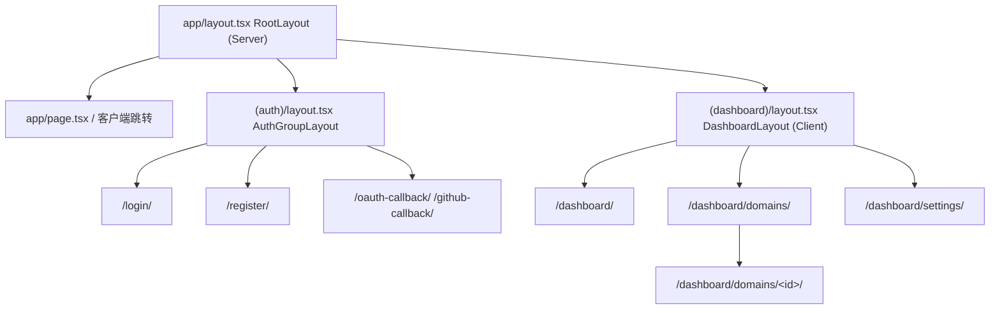
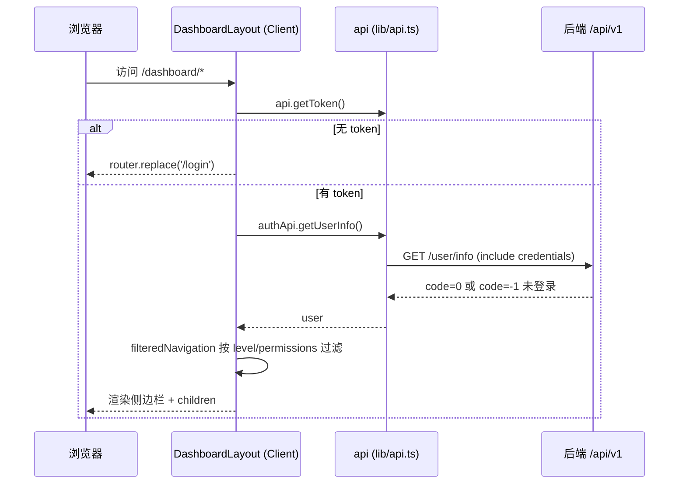
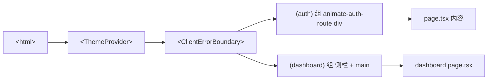
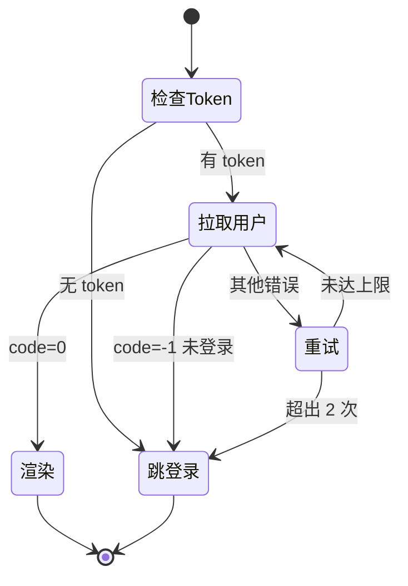
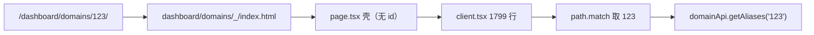
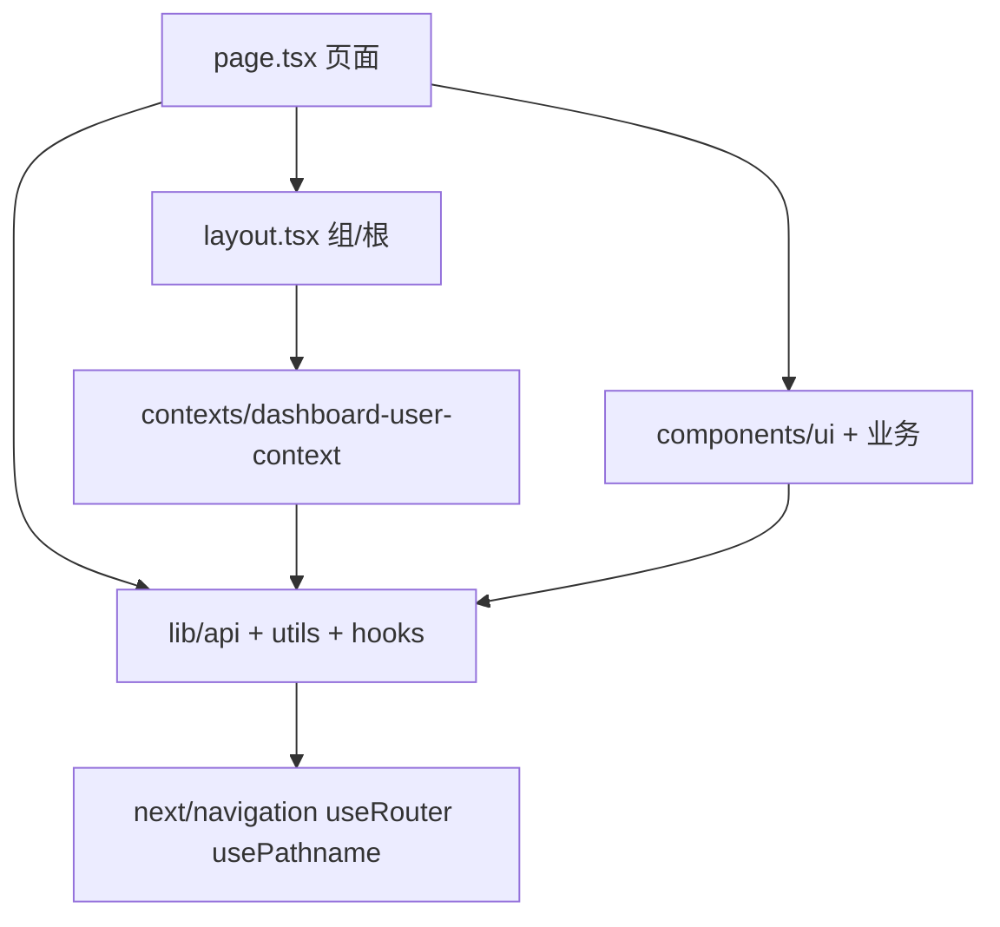

# Next.js 应用结构

<cite>
**本文档引用的文件**
- [web/next.config.ts](file://web/next.config.ts)
- [web/package.json](file://web/package.json)
- [web/tsconfig.json](file://web/tsconfig.json)
- [web/app/layout.tsx](file://web/app/layout.tsx)
- [web/app/page.tsx](file://web/app/page.tsx)
- [web/app/not-found.tsx](file://web/app/not-found.tsx)
- [web/app/error.tsx](file://web/app/error.tsx)
- [web/app/global-error.tsx](file://web/app/global-error.tsx)
- [web/app/(auth)/layout.tsx](file://web/app/(auth)/layout.tsx)
- [web/app/(auth)/login/page.tsx](file://web/app/(auth)/login/page.tsx)
- [web/app/(auth)/oauth-callback/page.tsx](file://web/app/(auth)/oauth-callback/page.tsx)
- [web/app/(auth)/reset-totp/page.tsx](file://web/app/(auth)/reset-totp/page.tsx)
- [web/app/(dashboard)/layout.tsx](file://web/app/(dashboard)/layout.tsx)
- [web/app/(dashboard)/dashboard/page.tsx](file://web/app/(dashboard)/dashboard/page.tsx)
- [web/app/(dashboard)/dashboard/domains/page.tsx](file://web/app/(dashboard)/dashboard/domains/page.tsx)
- [web/app/(dashboard)/dashboard/domains/[id]/page.tsx](file://web/app/(dashboard)/dashboard/domains/[id]/page.tsx)
- [web/app/(dashboard)/dashboard/domains/[id]/client.tsx](file://web/app/(dashboard)/dashboard/domains/[id]/client.tsx)
- [web/lib/api.ts](file://web/lib/api.ts)
- [web/lib/utils.ts](file://web/lib/utils.ts)
- [web/contexts/dashboard-user-context.tsx](file://web/contexts/dashboard-user-context.tsx)
- [web/scripts/sync-main-web.cjs](file://web/scripts/sync-main-web.cjs)
- [main/main.go](file://main/main.go)
</cite>

本文专题解析 DNSPlane 的 Next.js App Router 结构：`(auth)` 与 `(dashboard)` 两个路由组的划分、根布局与组布局的继承链、静态导出对动态段的特殊约束、认证守卫在客户端 layout 中的落地位置，以及 `domains/[id]` 这类带参路由的「壳 + 客户端解析」范式。

## 目录

- [简介](#简介)
- [项目结构](#项目结构)
- [核心组件](#核心组件)
- [架构总览](#架构总览)
- [详细组件分析](#详细组件分析)
  - [App Router 与路由组](#app-router-与路由组)
  - [布局继承链](#布局继承链)
  - [page.tsx 清单](#pagetsx-清单)
  - [route group 与 URL 的关系](#route-group-与-url-的关系)
  - [认证守卫与跳转](#认证守卫与跳转)
  - [静态导出与 export 配置](#静态导出与-export-配置)
  - [动态路由 [id] 的用法](#动态路由-id-的用法)
- [依赖关系分析](#依赖关系分析)
- [性能考虑](#性能考虑)
- [故障排查指南](#故障排查指南)
- [结论](#结论)
- [附录](#附录)

## 简介

DNSPlane 前端使用 Next.js 16.2.4 的 App Router。整个应用没有 `middleware.ts`，鉴权与授权全部前移到客户端 `(dashboard)/layout.tsx`；同时因为 `output: 'export'` 的静态导出限制，运行时不依赖任何 Server Action、Route Handler 或 `dynamic = 'force-dynamic'`。路由组用括号目录表达分组语义，不进入 URL。

三个结构性事实：

- `web/app/` 下存在两个路由组：`(auth)`（11 个页面）、`(dashboard)`（21 个页面），加根级 `page.tsx`，共 33 个页面入口。
- 根布局 `web/app/layout.tsx:15` 挂载全局 Provider；`(dashboard)/layout.tsx` 是客户端组件，承担侧边栏、鉴权与权限过滤。
- 唯一的带参路由 `domains/[id]` 采用薄壳 `page.tsx` 与实现体 `client.tsx` 分离，静态占位 `{id:'_'}` 加运行时正则解析。

**章节来源**
- [web/next.config.ts](file://web/next.config.ts)
- [web/app/layout.tsx](file://web/app/layout.tsx)
- [web/app/(dashboard)/layout.tsx](file://web/app/(dashboard)/layout.tsx)

## 项目结构

App Router 的 `app/` 目录采用「文件即路由」。真实文件系统树如下（省略样式与图标）：

```bash
web/app/
├── layout.tsx            # 根布局（Server Component）
├── page.tsx              # 根路径 /，客户端重定向到 /login
├── not-found.tsx         # 全局 404
├── error.tsx             # 全局错误边界（客户端）
├── global-error.tsx      # 根级错误边界（含 <html>）
├── globals.css
├── (auth)/               # 认证路由组，不贡献 URL 段
│   ├── layout.tsx        # AuthGroupLayout（入场动画）
│   ├── loading.tsx
│   ├── error.tsx
│   ├── login/page.tsx
│   ├── register/page.tsx
│   ├── forgot-password/page.tsx
│   ├── forgot-totp/page.tsx
│   ├── reset-password/page.tsx
│   ├── reset-totp/page.tsx
│   ├── magic-link/page.tsx
│   ├── magic-login/page.tsx
│   ├── magic-login/totp/page.tsx
│   ├── oauth-callback/page.tsx
│   └── github-callback/page.tsx
└── (dashboard)/          # 控制台路由组
    ├── layout.tsx        # DashboardLayout（客户端，442 行）
    ├── loading.tsx
    ├── error.tsx
    ├── not-found.tsx
    └── dashboard/
        ├── page.tsx
        ├── accounts/ + accounts/add/
        ├── domains/ + domains/[id]/(page.tsx + client.tsx)
        ├── cloudflare/hostnames/ + tunnels/
        ├── monitor/ schedule/
        ├── cert/ cert-accounts/ + cert-accounts/add/
        ├── deploy/ deploy-accounts/ + deploy-accounts/add/
        ├── users/ plans/ logs/ request-logs/
        └── profile/ settings/
```

| 结构单元 | 数量 | 关键角色 |
| --- | --- | --- |
| 路由组 | 2 | `(auth)`、`(dashboard)` |
| 布局文件 `layout.tsx` | 3 | 根 1 个 + 每组 1 个 |
| 页面文件 `page.tsx` | 33 | 全部静态导出 |
| 错误/加载边界 | 各 4 | `error.tsx`、`loading.tsx`、`not-found.tsx` |
| 带参段 `[id]` | 1 | `domains/[id]` |

**章节来源**
- [web/app/layout.tsx](file://web/app/layout.tsx)
- [web/app/(auth)/layout.tsx](file://web/app/(auth)/layout.tsx)
- [web/app/(dashboard)/layout.tsx](file://web/app/(dashboard)/layout.tsx)

## 核心组件

App Router 视角下的核心可归纳为四类文件：

| 类别 | 代表文件 | 组件类型 | 职责 |
| --- | --- | --- | --- |
| 根布局 | `web/app/layout.tsx:15` | Server | `<html lang="zh-CN">`、ThemeProvider、RouteProgress、ClientErrorBoundary、Toaster、GlobalErrorHandler |
| 组布局 | `web/app/(auth)/layout.tsx:4` | Server | 认证组入场动画壳 |
| 组布局 | `web/app/(dashboard)/layout.tsx:95` | Client（`'use client'`） | 侧边栏 + 鉴权 + 权限过滤 + 退出登录 |
| 页面 | `web/app/page.tsx:6` | Client | 根路径客户端 `router.replace('/login')` |
| 错误边界 | `web/app/error.tsx` `global-error.tsx` | Client | 全局异常渲染，`global-error.tsx` 自带 `<html>` 兜底 |

根布局文件片段（说明 `<html>` 与 Provider 结构）：

```tsx
// web/app/layout.tsx
export const metadata: Metadata = {
  title: "DNSPlane - DNS管理系统",
  description: "现代化DNS管理系统，支持多平台DNS管理、SSL证书申请、容灾切换",
}

export default function RootLayout({ children }: Readonly<{ children: React.ReactNode }>) {
  return (
    <html lang="zh-CN" suppressHydrationWarning>
      <body className="antialiased">
        <ThemeProvider>
          <Suspense><RouteProgress /></Suspense>
          <ClientErrorBoundary>{children}</ClientErrorBoundary>
          <Toaster position="top-center" richColors />
          <GlobalErrorHandler />
        </ThemeProvider>
      </body>
    </html>
  )
}
```

**章节来源**
- [web/app/layout.tsx](file://web/app/layout.tsx)
- [web/app/page.tsx](file://web/app/page.tsx)
- [web/app/(dashboard)/layout.tsx](file://web/app/(dashboard)/layout.tsx)

## 架构总览

App Router 的布局继承与路由组映射如下：



**图表来源**
- [web/app/layout.tsx](file://web/app/layout.tsx)
- [web/app/(auth)/layout.tsx](file://web/app/(auth)/layout.tsx)
- [web/app/(dashboard)/layout.tsx](file://web/app/(dashboard)/layout.tsx)

客户端一次导航的关键状态流：



**图表来源**
- [web/app/(dashboard)/layout.tsx](file://web/app/(dashboard)/layout.tsx)
- [web/lib/api.ts](file://web/lib/api.ts)

**章节来源**
- [web/app/layout.tsx](file://web/app/layout.tsx)
- [web/app/(dashboard)/layout.tsx](file://web/app/(dashboard)/layout.tsx)
- [web/lib/api.ts](file://web/lib/api.ts)

## 详细组件分析

### App Router 与路由组

Next.js 16 的 App Router 以文件路径为路由。路由组 `（folder）` 使用圆括号命名，仅用于组织与共享 layout，不进入 URL。DNSPlane 采用两组：

- `(auth)`：所有认证前后端页面。共享同一份入场动画与 `loading`/`error` 边界。
- `(dashboard)`：登录后的控制台。共享侧边栏与鉴权逻辑。

约定：

- 根 `app/page.tsx` 承接 `/`，只做客户端重定向。
- `app/layout.tsx` 是所有页面的公共外壳，包含 `<html>` 与 `<body>`。
- 每个组自带一个 `layout.tsx`，负责组级 UI 与副作用。
- 每个组自带 `loading.tsx`（Suspense fallback）与 `error.tsx`（错误边界）。
- `(dashboard)` 额外提供组级 `not-found.tsx`。

**章节来源**
- [web/app/(auth)/layout.tsx](file://web/app/(auth)/layout.tsx)
- [web/app/(dashboard)/layout.tsx](file://web/app/(dashboard)/layout.tsx)

### 布局继承链

从外到内的层级：

1. `web/app/layout.tsx`（RootLayout，Server Component）
   - 挂载 `ThemeProvider`、`RouteProgress`（`<Suspense>` 包裹，见 `24-26`）、`ClientErrorBoundary`、`Toaster`、`GlobalErrorHandler`
   - 输出 `<html lang="zh-CN" suppressHydrationWarning>`
2. 组布局：
   - `(auth)/layout.tsx`（AuthGroupLayout，Server Component）：`<div className="animate-auth-route min-h-screen">` 提供入场动画容器。
   - `(dashboard)/layout.tsx`（DashboardLayout，Client Component）：承担鉴权、侧栏、权限过滤、面包标签页。
3. 段布局（若存在）：本项目 `dashboard/*` 未再嵌套 `layout.tsx`，页面直接消费组布局。
4. 页面：`page.tsx`。

```tsx
// 组布局典型形态：(auth)/layout.tsx
export default function AuthGroupLayout({ children }: { children: React.ReactNode }) {
  return <div className="animate-auth-route min-h-screen">{children}</div>
}
```

继承链在浏览器中呈现的层级：



**图表来源**
- [web/app/layout.tsx](file://web/app/layout.tsx)
- [web/app/(auth)/layout.tsx](file://web/app/(auth)/layout.tsx)
- [web/app/(dashboard)/layout.tsx](file://web/app/(dashboard)/layout.tsx)

**章节来源**
- [web/app/layout.tsx](file://web/app/layout.tsx)
- [web/app/(auth)/layout.tsx](file://web/app/(auth)/layout.tsx)
- [web/app/(dashboard)/layout.tsx](file://web/app/(dashboard)/layout.tsx)

### page.tsx 清单

以下为工作区实测的完整 `page.tsx` 清单。「是否动态」一列标注路由段形态：静态段 = 无参；动态段 = 携带 `[param]` 但通过 `generateStaticParams` 预渲染。

| URL 路径 | 文件（相对 `web/app/`） | 是否动态 |
| --- | --- | --- |
| `/` | `page.tsx` | 静态段（客户端重定向） |
| `/login/` | `(auth)/login/page.tsx` | 静态段 |
| `/register/` | `(auth)/register/page.tsx` | 静态段 |
| `/forgot-password/` | `(auth)/forgot-password/page.tsx` | 静态段 |
| `/forgot-totp/` | `(auth)/forgot-totp/page.tsx` | 静态段 |
| `/reset-password/` | `(auth)/reset-password/page.tsx` | 静态段 |
| `/reset-totp/` | `(auth)/reset-totp/page.tsx` | 静态段 |
| `/magic-link/` | `(auth)/magic-link/page.tsx` | 静态段 |
| `/magic-login/` | `(auth)/magic-login/page.tsx` | 静态段 |
| `/magic-login/totp/` | `(auth)/magic-login/totp/page.tsx` | 静态段 |
| `/oauth-callback/` | `(auth)/oauth-callback/page.tsx` | 静态段 |
| `/github-callback/` | `(auth)/github-callback/page.tsx` | 静态段 |
| `/dashboard/` | `(dashboard)/dashboard/page.tsx` | 静态段 |
| `/dashboard/accounts/` | `(dashboard)/dashboard/accounts/page.tsx` | 静态段 |
| `/dashboard/accounts/add/` | `(dashboard)/dashboard/accounts/add/page.tsx` | 静态段 |
| `/dashboard/domains/` | `(dashboard)/dashboard/domains/page.tsx` | 静态段 |
| `/dashboard/domains/<id>/` | `(dashboard)/dashboard/domains/[id]/page.tsx` | **动态段**（`generateStaticParams` 占位） |
| `/dashboard/cloudflare/hostnames/` | `(dashboard)/dashboard/cloudflare/hostnames/page.tsx` | 静态段 |
| `/dashboard/cloudflare/tunnels/` | `(dashboard)/dashboard/cloudflare/tunnels/page.tsx` | 静态段 |
| `/dashboard/monitor/` | `(dashboard)/dashboard/monitor/page.tsx` | 静态段 |
| `/dashboard/schedule/` | `(dashboard)/dashboard/schedule/page.tsx` | 静态段 |
| `/dashboard/cert-accounts/` | `(dashboard)/dashboard/cert-accounts/page.tsx` | 静态段 |
| `/dashboard/cert-accounts/add/` | `(dashboard)/dashboard/cert-accounts/add/page.tsx` | 静态段 |
| `/dashboard/cert/` | `(dashboard)/dashboard/cert/page.tsx` | 静态段 |
| `/dashboard/deploy-accounts/` | `(dashboard)/dashboard/deploy-accounts/page.tsx` | 静态段 |
| `/dashboard/deploy-accounts/add/` | `(dashboard)/dashboard/deploy-accounts/add/page.tsx` | 静态段 |
| `/dashboard/deploy/` | `(dashboard)/dashboard/deploy/page.tsx` | 静态段 |
| `/dashboard/users/` | `(dashboard)/dashboard/users/page.tsx` | 静态段 |
| `/dashboard/plans/` | `(dashboard)/dashboard/plans/page.tsx` | 静态段 |
| `/dashboard/logs/` | `(dashboard)/dashboard/logs/page.tsx` | 静态段 |
| `/dashboard/request-logs/` | `(dashboard)/dashboard/request-logs/page.tsx` | 静态段 |
| `/dashboard/profile/` | `(dashboard)/dashboard/profile/page.tsx` | 静态段 |
| `/dashboard/settings/` | `(dashboard)/dashboard/settings/page.tsx` | 静态段 |

说明：

- 动态段仅 `domains/[id]` 一处；`cloudflare/hostnames` 与 `cloudflare/tunnels` 也采用同名 `page.tsx` 薄壳 + `client.tsx` 分离，但路由本身不带 `[param]`。
- 所有页面均为客户端组件（`'use client'`），因为鉴权与数据获取前移到 layout 与页面自身。

**章节来源**
- [web/app/page.tsx](file://web/app/page.tsx)
- [web/app/(auth)/login/page.tsx](file://web/app/(auth)/login/page.tsx)
- [web/app/(auth)/reset-totp/page.tsx](file://web/app/(auth)/reset-totp/page.tsx)
- [web/app/(auth)/oauth-callback/page.tsx](file://web/app/(auth)/oauth-callback/page.tsx)
- [web/app/(dashboard)/dashboard/page.tsx](file://web/app/(dashboard)/dashboard/page.tsx)
- [web/app/(dashboard)/dashboard/domains/page.tsx](file://web/app/(dashboard)/dashboard/domains/page.tsx)
- [web/app/(dashboard)/dashboard/domains/[id]/page.tsx](file://web/app/(dashboard)/dashboard/domains/[id]/page.tsx)

### route group 与 URL 的关系

Next.js 的路由组语义：**括号目录不参与 URL 段**。因此：

- `web/app/(auth)/login/page.tsx` → URL `/login/`（不带 `auth`）
- `web/app/(dashboard)/dashboard/page.tsx` → URL `/dashboard/`（只出现一层 `dashboard`，另一层是普通目录段）
- `web/app/(dashboard)/dashboard/domains/[id]/page.tsx` → URL `/dashboard/domains/<id>/`

这里刻意出现 `(dashboard)/dashboard/` 的双层结构：外层 `dashboard` 是路由组（分组语义、共享 layout），内层 `dashboard` 是普通目录段（贡献 URL 前缀）。这样组布局与页面渲染的 URL 前缀能对齐到 `/dashboard/*`。

| 目录 | 是否进入 URL | 语义 |
| --- | --- | --- |
| `(auth)` | 否 | 路由组，共享认证 layout |
| `(dashboard)` | 否 | 路由组，共享控制台 layout |
| `dashboard/` | 是 | 普通目录段，贡献 `/dashboard` 前缀 |
| `domains/[id]/` | 是 | 动态段，占位 `<id>` |
| `magic-login/totp/` | 是 | 嵌套目录段 |

**章节来源**
- [web/app/(auth)/layout.tsx](file://web/app/(auth)/layout.tsx)
- [web/app/(dashboard)/layout.tsx](file://web/app/(dashboard)/layout.tsx)
- [web/app/(dashboard)/dashboard/domains/[id]/page.tsx](file://web/app/(dashboard)/dashboard/domains/[id]/page.tsx)

### 认证守卫与跳转

本项目没有 `middleware.ts`。守卫完全在客户端 `(dashboard)/layout.tsx` 中实现，主要动作（对应源码段）：

- `190-194`：从 `api.getToken()` 读取本地 token，无 token 直接 `router.replace('/login')` 并 `return`。
- `156-195`：`fetchUserInfo()` 调用 `authApi.getUserInfo()`；成功 `setUser(res.data)`；`code === -1 && msg 含 "未登录"` 时清 token 并跳 `/login`；其他错误重试最多 2 次（`retryCount < maxRetries`，`500 * retryCount` 毫秒退避）。
- `143-151`（安全审计 H-4）：进入 dashboard 时主动清理 URL 上遗留的 `?token=`、`?refresh_token=`，通过 `window.history.replaceState` 兜底，防止 token 落入浏览器历史与 Referer。
- `252-258`：`!user` 时渲染 spinner 占位，等待 `fetchUserInfo` 结果。
- `198-207`：`handleLogout` 调用 `authApi.logout()`，清 token，`router.replace('/login')`。
- `232-250`：`filteredNavigation` 按 `user.level >= 2`（`adminOnly`）与 `hasModuleAccess(user, module)`（`lib/utils.ts:118-128`）过滤菜单项与子菜单。
- `209-220`：`isActive(href)` 精确匹配 + 前缀匹配（`pathname.startsWith(href + '/')`），避免 `/dashboard/cert` 与 `/dashboard/cert-accounts` 混淆。

认证页跳转与守卫的分工：



**图表来源**
- [web/app/(dashboard)/layout.tsx](file://web/app/(dashboard)/layout.tsx)
- [web/lib/api.ts](file://web/lib/api.ts)

`api.ts` 层的辅助守卫：

- `26-27`：`refreshInFlight: Promise<boolean> | null` 合并并发 401 到一次 `POST /auth/refresh`，避免 JTI 轮转互相踩掉新 token。
- `49`：所有请求默认 `credentials: 'include'`，配合 HttpOnly Cookie `_rt`。
- `84-104`：`setTokens`/`setOneTimeTokens` 只落 `access_token` 到内存/存储，`refresh_token` 一律通过 Cookie 下发；旧版本曾写入 localStorage，安全审计 M-1 已禁止。

根 `page.tsx` 也参与跳转：

```tsx
// web/app/page.tsx
export default function Home() {
  const router = useRouter()
  useEffect(() => { router.replace('/login') }, [router])
  return <div className="flex min-h-screen items-center justify-center">正在跳转...</div>
}
```

**章节来源**
- [web/app/page.tsx](file://web/app/page.tsx)
- [web/app/(dashboard)/layout.tsx](file://web/app/(dashboard)/layout.tsx)
- [web/lib/api.ts](file://web/lib/api.ts)
- [web/lib/utils.ts](file://web/lib/utils.ts)

### 静态导出与 export 配置

`web/next.config.ts` 的关键开关：

```typescript
import type { NextConfig } from "next";

const nextConfig: NextConfig = {
  output: 'export',
  trailingSlash: true,
  images: { unoptimized: true },
  // 安全审计 H-2：不设置 typescript.ignoreBuildErrors
};

export default nextConfig;
```

| 配置 | 作用 | 影响面 |
| --- | --- | --- |
| `output: 'export'` | 关闭 Node 运行时，全部预渲染为静态 HTML | 禁用 Route Handler、Server Action、`dynamic = 'force-dynamic'`、`headers`、`middleware.ts` |
| `trailingSlash: true` | 目录形态 URL | 每个页面输出为 `<path>/index.html`，Go 侧静态路由按目录匹配 |
| `images.unoptimized` | 关闭 `next/image` 优化管道 | 避免依赖服务端图像优化路由 |
| 不写 `typescript.ignoreBuildErrors` | 类型错误成为 CI 拦截器 | v1.0.7 移除、v1.0.11 清零 199 项 |

静态导出对 App Router 的三条硬约束：

- 所有带 `[param]` 的页面必须提供 `generateStaticParams`，否则构建报错。
- `useSearchParams` 必须外包 `<Suspense>`（`output: 'export'` 下未包裹会引发整页 fallback）。
- `next start` 不参与产物分发；`npm run build:ci` 后 `web/out/` 直接由 `scripts/sync-main-web.cjs` 复制到 `main/web`。

**章节来源**
- [web/next.config.ts](file://web/next.config.ts)
- [web/scripts/sync-main-web.cjs](file://web/scripts/sync-main-web.cjs)

### 动态路由 [id] 的用法

`domains/[id]` 是本仓库唯一的动态段。静态导出的天然约束是「构建期不知道 domain id」，实现策略：**壳 + 客户端解析**。

壳文件：

```tsx
// web/app/(dashboard)/dashboard/domains/[id]/page.tsx
import DomainRecordsClient from './client'
export const dynamicParams = false

export function generateStaticParams() {
  return [{ id: '_' }]
}

export default function DomainRecordsPage() {
  return <DomainRecordsClient />
}
```

三行配置各自作用：

| 行 | 内容 | 作用 |
| --- | --- | --- |
| `2` | `export const dynamicParams = false` | 构建产物之外的 URL 不允许访问，Next.js 返回 404（本项目由 Go 侧兜底，见下） |
| `4-6` | `generateStaticParams() { return [{ id: '_' }] }` | 只产出一个占位 `dashboard/domains/_/index.html` |
| `8-10` | `return <DomainRecordsClient />` | 页面本体不含 id 参数，运行时由客户端读取 |

实现体 `client.tsx` 从 URL 解析真实 id：

```tsx
// web/app/(dashboard)/dashboard/domains/[id]/client.tsx 关键行示意
const [domainId, setDomainId] = useState<string>('')
// 通过 window.location.pathname 正则解析
// path.match(/\/dashboard\/domains\/([^/]+)/)
useEffect(() => {
  if (domainId) {
    // 拉取记录 / 别名 / Whois / 变更日志
    domainApi.getAliases(domainId)
    domainApi.getRecordQuickInfo(domainId)
  }
}, [domainId])
```

运行时链路：



**图表来源**
- [web/app/(dashboard)/dashboard/domains/[id]/page.tsx](file://web/app/(dashboard)/dashboard/domains/[id]/page.tsx)
- [web/app/(dashboard)/dashboard/domains/[id]/client.tsx](file://web/app/(dashboard)/dashboard/domains/[id]/client.tsx)

Go 侧行为：静态资源路由命中 `main/web/dashboard/domains/_/index.html` 时会兜底为 `200` 返回同一份 HTML，`client.tsx` 再根据浏览器实际 URL 解析真实 id，这样 `/dashboard/domains/123/` 与 `/dashboard/domains/456/` 都能命中同一份预渲染壳。

`cloudflare/hostnames` 与 `cloudflare/tunnels` 也使用同名分离范式（`page.tsx` 薄壳 + `client.tsx` 实现体），但路由本身不带动态段，因此无需 `generateStaticParams`。

**章节来源**
- [web/app/(dashboard)/dashboard/domains/[id]/page.tsx](file://web/app/(dashboard)/dashboard/domains/[id]/page.tsx)
- [web/app/(dashboard)/dashboard/domains/[id]/client.tsx](file://web/app/(dashboard)/dashboard/domains/[id]/client.tsx)
- [main/main.go](file://main/main.go)

## 依赖关系分析

App Router 层与 lib / contexts / components 的耦合方向如下（自上而下依赖，禁止反向引用）：



**图表来源**
- [web/app/(dashboard)/layout.tsx](file://web/app/(dashboard)/layout.tsx)
- [web/lib/api.ts](file://web/lib/api.ts)
- [web/contexts/dashboard-user-context.tsx](file://web/contexts/dashboard-user-context.tsx)

| 依赖 | 消费方 | 提供方 |
| --- | --- | --- |
| `useRouter` `usePathname` | `(dashboard)/layout.tsx`、各页面 | `next/navigation` |
| `api` 单例 | 全局 | `web/lib/api.ts` |
| `cn` `hasModuleAccess` | 布局与业务组件 | `web/lib/utils.ts` |
| `DashboardUserProvider` | `(dashboard)/layout.tsx:261`、`440` | `web/contexts/dashboard-user-context.tsx` |
| `useDashboardUser()` | `dashboard/page.tsx:28` 等 | 同上 |
| `PageTabs` `ThemeToggle` | `(dashboard)/layout.tsx:434`、`398` | `components/` |

**章节来源**
- [web/app/(dashboard)/layout.tsx](file://web/app/(dashboard)/layout.tsx)
- [web/lib/api.ts](file://web/lib/api.ts)
- [web/lib/utils.ts](file://web/lib/utils.ts)
- [web/contexts/dashboard-user-context.tsx](file://web/contexts/dashboard-user-context.tsx)

## 性能考虑

- **路由组复用 layout**：`(auth)`、`(dashboard)` 各自共享一份 layout，避免每个页面重复挂载 Provider；`ThemeProvider` 只在根布局出现一次。
- **`generateStaticParams` 单占位**：`domains/[id]` 只产出一个 HTML 壳，避免构建期枚举全部 domain。
- **`trailingSlash: true`**：目录形态与 Go 静态资源路由天然匹配，减少重定向跳数。
- **`RouteProgress` Suspense**：根布局 `app/layout.tsx:24-26` 已把进度条包进 `<Suspense>`，防止进度条状态引发整页重挂。
- **客户端鉴权的重试策略**：`fetchUserInfo` 最多重试 2 次并退避 `500 * retryCount` ms，避免瞬时错误导致登录页反复跳转。
- **401 合并刷新**：`lib/api.ts` 的 `refreshInFlight` 保证并发请求只触发一次 `POST /auth/refresh`。
- **组件懒加载**：`login/page.tsx:20` 附近的 `GoCaptchaDialog` 使用 `dynamic import` + `Suspense`，认证首屏不加载验证码主包。

**章节来源**
- [web/app/layout.tsx](file://web/app/layout.tsx)
- [web/app/(dashboard)/layout.tsx](file://web/app/(dashboard)/layout.tsx)
- [web/app/(dashboard)/dashboard/domains/[id]/page.tsx](file://web/app/(dashboard)/dashboard/domains/[id]/page.tsx)
- [web/lib/api.ts](file://web/lib/api.ts)

## 故障排查指南

| 症状 | 定位 | 处理 |
| --- | --- | --- |
| 访问 `/dashboard/xxx` 立刻回跳到 `/login` | `(dashboard)/layout.tsx:190-194` `api.getToken()` 返回空 | 检查登录是否已写入 token；确认 `lib/api.ts` 未过期 |
| 登录后停留在 spinner 不进入页面 | `(dashboard)/layout.tsx:252-258` 等待 `fetchUserInfo` | 打开控制台看 `/user/info` 是否 401；`refreshInFlight` 是否被触发 |
| 菜单某项缺失 | `filteredNavigation`（`232-250`）按 `adminOnly` 与 `module` 过滤 | 与后端确认 `user.level` 与 `permissions`；`hasModuleAccess` 语义为「未配置权限的老用户放行」 |
| 构建报 `useSearchParams` 警告 | `output: 'export'` 强制 Suspense | 参照 `reset-password/page.tsx:340-348` 外包 `<Suspense>` |
| `build:ci` 报 `You're using a dynamic route but output: export` | `[id]` 页面缺少 `generateStaticParams` | 参照 `domains/[id]/page.tsx` 添加 `generateStaticParams` |
| `/dashboard/domains/123/` 直接访问返回 404 | `dynamicParams = false` 且 Go 侧未兜底 | 核对 `main/web/dashboard/domains/_/index.html` 是否存在；确认 Go 静态路由兜底规则 |
| URL 里出现 `?token=xxx` | 安全审计 H-4 遗留 | `(dashboard)/layout.tsx:143-151` 会自动清理；请检查签发方为何把 token 放进 URL |
| 组布局文件不生效 | 忘记在组目录添加 `layout.tsx` | 参照 `(auth)/layout.tsx` `4-10` 结构补齐 |
| 页面在根 `page.tsx` 与组布局之间被重复渲染 | 根 `page.tsx:6` 已重定向，不应与组页面共存 | 保持根 `page.tsx` 只做 `router.replace('/login')` |

**章节来源**
- [web/app/(dashboard)/layout.tsx](file://web/app/(dashboard)/layout.tsx)
- [web/app/(dashboard)/dashboard/domains/[id]/page.tsx](file://web/app/(dashboard)/dashboard/domains/[id]/page.tsx)
- [web/app/page.tsx](file://web/app/page.tsx)
- [web/next.config.ts](file://web/next.config.ts)
- [web/lib/api.ts](file://web/lib/api.ts)

## 结论

DNSPlane 的 App Router 结构可归纳为三句话：**两个路由组承担两种布局，一个客户端 layout 承担全部守卫，一个 `[id]` 段用壳 + 客户端解析绕过静态导出限制**。理解这套结构，是新页面接入和故障定位的前提。

未来在保持 `output: 'export'` 的前提下，可推进的事项：

- 若认证页进一步增多，可将 `(auth)` 组布局的动画容器抽成可配置项，避免重复类名字面量。
- 若动态段数量超过 3 个，考虑封装统一的 `page.tsx` 壳模板与 `client.tsx` 参数解析工具，降低 DRY 违反风险。
- 若 `(dashboard)/layout.tsx` 继续增长（当前 442 行），可将侧栏渲染拆分为独立组件，保持 layout 只做「守卫 + Provider 注入」。

## 附录

### 附录 A：新增一个带参页面的最小步骤

1. 建立目录：`web/app/(dashboard)/dashboard/foo/[id]/`
2. 壳文件：

```tsx
// page.tsx
import FooClient from './client'
export const dynamicParams = false
export function generateStaticParams() { return [{ id: '_' }] }
export default function FooPage() { return <FooClient /> }
```

3. 实现体：

```tsx
// client.tsx
'use client'
import { useEffect, useState } from 'react'
export default function FooClient() {
  const [id, setId] = useState('')
  useEffect(() => {
    const m = window.location.pathname.match(/\/dashboard\/foo\/([^/]+)/)
    if (m) setId(decodeURIComponent(m[1]))
  }, [])
  return <div>{id}</div>
}
```

4. 更新 `(dashboard)/layout.tsx:55-93` 的 `navigation` 常量与 `module` 字段。
5. 本地验证：

```bash
cd web
npx tsc --noEmit
npm run build:ci
```

**章节来源**
- [web/app/(dashboard)/dashboard/domains/[id]/page.tsx](file://web/app/(dashboard)/dashboard/domains/[id]/page.tsx)
- [web/app/(dashboard)/dashboard/domains/[id]/client.tsx](file://web/app/(dashboard)/dashboard/domains/[id]/client.tsx)
- [web/app/(dashboard)/layout.tsx](file://web/app/(dashboard)/layout.tsx)

### 附录 B：文件与角色速查

| 角色 | 文件 | 备注 |
| --- | --- | --- |
| 根布局 | `web/app/layout.tsx` | Server Component，含 `<html>` |
| 根路径 | `web/app/page.tsx` | Client，重定向到 `/login` |
| 全局 404 | `web/app/not-found.tsx` | 静态 |
| 根错误 | `web/app/error.tsx` | Client 边界 |
| 全局错误 | `web/app/global-error.tsx` | 自带 `<html>` 兜底 |
| 认证组布局 | `web/app/(auth)/layout.tsx` | 入场动画容器 |
| 控制台组布局 | `web/app/(dashboard)/layout.tsx` | 客户端守卫 + 侧栏 |
| 唯一动态段 | `web/app/(dashboard)/dashboard/domains/[id]/page.tsx` | 壳 |
| 唯一动态段实现 | `web/app/(dashboard)/dashboard/domains/[id]/client.tsx` | 1799 行 |

**章节来源**
- [web/app/layout.tsx](file://web/app/layout.tsx)
- [web/app/(auth)/layout.tsx](file://web/app/(auth)/layout.tsx)
- [web/app/(dashboard)/layout.tsx](file://web/app/(dashboard)/layout.tsx)
- [web/app/(dashboard)/dashboard/domains/[id]/page.tsx](file://web/app/(dashboard)/dashboard/domains/[id]/page.tsx)

### 附录 C：与静态产物同步的衔接点

App Router 构建完成后，`web/out/` 由 `scripts/sync-main-web.cjs` 全量复制到 `main/web`，Go 侧 `main/main.go:63` 用 `//go:embed all:web` 打进单二进制。

```bash
cd web
npm run build:ci   # next build --webpack && node scripts/sync-main-web.cjs
# 产物：web/out/*  → main/web/*
```

**章节来源**
- [web/scripts/sync-main-web.cjs](file://web/scripts/sync-main-web.cjs)
- [main/main.go](file://main/main.go)
