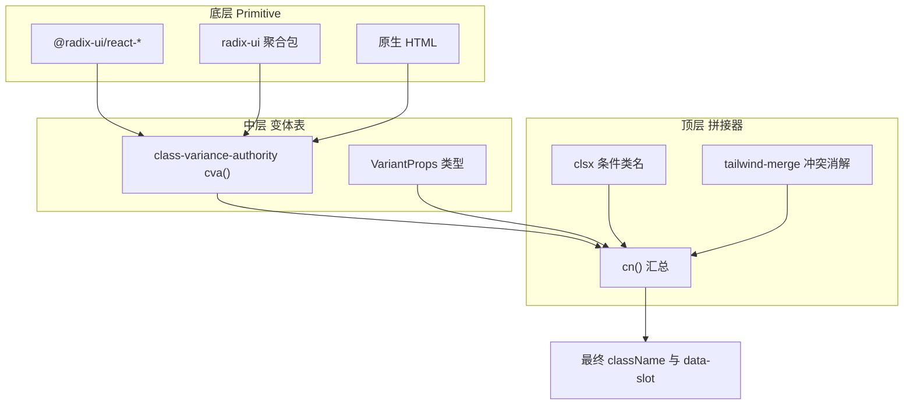
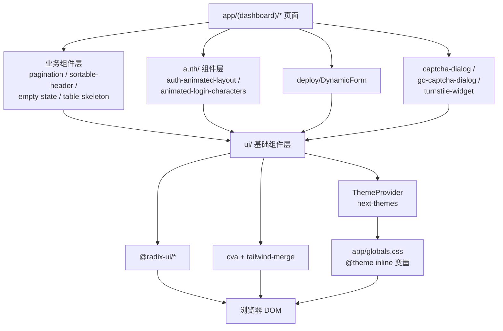
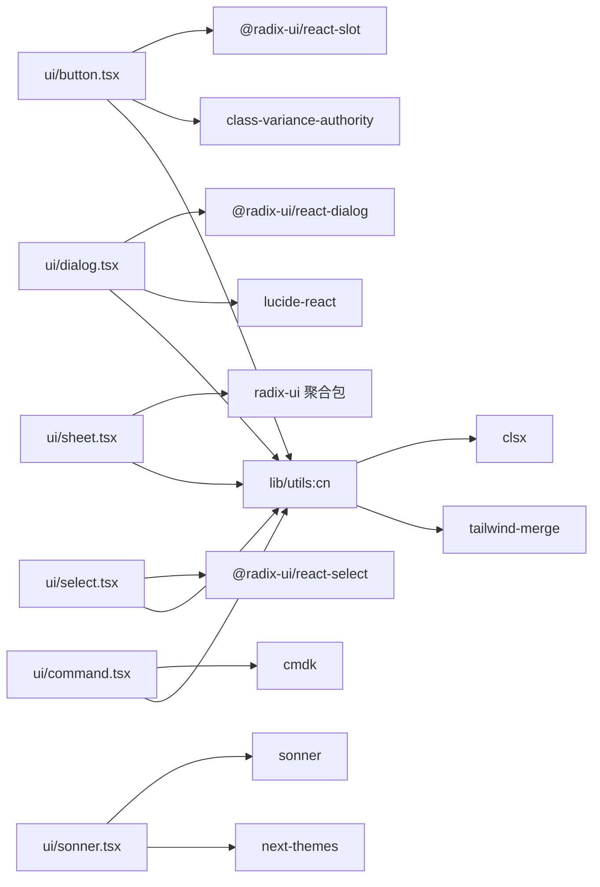
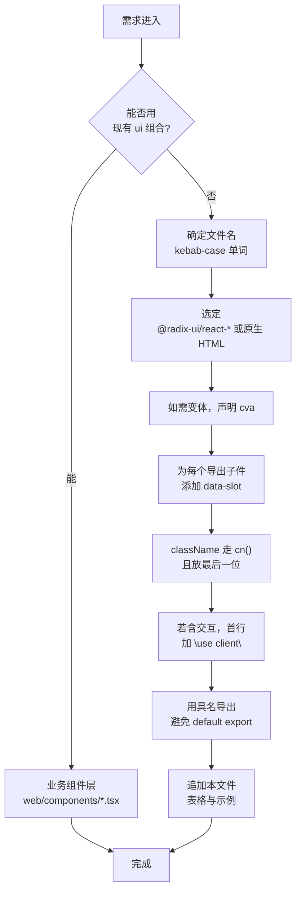

# UI组件库

<cite>
**本文档引用的文件**
- [web/components/ui/button.tsx](file://web/components/ui/button.tsx)
- [web/components/ui/badge.tsx](file://web/components/ui/badge.tsx)
- [web/components/ui/dialog.tsx](file://web/components/ui/dialog.tsx)
- [web/components/ui/table.tsx](file://web/components/ui/table.tsx)
- [web/components/ui/select.tsx](file://web/components/ui/select.tsx)
- [web/components/ui/sheet.tsx](file://web/components/ui/sheet.tsx)
- [web/components/ui/sonner.tsx](file://web/components/ui/sonner.tsx)
- [web/components/ui/alert-dialog.tsx](file://web/components/ui/alert-dialog.tsx)
- [web/components/ui/dropdown-menu.tsx](file://web/components/ui/dropdown-menu.tsx)
- [web/components/ui/command.tsx](file://web/components/ui/command.tsx)
- [web/components/ui/avatar.tsx](file://web/components/ui/avatar.tsx)
- [web/components/ui/card.tsx](file://web/components/ui/card.tsx)
- [web/components/ui/checkbox.tsx](file://web/components/ui/checkbox.tsx)
- [web/components/ui/input.tsx](file://web/components/ui/input.tsx)
- [web/components/ui/label.tsx](file://web/components/ui/label.tsx)
- [web/components/ui/popover.tsx](file://web/components/ui/popover.tsx)
- [web/components/ui/progress.tsx](file://web/components/ui/progress.tsx)
- [web/components/ui/radio-group.tsx](file://web/components/ui/radio-group.tsx)
- [web/components/ui/separator.tsx](file://web/components/ui/separator.tsx)
- [web/components/ui/skeleton.tsx](file://web/components/ui/skeleton.tsx)
- [web/components/ui/switch.tsx](file://web/components/ui/switch.tsx)
- [web/components/ui/tabs.tsx](file://web/components/ui/tabs.tsx)
- [web/components/ui/textarea.tsx](file://web/components/ui/textarea.tsx)
- [web/components/ui/tooltip.tsx](file://web/components/ui/tooltip.tsx)
- [web/components/deploy/DynamicForm.tsx](file://web/components/deploy/DynamicForm.tsx)
- [web/components/auth/auth-animated-layout.tsx](file://web/components/auth/auth-animated-layout.tsx)
- [web/components/auth/animated-login-characters.tsx](file://web/components/auth/animated-login-characters.tsx)
- [web/components/auth/auth-form-skeleton.tsx](file://web/components/auth/auth-form-skeleton.tsx)
- [web/components/auth/auth-footer-nav.tsx](file://web/components/auth/auth-footer-nav.tsx)
- [web/components/theme-provider.tsx](file://web/components/theme-provider.tsx)
- [web/components/theme-toggle.tsx](file://web/components/theme-toggle.tsx)
- [web/components/pagination.tsx](file://web/components/pagination.tsx)
- [web/components/sortable-header.tsx](file://web/components/sortable-header.tsx)
- [web/components/empty-state.tsx](file://web/components/empty-state.tsx)
- [web/components/table-skeleton.tsx](file://web/components/table-skeleton.tsx)
- [web/components/page-tabs.tsx](file://web/components/page-tabs.tsx)
- [web/components/provider-icon.tsx](file://web/components/provider-icon.tsx)
- [web/components/captcha-dialog.tsx](file://web/components/captcha-dialog.tsx)
- [web/components/account-form.tsx](file://web/components/account-form.tsx)
- [web/lib/utils.ts](file://web/lib/utils.ts)
- [web/app/layout.tsx](file://web/app/layout.tsx)
- [web/app/globals.css](file://web/app/globals.css)
- [web/package.json](file://web/package.json)
</cite>

## 目录

1. [简介](#简介)
2. [项目结构](#项目结构)
3. [核心组件](#核心组件)
4. [架构总览](#架构总览)
5. [详细组件分析](#详细组件分析)
6. [依赖关系分析](#依赖关系分析)
7. [性能考虑](#性能考虑)
8. [故障排查指南](#故障排查指南)
9. [结论](#结论)
10. [附录](#附录)

## 简介

DNSPlane 前端 `web/` 采用「Radix 无样式 Primitive + class-variance-authority 变体表 + tailwind-merge 类名合并」的三层组合结构。底层由 Radix 提供可访问性行为与受控状态，中层用 `cva` 声明变体（variant/size），顶层用 `cn()` 将三者拼接为最终 `className`。此结构保证：任意一个 UI 组件既可完全定制外观，又无需重复实现焦点管理、键盘导航、`aria-*` 属性等无障碍细节。

本文覆盖以下范围：

- `web/components/ui/` 下 24 个基础组件的职责、导出与行数
- `web/components/` 与 `web/components/auth/`、`web/components/deploy/` 构成的业务组件层
- 三层结构在典型组件（`button`、`badge`、`dialog`、`table`、`select`）中的具体写法
- 新增组件的推荐流程与命名约定

不覆盖：`app/` 路由组织、状态管理、API 客户端。

**章节来源**
- [web/components/ui/button.tsx](file://web/components/ui/button.tsx#L1-L65)
- [web/lib/utils.ts](file://web/lib/utils.ts#L1-L7)

## 项目结构

UI 层位于 `web/components/`，按「基础组件 vs 业务组件」分目录，基础组件目录扁平、无子层；业务组件按特性拆包。

```
web/components/
├── ui/                             # 24 个基础组件（Radix + cva + cn）
│   ├── alert-dialog.tsx        196 行
│   ├── avatar.tsx              109 行
│   ├── badge.tsx                48 行
│   ├── button.tsx               64 行
│   ├── card.tsx                 92 行
│   ├── checkbox.tsx             32 行
│   ├── command.tsx             103 行
│   ├── dialog.tsx              158 行
│   ├── dropdown-menu.tsx       257 行
│   ├── input.tsx                21 行
│   ├── label.tsx                24 行
│   ├── popover.tsx              31 行
│   ├── progress.tsx             31 行
│   ├── radio-group.tsx          45 行
│   ├── select.tsx              190 行
│   ├── separator.tsx            28 行
│   ├── sheet.tsx               143 行
│   ├── skeleton.tsx             13 行
│   ├── sonner.tsx               41 行
│   ├── switch.tsx               35 行
│   ├── table.tsx               117 行
│   ├── tabs.tsx                 91 行
│   ├── textarea.tsx             18 行
│   └── tooltip.tsx              61 行
├── auth/                             # 登录/注册视觉层
│   ├── animated-login-characters.tsx  568 行
│   ├── animated-login-characters.module.css
│   ├── animated-login-shell.module.css
│   ├── auth-animated-layout.tsx       136 行
│   ├── auth-footer-nav.tsx             59 行
│   ├── auth-form-skeleton.tsx          52 行
│   └── oauth-callback.module.css
├── deploy/
│   └── DynamicForm.tsx                102 行
└── *.tsx                           # 业务组件：分页、排序表头、空态、验证码对话框、主题等
```

`web/app/layout.tsx` 将 `ThemeProvider` 与 `Toaster` 挂在根 `<html>` 下，业务页面通过 import 使用 `ui/` 基础件。

**章节来源**
- [web/components/ui/](file://web/components/ui/)
- [web/components/auth/](file://web/components/auth/)
- [web/components/deploy/](file://web/components/deploy/)
- [web/app/layout.tsx](file://web/app/layout.tsx)

## 核心组件

三层结构在每个基础组件的写法一致：`Primitive 来源 → cva 变体表 → cn 合并`。



**图表来源**
- [web/components/ui/button.tsx](file://web/components/ui/button.tsx#L1-L65)
- [web/components/ui/badge.tsx](file://web/components/ui/badge.tsx#L1-L49)
- [web/lib/utils.ts](file://web/lib/utils.ts#L1-L7)
- [web/package.json](file://web/package.json)

| 组件族 | 用途 | 行数 | 主要导出 |
|---|---|---|---|
| button | 动作按钮，含 6 种 variant × 8 种 size | 64 | `Button`、`buttonVariants` |
| badge | 状态徽章，支持 `asChild` | 48 | `Badge`、`badgeVariants` |
| dialog | 模态对话框（Radix Dialog） | 158 | `Dialog` 系列 10 个组件 |
| alert-dialog | 阻断式确认对话框 | 196 | `AlertDialog` 系列 |
| sheet | 边缘抽屉，`side` 四向 | 143 | `Sheet` 系列 |
| select | 下拉选择（Radix Select） | 190 | `Select` 系列 |
| dropdown-menu | 菜单（含 checkbox/radio 项） | 257 | `DropdownMenu` 系列 |
| command | 命令面板（基于 cmdk） | 103 | `Command` 系列 |
| popover | 浮动面板 | 31 | `Popover` 系列 |
| tooltip | 悬停提示 | 61 | `Tooltip` 系列 |
| table | 数据表格 | 117 | `Table` 系列 8 个 |
| tabs | 标签页 | 91 | `Tabs` 系列 |
| card | 卡片容器 | 92 | `Card` 系列 |
| input / textarea / label | 表单原子件 | 21 / 18 / 24 | `Input` / `Textarea` / `Label` |
| checkbox / radio-group / switch | 选择控件 | 32 / 45 / 35 | 对应 Radix 封装 |
| avatar | 头像 | 109 | `Avatar` 系列 |
| progress / skeleton / separator | 视觉装饰 | 31 / 13 / 28 | 对应封装 |
| sonner | Toast 通知（基于 sonner） | 41 | `Toaster` |

**章节来源**
- [web/components/ui/](file://web/components/ui/)
- [web/package.json](file://web/package.json)

## 架构总览

`ui/` 基础组件与业务组件的调用关系如下：



**图表来源**
- [web/app/layout.tsx](file://web/app/layout.tsx)
- [web/components/ui/button.tsx](file://web/components/ui/button.tsx)
- [web/components/theme-provider.tsx](file://web/components/theme-provider.tsx)
- [web/app/globals.css](file://web/app/globals.css#L40-L81)

三层结构落地为四条硬约束：

- 每个基础组件文件必须声明 `data-slot="xxx"`，便于上层 selector
- 需要 `asChild` 场景一律用 `@radix-ui/react-slot` 的 `Slot`
- 变体统一由 `cva` 声明，禁止在 JSX 里用 `if/else` 拼类名
- 外部传入的 `className` 始终作为 `cn(...)` 参数中的最后一位，保证调用方覆盖生效

**章节来源**
- [web/components/ui/button.tsx](file://web/components/ui/button.tsx#L41-L62)
- [web/components/ui/badge.tsx](file://web/components/ui/badge.tsx#L32-L48)

## 详细组件分析

### 三层结构落地：button

`button` 是三层结构最典型的示例：`cva` 声明 6 variant × 8 size 的类名表，函数体将 `Slot` 作为可切换宿主，`cn()` 合并 `buttonVariants({ variant, size })` 与外部 `className`。

```tsx
const buttonVariants = cva(
  "inline-flex items-center justify-center gap-2 ... focus-visible:ring-[3px]",
  {
    variants: {
      variant: {
        default: "bg-primary text-primary-foreground hover:bg-primary/90",
        destructive: "bg-destructive text-white ... dark:bg-destructive/60",
        outline: "border bg-background shadow-xs ... dark:border-input",
        secondary: "bg-secondary text-secondary-foreground ...",
        ghost: "hover:bg-accent hover:text-accent-foreground ...",
        link: "text-primary underline-offset-4 hover:underline",
      },
      size: {
        default: "h-9 px-4 py-2 has-[>svg]:px-3",
        xs: "h-6 gap-1 rounded-md px-2 text-xs ...",
        sm: "h-8 rounded-md gap-1.5 px-3 has-[>svg]:px-2.5",
        lg: "h-10 rounded-md px-6 has-[>svg]:px-4",
        icon: "size-9",
        "icon-xs": "size-6 rounded-md ...",
        "icon-sm": "size-8",
        "icon-lg": "size-10",
      },
    },
    defaultVariants: { variant: "default", size: "default" },
  }
)

function Button({ className, variant = "default", size = "default", asChild = false, ...props }) {
  const Comp = asChild ? Slot : "button"
  return (
    <Comp
      data-slot="button"
      data-variant={variant}
      data-size={size}
      className={cn(buttonVariants({ variant, size, className }))}
      {...props}
    />
  )
}
```

要点：

- 所有 `data-*` 属性透传到宿主节点，方便 CSS 用 `[data-slot=button][data-variant=outline]` 命中
- `asChild` 分支保留语义：链接节点用 `<a>` 而非 `<button>`
- 变体名与 `globals.css` 中的 token 名一一对应（`bg-primary` 对应 `--color-primary`）

**章节来源**
- [web/components/ui/button.tsx](file://web/components/ui/button.tsx#L1-L65)
- [web/app/globals.css](file://web/app/globals.css#L40-L81)

### 组合模式：dialog

`dialog` 演示了「一个基础件对应多个 `data-slot`」的复合导出：Root/Trigger/Portal/Close/Overlay/Content/Header/Footer/Title/Description 共 10 个组件，全部直接转发 Radix Primitive。

```tsx
function DialogContent({ className, children, showCloseButton = true, ...props }) {
  return (
    <DialogPortal data-slot="dialog-portal">
      <DialogOverlay />
      <DialogPrimitive.Content
        data-slot="dialog-content"
        className={cn(
          "bg-background ... fixed top-[50%] left-[50%] z-50 grid w-full max-w-[calc(100%-2rem)] translate-x-[-50%] translate-y-[-50%] ... sm:max-w-lg",
          className
        )}
        {...props}
      >
        {children}
        {showCloseButton && (
          <DialogPrimitive.Close data-slot="dialog-close" className="...">
            <XIcon />
            <span className="sr-only">关闭</span>
          </DialogPrimitive.Close>
        )}
      </DialogPrimitive.Content>
    </DialogPortal>
  )
}
```

`alert-dialog`、`sheet`、`select`、`dropdown-menu`、`command`、`popover`、`tooltip` 沿用同一组合模式：一个 `Root` 加若干语义子件。`sheet.tsx` 的 side 变体采用内联 `cn()` 分支而不是 `cva`，因为方向影响的不只是类名，还牵扯到 CSS keyframe 选择器（`slide-in-from-left` 与 `slide-in-from-right`）。

**章节来源**
- [web/components/ui/dialog.tsx](file://web/components/ui/dialog.tsx#L50-L82)
- [web/components/ui/sheet.tsx](file://web/components/ui/sheet.tsx#L45-L90)
- [web/components/ui/alert-dialog.tsx](file://web/components/ui/alert-dialog.tsx)

### 无 Radix 依赖：table

`table` 是少见的「纯原生 HTML + `cn()`」组件：不使用 Radix，也不使用 cva。它通过 `data-slot` 与 CSS 兄弟选择器（`[&_tr]:border-b`）实现行分隔，并保留 `role=checkbox` 特殊对齐规则。

```tsx
function TableHead({ className, ...props }: React.ComponentProps<"th">) {
  return (
    <th
      data-slot="table-head"
      className={cn(
        "text-foreground h-10 px-2 text-left align-middle font-medium whitespace-nowrap " +
        "[&:has([role=checkbox])]:pr-0 [&>[role=checkbox]]:translate-y-[2px]",
        className
      )}
      scope="col"
      {...props}
    />
  )
}
```

外层 `Table` 自动包裹 `overflow-x-auto` 容器，保证小屏横向滚动。

**章节来源**
- [web/components/ui/table.tsx](file://web/components/ui/table.tsx#L1-L118)

### 主题桥接：sonner

`sonner.tsx` 将 `next-themes` 的 `theme` 注入 sonner 的 `Toaster`，并把主题 CSS 变量映射到 sonner 的内部变量，实现 toast 与主题联动。

```tsx
const { theme = "system" } = useTheme()
return (
  <Sonner
    theme={theme as ToasterProps["theme"]}
    style={{
      "--normal-bg": "var(--popover)",
      "--normal-text": "var(--popover-foreground)",
      "--normal-border": "var(--border)",
      "--border-radius": "var(--radius)",
    } as React.CSSProperties}
    ...
  />
)
```

**章节来源**
- [web/components/ui/sonner.tsx](file://web/components/ui/sonner.tsx#L1-L42)
- [web/components/theme-provider.tsx](file://web/components/theme-provider.tsx)

### 业务组件层：auth 与 deploy

`auth/` 承担登录/注册页的动画外壳，`deploy/DynamicForm` 承担服务商配置字段的动态渲染。两者都不重复实现基础控件，而是复用 `ui/`。

| 业务组件 | 路径 | 行数 | 职责 |
|---|---|---|---|
| `AuthAnimatedLayout` | `auth/auth-animated-layout.tsx` | 136 | 认证页容器，路由切换动画壳 |
| `AnimatedLoginCharacters` | `auth/animated-login-characters.tsx` | 568 | 登录页字符动画，配 `module.css` |
| `AuthFormSkeleton` | `auth/auth-form-skeleton.tsx` | 52 | 表单加载骨架 |
| `AuthFooterNav` | `auth/auth-footer-nav.tsx` | 59 | 认证页底部链接导航 |
| `DynamicForm` | `deploy/DynamicForm.tsx` | 102 | 服务商配置字段动态表单 |
| `Pagination` | `pagination.tsx` | 116 | 列表分页控件 |
| `SortableHeader` | `sortable-header.tsx` | 45 | 表头排序按钮 |
| `EmptyState` | `empty-state.tsx` | 56 | 空数据提示 |
| `TableSkeleton` | `table-skeleton.tsx` | 38 | 表格加载骨架 |
| `PageTabs` | `page-tabs.tsx` | 131 | 页面级 tab 栏 |
| `ProviderIcon` | `provider-icon.tsx` | 324 | DNS 服务商品牌图标 |
| `CaptchaDialog` | `captcha-dialog.tsx` | 233 | 通用验证码对话框 |
| `GoCaptchaDialog` | `go-captcha-dialog.tsx` | 233 | go-captcha 对话框 |
| `TurnstileWidget` | `turnstile-widget.tsx` | 92 | Cloudflare Turnstile 挂件 |
| `ThemeToggle` | `theme-toggle.tsx` | 69 | 三态主题切换按钮 |
| `AccountForm` | `account-form.tsx` | 538 | 账号编辑表单 |
| `CertOrderSelect` | `cert-order-select.tsx` | 64 | 证书订单选择 |
| `RouteProgress` | `route-progress.tsx` | 73 | 路由切换进度条 |
| `GlobalErrorHandler` | `global-error-handler.tsx` | 58 | 全局错误边界 |

`DynamicForm` 的字段类型判断使用条件分支渲染，字段可见性由 `evaluateDeployFieldShow` 驱动：

```tsx
const renderField = (field: ProviderConfigField) => {
  if (!evaluateDeployFieldShow(field.show, localValues)) return null
  const value = localValues[field.key] ?? field.value ?? ''
  return (
    <div key={field.key} className="space-y-1">
      <label className="block text-sm font-medium">
        {field.name}
        {field.required && <span className="text-red-500 ml-1">*</span>}
      </label>
      {field.type === 'radio' && field.options ? (/* ... */) :
       field.type === 'select' && field.options ? (/* ... */) :
       field.type === 'textarea' ? (/* ... */) : (/* input */)}
    </div>
  )
}
```

**章节来源**
- [web/components/deploy/DynamicForm.tsx](file://web/components/deploy/DynamicForm.tsx#L1-L103)
- [web/components/auth/auth-animated-layout.tsx](file://web/components/auth/auth-animated-layout.tsx)
- [web/components/pagination.tsx](file://web/components/pagination.tsx)
- [web/components/sortable-header.tsx](file://web/components/sortable-header.tsx)

### 类名合并：cn

`cn()` 位于 `web/lib/utils.ts`，是 `clsx` 与 `tailwind-merge` 的组合：前者处理条件类名与数组扁平化，后者消解 Tailwind 冲突类（如同时传入 `p-2 p-4` 时保留 `p-4`）。

```ts
export function cn(...inputs: ClassValue[]) {
  return twMerge(clsx(inputs))
}
```

调用顺序约定：`cn(baseVariants, className)` —— `className` 放最后，让外部覆盖生效。

**章节来源**
- [web/lib/utils.ts](file://web/lib/utils.ts#L1-L7)

## 依赖关系分析

`ui/` 层的依赖收敛在三类：Radix、样式工具（cva/clsx/tailwind-merge）、图标与 toast。



**图表来源**
- [web/components/ui/button.tsx](file://web/components/ui/button.tsx#L1-L6)
- [web/components/ui/dialog.tsx](file://web/components/ui/dialog.tsx#L1-L8)
- [web/components/ui/sonner.tsx](file://web/components/ui/sonner.tsx#L1-L11)
- [web/package.json](file://web/package.json)

| 依赖 | 版本 | 用途 | 影响范围 |
|---|---|---|---|
| `@radix-ui/react-slot` | ^1.2.4 | `asChild` 转发宿主 | button / badge / label |
| `@radix-ui/react-dialog` | ^1.1.15 | Dialog 与 Sheet 底座 | dialog、sheet |
| `@radix-ui/react-alert-dialog` | ^1.1.15 | 阻断式确认 | alert-dialog |
| `@radix-ui/react-select` | ^2.2.6 | 下拉选择 | select |
| `@radix-ui/react-dropdown-menu` | ^2.1.16 | 菜单 | dropdown-menu |
| `@radix-ui/react-popover` | ^1.1.19 | 浮动面板 | popover |
| `@radix-ui/react-tooltip` | ^1.2.8 | 提示气泡 | tooltip |
| `@radix-ui/react-tabs` | ^1.1.13 | 标签页 | tabs |
| `@radix-ui/react-checkbox` | ^1.3.3 | 复选框 | checkbox |
| `@radix-ui/react-radio-group` | ^1.3.8 | 单选组 | radio-group |
| `@radix-ui/react-switch` | ^1.2.6 | 开关 | switch |
| `@radix-ui/react-progress` | ^1.1.8 | 进度条 | progress |
| `@radix-ui/react-separator` | ^1.1.8 | 分隔线 | separator |
| `@radix-ui/react-label` | ^2.1.8 | 表单标签 | label |
| `@radix-ui/react-avatar` | ^1.1.11 | 头像 | avatar |
| `radix-ui` | ^1.4.3 | 聚合入口（sheet 使用） | sheet |
| `class-variance-authority` | ^0.7.1 | 变体表 | button / badge |
| `clsx` | ^2.1.1 | 条件类名 | 全部 cn 调用 |
| `tailwind-merge` | ^3.4.0 | 冲突类合并 | 全部 cn 调用 |
| `lucide-react` | ^0.563.0 | 图标 | dialog / sheet / 业务层 |
| `cmdk` | ^1.1.1 | 命令面板底座 | command |
| `sonner` | ^2.0.7 | Toast | sonner |
| `next-themes` | ^0.4.6 | 主题状态 | sonner / theme-provider |

**章节来源**
- [web/package.json](file://web/package.json)
- [web/components/ui/](file://web/components/ui/)

## 性能考虑

- `ui/` 层每个组件保持极小体积：最大的 `dropdown-menu` 257 行、`alert-dialog` 196 行，其余均在 200 行以内；`skeleton`、`textarea`、`input`、`label` 均不足 30 行。文件粒度过大通常是变体表膨胀的信号，应拆新的 `cva` 主题函数
- 所有需要客户端交互的组件在首行加 `"use client"`；`button.tsx`、`badge.tsx`、`label.tsx` 无副作用，可留在 RSC 图中参与服务端渲染
- Radix `Slot` 的 `asChild` 路径不引入额外包裹节点，避免 DOM 层数与样式冲突扩散
- `cn()` 只在需要动态拼接类名处调用，静态类名字面量直接写 `className="..."` 即可
- `next-themes` 只在 `ThemeProvider` 处挂一次，`Toaster` 复用 `useTheme()` 不重复注入
- 业务图标层 `provider-icon.tsx` 单文件 324 行集中管理品牌 SVG，避免每个页面各自引入

**章节来源**
- [web/components/ui/](file://web/components/ui/)
- [web/components/ui/button.tsx](file://web/components/ui/button.tsx)
- [web/components/ui/sonner.tsx](file://web/components/ui/sonner.tsx)

## 故障排查指南

| 现象 | 定位路径 | 常见原因 |
|---|---|---|
| 外部传入的 `className` 不生效 | 组件内 `cn()` 调用顺序 | 参数顺序颠倒，`className` 未放在最后 |
| Dialog 遮罩层级不对 | `z-50` 与页面其他 overlay 冲突 | `globals.css` 未定义 `--z-*`，需要显式 `z-*` 类 |
| Select 打开无内容 | `SelectContent` 缺 `position="popper"` | Radix Select 的 `item` 必须在 `Viewport` 内 |
| Toast 主题不跟随切换 | `sonner.tsx` 中的 `useTheme()` | `ThemeProvider` 未在根布局挂载 |
| `asChild` 未生效 | 忘记 `import { Slot } from "@radix-ui/react-slot"` | `Comp = asChild ? Slot : "button"` 分支缺失 |
| Sheet 侧滑方向异常 | `side` prop 传入拼写错误 | 四值 `top/right/bottom/left` 之外会走默认分支 |
| 图标尺寸不对 | 未在按钮上声明 `[&_svg]:size-*` | `button.tsx` 基础串已含，业务覆盖需保留 |
| 表格横向溢出无滚动 | 未在容器加 `overflow-x-auto` | `Table` 内置一层 `data-slot=table-container` |

排查时优先确认三件事：`data-slot` 是否透传、`cn()` 是否包含 `className`、Radix 版本是否与 `package.json` 一致。

**章节来源**
- [web/components/ui/button.tsx](file://web/components/ui/button.tsx#L41-L62)
- [web/components/ui/dialog.tsx](file://web/components/ui/dialog.tsx#L50-L82)
- [web/components/ui/sonner.tsx](file://web/components/ui/sonner.tsx)

## 结论

DNSPlane 的 UI 组件库以「Radix Primitive + cva + cn」三层结构承载基础件，向上通过 `data-slot` 与语义化子件暴露稳定 API，向下将变体表集中到 `cva` 声明并允许调用方用 `className` 覆盖。业务层按 `auth/`、`deploy/` 等特性子目录拆分，其余横切关注点（分页、排序、空态、主题、验证码、账号）集中在 `web/components/` 根目录。此结构在文件级、目录级两个层次保持模块边界清晰，避免「一个文件什么都做」的巨石模式。

- 优点：变体扩展、无障碍语义、样式覆盖三点均可在不改动既有代码的前提下完成
- 代价：新增基础件需要同时维护 Radix 行为与 cva 变体两张表，学习曲线略高
- 后续演进方向：`sheet.tsx` 目前用 `cn()` 内联四向分支，若再增加 `size` 变体建议改为 `cva`

## 附录

### 新增基础组件流程



**图表来源**
- [web/components/ui/button.tsx](file://web/components/ui/button.tsx)
- [web/components/ui/dialog.tsx](file://web/components/ui/dialog.tsx)

### 命名与导出约定

- 文件名：`kebab-case`，与业务概念一致（`alert-dialog.tsx`、`dropdown-menu.tsx`）
- 导出：具名导出，`PascalCase` 组件 + `camelCase` 变体表（`Button` + `buttonVariants`）
- 属性类型：`React.ComponentProps<typeof Primitive.X>` 或 `React.ComponentProps<"tag">`
- 外部类名：`className` 必须来自解构且传入 `cn()` 最后一位
- 复合组件：`Root`、`Trigger`、`Portal`、`Close`、`Overlay`、`Content`、`Header`、`Footer`、`Title`、`Description` 十个语义子件遵循 Dialog 顺序
- 无障碍：图标按钮必须带 `<span className="sr-only">…</span>` 或 `aria-label`
- 数据钩子：`data-slot` 必填，`data-variant`、`data-size`、`data-state` 按需

### 与主题系统的衔接

`ui/` 层的颜色类一律来自 `globals.css` 中的 `@theme inline` 变量映射（`bg-background`、`text-foreground`、`border-border`、`ring-ring` 等）。禁止在 `ui/` 组件里出现硬编码色值（如 `bg-blue-500`）。若需要新色板，先在 `globals.css` 增加 `--color-*` 定义，再让 `cva` 变体表引用。

**章节来源**
- [web/app/globals.css](file://web/app/globals.css#L40-L81)
- [web/components/ui/button.tsx](file://web/components/ui/button.tsx#L7-L39)

### 相关文件清单

- `web/components/ui/`：24 个基础组件
- `web/components/auth/`：4 个 tsx + 3 个 module.css
- `web/components/deploy/`：`DynamicForm.tsx`
- `web/components/`：22 个业务组件（分页、排序表头、空态、主题、验证码、账号表单等）
- `web/lib/utils.ts`：`cn()` 与业务格式化函数
- `web/app/globals.css`：`@theme inline` 变量与 `.dark` 变量块
- `web/app/layout.tsx`：`ThemeProvider` 与 `Toaster` 挂载点
