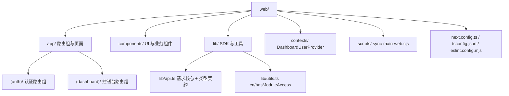
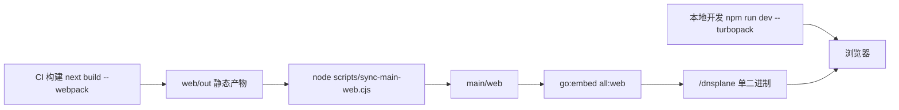
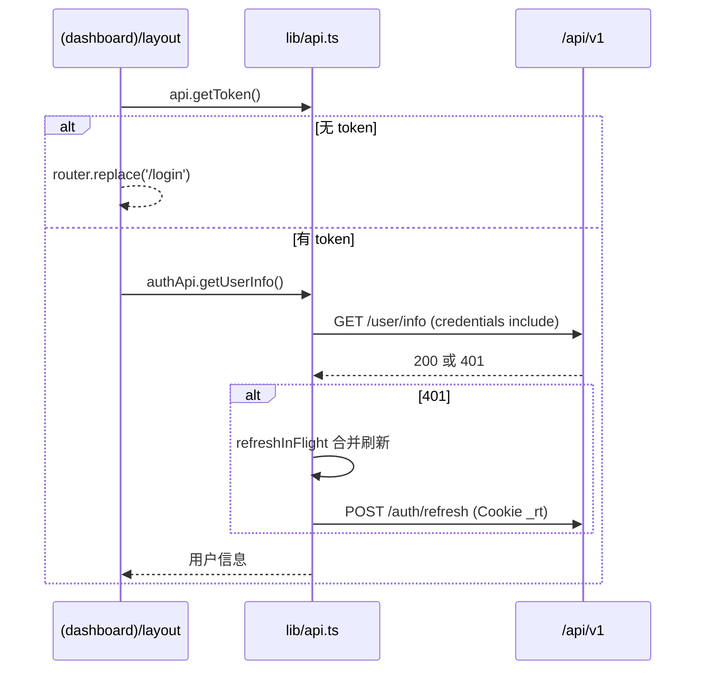
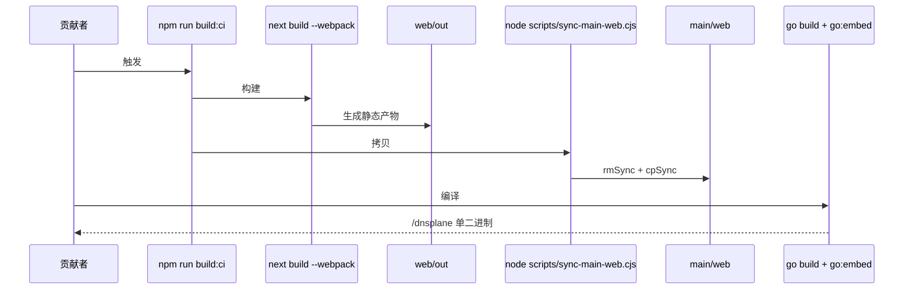
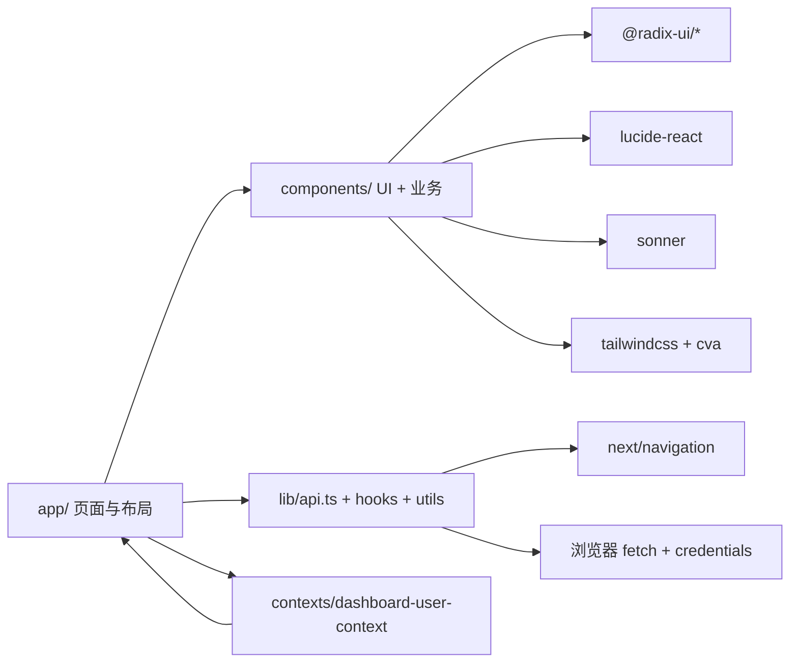

# 前端开发指南

<cite>
**本文档引用的文件**
- [web/package.json](file://web/package.json)
- [web/next.config.ts](file://web/next.config.ts)
- [web/tsconfig.json](file://web/tsconfig.json)
- [web/eslint.config.mjs](file://web/eslint.config.mjs)
- [web/app/layout.tsx](file://web/app/layout.tsx)
- [web/app/(auth)/layout.tsx](file://web/app/(auth)/layout.tsx)
- [web/app/(dashboard)/layout.tsx](file://web/app/(dashboard)/layout.tsx)
- [web/app/(dashboard)/dashboard/domains/[id]/page.tsx](file://web/app/(dashboard)/dashboard/domains/[id]/page.tsx)
- [web/app/(dashboard)/dashboard/domains/[id]/client.tsx](file://web/app/(dashboard)/dashboard/domains/[id]/client.tsx)
- [web/lib/api.ts](file://web/lib/api.ts)
- [web/lib/utils.ts](file://web/lib/utils.ts)
- [web/lib/hooks.ts](file://web/lib/hooks.ts)
- [web/contexts/dashboard-user-context.tsx](file://web/contexts/dashboard-user-context.tsx)
- [web/scripts/sync-main-web.cjs](file://web/scripts/sync-main-web.cjs)
- [Dockerfile](file://Dockerfile)
- [.github/workflows/build.yml](file://.github/workflows/build.yml)
- [main/main.go](file://main/main.go)
- [docs/Chanlog.md](file://docs/Chanlog.md)
</cite>

本文面向 DNSPlane 前端贡献者，覆盖从本地环境搭建、目录约定、TypeScript 严格模式历史包袱、ESLint 配置、新页面接入流程到与 Go 后端静态产物同步链路的完整开发闭环。所有行号均以当前工作区实测为准，若与旧版文档存在差异以本文件为准。

## 目录

- [简介](#简介)
- [项目结构](#项目结构)
- [核心组件](#核心组件)
- [架构总览](#架构总览)
- [详细组件分析](#详细组件分析)
  - [本地开发环境与构建入口](#本地开发环境与构建入口)
  - [TypeScript 严格模式与 199 类型错误清零](#typescript-严格模式与-199-类型错误清零)
  - [ESLint 与静态检查](#eslint-与静态检查)
  - [目录约定与命名规范](#目录约定与命名规范)
  - [新页面开发流程](#新页面开发流程)
  - [与 Go 后端的静态产物同步链路](#与-go-后端的静态产物同步链路)
- [依赖关系分析](#依赖关系分析)
- [性能考虑](#性能考虑)
- [故障排查指南](#故障排查指南)
- [结论](#结论)
- [附录](#附录)

## 简介

DNSPlane 前端为 Next.js 16.2.4 应用，运行于 React 19.2.4 + TypeScript 5，样式基座为 Tailwind CSS v4 与 shadcn/Radix 组件族。项目采取纯静态导出模式：`output: 'export'`、`trailingSlash: true`、`images.unoptimized: true`，产物 `web/out/` 通过 `scripts/sync-main-web.cjs` 全量复制到 `main/web/`，再由 Go 侧 `//go:embed all:web` 打进单二进制。

贡献者需理解两条构建路径的差异：

- 本地开发使用 `npm run dev`，Next.js 走 Turbopack 增量编译。
- 交付与 CI 构建必须走 `npm run build:ci`，Next.js 显式指定 `--webpack` 并调用 Node 同步脚本。Windows 专有的 `npm run build` 依赖 `set` 与 `powershell`，不参与跨平台流水线。

**章节来源**
- [web/package.json](file://web/package.json)
- [web/next.config.ts](file://web/next.config.ts)
- [docs/Chanlog.md](file://docs/Chanlog.md)

## 项目结构

前端源码根为 `web/`，按 Next.js App Router 约定展开。目录树与行数分布来自工作区实测（`.ts`/`.tsx`/`.cjs`，不含 CSS 与产物）：

| 目录 | 行数 | 职责 |
| --- | --- | --- |
| `web/app/` | 21926 | App Router 页面、路由组布局、错误/加载边界 |
| `web/components/` | 5966 | 业务与 UI 组件，含 `ui/` `auth/` `deploy/` 三个子目录 |
| `web/lib/` | 2522 | 客户端 SDK：`api.ts` 请求核心、类型契约、hooks、工具函数 |
| `web/contexts/` | 24 | `DashboardUserProvider` 单文件，注入当前登录用户 |
| `web/scripts/` | 13 | `sync-main-web.cjs`，静态产物 → `main/web` 的唯一同步入口 |
| **合计** | **30451** | — |

关键辅助文件：

| 文件 | 作用 |
| --- | --- |
| `web/next.config.ts` | `output: 'export'`、`trailingSlash`、`images.unoptimized` |
| `web/tsconfig.json` | `strict: true`、`noEmit`、`moduleResolution: bundler` |
| `web/eslint.config.mjs` | `eslint-config-next` 的 core-web-vitals + typescript 预设 |
| `web/postcss.config.mjs` | Tailwind v4 的 `@tailwindcss/postcss` 挂载 |
| `web/components.json` | shadcn CLI 元数据，路径别名 `@/*` |
| `web/bun.lock` | Bun 可选包管理器的锁文件（CI 走 `npm ci`） |



**图表来源**
- 目录树基于 `ls web/` 与工作区 `wc -l` 实测
- [web/package.json](file://web/package.json)
- [web/next.config.ts](file://web/next.config.ts)

**章节来源**
- [web/package.json](file://web/package.json)
- [web/next.config.ts](file://web/next.config.ts)
- [web/tsconfig.json](file://web/tsconfig.json)
- [web/eslint.config.mjs](file://web/eslint.config.mjs)

## 核心组件

前端可归纳为「三层一环」：路由层（App Router + route groups）、状态层（Context + hooks + lib/api 单例）、UI 层（components/ui + 业务组件）；外围一环为构建脚本层（`next build` + `sync-main-web.cjs` + Go `embed`）。

| 组件 | 位置 | 职责 |
| --- | --- | --- |
| RootLayout | `web/app/layout.tsx:15` | 全局 `<html>/<body>` 与 Provider 挂载：ThemeProvider、RouteProgress、ClientErrorBoundary、Toaster、GlobalErrorHandler |
| AuthGroupLayout | `web/app/(auth)/layout.tsx:4` | 认证页共用外壳，`animate-auth-route` 入场动画 |
| DashboardLayout | `web/app/(dashboard)/layout.tsx:95` | 客户端布局，负责鉴权、菜单渲染、模块权限过滤、退出登录、遗留 token 清理 |
| `api` 单例 | `web/lib/api.ts` | 请求封装，`getToken/setToken/setTokens`、401 合并刷新 `refreshInFlight` |
| `DashboardUserProvider` | `web/contexts/dashboard-user-context.tsx` | 注入 `useDashboardUser()` 消费当前用户 |
| `cn` / `hasModuleAccess` | `web/lib/utils.ts` | className 合并与模块权限判定 |
| `sync-main-web.cjs` | `web/scripts/sync-main-web.cjs` | 13 行零依赖同步：先 `rmSync` 再 `cpSync` |

**章节来源**
- [web/app/layout.tsx](file://web/app/layout.tsx)
- [web/app/(auth)/layout.tsx](file://web/app/(auth)/layout.tsx)
- [web/app/(dashboard)/layout.tsx](file://web/app/(dashboard)/layout.tsx)
- [web/lib/api.ts](file://web/lib/api.ts)
- [web/contexts/dashboard-user-context.tsx](file://web/contexts/dashboard-user-context.tsx)
- [web/scripts/sync-main-web.cjs](file://web/scripts/sync-main-web.cjs)

## 架构总览

从请求发起至交付落位，前端遵循「客户端 SPA + 静态导出 + Go 单二进制嵌入」的三段式：



**图表来源**
- [web/package.json](file://web/package.json)
- [web/scripts/sync-main-web.cjs](file://web/scripts/sync-main-web.cjs)
- [main/main.go](file://main/main.go)

客户端运行时的鉴权链路如下：



**图表来源**
- [web/app/(dashboard)/layout.tsx](file://web/app/(dashboard)/layout.tsx)
- [web/lib/api.ts](file://web/lib/api.ts)

**章节来源**
- [web/app/(dashboard)/layout.tsx](file://web/app/(dashboard)/layout.tsx)
- [web/lib/api.ts](file://web/lib/api.ts)
- [web/scripts/sync-main-web.cjs](file://web/scripts/sync-main-web.cjs)

## 详细组件分析

### 本地开发环境与构建入口

**运行时基线**：CI 与容器镜像统一锁定 Node 22（`.github/workflows/build.yml:50` `node-version: "22"`，`Dockerfile:4-10` `node:22-bookworm-slim`）。仓库同时保留 `web/bun.lock`，贡献者可选择 Bun 作为包管理器，但 CI 与 Dockerfile 的权威入口是 `npm ci`，两者锁定的依赖树必须等价。

**脚本矩阵**（对应 `web/package.json:5-11`）：

| 命令 | 定义 | 真实行为 | 适用场景 |
| --- | --- | --- | --- |
| `npm run dev` | `next dev --turbopack` | Turbopack 增量编译，HMR 快速 | 本地开发 |
| `npm run build` | `set "ANALYZE=true" && next build && powershell ...` | Windows 专有：`set` 环境变量 + `powershell` 拷贝 `out` → `../main/web` | 仅 Windows 本机 |
| `npm run build:ci` | `next build --webpack && node scripts/sync-main-web.cjs` | 显式 webpack + Node 跨平台同步 | CI 与 Linux/macOS 本地唯一推荐入口 |
| `npm run start` | `next start` | 本地服务端渲染启动 | 本项目为 `output: 'export'`，`start` 不适用于产物分发 |
| `npm run lint` | `eslint` | 静态检查 | PR 提交前 |

**Turbopack 与 webpack 的差异**：

- Turbopack 面向开发场景，增量编译快、支持模块热替换，但不保证与生产构建产物字节等价；`dev` 路由的 `useSearchParams` 边界缺失通常不会立刻报错。
- `--webpack` 用于 CI 与 `build:ci`，会真正执行 `next build` 的静态导出流程，触发 `generateStaticParams`、类型检查、ESLint 与 `export` 落盘。贡献者若只在 `dev` 下自测，可能漏掉 `output: 'export'` 对 `dynamic = 'force-dynamic'`、`headers`、`middleware` 等特性的禁用。

**推荐验证组合**（提交前）：

```bash
cd web
npx tsc --noEmit
npm run lint
npm run build:ci
```

**章节来源**
- [web/package.json](file://web/package.json)
- [Dockerfile](file://Dockerfile)
- [.github/workflows/build.yml](file://.github/workflows/build.yml)

### TypeScript 严格模式与 199 类型错误清零

`web/tsconfig.json:7` 开启 `strict: true`，同时 `noEmit`、`moduleResolution: bundler`、`jsx: react-jsx`、`target: ES2017` 构成当前编译口径。Next.js 官方插件 `next` 与路径别名 `@/*` 一并启用。

**历史事件 v1.0.11**（见 `docs/Chanlog.md:37-67`）：

- v1.0.7 时代，`next.config.ts` 曾配置 `typescript.ignoreBuildErrors`，类型错误被静默吞掉。安全审计 H-2 认定该开关会让 XSS、原型污染、越权类型混淆穿透到运行时。
- v1.0.7 移除该开关后，`npx tsc --noEmit` 暴露出 **199 个**存量类型错误。
- v1.0.11 提交 `72e15a9` 用 7 个文件清零全部 199 项，本地构建重新跑通。
- 文档重建时在 2026-10-10 工作区快照复验：`npx tsc --noEmit` 退出码 0，无输出。

**贡献者守则**：

- 不得在 `next.config.ts` 重新引入 `typescript.ignoreBuildErrors`。
- 单个文件若确需绕过类型检查，必须就地使用 `// @ts-expect-error` 局部豁免并写明理由，禁止 `// @ts-nocheck` 文件级禁用。
- API 返回的 `id` 字段在不同后端路径可能表现为 `number` 或 `string`，`lib/api.ts` 的类型契约必须与后端实际返回一致（v1.0.7 曾因此触发 CI 拦截）。

```typescript
// web/lib/api.ts 示意：后端 ID 契约需与实际响应对齐
export interface Domain {
  id: number
  name: string
  accountId: number
}
```

```tsx
// web/app/(dashboard)/dashboard/domains/[id]/page.tsx 实际片段
export default function DomainRecordsPage() {
  return <DomainRecordsClient />
}
```

**章节来源**
- [web/tsconfig.json](file://web/tsconfig.json)
- [web/next.config.ts](file://web/next.config.ts)
- [docs/Chanlog.md](file://docs/Chanlog.md)

### ESLint 与静态检查

`web/eslint.config.mjs` 采用 ESLint 9 Flat Config，叠加 `eslint-config-next` 的两套预设：

```javascript
import { defineConfig, globalIgnores } from "eslint/config";
import nextVitals from "eslint-config-next/core-web-vitals";
import nextTs from "eslint-config-next/typescript";

const eslintConfig = defineConfig([
  ...nextVitals,
  ...nextTs,
  globalIgnores([
    ".next/**", "out/**", "build/**", "next-env.d.ts", "scripts/**",
  ]),
]);

export default eslintConfig;
```

**覆盖范围**：

- `core-web-vitals` 预设：强制 `<Image>`、`<Link>`、`next/head` 等约定，捕获影响 LCP/CLS 的反模式。
- `typescript` 预设：与 `tsconfig.json` 联动的类型层规则，如未使用变量、不安全类型断言。
- `globalIgnores`：`scripts/**` 不在应用代码范围（`sync-main-web.cjs` 是 Node 工具，不参与浏览器运行）。

**提交前检查**：

```bash
cd web
npm run lint
```

任何可修复的 lint Warning 都应按 Error 处理。项目遵循「零警告」原则；若第三方类型定义带来不可消除的告警，需单独记录来源与临时措施，禁止批量 disable。

**章节来源**
- [web/eslint.config.mjs](file://web/eslint.config.mjs)
- [web/package.json](file://web/package.json)

### 目录约定与命名规范

App Router 的路由组使用括号语法：`(auth)`、`(dashboard)`，二者不进入 URL 段。真实路由入口在 `web/app/page.tsx`（客户端 `useEffect` 中 `router.replace('/login')`）、`web/app/(auth)/login/page.tsx` 等。

| 约定项 | 规则 | 依据 |
| --- | --- | --- |
| 页面文件名 | 一律 `page.tsx`，实现体超过 500 行需拆 `client.tsx` 伴生 | 项目「单文件 500 行」上限 |
| 路由组 | `(auth)` `(dashboard)`；括号目录不参与 URL | Next.js App Router |
| 动态段 | `[id]/page.tsx` + `[id]/client.tsx` 薄壳分离 | `output: 'export'` 需要 `generateStaticParams` 占位 |
| 服务端组件 | 默认 Server Component；需要 hooks 时文件首行 `'use client'` | React 19 RSC 约定 |
| 错误边界 | 每层路由组挂 `error.tsx` `loading.tsx`，根层挂 `global-error.tsx` | Next.js 错误处理 |
| 路径别名 | `@/*` → 项目根 | `tsconfig.json:21-23` |
| 组件命名 | 具名 + kebab-case 文件名；类型 `PascalCase` | 现有 `components/` 风格 |
| Hooks 命名 | `use*`，集中在 `lib/hooks.ts` | `useTurnstileGate`、`useDashboardUser` 等 |

**章节来源**
- [web/tsconfig.json](file://web/tsconfig.json)
- [web/app/layout.tsx](file://web/app/layout.tsx)
- [web/lib/hooks.ts](file://web/lib/hooks.ts)

### 新页面开发流程

以「新增一个 `dashboard/reports` 页面」为例，标准 7 步：

1. 在 `web/app/(dashboard)/dashboard/reports/page.tsx` 建立入口。若页面需要浏览器 API 或 hooks，首行 `'use client'`。
2. 若主体超过 500 行，拆分实现到 `web/app/(dashboard)/dashboard/reports/client.tsx`，`page.tsx` 仅做转发。
3. 若页面接入动态段（如 `reports/[id]`），必须同时提供：
   - `export const dynamicParams = false`
   - `export function generateStaticParams() { return [{ id: '_' }] }`
   - `client.tsx` 通过 `window.location.pathname` 或 `usePathname()` 运行时解析真实 id
4. 在 `web/app/(dashboard)/layout.tsx:55-93` 的 `navigation` 常量中新增一项，指定 `name` `href` `icon` 与 `module`；若仅管理员可见，加 `adminOnly: true`。
5. 在 `web/lib/api.ts` 补齐 API 与类型契约（若后端接口未定，先在后端仓库落定后再补），前端只允许调用 `api.request` 或已封装的 `domainApi/accountApi/certApi` 等命名空间。
6. 若使用 `useSearchParams`，必须外包 `Suspense`（参考 `reset-password/page.tsx:340-348`、`magic-login/page.tsx:26-29`）。这是 `output: 'export'` 场景下最容易被忽略的约束。
7. 提交前依次运行 `npx tsc --noEmit`、`npm run lint`、`npm run build:ci`；`build:ci` 通过意味着产物已成功同步到 `main/web`。

```tsx
// web/app/(dashboard)/dashboard/reports/page.tsx 骨架
import ReportsClient from './client'
export default function ReportsPage() {
  return <ReportsClient />
}
```

```tsx
// web/app/(dashboard)/dashboard/reports/[id]/page.tsx 动态段壳
import ReportClient from './client'
export const dynamicParams = false
export function generateStaticParams() {
  return [{ id: '_' }]
}
export default function ReportPage() {
  return <ReportClient />
}
```

**章节来源**
- [web/app/(dashboard)/layout.tsx](file://web/app/(dashboard)/layout.tsx)
- [web/app/(dashboard)/dashboard/domains/[id]/page.tsx](file://web/app/(dashboard)/dashboard/domains/[id]/page.tsx)
- [web/lib/api.ts](file://web/lib/api.ts)

### 与 Go 后端的静态产物同步链路

`next build` 产出 `web/out/`，随后由 `scripts/sync-main-web.cjs` 拷贝到 `main/web`。Go 侧在 `main/main.go:63` 用 `//go:embed all:web` 打包，最终产出 `/dnsplane` 单二进制。



**图表来源**
- [web/scripts/sync-main-web.cjs](file://web/scripts/sync-main-web.cjs)
- [main/main.go](file://main/main.go)

**Dockerfile 中的两段流水线**（`Dockerfile:4-22`）：

| 阶段 | 行 | 行为 |
| --- | --- | --- |
| `node:22-bookworm-slim` | `4-10` | `npm ci` → `npm run build:ci`；第 9 行 `COPY web/ ./` |
| `golang:1.26.2-bookworm` | `12-22` | `COPY --from=web /build/main/web ./web` 注入 Go 源码树，随后 `go build` |

`.github/workflows/build.yml:43-65` 的 `frontend` 作业与 Dockerfile 等价：`setup-node@v7` Node 22 + `npm ci` + `npm run build:ci`，之后 `actions/cache/save@v5` 缓存 `main/web`，供后续 Go 作业消费。

**sync-main-web.cjs 逐行语义**：

| 行 | 内容 | 说明 |
| --- | --- | --- |
| `1-2` | `require("fs")`、`require("path")` | 零第三方依赖 |
| `4` | `out = path.join(__dirname, "..", "out")` | 即 `web/out` |
| `5` | `dest = path.join(__dirname, "..", "..", "main", "web")` | 目标 `main/web` |
| `7-10` | `out/` 缺失则 `console.error + process.exit(1)` | 防呆，避免误清空 |
| `12` | `fs.rmSync(dest, { recursive: true, force: true })` | 先删后拷，杜绝陈旧文件残留 |
| `13` | `fs.cpSync(out, dest, { recursive: true })` | 全量复制 |

**章节来源**
- [web/scripts/sync-main-web.cjs](file://web/scripts/sync-main-web.cjs)
- [Dockerfile](file://Dockerfile)
- [.github/workflows/build.yml](file://.github/workflows/build.yml)
- [main/main.go](file://main/main.go)

## 依赖关系分析

前端运行时依赖以 Radix 无头组件 + lucide-react 图标 + sonner 通知为主，构建期依赖 Next/React/Tailwind/TypeScript/ESLint。核心清单摘自 `web/package.json:12-52`：

| 分类 | 关键包 | 版本 |
| --- | --- | --- |
| 框架 | `next` / `react` / `react-dom` | 16.2.4 / 19.2.4 / 19.2.4 |
| 无头 UI | `@radix-ui/react-*`（dialog、dropdown、select、tabs、tooltip 等 15+） | ^1.x / ^2.x |
| 样式 | `tailwindcss` / `@tailwindcss/postcss` / `tw-animate-css` | ^4 / ^4 / ^1.4 |
| 工具 | `class-variance-authority`、`clsx`、`tailwind-merge`、`lucide-react` | 见 package.json |
| 表单与交互 | `cmdk`（命令面板）、`sonner`（toast）、`qrcode`（TOTP） | ^1.1 / ^2.0 / ^1.5 |
| 验证码 | `go-captcha-react` | ^1.0.4 |
| 主题 | `next-themes` | ^0.4.6 |
| 语言 | `typescript` | ^5 |
| Lint | `eslint` / `eslint-config-next` | ^9 / 16.2.4 |



**图表来源**
- [web/package.json](file://web/package.json)
- [web/app/layout.tsx](file://web/app/layout.tsx)

**跨仓依赖**：

- 前端 → 后端：仅通过 HTTP `/api/v1/*`，鉴权凭据走 HttpOnly Cookie `_rt` 与 `Authorization` 头。安全审计 M-1 与 H-4 已禁止在 URL 查询串与 localStorage 中存放 refresh_token。
- 前端 → 交付：`build:ci` 产物落 `main/web`，由 Go 侧 `//go:embed all:web` 打进二进制。前端仓库不再关心运行时。

**章节来源**
- [web/package.json](file://web/package.json)
- [web/lib/api.ts](file://web/lib/api.ts)
- [main/main.go](file://main/main.go)

## 性能考虑

- **静态导出与预渲染**：`output: 'export'` 强制所有页面在构建期完成 prerender，浏览器拿到的是纯 HTML + `_next/static`。首屏依赖 CDN/边缘缓存，`trailingSlash: true` 保证目录形态匹配 Go 侧静态资源路由。
- **动态段的成本**：`generateStaticParams` 只生成 `id='_'` 一个占位 HTML，其余 id 复用同一份静态壳，运行时由 `client.tsx` 正则解析 `window.location.pathname`，避免构建期枚举全部 domain 的爆炸成本。
- **包体控制**：Radix 与 lucide-react 通过 Next.js tree-shaking 与 `next build --webpack` 的 sideEffects 分析按需拆分；`components/large` 单文件超过 1500 行（如 `domains/[id]/client.tsx` 1799 行、`settings/page.tsx` 2102 行、`monitor/page.tsx` 2100 行）需评估代码分割或懒加载。
- **验证码懒加载**：`GoCaptchaDialog` 通过 `dynamic import` + `Suspense` 挂载（`login/page.tsx:20` 附近），避免首屏拉入 `go-captcha-react` 主包。
- **useSearchParams 边界**：`output: 'export'` 下 `useSearchParams` 必须外包 `Suspense`，否则构建告警且会引发整页 fallback。已正确包裹的位置：`reset-password/page.tsx:340-348`、`reset-totp/page.tsx:216-224`、`magic-login/page.tsx:26-29`、`magic-login/totp/page.tsx:21-23`、`app/layout.tsx:24-26`（`RouteProgress`）。
- **401 合并刷新**：`lib/api.ts:26-27` 的 `refreshInFlight` 将并发 401 合并为单次 `POST /auth/refresh`，避免 JTI 轮转互相踩掉新 token。
- **图像策略**：`images.unoptimized: true`，Next.js Image 不走 CDN 优化管道，需自行控制 `public/` 图片大小。

**章节来源**
- [web/next.config.ts](file://web/next.config.ts)
- [web/lib/api.ts](file://web/lib/api.ts)
- [web/app/layout.tsx](file://web/app/layout.tsx)
- [web/app/(dashboard)/dashboard/domains/[id]/page.tsx](file://web/app/(dashboard)/dashboard/domains/[id]/page.tsx)

## 故障排查指南

| 症状 | 定位 | 处理 |
| --- | --- | --- |
| `npm run build` 在 Linux/macOS 报错 | `package.json:7` 依赖 Windows `set` + `powershell` | 换用 `npm run build:ci` |
| `build:ci` 报 `missing out/ — run next build first` | 上一阶段 `next build` 未产出 `web/out` | 先跑 `next build`，或直接 `npm run build:ci` |
| 类型错误大量出现 | 触碰 v1.0.7 移除的 `ignoreBuildErrors` 场景 | 就地修复或用 `// @ts-expect-error` + 注释理由 |
| 认证页 `useSearchParams` 构建警告 | `output: 'export'` 强制 Suspense | 外包 `<Suspense>` 再取 `useSearchParams` |
| 控制台首页持续转圈 | `(dashboard)/layout.tsx:252-258` 判定 `!user` | 检查 `api.getToken()`；若浏览器无 token，`router.replace('/login')` |
| 登录后立刻回跳到 `/login` | `fetchUserInfo` 重试 2 次仍失败 | 检查 `/user/info` 返回码与后端签名；`lib/api.ts` 的 401 是否触发 `refreshInFlight` |
| URL 上遗留 `?token=` 导致审计报警 | `(dashboard)/layout.tsx:143-151` H-4 清理 | 手动 `history.replaceState` 兜底已在代码中，不应再往 URL 写 token |
| `main/web` 存在陈旧文件 | 只拷贝未删除 | `sync-main-web.cjs:12` 已 `rmSync`；若仍异常，手工 `rm -rf main/web` 后重跑 `build:ci` |
| ESLint 报 `scripts/**` | Flat Config 已 `globalIgnores` | 若仍有告警，检查是否有本地覆盖配置 |
| Tailwind 类未生效 | `@tailwindcss/postcss` 未挂 `postcss.config.mjs` | 校对 `globals.css` 的 `@import "tailwindcss"` 与 PostCSS 插件 |
| 单二进制访问 `/dashboard` 404 | `main/web/dashboard/index.html` 缺失 | 核对 `trailingSlash: true` + `go:embed all:web`；重跑 `build:ci` 与 `go build` |
| 菜单可见性与后端权限不一致 | `hasModuleAccess`（`lib/utils.ts:118-128`）语义：未配置权限的老用户全放行 | 与后端确认 `permissions` 字段是否下发完整 |

**章节来源**
- [web/package.json](file://web/package.json)
- [web/scripts/sync-main-web.cjs](file://web/scripts/sync-main-web.cjs)
- [web/app/(dashboard)/layout.tsx](file://web/app/(dashboard)/layout.tsx)
- [web/lib/api.ts](file://web/lib/api.ts)
- [web/lib/utils.ts](file://web/lib/utils.ts)

## 结论

DNSPlane 前端以 Next.js App Router + 纯静态导出为基座，通过 `build:ci` + `sync-main-web.cjs` + Go `embed` 三段式与后端交付解耦。贡献者需重点关注三件事：**本地 Turbopack 与 CI webpack 的差异不得混用**、**TypeScript 严格模式的历史 199 错误清零不可倒退**、**`output: 'export'` 场景下 `useSearchParams` 与动态段 `generateStaticParams` 的强制约束**。

未来的迭代方向（YAGNI 原则下按需推进）：

- 拆分 `settings/page.tsx`（2102 行）、`monitor/page.tsx`（2100 行）、`domains/[id]/client.tsx`（1799 行）等超大单文件，收敛到项目 500 行上限以内。
- 评估 `components/captcha-dialog.tsx`（233 行无引用）与 `go-captcha-dialog.tsx` 的重复实现，保留一份。
- 若 CI 需并行化，可将 `next build --webpack` 与 `go build` 拆分为两个作业，通过 `actions/cache` 传递 `main/web`。

## 附录

### 附录 A：常用命令速查

```bash
# 本地开发（Turbopack）
cd web && npm run dev

# 类型检查（v1.0.11 之后必须退出码 0）
cd web && npx tsc --noEmit

# Lint
cd web && npm run lint

# 生产构建 + 静态产物同步（CI 唯一入口）
cd web && npm run build:ci

# 一键验证（等价于 CI frontend 作业）
cd web && npx tsc --noEmit && npm run lint && npm run build:ci
```

**章节来源**
- [web/package.json](file://web/package.json)

### 附录 B：路由组与 URL 映射

| URL | 页面文件 | 所属组 |
| --- | --- | --- |
| `/login/` | `web/app/(auth)/login/page.tsx` | `(auth)` |
| `/register/` | `web/app/(auth)/register/page.tsx` | `(auth)` |
| `/forgot-password/` | `web/app/(auth)/forgot-password/page.tsx` | `(auth)` |
| `/reset-password/` | `web/app/(auth)/reset-password/page.tsx` | `(auth)` |
| `/reset-totp/` | `web/app/(auth)/reset-totp/page.tsx` | `(auth)` |
| `/magic-login/` | `web/app/(auth)/magic-login/page.tsx` | `(auth)` |
| `/oauth-callback/` | `web/app/(auth)/oauth-callback/page.tsx` | `(auth)` |
| `/github-callback/` | `web/app/(auth)/github-callback/page.tsx` | `(auth)` |
| `/dashboard/` | `web/app/(dashboard)/dashboard/page.tsx` | `(dashboard)` |
| `/dashboard/domains/` | `web/app/(dashboard)/dashboard/domains/page.tsx` | `(dashboard)` |
| `/dashboard/domains/<id>/` | `web/app/(dashboard)/dashboard/domains/[id]/page.tsx` | `(dashboard)` |

**章节来源**
- [web/app/(auth)/layout.tsx](file://web/app/(auth)/layout.tsx)
- [web/app/(dashboard)/layout.tsx](file://web/app/(dashboard)/layout.tsx)

### 附录 C：Commit 与 PR 规范

前端改动建议遵循 Conventional Commits：

```text
feat(dashboard): add reports page with dynamic segment shell
fix(api): guard refresh token against concurrent 401
test(web): cover cn helper edge cases
refactor(components): split settings page into tab panels
chore(build): bump node to 22.11 in Dockerfile
```

PR 描述至少包含：

- 变更范围（页面/组件/SDK/构建脚本）
- 验证结果：`npx tsc --noEmit`、`npm run lint`、`npm run build:ci` 的实际退出码
- 若涉及产物：`main/web` 是否随本次 PR 一起提交

**章节来源**
- 参见根目录 `AGENTS.md` 中的 Git 与 Commit 规范
