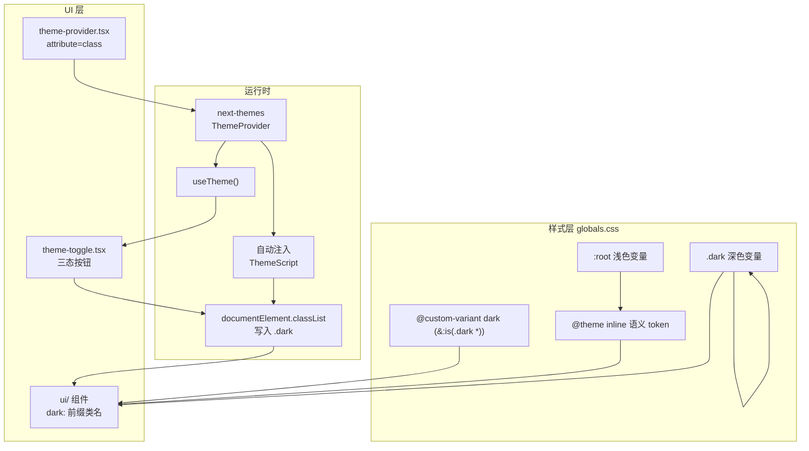
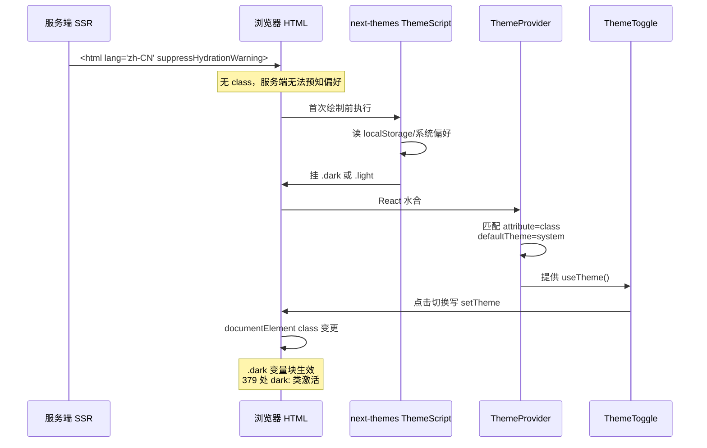
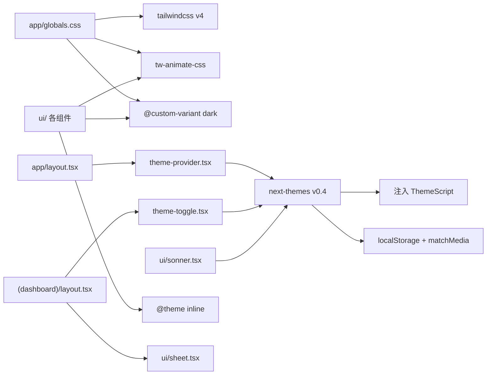
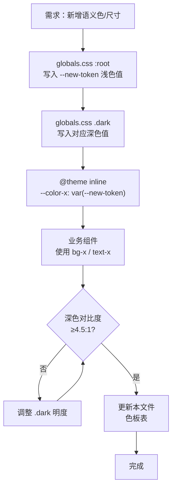

# 响应式设计与主题

<cite>
**本文档引用的文件**
- [web/app/globals.css](file://web/app/globals.css)
- [web/app/layout.tsx](file://web/app/layout.tsx)
- [web/app/(dashboard)/layout.tsx](file://web/app/(dashboard)/layout.tsx)
- [web/components/theme-provider.tsx](file://web/components/theme-provider.tsx)
- [web/components/theme-toggle.tsx](file://web/components/theme-toggle.tsx)
- [web/components/ui/button.tsx](file://web/components/ui/button.tsx)
- [web/components/ui/dialog.tsx](file://web/components/ui/dialog.tsx)
- [web/components/ui/sheet.tsx](file://web/components/ui/sheet.tsx)
- [web/components/ui/select.tsx](file://web/components/ui/select.tsx)
- [web/components/ui/dropdown-menu.tsx](file://web/components/ui/dropdown-menu.tsx)
- [web/components/ui/sonner.tsx](file://web/components/ui/sonner.tsx)
- [web/components/ui/table.tsx](file://web/components/ui/table.tsx)
- [web/components/ui/alert-dialog.tsx](file://web/components/ui/alert-dialog.tsx)
- [web/components/ui/avatar.tsx](file://web/components/ui/avatar.tsx)
- [web/components/ui/tooltip.tsx](file://web/components/ui/tooltip.tsx)
- [web/components/ui/popover.tsx](file://web/components/ui/popover.tsx)
- [web/components/auth/auth-animated-layout.tsx](file://web/components/auth/auth-animated-layout.tsx)
- [web/components/auth/animated-login-shell.module.css](file://web/components/auth/animated-login-shell.module.css)
- [web/components/auth/animated-login-characters.module.css](file://web/components/auth/animated-login-characters.module.css)
- [web/components/auth/oauth-callback.module.css](file://web/components/auth/oauth-callback.module.css)
- [web/lib/utils.ts](file://web/lib/utils.ts)
- [web/package.json](file://web/package.json)
- [devlog.md](file://devlog.md)
</cite>

## 目录

1. [简介](#简介)
2. [项目结构](#项目结构)
3. [核心组件](#核心组件)
4. [架构总览](#架构总览)
5. [详细组件分析](#详细组件分析)
6. [依赖关系分析](#依赖关系分析)
7. [性能考虑](#性能考虑)
8. [故障排查指南](#故障排查指南)
9. [结论](#结论)
10. [附录](#附录)

## 简介

DNSPlane 前端使用 Tailwind CSS v4 的 `@theme inline` 声明式设计 token，搭配 CSS 自定义属性（`:root` 与 `.dark` 两套 oklch 色板）实现主题化；暗色切换通过 `@custom-variant dark (&:is(.dark *))` 约定 `.dark` 类作为作用域，由 `next-themes` 在根 `<html>` 挂载对应类名。响应式布局沿用 Tailwind 默认断点 `sm` 至 `xl`，业务代码以 `md:` `lg:` 前缀驱动栅格、侧栏折叠、表格横向滚动等形态。动画由 `tw-animate-css` 提供进入/离开关键帧，Dialog、Sheet、路由切换等均走该库。

历史上项目曾一度拥有 379 处 `dark:` 类但没有 `.dark` 挂载点，导致暗色样式全部为死代码；本轮通过 `theme-provider.tsx` + `theme-toggle.tsx` 接线修复。相关取证见 `devlog.md` 「三｜暗色主题：379 处样式从死代码变为生效」。

**章节来源**
- [web/app/globals.css](file://web/app/globals.css#L38-L150)
- [web/components/theme-provider.tsx](file://web/components/theme-provider.tsx)
- [devlog.md](file://devlog.md#L1764-L1790)

## 项目结构

主题与响应式相关的文件分布在样式入口、根布局、Provider 与切换按钮四处。

```
web/
├── app/
│   ├── globals.css                448 行 样式入口（Tailwind 4 @theme、暗色变量、动画）
│   ├── layout.tsx                  36 行 根布局（ThemeProvider 挂载、suppressHydrationWarning）
│   └── (dashboard)/
│       └── layout.tsx             ~400 行 业务顶栏接入 ThemeToggle
├── components/
│   ├── theme-provider.tsx          27 行 next-themes Provider 封装
│   ├── theme-toggle.tsx            70 行 三态主题按钮（浅/深/系统）
│   └── ui/                          24 个基础组件，均引用 token 类名
│       └── sonner.tsx              42 行 toast 主题桥接
├── lib/
│   └── utils.ts                    cn() 类名合并工具
└── package.json                    tailwindcss v4 / next-themes / tw-animate-css
```

样式入口 `globals.css` 的行段职责如下：

| 行段 | 内容 |
|---|---|
| 1-2 | `@import "tailwindcss"` 与 `@import "tw-animate-css"` |
| 4-36 | 自定义 `@keyframes blob` 与 `auth-route-in` |
| 38 | `@custom-variant dark (&:is(.dark *))` 定义暗色作用域 |
| 40-81 | `@theme inline` 声明 Tailwind 4 语义 token 名 |
| 83-116 | `:root` 浅色 CSS 变量（oklch） |
| 118-150 | `.dark` 深色 CSS 变量（oklch） |
| 152-159 | `@layer base` 全局默认边框与背景 |
| 161-448 | `@layer components` 表格、状态徽章、Bootstrap 风格工具类 |

**章节来源**
- [web/app/globals.css](file://web/app/globals.css#L1-L448)
- [web/app/layout.tsx](file://web/app/layout.tsx#L1-L36)
- [web/app/(dashboard)/layout.tsx](file://web/app/(dashboard)/layout.tsx)

## 核心组件

主题系统由三块组成：CSS 变量层（`globals.css`）、React Provider 层（`theme-provider.tsx`）、UI 交互层（`theme-toggle.tsx`）。



**图表来源**
- [web/app/globals.css](file://web/app/globals.css#L38-L150)
- [web/components/theme-provider.tsx](file://web/components/theme-provider.tsx#L16-L27)
- [web/components/theme-toggle.tsx](file://web/components/theme-toggle.tsx#L25-L69)

三层职责严格分离：样式层只负责定义与选择器约定，Provider 层只负责读写 `.dark` 与 `theme` 状态，UI 层只负责按钮组与暗色前缀类名。

**章节来源**
- [web/app/globals.css](file://web/app/globals.css#L38-L150)
- [web/components/theme-provider.tsx](file://web/components/theme-provider.tsx)
- [web/components/theme-toggle.tsx](file://web/components/theme-toggle.tsx)

## 架构总览

从请求到渲染的主题决策路径如下：



**图表来源**
- [web/app/layout.tsx](file://web/app/layout.tsx#L20-L32)
- [web/components/theme-provider.tsx](file://web/components/theme-provider.tsx)
- [web/components/theme-toggle.tsx](file://web/components/theme-toggle.tsx)

响应式布局的骨架决策由 `sm:` 与 `lg:` 两组断点驱动，具体使用集中在 `web/app/(dashboard)/layout.tsx`、`web/components/ui/dialog.tsx`、`web/components/ui/sheet.tsx` 与业务页面。

| 断点 | 阈值 | 主要影响 |
|---|---|---|
| `sm` | 640px | Dialog 宽度切换（`max-w-[calc(100%-2rem)] sm:max-w-lg`）、Sheet 侧滑宽度上限 |
| `md` | 768px | 表单栅格由一列转两列、输入行内化 |
| `lg` | 1024px | 侧栏常驻显示、卡片网格 `lg:grid-cols-3` 起步 |
| `xl` | 1280px | 主内容宽度上限、图表区放大 |

**章节来源**
- [web/components/ui/dialog.tsx](file://web/components/ui/dialog.tsx#L64-L66)
- [web/components/ui/sheet.tsx](file://web/components/ui/sheet.tsx#L52-L90)
- [web/app/(dashboard)/layout.tsx](file://web/app/(dashboard)/layout.tsx)

## 详细组件分析

### 设计 token：@theme inline

Tailwind 4 用 `@theme` 声明语义 token，本项目选择 `@theme inline` 让生成的工具类直接引用 CSS 变量而非硬编码值。这样运行时切换 `.dark` 会自动改变 `bg-background` 等类名的实际色值。

```css
@custom-variant dark (&:is(.dark *));

@theme inline {
  --color-background: var(--background);
  --color-foreground: var(--foreground);
  --color-card: var(--card);
  --color-primary: var(--primary);
  --color-destructive: var(--destructive);
  --color-border: var(--border);
  --color-input: var(--input);
  --color-ring: var(--ring);
  --color-chart-1: var(--chart-1);
  --color-sidebar: var(--sidebar);
  --radius-sm: calc(var(--radius) - 4px);
  --radius-md: calc(var(--radius) - 2px);
  --radius-lg: var(--radius);
  --radius-xl: calc(var(--radius) + 4px);
  --font-sans: ui-sans-serif, system-ui, -apple-system, "PingFang SC", "Microsoft YaHei", sans-serif;
}
```

关键约定：

- 变量名 `--color-*` 是 Tailwind 4 的 token 命名空间，映射为 `bg-*`、`text-*`、`border-*` 工具类
- `--radius-*` 通过 `calc()` 派生，只需修改 `:root { --radius }` 即可全站缩放圆角
- `@custom-variant dark` 的 `&:is(.dark *)` 让 `dark:bg-x` 编译为 `.dark .xx:is(.dark *)` 结构，兼容后代与自身

**章节来源**
- [web/app/globals.css](file://web/app/globals.css#L38-L81)

### 色板：`:root` 与 `.dark`

两套变量块使用 oklch 色彩空间，保证跨显示器感知一致。核心变量如下：

| Token | 浅色 (`:root`) | 深色 (`.dark`) | 用途 |
|---|---|---|---|
| `--background` | `oklch(1 0 0)` | `oklch(0.145 0 0)` | 页面底色 |
| `--foreground` | `oklch(0.145 0 0)` | `oklch(0.985 0 0)` | 主文本 |
| `--card` | `oklch(1 0 0)` | `oklch(0.205 0 0)` | 卡片背景 |
| `--primary` | `oklch(0.205 0 0)` | `oklch(0.922 0 0)` | 主操作色（自动反色） |
| `--muted` | `oklch(0.97 0 0)` | `oklch(0.269 0 0)` | 弱化背景 |
| `--accent` | `oklch(0.97 0 0)` | `oklch(0.269 0 0)` | 悬停强调 |
| `--destructive` | `oklch(0.577 0.245 27.325)` | `oklch(0.704 0.191 22.216)` | 危险色，深色提高明度 |
| `--border` | `oklch(0.922 0 0)` | `oklch(1 0 0 / 14%)` | 边框（深色用带 alpha 白） |
| `--ring` | `oklch(0.708 0 0)` | `oklch(0.556 0 0)` | 焦点环 |
| `--sidebar-*` | 一整套 | 一整套 | 侧栏独立色板 |
| `--chart-1..5` | 5 色 | 5 色（不同色相） | 图表配色 |

深色边框使用带 alpha 的白色（`oklch(1 0 0 / 14%)`），保证在任何背景上都能透出柔和分割线。

**章节来源**
- [web/app/globals.css](file://web/app/globals.css#L83-L150)

### 暗色作用域：@custom-variant

`@custom-variant dark (&:is(.dark *))` 声明暗色伪类变体的匹配规则。编译后的选择器：

```css
/* 源 */
.foo { @apply bg-white dark:bg-black; }

/* Tailwind 4 生成 */
.foo { background-color: white; }
.dark .foo:is(.dark *) { background-color: black; }
```

`.dark *` 表示「`.dark` 后代的任意节点」，`&:is(.dark *)` 又要求节点本身处于 `.dark` 之下。这种写法允许 `.dark` 挂在 `<html>`、`<body>` 或任何子容器上，都能激活。项目实际使用 `<html>` 挂载，即由 `next-themes` 的 `attribute="class"` 完成。

**章节来源**
- [web/app/globals.css](file://web/app/globals.css#L38)
- [web/components/theme-provider.tsx](file://web/components/theme-provider.tsx#L16-L27)

### Provider 挂载：theme-provider.tsx

```tsx
export function ThemeProvider({ children }: { children: React.ReactNode }) {
  return (
    <NextThemesProvider
      attribute="class"
      defaultTheme="system"
      enableSystem
      disableTransitionOnChange
    >
      {children}
    </NextThemesProvider>
  )
}
```

四个 prop 的意义：

| Prop | 值 | 作用 |
|---|---|---|
| `attribute` | `"class"` | 主题类名直接写到 `<html class>`，与 `@custom-variant dark` 匹配 |
| `defaultTheme` | `"system"` | 首次访问按 `prefers-color-scheme` 决定，避免默认浅色 |
| `enableSystem` | `true` | 三态切换中「跟随系统」可用 |
| `disableTransitionOnChange` | `true` | 切换主题期间临时关闭 CSS transition，防止颜色错位 |

`next-themes` 内部会向 `<head>` 注入一段 `ThemeScript`，在首次绘制前读取 `localStorage` 或系统偏好并写入 class，配合 `<html suppressHydrationWarning>` 消除服务端与客户端 class 差异。

**章节来源**
- [web/components/theme-provider.tsx](file://web/components/theme-provider.tsx)
- [web/app/layout.tsx](file://web/app/layout.tsx#L20-L32)

### 三态切换：theme-toggle.tsx

`ThemeToggle` 提供浅色 / 深色 / 跟随系统三个 radio 按钮，`useSyncExternalStore` 判断挂载态避免首帧闪错图标。

```tsx
const emptySubscribe = () => () => {}

export function ThemeToggle({ className }: { className?: string }) {
  const { theme, setTheme } = useTheme()
  const mounted = useSyncExternalStore(emptySubscribe, () => true, () => false)

  const options = [
    { value: "light", label: "浅色", Icon: Sun },
    { value: "dark", label: "深色", Icon: Moon },
    { value: "system", label: "跟随系统", Icon: Monitor },
  ] as const

  const active = mounted ? theme : "light"
  // ... role=radiogroup + 三按钮渲染
}
```

设计要点：

- 挂载前默认高亮「浅色」而不是 `undefined`：SSR 首帧无法读到用户偏好，直接采信会让按钮组闪一下空态
- `useSyncExternalStore` 替代 `useState + useEffect` 置位：语义更明确，避免 `react-hooks/set-state-in-effect` 规则告警
- `role="radiogroup"` + `role="radio"` + `aria-checked`：三态按钮对读屏软件呈现为单选组

**章节来源**
- [web/components/theme-toggle.tsx](file://web/components/theme-toggle.tsx#L1-L70)

### Toast 桥接：sonner

`sonner.tsx` 从 `useTheme()` 读取当前主题传给 `Toaster`，并把主题变量重映射到 sonner 内部变量：

```tsx
<Sonner
  theme={theme as ToasterProps["theme"]}
  style={{
    "--normal-bg": "var(--popover)",
    "--normal-text": "var(--popover-foreground)",
    "--normal-border": "var(--border)",
    "--border-radius": "var(--radius)",
  } as React.CSSProperties}
/>
```

`theme = "system"` 的默认值必须与 `ThemeProvider` 的 `defaultTheme` 一致，否则挂载前会有一闪。

**章节来源**
- [web/components/ui/sonner.tsx](file://web/components/ui/sonner.tsx#L1-L42)

### 响应式基础件：dialog 与 sheet

Dialog 在小屏与桌面宽度不同：

```tsx
<DialogPrimitive.Content
  className={cn(
    "bg-background ... grid w-full max-w-[calc(100%-2rem)] ... sm:max-w-lg",
    className
  )}
>
```

`max-w-[calc(100%-2rem)]` 保证小屏留 1rem 边距；`sm:max-w-lg`（≥32rem）在桌面收紧宽度，避免过宽。

Sheet 使用 `side` prop 决定动画方向，宽度采用 `w-3/4 sm:max-w-sm` —— 小屏占屏 75%，桌面固定 24rem：

```tsx
side === "right" &&
  "data-[state=closed]:slide-out-to-right data-[state=open]:slide-in-from-right inset-y-0 right-0 h-full w-3/4 border-l sm:max-w-sm",
```

Dialog/Sheet 的动画类（`animate-in`、`fade-in-0`、`zoom-in-95`、`slide-in-from-right`）来自 `tw-animate-css`，通过 `data-[state=open]` / `data-[state=closed]` 属性选择器与 Radix 状态绑定。

**章节来源**
- [web/components/ui/dialog.tsx](file://web/components/ui/dialog.tsx#L50-L82)
- [web/components/ui/sheet.tsx](file://web/components/ui/sheet.tsx#L52-L90)
- [web/app/globals.css](file://web/app/globals.css#L1-L2)

### 认证页动画：auth/

`auth/` 目录下的 CSS Module 使用 `@keyframes` 定义局部动画（登录页字符动效、路由切换淡入），与全局的 `tw-animate-css` 独立。

- `auth-animated-layout.tsx` 136 行，包裹 `AnimateAuthRoute`，动画类 `.animate-auth-route` 定义在 `globals.css:34-36`
- `animated-login-characters.tsx` 568 行，配合 `animated-login-characters.module.css` 与 `animated-login-shell.module.css`
- `oauth-callback.module.css` 承担 OAuth 回调页样式隔离

字符动画与 shell 采用 CSS Module 而非 Tailwind 类，是因为动画由大量延迟错位（`animation-delay` 按索引计算）驱动，用工具类表达不经济。

**章节来源**
- [web/components/auth/auth-animated-layout.tsx](file://web/components/auth/auth-animated-layout.tsx)
- [web/app/globals.css](file://web/app/globals.css#L24-L36)

### 业务页面的响应式约定

业务页面在 `app/(dashboard)/dashboard/*/page.tsx` 中广泛使用 `sm:` `md:` `lg:` 前缀类。`domains/[id]/client.tsx` 单文件包含 41 处断点前缀，覆盖记录表格在小屏下的列隐藏、编辑对话框宽度、以及移动端底部按钮栏；`monitor/page.tsx` 有 22 处，用于切换卡片网格列数（`md:grid-cols-2 lg:grid-cols-3`）。

约定：

- 优先「桌面优先」：不写前缀即为默认（≥1280px 视口），`sm:` 表示「≥640 恢复」
- 表格横向滚动通过 `Table` 的 `overflow-x-auto` 容器自动处理，业务代码不需重复
- 侧栏折叠在 `dashboard/layout.tsx` 用 `lg:` 判定，`<lg` 时改由 `Sheet` 抽屉打开
- 状态圆点、色块等语义色一律走 token（`bg-primary`、`text-muted-foreground`），避免深色下对比度不达标

**章节来源**
- [web/app/(dashboard)/layout.tsx](file://web/app/(dashboard)/layout.tsx)
- [web/components/ui/table.tsx](file://web/components/ui/table.tsx#L7-L20)

## 依赖关系分析

主题与响应式相关的关键依赖如下：



**图表来源**
- [web/package.json](file://web/package.json)
- [web/app/globals.css](file://web/app/globals.css)
- [web/components/theme-provider.tsx](file://web/components/theme-provider.tsx)

| 依赖 | 版本 | 用途 |
|---|---|---|
| `tailwindcss` | v4 | 样式引擎，`@theme inline` 语法 |
| `tw-animate-css` | 最新 | `animate-in` / `fade-in` / `slide-in-from-*` 工具类 |
| `next-themes` | ^0.4.6 | 主题读写 + 防闪烁 `ThemeScript` |
| `lucide-react` | ^0.563.0 | `ThemeToggle` 的 Sun/Moon/Monitor 图标 |
| `class-variance-authority` | ^0.7.1 | 变体表，色板 token 通过类名进入 |
| `tailwind-merge` | ^3.4.0 | 冲突类消解，`cn()` 依赖 |
| `clsx` | ^2.1.1 | 条件类名合并 |

**章节来源**
- [web/package.json](file://web/package.json)

## 性能考虑

- 主题变量写在 `:root` 与 `.dark` 两个块，切换 class 即整站换色，无需重新编译 CSS
- `disableTransitionOnChange` 让主题切换过程中临时禁用 CSS transition，防止「一半新一半旧」的过渡撕裂
- `suppressHydrationWarning` 仅在 `<html>` 使用一次，避免整棵树水合告警噪音
- `ThemeScript` 在 `<head>` 内同步执行，浏览器首次绘制前完成 class 写入，避免 FOUC
- `useSyncExternalStore` 让 `ThemeToggle` 只在订阅变化时重渲染，比 `useState + useEffect` 少一次额外级联
- 断点前缀类由 Tailwind JIT 生成，未使用的 `md:` 变体不进最终 CSS
- 动画类（`animate-in`、`fade-in-0`）由 `tw-animate-css` 提供，与 CSS 变量共享硬件加速

**章节来源**
- [web/components/theme-provider.tsx](file://web/components/theme-provider.tsx)
- [web/components/theme-toggle.tsx](file://web/components/theme-toggle.tsx#L15-L27)
- [web/app/globals.css](file://web/app/globals.css#L1-L2)

## 故障排查指南

| 现象 | 定位 | 常见原因与修复 |
|---|---|---|
| 深色样式不生效 | `documentElement.classList` | 根 `<html>` 没有 `.dark`：`ThemeProvider` 未挂载或 `attribute` 未设为 `"class"` |
| 首屏一闪 | 网络面板 `ThemeScript` | `suppressHydrationWarning` 未加、或 Provider 在 body 内层挂载 |
| 主题切换时全屏抖动 | CSS transition | 未在 Provider 上开 `disableTransitionOnChange` |
| Toast 色板与主题脱节 | `sonner.tsx` | 默认 `theme = "system"` 与 `defaultTheme` 不一致 |
| `bg-white` 覆盖 token 深色 | 类冲突 | 业务代码写死 `bg-white` 未加 `dark:bg-*`，`tailwind-merge` 无法回退 |
| `dark:` 前缀失效 | `@custom-variant` | `globals.css` 中未定义 `@custom-variant dark`，或 `.dark` 挂在非祖先节点 |
| 移动端 Dialog 溢出 | `sm:` 断点 | 只写了 `max-w-lg` 未加 `max-w-[calc(100%-2rem)]` |
| Sheet 侧滑方向错 | `side` 参数 | 传入非 `top/right/bottom/left` 值，走默认分支 |
| 侧栏小屏常驻 | `lg:` 前缀 | 未使用 `lg:` 判定，`<lg` 视口未折叠为 Sheet |
| 主题偏好刷新丢失 | localStorage | `next-themes` 存储键被自定义覆盖，或浏览器隐私模式拒写 |

历史事故：项目曾长期拥有 379 处 `dark:` 类而没有 `.dark` 挂载点，`devlog.md:1764-1790` 记录了这轮修复。取证要点：

- `globals.css:38` 定义了 `@custom-variant`，但 `layout.tsx:20` 的 `<html lang="zh-CN">` 从未带 class
- 全仓 `next-themes` 只在 `sonner.tsx:10` 被 `import`，无 Provider 挂载
- 结论：32 个文件、379 处 `dark:` 类为死代码
- 修复：新增 `theme-provider.tsx`、`theme-toggle.tsx`，`layout.tsx` 挂 Provider，`dashboard/layout.tsx` 接线按钮

**章节来源**
- [devlog.md](file://devlog.md#L1764-L1790)
- [web/app/globals.css](file://web/app/globals.css#L38)
- [web/components/ui/sonner.tsx](file://web/components/ui/sonner.tsx)

## 结论

DNSPlane 的主题系统建立在 Tailwind 4 `@theme inline` + CSS 变量 + `@custom-variant` 三件套之上，`next-themes` 提供运行时读写与防闪烁脚本，UI 通过 `dark:` 前缀消费 token。响应式布局沿用 Tailwind 默认 `sm/md/lg/xl` 四档断点，Dialog、Sheet、Table、侧栏等在关键断点处声明宽度或形态。动画统一走 `tw-animate-css`，认证页动画独立走 CSS Module。

- 优点：主题与响应式共享同一份 CSS 变量与工具类体系，代码无二次映射
- 已知风险：品牌色行内样式（如 `provider-icon.tsx`）绕过 `dark:` 变体，`devlog.md` 已列出对比度不达标的条目
- 演进方向：若未来引入多套主题（不只是深/浅），可保留 `@theme inline` 结构，把 `:root` 替换为 `[data-theme="x"]`

**章节来源**
- [devlog.md](file://devlog.md#L1788-L1795)
- [web/app/globals.css](file://web/app/globals.css)

## 附录

### 新增 token 流程



**图表来源**
- [web/app/globals.css](file://web/app/globals.css#L40-L150)

### 断点参考

Tailwind 4 默认断点（项目未覆写）：

| 前缀 | min-width | 场景 |
|---|---|---|
| `sm` | 640px | Dialog 宽度、Sheet 桌面收口 |
| `md` | 768px | 表单两列栅格 |
| `lg` | 1024px | 侧栏常驻、卡片三列 |
| `xl` | 1280px | 主内容最大宽度 |
| `2xl` | 1536px | 大屏留白 |

约定：不写前缀即代表基线（覆盖 ≥0px），移动优先场景可反向前缀，但项目整体采用「桌面基线 + 小屏恢复」写法，与 shadcn/ui 默认风格一致。

### 主题色板速查

| 用途 | Token | 浅色类 | 深色类（`.dark`） |
|---|---|---|---|
| 页面底 | `--background` | `oklch(1 0 0)` | `oklch(0.145 0 0)` |
| 主文本 | `--foreground` | `oklch(0.145 0 0)` | `oklch(0.985 0 0)` |
| 卡片 | `--card` | `oklch(1 0 0)` | `oklch(0.205 0 0)` |
| 主色 | `--primary` | `oklch(0.205 0 0)` | `oklch(0.922 0 0)` |
| 弱化 | `--muted` | `oklch(0.97 0 0)` | `oklch(0.269 0 0)` |
| 强调 | `--accent` | `oklch(0.97 0 0)` | `oklch(0.269 0 0)` |
| 危险 | `--destructive` | `oklch(0.577 0.245 27.325)` | `oklch(0.704 0.191 22.216)` |
| 边框 | `--border` | `oklch(0.922 0 0)` | `oklch(1 0 0 / 14%)` |
| 焦点环 | `--ring` | `oklch(0.708 0 0)` | `oklch(0.556 0 0)` |

**章节来源**
- [web/app/globals.css](file://web/app/globals.css#L83-L150)

### 相关文件

- 样式入口：`web/app/globals.css`
- 根布局：`web/app/layout.tsx`
- 业务布局：`web/app/(dashboard)/layout.tsx`
- Provider：`web/components/theme-provider.tsx`
- 切换按钮：`web/components/theme-toggle.tsx`
- Toast 桥接：`web/components/ui/sonner.tsx`
- 认证页动画：`web/components/auth/auth-animated-layout.tsx`、`animated-login-characters.module.css`
- 历史取证：`devlog.md` 第三章节

### 常用命令

```bash
# 开发运行
pnpm --dir web dev

# 生产构建（Tailwind 4 会输出编译后的类名与变量）
pnpm --dir web build

# 类型检查
pnpm --dir web tsc --noEmit
```
