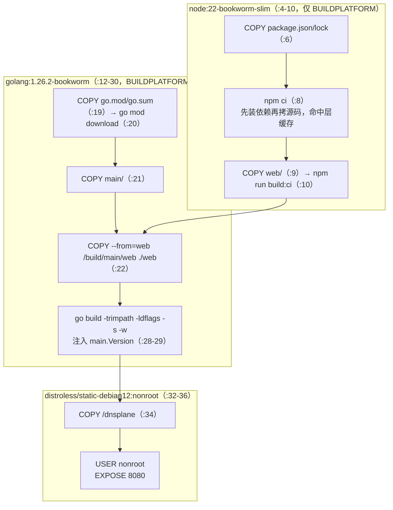
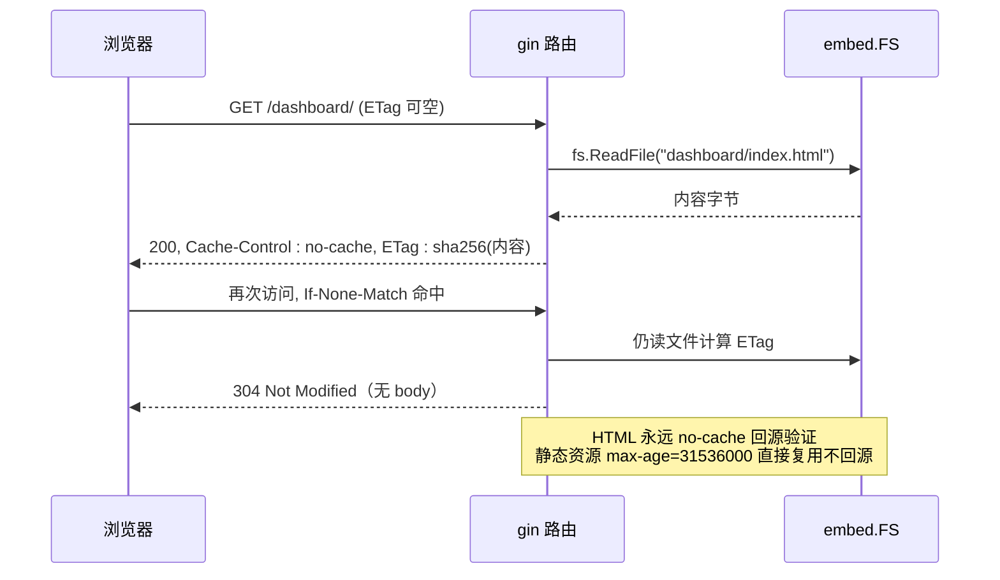
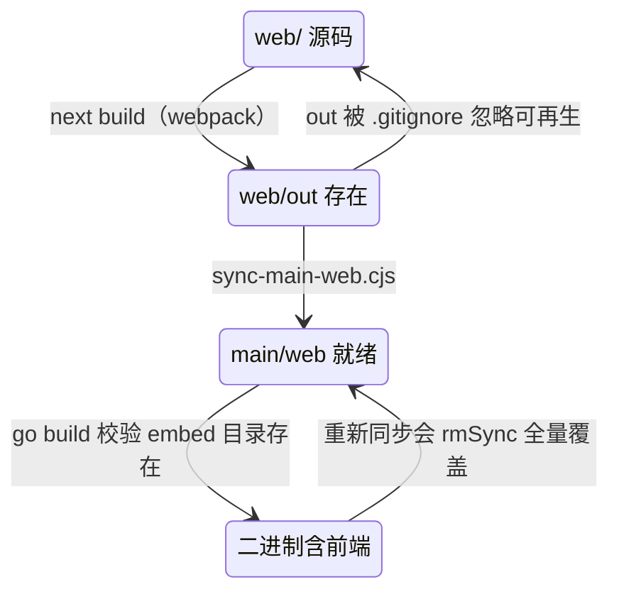
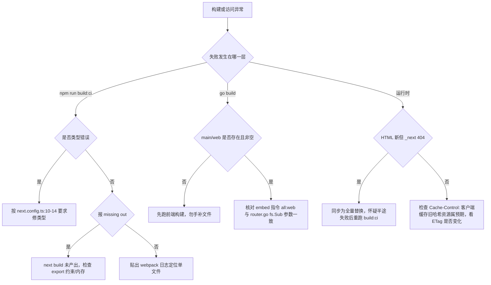

# 构建部署与性能优化

<cite>
**本文档引用的文件**
- [package.json](file://web/package.json)
- [next.config.ts](file://web/next.config.ts)
- [sync-main-web.cjs](file://web/scripts/sync-main-web.cjs)
- [Dockerfile](file://Dockerfile)
- [build.sh](file://scripts/build.sh)
- [docker-build.sh](file://scripts/docker-build.sh)
- [main.go](file://main/main.go)
- [router.go](file://main/internal/api/router.go)
- [DynamicForm.tsx](file://web/components/deploy/DynamicForm.tsx)
- [.gitignore](file://.gitignore)
</cite>

## 目录

1. [简介](#简介)
2. [项目结构](#项目结构)
3. [核心组件](#核心组件)
4. [架构总览](#架构总览)
5. [详细组件分析](#详细组件分析)
6. [依赖关系分析](#依赖关系分析)
7. [性能考虑](#性能考虑)
8. [故障排查指南](#故障排查指南)
9. [结论](#结论)
10. [附录](#附录)

## 简介

DNSPlane 前端是 Next.js 16.2.4（React 19.2.4）项目，采用**纯静态导出**模式：`next build` 产出 `web/out/` 静态目录，经同步脚本落入 `main/web/`，最终由 Go 的 `//go:embed all:web` 编译进单一二进制，运行时由 gin 路由直接分发。整个链路没有 Node.js 服务端运行时，部署产物只有一个可执行文件或一个 distroless 镜像。

本文覆盖四条主线：

- 开发模式（Turbopack）与 CI 构建模式（webpack + 同步脚本）的行为差异
- 静态导出产物落位与 Go embed 装配链路（以 `main/main.go` 实测为准）
- 产物体积实测数据、HTTP 缓存策略与 Lighthouse 关注点
- Docker 多阶段多架构构建与常见构建失败的排查方法

所有行号均来自当前工作区实际读取；体积数据来自 `du` 实测；未实机验证的项目（如 Lighthouse 得分）均已如实标注。

**章节来源**
- [package.json](file://web/package.json)
- [next.config.ts](file://web/next.config.ts)
- [main.go](file://main/main.go)

## 项目结构

### 前端目录布局

前端全部位于仓库根的 `web/` 目录，构建产物落位与源码分离是两个独立目录：源码在 `web/app/`，入库前的产物中转站在 `main/web/`。

```bash
# 实测命令与结果（仓库根执行）
$ ls web
app/            # Next.js App Router 源码（33 个 page.tsx）
components/     # UI 组件（含 deploy/DynamicForm.tsx）
lib/            # 客户端库（api.ts、deploy-config-form.ts 等）
scripts/        # sync-main-web.cjs 等同步脚本
out/            # next build 静态导出产物（.gitignore 忽略）
$ ls main/web   # 嵌入 Go 二进制的产物目录（.gitignore 第 33 行忽略）
404/  _next/  _not-found/  dashboard/  login/  ...
```

| 路径 | 角色 | 是否入库 | 证据 |
| --- | --- | --- | --- |
| `web/app` | 页面源码 | 是 | 实测 33 个 `page.tsx` |
| `web/out` | `next build` 静态导出目录 | 否 | `.gitignore` 含 `web/out/` |
| `main/web` | embed 产物中转目录 | 否 | `.gitignore` 第 33 行 `main/web/` |
| `web/.next` | Next 内部工作目录 | 否 | `.gitignore` 含 `web/.next/` |
| `dist` | `scripts/build.sh` 二进制输出 | 否 | `build.sh` 第 48 行 |

**章节来源**
- [package.json](file://web/package.json)
- [sync-main-web.cjs](file://web/scripts/sync-main-web.cjs)
- [.gitignore](file://.gitignore)

### 构建脚本分布

构建入口共四处，职责互不重叠：

- `web/package.json` 第 5-11 行：npm scripts，定义 `dev` / `build` / `build:ci` / `start` / `lint`
- `web/scripts/sync-main-web.cjs`：产物从 `web/out` 同步到 `main/web` 的唯一通道
- `scripts/build.sh`：本地一键编译（前端 + Go 交叉编译 + 校验和）
- `scripts/docker-build.sh`：buildx 多架构镜像构建与推送

`Dockerfile`（共 37 行）则是 CI/发布链路的权威定义，内含与上述脚本等价的步骤。

**章节来源**
- [package.json](file://web/package.json)
- [build.sh](file://scripts/build.sh)
- [docker-build.sh](file://scripts/docker-build.sh)
- [Dockerfile](file://Dockerfile)

## 核心组件

### npm scripts 逐条解析

实测 `web/package.json` 第 5-11 行的 scripts 段：

| 脚本 | 定义（行号） | 构建器 | 行为 |
| --- | --- | --- | --- |
| `dev` | `next dev --turbopack`（:6） | Turbopack | 本地开发服务器，增量编译，不产出静态文件 |
| `build` | `set "ANALYZE=true" && next build && powershell ...`（:7） | webpack（默认） | Windows 手工路径：设环境变量后经 powershell 拷贝 `out` 到 `..\main\web` |
| `build:ci` | `next build --webpack && node scripts/sync-main-web.cjs`（:8） | webpack（显式） | 跨平台 CI 路径：导出后调用 node 同步脚本 |
| `start` | `next start`（:9） | — | 启动 Next 服务器；静态导出模式下基本无用 |
| `lint` | `eslint`（:10） | — | 代码检查 |

关键差异：`dev` 用 Turbopack，`build:ci` 显式锁 `--webpack`。两者是不同编译管线，理论上存在「dev 正常、build 报错」的行为分叉面（见故障排查）。

`build` 脚本中的 `ANALYZE=true` 需要如实说明：该变量只是被设置，但 `web/next.config.ts` 全文 16 行中没有任何 bundle 分析器包装，`package.json` 依赖中也没有 `@next/bundle-analyzer`。**当前仓库中 ANALYZE=true 未接线，不会产出体积分析报告**（结论来源：逐行读取两个文件；如需启用见附录）。

```ts
// web/next.config.ts 核心配置（:4-8）
const nextConfig: NextConfig = {
  output: 'export',        // 静态导出，无服务端运行时
  trailingSlash: true,     // 与 Go 侧目录/index.html 查找逻辑对齐
  images: { unoptimized: true }, // 导出模式无 /_next/image 优化器
};
```

**章节来源**
- [package.json](file://web/package.json)
- [next.config.ts](file://web/next.config.ts)

### 同步脚本 sync-main-web.cjs

13 行的脚本承担产物落位的唯一契约（实测行号）：

- `:4` `out = web/out` —— 来源目录
- `:5` `dest = main/web` —— 目标目录（相对脚本位置向上两级再进 `main/web`）
- `:7-10` 若 `web/out` 不存在，打印 `missing out/ — run next build first` 并 `exit 1`
- `:12-13` `rmSync(dest)` 后 `cpSync(out, dest, {recursive:true})`，即**先删后拷的全量替换**

一个容易忽略的副作用：在 Docker 构建环境中该相对路径被重新解释。`Dockerfile` 第 5 行 `WORKDIR /build/web`，于是 `:5` 的 `../..` 解析为 `/build`，产物落在 `/build/main/web`；第 22 行 `COPY --from=web /build/main/web ./web` 正好消费这一位置。仓库布局（`dns/web` 与 `dns/main` 平级）与 Docker 布局（`/build/web` 与 `/build/main` 平级）保持了同构，这是该脚本能在两个环境复用的前提。

**章节来源**
- [sync-main-web.cjs](file://web/scripts/sync-main-web.cjs)
- [Dockerfile](file://Dockerfile)

### Go embed 装配链路

实测 `main/main.go`（156 行）：

- `:63` `//go:embed all:web`，`:64` `var staticFS embed.FS`
- `:128` `router := api.SetupRouter(staticFS)`

`main/internal/api/router.go` 接收后：`:18` `SetupRouter(staticFS embed.FS)`，`:55` `setupRouter(staticFS fs.FS)`，`:344` `fs.Sub(staticFS, "web")` 取出子文件系统，`:411` 起在 `NoRoute` 中完成页面查找。

注意 `all:` 前缀：embed 默认跳过 `.` 与 `_` 开头的文件，`all:` 前缀将 `_next/`、`_not-found/` 这类下划线目录一并纳入——去掉 `all:` 会静默丢失 Next 静态资源，属高危改动点。

```go
// main/main.go（:63-64, :128）
//go:embed all:web
var staticFS embed.FS
// ...
router := api.SetupRouter(staticFS)
```

**章节来源**
- [main.go](file://main/main.go)
- [router.go](file://main/internal/api/router.go)

## 架构总览

从源码到线上请求的完整链路：


**图表来源**
- [package.json](file://web/package.json)
- [sync-main-web.cjs](file://web/scripts/sync-main-web.cjs)
- [main.go](file://main/main.go)
- [router.go](file://main/internal/api/router.go)

Docker 多阶段构建的依赖关系：



**图表来源**
- [Dockerfile](file://Dockerfile)

一次页面访问的条件请求时序：



**图表来源**
- [router.go](file://main/internal/api/router.go)

## 详细组件分析

### dev 与 build:ci 的差异

| 维度 | dev（Turbopack） | build:ci（webpack） |
| --- | --- | --- |
| 编译管线 | Turbopack 增量打包 | webpack 全量构建 |
| 是否产出 `web/out` | 否，纯内存服务 | 是（`output:'export'` 强制静态导出） |
| 类型检查 | 即时反馈但可被绕过 | 构建期硬失败（H-2 决策后不再吞错） |
| 产物同步 | 无 | `sync-main-web.cjs` 落 `main/web` |
| Go embed | 不参与 | 必须先完成，否则 `go build` 失败 |
| 典型不一致 | HMR 状态残留 | show/hide 表单联动只在导出后暴露 |

开发时的正确心智模型：`npm run dev` 验证交互，**提交前必须至少跑一次 `npm run build:ci`**，因为线上跑的是导出产物 + Go 分发，与 dev 服务器是两套运行时（Go 侧静态服务的查找逻辑见下一节）。

`web/app/(dashboard)` 这类路由组不会出现在 URL 中；导出产物以「目录 + index.html」形态组织（`trailingSlash: true`，next.config.ts:5），与 `router.go` 的 NoRoute 查找顺序严格对应：

```go
// main/internal/api/router.go NoRoute 摘要（:411-428）
// 1) 直接路径当文件试            tryServeFile(c, filePath)
// 2) 以 / 结尾补 index.html      filePath + "index.html"
// 3) 无尾斜杠也补 "/index.html"  filePath + "/index.html"
// 4) 动态路由兜底 /dashboard/domains/[id]/ → dashboard/domains/_/index.html（:427-428）
```

根路径 `/` 在 `:408` 直接 302 到 `/login`，不经过 NoRoute。

**章节来源**
- [package.json](file://web/package.json)
- [next.config.ts](file://web/next.config.ts)
- [router.go](file://main/internal/api/router.go)

### 静态导出对代码的硬约束

`output: 'export'` 意味着构建期枚举全部路由，因此：

- 禁止使用依赖服务端运行时的能力（Route Handler 动态响应、`cookies()` 读写、middleware 重写等）。项目将动态性全部收敛到客户端组件与后端 API。
- `images.unoptimized: true`（next.config.ts:6-8）：导出产物没有 `/_next/image` 服务，`next/image` 退化为原生 `img`。新增图片优化需求只能走 CDN 或预处理。
- 动态段以占位目录落地：`[id]` 段导出为 `_`，由 Go 侧 `router.go:427-428` 回填路由。
- 类型必须干净：next.config.ts 第 10-14 行注释记录了安全审计 H-2——曾有的 `typescript.ignoreBuildErrors` 已移除，任何类型错误都会使 CI 构建失败；个别确需绕过的文件应使用 `// @ts-expect-error` 局部豁免。

**章节来源**
- [next.config.ts](file://web/next.config.ts)
- [router.go](file://main/internal/api/router.go)

### 产物体积实测

实测数据（`du -sh`，构建后工作区）：

| 目录 | 体积 | 说明 |
| --- | --- | --- |
| `main/web` | 6.7M | 最终嵌入二进制的产物 |
| `main/web/_next/static` | 2.6M | JS/CSS 主体，占产物约四成 |
| `main/web/404` | 20K | 错误页目录 |
| `web/.next` | 356M | webpack 中间产物，不入库 |
| `web/node_modules` | 673M | 依赖树，不入库 |

33 个 `page.tsx` 对应 33 组「目录 + index.html」导出。`_next/static` 下的文件名带内容哈希（实测目录名如 `lJ-oNfvazZ5hZeHUe1RMk`），这正是一年期强缓存策略成立的前提。

**ANALYZE=true 现状**：如核心组件节所证，仓库中未接线 bundle 分析器，**无法在本地直接获得按 chunk 拆解的体积报告**；上表数字为目录级实测，chunk 级归因标记为未知。可行替代见附录。

**章节来源**
- [sync-main-web.cjs](file://web/scripts/sync-main-web.cjs)
- [package.json](file://web/package.json)
- [next.config.ts](file://web/next.config.ts)

### Go 侧缓存策略

`router.go` 的 `tryServeFile`（:385 起）实现了两级缓存语义：

| 文件类别 | Cache-Control | 行号 | 依据 |
| --- | --- | --- | --- |
| `.html` / `.txt` | `no-cache` | :392 | 内容哈希变化必须立即可见，交由 ETag 验证 |
| 其余静态资源 | `public, max-age=31536000` | :394 | `_next/static` 带哈希，可永久缓存 |
| 所有文件 | `ETag: sha256(内容)` | :396-398 | 304 响应也携带 ETag（RFC 9110，:397 注释） |

条件请求命中 `If-None-Match` 时返回 304（:399-401）。Content-Type 由内置 `getContentType`（:350-381）按扩展名映射，未识别类型回落 `application/octet-stream`。

该策略的可感知后果：页面 HTML 每次访问都会回源验证（304 仍有一次 RTT），但验证成本极低——文件已在二进制内，无磁盘 IO；而哈希资源命中一年期缓存后浏览器完全不发起请求。

**章节来源**
- [router.go](file://main/internal/api/router.go)

### Lighthouse 关注点

以下为基于代码事实的**关注点清单，未实机运行 Lighthouse，得分一律未知**，不得当作实测结论引用：

- FCP/LCP：产物无代码分割之外的服务端渲染加成，首屏依赖 `_next/static` 中哈希 chunk 的下载；HTML `no-cache` 意味着每次进站先吃一次 304 往返。
- TBT：客户端组件为主（`'use client'，见 DynamicForm.tsx:1`），React 19 hydration 成本集中在 dashboard 大页。
- CLS：`images.unoptimized` 下若新增图片忘记显式宽高，将直接引入布局偏移。
- 可访问性/SEO：静态导出对 SEO 友好，但登录墙后的 dashboard 页面本身不需要被索引。
- 建议验证方式：对 `go run` 起的本地实例或 Docker 实例跑 `npx lighthouse http://localhost:8080/login`，将结果补录为实测数据。

**章节来源**
- [next.config.ts](file://web/next.config.ts)
- [DynamicForm.tsx](file://web/components/deploy/DynamicForm.tsx)

## 依赖关系分析

### 前端依赖分层

`web/package.json` 依赖段实测（dependencies :12-42，devDependencies :43-53）：

| 分组 | 包 | 版本 | 行号 |
| --- | --- | --- | --- |
| 框架 | next / react / react-dom | 16.2.4 / 19.2.4 / 19.2.4 | :34, :38-39 |
| 锁版lint | eslint-config-next | 16.2.4（精确匹配 next） | :49 |
| UI 基元 | @radix-ui/*（15 个）、radix-ui | ^1.x/^2.x | :13-27, :37 |
| 样式 | tailwindcss / @tailwindcss/postcss / tw-animate-css | ^4 / ^4 / ^1.4.0 | :44, :50-51 |
| 工具 | clsx / tailwind-merge / class-variance-authority | 现有 shadcn 风格组合 | :29-31, :41 |
| 业务 | go-captcha-react / qrcode / sonner / next-themes / lucide-react / cmdk | 验证码/二维码/通知/主题等 | :32-36, :40 |

强版本耦合点只有一个：`eslint-config-next` 与 `next` 同为 16.2.4 精确版本，升级 Next 必须同步改两处，否则 lint 管线与编译管线版本漂移。

**章节来源**
- [package.json](file://web/package.json)

### 构建产物对 Go 的单向依赖



**图表来源**
- [sync-main-web.cjs](file://web/scripts/sync-main-web.cjs)
- [main.go](file://main/main.go)
- [.gitignore](file://.gitignore)

`main/web` 不在版本库中（`.gitignore:33`），因此任何全新克隆的仓库**必须先跑前端构建再跑 go build**；`scripts/build.sh` 正是按此顺序编排（前端 :20-31 → 后端 :47-57），并提供 `SKIP_FRONTEND=1`（:20）复用上次的 `main/web`。

**章节来源**
- [package.json](file://web/package.json)
- [build.sh](file://scripts/build.sh)
- [.gitignore](file://.gitignore)

## 性能考虑

### 构建性能

- Docker 前端阶段只在 `$BUILDPLATFORM` 构建一次（Dockerfile:2 注释），多架构发布不重复 `npm ci`；Go 用 `TARGETOS/TARGETARCH/TARGETVARIANT` 交叉编译（:13-15, :24-27 含 GOARM 处理）。
- 依赖层与源码层分离：`COPY package.json lock` → `npm ci`（:6-8）先于 `COPY web/`（:9）；Go 同理 `go mod download`（:20）先于 `COPY main/`（:21）。改业务代码不触发依赖重装。
- npm 网络重试参数已在镜像内预设（:7 `fetch-retries 5` 等），弱网 CI 无需再做。
- 本地可用 bun 加速：`build.sh` 检测到 `bun` 与 `bun.lock` 时改走 `bun install --frozen-lockfile && bun run build:ci`（:23-26）。

**章节来源**
- [Dockerfile](file://Dockerfile)
- [build.sh](file://scripts/build.sh)

### 运行时性能

- 静态资源在服务二进制内，`fs.ReadFile` 无磁盘 IO；ETag 为内容 sha256，代价是每次请求重算哈希（文件在内存中，属可接受交换）。
- 单二进制分发使冷启动只有 Go 运行时开销，无 Node 启动、无端口二级代理。
- 前端体积治理抓手：6.7M 产物中 `_next/static` 占 2.6M；因 ANALYZE 未接线，chunk 级归因未知，建议按附录先接线再决策。

**章节来源**
- [Dockerfile](file://Dockerfile)
- [build.sh](file://scripts/build.sh)
- [router.go](file://main/internal/api/router.go)

## 故障排查指南

### 常见构建失败速查

| 症状 | 根因 | 取证位置 | 处置 |
| --- | --- | --- | --- |
| `missing out/ — run next build first` | 未先跑 next build 就执行同步脚本 | sync-main-web.cjs:7-10 | 走 `npm run build:ci` 整体执行 |
| `go build` 报 embed 模式无匹配文件 | 新克隆未构建前端，`main/web` 为空 | main.go:63；.gitignore:33 | 先 `scripts/build.sh` 或单独跑前端 |
| 页面 404 但文件存在 | embed 用了 `web` 而非 `all:web`，`_next` 目录被丢 | main.go:63 | 恢复 `all:` 前缀 |
| CI 因类型错误中断 | H-2 移除 ignoreBuildErrors 后属预期行为 | next.config.ts:10-14 | 修类型，必要时单文件 `@ts-expect-error` |
| 表单联动 dev 正常、线上不刷新 | show 条件求值依赖导出后的 React 状态流 | DynamicForm.tsx | 以 `build:ci` 产物复现 |
| 镜像构建超时在 npm ci | 网络抖动 | Dockerfile:7-8 | 已有重试参数；仍失败则换 registry |
| buildx 多架构产物本地看不到 | 多平台禁止 `--load`（Docker 限制） | docker-build.sh 注释段 | 本地用单架构或加 `--push` |
| 改了 main/web 但行为没变 | 同步脚本 rm+cp 全量覆盖手工改动 | sync-main-web.cjs:12-13 | 只把 `web/out` 当真相源 |

**章节来源**
- [sync-main-web.cjs](file://web/scripts/sync-main-web.cjs)
- [next.config.ts](file://web/next.config.ts)
- [docker-build.sh](file://scripts/docker-build.sh)
- [Dockerfile](file://Dockerfile)

### 排查决策树



**图表来源**
- [next.config.ts](file://web/next.config.ts)
- [sync-main-web.cjs](file://web/scripts/sync-main-web.cjs)
- [main.go](file://main/main.go)
- [router.go](file://main/internal/api/router.go)

**章节来源**
- [next.config.ts](file://web/next.config.ts)
- [sync-main-web.cjs](file://web/scripts/sync-main-web.cjs)
- [main.go](file://main/main.go)
- [router.go](file://main/internal/api/router.go)

### 一键复现命令

```bash
# 干净全链路复现（仓库根）
rm -rf web/out main/web
npm --prefix web ci && npm --prefix web run build:ci
( cd main && go build -o /tmp/dnsplane . )
/tmp/dnsplane   # 监听 8080，浏览器访问 /login

# 仅改后端时
SKIP_FRONTEND=1 scripts/build.sh
```

**章节来源**
- [build.sh](file://scripts/build.sh)
- [sync-main-web.cjs](file://web/scripts/sync-main-web.cjs)

## 结论

- 前端构建是「webpack 静态导出 → main/web → go:embed」三段单向链，**dev 的 Turbopack 与 CI 的 webpack 是两套管线**，验收必须以 `build:ci` 产物为准。
- 缓存策略由 Go 侧统一实现：HTML 不缓存 + ETag 验证，哈希资源一年强缓存，二者组合与内容哈希文件名互相咬合，无失效死角。
- 体积实测：嵌入产物 6.7M（`_next/static` 2.6M），对单二进制分发完全可接受；chunk 级归因因 ANALYZE 未接线而未知，属下一步工作。
- 本链路的脆弱点集中在三处相对路径契约：`sync-main-web.cjs:5` 的 `../../main/web`、`Dockerfile:22` 的 `/build/main/web`、`main.go:63` 的 `all:web`，改动任一处必须同时验证另两处。

**章节来源**
- [sync-main-web.cjs](file://web/scripts/sync-main-web.cjs)
- [Dockerfile](file://Dockerfile)
- [main.go](file://main/main.go)

## 附录

### 命令速查

| 目的 | 命令 |
| --- | --- |
| 本地开发 | `cd web && npm run dev` |
| CI 等价构建 | `cd web && npm run build:ci` |
| 本机一键出二进制 | `scripts/build.sh` |
| 多架构出包 | `scripts/build.sh amd64 arm64` |
| 仅后端 | `SKIP_FRONTEND=1 scripts/build.sh` |
| 指定版本号 | `VERSION=v1.2.3 scripts/build.sh` |
| 本地多架构镜像 | `scripts/docker-build.sh` |
| 推送镜像 | `IMAGE=... scripts/docker-build.sh --push v1.2.3` |
| 校验和 | `dist/SHA256SUMS`（build.sh:61-64 生成） |

**章节来源**
- [build.sh](file://scripts/build.sh)
- [docker-build.sh](file://scripts/docker-build.sh)

### 启用真正的体积分析

当前 `ANALYZE=true` 未接线（见核心组件节）。最小接线方案：

```ts
// web/next.config.ts 草案（需先安装 @next/bundle-analyzer 才能生效）
const withBundleAnalyzer = require('@next/bundle-analyzer')({
  enabled: process.env.ANALYZE === 'true',
});
export default withBundleAnalyzer(nextConfig);
```

替代路径（不加依赖）：构建后按哈希目录人工比较——`du -ah web/out/_next/static | sort -rh | head -20`。

**章节来源**
- [build.sh](file://scripts/build.sh)
- [docker-build.sh](file://scripts/docker-build.sh)
- [package.json](file://web/package.json)

### 相关文档

- 后端路由与中间件：[后端开发指南](../后端开发指南/)
- 部署与镜像运维：[部署运维](../部署运维/)
- 前端整体架构：[前端架构](../系统架构/前端架构.md)

[本节为通用指导，无需特定文件来源]
