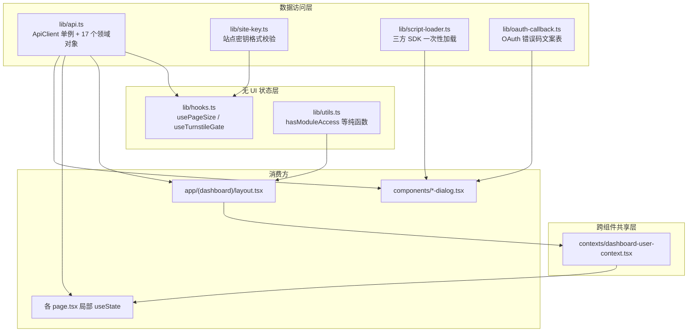
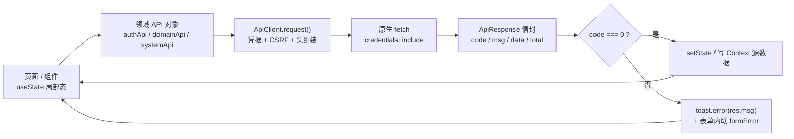
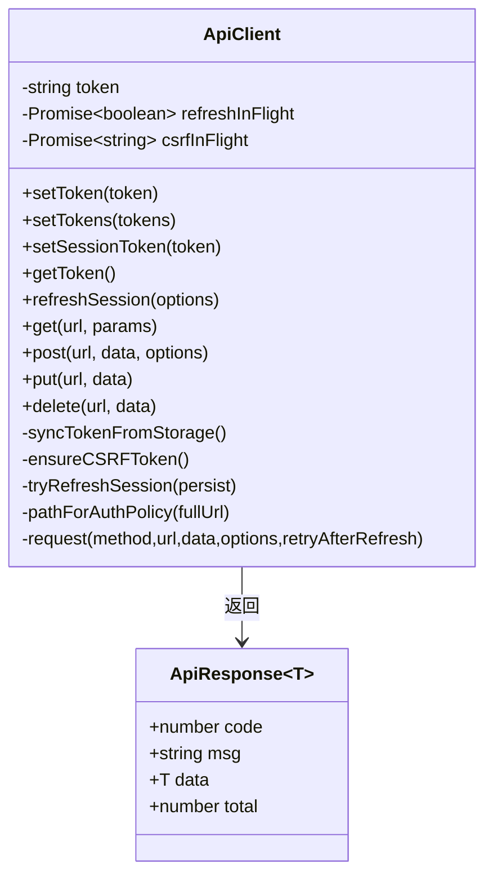
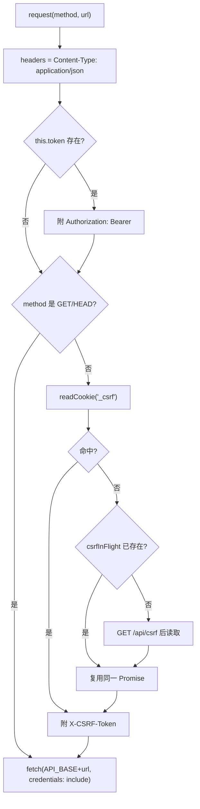
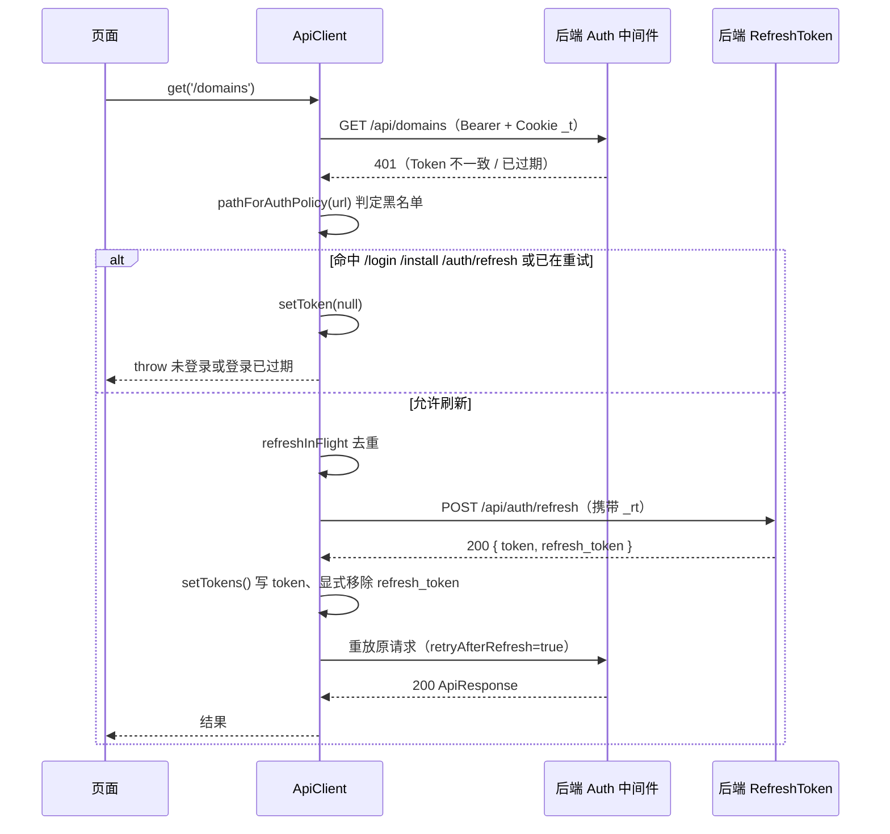
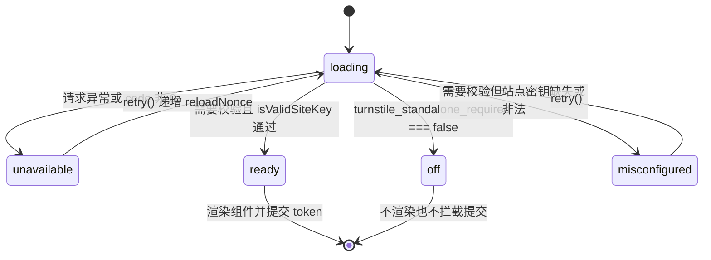
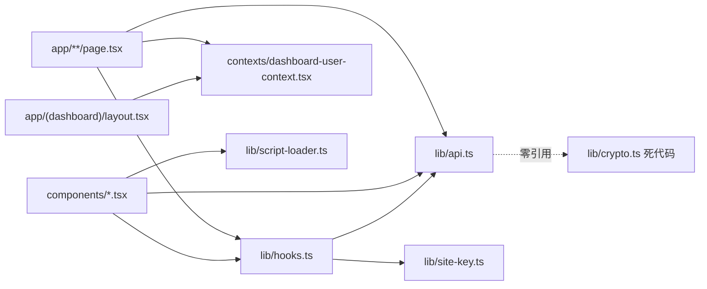

# 状态管理与API调用

<cite>
**本文档引用的文件**
- [web/lib/api.ts](file://web/lib/api.ts)
- [web/lib/hooks.ts](file://web/lib/hooks.ts)
- [web/lib/utils.ts](file://web/lib/utils.ts)
- [web/lib/site-key.ts](file://web/lib/site-key.ts)
- [web/lib/script-loader.ts](file://web/lib/script-loader.ts)
- [web/lib/oauth-callback.ts](file://web/lib/oauth-callback.ts)
- [web/lib/crypto.ts](file://web/lib/crypto.ts)
- [web/contexts/dashboard-user-context.tsx](file://web/contexts/dashboard-user-context.tsx)
- [web/app/(dashboard)/layout.tsx](file://web/app/(dashboard)/layout.tsx)
- [web/app/(dashboard)/dashboard/page.tsx](file://web/app/(dashboard)/dashboard/page.tsx)
- [web/app/(auth)/login/page.tsx](file://web/app/(auth)/login/page.tsx)
- [web/app/(auth)/forgot-password/page.tsx](file://web/app/(auth)/forgot-password/page.tsx)
- [web/app/(auth)/register/page.tsx](file://web/app/(auth)/register/page.tsx)
- [web/components/auth-captcha-fields.tsx](file://web/components/auth-captcha-fields.tsx)
- [web/components/oauth-callback-view.tsx](file://web/components/oauth-callback-view.tsx)
- [web/package.json](file://web/package.json)
- [docs/Chanlog.md](file://docs/Chanlog.md)
</cite>

## 目录

1. [简介](#简介)
2. [项目结构](#项目结构)
3. [核心组件](#核心组件)
4. [架构总览](#架构总览)
5. [详细组件分析](#详细组件分析)
6. [依赖关系分析](#依赖关系分析)
7. [性能考虑](#性能考虑)
8. [故障排查指南](#故障排查指南)
9. [结论](#结论)
10. [附录](#附录)

## 简介

本文档描述 DNSPlane 前端（`web/`，Next.js 16 + React 19）在**状态管理**与**API 调用**上的实现，覆盖：状态载体清单与消费者、`web/lib/api.ts` 的端点封装模式与类型族、`_t` cookie 与 `Authorization: Bearer` 双通道一致性的前端配合、fetch 错误处理与 toast 出口、乐观更新的实际形态。

两个必须先说明的事实性结论：

- **本项目没有引入任何第三方状态库。** `web/package.json` 的 `dependencies` 中不存在 `redux`、`zustand`、`jotai`、`recoil`、`@tanstack/react-query`、`swr` 任何一项；全仓检索 `createContext`/`useContext` 仅命中 1 个文件。因此「Contexts 清单」实际是一份「状态载体清单」，本文如实记录而不虚构多个 Context。
- **API 层已完成类型严格化。** `docs/Chanlog.md` 记录 v1.0.11（提交 `72e15a9`）把 `npx tsc --noEmit` 报出的 **199 个类型错误清零**，主体改动落在 `web/lib/api.ts`（+170 / −2）。这是理解该文件写法的历史背景，详见[类型族与严格化历史](#类型族与严格化历史199--0)。

读者是需要在控制台新增页面、新增端点封装或排查登录态异常的前端开发者。

## 项目结构

状态与数据访问相关文件集中在三处：`contexts/`（跨组件只读共享）、`lib/`（数据访问与无 UI 逻辑）、页面与组件内部（局部态）。



**图表来源**

- [web/lib/api.ts](file://web/lib/api.ts)
- [web/lib/hooks.ts](file://web/lib/hooks.ts)
- [web/contexts/dashboard-user-context.tsx](file://web/contexts/dashboard-user-context.tsx)
- [web/app/(dashboard)/layout.tsx](file://web/app/(dashboard)/layout.tsx)

### 状态载体清单

下表是全项目**真实存在**的状态载体，名称列一律使用源码标识符。

| 载体 | 类型 | 作用 | 生命周期 | 消费者 |
| --- | --- | --- | --- | --- |
| `DashboardUserContext` | React Context | 向仪表盘子树下发当前登录用户 | 随 `(dashboard)/layout.tsx` 挂载 | `dashboard/page.tsx` |
| `DashboardUserProvider` | Context Provider | 注入 `user` 值 | 同上 | `app/(dashboard)/layout.tsx` |
| `useDashboardUser()` | 消费 Hook | 读取当前用户，未包裹时返回 `null` | 调用处 | 仪表盘页面 |
| `api`（`ApiClient` 单例） | 模块级单例 | 持有 `token`、`refreshInFlight`、`csrfInFlight` | 浏览器会话 | 全部领域 API 对象 |
| `usePageSize(key, defaultSize)` | 自定义 Hook | 分页大小持久化 | 组件 + `localStorage` | 各列表页 |
| `useTurnstileGate()` | 自定义 Hook | 判定独立 Turnstile 五态 | 组件挂载期 | 找回密码、重置 TOTP 页 |
| `localStorage['token']` | 浏览器持久存储 | access token 落盘副本 | 跨标签页 | 构造器与 `syncTokenFromStorage` |
| `document.cookie._csrf` | 非 HttpOnly Cookie | CSRF double-submit 的浏览器侧一半 | 后端设置，TTL 7 天 | `ensureCSRFToken` |
| `HttpOnly _t` / `_rt` | HttpOnly Cookie | 会话与刷新凭据 | 后端设置 | 浏览器自动携带，JS 不可读 |
| 组件内 `useState` | 局部态 | 表单、加载态、弹窗开关 | 组件挂载期 | 各页面自身 |

**章节来源**

- [web/contexts/dashboard-user-context.tsx](file://web/contexts/dashboard-user-context.tsx)
- [web/lib/hooks.ts](file://web/lib/hooks.ts)
- [web/lib/api.ts](file://web/lib/api.ts)
- [web/app/(dashboard)/dashboard/page.tsx](file://web/app/(dashboard)/dashboard/page.tsx)

### 为什么 Context 只有一个

`dashboard-user-context.tsx` 全文 24 行，只有 `createContext<User | null>(null)`、一个 Provider、一个消费函数，没有 reducer、没有 setter、没有加载态：

```tsx
// web/contexts/dashboard-user-context.tsx
const DashboardUserContext = createContext<User | null>(null)

export function DashboardUserProvider({ user, children }: { user: User; children: ReactNode }) {
  return <DashboardUserContext.Provider value={user}>{children}</DashboardUserContext.Provider>
}

export function useDashboardUser() {
  return useContext(DashboardUserContext)
}
```

它存在的唯一理由：`(dashboard)/layout.tsx` 已在鉴权副作用里调过 `authApi.getUserInfo()`，而子页面还需要同一份 `User`（展示用户名、判断 `level`、匹配模块权限）。不共享就会重复请求 `/api/user/info`。这是 YAGNI 取舍——**只共享「已取到且多处只读」的数据，不共享写操作**，所有写操作仍留在各页面的 `useState` + 领域 API 对象。

**章节来源**

- [web/contexts/dashboard-user-context.tsx](file://web/contexts/dashboard-user-context.tsx)
- [web/app/(dashboard)/layout.tsx](file://web/app/(dashboard)/layout.tsx)

## 核心组件

### 组件职责划分

| 组件 | 位置 | 单一职责 | 是否持有状态 |
| --- | --- | --- | --- |
| `ApiClient` | `lib/api.ts:24` | 组装请求头、发起 fetch、处理 401、解析响应 | 是 |
| `ApiResponse<T>` | `lib/api.ts:6` | 定义后端统一信封 `{code,msg?,data?,total?}` | 否 |
| 领域 API 对象（17 个） | `lib/api.ts:348` 起 | 固定某一路由前缀的路径与请求体形状 | 否 |
| `encryptedPost` | `lib/api.ts:298` | 历史命名残留，实为 `api.post` 别名 | 否 |
| `AuthPublicConfig` | `lib/api.ts:306` | 描述 `GET /auth/config` 的可空字段族 | 否 |
| `useTurnstileGate` | `lib/hooks.ts:69` | 把「后端是否会拒绝」翻译成五态 | 是 |
| `isValidSiteKey` | `lib/site-key.ts:7` | 站点密钥格式白名单校验 | 否 |
| `loadScriptOnce` | `lib/script-loader.ts:16` | 三方 SDK 脚本去重加载 | 是（DOM 属性标记） |
| `OAUTH_CALLBACK_ERRORS` | `lib/oauth-callback.ts:7` | 后端错误码 → 中文文案映射 | 否 |
| `DashboardUserContext` | `contexts/…` | 用户对象跨子树只读共享 | 是（Provider value） |

分工体现 SRP：`ApiClient` 只管「怎么发」，领域对象只管「发什么」，Hook 只管「怎么判定」，`site-key.ts`/`script-loader.ts` 是纯工具，页面只管「怎么渲染」。

**章节来源**

- [web/lib/api.ts](file://web/lib/api.ts)
- [web/lib/hooks.ts](file://web/lib/hooks.ts)
- [web/lib/script-loader.ts](file://web/lib/script-loader.ts)

## 架构总览

### 三层数据流



**图表来源**

- [web/lib/api.ts](file://web/lib/api.ts)
- [web/app/(auth)/login/page.tsx](file://web/app/(auth)/login/page.tsx)

整条链上**没有拦截器注册、没有全局错误总线、没有请求缓存层**。业务失败由调用点显式判断 `res.code === 0`；网络级异常（`fetch` reject、非 2xx、JSON 解析失败）由 `request()` 抛 `Error`，由调用点 `catch` 接住。这个选择符合 KISS：代价是每页都要写一次 `if`，收益是任何失败都能就地读懂、就地决定提示还是回滚，不存在「错误被谁吞掉了」的排查黑洞。

**章节来源**

- [web/lib/api.ts](file://web/lib/api.ts)

### 凭据双通道全景

| 通道 | 载体 | 前端可读 | 前端可控 |
| --- | --- | --- | --- |
| Cookie | `_t`（AES-GCM 密文，HttpOnly，path `/`） | 不可读 | 仅浏览器自动携带 |
| Header | `Authorization: Bearer <access token>` | `ApiClient` 持有 | 完全可控 |
| Cookie | `_rt`（path `/api/auth/refresh`） | 不可读 | 仅 refresh 时自动携带 |
| Cookie | `_csrf`（**非** HttpOnly） | `document.cookie` 可读 | 需回显到 `X-CSRF-Token` |

前端配合原则只有一条：**任何时刻内存与存储里的 Bearer 值，必须是最近一次由后端签发的 access token。** 该原则如何被保证、以及在 OAuth 回调路径上如何被部分打破，见[双通道一致性](#t-cookie-与-authorization-bearer-双通道一致性)。

**章节来源**

- [web/lib/api.ts](file://web/lib/api.ts)

## 详细组件分析

### ApiClient 类结构

`ApiClient` 是模块内唯一 class，文件末尾以 `export const api = new ApiClient()` 导出单例。



**图表来源**

- [web/lib/api.ts](file://web/lib/api.ts)

构造器只在非 SSR 环境下从 `localStorage` 取回 token，随后每次请求前做一次**单向对齐**：

```ts
// web/lib/api.ts
/** 内存中的 token 可能与 localStorage 脱节（构建时无 window、HMR、多标签页等），请求前对齐 */
private syncTokenFromStorage() {
  if (typeof window === 'undefined') return
  if (!this.token) {
    const t = localStorage.getItem('token')
    if (t) this.token = t
  }
}
```

方向是单向的：只在内存为空时从存储补齐，**不会**用存储值覆盖内存值。这避免「本标签页刚刷新的新 token 被另一标签页旧值倒灌」，但也意味着多标签页下仍可能出现内存值与 `_t` 不一致，此时由 401 → refresh 链路收敛（cookie 随之更新，内存值由 `setTokens` 重写）。

**章节来源**

- [web/lib/api.ts](file://web/lib/api.ts)

### 请求组装与 CSRF 引导

头组装顺序为 `Content-Type` → `Authorization`（有 token 时）→ `X-CSRF-Token`（非 GET/HEAD 时）。



**图表来源**

- [web/lib/api.ts](file://web/lib/api.ts)

后端 CSRF 中间件是 **double-submit cookie** 策略，`_csrf` cookie 非 HttpOnly 正是为了让前端 JS 读出并回显到请求头。前端把「读 cookie」作为首选路径，读不到才 `GET /api/csrf` 引导，并用 `csrfInFlight` 合并并发引导，避免首屏多个请求各自 bootstrap。引导失败时返回空串而不抛错——让本次请求按原逻辑失败，下次自然重试，避免一次网络抖动打断整页。`readCookie` 在 SSR 下返回空串，因此服务端渲染阶段不会误带 CSRF 头。

**章节来源**

- [web/lib/api.ts](file://web/lib/api.ts)

### 401 单飞刷新与一次性重试



**图表来源**

- [web/lib/api.ts](file://web/lib/api.ts)

三处设计要点：

- **`_retryAfterRefresh` 硬上限一次**，重试仍 401 则清理并抛错，不可能形成刷新风暴。
- **`refreshInFlight` 合并并发。** 后端 refresh JTI 是「每用户同一时刻仅一个有效值」且一次性轮转；若首屏 5 个请求各自刷新，后 4 次会命中重用检测并被删除全部 refresh 记录。合并是对该服务端语义的直接适配。
- **刷新路径不复用 `request()`**，源码注释写明「不走 `request()`，避免与 401 处理互相递归」。

刷新失败后统一 `window.location.href = '/login'`（整页跳转而非路由跳转），目的是彻底丢弃内存中的组件态。

**章节来源**

- [web/lib/api.ts](file://web/lib/api.ts)

### 端点封装模式与领域 API 命名族

`api.ts` 把后端路由收敛为 **17 个导出对象**，每个对象由若干箭头函数组成，形如 `名字: (参数) => api.get<T>(路径, params)` 或 `api.post<T>(路径, body)`。

| 领域对象 | 起始行 | 路由前缀 | 参数约定 | 返回类型示例 |
| --- | --- | --- | --- | --- |
| `authApi` | 348 | `/login` `/auth/*` `/user/password` | 显式字段对象，按后端可选性标 `?` | `{ token; refresh_token; expires_in?; user }` |
| `authControlApi` | 455 | `/system/auth-control` | `Record<string, unknown>` 透传 | `Record<string, unknown>` |
| `accountApi` | 493 | `/accounts` | `id: number \| string` | `Account[]` |
| `domainApi` | 505 | `/domains` | `id: number \| string` + query | `Domain`、`DNSRecord[]` |
| `domainCategoryApi` | 579 | `/domains/categories` | 数字 ID | `DomainCategory[]` |
| `scheduleApi` | 589 | `/schedule/tasks` | `number \| string` | 信封 |
| `monitorApi` | 600 | `/monitor/*` | `number \| string` + `lookup` | `MonitorTask`、`MonitorOverview` |
| `certApi` | 627 | `/cert/*` | 显式凭据字段 | `CertAccount`、`CertOrder` |
| `userApi` | 681 | `/users/*` | 分页 + 过滤 | `User[]` |
| `logApi` | 715 | `/logs` | `date_from`/`date_to` 可选 | `OperationLogListData` |
| `systemApi` | 754 | `/system/*` | 键值配置 + 各 `test*` 无参 | `SystemConfig`、`TaskStatus` |
| `dashboardApi` | 812 | `/dashboard/stats` | 无参 | `DashboardStats` |
| `totpApi` | 817 | `/user/totp/*` | `code`、`password` 可选 | `{ secret; qrcode; uri? }` |
| `oauthApi` | 836 | `/auth/oauth/*` `/user/oauth/*` | provider 字符串 | `OAuthProvider[]`、`OAuthExchangeResult` |
| `requestLogApi` | 861 | `/system/request-logs` | 分页 + 过滤 | `RequestLog`、`RequestLogStats` |
| `cloudflareApi` | 881 | `/cloudflare/*` | zone / tunnel 标识 | `CloudflareTunnel`、`CustomHostname` |
| `quotaApi` | 1728 | `/quota/*` | `QuotaMap` 系列 | `UserQuotaRow`、`QuotaDetail` |

三条一致性约定：

- **命名冗余是刻意兼容层。** `authControlApi` 同时导出 `get/update` 与 `getConfig/updateConfig`，注释标注「兼容历史命名」；新增调用应统一用后一组。
- **「只在有值时写入 body」。** `authApi.login` 不展开参数，而是一句句 `if (data.xxx) body.xxx = data.xxx`，避免把空串发成后端眼中的显式空值。
- **超时是端点级补偿而非通用能力。** `publicMailPostTimeoutMs = 12_000` 只挂在发信类端点（`forgotPassword`/`forgotTotp`/`sendCode`/`requestMagicLink`），因为后端对这些已改为异步发信。

`oauthApi.exchange` 是唯一带逻辑的封装（见双通道一节），其余全部为纯映射，这是 DRY 的体现：路径与形状只在一处声明。

**章节来源**

- [web/lib/api.ts](file://web/lib/api.ts)

### 类型族与严格化历史（199 → 0）

`docs/Chanlog.md` 记录了三步收紧过程，直接决定今天类型声明的写法：

| 版本 | 提交 | 动作 | 规模 | 性质 |
| --- | --- | --- | --- | --- |
| v1.0.7 | `b664c13` | 删除 `next.config.ts` 的 `typescript.ignoreBuildErrors`（前端-H2） | — | 类型错误重新成为 CI 拦截器 |
| v1.0.9 | `301421f` | `id: number` → `id: number \| string` | 47 处 API 签名 | 契约对齐而非放宽 |
| v1.0.10 | `74432ec` | 补齐 `domainId` / `subId` 命名 | `api.ts` +46/−46 | 修复 v1.0.9 漏改 |
| v1.0.11 | `72e15a9` | **199 个 TS 类型错误清零** | 7 文件 +228/−17，`api.ts` +170/−2 | 类型定义补全 |

根因是「后端 ID 在部分路径下以字符串返回，而前端签名声明为 `number`」，故 v1.0.9 的方向是**以返回值真实形态为准修正声明**。这解释了 `api.ts` 中大量 `number | string`——它是实测结果的如实登记，不是妥协性放宽。v1.0.11 的补全集中在 `SystemConfig`、`TaskStatus` 等字段动态注入的接口：状态页要读 `record_sync`，若内联定义该字段就拿不到类型，故源码注释明确「类型集中在 `TaskStatus` 上」。本次文档重建在 2026-10-10 快照复验：`npx tsc --noEmit` 退出码 0，无输出。

类型族按用途分四类：

| 类别 | 代表 | 特征 |
| --- | --- | --- |
| 信封 | `ApiResponse<T>` | 全链路统一，`code === 0` 是唯一成功判据 |
| 实体 | `User` `Domain` `DNSRecord` `CertOrder` `MonitorTask` | ID 一律 `number \| string` |
| 配置 | `SystemConfig` `AuthPublicConfig` `CronConfig` `ProviderConfigField` | 大量可选字段，缺失原因写进 JSDoc |
| 计算 | `QuotaMap` `QuotaOverlayForm` `QuotaSource` `QuotaDetail` | 用 `Record` 与字面量联合而非 `any` |

「可选字段 + 注释解释缺失」以 `AuthPublicConfig.turnstile_standalone_required` 最为典型：`true` 表示后端会拒绝缺 token 的请求，`false` 表示明确不校验，`undefined` 表示后端版本过旧未下发该信号、必须按「可能校验」处理。**缺失值不被当作 `false`，而是当作「未知」**，这是防止降级死锁的关键。

**章节来源**

- [docs/Chanlog.md](file://docs/Chanlog.md)
- [web/lib/api.ts](file://web/lib/api.ts)

### _t cookie 与 Authorization Bearer 双通道一致性

后端 `Auth` 中间件同时解密 `_t` cookie 与解析 `Authorization: Bearer`，并强制两者结果完全一致，不一致即 401。前端配合落在四个实现点：

| 配合点 | 位置 | 做法 | 违反后果 |
| --- | --- | --- | --- |
| 永远同时携带 | `request()` 的 `credentials: 'include'` + `Authorization` | 两通道同源于一次签发 | 缺任一通道一律 401 |
| 签发即同步 | `setTokens()` | 内存 + `localStorage` 同时写入 | 内存新、cookie 旧 → 不一致 |
| 一次性重试 | `_retryAfterRefresh` | 保证重放用的是新 Bearer | 旧 Bearer 重放 → 再次不一致 |
| 不落盘路径 | `setSessionToken()` | 仅内存持有，主动清 `localStorage` | 与回调后写回的 `_t` 不匹配 |

```ts
// web/lib/api.ts
setTokens(tokens: { token: string; refresh_token?: string }) {
  this.token = tokens.token
  if (typeof window !== 'undefined') {
    localStorage.setItem('token', tokens.token)
    localStorage.removeItem('refresh_token') // 清理历史版本残留
  }
}

/** OAuth 回调页专用：会话已由服务端 HttpOnly cookie 建立，此处只取回 access token */
setSessionToken(token: string) {
  this.token = token
  if (typeof window !== 'undefined') {
    localStorage.removeItem('token')
    localStorage.removeItem('refresh_token')
  }
}
```

安全审计 M-1 之后 `refresh_token` 只由服务端下发 HttpOnly Cookie `_rt`，前端不再持有明文；两个方法仍显式 `removeItem('refresh_token')` 清理历史残留。

OAuth 是唯一需要「反查」的路径：后端交换接口**响应体不含任何 token**，只下 cookie。于是前端必须在交换成功后再调一次刷新接口，把与 `_t` 同源的 access token 取回交给内存：

```ts
// web/lib/api.ts
exchange: async (params: { code: string; state: string }) => {
  const res = await api.post<OAuthExchangeResult>('/auth/oauth/exchange', params)
  if (res.code !== 0) return res
  if (res.data?.mode === 'login') {
    await api.refreshSession({ persist: false })
  }
  return res
},
```

**已知偏差（推断自源码路径）**：`refreshSession({ persist: false })` 走 `setSessionToken`，只在内存持有；但此后任意一次 401 触发的 `tryRefreshSession()` 默认 `persist = true`，会经 `setTokens` 把新 token 写回 `localStorage`。即「不落 localStorage」的承诺只在首个 401 之前成立，跨标签页持久性与 XSS 窃取面仍与口令登录路径趋同。修改此处需连同 `tryRefreshSession` 默认值一起考虑，不能只改 `exchange`。

**章节来源**

- [web/lib/api.ts](file://web/lib/api.ts)
- [web/components/oauth-callback-view.tsx](file://web/components/oauth-callback-view.tsx)

### 错误处理与 toast 出口

| 来源 | 触发条件 | 冒泡形态 | 典型出口 |
| --- | --- | --- | --- |
| 业务失败 | HTTP 200 + `res.code !== 0` | 正常返回信封 | `toast.error(res.msg || 兜底文案)` |
| 传输/解析失败 | `fetch` reject、非 2xx（非 401）、JSON 解析失败 | `throw new Error(...)` | 调用点 `catch` |
| 会话失效 | HTTP 401 | 先刷新，仍失败则抛错并整页跳 `/login` | 调用点无需处理 |

`request()` 内只有两处硬编码 `Error` 文案：`'未登录或登录已过期'` 与 `'服务器返回了无效的响应格式'`。后者是 NoRoute 回落场景的产物（未注册的 `/api/*` 返回 200 + HTML，`response.json()` 解析失败），属后端路由缺口的症状而非真正的格式问题。

登录页把「toast + 表单内联」统一到一处，是本层最好的错误处理范式：

```tsx
// web/app/(auth)/login/page.tsx
/** 最近一次失败原因，展示在表单顶部；toast 会消失，这条不会 */
const [formError, setFormError] = useState('')

/** 同时推送 toast 与表单内联错误，两处口径始终一致 */
const failWith = (message: string) => {
  toast.error(message)
  setFormError(message)
}
```

单靠 `toast` 会自动消失，用户回看表单时看不到原因；单靠内联又缺即时反馈。`failWith` 让两者不可能分叉，符合 DRY。对特殊 `code` 还做了语义化处理而非一律当错误：登录返回 `code === 2` 表示需要 TOTP，此时不报错而是 `setNeedTotp(true)` 展开动态码输入框并 `toast.info('请输入动态口令')`。

**章节来源**

- [web/lib/api.ts](file://web/lib/api.ts)
- [web/app/(auth)/login/page.tsx](file://web/app/(auth)/login/page.tsx)

### 乐观更新模式

本项目没有通用乐观更新框架，乐观策略以「**先落 UI 态、失败即回滚**」的形式出现在两类场景。

场景一：发信类端点先响应再请求。找回密码页在 `await` 之前就把步骤推进到第二步并给出成功提示，失败分支显式回滚：

```tsx
// web/app/(auth)/forgot-password/page.tsx
const submitLockRef = useRef(false)

if (submitLockRef.current) return
submitLockRef.current = true
setStep(2)
toast.success('请求已提交，请留意邮箱与垃圾箱')
await authApi
  .forgotPassword({ email: trimmed, ...(turnstile.enabled ? { turnstile_token: turnstileToken } : {}) })
  .then((res) => {
    if (res.code !== 0) { setStep(1); toast.error(res.msg || '发送失败') }
  })
  .catch(() => { setStep(1); toast.error('发送失败') })
  .finally(() => { submitLockRef.current = false })
```

这里的乐观有依据：后端对找回密码采用**模糊成功口径**（邮箱是否存在都回同一提示），且发信为异步，因此提前进入第二步不会泄露账号存在性。提交锁用 `useRef` 而非 state——锁不需要触发渲染，且可避免连续点击期间因状态更新造成的重入窗口。

场景二：登录/验证码失败后按类型精确重置，决定回滚粒度。

```tsx
// web/app/(auth)/login/page.tsx
if (captchaEnabled) {
  if (isBehavioralCaptcha) {
    setVerifyToken('')                     // 行为验证码 token 一次性
  } else if (isThirdPartyCaptcha) {
    setCaptchaToken('')                    // 第三方 token 一次性
    setCaptchaRefreshSignal((n) => n + 1)  // 递增信号触发组件重挂载
  } else {
    loadCaptcha()                          // 图形码重新取图
    setFormData((prev) => ({ ...prev, captcha: '' }))
  }
}
```

三种验证码失效语义不同，回滚动作也不同。后端行为验证码在校验**之前**就删除缓存键，任何偏差（含坐标差 1 像素）都会作废整张图，所以失败后必须重新 GET，不能保留旧 `verify_token` 重试。

**章节来源**

- [web/app/(auth)/forgot-password/page.tsx](file://web/app/(auth)/forgot-password/page.tsx)
- [web/app/(auth)/login/page.tsx](file://web/app/(auth)/login/page.tsx)

### TurnstileGate 五态状态机

`useTurnstileGate` 是前端最完整的状态机，把「配置字段的可空性」翻译成「后端会不会拒绝我」这一可操作结论。



**图表来源**

- [web/lib/hooks.ts](file://web/lib/hooks.ts)
- [web/lib/site-key.ts](file://web/lib/site-key.ts)

判定规则的注释直接写出它要防的事故：「判定规则以『后端是否会拒绝』为准，而不是『前端能否渲染』」。字段缺失（连到尚未下发该信号的后端）时按「可能校验」处理，有合法站点密钥就渲染、没有就报错，**绝不静默放行**。

`unavailable` 与 `misconfigured` 在 `enabled` 上语义不同：前者不拦截（无法判断），后者必须拦截并报错。若合并二者，用户会陷入「提交被后端拒绝、前端却渲染不出验证组件」的死锁。副作用清理用 `cancelled` 标志位而非中断路径，避免组件卸载后 `setState` 造成警告。

**章节来源**

- [web/lib/hooks.ts](file://web/lib/hooks.ts)

### 列表页数据获取范式

仪表盘首页展示了最完整的取数写法：并行拉取、区分首屏与刷新、可开关轮询。

```tsx
// web/app/(dashboard)/dashboard/page.tsx
const [stats, setStats] = useState<DashboardStats | null>(null)
const [loading, setLoading] = useState(true)      // 首屏
const [refreshing, setRefreshing] = useState(false) // 手动/自动刷新
const [sysInfo, setSysInfo] = useState<SystemInfo | null>(null)
const [lastUpdate, setLastUpdate] = useState<Date | null>(null)
const [autoRefresh, setAutoRefresh] = useState(true)
const dashboardUser = useDashboardUser()
```

`loading` 与 `refreshing` 分离，避免刷新时整页闪回骨架屏；`dashboardApi.getStats()` 与 `systemApi.getSystemInfo()` 用 `Promise.all` 并行；`lastUpdate` 兼作轮询节拍与「上次更新」展示锚点；用户名与权限直接读 `useDashboardUser()`，不再重复请求 `/user/info`。

分页偏好由 `usePageSize` 唯一承担，读写都走 `localStorage` 且带 SSR 保护：

```ts
// web/lib/hooks.ts
export function usePageSize(key: string, defaultSize = 20): [number, (size: number) => void] {
  const storageKey = `page_size_${key}`
  const [pageSize, setPageSize] = useState(() => {
    if (typeof window === 'undefined') return defaultSize
    const saved = localStorage.getItem(storageKey)
    return saved ? parseInt(saved, 10) : defaultSize
  })
  const updatePageSize = (size: number) => {
    setPageSize(size)
    localStorage.setItem(storageKey, String(size))
  }
  return [pageSize, updatePageSize]
}
```

惰性初始化函数（而非直接读 `window`）让 `localStorage` 只在客户端读一次，同时保证水合值与初始值一致。

**章节来源**

- [web/app/(dashboard)/dashboard/page.tsx](file://web/app/(dashboard)/dashboard/page.tsx)
- [web/lib/hooks.ts](file://web/lib/hooks.ts)

## 依赖关系分析



**图表来源**

- [web/lib/api.ts](file://web/lib/api.ts)
- [web/lib/hooks.ts](file://web/lib/hooks.ts)
- [web/lib/crypto.ts](file://web/lib/crypto.ts)

依赖矩阵（行依赖列）：

| 模块 | api.ts | hooks.ts | site-key | script-loader | contexts | utils |
| --- | --- | --- | --- | --- | --- | --- |
| 页面组件 | 是 | 是 | 否 | 否 | 是 | 是 |
| 验证码组件 | 是 | 是 | 是 | 是 | 否 | 是 |
| lib/hooks.ts | 是 | 否 | 是 | 否 | 否 | 否 |
| lib/api.ts | 自持 | 否 | 否 | 否 | 否 | 否 |
| contexts | 仅类型 `User` | 否 | 否 | 否 | 自持 | 否 |

无环。`api.ts` 位于最底层且不反向依赖任何 UI 或 Hook；`contexts` 只从 `api.ts` 引入**类型**（`import type`），不引入实现。这种「依赖倒置到类型层」让数据模型变更不会把 UI 层一起拖进来。

两处死代码需正视：`lib/crypto.ts`（373 行）在 `web/` 全仓检索中**零 import**，是后端 RSA 混合加密链路在前端侧的残留；`api.ts` 的 `encryptedPost` 只是 `api.post` 的别名，注释自陈「当前后端为明文 JSON body」，但 `reset-password`、`reset-totp` 两页仍在用它提交，容易让人误判该链路存在加密。

**章节来源**

- [web/lib/api.ts](file://web/lib/api.ts)
- [web/lib/crypto.ts](file://web/lib/crypto.ts)
- [web/contexts/dashboard-user-context.tsx](file://web/contexts/dashboard-user-context.tsx)

## 性能考虑

- **并发合并优先于重试。** `csrfInFlight` 与 `refreshInFlight` 都采用「已有 Promise 直接复用」，把 N 个并发请求的引导/刷新成本压到 1 次。`ensureCSRFToken` 位于 `await` 链上，若无合并会串行化，这是首屏性能的主要保障。
- **GET 完全不触碰 CSRF。** 判定为 `method !== 'GET' && method !== 'HEAD'`，读接口不引入额外往返。
- **超时只在需要处启用。** `AbortSignal.timeout(timeoutMs)` 仅在 `post` 显式传入且调用方未自带 `signal` 时生效，默认不设超时，避免长任务被误杀。
- **开发期耗时日志带环境门禁。** `request()` 内的 `console.debug` 同时要求 `NODE_ENV === 'development'` 与 `performance` 可用，生产构建不带入。
- **卸载保护与重挂载信号。** `useTurnstileGate`、`AuthCaptchaFields` 用 `cancelled` 闭包守卫异步回填；`refreshSignal` 递增触发 `useEffect` 依赖变化，让子组件自行重取验证码，父组件无需持有子组件内部状态，减少一层双向耦合。
- **`localStorage` 读取被摊销。** `syncTokenFromStorage` 只在 `this.token` 为空时读盘，正常已登录路径每次请求 0 次读盘。
- **待改进（推断）**：后端在 access 剩余不足 5 分钟时写 `X-Token-Expiring: true`，且 `Access-Control-Expose-Headers` 已放行，但 `web/` 全量检索零命中。前端因此只能在 401 后被动刷新，到期瞬间必有一次可感知的失败重放。若要消除，应在 `request()` 内读取该头并后台预取刷新。

**章节来源**

- [web/lib/api.ts](file://web/lib/api.ts)
- [web/lib/hooks.ts](file://web/lib/hooks.ts)
- [web/components/auth-captcha-fields.tsx](file://web/components/auth-captcha-fields.tsx)

## 故障排查指南

| 症状 | 第一怀疑点 | 定位方法 | 处置 |
| --- | --- | --- | --- |
| 任何请求都 401，重登后仍 401 | 双通道不一致 | Network 核对 `Authorization` 头与 Cookie `_t` 是否同源签发 | 清 `localStorage['token']` 后重登；确认 `credentials: 'include'` 未被覆盖 |
| 报「服务器返回了无效的响应格式」 | 端点在后端不存在（NoRoute 回落 200 + HTML） | 直接 `curl` 该 `/api/...` 看是否为 HTML | 核对后端路由，勿改前端解析 |
| 写请求 403「CSRF token 缺失」 | `_csrf` cookie 未落地 | `document.cookie` 是否含 `_csrf`；`GET /api/csrf` 是否 200 | 确认 SameSite/Secure 与代理协议头 |
| 登录后立即弹回 `/login` | 首屏并发各自刷新触发 JTI 重用检测 | 观察是否出现多个 `/api/auth/refresh` | 确认未被组件内裸调 `fetch` 绕过合并 |
| OAuth 成功但下一步 401 | `exchange` 后未取回 access token | 检查是否走了 `oauthApi.exchange` | 必须用领域对象，其内部会 `refreshSession({ persist: false })` |
| 找回密码卡在「配置异常」 | 后端要求校验但站点密钥缺失/非法 | `turnstile.status` 是否为 `misconfigured` | 管理员补配站点密钥，用户侧点重试触发 `retry()` |
| 验证码答对一次、第二次总失败 | 一次性语义 | 后端校验前先删缓存键 | 失败后必须重新 GET，不可复用旧 `verify_token` |
| TOTP 恢复码始终为空 | 幽灵端点 | `POST /user/totp/recovery/regenerate` 后端无此路由 | 恢复码功能不可用，须走 `forgot-totp` 邮件流程 |
| 快捷登录链接报参数解析失败 | GET 端点按 JSON 标签取参 | `api.get('/domains/{id}/loginurl')` 的 `domain_id` | 需后端按 query 绑定，前端无法单独修 |

**排查顺序**：先看 Network 的状态码与信封 `code`，区分「业务失败（200 + code 非 0）」与「传输失败（throw）」，最后才怀疑组件逻辑。二者在 UI 上表现不同：前者带 `res.msg`，后者只会命中兜底文案。

**章节来源**

- [web/lib/api.ts](file://web/lib/api.ts)
- [web/lib/hooks.ts](file://web/lib/hooks.ts)
- [web/app/(dashboard)/layout.tsx](file://web/app/(dashboard)/layout.tsx)

## 结论

DNSPlane 前端的状态管理是一次**有意的极简选择**：1 个 Context、2 个自定义 Hook、1 个 `ApiClient` 单例，加上浏览器原生的 `localStorage`/`cookie`，没有引入任何状态库。在这个规模下它是正确的——单一数据源（layout 取用户、往下只读）、单向依赖（UI → 领域对象 → 客户端 → fetch）、显式错误出口（`failWith` 双通道），共同满足 KISS 与 SRP。

`lib/api.ts` 的价值不在封装深度，而在**把后端契约固化进类型**。199 → 0 的严格化史（v1.0.9 的 `number | string`、v1.0.10 的命名补齐、v1.0.11 的类型补全）说明这个文件是「实测结果的登记表」而非「理想签名的声明处」。新增调用应延续该纪律：以真实返回形态为准修正声明，而不是用 `any` 换取编译通过。

需正视的四项遗留：

1. `lib/crypto.ts` 与 `encryptedPost` 属命名与代码双重残留，易被误读为存在加密链路。
2. OAuth 的 `persist: false` 承诺会被首个 401 打破，与口令登录路径趋同。
3. `X-Token-Expiring` 有信号无消费者，access 到期时必有一次可感知往返。
4. `totpApi` 存在与后端未对齐的字段与幽灵端点，对应界面文案目前无法兑现。

下一步建议（均属待办，未实施）：按 `docs/Chanlog.md` 口径把四项登记为待办，并用附录 checklist 约束新增封装，避免同类问题再积累。

## 附录

### 新增端点封装 checklist

| 检查项 | 通过标准 |
| --- | --- |
| 归属正确 | 放进对应领域对象；无匹配领域时才新增对象 |
| 返回类型 | 泛型写成实体/配置类型，不用 `unknown`（除答案形态确依类型变化的验证码） |
| ID 类型 | 参数按 `number \| string`，与后端真实形态一致 |
| 可选字段 | 参照 `authApi.login`，只在有值时写入 body |
| 超时 | 仅公开发信类端点复用 `publicMailPostTimeoutMs` |
| 凭据 | 不在组件内裸调 `fetch`，一律经 `api`，保证双通道与 CSRF |
| 错误 | 区分 `code !== 0` 与 `throw` 两出口，都有兜底文案 |
| 乐观更新 | 必须有可执行回滚分支与 `useRef` 提交锁 |
| 类型检查 | `npx tsc --noEmit` 退出码 0，零警告 |

**章节来源**

- [web/lib/api.ts](file://web/lib/api.ts)

### 状态载体选型建议

| 需求 | 推荐方案 | 不推荐 |
| --- | --- | --- |
| 一处已取、多处只读的实体 | 扩展现有 Context 或由 layout 下发 props | 每页重复请求同一端点 |
| 单页交互态（表单、弹窗、步骤） | 组件内 `useState` | 塞进 Context |
| 写操作后的局部反馈 | 乐观更新 + 失败回滚 | 为此引入全局 store |
| 跨会话偏好（分页大小） | `usePageSize` 风格 Hook + `localStorage` | 后端存个人偏好 |
| 首屏并发取数 | `Promise.all` + `loading`/`refreshing` 双标志 | 串行 `await` |

**章节来源**

- [web/lib/hooks.ts](file://web/lib/hooks.ts)

### 术语对照

| 术语 | 含义 |
| --- | --- |
| 双通道 | `_t` HttpOnly Cookie 与 `Authorization: Bearer` 并存且解密结果必须一致 |
| double-submit | CSRF 策略：`_csrf` cookie（非 HttpOnly）与 `X-CSRF-Token` 头同值比对 |
| 单飞 | `xxxInFlight` 合并并发引导/刷新 |
| JTI 轮转 | refresh token 每用户同时刻仅一个有效 ID，重用即吊销全部 |
| 幽灵端点 | 前端有封装、后端无路由的调用 |
| 模糊成功口径 | 找回类接口对账号存在与否返回同一提示 |

**章节来源**

- [web/lib/api.ts](file://web/lib/api.ts)
