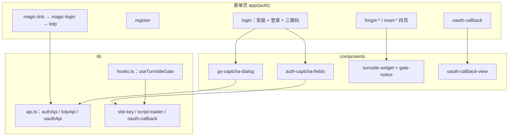
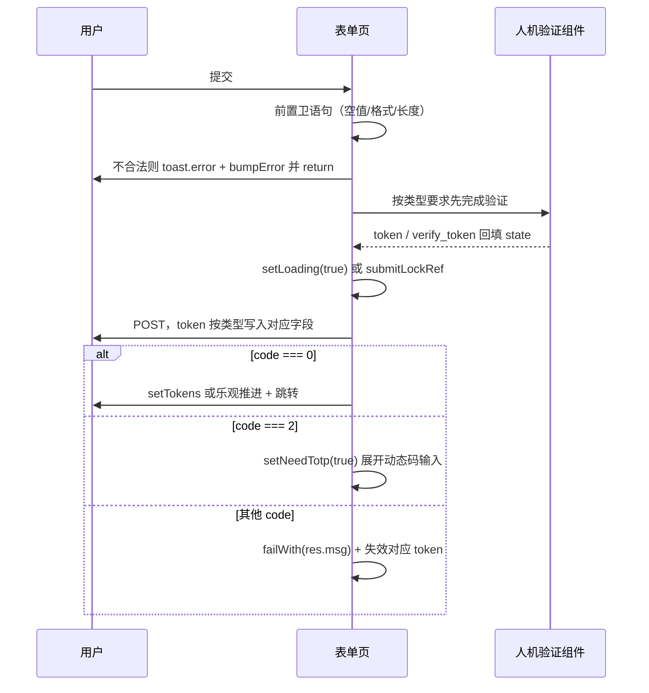
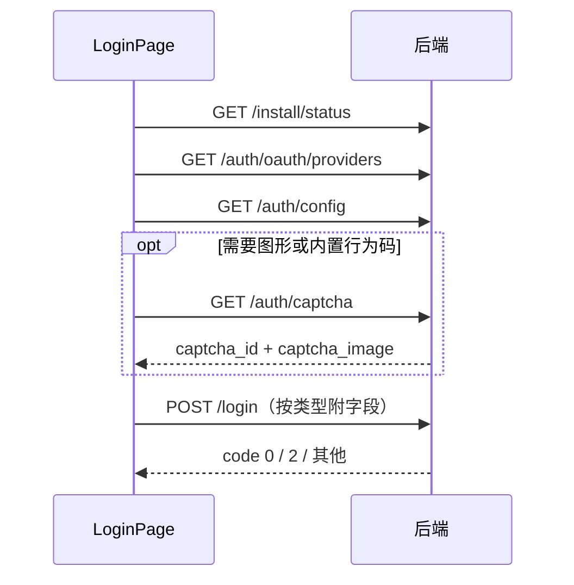
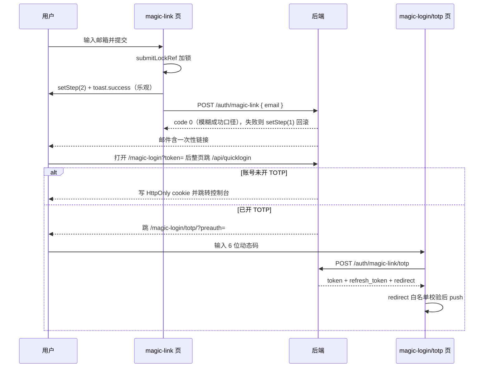
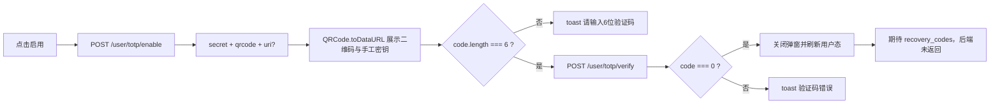
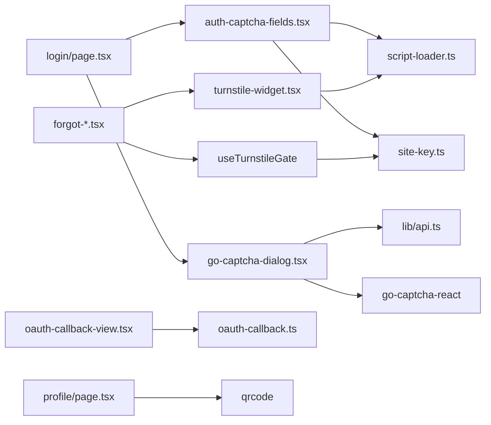

# 表单验证与认证

<cite>
**本文档引用的文件**
- [web/app/(auth)/login/page.tsx](file://web/app/(auth)/login/page.tsx)
- [web/app/(auth)/register/page.tsx](file://web/app/(auth)/register/page.tsx)
- [web/app/(auth)/forgot-password/page.tsx](file://web/app/(auth)/forgot-password/page.tsx)
- [web/app/(auth)/forgot-totp/page.tsx](file://web/app/(auth)/forgot-totp/page.tsx)
- [web/app/(auth)/reset-password/page.tsx](file://web/app/(auth)/reset-password/page.tsx)
- [web/app/(auth)/reset-totp/page.tsx](file://web/app/(auth)/reset-totp/page.tsx)
- [web/app/(auth)/magic-link/page.tsx](file://web/app/(auth)/magic-link/page.tsx)
- [web/app/(auth)/magic-login/page.tsx](file://web/app/(auth)/magic-login/page.tsx)
- [web/app/(auth)/magic-login/totp/page.tsx](file://web/app/(auth)/magic-login/totp/page.tsx)
- [web/app/(auth)/oauth-callback/page.tsx](file://web/app/(auth)/oauth-callback/page.tsx)
- [web/components/auth-captcha-fields.tsx](file://web/components/auth-captcha-fields.tsx)
- [web/components/go-captcha-dialog.tsx](file://web/components/go-captcha-dialog.tsx)
- [web/components/captcha-dialog.tsx](file://web/components/captcha-dialog.tsx)
- [web/components/turnstile-widget.tsx](file://web/components/turnstile-widget.tsx)
- [web/components/turnstile-gate-notice.tsx](file://web/components/turnstile-gate-notice.tsx)
- [web/components/oauth-callback-view.tsx](file://web/components/oauth-callback-view.tsx)
- [web/lib/api.ts](file://web/lib/api.ts)
- [web/lib/hooks.ts](file://web/lib/hooks.ts)
- [web/lib/site-key.ts](file://web/lib/site-key.ts)
- [web/lib/script-loader.ts](file://web/lib/script-loader.ts)
- [web/lib/oauth-callback.ts](file://web/lib/oauth-callback.ts)
- [web/app/(dashboard)/dashboard/profile/page.tsx](file://web/app/(dashboard)/dashboard/profile/page.tsx)
- [web/package.json](file://web/package.json)
</cite>

## 目录

1. [简介](#简介)
2. [项目结构](#项目结构)
3. [核心组件](#核心组件)
4. [架构总览](#架构总览)
5. [详细组件分析](#详细组件分析)
6. [依赖关系分析](#依赖关系分析)
7. [性能考虑](#性能考虑)
8. [故障排查指南](#故障排查指南)
9. [结论](#结论)
10. [附录](#附录)

## 简介

本文档描述 DNSPlane 前端认证链路的**表单流程与校验规则**，逐表单给出流程图或步骤表，并把前端校验与后端真实约束逐条对照。覆盖：初始化安装、登录、注册、找回密码、重置密码、找回与重置二步验证、Magic Link 申请与中转与动态码、OAuth 回调，以及控制台内的 TOTP 绑定。

三项贯穿全文的约定：

- **表单一律 `noValidate`。** 浏览器原生校验被完全关闭，规则集中在提交处理函数的前置卫语句里。收益是错误文案可控、校验顺序可控，不会出现原生气泡与内联提示同时出现。
- **校验是前置卫语句而非模式库。** `web/package.json` 的 `dependencies` 中不存在 `zod`、`yup`、`react-hook-form`。每条规则写成 `if (...) { toast.error(...); return }`，可读且零依赖，代价是规则无法声明式复用。
- **人机验证有三套互斥实现。** 图形码、内置行为码（go-captcha-react）、第三方码（Turnstile / reCAPTCHA / hCaptcha），由后端 `captcha_type` 单选其一，前端按类型分派渲染与提交字段，状态互不共用。

**校验规则的权威在后端。** 前端校验只负责体验，绕过前端的请求由后端约束。本文在[前后端校验规则对照](#前后端校验规则对照)逐条登记差异，并指出一处**前端三处密码门槛互不一致**的实际风险。

## 项目结构

认证表单集中在 `(auth)` 路由组与控制台 profile 页；人机验证组件与判定逻辑独立在 `components/` 与 `lib/`。



**图表来源**

- [web/app/(auth)/login/page.tsx](file://web/app/(auth)/login/page.tsx)
- [web/components/auth-captcha-fields.tsx](file://web/components/auth-captcha-fields.tsx)
- [web/lib/hooks.ts](file://web/lib/hooks.ts)

### 表单清单

| 表单 | 路径 | 提交端点 | 前置校验项 | 人机验证 | 成功后去向 |
| --- | --- | --- | --- | --- | --- |
| 初始化安装 | `(auth)/login/page.tsx` | `POST /install` | 用户名与密码非空 | 无 | 登录态控制台 |
| 登录 | `(auth)/login/page.tsx` | `POST /login` | 用户名/密码/码/TOTP | 三选一 | `/dashboard/` |
| 注册 | `(auth)/register/page.tsx` | `/auth/send-code` + `/auth/register` | 四项非空、密码 ≥6 | 邮箱验证码 | `/login` |
| 找回密码 | `(auth)/forgot-password/page.tsx` | `POST /auth/forgot-password` | 邮箱格式 | 独立 Turnstile | 提示查收邮件 |
| 重置密码 | `(auth)/reset-password/page.tsx` | `POST /auth/reset-password` | token + 四级密码规则 + 二次一致 | 无（靠邮件 token） | 成功态页面 |
| 找回二步验证 | `(auth)/forgot-totp/page.tsx` | `POST /auth/forgot-totp` | 邮箱格式 | 独立 Turnstile | 提示查收邮件 |
| 重置二步验证 | `(auth)/reset-totp/page.tsx` | `POST /auth/reset-totp` | token 存在 | 独立 Turnstile | 引导重新登录 |
| Magic Link 申请 | `(auth)/magic-link/page.tsx` | `POST /auth/magic-link` | 邮箱非空 | 无 | 第二步确认页 |
| Magic Link 中转 | `(auth)/magic-login/page.tsx` | `GET /api/quicklogin`（整页跳转） | `token` 查询串存在 | 无 | 控制台或动态码页 |
| Magic Link 动态码 | `(auth)/magic-login/totp/page.tsx` | `POST /auth/magic-link/totp` | `preauth` 存在、码长 6 | 无 | 白名单 redirect |
| OAuth 回调 | `(auth)/oauth-callback/page.tsx` | `POST /auth/oauth/exchange` | `code` 与 `state` 均非空 | 无 | 绑定提示或控制台 |
| TOTP 绑定 | `dashboard/profile/page.tsx` | `/user/totp/enable` + `/verify` | 码长恰为 6 | 密码 + 动态码二次确认 | 启用状态更新 |

**章节来源**

- [web/app/(auth)/login/page.tsx](file://web/app/(auth)/login/page.tsx)
- [web/lib/api.ts](file://web/lib/api.ts)

## 核心组件

### 认证表单的共同骨架

所有 `(auth)` 表单都包在 `AuthAnimatedLayout` 里，它除视觉动效外还承担**错误反馈的动画出口**：接收 `errorNonce`，值每变一次播放一次抖动。各表单因此实现了同一个递增 nonce 惯用法：

```tsx
// web/app/(auth)/register/page.tsx
const [characterErrorNonce, setCharacterErrorNonce] = useState(0)
const bumpCharacterError = () => setCharacterErrorNonce((n) => n + 1)
```

用递增而非布尔翻转，是为了让连续两次同类错误也各触发一次动画——布尔值不变则 React 不重渲染，抖动只会出现一次。

**章节来源**

- [web/app/(auth)/register/page.tsx](file://web/app/(auth)/register/page.tsx)
- [web/app/(auth)/reset-password/page.tsx](file://web/app/(auth)/reset-password/page.tsx)

## 架构总览

### 表单提交的统一时序



**图表来源**

- [web/app/(auth)/login/page.tsx](file://web/app/(auth)/login/page.tsx)

**章节来源**

- [web/app/(auth)/login/page.tsx](file://web/app/(auth)/login/page.tsx)

### 验证码类型判定链

登录页把 `GET /auth/config` 翻译成三个互斥布尔，判定函数就地定义并注释说明为何必须兼容两个拼法：

```tsx
// web/app/(auth)/login/page.tsx
/**
 * 后端 handler.Login 的分派同时接受 behavioral 与 go-captcha 两个拼法，
 * 前端若只认前者，历史数据的 go-captcha 会被当成图形验证码渲染，
 * 输入框永远取不到图、提交也拿不到 verify_token
 */
function isBuiltinBehavioralCaptcha(captchaType: string): boolean {
  return captchaType === 'behavioral' || captchaType === 'go-captcha'
}

/** 需要第三方组件产出 token 的类型，与后端 notify.IsThirdPartyCaptchaType 集合一致 */
function isThirdPartyCaptchaType(captchaType: string): boolean {
  return captchaType === 'turnstile' || captchaType === 'recaptcha' || captchaType === 'hcaptcha'
}

const isImageCaptcha = !isThirdPartyCaptcha && !isBehavioralCaptcha
```

`isImageCaptcha` 定义为「两者皆非」而非 `=== 'image'`，是有意兜底：后端新增未知类型时退化成最保守的图形码路径（仍要求人工输入），而不是静默变成无人工验证。

**章节来源**

- [web/app/(auth)/login/page.tsx](file://web/app/(auth)/login/page.tsx)
- [web/lib/api.ts](file://web/lib/api.ts)

## 详细组件分析

### 登录表单

登录页同时承载**初始化安装**与**登录**两种形态：挂载时先 `authApi.getInstallStatus()`，未安装则标题切为「初始化系统」、提交改走 `authApi.install`；安装态未确定前渲染 `AuthFormSkeleton`，避免闪现已安装态。



**图表来源**

- [web/app/(auth)/login/page.tsx](file://web/app/(auth)/login/page.tsx)
- [web/lib/api.ts](file://web/lib/api.ts)

卫语句按「缺哪一项就补哪一项」排序，且逐项区分验证码类型：

```tsx
// web/app/(auth)/login/page.tsx
if (!formData.username || !formData.password) { failWith('请输入用户名和密码'); return }
if (captchaEnabled && isBehavioralCaptcha && !verifyToken) { setShowGoCaptcha(true); return }
if (captchaEnabled && isThirdPartyCaptcha) {
  if (!thirdPartySiteKeyValid) { failWith('管理员已开启第三方验证码但站点密钥不可用，请联系管理员检查系统设置'); return }
  if (!captchaToken) { failWith('请先完成人机验证'); return }
}
if (captchaEnabled && isImageCaptcha && !formData.captcha) { failWith('请输入验证码'); return }
if (needTotp && !formData.totp_code) { failWith('请输入动态口令'); return }
```

第二条值得注意：行为码缺失时**不是报错而是直接打开弹窗**，把「补全校验」变成一次交互，省掉「报错—手动点击」的往返。第三方码相反——站点密钥不可用必须硬失败并提示联系管理员，因为此时前端渲染不出组件而后端一定拒绝，静默放行会让用户看到无法理解的错误。

请求体字段分派是登录表单最微妙的一处，两家第三方的字段名不同：

```tsx
// web/app/(auth)/login/page.tsx
const res = await authApi.login({
  username: formData.username, password: formData.password,
  captcha_id: captchaId, captcha: formData.captcha,
  verify_token: verifyToken, totp_code: formData.totp_code,
  // 字段名按类型分叉：turnstile 走 turnstile_token，recaptcha / hcaptcha 走 captcha_token
  ...(captchaEnabled && captchaType === 'turnstile' ? { turnstile_token: captchaToken } : {}),
  ...(captchaEnabled && isThirdPartyCaptcha && captchaType !== 'turnstile'
    ? { captcha_token: captchaToken } : {}),
})
```

`authApi.login` 内部再把 `captcha` 归一化为后端字段 `captcha_code`，并只写非空值，因此上述展开不会产生空字段。

**章节来源**

- [web/app/(auth)/login/page.tsx](file://web/app/(auth)/login/page.tsx)
- [web/lib/api.ts](file://web/lib/api.ts)

### 注册表单

流程为两步：先发验证码，再提交注册。

| 步骤 | 动作 | 端点 | 前端校验 | 失败处理 |
| --- | --- | --- | --- | --- |
| 1 | 点击发送 | `/auth/send-code`（scene `register`） | 邮箱非空 | 解除倒计时、`toast.error` |
| 2 | 倒计时 | 本地 60 秒 | — | 卸载时 `clearInterval` |
| 3 | 提交 | `/auth/register` | 四项非空、密码 ≥6 | `toast.error` + 抖动 |
| 4 | 成功 | — | — | `router.push('/login')` |

倒计时用 `useRef` 持有定时器 ID，并在卸载 effect 里无条件 `clearInterval`，防止离开页面后仍 setState。发送请求的超时异常被专门吞掉，这与 `api.post` 的 `timeoutMs` 相配——`AbortSignal.timeout` 触发 `AbortError`，而后端发信是异步的，超时不代表失败，因此不做二次提示以免误导。提交前所有字段（含传给 API 的对象）都 `trim()`：

```tsx
// web/app/(auth)/register/page.tsx
.catch((e) => {
  if (e instanceof Error && e.name === 'AbortError') return
  toast.error('发送失败')
})

if (!form.username.trim() || !form.password || !form.email.trim() || !form.code.trim()) {
  toast.error('请填写完整信息'); return
}
if (form.password.length < 6) { toast.error('密码至少 6 位'); return }
const res = await authApi.register({
  username: form.username.trim(), password: form.password,
  email: form.email.trim(), code: form.code.trim(),
})
```

**章节来源**

- [web/app/(auth)/register/page.tsx](file://web/app/(auth)/register/page.tsx)
- [web/lib/api.ts](file://web/lib/api.ts)

### 找回密码与找回二步验证表单

两者结构同构，均为「邮箱 + 独立 Turnstile + 乐观进入第二步」，差异只在端点 `/auth/forgot-password` 与 `/auth/forgot-totp`。

```tsx
// web/app/(auth)/forgot-password/page.tsx
const turnstile = useTurnstileGate()
if (turnstile.enabled && !turnstileToken) { toast.error('请先完成人机验证'); return }

{turnstile.enabled && turnstile.status === 'ready' && (
  <TurnstileWidget siteKey={turnstile.siteKey} onToken={setTurnstileToken}
    refreshSignal={turnstileRefreshSignal} />
)}
<TurnstileGateNotice status={turnstile.status} onRetry={turnstile.retry} />
```

关键点是 `turnstile.enabled` 与 `turnstile.status === 'ready'` 是**两个条件**：前者决定是否拦截提交，后者决定能否渲染组件。二者分离正是为了让 `misconfigured` 能做到「拦截并告知原因、给重试入口」，而不是「拦截但页面上没有任何可操作元素」。`TurnstileGateNotice` 无条件渲染（内部按 status 自行决定内容），五种状态因此都有文案出口。

**章节来源**

- [web/app/(auth)/forgot-password/page.tsx](file://web/app/(auth)/forgot-password/page.tsx)
- [web/app/(auth)/forgot-totp/page.tsx](file://web/app/(auth)/forgot-totp/page.tsx)
- [web/lib/hooks.ts](file://web/lib/hooks.ts)
- [web/components/turnstile-gate-notice.tsx](file://web/components/turnstile-gate-notice.tsx)

### 重置密码与重置二步验证表单

两个表单都从邮件链接进入，凭据来自查询串。

| 项 | 重置密码 | 重置二步验证 |
| --- | --- | --- |
| 参数来源 | `searchParams.get('token')` | `searchParams.get('token')` |
| token 缺失 | `toast.error('无效的重置链接')` + 抖动 | 同左 |
| 人机验证 | 无（token 即凭据） | 有，`useTurnstileGate()` |
| 提交封装 | `encryptedPost('/auth/reset-password', ...)` | `encryptedPost('/auth/reset-totp', ...)` |
| 请求体 | `{ token, password }` | `{ token, turnstile_token? }` |

重置密码的校验是全项目最严的一处，逐条卫语句：

```tsx
// web/app/(auth)/reset-password/page.tsx
if (!token) { toast.error('无效的重置链接'); bumpError(); return }
if (!formData.password) { toast.error('请输入新密码'); bumpError(); return }
if (formData.password.length < 8) { toast.error('密码长度至少8位'); bumpError(); return }
if (!/[A-Z]/.test(formData.password)) { toast.error('密码需包含至少一个大写字母'); bumpError(); return }
if (!/[a-z]/.test(formData.password)) { toast.error('密码需包含至少一个小写字母'); bumpError(); return }
if (!/[0-9]/.test(formData.password)) { toast.error('密码需包含至少一个数字'); bumpError(); return }
if (formData.password !== formData.confirmPassword) { toast.error('两次输入的密码不一致'); bumpError(); return }
```

**命名陷阱**：两处都用 `encryptedPost`，但它是 `api.post` 的别名，注释自陈「当前后端为明文 JSON body」。不存在请求体加密，`web/lib/crypto.ts`（373 行）在 `web/` 中零引用。修改这两个表单时不应假设存在加密层。

**章节来源**

- [web/app/(auth)/reset-password/page.tsx](file://web/app/(auth)/reset-password/page.tsx)
- [web/app/(auth)/reset-totp/page.tsx](file://web/app/(auth)/reset-totp/page.tsx)
- [web/lib/api.ts](file://web/lib/api.ts)

### Magic Link 表单链

无密码登录由三段接力，每段职责单一。



**图表来源**

- [web/app/(auth)/magic-link/page.tsx](file://web/app/(auth)/magic-link/page.tsx)
- [web/app/(auth)/magic-login/totp/page.tsx](file://web/app/(auth)/magic-login/totp/page.tsx)

中转页刻意用**整页跳转**（`window.location.assign`）而非 XHR，因为只有顶层导航才能让会话 cookie 与 302 目标页一并生效；`token` 经 `encodeURIComponent` 处理。`token` 缺失时不发起任何请求，直接渲染「缺少登录凭证」并给返回入口。

二步页对 `redirect` 做严格白名单，是防 Open Redirect 的前端纵深：

```tsx
// web/app/(auth)/magic-login/totp/page.tsx
// 安全审计 H-2：只允许站内相对路径，防止后端注入或 MITM 返回外部链接
const raw = res.data.redirect
const safe = typeof raw === 'string' && raw.startsWith('/') && !raw.startsWith('//')
  ? raw : '/dashboard/'
router.push(safe.endsWith('/') ? safe : `${safe}/`)
```

`!raw.startsWith('//')` 是必需的第二道判断：`//evil.com` 同样以 `/` 开头，但会被浏览器解析为协议相对 URL 而跳出本站。

**章节来源**

- [web/app/(auth)/magic-login/page.tsx](file://web/app/(auth)/magic-login/page.tsx)
- [web/app/(auth)/magic-login/totp/page.tsx](file://web/app/(auth)/magic-login/totp/page.tsx)

### OAuth 回调表单

`oauth-callback/page.tsx` 与 `github-callback/page.tsx` 都是薄壳，逻辑在 `OAuthCallbackView`。它是**唯一没有可见提交按钮的认证表单**：校验与提交都发生在挂载 effect 里。

| 步骤 | 处理 | 依据 |
| --- | --- | --- |
| 1 | 读取 `code` 与 `state` | 任一为空即失败 |
| 2 | **发请求前先清掉查询串** | 两者都是一次性凭据，避免被复制进书签或留在历史 |
| 3 | 调 `oauthApi.exchange({ code, state })` | 内部在 `mode === 'login'` 时再调 `refreshSession({ persist: false })` |
| 4 | 按 `mode` 分支 | `bind` 提示已绑定；`login` 提示登录成功 |
| 5 | 延时跳转 | `setTimeout(() => router.replace(target), REDIRECT_DELAY_MS)` |
| 6 | 失败映射文案 | `OAUTH_CALLBACK_ERRORS[code] ?? 登录失败：${code}` |

失败视图的「返回登录页」按钮携带 `?error=<code>`，使登录页可复用同一张文案表，错误文案因此只需一处定义（DRY）。

**章节来源**

- [web/components/oauth-callback-view.tsx](file://web/components/oauth-callback-view.tsx)
- [web/lib/oauth-callback.ts](file://web/lib/oauth-callback.ts)

### TOTP 绑定表单（qrcode 集成）

profile 页承载二步验证的启用、关闭与恢复码重生成。启用流程的关键设计：**二维码由前端本地生成，后端只下发 `secret` 与可选 `uri`。**

```tsx
// web/app/(dashboard)/dashboard/profile/page.tsx
const res = await totpApi.enable()
if (res.code === 0 && res.data) {
  const uri = res.data.uri
    || `otpauth://totp/DNSPlane:${user?.username}?secret=${res.data.secret}&issuer=DNSPlane`
  setTotpQrCode(await QRCode.toDataURL(uri))
} else toast.error(res.msg || '获取密钥失败')
```

`uri` 缺失时前端自行拼接 `otpauth://` URI，保证即使后端字段收缩，绑定页仍可工作。



**图表来源**

- [web/app/(dashboard)/dashboard/profile/page.tsx](file://web/app/(dashboard)/dashboard/profile/page.tsx)
- [web/lib/api.ts](file://web/lib/api.ts)

动态码校验统一为「长度恰等于 6」，登录页、Magic Link 二步页与 profile 三处一致。关闭与重生成都要求**密码 + 动态码双因子二次确认**，前端只做非空与长度校验，身份复核交给后端：

```tsx
if (!disableForm.password || !disableForm.code) { toast.error('请填写密码和验证码'); return }
const res = await totpApi.disable(disableForm.password, disableForm.code)
```

**恢复码目前无法兑现（已验证代码 + 推断行为）**：`VerifyAndEnableTOTP` 只返回 `{code, msg}`，而前端期待 `res.data.recovery_codes`；`totpApi.regenerateRecovery` 请求的 `POST /user/totp/recovery/regenerate` 在后端路由中不存在。因此恢复码入口会恒为失败，用户丢失验证器只能走 `forgot-totp` 邮件流程。

**章节来源**

- [web/app/(dashboard)/dashboard/profile/page.tsx](file://web/app/(dashboard)/dashboard/profile/page.tsx)
- [web/lib/api.ts](file://web/lib/api.ts)

### go-captcha-react 行为验证码集成

`GoCaptchaDialog` 是唯一直接依赖 `go-captcha-react` 的组件，登录页用 `lazy(() => import(...))` 按需加载，避免把 SDK 打进首屏 chunk。从库内部路径按类型引入判别类型与 ref 类型，是这套集成的类型适配点：

```tsx
// web/components/go-captcha-dialog.tsx
import GoCaptcha from 'go-captcha-react'
import type { ClickDot } from 'go-captcha-react/dist/components/Click/meta/data'
import type { SlidePoint } from 'go-captcha-react/dist/components/Slide/meta/data'
// 另有 ClickRef / SlideRef / RotateRef 三个 ref 类型，分别挂到三个 useRef
```

三种类型的 answer 形状必须与后端校验分支逐字对齐，因此提交函数对 answer 用 `unknown`——`api.ts` 注释说明「answer 形态依赖具体验证码类型（点选/拖拽/旋转/算术）」：

```tsx
// web/components/go-captcha-dialog.tsx
const handleClickConfirm = (dots: Array<ClickDot>, reset: () => void) => {
  const answer = dots.map(d => ({ x: d.x, y: d.y }))
  submitVerify('click', answer).then(ok => { if (!ok) reset() })
}
const handleSlideConfirm = (point: SlidePoint, reset: () => void) => {
  submitVerify('slide', { x: point.x, y: point.y }).then(ok => { if (!ok) reset() })
}
const handleRotateConfirm = (angle: number, reset: () => void) => {
  submitVerify('rotate', { angle: Math.round(angle) }).then(ok => { if (!ok) reset() })
}
```

三个回调都接收库提供的 `reset`，**只在验证失败时调用**。这避免成功后组件自行重置造成视觉闪烁，也把「失败即重来」的控制权留在业务侧。

加载时机是一处易踩的坑，源码用注释标明：

```tsx
/* open prop 变化时加载验证码（onOpenChange 不在程序化设置 open 时触发） */
useEffect(() => {
  if (open) loadCaptcha()
  else { setCaptchaData(null); setError(false) }
}, [open, loadCaptcha])
```

登录页通过 `setShowGoCaptcha(true)` **程序化**打开弹窗，Radix 的 `onOpenChange` 在此路径不触发，因此拉图逻辑必须挂在 `open` 的 effect 上，否则弹窗打开却是空图。失败后的重取也是强制的：`submitVerify` 在非 0 分支和 `catch` 分支都调 `loadCaptcha()`，因为后端在**校验之前**就删除缓存键，任何偏差（含坐标差 1 像素）都会让这张图永久失效。

**章节来源**

- [web/components/go-captcha-dialog.tsx](file://web/components/go-captcha-dialog.tsx)
- [web/app/(auth)/login/page.tsx](file://web/app/(auth)/login/page.tsx)

### 第三方验证码组件与站点密钥防线

`AuthCaptchaFields` 按 `type` 分路渲染：`none` / `image` / `turnstile` / `recaptcha` / `hcaptcha`。第三方各路都遵循同一道防线——**先校验站点密钥格式，再决定是否初始化 SDK**：

```tsx
// web/components/auth-captcha-fields.tsx
const safeSiteKey = isValidSiteKey(siteKey) ? siteKey : undefined
if (type !== 'turnstile' || !safeSiteKey) return
```

```ts
// web/lib/site-key.ts
export function isValidSiteKey(s: unknown): s is string {
  return typeof s === 'string' && s.length > 0 && s.length <= 128 && /^[A-Za-z0-9_-]+$/.test(s)
}
```

返回类型 `s is string` 让校验同时完成窄化，`safeSiteKey` 因此是 `string | undefined` 而非需要断言的未知值。`onChange` 经 `onChangeRef.current` 转发，使 effect 依赖只放 `notify`（`useCallback` 稳定引用）而不放 `onChange`，避免父组件每次渲染都重建验证码组件。

`AuthPublicConfig` 的注释还记录了一条容易误读的后端行为：`captcha_site_key` 仅在类型为 recaptcha / hCaptcha 且非空时下发，**Turnstile 类型下后端不读取也不下发该键**。缺失不代表未配置，若把 reCAPTCHA 的 key 拿去初始化 Turnstile 就会静默失败。

**章节来源**

- [web/components/auth-captcha-fields.tsx](file://web/components/auth-captcha-fields.tsx)
- [web/lib/site-key.ts](file://web/lib/site-key.ts)
- [web/lib/api.ts](file://web/lib/api.ts)

### 前后端校验规则对照

任务描述中提到的 `param_guard`，在**本工作区与 `.wiki-context/` 素材中均无对应文件**（素材只出现证书部署用途的 `path_guard.go`，负责拒绝 `..` 与控制字符，与认证表单无关）。因此本节后端依据改为实测可核对的三处：结构体 `binding` 标签、`utils.ValidatePasswordStrength`（`internal/utils/password.go:7`）、`verify/code.go` 的场景常量与阈值。

| 规则 | 前端 | 后端 | 一致性 |
| --- | --- | --- | --- |
| 用户名长度 | placeholder 提示 2～64 | `Register` 校验 2-64 | 一致 |
| 密码强度（重置） | ≥8 且含大小写与数字 | `ValidatePasswordStrength` | 前端更严或相等 |
| 密码强度（注册） | ≥6 | `ValidatePasswordStrength` | **可能不一致** |
| 密码强度（改密） | ≥6 | `ValidatePasswordStrength` | **可能不一致** |
| 两次密码一致 | 有 | 无此概念 | 仅体验层 |
| 邮箱格式 | 提交前判定 | 白名单与查重（`LOWER(TRIM(email))`） | 前端不做白名单 |
| 邮箱验证码 | 仅非空 | 长度 8、TTL 5 分钟、错 5 次作废 | 前端不校验位数 |
| 验证码重发节流 | 本地 60 秒倒计时 | `rl:pubmail` IP + 邮箱双维度限流 | 前端为体验副本 |
| 动态码 | 长度恰为 6 | HMAC-SHA1、30 秒窗口 ±1 格 | 一致 |
| TOTP 关闭 | 密码与码非空 | 密码 + 动态码复核 | 一致 |
| 登录锁定 | 无 | `login_fail:<子网>:<用户名>`，15 分钟 5 次 | 前端仅透传 `res.msg` |
| CSRF | 由 `ApiClient` 自动附头 | `_csrf` 与 `X-CSRF-Token` 常数时间比较 | 表单层无感 |
| `redirect` 跳转 | 仅站内相对路径且非 `//` | 由后端签发 | 前端为纵深防御 |

**密码门槛三处互不一致**是本次分析发现的实际问题：重置要求「≥8 + 大写 + 小写 + 数字」，而注册与改密只要求「≥6」。同一账户体系下三条路径强度不同，用户可能通过注册设一个后端认为不合格的弱口令，也可能在重置时被前端规则挡在比后端更严的门槛外。修复方向是抽一个共享校验函数并对齐后端 `ValidatePasswordStrength`，而不是把某一处规则复制到其余两处。

另一处口径差异值得登记：后端把验证码校验失败排除在登录失败计数之外，因此「无限错验证码」不会触发账号锁定，前端也无法从 `res.msg` 得知剩余次数，只能原样透传。

**章节来源**

- [web/app/(auth)/reset-password/page.tsx](file://web/app/(auth)/reset-password/page.tsx)
- [web/app/(auth)/register/page.tsx](file://web/app/(auth)/register/page.tsx)
- [web/app/(dashboard)/dashboard/profile/page.tsx](file://web/app/(dashboard)/dashboard/profile/page.tsx)
- [web/lib/api.ts](file://web/lib/api.ts)

### 错误回显模式

| 模式 | 载体 | 适用 | 代表位置 |
| --- | --- | --- | --- |
| toast 单通道 | `toast.error` | 一次性、无需回看的输入错误 | 注册、重置、profile 各表单 |
| toast + 内联双通道 | `failWith` | 需要用户回看原因的关键失败 | 登录页 |
| 动画反馈 | `errorNonce` 递增 | 与 toast 同时提供视觉锚点 | 所有 `AuthAnimatedLayout` 表单 |
| 专用失败视图 | 整页状态机 | 不可重试或需引导离开 | `TurnstileGateNotice`、`OAuthCallbackView` |

登录页写出了双通道的理由：「最近一次失败原因，展示在表单顶部；toast 会消失，这条不会」。`?error=` 回跳路径则**读取后立即从查询串删除**，避免刷新重复提示：

```tsx
// web/app/(auth)/login/page.tsx
const err = params.get('error')
toast.error(message)
params.delete('error')
```

特殊 `code` 不当错误处理是另一条一致原则：`code === 2` 被翻译为「需要 TOTP」的流程推进而非红色报错；`catch` 里的网络异常统一为兜底文案，不暴露内部细节。

**章节来源**

- [web/app/(auth)/login/page.tsx](file://web/app/(auth)/login/page.tsx)
- [web/components/turnstile-gate-notice.tsx](file://web/components/turnstile-gate-notice.tsx)
- [web/components/oauth-callback-view.tsx](file://web/components/oauth-callback-view.tsx)

## 依赖关系分析



**图表来源**

- [web/components/go-captcha-dialog.tsx](file://web/components/go-captcha-dialog.tsx)
- [web/app/(dashboard)/dashboard/profile/page.tsx](file://web/app/(dashboard)/dashboard/profile/page.tsx)
- [web/package.json](file://web/package.json)

认证表单直接依赖的三方包只有四个，各有明确边界：

| 依赖 | 版本 | 用途 | 引入方式 |
| --- | --- | --- | --- |
| `go-captcha-react` | `^1.0.4` | 行为验证码渲染与交互 | 登录页 `lazy` 动态导入 |
| `qrcode` | `^1.5.4` | 本地生成 TOTP 二维码 dataURL | profile 页静态导入 |
| `@types/qrcode` | `^1.5.6` | `qrcode` 类型 | devDependency |
| `sonner` | `^2.0.7` | 全部 toast 出口 | 各页静态导入 |

Cloudflare Turnstile、reCAPTCHA、hCaptcha **都不是 npm 依赖**，而是运行时经 `loadScriptOnce` 注入的远端脚本，容器元素由组件自持。这让第三方人机验证的可用性不绑定构建产物，也让同一表单可在三种实现间切换而无需重新构建。

**章节来源**

- [web/package.json](file://web/package.json)
- [web/lib/script-loader.ts](file://web/lib/script-loader.ts)

## 性能考虑

- **行为验证码弹窗懒加载。** `lazy(() => import('@/components/go-captcha-dialog'))` 配合 `Suspense`，图形码部署（最常见）不会加载 go-captcha-react 的渲染代码，登录首屏因此不含该依赖。
- **脚本去重加载。** `loadScriptOnce` 以 DOM 属性定位已有标签：已加载立即 resolve，加载中挂 `load`/`error` 监听等待，重复调用不产生第二次网络请求。
- **`useRef` 承载不需要渲染的状态。** 提交锁 `submitLockRef` 与定时器 `codeTimerRef` 都用 ref，避免加解锁各触发一次重渲染；`onChangeRef` 稳定回调引用，防止 SDK 组件反复重挂载。
- **`onToken` 走 ref 转发。** `TurnstileWidget` 把回调写入 `onTokenRef`，effect 依赖只留 `siteKey`/`disabled`/`refreshSignal`，避免父组件每次 render 都重建 widget 并重复初始化第三方脚本。
- **超时收窄在发信端点。** 找回密码、找回 TOTP、发送验证码、Magic Link 共用 `publicMailPostTimeoutMs`（12 秒），其余认证端点不设超时，避免慢接口被误杀。
- **SSR 安全。** `readCookie`、`AuthCaptchaFields` 都显式检查 `typeof window`/`typeof document`，认证表单可在服务端渲染阶段执行而不抛错。

**章节来源**

- [web/app/(auth)/login/page.tsx](file://web/app/(auth)/login/page.tsx)
- [web/lib/script-loader.ts](file://web/lib/script-loader.ts)
- [web/components/turnstile-widget.tsx](file://web/components/turnstile-widget.tsx)

## 故障排查指南

| 症状 | 可能原因 | 核对点 | 处置 |
| --- | --- | --- | --- |
| 弹窗打开却是空图 | 程序化 `open` 不触发 `onOpenChange` | `open` 的 effect 是否调 `loadCaptcha` | 保持挂在 `open`，勿挂 `onOpenChange` |
| 行为码答对仍反复失败 | 一次性缓存键已删除 | 失败后是否重新 GET | 失败必须重取，勿复用 `verify_token` |
| 输入框永远取不到图 | `captcha_type` 为 `go-captcha` 未被识别 | `isBuiltinBehavioralCaptcha` 返回值 | 两个拼法都要认 |
| Turnstile 渲染不出但提交被拒 | 独立信号缺失或密钥非法 | `turnstile.status` 五态值 | `misconfigured` 报错并给 `retry()` |
| 第三方码报「站点密钥不可用」 | `captcha_site_key` 与 `turnstile_site_key` 混用 | 后端按类型只下发一个键 | 按 `captcha_type` 取对应键 |
| 注册允许弱口令而重置被挡 | 前端三处强度门槛不一致 | `<6` 与 `<8+三类字符` | 抽共享校验并对齐后端 |
| 重置链接打开即报错 | `?token=` 缺失 | `searchParams.get('token')` | 引导重新发邮件 |
| 找回密码一直「发送失败」但邮件已到 | 12 秒超时先返回 | 是否命中 `AbortError` 吞掉分支 | 不做二次提示 |
| 动态码正确却验证失败 | 服务器时钟漂移超出 ±1 格 | 30 秒窗口 | 校时，勿放大窗口 |
| 恢复码入口恒失败 | 后端无对应路由 | `POST /user/totp/recovery/regenerate` | 走 `forgot-totp`，待后端补齐 |
| OAuth 回调显示未知错误码 | 文案表未覆盖该码 | `OAUTH_CALLBACK_ERRORS` 键集合 | 补映射，兜底文案已含原始码 |

**定位顺序建议**：先判断是「前端卫语句挡住」还是「后端返回非 0」。前者不会产生 Network 请求；可通过 toast 文案是否来自 `res.msg` 区分——带后端原文的即服务端裁决，固定文案（如「请输入 6 位动态口令」）的即前端拦截。

**章节来源**

- [web/components/go-captcha-dialog.tsx](file://web/components/go-captcha-dialog.tsx)
- [web/app/(auth)/login/page.tsx](file://web/app/(auth)/login/page.tsx)
- [web/lib/hooks.ts](file://web/lib/hooks.ts)

## 结论

认证表单层分层清晰：`AuthAnimatedLayout` 统一视觉与错误动画，各页 `useState` 持有局部表单态，`lib/api.ts` 固化端点契约，验证码组件封装 SDK 生命周期。`noValidate` + 前置卫语句让每条校验可读可定位，零校验库依赖符合 KISS；`failWith` 双通道与 `errorNonce` 递增两种惯用法多处复用，体现 DRY。

行为验证码集成中最值得保留的经验是**三处「后端语义决定前端写法」**：`captcha_type` 必须兼容两个拼法、取图必须挂在 `open` 的 effect 上、失败必须重取而不能原地重试。它们都不是风格选择，而是对后端一次性缓存语义的正确适配，注释已把因果留在代码里。

需正视的四项问题：

1. **密码门槛三处不一致**（重置 ≥8+三类字符、注册与改密 ≥6）。建议抽共享校验并对齐 `ValidatePasswordStrength`。
2. **恢复码功能不可用**，前端期待 `recovery_codes` 且调用不存在的路由，界面文案目前无法兑现。
3. **`encryptedPost` 命名误导**，两个重置表单看似走加密链路，实际为明文 JSON。
4. **`TurnstileWidget` 依赖第三方脚本可达**，加载失败时只回传空 token，在受限网络下表现为「无法完成人机验证」，需与 `misconfigured` 文案区分。

下一步建议（未实施）：统一密码校验为共享函数；把 `captcha_type` 的两个判定谓词从登录页上移到 `lib/`，供找回密码等第二处表单复用；修正 TOTP 状态字段命名；清理 `encryptedPost` 与 `lib/crypto.ts` 死代码。

## 附录

### 新增认证表单 checklist

| 检查项 | 通过标准 |
| --- | --- |
| 关闭原生校验 | `<form noValidate>` |
| 卫语句顺序 | 必填 → 格式 → 人机验证 → 二次因子 |
| 人机验证按类型分派 | 不新增通用字段，按 `captcha_type` 写对应字段名 |
| 站点密钥校验 | 交给 SDK 前必须过 `isValidSiteKey` |
| 提交锁 | 用 `useRef`，并在 `finally` 释放 |
| 失败回滚 | 乐观推进须有 `code !== 0` 与 `catch` 两个回滚分支 |
| 错误出口 | 关键失败走 `failWith`，且 `bumpError` 递增 nonce |
| 跳转白名单 | 服务端返回的 `redirect` 须 `/` 开头且非 `//` |
| 类型检查 | `npx tsc --noEmit` 退出码 0，零警告 |

**章节来源**

- [web/lib/site-key.ts](file://web/lib/site-key.ts)

### 验证码 token 字段对照

| `captcha_type` | 前端 state | 提交字段 | 后端校验依据 |
| --- | --- | --- | --- |
| `image`（含未知类型兜底） | `captchaId` + `formData.captcha` | `captcha_id` + `captcha_code` | `base64Captcha` 内存 store |
| `behavioral` / `go-captcha` | `verifyToken` | `verify_token` | `captcha_verify:<uuid>`，消费即删 |
| `turnstile`（登录） | `captchaToken` | `turnstile_token` | `turnstile_secret_key` 非空才强制 |
| `recaptcha` / `hcaptcha` | `captchaToken` | `captcha_token` | `captcha_secret_key` 非空才强制 |
| 找回类敏感流程（独立） | `turnstileToken` | `turnstile_token` | `requireSensitiveCaptcha` |

最后一行与第三行是**两个互不替代的信号**：`captcha_type_turnstile` 表示登录用哪种码，`turnstile_standalone_required` 表示找回类敏感操作是否强制校验，前者为 `false` 不代表后者也为 `false`。

**章节来源**

- [web/lib/api.ts](file://web/lib/api.ts)

### 后端频控与表单的对应

| 表单 | 后端键前缀 | 阈值 | 前端可见表现 |
| --- | --- | --- | --- |
| 登录爆破 | `login_fail:<子网>:<用户名>` | 15 分钟 5 次 | 透传 `res.msg` |
| 找回密码 | `rl:pubmail:forgot_pw:ip/em` | 每小时 12 / 5 | 透传 `res.msg` |
| 注册验证码 | `rl:pubmail:reg_code:ip/em` | 每小时 24 / 8 | 透传 `res.msg` |
| 邮箱验证码 | `vcode:<scene>:<email>` | TTL 5 分钟、重发间隔 60 秒、错 5 次作废 | 本地 60 秒倒计时 |
| 快速登录 | `rl:quicklogin_<ip>` | 每小时 30 次 | 页面报错文案 |

前端倒计时是后端节流的**体验副本**而非替代品：清 cookie 或换邮箱可绕过倒计时，但绕不过 `rl:pubmail` 双维度限流，因此不要把倒计时表述为安全措施。

**章节来源**

- [web/lib/api.ts](file://web/lib/api.ts)
- [web/app/(auth)/register/page.tsx](file://web/app/(auth)/register/page.tsx)
