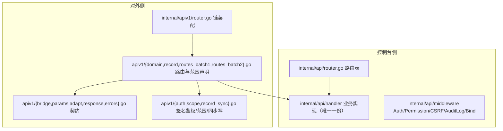
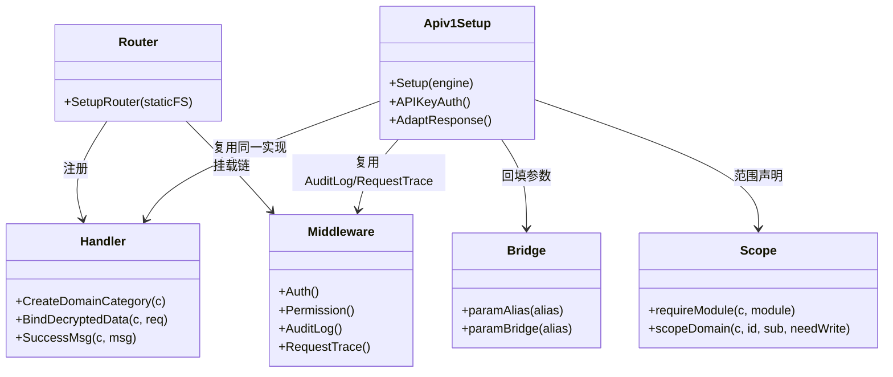
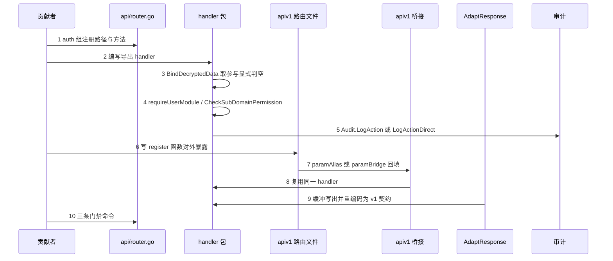
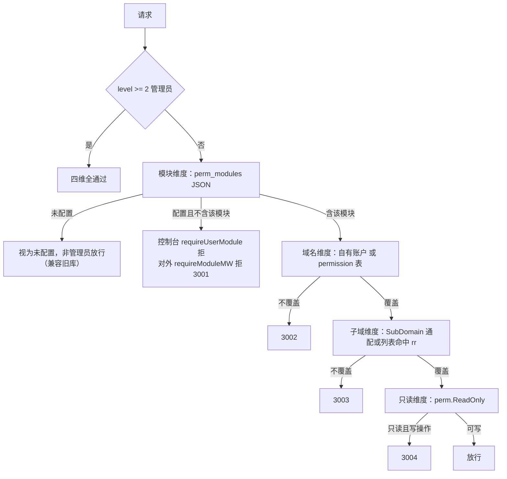
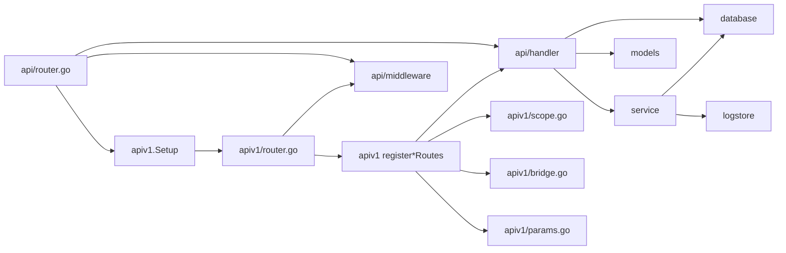
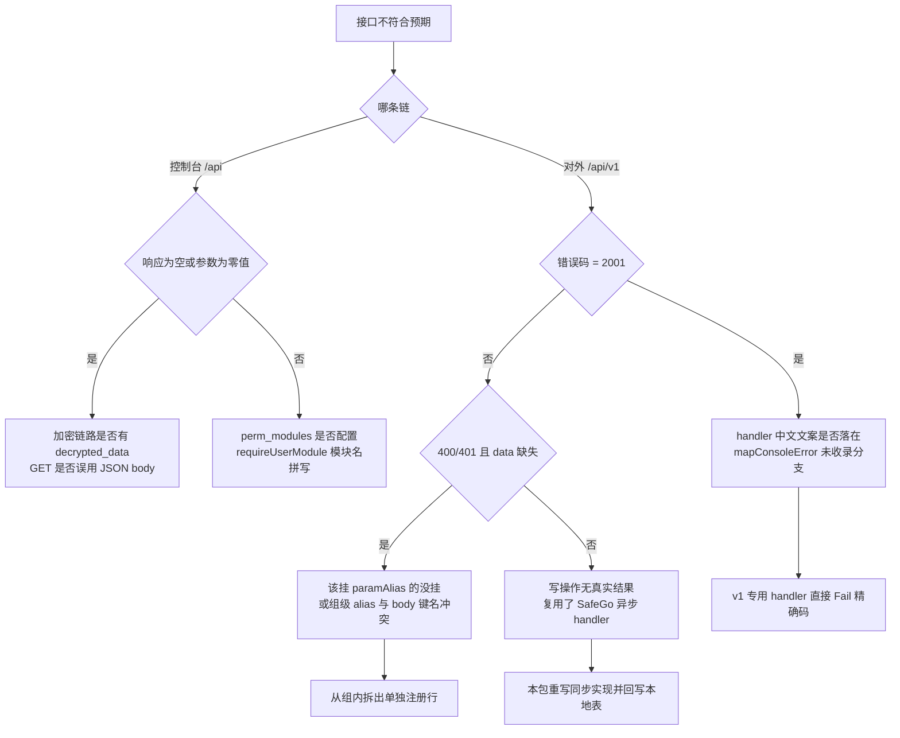

# API开发

<cite>
**本文档引用的文件**
- [router.go](file://main/internal/api/router.go)
- [domain_category.go](file://main/internal/api/handler/domain_category.go)
- [account.go](file://main/internal/api/handler/account.go)
- [domain.go](file://main/internal/api/handler/domain.go)
- [monitor.go](file://main/internal/api/handler/monitor.go)
- [cloudflare.go](file://main/internal/api/handler/cloudflare.go)
- [sign.go](file://main/internal/api/middleware/sign.go)
- [permission.go](file://main/internal/api/middleware/permission.go)
- [audit.go](file://main/internal/api/middleware/audit.go)
- [auth.go](file://main/internal/api/middleware/auth.go)
- [router.go](file://main/internal/apiv1/router.go)
- [auth.go](file://main/internal/apiv1/auth.go)
- [domain.go](file://main/internal/apiv1/domain.go)
- [record.go](file://main/internal/apiv1/record.go)
- [scope.go](file://main/internal/apiv1/scope.go)
- [params.go](file://main/internal/apiv1/params.go)
- [bridge.go](file://main/internal/apiv1/bridge.go)
- [adapt.go](file://main/internal/apiv1/adapt.go)
- [errors.go](file://main/internal/apiv1/errors.go)
- [response.go](file://main/internal/apiv1/response.go)
- [record_sync.go](file://main/internal/apiv1/record_sync.go)
- [audit.go](file://main/internal/service/audit.go)
- [skeleton_test.go](file://main/internal/apiv1/skeleton_test.go)
- [permission_route_test.go](file://main/internal/api/permission_route_test.go)
- [devlog.md](file://devlog.md)
- [scan-backend.md](file://../.wiki-context/scan-backend.md)
</cite>

## 目录

1. [简介](#简介)
2. [项目结构](#项目结构)
3. [核心组件](#核心组件)
4. [架构总览](#架构总览)
5. [详细组件分析](#详细组件分析)
6. [依赖关系分析](#依赖关系分析)
7. [性能考虑](#性能考虑)
8. [故障排查指南](#故障排查指南)
9. [结论](#结论)
10. [附录](#附录)

---

## 简介

本文给出在本仓库**新增一个 HTTP 端点**的端到端流程：控制台路由注册 → handler 编写 → 参数绑定 → 权限点声明 → `apiv1` 对外桥接 → 审计日志 → 测试模板 → 验收命令。代码片段形态均取自当前工作区真实实现。

必须先建立的心智：本项目**只有一份业务实现**。控制台 `/api` 与对外 `/api/v1` 共用 `internal/api/handler` 的同一批函数，`apiv1` 不复制业务逻辑，只做鉴权、参数桥接与响应重编码。所以「新增端点」默认是两步：先让它在控制台可用，再决定是否对外暴露；对外最容易出错的是桥接与错误码，不是业务代码。

证据口径：**已验证**＝当前工作区直读与检索，行号以当前工作区为准；**快照口径**＝`.wiki-context/scan-backend.md`（2026-10-10 13:30:43）的行数与计数，须复核；**推断**＝由证据间接得出。

一处口径修正：`scan-backend.md` 记录「`Permission` 中间件从未被挂载」，当前工作区已不成立——`main/internal/api/router.go:104` 存在 `auth.Use(middleware.Permission())`。

**章节来源**

- [domain.go](file://main/internal/apiv1/domain.go#L9-L20)
- [router.go](file://main/internal/api/router.go#L100-L105)
- [scan-backend.md](file://../.wiki-context/scan-backend.md#L663-L680)

---

## 项目结构

一个端点会牵涉 7 类文件，这张图是「改哪里」的地图。



**图表来源**

- [router.go](file://main/internal/api/router.go#L18-L64)
- [router.go](file://main/internal/apiv1/router.go#L24-L47)

### 路由登记位置

| 归属 | 文件 | 说明 |
| --- | --- | --- |
| 控制台公开 | `internal/api/router.go` `/api` 组 | 登录、验证码、安装、忘记密码 |
| 控制台鉴权 | 同文件 `auth` 子组 | `Auth` + `Permission`（`:104`），快照 201 条 |
| 对外骨架 | `apiv1/router.go` | `Setup` 依次调用 10 个 `register*Routes` |
| 对外域名 | `apiv1/domain.go` | 域名族 19 条，整组 `paramAlias{"id":"domain_id"}` |
| 对外记录 | `apiv1/record.go` | 记录族 14 条，5 个写接口指向本包同步实现 |
| 对外账户/证书/监控/定时/CF/系统/用户/优选IP | `apiv1/routes_batch1.go`、`routes_batch2.go` | 6 + 21 + 15 + 6 与 41 + 14 + 12 + 7，系统组一律 `adminOnly` |

路由总量（控制台 226 / 对外 145）为快照口径，提交前用附录 A 的计数命令复核。

**章节来源**

- [scan-backend.md](file://../.wiki-context/scan-backend.md#L226-L233)
- [scan-backend.md](file://../.wiki-context/scan-backend.md#L464-L620)

---

## 核心组件

新增端点直接打交道的六个组件，职责边界必须清楚，否则校验会写错层。

| 组件 | 入口符号 | 承担 | 不承担 |
| --- | --- | --- | --- |
| 控制台路由 | `api.SetupRouter(staticFS)` | 路径、方法、分组归属 | 业务判断 |
| 控制台鉴权链 | `middleware.Auth`、`middleware.Permission` | 注入 `user_id`/`level`/`perm_modules`/`perm_domain`/`perm_read_only` | 字段级资源校验 |
| 业务 handler | `handler.Xxx(c *gin.Context)` | 取参、校验、读写库、调上游、写审计、响应 | 认证与传输加密 |
| 参数绑定 | `middleware.BindDecryptedData` | 加密/明文两条取参路径归一 | 路径参数（走 `c.Param`） |
| 对外桥接 | `paramAlias`、`paramBridge` | 回填 `c.Param`、还原请求体、按需搬 query | 权限判定 |
| 对外契约 | `OK`/`Fail`/`Failf`/`OKPage` + `Code*` | 稳定错误码与 `request_id` | 文案语义（`message` 仅供参考） |



**图表来源**

- [router.go](file://main/internal/api/router.go#L18-L64)
- [bridge.go](file://main/internal/apiv1/bridge.go#L35-L103)
- [scope.go](file://main/internal/apiv1/scope.go#L27-L132)
- [audit.go](file://main/internal/service/audit.go#L35-L60)

现有功能模块名（代码检索所得）：`domain`、`monitor`、`cert`、`deploy`。

**章节来源**

- [monitor.go](file://main/internal/api/handler/monitor.go#L45-L45)
- [cloudflare.go](file://main/internal/api/handler/cloudflare.go#L103-L117)

---

## 架构总览

一次「新增端点并对外暴露」的端到端时序。



**图表来源**

- [router.go](file://main/internal/api/router.go#L44-L105)
- [domain_category.go](file://main/internal/api/handler/domain_category.go#L51-L79)
- [adapt.go](file://main/internal/apiv1/adapt.go#L32-L111)

### 两条链的差异决定实现细节

| 维度 | 控制台 `/api` | 对外 `/api/v1` |
| --- | --- | --- |
| 方法 | GET + POST 混用 | 全部 POST，无路径参数 |
| 身份 | Cookie + JWT | HMAC-SHA256 签名 `APIKeyAuth` |
| 参数位置 | 路径参数 + query + body | 仅 body，需桥接回填 |
| 响应 | `{code, msg, data}`，可加密 | `{code, request_id, data, message}`，`code` 是契约 |
| CSRF | 必须 | 不挂载，签名即凭据 |
| 权限声明 | 散在各 handler 内 | 集中在路由表，可枚举 |
| 异步写 | 允许 `utils.SafeGo` | 不允许，需重写同步 |

v1 不挂 CSRF 的理由写在 `apiv1/router.go:12-15`：API Key 客户端没有 cookie 也无从取 token，继承 `/api` 链会让所有写请求在 CSRF 处被拒。

**章节来源**

- [router.go](file://main/internal/apiv1/router.go#L9-L34)
- [response.go](file://main/internal/apiv1/response.go#L17-L44)

---

## 详细组件分析

### 第一步：控制台路由注册

路由集中在 `internal/api/router.go`。公开接口挂 `api` 组，业务接口挂 `auth` 子组。

```go
auth.POST("/domains/categories", handler.CreateDomainCategory)
auth.GET("/domains/categories", handler.GetDomainCategories)
auth.POST("/domains/categories/:id", handler.UpdateDomainCategory)
auth.POST("/domains/categories/:id/delete", handler.DeleteDomainCategory)
```

三条约定：

- 本仓库只有 GET 与 POST，**变更类一律 POST**，删除用 `/xxx/:id/delete` 表达。`AuditLog` 正是依赖这个约定判定「写操作」。
- `:param` 命名沿用既有拼写（`id`、`recordId`、`aliasId`），因为 `apiv1` 的别名表按这些键回填。
- 链顺序不可动：引擎级 `SecurityHeaders → gin.Recovery → Logger`，`/api` 组 `CORS → RequestTrace → Recovery → CSRF → AuditLog`，`auth` 子组再叠 `Auth → Permission`。

**章节来源**

- [router.go](file://main/internal/api/router.go#L24-L53)
- [audit.go](file://main/internal/api/middleware/audit.go#L16-L33)

### 第二步：handler 编写

handler 是 `func X(c *gin.Context)`。模板形态与 `handler/domain_category.go:41-79` 一致：

```go
package handler

import (
	"main/internal/api/middleware"
	"main/internal/database"
	"main/internal/models"
	"main/internal/service"

	"github.com/gin-gonic/gin"
)

type createDomainCategoryRequest struct {
	Name   string `json:"name" binding:"required"`
	Remark string `json:"remark"`
	Sort   int    `json:"sort"`
}

/**
 * CreateDomainCategory 创建域名分类
 * @route POST /domains/categories
 */
func CreateDomainCategory(c *gin.Context) {
	if !requireUserModule(c, "domain") {
		return
	}
	var req createDomainCategoryRequest
	if err := middleware.BindDecryptedData(c, &req); err != nil {
		middleware.ErrorResponse(c, "参数解析失败")
		return
	}
	if req.Name == "" { // binding tag 在加密链路下不生效
		middleware.ErrorResponse(c, "分类名称不能为空")
		return
	}
	var existing models.DomainCategory
	if database.WithContext(c).Where("name = ?", req.Name).First(&existing).Error == nil {
		middleware.ErrorResponse(c, "分类名称已存在")
		return
	}
	cat := models.DomainCategory{Name: req.Name, Remark: req.Remark, Sort: req.Sort}
	if err := database.WithContext(c).Create(&cat).Error; err != nil {
		middleware.ErrorResponse(c, "创建分类失败")
		return
	}
	middleware.SuccessMsg(c, "添加分类成功")
	_ = service.Audit.LogAction(c, "create_domain_category", cat.Name, "创建分类: "+cat.Name)
}
```

四条硬规则，每条在当前代码里都能找到教训：

- **路径参数为空必须早退。** `handler/domain_category.go:95-105` 注释指出：`First(&cat, "")` 退化成不带主键条件的查询，静默命中全表第一条，分类会被改名而不是报「不存在」；v1 路由表没有路径参数，这条退化路径是可达的。
- **一律 `database.WithContext(c)`**，把 SQL 关联到请求；`RegisterDBCallbacks` 只覆盖主库与 `LogDB`，不含 `RequestDB`。
- **错误文案是给 `mapConsoleError` 读的。** 用既有词汇（无权限、不存在、只读、参数、已存在、超时），别自造同义词，否则对外被归到 2001。
- **需要结果的写操作不要用 `utils.SafeGo`**，见第五步。

**章节来源**

- [domain_category.go](file://main/internal/api/handler/domain_category.go#L41-L106)
- [account.go](file://main/internal/api/handler/account.go#L43-L70)
- [adapt.go](file://main/internal/apiv1/adapt.go#L113-L148)

### 第三步：BindDecryptedData 参数绑定

`middleware.BindDecryptedData`（`internal/api/middleware/sign.go:104`）是唯一取参入口，把两条传输路径归一：加密链路读上下文 `decrypted_data` 后 `json.Marshal` + `Unmarshal` 回填结构体；无加密时 GET/HEAD 走 `ShouldBindQuery`，其余走 `ShouldBindJSON`，且 `io.EOF` 与 `unexpected end of json input` 被当作「无 body」返回 `nil` 而非报错。

| 传输形态 | `GetDecryptedData` | 实际取参来源 | 典型调用方 |
| --- | --- | --- | --- |
| 加密链路（前端） | 非 nil | 上下文 `decrypted_data` | 控制台前端 |
| 明文 GET | nil | `ShouldBindQuery` | 未启用加密的读接口 |
| 明文 POST 有 body | nil | `ShouldBindJSON` | 明文 API 客户端 |
| 明文 POST 无 body | nil | 返回 `nil`，字段留零值 | `/xxx/:id/delete`，ID 走 `c.Param` |
| v1 对外 | 非 nil | `JSONBodyToDecryptedData` + 桥接还原 body | API Key 客户端 |

两个易错点：**`binding:"required"` 在加密链路下不生效**，那条路径不经 gin 绑定校验，判空必须显式写（`domain_category.go:60` 就是这么补的）；**`json` tag 就是对外契约**，改名等价于破坏公共 API。

另有 `BindJSONFlexible`（`:129`）：优先 `decrypted_data`，否则 `ShouldBindJSON`，**不处理 GET/query**。新接口默认 `BindDecryptedData`，除非明确只接 JSON body。

**章节来源**

- [sign.go](file://main/internal/api/middleware/sign.go#L85-L139)
- [domain_category.go](file://main/internal/api/handler/domain_category.go#L55-L63)

### 第四步：权限点声明

权限点是四个维度的组合，不是单一开关。



**图表来源**

- [permission.go](file://main/internal/api/middleware/permission.go#L33-L49)
- [permission.go](file://main/internal/api/middleware/permission.go#L363-L395)
- [scope.go](file://main/internal/apiv1/scope.go#L13-L132)

声明与读取分四层：

| 层次 | 位置 | 用法 |
| --- | --- | --- |
| 注入 | `ApplyUserPermissionModules(c, user.Permissions)` | 控制台 `middleware/auth.go:188`；对外 `apiv1/auth.go:111` |
| 判定 | `UserModuleAllowed(c, module)` | `permission.go:383`，空列或解析失败视为未配置并放行非管理员 |
| 控制台调用 | `requireUserModule(c, "domain")` | `handler/account.go:67`，各 handler 首行 |
| 对外调用 | `requireModuleMW("domain")` | `apiv1/domain.go:75`，写在路由表上 |

域名三写法选用：

```go
// 控制台 handler 内：域级 + 子域级两级（domain.go:900 / :1017 的写法）
if !middleware.CheckDomainPermission(c.GetString("user_id"), c.GetInt("level"), req.DomainID) {
	middleware.ErrorResponse(c, "无该域名操作权限")
	return
}
if !middleware.CheckSubDomainPermission(c.GetString("user_id"), c.GetInt("level"), req.DomainID, req.Name) {
	middleware.ErrorResponse(c, "无该子域名操作权限")
	return
}

// 对外 v1：四步固定顺序，needWrite 为真才施加只读限制
domain, ok := scopeDomain(c, req.DomainID, req.Name, true)
if !ok {
	return
}
```

一条已验证的教训必须写进流程：`devlog.md` 记录了批量接口越权缺陷——`BatchActionRecords` 只调 `CheckDomainPermission`，而 `Permission` 中间件的 `getSubDomainFromRequest` 只读 body 的 `name`/`rr`，该请求体**只有 `record_ids` 和 `action`**，中间件取不到子域，二级校验根本不触发。结论：域级校验回答不了「这条记录归不归你管」，凡能定位到具体 rr 的写操作，handler 内必须显式补 `CheckSubDomainPermission`。

**章节来源**

- [permission.go](file://main/internal/api/middleware/permission.go#L18-L49)
- [auth.go](file://main/internal/apiv1/auth.go#L106-L112)
- [domain.go](file://main/internal/api/handler/domain.go#L900-L901)
- [devlog.md](file://devlog.md#L2297-L2310)

### 第五步：apiv1 桥接

对外路由表全是 POST、无路径参数，而控制台 handler 只认 `c.Param("id")`。`bridge.go:15-33` 给出两处不兼容与两级方案：

| 方案 | 动作 | 副作用范围 | 何时用 |
| --- | --- | --- | --- |
| `paramAlias({"id":"domain_id"})` | 回填 `c.Param` + 还原请求体 | 不改 URL，可整组挂载 | 默认选择 |
| `paramBridge(alias)` | alias 之上把标量搬进 query | **会改写调用方自传的查询串** | 仅当确有 `c.Query` 消费点 |

`bridgeParams` 只在「键存在且当前参数为空」时动作，不覆盖调用方显式给出的路径参数；请求体用 `decrypted_data` 的序列化结果等价还原，否则下游 `ShouldBindJSON` 拿到 EOF，表现为「参数错误」而调用方看不出哪里错。全仓真实依赖 query 搬运的只有 `SmartParseRecord` 一处，故 query 搬运被降级为按需。

```go
// 对外注册样例（形态取自 apiv1/domain.go 与 apiv1/record.go）
func registerDomainRoutes(v1 *gin.RouterGroup) {
	g := v1.Group("/domains", paramAlias(map[string]string{"id": "domain_id"}))
	g.POST("/list", requireModuleMW("domain"), handler.GetDomains)
	g.POST("/create", requireModuleMW("domain"), handler.CreateDomain)

	// body 键名与整组不同的，单独注册，不能留在 g 内
	v1.POST("/domains/aliases/delete", requireModuleMW("domain"),
		paramAlias(map[string]string{"aliasId": "alias_id"}), handler.DeleteDomainAlias)

	// 只读 c.Query 的接口才升级到 paramBridge
	v1.POST("/records/smartparse", requireModuleMW("domain"),
		paramBridge(map[string]string{"id": "domain_id"}), handler.SmartParseRecord)
}
```

**必须重写同步的一类**：控制台 handler 内部用 `utils.SafeGo` 异步执行的写接口。「提交成功」再后台执行意味着程序化调用方拿不到成败与失败原因。`apiv1/record_sync.go` 就是为此存在：`CreateRecordSync`、`UpdateRecordSync`、`DeleteRecordSync`、`SetRecordStatusSync`、`UpdateRecordRemarkSync` 五个同步实现，写成功后回写本地 `dns_records`，并给 `recordOpTimeout = 30s`。

**配额门不可复制缺口**：`record.go:27-34` 注释明确——控制台只给单条创建挂了 `records` 配额，批量族没有；对外必须两条都挂，「缺一道门就等于给了绕过的确定性路径」。

**章节来源**

- [bridge.go](file://main/internal/apiv1/bridge.go#L15-L103)
- [domain.go](file://main/internal/apiv1/domain.go#L21-L72)
- [record.go](file://main/internal/apiv1/record.go#L18-L58)

### 第六步：响应契约与有损映射警告

复用控制台 handler 时，`AdaptResponse()` 缓冲写出、解析后重编码为 v1 格式。识别规则：缓冲内容含 `"request_id"` 子串即视为 v1 自有响应，原样透出（`adapt.go:63-67`）。

复用路径的错误分支走 `mapConsoleError`，`adapt.go:113-119` 的注释原文把它定性为**有损映射**：控制台所有错误都是 `code=-1`，只能按中文文案反推类别，未收录文案一律落 `CodeParamInvalid`。

| 文案子串 | 映射结果 |
| --- | --- |
| `无权限`/`仅管理员`/`无权操作`/`权限不足` | `3002 CodeDomainDenied` |
| `只读` | `3004 CodeReadOnly` |
| `不存在` + `域名`/`账户`/`任务` | `4002`/`4003`/`4006` |
| `不存在` | `4001 CodeResourceNotFound` |
| `已存在`/`重复` | `4007 CodeResourceConflict` |
| `账户配置`/`不支持`/`超时` | `5002`/`5003`/`5006` |
| `参数`/`缺少`/`不能为空` | `2001 CodeParamInvalid` |
| **未收录文案** | **`2001 CodeParamInvalid`**（主要失真点） |

规避方式只有一个：**v1 专用 handler 直接调 `Fail`/`Failf` 给准确码**。`code` 是契约、`message` 仅供参考；`errors.go:16` 明确「码值一经发布不得复用或改义」。码值分段为 `1xxx` 认证、`2xxx` 参数、`3xxx` 权限与范围、`4xxx` 资源与状态、`5xxx` 业务与外部依赖、`9xxx` 内部错误；一处实测行为值得记录——`httpStatusFor` 的 switch 未列出 3xxx 分支，**权限类错误当前落 `400` 而非 `403`**（`errors.go:71-92`），要对齐语义属于对外契约变更，需单独评审。

成功侧固定形状：`OK` 恒输出 `data`（nil 也输出 `null`）；`OKPage` 在 `list` 为 nil 时归一化为空数组，并**回显服务端实际采用的 `page`/`page_size`**，因为 `parsePaging` 会对越界值收敛（`defaultPageSize = 20`、`maxPageSize = 200`，仅负数判非法）。

**章节来源**

- [adapt.go](file://main/internal/apiv1/adapt.go#L56-L148)
- [errors.go](file://main/internal/apiv1/errors.go#L18-L92)
- [response.go](file://main/internal/apiv1/response.go#L56-L108)
- [params.go](file://main/internal/apiv1/params.go#L27-L56)

### 第七步：审计日志

审计有两条独立路径，都要考虑。

| 路径 | 触发 | 内容 | 域名归属 |
| --- | --- | --- | --- |
| 中间件自动 | `middleware.AuditLog()`，两条链都挂 | 仅 POST/PUT/DELETE/PATCH；`deriveAction(path, method)` 粗粒度动作、耗时、HTTP 类别 | 读上下文 `perm_domain` |
| 服务显式 | `Audit.LogAction` / `LogActionDirect` / `LogChange` | 自定义 action 与人类可读 data，支持变更前后快照 | 调用方传入 |

中间件层的三个前置条件（`audit.go:29-47`）：`shouldSkipAudit(path)` 跳过登录等路径以免记录密码；`userID == ""` 不记；域名取 `perm_domain`。

一个当前工作区的真实缺口，新增对外接口必须自行补上：**`perm_domain` 只由 `middleware/permission.go:169`、`:202` 写入**，而 `Permission` 只挂在控制台 `auth` 组（`router.go:104`），v1 链（`apiv1/router.go:27-34`）没有它。因此**对外接口的审计域名在中间件层恒为空**，必须靠 handler 显式传域名——`handler/domain.go:943-954` 与 `apiv1/record_sync.go` 的 `logRecordAction` 正是这么做的。

```go
// 成功与失败都要记（形态取自 handler/domain.go:943-954）
service.Audit.LogActionDirect(userID, username, ip, ua, "add_record", domainName,
	fmt.Sprintf("%s.%s -> %s", req.Name, domainName, req.Value))
service.Audit.LogActionDirect(userID, username, ip, ua, "add_record_failed", domainName,
	fmt.Sprintf("%s.%s -> %s 失败: %s", req.Name, domainName, req.Value, err.Error()))
```

落库去处：`saveLog` 在 `logstore.Store.IsRedis()` 时走 Redis 系统日志，否则 `database.LogDB.Create`。action 命名沿用既有 `动词_名词` 与 `_failed` 后缀，别新造风格。

**章节来源**

- [audit.go](file://main/internal/api/middleware/audit.go#L16-L70)
- [permission.go](file://main/internal/api/middleware/permission.go#L169-L202)
- [audit.go](file://main/internal/service/audit.go#L20-L60)

### 第八步：测试模板

骨架测试的先例是 `internal/apiv1/skeleton_test.go`，两个必须重复的设置如下。

```go
package apiv1

import (
	"path/filepath"
	"testing"

	"github.com/gin-gonic/gin"

	"main/internal/api/middleware"
	"main/internal/cache"
	"main/internal/config"
	"main/internal/database"
)

// RequestTrace 在请求结束落 RequestDB，未建库会 nil 解引用 panic
func setupTestDB(t *testing.T) {
	t.Helper()
	if err := database.Init(&config.DatabaseConfig{Driver: "sqlite",
		FilePath: filepath.Join(t.TempDir(), "apiv1.db")}); err != nil {
		t.Fatalf("初始化测试数据库失败: %v", err)
	}
	cache.Init(&cache.Config{})
	t.Cleanup(func() { _ = cache.Close(); _ = database.Close() })
}

// 构造与生产同构的 v1 路由，只挂被测模块
func testEngine(register func(*gin.RouterGroup)) *gin.Engine {
	gin.SetMode(gin.TestMode)
	r := gin.New()
	v1 := r.Group("/api/v1")
	v1.Use(middleware.RequestTrace())
	v1.Use(APIKeyAuth())
	v1.Use(JSONBodyToDecryptedData())
	v1.Use(AdaptResponse())
	if register != nil {
		register(v1)
	}
	return r
}
```

覆盖面要求：

- **正常路径**：`code == 0`、`data` 形状正确、`request_id` 非空。
- **桥接正确性**：body 里的 `domain_id` 能被 handler 读到；body 未还原时的错误必须可定位。
- **权限四维各一条拒绝**：3001 / 3002 / 3003 / 3004。
- **错误码不被有损映射吞掉**：v1 自有 handler 断言精确码；复用控制台 handler 时断言映射结果，并把未收录文案写进测试名以暴露风险。
- **只读写操作被拒**、**越界分页被收敛**（回显服务端实际值）；**审计可追溯**：显式 `LogAction*` 的接口至少一条用例断言日志库出现对应 action。

控制台侧先例是 `internal/api/` 下 7 个测试文件，其中 `permission_route_test.go` 直接构造 `auth.Use(middleware.Permission())` 并断言 `perm_domain` 被写入——新增权限维度时照这个模式补。

**章节来源**

- [skeleton_test.go](file://main/internal/apiv1/skeleton_test.go#L18-L59)
- [permission_route_test.go](file://main/internal/api/permission_route_test.go#L52-L120)

### 第九步：验收命令

```bash
# 三条门禁（工作目录必须是 main/，GOTMPDIR 必须避开 /tmp）
export GOTMPDIR=/home/clfchen/.cache/go-work
cd main
GOTMPDIR="$GOTMPDIR" go build -gcflags="-lang=go1.26" ./...
GOTMPDIR="$GOTMPDIR" go vet ./...
GOTMPDIR="$GOTMPDIR" go test ./... -count=1

# 只跑本次改动相关包，迭代更快
go test ./internal/apiv1/ ./internal/api/ ./internal/api/handler/ -count=1

# 确认新接口真的进了路由表
rg -c '\.(GET|POST)\(' internal/api/router.go
rg -n '\.POST\(' internal/apiv1 -g '!*_test.go' | wc -l
```

`-count=1` 不可省：禁用测试缓存后才能证明新行为真被跑过。门禁口径原文见 `devlog.md` 的验证段（该段口径为 14/14 包全绿，当前工作区含测试文件的目录实测为 15 个）。

**章节来源**

- [devlog.md](file://devlog.md#L2266-L2272)
- [scan-backend.md](file://../.wiki-context/scan-backend.md#L226-L232)

---

## 依赖关系分析



**图表来源**

- [scan-backend.md](file://../.wiki-context/scan-backend.md#L831-L858)
- [router.go](file://main/internal/api/router.go#L55-L64)

### 改动半径判断

| 你要改 | 直接影响 | 必须同时验证 |
| --- | --- | --- |
| handler 函数签名 | 控制台 + v1 两条链同时断 | 全量 `go build` + 两侧路由测试 |
| handler 内部逻辑 | 所有复用方 | `handler` 34 个测试文件 + `apiv1` 8 个 |
| `mapConsoleError` 新分支 | 所有复用控制台 handler 的 v1 接口 | 响应适配用例，逐条确认码值不漂移 |
| `paramAlias`/`paramBridge` 行为 | 全部 v1 路由 | `bridge_test.go`、`body_and_message_test.go` |
| `Permission` 中间件 | 控制台 `auth` 全部路由 + 审计域名归属 | `permission_route_test.go` |

依赖方向硬约束：**`apiv1` 不得 import `api`**，否则与 `api/router.go:63` 的 `apiv1.Setup` 成环；`service` 需要 handler 能力时走装配期函数注入（`main.go:108`、`:110`），不在 `service` 内 import `handler`。新增 `Code*` 常量属于对外契约变更，不可复用已发布码值、不可改义。

**章节来源**

- [scan-backend.md](file://../.wiki-context/scan-backend.md#L831-L858)
- [errors.go](file://main/internal/apiv1/errors.go#L16-L16)

---

## 性能考虑

| 关注点 | 机制 | 新增接口守则 |
| --- | --- | --- |
| 重复查库 | `dbcache.GetOrSetJSON`，`DefaultTTL = 60s` | 列表类优先走 dbcache，写后 `Bust*` |
| 配置读放大 | `sysconfig` 60 秒缓存 | 判定型读用 `GetValue`，别直查表 |
| 上游 DNS/CA 调用 | 出站网络，可能数秒 | 需要结果就同步实现并设超时，`recordOpTimeout = 30s` 是先例 |
| 批量接口 | 一次请求多次上游调用 | 明确部分失败语义，计数写进文案（v1 会保留到 `message`） |
| 分页 | `parsePaging` 收敛越界 | 返回 `OKPage` 并回显实际采用的值 |
| 速率限制 | 快照记录为 **V1 无速率限制** | 昂贵接口自建 `requireQuota`，别指望框架兜底 |

既然对外没有速率限制，当前唯一节流手段就是配额门，而 `record.go` 已示范「批量与单条都要挂」。

**章节来源**

- [scan-backend.md](file://../.wiki-context/scan-backend.md#L702-L716)
- [record.go](file://main/internal/apiv1/record.go#L27-L42)

---

## 故障排查指南



**图表来源**

- [bridge.go](file://main/internal/apiv1/bridge.go#L15-L33)
- [adapt.go](file://main/internal/apiv1/adapt.go#L113-L148)
- [sign.go](file://main/internal/api/middleware/sign.go#L103-L127)

### 症状速查

| 症状 | 根因 |
| --- | --- |
| v1 报「域名不存在」但 ID 正确 | `c.Param("id")` 为空，路由未落在带 `paramAlias` 的组内 |
| v1 报「参数错误」而调用方看不出哪里错 | body 被 `JSONBodyToDecryptedData` 读到 EOF，桥接未还原请求体 |
| 鉴权拒绝被改写成 2001 | v1 自有响应被按控制台格式解析，缺 `request_id` 标识 |
| 路径参数为空反而改了别的数据 | `First(&x, "")` 退化命中全表第一条 |
| 批量接口越权 | `getSubDomainFromRequest` 读不到 `rr`，二级校验未触发 |
| 对外审计日志 domain 恒为空 | v1 链未挂 `Permission`，无 `perm_domain` |
| 配额可被绕过 | 只给单条挂配额，批量族漏挂 |
| 加密链路下 `binding:"required"` 失效 | 该路径走 `json.Unmarshal`，不经 gin 绑定 |

**章节来源**

- [domain.go](file://main/internal/api/handler/domain.go#L900-L901)
- [devlog.md](file://devlog.md#L2297-L2310)

---

## 结论

新增端点的正确顺序是「先定契约，再写实现」，因为复用结构把契约成本前置了：

- **控制台侧**：`auth` 组登记路径 → 导出 handler → `BindDecryptedData` 取参并显式判空 → `c.Param` 早退 → 模块 + 域级 + 子域级三层校验 → `SuccessResponse`/`SuccessMsg`/`ErrorResponse` → 显式 `Audit.LogAction*`。
- **对外侧**：在对应 `register*Routes` 加一行 POST → 默认 `paramAlias`，确有 `c.Query` 消费点才升 `paramBridge` → 范围声明写在路由表上（`requireModuleMW` / `adminOnly` / `requireQuota`）→ 异步 handler 必须重写同步 → v1 专用 handler 直接 `Fail` 精确码，绕开有损映射。
- **验收**：三条门禁 + 权限四维各一条拒绝 + 桥接一条 + 审计一条。

三个当前明确的风险，评审新接口时逐条对照：对外无速率限制，配额门是唯一节流；`mapConsoleError` 把所有未收录中文文案压成 2001；对外链未挂 `Permission`，审计域名依赖 handler 显式传参。

下一步：把权限点声明从口头约定落成表驱动检查，让新增路由漏挂校验时能在测试阶段自动报警。

**章节来源**

- [domain.go](file://main/internal/apiv1/domain.go#L9-L20)
- [adapt.go](file://main/internal/apiv1/adapt.go#L113-L119)
- [router.go](file://main/internal/apiv1/router.go#L24-L34)

---

## 附录

### 附录 A：可复现的复核命令

```bash
cd main

# 路由计数（复核快照口径 226 / 145）与中间件挂载点（控制台 10 处、v1 7 处）
rg -c '\.(GET|POST)\(' internal/api/router.go
rg -n '\.POST\(' internal/apiv1 -g '!*_test.go' | wc -l
rg '\.Use\(' internal/api internal/apiv1 -g '!*_test.go'

# 权限判定入口与错误码使用面
rg -n 'UserModuleAllowed|CheckDomainPermission|CheckSubDomainPermission|requireModuleMW|adminOnly|requireQuota' internal -g '!*_test.go'
rg -n 'Code[A-Z][A-Za-z]*' internal/apiv1 -g '!*_test.go' | sort -u

# 含测试的包数（当次实测口径）
command find internal -name '*_test.go' | sed 's|/[^/]*$||' | sort -u | wc -l
```

**章节来源**

- [scan-backend.md](file://../.wiki-context/scan-backend.md#L889-L910)

### 附录 B：新增端点检查清单

- 控制台路径是否登记在 `auth` 组内（公开接口除外）；handler 是否导出、注释是否带 `@route`。
- 取参是否统一 `middleware.BindDecryptedData`，并显式判空而非只依赖 `binding` tag；`c.Param` 为空时是否早退。
- 三层权限校验是否齐备，批量场景是否显式补子域校验；是否 `database.WithContext(c)`，涉及敏感列是否同步 `models/hooks.go`。
- 是否显式记审计（成功与失败各一条），action 命名是否沿用既有风格；对外是否复用同一 handler，复用的是否异步实现（是则重写同步）。
- 桥接层级是否选对；组级 alias 与单条 body 键名冲突时是否单独注册。
- 权限声明是否在路由表上可见；单条与批量是否都挂配额门。
- v1 专用 handler 是否直接 `Fail` 精确码；分页是否走 `parsePaging` + `OKPage` 并回显实际值。
- 测试是否覆盖正常 / 缺字段 / 无权限 / 只读 / 越界 / 幂等 / 审计七类；三条门禁是否通过、FAIL 包数是否为 0。

**章节来源**

- [record.go](file://main/internal/apiv1/record.go#L27-L42)
- [domain.go](file://main/internal/apiv1/domain.go#L52-L71)
- [scope.go](file://main/internal/apiv1/scope.go#L111-L132)
