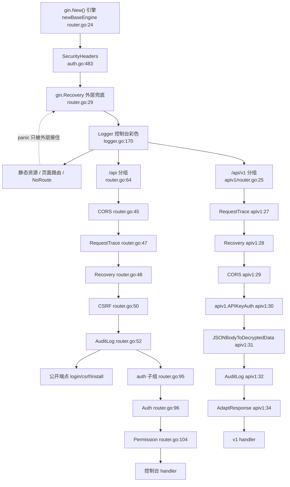
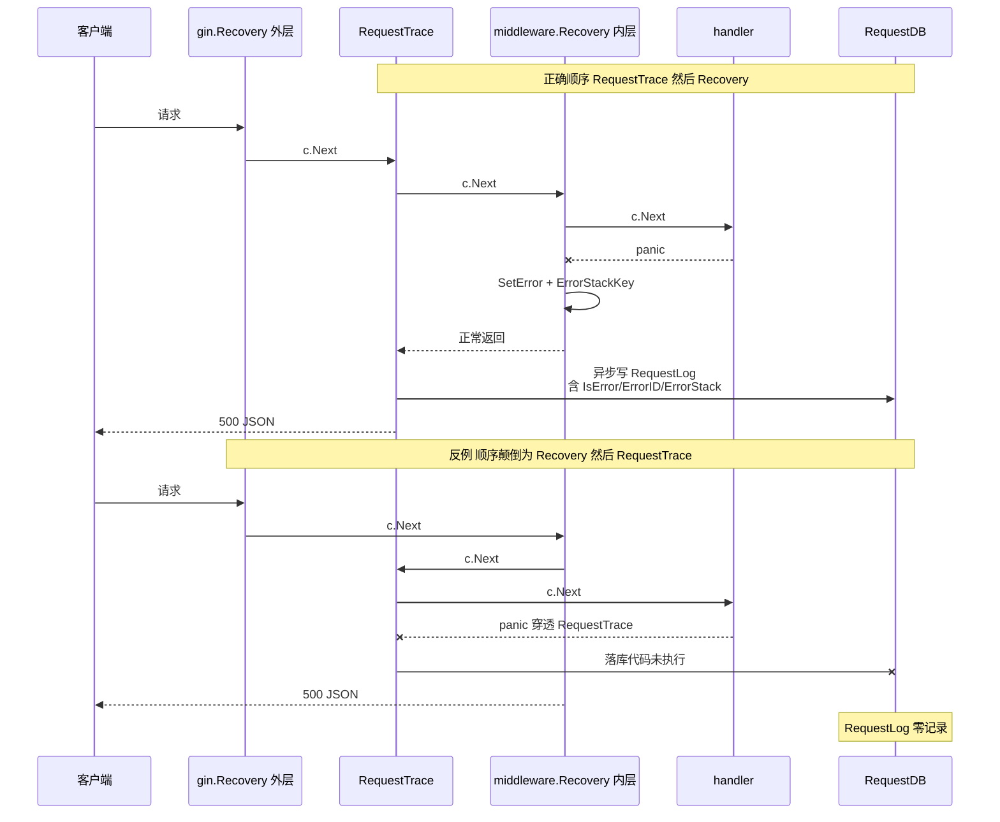
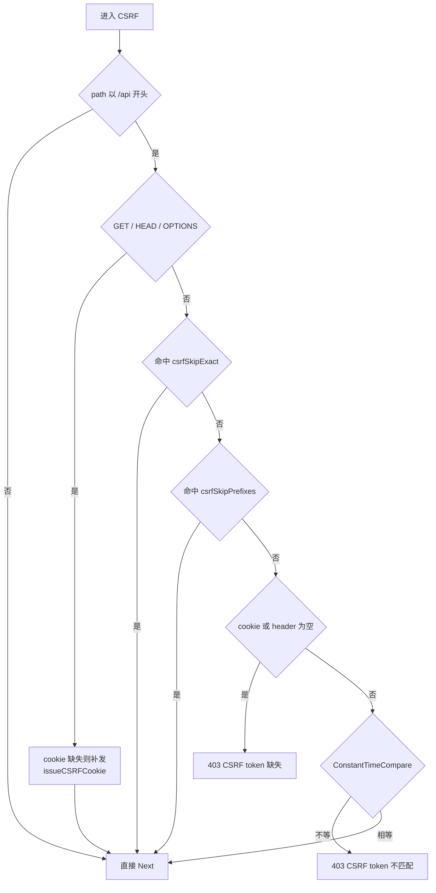
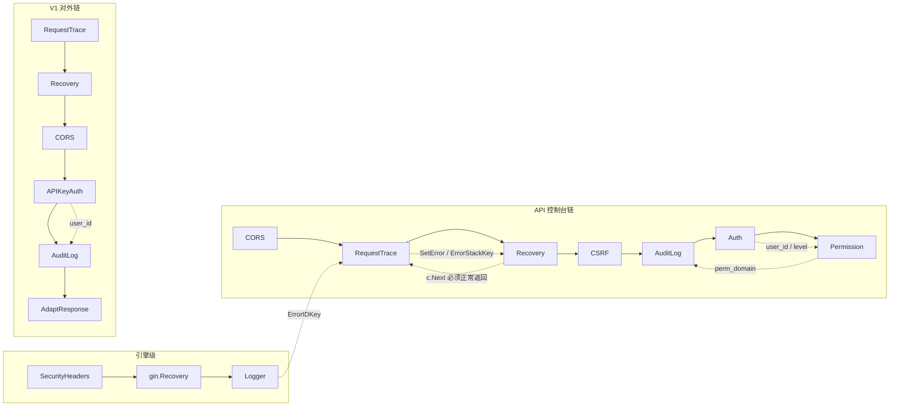

# 中间件系统

<cite>
**本文档引用的文件**
- [router.go](file://main/internal/api/router.go)
- [router.go (apiv1)](file://main/internal/apiv1/router.go)
- [auth.go (middleware)](file://main/internal/api/middleware/auth.go)
- [permission.go](file://main/internal/api/middleware/permission.go)
- [csrf.go](file://main/internal/api/middleware/csrf.go)
- [request_trace.go](file://main/internal/api/middleware/request_trace.go)
- [recovery.go](file://main/internal/api/middleware/recovery.go)
- [audit.go](file://main/internal/api/middleware/audit.go)
- [logger.go (middleware)](file://main/internal/api/middleware/logger.go)
- [sign.go](file://main/internal/api/middleware/sign.go)
- [sanitize.go](file://main/internal/api/middleware/sanitize.go)
- [apikey.go](file://main/internal/api/middleware/apikey.go)
- [auth.go (apiv1)](file://main/internal/apiv1/auth.go)
- [adapt.go](file://main/internal/apiv1/adapt.go)
- [recovery_trace_test.go](file://main/internal/api/recovery_trace_test.go)
- [recovery_panic_client_test.go](file://main/internal/api/recovery_panic_client_test.go)
- [router_test.go](file://main/internal/api/router_test.go)
- [permission_route_test.go](file://main/internal/api/permission_route_test.go)
- [dashboard_proxy_test.go](file://main/internal/api/handler/dashboard_proxy_test.go)
</cite>

## 目录

1. [简介](#简介)
2. [项目结构](#项目结构)
3. [核心组件](#核心组件)
4. [架构总览](#架构总览)
5. [详细组件分析](#详细组件分析)
6. [依赖关系分析](#依赖关系分析)
7. [性能考虑](#性能考虑)
8. [故障排查指南](#故障排查指南)
9. [结论](#结论)
10. [附录](#附录)

## 简介

本文档描述 DNSPlane 后端 HTTP 中间件层的完整装配关系与逐个组件的行为契约。系统存在**两条互不相交的中间件链**：

- 控制台链 `/api`：面向浏览器，依赖 HttpOnly Cookie 会话 + CSRF double-submit，鉴权走 JWT。
- 对外 API 链 `/api/v1`：面向 API Key 客户端，无 Cookie，鉴权走 HMAC-SHA256 签名，响应经 `AdaptResponse` 统一改写。

`main/internal/api/router.go:63` 显式把 `apiv1.Setup(r)` 挂在引擎根节点而非 `/api` 分组下，原因写在 `router.go:57-62` 的注释里：`/api` 分组的 CSRF 校验会让没有 Cookie 的 API Key 客户端所有写请求被拒，而签名本身即身份与完整性凭据。

本文重点回答三个问题：

1. 每个中间件的作用、输入输出、失败响应与精确挂载位置。
2. **双层 panic 恢复**为什么必须让 `Recovery` 紧跟 `RequestTrace`——顺序颠倒会让请求日志完全丢失。
3. `apikey.go` 与 `sign.go` 中的 `DecryptAndVerify` 为何成为零引用死代码。

## 项目结构

中间件代码集中在 `main/internal/api/middleware/`，另有对外 API 专用中间件下沉到 `main/internal/apiv1/`，避免控制台包与开放接口包相互反向依赖。

| 文件 | 行数 | 导出中间件 | 辅助能力 |
| --- | --- | --- | --- |
| `auth.go` | 572 | `Auth()`、`SecurityHeaders()`、`CORS()` | Cookie 加解密、令牌签发、用户缓存 |
| `permission.go` | 400 | `Permission()` | 域名/子域授权判定 |
| `csrf.go` | 130 | `CSRF()`、`IssueCSRFHandler` | double-submit token 发放 |
| `request_trace.go` | 372 | `RequestTrace()` | `SetError`、`AddDBQuery`、`MarkErrorID` |
| `recovery.go` | 78 | `Recovery()` | brokenPipe 识别、堆栈采集 |
| `audit.go` | 176 | `AuditLog()` | 跳过规则、动作名推导 |
| `logger.go` | 246 | `Logger()` | 着色输出、慢请求阈值 |
| `sign.go` | 206 | `DecryptAndVerify()`（未挂载） | 加解密响应与统一响应封装 |
| `sanitize.go` | 169 | 无 | body/header 脱敏 |
| `apikey.go` | 112 | `APIKeyAuth()`（零引用） | HMAC 工具（零引用） |

各入口函数的定义行（当次直读复核，`rg -n '^func '`）：

| 文件 | 入口函数与定义行 |
| --- | --- |
| `middleware/auth.go` | `Auth():125`、`SecurityHeaders():483`、`CORS():516`、`DecryptCookie():66`、`AuthUserID():216` |
| `middleware/permission.go` | `Permission():132`、`getDomainIDFromRequest():210`、`ApplyUserPermissionModules():367` |
| `middleware/csrf.go` | `CSRF():70`、`newCSRFToken():55`、`issueCSRFCookie():62`、`IssueCSRFHandler():119` |
| `middleware/request_trace.go` | `RequestTrace():135`、`MarkErrorID():122`、`SetError():316`、`AddDBQuery():346` |
| `middleware/recovery.go` | `Recovery():21`（全文件 78 行） |
| `middleware/audit.go` | `AuditLog():21`、`shouldSkipAudit():128`、`deriveAction():149` |
| `middleware/logger.go` | `Logger():170`、`shouldSkipLog():47`、`extractModule():103` |
| `middleware/sign.go` | `DecryptAndVerify():17`、`GetDecryptedData():84`、`EncryptedResponse():142` |
| `middleware/sanitize.go` | `SanitizeBodyForLog():101`、`SanitizeHeadersForLog():155`、`isSensitiveKey():92` |
| `middleware/apikey.go` | `JSONBodyToDecryptedData():27`、`APIKeyAuth():44`（全文件零引用） |
| `apiv1/auth.go` | `APIKeyAuth():44`、`JSONBodyToDecryptedData():143`、`signWithKey():118` |
| `apiv1/adapt.go` | `AdaptResponse():32`、`mapConsoleError():120` |

**章节来源**

- `main/internal/api/middleware/` 全量文件的 `func` 声明行，经 `rg -n '^func '` 复核
- [auth.go:125](file://main/internal/api/middleware/auth.go#L125)
- [recovery.go:21](file://main/internal/api/middleware/recovery.go#L21)
- [apikey.go:27-44](file://main/internal/api/middleware/apikey.go#L27-L44)

## 核心组件

按挂载位置与职责归类，挂载状态以代码实际引用为准：

| 组件 | 挂载点（file:line） | 作用域 | 失败响应 | 状态 |
| --- | --- | --- | --- | --- |
| `SecurityHeaders` | `api/router.go:28` | 全引擎 | 不中断 | 生效 |
| `gin.Recovery` | `api/router.go:29` | 全引擎 | 500 | 生效（外层兜底） |
| `Logger` | `api/router.go:30` | 全引擎 | 不中断 | 生效 |
| `CORS` | `api/router.go:45` / `apiv1/router.go:29` | 分组内 | OPTIONS 204 | 生效 |
| `RequestTrace` | `api/router.go:47` / `apiv1/router.go:27` | `/api*` | 不中断 | 生效 |
| `middleware.Recovery` | `api/router.go:48` / `apiv1/router.go:28` | 分组内 | 500 + JSON | 生效（内层） |
| `CSRF` | `api/router.go:50` | 仅 `/api` | 403 | 生效 |
| `AuditLog` | `api/router.go:52` / `apiv1/router.go:32` | 分组内 | 不中断 | 生效 |
| `Auth` | `api/router.go:96` | `/api` 认证子组 | 401 | 生效 |
| `Permission` | `api/router.go:104` | `/api` 认证子组 | 200 + `code:-1` | 生效 |
| `apiv1.APIKeyAuth` | `apiv1/router.go:30` | `/api/v1` | v1 错误码 | 生效 |
| `apiv1.JSONBodyToDecryptedData` | `apiv1/router.go:31` | `/api/v1` | 不中断 | 生效 |
| `AdaptResponse` | `apiv1/router.go:34` | `/api/v1` | 改写响应 | 生效 |
| `middleware.APIKeyAuth` | 无引用 | — | — | 死代码 |
| `middleware.JSONBodyToDecryptedData` | 无引用 | — | — | 死代码 |
| `DecryptAndVerify` | 无挂载点 | — | 200 + `code:-1` | 死代码 |

**章节来源**

- [router.go:28-30](file://main/internal/api/router.go#L28-L30)
- [router.go:45-52](file://main/internal/api/router.go#L45-L52)
- [router.go:95-104](file://main/internal/api/router.go#L95-L104)
- [router.go (apiv1):27-34](file://main/internal/apiv1/router.go#L27-L34)

## 架构总览

两条链共用引擎级中间件，在分组级彻底分叉：



**图表来源**

- [router.go:24-53](file://main/internal/api/router.go#L24-L53)
- [router.go:63-104](file://main/internal/api/router.go#L63-L104)
- [router.go (apiv1):24-47](file://main/internal/apiv1/router.go#L24-L47)

装配被拆成两个可复用函数，这处设计意图写在 `router.go:22-23`：

```go
// newBaseEngine 构建引擎并挂载链首中间件
// 抽为独立函数：测试需要与生产完全一致的链路，复刻一份会在顺序被改坏时失去报警能力
func newBaseEngine() *gin.Engine {
	r := gin.New()
	r.Use(middleware.SecurityHeaders())
	r.Use(gin.Recovery())
	r.Use(middleware.Logger())
	return r
}
```

因为测试直接调用 `newBaseEngine()` 与 `applyAPIMiddleware()`，任何顺序改动都会在断言里暴露，而不是只在文档里失效。

**章节来源**

- [router.go:22-32](file://main/internal/api/router.go#L22-L32)
- [router.go:44-53](file://main/internal/api/router.go#L44-L53)

## 详细组件分析

### SecurityHeaders 与 CORS

`SecurityHeaders`（`auth.go:483`）纯写响应头，不读上下文、不中断链。固定注入 `X-Content-Type-Options`、`X-Frame-Options`、`Referrer-Policy`、`Permissions-Policy` 与一条完整 CSP（`auth.go:490-501`）。CSP 中 `frame-src` 被单独列出，注释在 `auth.go:496` 说明原因：三家验证码 SDK 都把控件渲染进跨源 iframe，缺该指令会回落 `default-src 'self'` 而拦截。HTTPS 条件下追加 HSTS（`auth.go:503-505`），不带 `includeSubDomains`。

`CORS`（`auth.go:516`）输入是 `Origin` 请求头，输出是四个 `Access-Control-*` 头。放行判定在 `isAllowedOrigin`（`auth.go:542`）：优先匹配系统 `site_url`，未配置时只允许与当前请求 `Host` 一致的来源，`localhost`/`127.0.0.1` 作为开发豁免。`OPTIONS` 直接 `AbortWithStatus(204)`（`auth.go:527-530`），因此 `RequestTrace` 必须排在 CORS 之后，否则预检请求会污染请求日志——这条依赖写在 `router.go:46`。

失败响应：CORS 不回 403，仅省略 `Access-Control-Allow-Origin`，由浏览器拦截，因此服务端日志看不到显式拒绝，排障需看 `Origin` 落库字段。

`X-Error-ID`、`X-Request-ID`、`X-Token-Expiring` 通过 `Access-Control-Expose-Headers`（`auth.go:525`）显式暴露给跨源脚本，前端才能显示错误追踪号。

**章节来源**

- [auth.go:479-534](file://main/internal/api/middleware/auth.go#L479-L534)
- [auth.go:536-570](file://main/internal/api/middleware/auth.go#L536-L570)
- [router.go:45-47](file://main/internal/api/router.go#L45-L47)
- [router_test.go:138](file://main/internal/api/router_test.go#L138)
- [router_test.go:207](file://main/internal/api/router_test.go#L207)

### RequestTrace

`request_trace.go:135`。作用：生成 `X-Request-ID`、包裹响应写入器、在 `c.Next()` 返回后把一条 `models.RequestLog` 异步落库。

输入与输出：

| 项目 | 来源 | 上限/处理 | 位置 |
| --- | --- | --- | --- |
| `X-Request-ID` | 自生成 `GenerateRequestID()` | 原子序列 + UnixNano，非加密随机 | `:47` |
| 请求体 | `io.LimitReader(MaxBodySize)` | 64KB，读完回填 `NopCloser` | `:151-154` |
| 请求头 | 多值合并 + `Host` 补记 | 交给 `SanitizeHeadersForLog` | `:157-172` |
| 响应体 | `respCaptureWriter` 缓冲 | 成功 16384B，失败 256KB | `:174-182`、`:240-246` |
| DB 查询 | `DBQueriesKey` | 累加耗时并 JSON 化 | `:251-261` |

关键常量集中在 `request_trace.go:24-32`：`RequestIDKey`、`ErrorIDKey`、`DBQueriesKey`、`ErrorStackKey`、`ExtraDataKey`、`MaxBodySize`、`MaxResponseSize`；正文截断另有 `maxRequestLogBodyLen = 8192`（`:57`）与 `maxSuccessResponseCapture = 16384`（`:60`）。

`X-Error-ID` 的送达依赖写入器重写：`respCaptureWriter` 在 `WriteHeader`（`:80`）、`WriteHeaderNow`（`:86`）、`Write`（`:91`）三处调用 `noteStatus`（`:73`），因为状态码一旦写出响应头即被快照，之后设的头不再送达（`request_trace.go:120-121` 注释）。`MarkErrorID`（`:122`）对 `< 400` 或已写出的响应直接返回，且已有 `ErrorID` 时复用同一值，保证响应头与落库记录一致。

落库分支（`:296-302`）：`logstore.Store` 处于 Redis 模式时只写 Redis，避免与 SQLite 双写；否则写 `database.RequestDB`。整个落库在 goroutine 内完成，主链路不等待。

请求体脱敏顺序值得注意：先取解密明文（`GetDecryptedData`），表单 URL 编码转 JSON，再统一 `SanitizeBodyForLog`，最后截断（`:211-231`）。响应侧同样脱敏，因为登录/刷新类接口可能回显 token（`:247-248`）。

```go
// request_trace.go:196-209 错误判定
isError := statusCode >= 400 || c.GetBool("has_error")
if isError {
    errorID = c.GetString(ErrorIDKey)
    if errorID == "" {
        errorID = GenerateErrorID()
    }
    errorMsg = c.GetString("error_msg")
    errorStack = c.GetString(ErrorStackKey)
}
```

这说明 `has_error` 与 HTTP 状态码是**两条独立的错误信号**：`SetError`（`:316`）置位 `has_error`，即便 handler 返回 200 + `code:-1`（控制台风格）也会记为错误请求。

**章节来源**

- [request_trace.go:24-60](file://main/internal/api/middleware/request_trace.go#L24-L60)
- [request_trace.go:62-132](file://main/internal/api/middleware/request_trace.go#L62-L132)
- [request_trace.go:135-304](file://main/internal/api/middleware/request_trace.go#L135-L304)
- [request_trace.go:316-340](file://main/internal/api/middleware/request_trace.go#L316-L340)

### Recovery 内层

`recovery.go:21`，全文件仅 78 行，只做四件事：

1. 区分连接中断与真实 panic。`net.OpError` → `os.SyscallError` → 错误串含 `broken pipe` 或 `connection reset by peer` 判定为客户端断开（`:26-35`），仅 `logger.Warn` 后 `Abort`，不告警、不写 500 体。
2. 采集 `runtime.Stack` 到 8192 字节缓冲（`:44-46`）。
3. `SetError(c, "PANIC: ...")` 与 `c.Set(ErrorStackKey, stackTrace)`（`:62-63`），把错误信息交回 `RequestTrace` 落库。
4. 若响应已部分写出则只 `Abort`（`:64-67`），避免二次写 body；否则返回 500 且体为 `{"code":-1,"msg":"服务器内部错误"}`（`:70-73`）。

失败响应表：

| 场景 | 判定条件 | HTTP | 响应体 | 位置 |
| --- | --- | --- | --- | --- |
| 客户端断开 | brokenPipe | 无（Abort） | 无 | `:48-54` |
| panic 且响应已写出 | `c.Writer.Written()` | 保留原状态 | 原内容不追加 | `:64-67` |
| panic 且未写出 | 默认 | 500 | `{"code":-1,"msg":"服务器内部错误"}` | `:70-73` |

`**Recovery 与 Logger 的分工**`：`Logger` 只输出到控制台与日志文件，`Recovery` 只写数据库所需的错误上下文，两者无耦合，故 `Recovery` 不重复打印请求行。

**章节来源**

- [recovery.go:15-78](file://main/internal/api/middleware/recovery.go#L15-L78)
- [request_trace.go:316-337](file://main/internal/api/middleware/request_trace.go#L316-L337)

### 双层 panic 恢复设计

这是本层最反直觉、也最容易被误改的一处。`router.go:34-43` 的块注释给出了完整理由，逐条对应实现：

```go
/*
 * panic 恢复分两层，内层必须紧跟 RequestTrace：
 *   - RequestTrace 的落库代码在 c.Next() 之后，panic 若穿透到链首，这段代码不会执行，
 *     请求日志将完全丢失（实测：仅外层 gin.Recovery 时 RequestLog 零记录）
 *   - 内层在此处被 RequestTrace 包裹，middleware.Recovery 先 SetError 并写 ErrorStackKey，
 *     再把 panic 挡在 RequestTrace 之内，使 c.Next() 正常返回后完成落库，保留 ErrorID 与堆栈
 *   - 外层 gin.Recovery 保留，兜住不经 RequestTrace 的静态资源、页面路由与 NoRoute 的 panic
 */
```

时序差异如下：



**图表来源**

- [router.go:34-53](file://main/internal/api/router.go#L34-L53)
- [recovery.go:61-67](file://main/internal/api/middleware/recovery.go#L61-L67)
- [request_trace.go:181-302](file://main/internal/api/middleware/request_trace.go#L181-L302)

三条测试构成锁死该顺序的证据链：

| 测试 | 位置 | 断言要点 |
| --- | --- | --- |
| `TestAPIPanicPersistsRequestLog` | `recovery_trace_test.go:46` | 500、日志条数恰为 1、`IsError=true`、`ErrorMsg` 含 `PANIC` 与原因、`ErrorStack` 非空、`ErrorID`/`RequestID` 非空 |
| `TestPageRoutePanicStillReturns500` | `recovery_trace_test.go:90` | 页面路由不经 RequestTrace，仍由外层 `gin.Recovery` 返回 500 |
| `TestNonPanicErrorUnaffected` | `recovery_trace_test.go:103` | 非 panic 的 500 请求 `ErrorMsg` 保留业务原文，不被 panic 兜底改写 |
| `TestPanicResponseCarriesErrorIDHeader` | `recovery_panic_client_test.go:16` | panic 响应也带 `X-Error-ID` 且与落库值一致 |
| `TestWriteThenPanicKeepsSingleResponseBody` | `recovery_panic_client_test.go:82` | 已写出后再 panic，响应体不出现两段 JSON |
| `TestSecurityHeadersSurvivePanic` | `router_test.go:228` | 安全头在 panic 路径上仍然送达 |

`TestNonPanicErrorUnaffected` 补上了另一侧风险：若让内层 `Recovery` 无条件覆盖 `error_msg`，普通业务错误会被写成一堆无关堆栈文本。实现里靠 `recover()` 只在真有 panic 时非空来保证这一点。

外层 `gin.Recovery` 不可删除的原因同样具体：静态资源、页面路由、`NoRoute`（`router.go:346` 附近还有内嵌静态子系统初始化失败时的 `panic`）都不在 `/api` 组内，没有内层保护。

**章节来源**

- [router.go:34-53](file://main/internal/api/router.go#L34-L53)
- [recovery_trace_test.go:38-131](file://main/internal/api/recovery_trace_test.go#L38-L131)
- [recovery_panic_client_test.go:16-110](file://main/internal/api/recovery_panic_client_test.go#L16-L110)
- [router_test.go:228](file://main/internal/api/router_test.go#L228)

### CSRF

`csrf.go:70`。double-submit cookie 模型：cookie 名 `_csrf`，头名 `X-CSRF-Token`（`csrf.go:23-24`）。

判定流程：



**图表来源**

- [csrf.go:69-115](file://main/internal/api/middleware/csrf.go#L69-L115)
- [csrf.go:23-40](file://main/internal/api/middleware/csrf.go#L23-L40)

token 由 `crypto/rand` 生成 32 字节并 hex 编码（`newCSRFToken`，`csrf.go:55`）。cookie 用 `SameSite=Strict`、7 天有效期、路径 `/`，且**显式非 HttpOnly**（`csrf.go:65-66`），因为前端必须能读出它再回填 header。比较使用 `subtle.ConstantTimeCompare`，与 API Key 签名一样规避时序侧信道。

`GET /api/csrf`（`router.go:68` → `IssueCSRFHandler`，`csrf.go:119`）返回 `{"code":0,"data":{"token":"..."}}`，供前端初始化拉取一次。跳过清单 `csrfSkipExact`（`csrf.go:36`）与 `csrfSkipPrefixes`（`csrf.go:30`）覆盖 OAuth 回调、magic-link verify 这类跨站返回场景——这些请求带着有效会话但带不上本站签发时序内的 token，注释在 `csrf.go:20` 说明。

失败响应：均为 403，体分别是 `CSRF token 缺失`、`CSRF token 不匹配`（`csrf.go:106`、`:110`），`code` 字段为 403 而非控制台的 `-1`。

**章节来源**

- [csrf.go:18-40](file://main/internal/api/middleware/csrf.go#L18-L40)
- [csrf.go:55-115](file://main/internal/api/middleware/csrf.go#L55-L115)
- [csrf.go:117-130](file://main/internal/api/middleware/csrf.go#L117-L130)
- [router.go:67-68](file://main/internal/api/router.go#L67-L68)

### AuditLog

`audit.go:21`。这是一个**后置写**中间件：`c.Next()` 之后才开始判断，因此它必须在认证之后挂载才能读到 `user_id`（`apiv1/router.go:22` 注释明确说明）。

过滤顺序（`:29-47`）：方法必须属于 `POST/PUT/DELETE/PATCH`；路径命中 `shouldSkipAudit`（`:128`）则跳过；`user_id` 为空（未认证）直接返回。域名取自 `perm_domain`（`:54`），因此审计日志里的 domain 字段依赖 `Permission` 是否挂载——这层耦合在下节展开。

跳过规则用三张预编译表表达（`audit.go:97-122`）：前缀 `auditSkipPrefixes`（`/api/login`、`/api/auth/`、`/api/install`）、后缀 `auditSkipSuffixes`（`/list`、`/detail`、`/stats` 等 14 项）、精确 `auditSkipExact`（12 个只读型 POST 端点）。`shouldSkipAudit` 对精确项走 map 的 O(1) 查找，注释在 `:124-126` 说明这是为了避免每请求线性扫描。

写入通过 `utils.SafeGo` 异步投递 `database.LogDB`（`:74-89`），`LogDB == nil` 时静默返回。`Data` 字段拼接动作名、耗时与 HTTP 状态类别（`:63-69`），最终 `truncate` 到 500 字符（`:83`），UserAgent 截 200（`:85`）。

失败响应：无。审计本身不影响业务响应，落库失败被丢弃，排查需看 `LogDB` 是否初始化。

**章节来源**

- [audit.go:13-91](file://main/internal/api/middleware/audit.go#L13-L91)
- [audit.go:93-128](file://main/internal/api/middleware/audit.go#L93-L128)
- [audit.go:149-176](file://main/internal/api/middleware/audit.go#L149-L176)

### Auth

`auth.go:125`。三因子会话校验，任何一步失败都是 401 且立即 `Abort`：

```go
cookieVal, cookieErr := c.Cookie("_t")            // :128 复合会话凭证 sid.verifier
realToken, valid := DecryptCookie(cookieVal)      // :136 AES-GCM 解密出真实 access token
headerToken := extractBearerToken(authHeader)     // :145 Authorization 头二次比对
if headerToken == "" || headerToken != realToken  // :146 不一致即拒绝
```

Cookie 加解密对：`EncryptForCookie`（`:45`）与 `DecryptCookie`（`:66`），密钥由 `deriveKey`（`:35`）派生。这一层设计使 Cookie 单独泄露不足以重放请求，必须有同名 Bearer 头。

后续校验：`ParseToken`（`:152`，函数体 `:423`）解析 JWT 并校验过期；`TokenType` 非 `access` 直接拒（`:160-164`），阻止 refresh token 当访问令牌用；`getCachedAuthUser`（`:170`，函数体 `:456`）读 10 秒 TTL 用户缓存，注释在 `:166-169` 明确接受"权限变更最多 10 秒后生效"的延迟；`user.Status != 1` 拒绝（`:177`）。

注入上下文键（`:184-188`）：`user_id`（**字符串**，`:183` 注释警告勿存 uint，否则 `GetString` 为空）、`username`、`level`、`auth_user_model`（常量在 `auth.go:95`）。随后 `ApplyUserPermissionModules`（`permission.go:367`）写入模块级权限。响应头 `X-Token-Expiring` 在剩余有效期不足 5 分钟时置 `true`（`:191-196`）。

失败响应全清单：

| 触发条件 | msg | HTTP | 位置 |
| --- | --- | --- | --- |
| `_t` Cookie 缺失 | 未登录 | 401 | `:129-133` |
| Cookie 解密失败 | 会话已过期 | 401 | `:137-141` |
| Header 与 Cookie token 不一致 | Token不一致 | 401 | `:146-150` |
| JWT 解析失败/过期 | Token无效或已过期 | 401 | `:153-157` |
| TokenType 非 access | 无效的Token类型 | 401 | `:160-164` |
| 用户查不到 | 用户不存在 | 401 | `:171-175` |
| 账户被禁用 | 账户已被禁用 | 401 | `:177-181` |

`AuthCachedUser`（`:203`）与 `AuthUserID`（`:216`）是给下游复用的读取器，避免二次查库；`InvalidateAuthUserCache`（`:473`）在权限变更时主动失效。

**章节来源**

- [auth.go:117-200](file://main/internal/api/middleware/auth.go#L117-L200)
- [auth.go:35-66](file://main/internal/api/middleware/auth.go#L35-L66)
- [auth.go:203-230](file://main/internal/api/middleware/auth.go#L203-L230)
- [auth.go:446-482](file://main/internal/api/middleware/auth.go#L446-L482)
- [router.go:95-104](file://main/internal/api/router.go#L95-L104)

### Permission

`permission.go:132`。读取顺序在注释 `permission.go:128-130` 中说明：从 GET query 或 POST 解密数据取 `domain_id`。实际取值为三级回退（`getDomainIDFromRequest`，`:210`），第三级是 `c.Param("id")`。

判定链：

| 步骤 | 条件 | 结果 | 位置 |
| --- | --- | --- | --- |
| 管理员豁免 | `level >= 2` | 直接 Next | `:138-141` |
| 无 domain_id | 空串 | 直接 Next，交由 handler | `:143-148` |
| 域名查不到 | DB 错误 | 200 + `code:-1` "域名不存在" | `:152-156` |
| 自有账户 | `account.UserID == uid` | 放开全部子域，写 `perm_sub_domain="*"` | `:166-173` |
| 委派权限缺失 | `pickDelegatedPermission` 返回 false | "无权限操作该域名" | `:175-180` |
| 只读 + 写请求 | `perm.ReadOnly && isDomainScopedWriteRequest` | "该域名为只读权限，无法执行写操作" | `:183-187` |
| 子域越界 | `subGrantCoversRR` 为 false | "无权限操作该子域名" | `:190-199` |

注意所有拒绝都是 **HTTP 200 + 业务 code -1**，与 `Auth` 的 401 风格不同，这是控制台协议的历史约定，前端按 `code` 分支。

`router.go:97-103` 的块注释记录了这处中间件的一次真实漏挂事故：此前只定义了 `Permission()` 而从未挂载，导致它写入的 `perm_read_only` / `perm_domain` / `perm_sub_domain` 三个上下文键恒不存在，下游三处依赖全部失效——只读用户可删记录、子域受限用户能读到该域名全部记录、审计日志的 domain 恒为空。因此它被要求"必须在 Auth 之后（读 user_id/level），在全部路由之前"。

`permission_route_test.go:53-59` 的注释进一步说明：生产探针带 `:id` 路径参数，因为 `DecryptAndVerify` 从未挂载，`decrypted_data` 恒空，控制台域名范围接口实际都靠 `c.Param("id")` 取域名 ID。

权限合并逻辑在 `mergePermissionRows`（`:52`）与 `activeDelegatedPermissionsByUID`（`:19`）；`DomainPermissionOf`（`:330`）、`CheckDomainPermission`（`:335`）、`CheckSubDomainPermission`（`:344`）是给 handler 直接调用的公开判定入口。

**章节来源**

- [permission.go:127-207](file://main/internal/api/middleware/permission.go#L127-L207)
- [permission.go:19-107](file://main/internal/api/middleware/permission.go#L19-L107)
- [permission.go:210-282](file://main/internal/api/middleware/permission.go#L210-L282)
- [router.go:97-104](file://main/internal/api/router.go#L97-L104)
- [permission_route_test.go:45-70](file://main/internal/api/permission_route_test.go#L45-L70)

### Logger

`logger.go:170`。与 `RequestTrace` 的分工是：前者管人看的彩色控制台，后者管库里的结构化审计。`Logger` 不落库，只写 stdout 与日志文件。

跳过策略：`HEAD` 请求直接放行（`:173-176`），`shouldSkipLog`（`:47`）过滤静态资源。控制台行格式在 `:204-211`，形如 `14:20:24 200 1.99ms GET /api/domains/list`；若 `has_error` 且有 `ErrorID`，末尾追加红色 `[err_xxxx]`（`:214-218`）。

文件写入按严重程度分档（`:228-243`）：`status >= 500 || has_error` → `FileError`；`status >= 400` → `FileWarn`；耗时 ≥ `slowRequestThreshold`（`logger.go:14`，3 秒）→ `FileWarn` 带 `SLOW` 标记。**正常快速请求不写日志文件**（`:243` 注释），避免文件膨胀，这一点在排查"为什么某请求没进日志文件"时容易误判。

模块名由 `extractModule`（`:103`）从路径推导，用于日志前缀 `[domain]`、`[cert]` 这类标签。

**章节来源**

- [logger.go:14-47](file://main/internal/api/middleware/logger.go#L14-L47)
- [logger.go:103-169](file://main/internal/api/middleware/logger.go#L103-L169)
- [logger.go:168-246](file://main/internal/api/middleware/logger.go#L168-L246)

### apiv1.APIKeyAuth 与 JSONBodyToDecryptedData

对外 API 的认证实现位于 `main/internal/apiv1/auth.go:44`，与 `middleware/apikey.go` 中的同名实现并存但**只有前者被挂载**。

请求头契约（`apiv1/auth.go:24-41`）：`X-API-UID`、`X-API-Timestamp`、`X-API-Sign`，待签串为 `uid + "\n" + timestamp + "\n" + METHOD + "\n" + PATH`，用 `api_key` 做 HMAC-SHA256 后 hex。注释在 `:29-33` 说明与旧版 PHP `md5(uid+timestamp+apikey)` 的差异：新方案多绑定了目标接口，同一签名无法挪用到别的路径。时间戳窗口 `apiKeyTimestampTolerance = 5 * time.Minute`（`:37`）。

失败响应统一走 v1 错误码体系（见《错误处理与日志系统》）：凭据缺失 `Fail(c, CodeUnauthorized, "")`（`:51`），UID 非法 `Failf(..., "无效的用户 ID: %s", uid)`（`:58`）。签名比较同样使用 `hmac.Equal` 常量时间实现。

`JSONBodyToDecryptedData`（`apiv1/auth.go:143`）只处理 POST：`ShouldBindJSON` 成功且非 nil 才写 `decrypted_data`（`middleware/apikey.go:29-34` 是同款逻辑）。它存在的原因是下游 handler 层统一用 `GetDecryptedData`/`BindDecryptedData` 读参数，v1 走明文 JSON 时必须把 body 塞进同一个上下文键，才能复用 handler。

**章节来源**

- [auth.go (apiv1):22-118](file://main/internal/apiv1/auth.go#L22-L118)
- [auth.go (apiv1):139-160](file://main/internal/apiv1/auth.go#L139-L160)
- [apikey.go:23-105](file://main/internal/api/middleware/apikey.go#L23-L105)
- [router.go (apiv1):27-47](file://main/internal/apiv1/router.go#L27-L47)

### AdaptResponse

`apiv1/adapt.go:32`，链末适配器。机制：替换 `c.Writer` 为缓冲写入器 `adapterWriter`（`:28-29`），`c.Next()` 后恢复真实 writer 再改写（`:46-47` 注释强调顺序，否则适配内容仍落进缓冲）。

三道保护：

1. `OPTIONS` 直接返回，避免给 204 强塞 JSON（`:35-38`）。
2. 缓冲为空则不处理——认证/参数阶段的中间件已直接写出 v1 格式（`:49-53`）。
3. 原始字节含 `"request_id"` 即判定为 v1 自身响应，原样透出（`:56-67`）。注释解释了这个判定的必要性：v1 handler 直接调 `Fail/OK` 时也会落进同一缓冲，若按控制台格式解析，其 `message` 会被当成 `msg` 读到空串，进而被重新映射成参数错误，"余额的鉴权拒绝会被改写成 2001"。

成功分支保留两种控制台形状（`:81-101`）：`SuccessResponse → {code,data}` 与 `SuccessMsg → {code,msg}`，注释指出早期只取 `data` 会让后者变成 `data:null`，丢掉"成功添加 3 条"这类判断部分失败的唯一线索。

失败分支 `console.Code != 0` 时调用 `mapConsoleError(console.Msg)`（`:104`）反推 v1 错误码，该函数是**有损映射**，详见《错误处理与日志系统》。非预期 JSON 形状（404 页面、panic 堆栈）原样透出（`:74-79`），避免把错误掩盖成格式问题。

注释 `apiv1/router.go:33` 说明它必须放链末："必须在认证与限流之后"，当前仓库未发现限流中间件实现（仅注释提及），这是待观察项而非已验证事实。

**章节来源**

- [adapt.go:28-111](file://main/internal/apiv1/adapt.go#L28-L111)
- [adapt.go:113-148](file://main/internal/apiv1/adapt.go#L113-L148)
- [router.go (apiv1):16-34](file://main/internal/apiv1/router.go#L16-L34)

### DecryptAndVerify 与 apikey.go 的死代码成因

两个组件形态不同，但根因相同：**能力被迁移到新的挂载点，旧实现留在原包内未被删除**。

`sign.go:17` 的 `DecryptAndVerify` 实现的是"前端加密请求体"链路：解析 `{key, iv, data}` 三段信封（`:19-29`）→ `utils.HybridDecryptWithKey` 混合解密（`:37`）→ 从 `Authorization` + `X-Refresh-Token` + `X-Secret-Token` 派生签名密钥（`:49-58`）→ `utils.ParseSignedRequestWithKey` 校验签名（`:61`）→ 写 `aes_key` 与 `decrypted_data`。

它的失败响应全部是 **HTTP 200 + `code:-1`**，msg 分别为 `请求格式错误`、`请求解密失败`、以及签名校验的 `err.Error()` 原文（`:26`、`:40`、`:64`）。

关键事实：**全仓无任何挂载点**。`rg -n 'DecryptAndVerify'` 在 Go 源码中只命中定义处与三处注释（`sign.go:16`、`permission_route_test.go:57`、`handler/dashboard_proxy_test.go:70`），没有任何 `Use` 调用。它的存在被两处测试注释反过来证实为缺失：

- `permission_route_test.go:56-58`：写入 `decrypted_data` 的 `DecryptAndVerify` 中间件从未被挂载。
- `handler/dashboard_proxy_test.go:69-73`：`DecryptAndVerify` 与 `JSONBodyToDecryptedData` 两个会写 `decrypted_data` 的中间件"在本仓均无挂载点"，因此 `BindDecryptedData` 恒走 `ShouldBindJSON` 明文分支，请求在 `binding:"required"` 阶段就被拦下。

但 `sign.go` 的其余部分**并未失效**：`EncryptedResponse`（`:142`）被 `handler/dashboard.go:326` 实际调用，`GetDecryptedData`（`:84`）、`BindDecryptedData`（`:104`）、`GetOriginalResponse`（`:175`）被 handler 层与 `request_trace.go:213`、`:235` 广泛使用。这解释了为何死代码长期存活——文件本身是活的，只有入口中间件是空的，删除单个函数需要确认整条前端加密协议是否还对外承诺。

`middleware/apikey.go` 的成因更清晰：`APIKeyAuth`（`:44`）与 `JSONBodyToDecryptedData`（`:27`）在 `apiv1` 包内各有一份新实现（`apiv1/auth.go:44`、`:143`），且新实现改用 v1 错误码（`Fail`/`Failf`）而非裸 JSON。`apiv1/router.go:30-31` 因同包引用直接写成 `APIKeyAuth()`，`rg -n 'middleware\.APIKeyAuth|middleware\.JSONBodyToDecryptedData'` **零命中**，因此 `apikey.go` 全文件（含 `computeHMACSHA256` `:108`、`APIKeyTimestampTolerance` `:20`）都不再进入运行时链路。

| 死代码 | 行数 | 替代实现 | 未删除的可观测原因 |
| --- | --- | --- | --- |
| `sign.DecryptAndVerify` | `sign.go:17-72` | 无（前端加密链路整体停用） | 同文件的响应封装被大量引用 |
| `middleware.APIKeyAuth` | `apikey.go:44-105` | `apiv1.APIKeyAuth:44` | 错误码协议升级为 v1 枚举 |
| `middleware.JSONBodyToDecryptedData` | `apikey.go:27-37` | `apiv1.JSONBodyToDecryptedData:143` | 同上，同包名遮蔽需显式限定 |

风险说明：这三处都是 `exported`，编译器与 `go vet` 不会报警，静态检查也无法识别，只能靠引用扫描发现。若后续重启前端加密链路，直接挂 `middleware.DecryptAndVerify` 会与新式 `CORS` 放行头（`X-Secret-Token` 已在 `Allow-Headers` 内，`auth.go:524`）兼容，但会绕过 v1 错误码体系，需明确归属。

**章节来源**

- [sign.go:16-72](file://main/internal/api/middleware/sign.go#L16-L72)
- [sign.go:83-206](file://main/internal/api/middleware/sign.go#L83-L206)
- [apikey.go:18-112](file://main/internal/api/middleware/apikey.go#L18-L112)
- [auth.go (apiv1):38-143](file://main/internal/apiv1/auth.go#L38-L143)
- [permission_route_test.go:53-59](file://main/internal/api/permission_route_test.go#L53-L59)
- [dashboard_proxy_test.go:63-73](file://main/internal/api/handler/dashboard_proxy_test.go#L63-L73)

### sanitize 脱敏工具

`sanitize.go` 不是中间件，而是 `RequestTrace` 与 `AuditLog` 在记录前调用的纯函数集。掩码常量 `redactedMark = "***REDACTED***"`（`:13`）。

敏感关键字以 map 表达（`:16` 起），覆盖 `password`/`passwd`/`pwd` 三态、`*_password` 四种变体、`token` 家族（`access_token`、`refresh_token`、`magic_link_token`、`reset_token`）、密钥家族（`api_key`、`apikey`、`access_key`、`secret_key`、`access_key_id`、`accesskeysecret` 等含无下划线写法）以及 `totp`、`verification_code`。注释在 `:15` 明确取向："宁可多掩几个也不要漏"。

匹配前用 `normalizeKey`（`:84`）归一化，`isSensitiveKey`（`:92`）不区分大小写、不区分 `_` 与 `-`。`SanitizeBodyForLog`（`:101`）按 content-type 分派：JSON 走 `redactJSON`（`:135`）递归改写，表单走 URL 解码路径。`SanitizeHeadersForLog`（`:155`）处理 `Authorization`/`Cookie`/`X-Refresh-Token`。

`sanitize_bench_test.go` 提供基准，说明这条路径在每请求热路径上，性能考量见下节。

**章节来源**

- [sanitize.go:12-101](file://main/internal/api/middleware/sanitize.go#L12-L101)
- [sanitize.go:135-169](file://main/internal/api/middleware/sanitize.go#L135-L169)
- [request_trace.go:171-172](file://main/internal/api/middleware/request_trace.go#L171-L172)
- [request_trace.go:227-248](file://main/internal/api/middleware/request_trace.go#L227-L248)

## 依赖关系分析

中间件之间的依赖全部通过**执行顺序**与**上下文键**表达，没有显式调用关系：



**图表来源**

- [router.go:44-53](file://main/internal/api/router.go#L44-L53)
- [router.go:95-104](file://main/internal/api/router.go#L95-L104)
- [recovery.go:61-63](file://main/internal/api/middleware/recovery.go#L61-L63)
- [audit.go:42-56](file://main/internal/api/middleware/audit.go#L42-L56)

硬约束清单（违反即产生静默失效，而非启动报错）：

| 约束 | 位置 | 违反后果 |
| --- | --- | --- |
| `RequestTrace` 必须先于 `Recovery` | `api/router.go:47-48`、`apiv1/router.go:27-28` | panic 请求日志完全丢失 |
| `CORS` 必须先于 `RequestTrace` | `api/router.go:45-47` | OPTIONS 预检被记为请求日志 |
| `Auth` 必须先于 `Permission` | `api/router.go:96-104` | `user_id`/`level` 为空，权限判定整体放行 |
| `Auth`/`APIKeyAuth` 必须先于 `AuditLog` | `apiv1/router.go:22` | 写操作不落审计 |
| `AdaptResponse` 必须在链末 | `apiv1/router.go:34` | 中间件写出内容不被适配 |

**章节来源**

- [router.go:44-53](file://main/internal/api/router.go#L44-L53)
- [router.go:95-104](file://main/internal/api/router.go#L95-L104)
- [router.go (apiv1):16-34](file://main/internal/apiv1/router.go#L16-L34)

## 性能考虑

热路径上每请求都会执行的成本项，按量级排序：

| 开销点 | 实现 | 上限/缓解 | 位置 |
| --- | --- | --- | --- |
| 请求体读取 | `io.LimitReader` 全读入内存 | 64KB | `request_trace.go:152` |
| 响应体截取 | 缓冲复制 | 成功 16KB / 失败 256KB | `:60`、`:31` |
| body/响应脱敏 | JSON 递归解析 | 命中关键字即掩，`>8192` 截断 | `:228-231` |
| 请求头序列化 | map 合并 + JSON | 敏感头不落明文 | `:157-172` |
| DB 查询收集 | 每请求一个切片指针 | `AddDBQuery` 追加 | `:346` |
| 请求日志落库 | `go func` 异步 | Redis 模式仅写 Redis | `:296-302` |
| 审计落库 | `utils.SafeGo` 异步 | 截断 500/200 | `audit.go:74-88` |
| 用户查询 | 10 秒 TTL 缓存 | 权限变更延迟可接受 | `auth.go:166-170` |

三个具体取舍值得记录：

1. `GenerateRequestID`（`request_trace.go:47`）用**原子自增 + UnixNano**而非 `crypto/rand`，注释直言"避免每请求 crypto/rand 开销"；而 `GenerateErrorID`（`:53`）仍走 `crypto/rand`，因为错误路径低频且 ID 会暴露给用户。
2. 请求日志与审计都异步写，代价是**响应已返回但日志尚未落库**。测试为此专门实现了 `waitRequestLog` 轮询等待（`recovery_trace_test.go:38` 超时报错可见），文档层面须承认这个可见延迟。
3. `Logger` 不写正常快速请求到文件（`logger.go:243`），把文件 I/O 只留给 4xx/5xx/慢请求，是磁盘压力与可观测性的直接折中。

`CSRF` 与 `Auth` 都使用常量时间比较（`csrf.go:109`、`apikey.go:94` 与 `apiv1/auth.go:118`），这部分不追求速度而追求时序一致性，不应被"优化"为 `==`。

**章节来源**

- [request_trace.go:44-60](file://main/internal/api/middleware/request_trace.go#L44-L60)
- [request_trace.go:296-302](file://main/internal/api/middleware/request_trace.go#L296-L302)
- [auth.go:166-170](file://main/internal/api/middleware/auth.go#L166-L170)
- [logger.go:222-244](file://main/internal/api/middleware/logger.go#L222-L244)
- [recovery_trace_test.go:30-40](file://main/internal/api/recovery_trace_test.go#L30-L40)

## 故障排查指南

| 症状 | 首要假设 | 验证方法 | 关键位置 |
| --- | --- | --- | --- |
| 服务端 panic 但请求日志无记录 | `Recovery` 被挪到 `RequestTrace` 之前 | 查 `router.go:47-48` 顺序 | `router.go:34-43` |
| panic 响应出现两段 JSON | 响应已写出后再 panic | `TestWriteThenPanicKeepsSingleResponseBody` 复跑 | `recovery.go:64-67` |
| 客户端只断连不报错也被记 500 | brokenPipe 判定失效 | 检查 `net.OpError` 类型链 | `recovery.go:26-35` |
| 写请求全被 403 | `_csrf` cookie 未下发 | 先请求 `GET /api/csrf` | `csrf.go:84-90` |
| 只读用户能删记录 | `Permission` 未挂载或早于 `Auth` | 查 `router.go:104` | `router.go:97-103` |
| 审计日志 domain 恒空 | `Permission` 未写 `perm_domain` | 确认命中域名参数 | `audit.go:54` |
| `X-Error-ID` 不送达 | 状态码已写出后才设头 | 检查 writer 是否被替换 | `request_trace.go:120-131` |
| v1 鉴权拒绝显示为 2001 | `request_id` 判据失效 | 确认 `Fail/OK` 输出含该字段 | `adapt.go:56-67` |
| 日志文件缺某请求 | 正常快速请求不写文件 | 看 stdout 是否有 | `logger.go:243` |

一条实用的顺序自检思路：

```bash
# 只读检查：确认两条链的相对顺序与挂载点
rg -n '\.Use\(' main/internal/api/router.go main/internal/apiv1/router.go

# 确认死代码判定是否仍然成立
rg -n 'middleware\.APIKeyAuth|middleware\.JSONBodyToDecryptedData' --type go .
rg -n 'DecryptAndVerify' --type go .

# 复跑双层恢复的证据链
go test ./main/internal/api -run 'Panic|ErrorID|SecurityHeaders' -count=1
```

**章节来源**

- [recovery_trace_test.go:46-131](file://main/internal/api/recovery_trace_test.go#L46-L131)
- [recovery_panic_client_test.go:16-110](file://main/internal/api/recovery_panic_client_test.go#L16-L110)
- [router.go:34-53](file://main/internal/api/router.go#L34-L53)
- [adapt.go:56-67](file://main/internal/apiv1/adapt.go#L56-L67)

## 结论

本次梳理确认了四项事实：

1. **两条链彻底分离是有意的架构决策**，不是复制粘贴。`/api` 依赖 Cookie + CSRF，`/api/v1` 依赖签名 + 响应适配，共用点只有引擎级三件套与 `RequestTrace`/`Recovery`/`CORS`/`AuditLog` 四个可复用中间件。
2. **双层 panic 恢复的顺序不可调换**，`router.go:34-43` 的注释 + `recovery_trace_test.go` 三条测试构成"文档—实现—回归"三位一体的防护。内层负责保住请求日志与 `ErrorID`，外层负责兜住非 `/api` 路径。
3. **三处死代码已定位到具体行**：`sign.go:17` 的 `DecryptAndVerify` 无任何挂载点，`apikey.go` 的 `APIKeyAuth` 与 `JSONBodyToDecryptedData` 被 `apiv1` 包内新实现取代。它们都是 exported，静态检查无法发现，只能靠引用扫描维持认知。
4. **中间件依赖以顺序与上下文键表达**，因此"漏挂"不会报错只会静默失效——`Permission` 的历史事故（`router.go:97-103`）是最直接的证据。

遗留待观察：`apiv1/router.go:33` 注释提到"认证与限流之后"，但仓库内未见限流中间件实现，属注释与现状不一致（标记为待确认，不推断为已存在）。

**建议的后续动作**（未执行，属建议）：若确认前端加密协议不再对外承诺，删除 `DecryptAndVerify` 与其独占依赖分支；`apikey.go` 可整体删除，前提是 `apiv1` 新实现已通过等价测试覆盖（`apiv1/*_test.go` 中 6 处 `v1.Use(APIKeyAuth())` 表明覆盖存在）。

## 附录

**A. 上下文键与写读责任**

| 键名 | 写入者 | 读取者 | 定义位置 |
| --- | --- | --- | --- |
| `request_id` | `RequestTrace` | `Logger`、`Recovery`、`GetRequestID` | `request_trace.go:25` |
| `error_id` | `SetError`、`MarkErrorID` | `RequestTrace`、`Logger` | `:26` |
| `db_queries` | `RequestTrace` 初始化、`AddDBQuery` | `RequestTrace` | `:27`、`:346` |
| `error_stack` | `Recovery` | `RequestTrace` | `:28` |
| `user_id` | `Auth`、`apiv1.APIKeyAuth` | `AuditLog`、`Permission`、`AuthUserID` | `auth.go:184`、`apiv1/auth.go:106` |
| `level` | `Auth` | `Permission` | `auth.go:186` |
| `auth_user_model` | `Auth` | `AuthCachedUser`、handler | `auth.go:95`、`:204` |
| `perm_read_only` | `Permission` | handler 层拦截 | `permission.go:168`、`:201` |
| `perm_domain` | `Permission` | `AuditLog` | `permission.go:169`、`audit.go:54` |
| `perm_sub_domain` | `Permission` | handler 层记录过滤 | `permission.go:170`、`:203` |
| `decrypted_data` | `apiv1.JSONBodyToDecryptedData`、（未挂载的 `DecryptAndVerify`） | `GetDecryptedData`、`RequestTrace` | `sign.go:69`、`apiv1/auth.go:143` |
| `has_error` | `SetError` | `RequestTrace`、`Logger` | `request_trace.go:197`、`logger.go:214` |

**B. 响应头契约**

| 头 | 设置者 | 语义 | 位置 |
| --- | --- | --- | --- |
| `X-Request-ID` | `RequestTrace` | 请求关联号，成功失败都写 | `request_trace.go:149` |
| `X-Error-ID` | `MarkErrorID` | 仅 ≥400，且写出前注入 | `:131` |
| `X-Token-Expiring` | `Auth` | 剩余有效期 < 5 分钟 | `auth.go:194` |
| `Content-Security-Policy` | `SecurityHeaders` | 含三家验证码域名豁免 | `auth.go:490` |
| `Strict-Transport-Security` | `SecurityHeaders` | 仅 HTTPS 请求 | `auth.go:504` |
| `Access-Control-Expose-Headers` | `CORS` | 暴露三个自定义头给跨源脚本 | `auth.go:525` |

**C. 术语**

| 术语 | 含义 |
| --- | --- |
| 后置写 | `c.Next()` 之后才执行统计与落库，如 `RequestTrace`、`AuditLog`、`AdaptResponse` |
| double-submit cookie | 同一随机值同时放 Cookie 与请求头并比对，CSRF 防护手段 |
| 有损映射 | 信息不足以还原原始类别，只能按关键词猜测，`mapConsoleError` 是典型 |

**章节来源**

- [request_trace.go:24-32](file://main/internal/api/middleware/request_trace.go#L24-L32)
- [permission.go:166-205](file://main/internal/api/middleware/permission.go#L166-L205)
- [auth.go:510-534](file://main/internal/api/middleware/auth.go#L510-L534)
