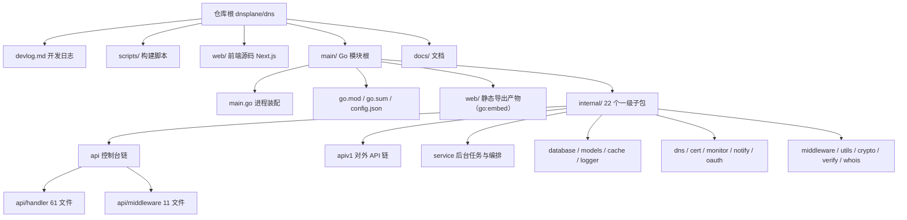
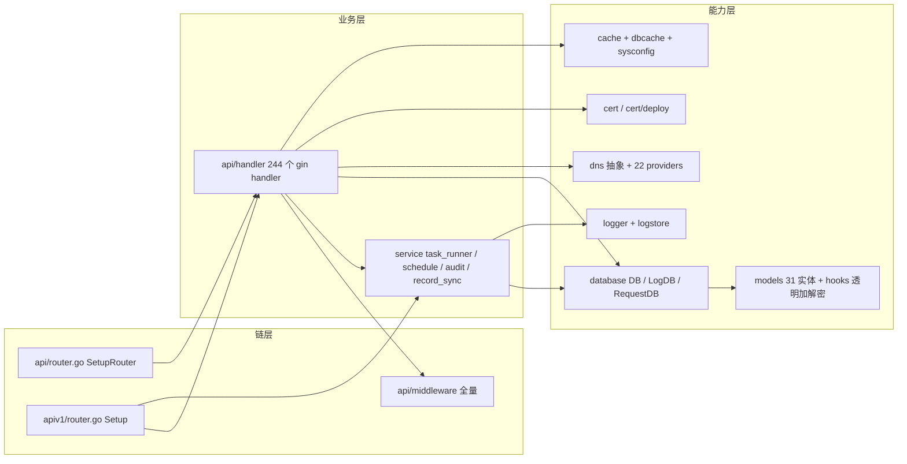
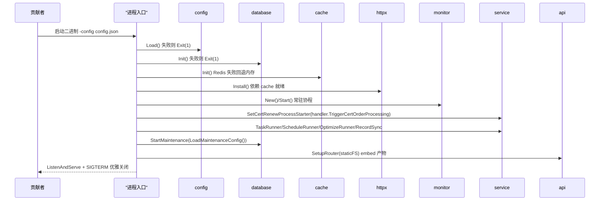
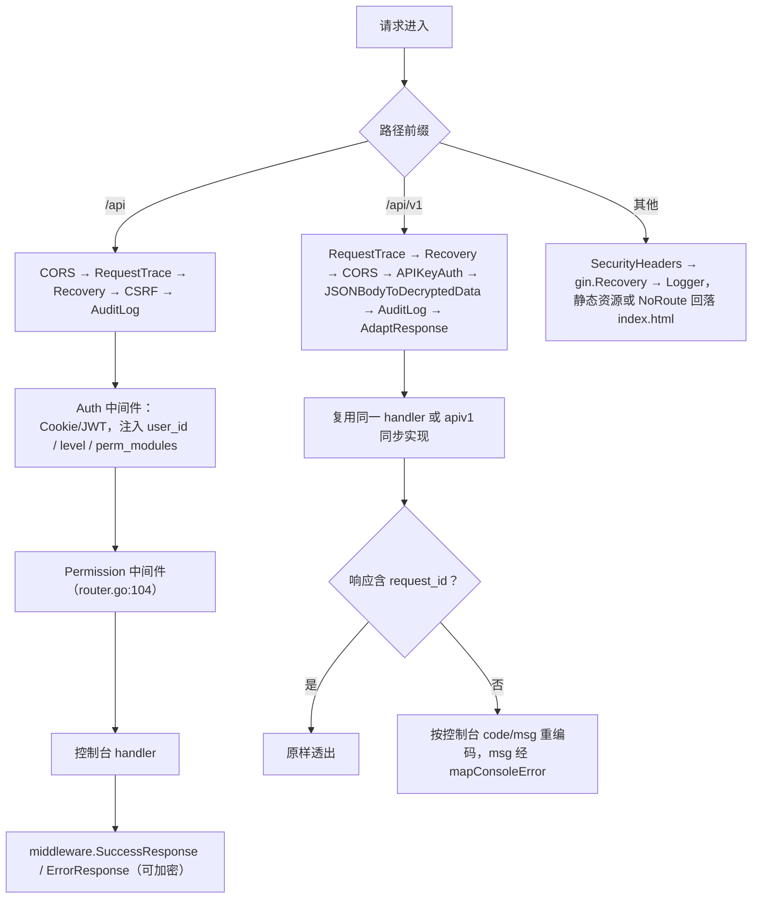
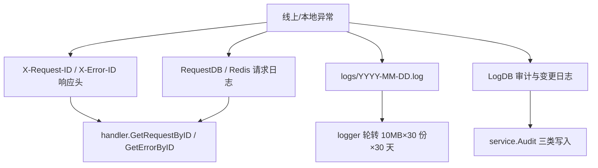
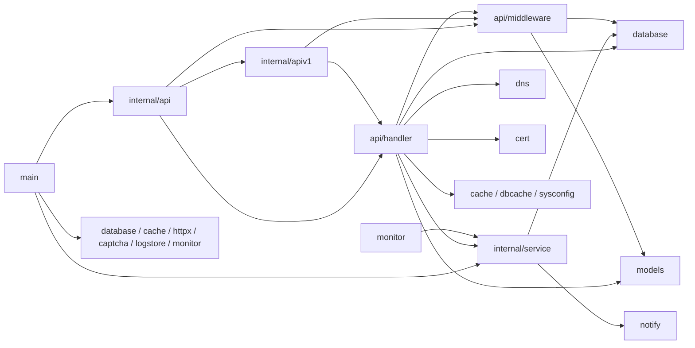
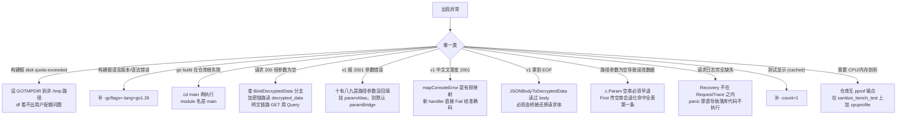

# 后端开发指南

<cite>
**本文档引用的文件**
- [go.mod](file://main/go.mod)
- [main.go](file://main/main.go)
- [router.go](file://main/internal/api/router.go)
- [sign.go](file://main/internal/api/middleware/sign.go)
- [permission.go](file://main/internal/api/middleware/permission.go)
- [auth.go](file://main/internal/api/middleware/auth.go)
- [request_trace.go](file://main/internal/api/middleware/request_trace.go)
- [bridge.go](file://main/internal/apiv1/bridge.go)
- [router.go](file://main/internal/apiv1/router.go)
- [scope.go](file://main/internal/apiv1/scope.go)
- [errors.go](file://main/internal/apiv1/errors.go)
- [domain_category.go](file://main/internal/api/handler/domain_category.go)
- [account.go](file://main/internal/api/handler/account.go)
- [audit.go](file://main/internal/service/audit.go)
- [skeleton_test.go](file://main/internal/apiv1/skeleton_test.go)
- [build.sh](file://scripts/build.sh)
- [build.yml](file://.github/workflows/build.yml)
- [devlog.md](file://devlog.md)
- [scan-backend.md](file://../.wiki-context/scan-backend.md)
</cite>

## 目录

1. [简介](#简介)
2. [项目结构](#项目结构)
3. [核心组件](#核心组件)
4. [架构总览](#架构总览)
5. [详细组件分析](#详细组件分析)
6. [依赖关系分析](#依赖关系分析)
7. [性能考虑](#性能考虑)
8. [故障排查指南](#故障排查指南)
9. [结论](#结论)
10. [附录](#附录)

---

## 简介

本文面向 DNSPlane 后端的**贡献者**，回答四个问题：在本仓库怎样把代码编译出来、怎样把测试跑到全绿、代码风格与文件规模的既有约束是什么、以及出问题时从哪里取证。它不重复《系统架构》类文档的设计叙述，只保留与「动手改代码」直接相关的可执行事实。

证据口径（重要）：

- **已验证**：来自当前工作区文件直读，或 `grep` / `find` / `sed` 实测输出。全部行号以当前工作区为准。
- **用户提供**：任务书中给出的口径，例如「14 包测试全绿」，已在 `devlog.md` 验证段独立取证。
- **快照口径**：`.wiki-context/scan-backend.md` 是 2026-10-10 13:30:43 的扫描快照，其行号与部分结论已过期，本文引用时会显式标注差异。
- **推断**：仅由证据间接得出、未直接验证的判断，文中标注「推断」。

一处必须先说明的口径差异：`scan-backend.md` 记录的「`Permission` 中间件从未被挂载」在当前工作区已不成立——`main/internal/api/router.go:104` 存在 `auth.Use(middleware.Permission())`。这是快照之后的变更，也是本文坚持「行号以当前工作区为准」的原因。

**章节来源**

- [router.go](file://main/internal/api/router.go#L104)
- [scan-backend.md](file://../.wiki-context/scan-backend.md#L665-L680)

---

## 项目结构

Go 模块根不在仓库根，而在 `main/` 子目录：`go.mod` 声明 `module main`、`go 1.26.2`。仓库根的 `scripts/build.sh` 在 `cd main` 之后才执行交叉编译。任何「在仓库根直接 `go build ./...`」的操作都会失败。



**图表来源**

- [build.sh](file://scripts/build.sh#L38-L52)
- [go.mod](file://main/go.mod#L1-L4)
- [scan-backend.md](file://../.wiki-context/scan-backend.md#L29-L64)

### 目录约定

| 路径 | 职责 | 贡献者注意事项 |
| --- | --- | --- |
| `main/main.go` | 进程装配：加载配置→连库→初始化缓存→装路由→起后台协程→优雅关闭 | 新增 provider / 部署器需在此加 blank import |
| `main/internal/api/` | 控制台 HTTP 链：`SetupRouter`、路由表、静态文件回落 | 路由集中在 `router.go`，464 行 |
| `main/internal/api/handler/` | 控制台业务 handler | 32 个非测试文件，同时被 `apiv1` 复用 |
| `main/internal/api/middleware/` | 认证、权限、追踪、审计、参数绑定、加解密 | 11 文件，`auth.go` 572 行 |
| `main/internal/apiv1/` | 对外 `/api/v1`：签名鉴权、参数桥接、响应重编码 | 14 个非测试文件，全部 POST |
| `main/internal/service/` | 定时任务、编排、审计服务 | 反向注入 handler，避免 import 成环 |
| `main/internal/dns/`、`cert/` | 上游能力抽象与 provider 工厂 | 各子包 `init()` 注册到全局表 |
| `main/web/` | 前端构建产物落点，被 `//go:embed all:web` 内嵌 | 不由手写维护，由 `scripts/build.sh` 生成 |

**章节来源**

- [go.mod](file://main/go.mod#L1-L4)
- [scan-backend.md](file://../.wiki-context/scan-backend.md#L29-L64)

### 包规模度量（快照口径 + 当前复核）

`scan-backend.md` 的度量快照给出：Go 源文件总行数 88625、非测试 71879、测试文件 78、`internal/` 一级子包 22、`api/handler` 61 文件、`apiv1` 20 文件、DNS 服务商适配器目录 22。这些数字会随开发漂移，提交前用附录 A 的复核命令重取，不要把快照数字当现状抄进新文档。

**章节来源**

- [scan-backend.md](file://../.wiki-context/scan-backend.md#L8-L28)

---

## 核心组件

后端由三层核心组件构成：**链层**（中间件与路由装配）、**业务层**（handler 与 service）、**能力层**（provider 抽象与基础设施）。



**图表来源**

- [scan-backend.md](file://../.wiki-context/scan-backend.md#L36-L64)
- [scan-backend.md](file://../.wiki-context/scan-backend.md#L831-L858)

### 链层：两条互不继承的链

控制台链与对外链刻意不共享分组。`main/internal/apiv1/router.go:12-15` 的注释给出了唯一理由：`/api` 分组带 CSRF double-submit 校验，API Key 客户端既没有 cookie 也无从取 token，继承那条链会让所有写请求在 CSRF 处被拒；签名本身就是身份与完整性凭据。

| 维度 | 控制台 `/api` | 对外 `/api/v1` |
| --- | --- | --- |
| 挂载点 | `api/router.go` 的 `r.Group("/api")` | `apiv1/router.go` 的 `engine.Group("/api/v1")` |
| 调用方 | `main.go:128` → `api.SetupRouter(staticFS)`；`api/router.go:63` → `apiv1.Setup(r)` | 同左（v1 由控制台路由文件反向装配） |
| 鉴权 | Cookie + JWT + `middleware.Auth` | HMAC-SHA256 签名 `APIKeyAuth` |
| CSRF | `middleware.CSRF()` | 不挂载 |
| 响应 | `{code, msg, data}`，可加密混淆 | `OK/Fail/Failf` + `request_id` |
| 路由量 | 快照 226 条 | 快照 145 条（全部 POST） |

**章节来源**

- [router.go](file://main/internal/api/router.go#L44-L64)
- [router.go](file://main/internal/apiv1/router.go#L9-L47)
- [scan-backend.md](file://../.wiki-context/scan-backend.md#L20-L21)

### 业务层：handler 是唯一共享实现

`apiv1` 不复制业务逻辑，它直接复用 `handler` 包的同名函数，只替换认证与响应格式。唯一例外是内部使用 `utils.SafeGo` 异步执行的写接口——程序化调用需要真实成败与失败原因，所以 `apiv1/record_sync.go` 重写为同步实现（快照 444 行）。

`requireAdmin` 与 `requireUserModule` 定义在 `main/internal/api/handler/account.go:43` 与 `:67`，被同包各 handler 调用；`apiv1` 侧对应的是 `scope.go` 的 `requireModule` / `requireAdmin`。两套语义相同、入口不同，新增接口时不要混用。

**章节来源**

- [account.go](file://main/internal/api/handler/account.go#L43-L70)
- [scope.go](file://main/internal/apiv1/scope.go#L27-L45)
- [scan-backend.md](file://../.wiki-context/scan-backend.md#L812-L830)

### 能力层：基础设施的硬约束

- `database` 暴露三库：`DB`（主库）、`LogDB`（审计）、`RequestDB`（请求日志），SQLite 走 WAL，同时支持 MySQL。
- `models/hooks.go` 对 7 个模型的敏感列做透明加解密：`Account.Config`、`CertAccount.Config/Ext`、`CertOrder.PrivateKey/Info`、`CertDeploy.Config/Info`、`DMTask.ProxyPassword`、`User.TOTPSecret`、`UserOAuth.AccessToken/RefreshToken`。新增敏感列必须同步这里，否则明文入库。
- `cache.Init` 在 Redis Ping 失败时静默回退内存缓存，不退出进程；`httpx.Install()` 必须在 `cache.Init` 之后，因为其 `init()` 期读 `cache.C` 会 panic。
- `logger` 在 `go test` 进程下只输出 stdout、不落盘（`runningUnderGoTest`）。

**章节来源**

- [scan-backend.md](file://../.wiki-context/scan-backend.md#L40-L63)

---

## 架构总览

### 进程启动装配

`main/main.go` 共 156 行，装配顺序不可随意调整，因为后三步依赖前四步的全局状态。



**图表来源**

- [scan-backend.md](file://../.wiki-context/scan-backend.md#L65-L90)
- [main.go](file://main/main.go#L63-L155)

装配的失败行为差异值得注意：配置与数据库失败即 `os.Exit(1)`；`captcha.Init()` 失败只 `logger.Warn` 并降级；`SetupRouter` 在静态子文件系统创建失败时 `panic`（快照指向 `router.go:346`）。

**章节来源**

- [scan-backend.md](file://../.wiki-context/scan-backend.md#L67-L89)

### 请求链路



**图表来源**

- [router.go](file://main/internal/api/router.go#L24-L64)
- [router.go](file://main/internal/apiv1/router.go#L24-L47)
- [adapt.go](file://main/internal/apiv1/adapt.go#L32-L111)

中间件挂载点数量（快照实测）：控制台 10 处 `.Use`、v1 7 处。改动链顺序后应重跑这两个计数。

**章节来源**

- [scan-backend.md](file://../.wiki-context/scan-backend.md#L91-L137)
- [scan-backend.md](file://../.wiki-context/scan-backend.md#L868-L869)

---

## 详细组件分析

### 环境准备与工具链约束

| 项目 | 取值 | 取证 |
| --- | --- | --- |
| 模块路径 | `module main` | `main/go.mod` 首行 |
| 语言版本声明 | `go 1.26.2` | `main/go.mod` |
| 本机工具链 | `go1.27.1 linux/amd64`（快照） | `scan-backend.md` §12 |
| 构建语言闸门 | `-gcflags="-lang=go1.26"` | `devlog.md` 多轮验证段 |
| CGO | `CGO_ENABLED=0`（交叉编译与 CI 均为 0） | `scripts/build.sh`、`.github/workflows/build.yml` |
| 构建临时目录 | `GOTMPDIR=/home/clfchen/.cache/go-work` | `devlog.md` 环境事故段 |
| 前端工具 | `bun`（存在 `bun.lock` 时优先）否则 `npm` | `scripts/build.sh` |

语言版本声明与本机工具链不一致（`go 1.26.2` vs `go1.27.1`），因此仓库统一用 `-gcflags="-lang=go1.26"` 锁定语言版本，防止误用更高版本的语法或标准库行为。`devlog.md` 记录过一次全仓扫描：56 个包 / 209 个源文件 / 12 个 CI 目标平台全 PASS，`go vet -stdversion` 零告警，无泛型、无 1.27 新特性。

#### GOTMPDIR 非 /tmp 的坑

现象是 `go build` 报 `write $WORK/_pkg_.a: disk quota exceeded`。`/tmp` 是带 `usrquota` 的 tmpfs，**用户配额**已满而 tmpfs 整体仍有 6.3G 可用，`df` 显示 `Used 73%` 看不出问题，只有实际写入才失败。仓库的既有处置是把 `GOTMPDIR` 指向非 `/tmp` 路径，全程构建与测试都在该路径完成：

```bash
# 一次性：为当前 shell 指定构建临时目录
export GOTMPDIR=/home/clfchen/.cache/go-work
mkdir -p "$GOTMPDIR"

# 三条准入门禁命令（工作目录必须是 main/）
cd main
GOTMPDIR="$GOTMPDIR" go build   -gcflags="-lang=go1.26" ./...
GOTMPDIR="$GOTMPDIR" go vet     ./...
GOTMPDIR="$GOTMPDIR" go test    ./... -count=1
```

`$HOME/.cache/go-build` 在 `devlog.md` 中已增至 40G。`go clean -cache` 能回收，但那是全局缓存、会拖慢后续所有构建，属于需先确认的操作，不要在迭代中顺手执行。同理，`/tmp` 下的大件占用（`/tmp/engperf` 5.9G 等）**未被删除**，因为归属未经逐个确认——排查配额时先确认归属，再谈清理。

**章节来源**

- [go.mod](file://main/go.mod#L1-L4)
- [devlog.md](file://devlog.md#L2266-L2296)
- [devlog.md](file://devlog.md#L521-L533)

### 构建流程

`scripts/build.sh` 是本地一键构建入口，做三件事：前端 → 后端交叉编译 → 校验和。

```bash
# 用法（直接抄自 scripts/build.sh 头部注释）
scripts/build.sh                    # 默认本机架构（go env GOARCH）
scripts/build.sh amd64              # 指定单架构
scripts/build.sh amd64 arm64        # 多架构一次性出
SKIP_FRONTEND=1 scripts/build.sh    # 仅改后端时跳过前端
```

版本号优先级为：环境变量 `VERSION` > 仓库根 `VERSION` 文件 > `git describe --tags --always --dirty` > `dev`。产物落在 `dist/dnsplane-linux-<arch>`，并生成 `dist/SHA256SUMS`。

一个已验证的不一致点值得记录：`build.sh` 传入 `-ldflags="-s -w -X main.Version=${VERSION}"`，但 `main` 包内（仅 `main.go` 一个文件）检索不到 `Version` 标识符；CI 的构建命令是 `CGO_ENABLED=0 go build -buildvcs=false -trimpath -ldflags="-s -w"`，不含 `-X main.Version`。**推断**：Go 链接器对不存在符号的 `-X` 静默忽略，因此不影响构建成功，但版本号并未真正注入二进制。若需要版本可追溯，应先在 `main` 包补 `var Version = "dev"`，再依赖该 ldflags。

**章节来源**

- [build.sh](file://scripts/build.sh#L1-L72)
- [build.yml](file://.github/workflows/build.yml#L125-L142)
- [main.go](file://main/main.go#L67-L68)

### 测试与准入门禁

`devlog.md` 的验证段是仓库的准入口径原文：

```
GOTMPDIR=<非 /tmp 路径> go build -gcflags="-lang=go1.26" ./...   通过
GOTMPDIR=<非 /tmp 路径> go vet ./...                             通过
GOTMPDIR=<非 /tmp 路径> go test ./... -count=1                   14/14 包全绿
```

「14/14 包全绿」是 `devlog.md` 在 2026-10-10 前后多轮使用的口径，随后同一文件出现 15/15 的记录。当前工作区实测含 `*_test.go` 的目录共 15 个，测试文件 89 个（快照为 78），与 15/15 口径一致：

| 包目录 | 测试文件数 |
| --- | --- |
| `internal/api/handler` | 34 |
| `internal/notify` | 18 |
| `internal/service` | 8 |
| `internal/apiv1` | 8 |
| `internal/api` | 7 |
| `internal/monitor` | 4 |
| `internal/logstore`、`internal/httpx`、`internal/cache` | 各 1 |
| `internal/dns`、`internal/dns/providers`、`internal/dns/providers/cloudflare` | 各 1 |
| `internal/cert/aliyun`、`internal/cert/tencent` | 各 1 |
| `internal/api/middleware` | 1 |

口径结论：**验收标准应表述为「`go test ./... -count=1` 全部含测试的包 ok、FAIL 包数为 0」，并把包数作为当次实测值写出**，不要写死 14 或 15。历史迭代引用旧口径时保留原文，另起一行标注当前实测数，避免读者以为测试减少了。

`-count=1` 是必需的：它禁用测试缓存，否则二次执行会显示 `(cached)`，无法证明变更后的行为真的被跑过。

**章节来源**

- [devlog.md](file://devlog.md#L2266-L2272)
- [devlog.md](file://devlog.md#L2492-L2494)
- [scan-backend.md](file://../.wiki-context/scan-backend.md#L14-L14)

### 参数绑定与上下文约定

控制台 handler 一律经 `middleware.BindDecryptedData` 取参（`main/internal/api/middleware/sign.go:104`）。它的分支必须理解清楚，否则会写出只在加密链路下工作的代码：

```go
// 语义摘自 main/internal/api/middleware/sign.go
func BindDecryptedData(c *gin.Context, v interface{}) error {
    data := GetDecryptedData(c)
    if data == nil {
        // 明文链路：GET/HEAD 走 Query，其余走 JSON body
        if c.Request.Method == http.MethodGet || c.Request.Method == http.MethodHead {
            return c.ShouldBindQuery(v)
        }
        if err := c.ShouldBindJSON(v); err != nil {
            // POST 无 body（如 /accounts/:id/delete）时 ShouldBindJSON 报 EOF，
            // 路径参数由 handler 自行补全，这里按「无参」处理而非报错
            if errors.Is(err, io.EOF) { return nil }
            if strings.Contains(strings.ToLower(err.Error()), "unexpected end of json input") {
                return nil
            }
            return err
        }
        return nil
    }
    // 加密链路：decrypted_data 已在上下文，序列化后回填结构体
    b, err := json.Marshal(data)
    if err != nil { return err }
    return json.Unmarshal(b, v)
}
```

三条约定：

- 路径参数与 body 参数**分开取**。`c.Param("id")` 不能被 `BindDecryptedData` 替代；且路径参数为空时必须早退，因为 `First(&cat, "")` 会退化成不带主键条件的查询、静默命中全表第一条。`apiv1` 的路由表没有路径参数，`c.Param` 恒为空串，这条退化路径是**可达的**。
- 响应只走 `middleware.SuccessResponse` / `SuccessMsg` / `ErrorResponse` / `ErrorResponseWithCode`。`ErrorResponse` 会先 `SetError(c, msg)`，把错误上下文写入请求追踪，这是排错时能查到 ErrorID 的前提。
- 需要用户身份时读上下文键 `user_id`（**字符串**，不是 uint）、`username`、`level`。`level >= 2` 为管理员，这是 `handler/account.go:43` 与 `apiv1/scope.go:38` 共同的判定。

**章节来源**

- [sign.go](file://main/internal/api/middleware/sign.go#L85-L139)
- [domain_category.go](file://main/internal/api/handler/domain_category.go#L95-L106)
- [account.go](file://main/internal/api/handler/account.go#L43-L70)

### 代码风格与巨型文件拆分

既有风格约定，从代码与 `AGENTS.md` 归纳：

- 注释用 JSDoc 风格块注释：`/** ... */` 描述函数契约（含 `@route` 标注），`/* ... */` 单独解释**为什么**，尤其是踩坑与不这么做会怎样。不重复代码「做什么」。
- 文件与注释统一简体中文、UTF-8 无 BOM；代码标识符、命令、日志保持英文。
- 块注释里成段写「为什么这样分层」，例如 `bridge.go` 用整块注释解释 `paramAlias` 与 `paramBridge` 的副作用范围差异。这种注释是接口文档的一部分，删它等于删设计说明。
- 单文件尽量 500 行以内，单函数 50 行以内，嵌套不超过 3 层、优先卫语句。

现状与目标的差距集中在 handler 与 provider。`handler/` 超 500 行的文件按快照行数排序：

| 排名 | 文件 | 行数 | 导出 handler 数 | 业务归属 |
| --- | --- | --- | --- | --- |
| 1 | `cloudflare.go` | 2509 | 28 | 自定义主机名 / Tunnel / 回退源 / DCV |
| 2 | `domain.go` | 1716 | 16 | 域名与解析记录 |
| 3 | `auth.go` | 1573 | 25 | 登录注册、TOTP、魔法链接、安装 |
| 4 | `cert.go` | 1519 | 19 | 证书账户 / 订单 / 部署 / 下载 |
| 5 | `monitor.go` | 1270 | 16 | 容灾监控任务 CRUD 与切换 |
| 6 | `cert_deploy.go` | 1101 | 17 | 部署账户与部署任务 |
| 7 | `acceleration.go` | 1000 | 10 | 一键加速（EO / ESA） |
| 8 | `user.go` | 743 | 14 | 用户、域名授权、系统配置读写 |
| 9 | `plan.go` | 672 | 14 | 套餐、配额、订阅 |
| 10 | `oauth.go` | 565 | 9 | OAuth 登录、绑定、解绑 |
| 11 | `dashboard.go` | 519 | 18 | 概览统计 + 11 个通知测试端点 |

`handler/` 之外达到 500 行的：`cert/acme/acme.go` 1052、`monitor/monitor.go` 1049、`service/task_runner.go` 1015、`notify/notify.go` 914、`dns/providers/aws/aws.go` 888、`api/middleware/auth.go` 572 等。

拆分建议（按当前证据，不做无根据的重构）：

- **按子领域切文件，不改函数签名。** `cloudflare.go` 的 28 个 handler 天然分为 hostname / tunnel / 回退源 / DCV 四组，拆成 `cloudflare_hostname.go` 等同包多文件即可，包外零影响。同包已有先例：`cert_authz.go`、`batch_authz.go`、`default_plan.go` 都是纯辅助文件。
- **先拆请求结构体与私有辅助，再拆 handler。** `domain.go` 内的 `logRecordAction` 类辅助与 `xxxRequest` 结构体可下沉到 `domain_types.go`，主文件只留下流程。
- **不为「行数好看」而引入接口层。** `apiv1/adapt.go` 的存在已说明代价：一个响应适配层要维护中文文案到错误码的**有损映射**。多一层抽象就多一层失真。
- **`apiv1/util.go` 应优先处理。** 它是非 `_test.go` 文件却 import `testing` 与 `net/http/httptest`，并把 `newRecorder`、`decodeBody(t *testing.T, ...)` 编入生产二进制。把测试辅助移到 `_test.go` 是零行为变更的干净改进。

**章节来源**

- [scan-backend.md](file://../.wiki-context/scan-backend.md#L717-L748)
- [scan-backend.md](file://../.wiki-context/scan-backend.md#L773-L811)
- [scan-backend.md](file://../.wiki-context/scan-backend.md#L710-L716)

### 调试与可观测性入口

必须先纠正一个常见假设：**本仓库没有注册 pprof**。全库检索 `pprof`、`net/http/pprof` 均零命中（含 `docs/`、`scripts/`、`web/`）。任何「访问 `/debug/pprof/` 取 profile」的写法在本项目都不可用。同理未检索到 `runtime.SetBlockProfileFraction`、`SetMutexProfileFraction`、`GODEBUG`、`GIN_MODE` 的显式设置。

实际可用的取证入口有四个：



**图表来源**

- [request_trace.go](file://main/internal/api/middleware/request_trace.go)
- [audit.go](file://main/internal/service/audit.go#L20-L60)

- **请求追踪**：`RequestTrace` 在链首生成 `X-Request-ID`，错误路径写 `X-Error-ID`，请求结束把 body/headers/db_queries 落 `RequestDB` 或 Redis。`GetRequestByID`、`GetErrorByID`、`GetRequestStats`、`CleanRequestLogs` 都在 `handler/request_log.go`。
- **panic 与堆栈**：`middleware.Recovery` 先 `SetError` 并写堆栈键，再把 panic 挡在 `RequestTrace` 之内，使 `c.Next()` 正常返回后完成落库。若把 `Recovery` 放到 `RequestTrace` 之外，实测结果是 RequestLog **零记录**。改链顺序时必须跑 `internal/api/recovery_trace_test.go` 与 `recovery_panic_client_test.go`。
- **SQL 追踪**：`database.RegisterDBCallbacks()` 采集 GORM 前后回调（仅主库 + LogDB，不含 RequestDB），配合 `DBQuery` 与 `WithContext(c)` 使用。`middleware.AddDBQuery` 把 SQL 归集到当前请求，可在请求日志里直接看到慢查询。
- **基准**：`internal/api/middleware/sanitize_bench_test.go` 是仓库内唯一的 bench 文件，用 `go test -bench=. -benchmem ./internal/api/middleware/` 运行。需要 CPU/内存剖析时，在此类 bench 上加 `-cpuprofile` / `-memprofile`，是本仓库现阶段最接近 pprof 的可用路径（推断：仓库未提供常驻 pprof 端点，离线剖析是当前唯一手段）。

**章节来源**

- [scan-backend.md](file://../.wiki-context/scan-backend.md#L93-L118)
- [router.go](file://main/internal/api/router.go#L29-L43)
- [devlog.md](file://devlog.md#L297-L297)

---

## 依赖关系分析



**图表来源**

- [scan-backend.md](file://../.wiki-context/scan-backend.md#L831-L858)

### 关键依赖事实

| 关系 | 实测结论 | 对改动的约束 |
| --- | --- | --- |
| `api` ↔ `apiv1` | `apiv1` **不依赖** `api`；反向由 `api/router.go:63` 调 `apiv1.Setup` | 不能在 `apiv1` 内 import `api`，否则成环 |
| `apiv1` → `handler` | `apiv1` 直接复用 `handler` 导出函数 | 改 handler 签名会同时打断控制台与对外两条链 |
| `handler` → `service` | 单向 | `service` 需要 handler 能力时用函数变量反向注入 |
| 反向注入 | `main.go:108` `service.SetCertRenewProcessStarter(handler.TriggerCertOrderProcessing)`；`:110` 注入签发成功/失败通知钩子 | 新增跨层回调应沿用「装配期注入」，不要在 `service` 里 import `handler` |
| `database` 覆盖面 | 40+ 文件：全部 handler、全部 apiv1 业务文件、service、monitor、oauth、sysconfig、middleware | `WithContext` 与裸 `DB` 混用会丢请求关联，新代码统一 `database.WithContext(c)` |
| `models` 覆盖面 | 50+ 文件，除 `main.go` 外几乎全覆盖 | 模型字段变更等价于公共 API 变更 |
| `cache` | 被 10+ 处依赖，含 `httpx` 的顺序约束 | 任何在 `cache.Init` 之前读 `cache.C` 的 `init()` 都有 panic 风险 |

**章节来源**

- [scan-backend.md](file://../.wiki-context/scan-backend.md#L831-L858)
- [scan-backend.md](file://../.wiki-context/scan-backend.md#L39-L52)

### 权限判定的四处入口

模块权限只有一份存储、四处读取，改一处必须想清其余三处：

- 存储：`User.Permissions` JSON 列。
- 注入：`middleware.ApplyUserPermissionModules(c, user.Permissions)`，控制台由 `middleware/auth.go:188` 调用，v1 由 `apiv1/auth.go:111` 调用。上下文键 `perm_modules` 与 `perm_modules_configured`。
- 判定：`middleware.UserModuleAllowed(c, module)`（`permission.go:383`）。**空列或解析失败视为「未配置」，对非管理员一律放行**（兼容旧库）。
- 域名/子域/只读三维：控制台走 `CheckDomainPermission` / `CheckSubDomainPermission`（`permission.go:335` / `:344`）与 `Permission` 中间件；v1 走 `scope.go` 的 `scopeDomain`，固定「加载域名 → 域名权限 → 子域 → 只读」顺序。

`scope.go:88-93` 的注释是重要历史线索：`requireWritable` 故意**不读** `perm_read_only` 上下文键，而直接查权限表。原因写作「该中间件从未被挂载」，而当前工作区 `router.go:104` 已挂载 `Permission`。这条注释现在与代码状态不一致（已验证的注释漂移），但它选择的实现方式（不依赖中间件是否挂上）依然是更稳的写法，新代码应照此办理。

**章节来源**

- [permission.go](file://main/internal/api/middleware/permission.go#L363-L395)
- [auth.go](file://main/internal/api/middleware/auth.go#L188-L188)
- [scope.go](file://main/internal/apiv1/scope.go#L87-L132)
- [router.go](file://main/internal/api/router.go#L100-L105)

---

## 性能考虑

后端性能瓶颈集中在「出站上游调用」与「日志落库」两类，缓存层是唯一的横向缓解手段。

| 关注点 | 现有机制 | 证据 | 贡献者守则 |
| --- | --- | --- | --- |
| 上游调用阻塞 | 控制台写接口经 `utils.SafeGo` 异步执行 | `scan-backend.md` 记 `domain.go` 写操作异步 | 需要真实成败的接口不要异步（v1 已有同步重写先例） |
| 列表读放大 | `dbcache.GetOrSetJSON`，`DefaultTTL = 60s` | `internal/dbcache/dbcache.go:12` | 写后必须 `Bust*` 失效，否则最长 60 秒脏读 |
| 配置读放大 | `sysconfig` 60 秒缓存 | `internal/sysconfig/sysconfig.go:13-14` | `SetValue` 是 `FirstOrCreate + Assign` 幂等 upsert |
| 探测并发上限 | `maxDispatchPerTick = 100`、`maxConcurrentChecks = 64` | `internal/monitor/monitor.go:24`、`:29` | 不要绕过上限自行起 goroutine |
| ACME 限流退避 | `acmeRateLimitMaxAttempts = 12` | `internal/cert/acme/acme.go:39` | 新增 CA 调用要考虑配额而非无限重试 |
| 请求日志裁剪 | Redis List 每 64 次写入才裁剪，`maxLogSize = 10000` | `internal/logstore/store.go:16-22` | 统计结果缓存 2 分钟，别期望实时 |
| 证书/密钥签发轮转 | `logger` 10MB×30 份×30 天 | `internal/logger/logger.go:16-20` | `go test` 下不落盘，别用文件断言 |
| 静态资源 | ETag + 304、`NoRoute` 回落 `index.html` | `api/router.go` 静态段 | 前端产物变更靠 hash 而非缓存过期 |
| HTTP 服务器 | `ReadHeaderTimeout: 30s`、`IdleTimeout: 120s`、`Shutdown` 10s 超时 | `main/main.go:130-155` | 长任务要挂在可取消 ctx 上，不能靠延长超时 |
| SQL 采集开销 | GORM 回调为每条 SQL 记录耗时并归集到请求 | `database.RegisterDBCallbacks` | 高频接口少查一次库比优化一次查询更划算 |

关于 `-count=1` 与构建缓存：`devlog.md` 记录 `$HOME/.cache/go-build` 增至 40G。这是 Go 正常的构建缓存增长，不是泄漏；只有在磁盘告急且已确认归属时才 `go clean -cache`，并接受后续构建变慢。

**章节来源**

- [scan-backend.md](file://../.wiki-context/scan-backend.md#L40-L57)
- [devlog.md](file://devlog.md#L2294-L2296)

---

## 故障排查指南



**图表来源**

- [devlog.md](file://devlog.md#L2274-L2292)
- [bridge.go](file://main/internal/apiv1/bridge.go#L15-L33)
- [adapt.go](file://main/internal/apiv1/adapt.go#L113-L148)
- [router.go](file://main/internal/api/router.go#L29-L43)

### 常见故障与处置

| 症状 | 根因 | 定位手段 | 处置 |
| --- | --- | --- | --- |
| `write $WORK/_pkg_.a: disk quota exceeded` | `/tmp` tmpfs 用户配额满，`df` 不报错 | `go build` 失败即证；确认 `GOTMPDIR` 未设 | `export GOTMPDIR=<非 /tmp 路径>` |
| 本地 `go build ./...` 提示无包 | 模块根在 `main/` | `ls main/go.mod` | 进 `main/` 目录执行 |
| v1 调用「域名不存在」但 ID 正确 | v1 无路径参数，`c.Param("id")` 为空 | 查 `apiv1/domain.go` 组级桥接 | 为整组挂 `paramAlias(map[string]string{"id":"domain_id"})` |
| v1 body 参数丢失、报「参数错误」 | body 被 `JSONBodyToDecryptedData` 读到 EOF | `bridge.go` 注释 | 走 `bridgeParams` 还原请求体，勿手写 |
| 鉴权拒绝被改写成 2001 | `AdaptResponse` 把 v1 自有响应按控制台格式解析 | `adapt.go:63-67` | 保留 `request_id` 字段作为 v1 标识，勿删 |
| 只读用户能删记录（历史缺陷） | `Permission` 未挂载时 `perm_read_only` 恒不存在 | `router.go:104` 现状已挂载；v1 用 `requireWritable` 直查权限表 | 新增 v1 写接口一律走 `scopeDomain(needWrite=true)` |
| 批量接口越权 | `Permission` 的 `getSubDomainFromRequest` 只读 body 的 `name`/`rr`，而 `BatchActionRecords` 只有 `record_ids`+`action` | `devlog.md` 记录该反悔过程 | handler 内补 `CheckSubDomainPermission`，不能只依赖中间件 |
| 请求日志零记录 | `Recovery` 位置在 `RequestTrace` 之外 | `recovery_trace_test.go` | 按 `applyAPIMiddleware` 的既有顺序挂载 |
| 敏感列明文入库 | 新增列未加入 `models/hooks.go` 加解密清单 | `hooks.go` 的 7 模型列表 | 同步补 `MigrateSpec` / `MigratePlaintext` 迁移 |
| 测试期 `cache.C` nil panic | 初始化顺序或 `init()` 期读缓存 | `httpx/proxy.go` 同类注释 | 全局状态读取一律走运行时惰性分支，不在 `init()` 读 |

**章节来源**

- [devlog.md](file://devlog.md#L2297-L2310)
- [scan-backend.md](file://../.wiki-context/scan-backend.md#L663-L716)
- [bridge.go](file://main/internal/apiv1/bridge.go#L73-L103)

---

## 结论

本仓库的后端贡献体验可以压缩成三条命令、两条链、一份实现：

- **三条命令**：`go build -gcflags="-lang=go1.26" ./...`、`go vet ./...`、`go test ./... -count=1`，工作目录 `main/`，`GOTMPDIR` 必须落在非 `/tmp` 路径。验收写「全部含测试的包 ok、FAIL 包数 0」并附当次实测包数（当前 15 个）。
- **两条链**：控制台 `/api` 与对外 `/api/v1` 不共享分组，CSRF 是唯一分水岭；链顺序不是风格问题，`Recovery` 与 `RequestTrace` 的内外关系直接决定 panic 时能否留下请求日志。
- **一份实现**：`handler` 是唯一的业务实现，`apiv1` 只做鉴权、参数桥接与响应重编码。这条复用带来两个必须承认的代价——中文错误文案到错误码的**有损映射**，以及异步写接口在对外语义下必须重写为同步。

三个已定位、可低成本推进的改进项：`apiv1/util.go` 把测试辅助编入生产二进制；`main` 包缺 `Version` 变量导致 `build.sh` 的 `-X main.Version` 落空；`scope.go` 关于「`Permission` 从未挂载」的注释已与 `router.go:104` 的现状不一致。三者都不涉及行为重构，属于下一轮可直接落地的清理。

下一步计划：按子领域拆 `cloudflare.go`（2509 行）与 `domain.go`（1716 行）为同包多文件；补齐仓库级调试入口（常驻 profiling 或至少一份「如何离线剖析」的操作说明）；把「含测试包数」写进 CI 断言，使测试减少能被自动发现。

**章节来源**

- [devlog.md](file://devlog.md#L2266-L2272)
- [scan-backend.md](file://../.wiki-context/scan-backend.md#L710-L748)

---

## 附录

### 附录 A：可复现的复核命令

```bash
# 包级行数（递归）
cd main && go list -f '{{.ImportPath}} {{.Dir}}' ./... | while read p d; do
  printf '%s ' "$p"; command find "$d" -maxdepth 1 -name '*.go' ! -name '*_test.go' \
    -exec cat {} + | wc -l
done

# 单文件行数（本机 find 被 alias 为 fd，用 command find 或 awk 更稳）
awk 'END{print FILENAME, NR}' internal/api/handler/cloudflare.go

# 某文件全部导出函数与起始行
rg -n '^func [A-Z]' internal/api/handler/domain.go

# 路由全量
rg -n '\.(GET|POST)\(' internal/api/router.go | wc -l
rg -n '\.POST\(' internal/apiv1 | wc -l

# 中间件挂载点
rg '\.Use\(' internal/api internal/apiv1 -g '!*_test.go'

# 反向依赖
rg -l 'main/internal/api/middleware' internal -g '!*_test.go'

# 含测试的包数（当次实测口径）
command find internal -name '*_test.go' | sed 's|/[^/]*$||' | sort -u | wc -l
```

**章节来源**

- [scan-backend.md](file://../.wiki-context/scan-backend.md#L889-L910)

### 附录 B：命令速查

| 场景 | 命令 |
| --- | --- |
| 编译检查 | `cd main && GOTMPDIR=$HOME/.cache/go-work go build -gcflags="-lang=go1.26" ./...` |
| 静态检查 | `cd main && go vet ./...` |
| 全量测试 | `cd main && go test ./... -count=1` |
| 单包测试 | `cd main && go test ./internal/apiv1/ -count=1 -run TestXxx -v` |
| 基准测试 | `cd main && go test -bench=. -benchmem ./internal/api/middleware/` |
| 离线剖析 | `cd main && go test -bench=. -cpuprofile cpu.out -memprofile mem.out ./internal/api/middleware/` |
| 本地一键构建 | `scripts/build.sh`（仅改后端：`SKIP_FRONTEND=1 scripts/build.sh`） |
| 多架构出包 | `scripts/build.sh amd64 arm64`，产物在 `dist/` 并含 `SHA256SUMS` |
| CI 构建口径 | `CGO_ENABLED=0 go build -buildvcs=false -trimpath -ldflags="-s -w"`（`build.yml`） |

**章节来源**

- [build.sh](file://scripts/build.sh#L1-L72)
- [build.yml](file://.github/workflows/build.yml#L125-L142)
- [devlog.md](file://devlog.md#L2266-L2272)

### 附录 C：提交前检查清单

- 工作目录是否切到 `main/`；`GOTMPDIR` 是否指向非 `/tmp` 路径。
- `go build -gcflags="-lang=go1.26" ./...`、`go vet ./...`、`go test ./... -count=1` 三条是否全过，FAIL 包数是否为 0。
- 新增敏感列是否同步 `models/hooks.go` 与 `crypto.MigrateSpec`。
- 新增控制台路由是否同时考虑 v1 是否需要暴露；暴露时桥接选 `paramAlias` 还是 `paramBridge`。
- 新增 v1 handler 是否直接 `Fail`/`Failf` 给准确码值，而不是依赖 `mapConsoleError`。
- 涉及域名的 v1 写接口是否走 `scopeDomain(needWrite = true)` 的固定四步。
- `c.Param` 为空串时是否早退，杜绝 `First(&x, "")` 退化命中全表。
- 链顺序若变更，`recovery_trace_test.go` 与 `recovery_panic_client_test.go` 是否仍通过。
- 新 handler 若复用现有函数，是否检查其内部是否用了 `utils.SafeGo` 异步。
- 单文件是否突破 500 行；若突破，是否已在同 PR 说明拆分计划。

**章节来源**

- [scope.go](file://main/internal/apiv1/scope.go#L111-L132)
- [adapt.go](file://main/internal/apiv1/adapt.go#L113-L148)
- [router.go](file://main/internal/api/router.go#L29-L53)

### 附录 D：术语与口径

| 术语 | 本文含义 |
| --- | --- |
| 链层 | 中间件与路由装配，不含业务判断 |
| 控制台 | `/api` 前缀下、面向内置 Web 界面的接口 |
| 对外 API / v1 | `/api/v1` 前缀下、HMAC 签名鉴权的 145 条 POST 接口（快照口径） |
| 桥接 | `apiv1/bridge.go` 把 body 参数回填成控制台 handler 所需的 `c.Param` 与请求体 |
| 有损映射 | `mapConsoleError` 按中文文案子串反推错误码，未收录文案统一落 `CodeParamInvalid` |
| 全绿 | `go test ./... -count=1` 下所有含测试的包输出 ok，FAIL 包数为 0 |
| 快照口径 | 引自 `scan-backend.md`（2026-10-10 13:30:43）的行数、行号与路由计数，须复核后使用 |

**章节来源**

- [scan-backend.md](file://../.wiki-context/scan-backend.md#L1-L7)
- [errors.go](file://main/internal/apiv1/errors.go#L16-L63)
