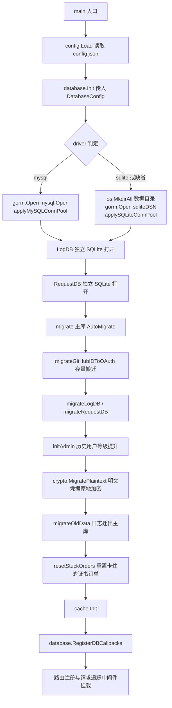
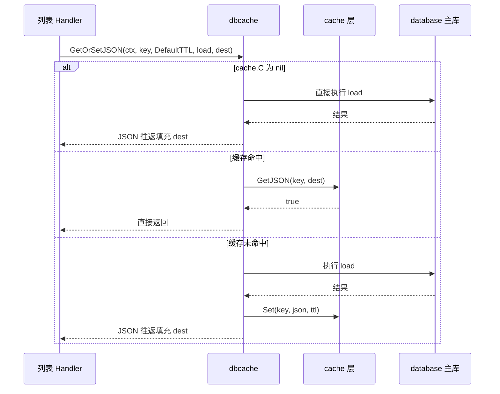
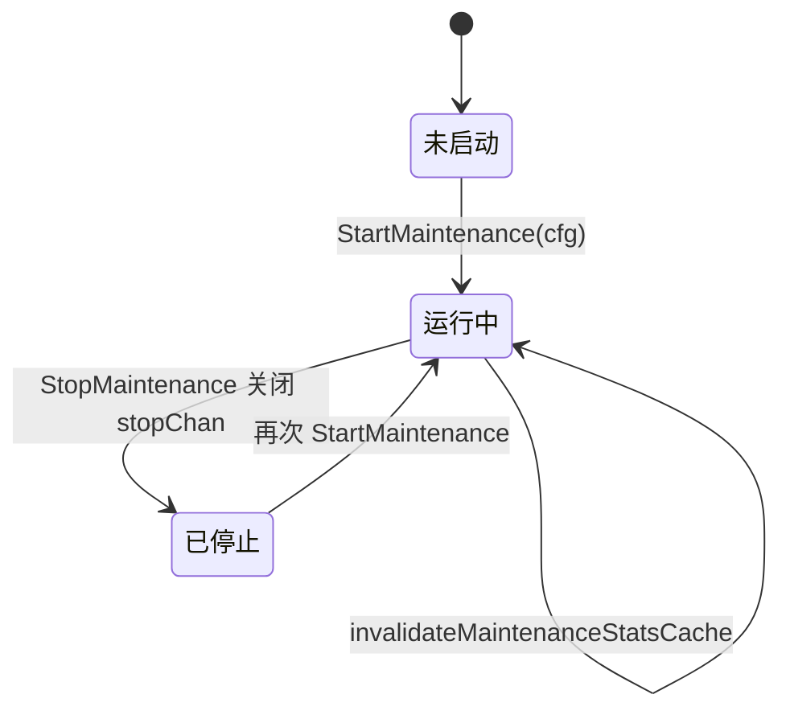
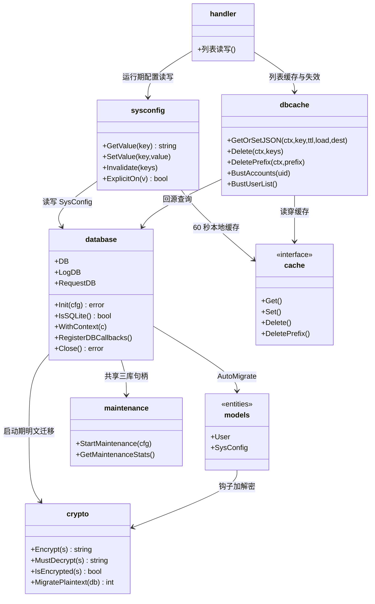
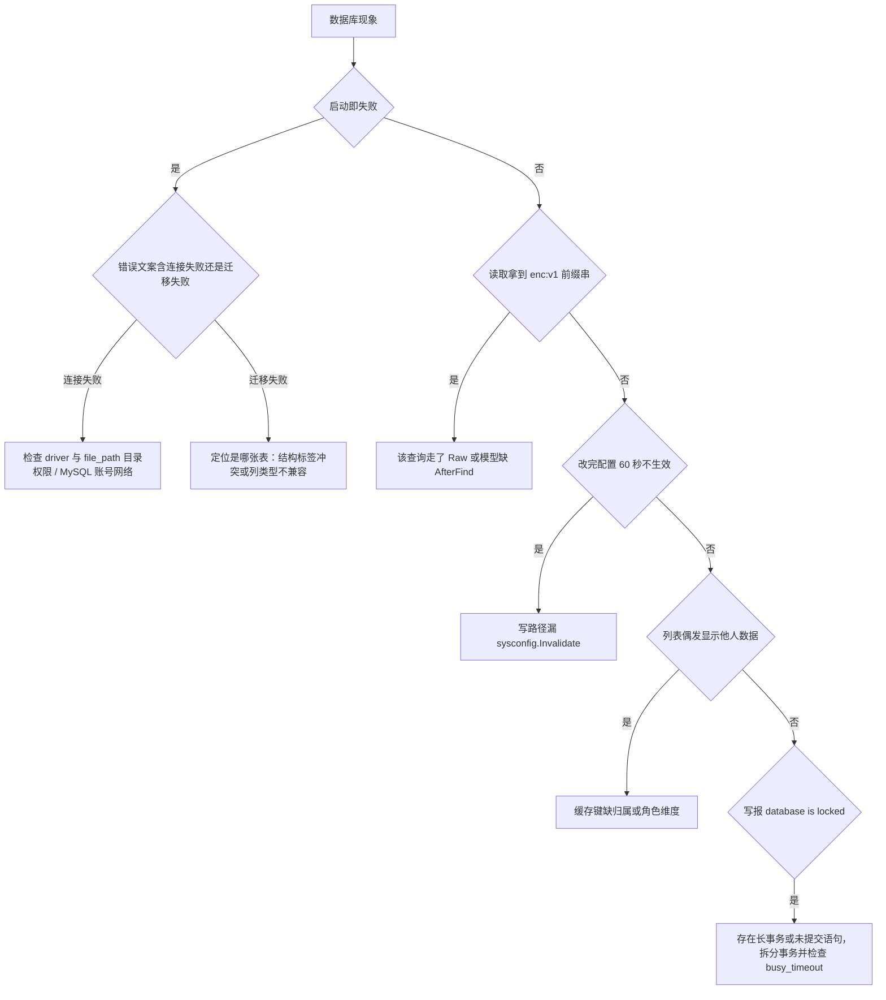

# 数据库开发

<cite>
**本文档引用的文件**
- [main.go](file://main/main.go)
- [database.go](file://main/internal/database/database.go)
- [maintenance.go](file://main/internal/database/maintenance.go)
- [trace_gin.go](file://main/internal/database/trace_gin.go)
- [models.go](file://main/internal/models/models.go)
- [hooks.go](file://main/internal/models/hooks.go)
- [dbcache.go](file://main/internal/dbcache/dbcache.go)
- [keys.go](file://main/internal/dbcache/keys.go)
- [sysconfig.go](file://main/internal/sysconfig/sysconfig.go)
- [crypto.go](file://main/internal/crypto/crypto.go)
- [migrate.go](file://main/internal/crypto/migrate.go)
- [account.go](file://main/internal/api/handler/account.go)
- [user.go](file://main/internal/api/handler/user.go)
- [cert.go](file://main/internal/api/handler/cert.go)
- [plan.go](file://main/internal/api/handler/plan.go)
- [domain.go](file://main/internal/api/handler/domain.go)
- [quota.go](file://main/internal/api/handler/quota.go)
- [dashboard_scope.go](file://main/internal/api/handler/dashboard_scope.go)
- [request_trace.go](file://main/internal/api/middleware/request_trace.go)
- [config.go](file://main/internal/config/config.go)
</cite>

## 目录

- [简介](#简介)
- [项目结构](#项目结构)
- [核心组件](#核心组件)
- [架构总览](#架构总览)
- [详细组件分析](#详细组件分析)
  - [新增模型端到端流程](#新增模型端到端流程)
  - [AutoMigrate 注册顺序](#automigrate-注册顺序)
  - [模型钩子与字段级加密](#模型钩子与字段级加密)
  - [关联查询与 N+1 防范](#关联查询与-n1-防范)
  - [事务边界与 SkipDefaultTransaction](#事务边界与-skipdefaulttransaction)
  - [dbcache 键设计与失效](#dbcache-键设计与失效)
  - [SQLite 与 MySQL 双驱动差异](#sqlite-与-mysql-双驱动差异)
  - [查询追踪与慢查询定位](#查询追踪与慢查询定位)
  - [数据库维护服务](#数据库维护服务)
- [依赖关系分析](#依赖关系分析)
- [性能考虑](#性能考虑)
- [故障排查指南](#故障排查指南)
- [结论](#结论)
- [附录](#附录)

## 简介

本文面向 DNSPlane 后端开发者，说明「从新增一张表到线上可观测」的完整开发流程与既有约定，覆盖以下主题：

- 模型定义与 `AutoMigrate` 注册顺序约束
- GORM 钩子（`BeforeSave` / `AfterFind`）与字段级加密
- 关联查询写法与 N+1 防范策略
- 显式事务边界，以及 `SkipDefaultTransaction` 的取舍理由
- `dbcache` 读穿缓存的键设计、TTL 与失效半径
- SQLite / MySQL 双驱动的行为差异与迁移注意事项
- `trace_gin.go` 与请求追踪中间件构成的慢查询定位链路
- 数据库维护服务的清理与压缩策略

本文**不重复**表字段清单与配置项全表：

- 表结构、字段语义与索引清单见 [数据库设计](../数据库设计.md)
- 配置项全表与优先级矩阵见 [配置管理](../配置管理.md)
- 运行期配置项的扩展流程见 [配置扩展](./配置扩展.md)

**章节来源**
- [database.go:34-46](file://main/internal/database/database.go#L34-L46)
- [maintenance.go:28-44](file://main/internal/database/maintenance.go#L28-L44)

## 项目结构

数据库相关代码集中在四个包，职责边界清晰，不存在跨层直连：

```text
main/internal/
├── database/
│   ├── database.go       # 三库句柄、DSN 构造、连接池、Init 编排、AutoMigrate、回调注册
│   ├── maintenance.go    # 维护服务：日志清理、行数裁剪、WAL checkpoint、VACUUM、统计快照
│   └── trace_gin.go      # goroutine 与 gin.Context 绑定，供回调注入请求上下文
├── models/
│   ├── models.go         # 全部业务模型（结构体标签即 DDL 意图）
│   ├── hooks.go          # BeforeSave / AfterFind 字段加解密钩子
│   ├── cloudflare.go     # Cloudflare 相关模型
│   └── quota.go          # 套餐 / 订阅 / 配额模型
├── dbcache/
│   ├── dbcache.go        # 读穿缓存原语 GetOrSetJSON / Delete / DeletePrefix
│   └── keys.go           # 逻辑键命名与失效函数（Bust 系列）
└── sysconfig/
    └── sysconfig.go      # SysConfig 表读写 + 60 秒本地缓存
```

调用侧统一通过 `database.WithContext(c)` 获取会话，不直接引用全局句柄拼查询。

**章节来源**
- [database.go:21-25](file://main/internal/database/database.go#L21-L25)
- [database.go:358-371](file://main/internal/database/database.go#L358-L371)

## 核心组件

### 三库句柄与职责划分

进程内维护三个独立的 `*gorm.DB`，按写入频率与体积隔离：

| 句柄 | 载体 | 承载模型 | 隔离动机 |
| --- | --- | --- | --- |
| `DB` | SQLite 或 MySQL（由 `database.driver` 决定） | User、Account、Domain、CertOrder、Plan、SysConfig 等全部业务表 | 业务主数据，需要持久与可备份 |
| `LogDB` | 恒为 SQLite（`logs.db`） | `Log`、`CertLog`、`DMCheckLog` | 追加写为主，体积随时间膨胀，不与业务表争抢页缓存 |
| `RequestDB` | 恒为 SQLite（`request_logs.db`） | `RequestLog` | 请求追踪含 SQL 文本，写入量最大，独立文件便于裁剪 |

`LogDB` 与 `RequestDB` 的路径由主库路径推导（`LogDBPath` / `RequestDBPath`），即使主库切到 MySQL，两个日志库仍是本地 SQLite 文件，因此**日志类模型不得声明跨库关联**，也不能出现在同一条 SQL 中与主库表 JOIN。

**章节来源**
- [database.go:21-32](file://main/internal/database/database.go#L21-L32)
- [database.go:104-118](file://main/internal/database/database.go#L104-L118)
- [config.go:57-67](file://main/internal/config/config.go#L57-L67)
- [models.go:344-377](file://main/internal/models/models.go#L344-L377)

### 连接池装配

两套池参数按驱动分别硬编码，不来自配置文件：

| 参数 | SQLite | MySQL | 设计依据 |
| --- | --- | --- | --- |
| `SetMaxOpenConns` | 8 | 100 | SQLite 单文件写入串行化，超出只增加 page cache 占用 |
| `SetMaxIdleConns` | 4 | 25 | 保持少量热连接避免反复建连 |
| `SetConnMaxIdleTime` | 5 分钟 | 5 分钟 | 统一回收空闲连接 |
| `SetConnMaxLifetime` | 0（永不） | 1 小时 | MySQL 需定期重建以躲过服务端 `wait_timeout`；本地文件无此问题 |

**章节来源**
- [database.go:48-69](file://main/internal/database/database.go#L48-L69)

## 架构总览

启动阶段的编排顺序是硬约束，任何新增模型或迁移都必须落在 `database.Init` 内部：



**图表来源**
- [database.go:71-150](file://main/internal/database/database.go#L71-L150)
- [main.go:70-100](file://main/main.go#L70-L100)

`registerTraceCallbacks` 只注册到 `DB` 与 `LogDB`，**刻意排除 `RequestDB`**，否则写请求日志会再次被追踪，形成递归放大。

**章节来源**
- [database.go:71-150](file://main/internal/database/database.go#L71-L150)
- [database.go:241-312](file://main/internal/database/database.go#L241-L312)
- [database.go:373-377](file://main/internal/database/database.go#L373-L377)
- [main.go:70-100](file://main/main.go#L70-L100)

## 详细组件分析

### 新增模型端到端流程

从 0 到 1 增加一张表，必须依次完成六个动作，缺任一项都会在运行期暴露：

1. 在 `main/internal/models/models.go` 定义结构体，用标签表达列宽、索引与默认值
2. 把结构体指针追加进 `migrate()` 的 `DB.AutoMigrate(...)` 参数列表（主库表），或追加进 `migrateLogDB()` / `migrateRequestDB()`（日志表）
3. 若含凭据、令牌、私钥类字段，在 `hooks.go` 补一对 `BeforeSave` / `AfterFind`，并在 `crypto/migrate.go` 的 `DefaultMigrateSpecs` 登记表名与列名
4. 在 `main/internal/api/handler/` 或 `main/internal/service/` 编写读写代码，会话统一取 `database.WithContext(c)`
5. 若该表出现在高频列表接口，在 `dbcache/keys.go` 增加键函数与 `Bust` 失效函数，写路径全部调用失效
6. 补一条 `EXPLAIN` 可验证的索引，并确认列表查询的过滤列都在索引前缀内

新增模型的最小骨架：

```go
// Subscription 订阅变更事件（主库表，需要进 migrate 注册）
type Subscription struct {
    ID        uint           `gorm:"primaryKey" json:"id"`
    UserID    uint           `gorm:"column:uid;index:idx_subscription_user_time,priority:1" json:"uid"`
    Event     string         `gorm:"size:32;not null" json:"event"`
    Payload   string         `gorm:"type:text" json:"payload"`
    Token     string         `gorm:"size:191" json:"-"` // 凭据类字段，json 永不外泄
    CreatedAt time.Time      `gorm:"index:idx_subscription_user_time,priority:2" json:"created_at"`
    DeletedAt gorm.DeletedAt `gorm:"index" json:"-"`
}
```

注册动作是**唯一**建表入口，项目不使用版本化迁移脚本：

```go
func migrate() error {
    if err := DB.AutoMigrate(
        &models.User{},
        // ... 既有模型保持原顺序 ...
        &models.SubdomainClaim{},
        &models.Subscription{}, // 新增模型追加到列表尾部
    ); err != nil {
        return err
    }
    migrateGitHubIDToOAuth()
    return nil
}
```

标签写法必须与既有模型保持一致：列名显式 `column:`（如 `uid`、`did`、`oid`）、组合索引拆成 `index:名称,priority:N`、软删字段统一用 `gorm.DeletedAt` 并建索引。

**章节来源**
- [models.go:9-33](file://main/internal/models/models.go#L9-L33)
- [models.go:300-324](file://main/internal/models/models.go#L300-L324)
- [database.go:241-278](file://main/internal/database/database.go#L241-L278)
- [hooks.go:32-70](file://main/internal/models/hooks.go#L32-L70)

### AutoMigrate 注册顺序

`AutoMigrate` 按参数顺序逐表处理，本项目的顺序约束来自三点：

| 约束 | 说明 | 违反后果 |
| --- | --- | --- |
| 存量搬迁依赖表必须先存在 | `migrate()` 在 AutoMigrate 成功后立即调用 `migrateGitHubIDToOAuth()`，读写 `user_oauths` | 该表未建，搬迁静默失败，第三方绑定丢失 |
| 同库内先基础后派生 | `User` → `UserOAuth` → `Account` → `Domain` → `DomainCategory`，与引用方向一致 | 无外键约束故仍能建表，但索引重建与列补齐顺序混乱，首启动日志噪声大 |
| 主库与日志库分组注册 | `migrate()` / `migrateLogDB()` / `migrateRequestDB()` 三组互不混用 | 日志模型进主库会被 `migrateOldData` 迁走并 `DROP`，反之业务表进日志库将丢失 |

`SysConfig` 位于主库列表中部，这是硬要求：`initAdmin()`、`crypto.MigratePlaintext()`、`migrateOldData()` 全部在其之后执行，且首次请求到达前必须存在。

**既有顺序不得重排**。新增表只能追加到所属分组末尾，因为 `migrate()` 结尾的搬迁逻辑默认「前面都是老表」。

**章节来源**
- [database.go:241-298](file://main/internal/database/database.go#L241-L298)
- [database.go:300-312](file://main/internal/database/database.go#L300-L312)
- [database.go:152-239](file://main/internal/database/database.go#L152-L239)

### 模型钩子与字段级加密

加密能力集中在 `crypto` 包，模型层只声明「哪些字段要加解密」：

```go
func (o *UserOAuth) BeforeSave(*gorm.DB) error {
    return encFields(&o.AccessToken, &o.RefreshToken)
}
func (o *UserOAuth) AfterFind(*gorm.DB) error {
    decFields(&o.AccessToken, &o.RefreshToken)
    return nil
}
```

关键实现事实：

- 密文带前缀 `enc:v1:`，`IsEncrypted` 据此判定；`Encrypt` 对空前缀串与已加密串都直接返回，因此**重复保存不会二次加密**
- 密钥由 `config.SecurityConfig.MasterKey` 经 SHA-256 派生，AES-256-GCM，`deriveKey` 用 `sync.Once` 缓存
- `MustDecrypt` 对明文输入原样返回，故降级与历史数据不会导致读取崩溃
- 钩子成对出现是**强制约定**：只写 `BeforeSave` 会让读取拿到密文，只写 `AfterFind` 会让明文落库

已覆盖的敏感字段清单（`hooks.go` 全量）：

| 模型 | 字段 |
| --- | --- |
| `Account` | `Config` |
| `CertAccount` | `Config`、`Ext` |
| `CertOrder` | `PrivateKey`、`Info` |
| `CertDeploy` | `Config`、`Info` |
| `DMTask` | `ProxyPassword` |
| `User` | `TOTPSecret` |
| `UserOAuth` | `AccessToken`、`RefreshToken` |

`DefaultMigrateSpecs` 是上述清单的「表名 + 列名」镜像，`database.Init` 每次启动都会跑一次 `crypto.MigratePlaintext`，幂等且只回写真正为明文的行。**新增钩子必须同步登记 spec**，否则老库升级后凭据仍是明文入库。

```sql
-- 验收：确认没有遗留明文（应为 0）
SELECT COUNT(*) FROM user_oauths
WHERE access_token <> '' AND access_token NOT LIKE 'enc:v1:%';
```

钩子只作用于经 GORM 模型路径的读写。`DB.Raw(...)` / `DB.Exec(...)` 手写 SQL **不会触发 `AfterFind`**，这类查询返回的是密文，务必改走模型 API。

**章节来源**
- [hooks.go:9-70](file://main/internal/models/hooks.go#L9-L70)
- [crypto.go:17-60](file://main/internal/crypto/crypto.go#L17-L60)
- [crypto.go:95-95](file://main/internal/crypto/crypto.go#L95-L95)
- [migrate.go:9-45](file://main/internal/crypto/migrate.go#L9-L45)
- [database.go:136-141](file://main/internal/database/database.go#L136-L141)

### 关联查询与 N+1 防范

本项目**不使用 GORM 关联字段**：`models` 包内没有任何 `has many` / `belongs to` 声明，也没有一处 `Preload` 调用。表间关系只靠标量外键列（`uid`、`aid`、`did`、`oid`）表达，跨表读取统一写成显式 `Joins`。

这是刻意的 KISS 取舍：关联字段 + `Preload` 会在循环里退化为 N+1，且难以与「按用户可见范围过滤」这类业务条件组合。既有实现直接给出可复制的范式：

```go
// 一次 JOIN 同时拿到域名与其所属账户，并按账户归属过滤
query := database.WithContext(c).Model(&models.Domain{}).
    Joins("LEFT JOIN accounts ON domains.aid = accounts.id").
    Where("domains.deleted_at IS NULL AND accounts.uid = ?", userID)
```

多表计数用「每表一条聚合 SQL」而非逐行统计，见 `quota.go` 与 `dashboard_scope.go`：

```go
db.Table("accounts").Where("uid = ? AND deleted_at IS NULL", userID).Count(&n)
db.Table("domains").
    Joins("LEFT JOIN accounts ON domains.aid = accounts.id").
    Where("domains.deleted_at IS NULL AND accounts.uid = ?", userID).Count(&n)
```

必须遵守的四条规则：

1. 列表接口先 `Count` 再取分页行，两条 SQL 都保留 `deleted_at IS NULL`（`Joins` 拼出的条件写在 `ON` 里时，软删过滤要显式补到 `WHERE`）
2. 需要「父表字段参与过滤」时用 `Joins`，不要在拿到子表行后循环查父表
3. 跨库关联禁止：`Log` 与 `Domain` 分属 `LogDB` 与 `DB`，只能先在应用层取 ID 集合再用 `IN`
4. 批量更新必须显式加 `Session(&gorm.Session{AllowGlobalUpdate: true})`，否则 GORM 拒绝无 `WHERE` 的全表更新

N+1 自查 SQL：把可疑接口的一页请求 SQL 取出来，若同一语句模板出现次数与页大小同阶，即为 N+1。

```sql
-- 定位缺索引导致的慢 JOIN：确认过滤列在复合索引前缀
EXPLAIN QUERY PLAN
SELECT domains.* FROM domains
LEFT JOIN accounts ON domains.aid = accounts.id
WHERE domains.deleted_at IS NULL AND accounts.uid = 1;
```

**章节来源**
- [domain.go:102-102](file://main/internal/api/handler/domain.go#L102-L102)
- [quota.go:122-123](file://main/internal/api/handler/quota.go#L122-L123)
- [quota.go:277-313](file://main/internal/api/handler/quota.go#L277-L313)
- [dashboard_scope.go:29-41](file://main/internal/api/handler/dashboard_scope.go#L29-L41)
- [user.go:583-583](file://main/internal/api/handler/user.go#L583-L583)

### 事务边界与 SkipDefaultTransaction

`gorm.Config` 显式设置 `SkipDefaultTransaction: true`。源码注释给出三条依据：项目无散落隐式事务、无多行批量插入、库内无外键约束，逐条提交只增加 WAL fsync 次数。

代价是：**单条写不再有隐式事务保护**。任何「多步写必须同生同死」的场景都必须自己开显式事务。既有范式（设为默认套餐）：

```go
err := database.WithContext(c).Transaction(func(tx *gorm.DB) error {
    if err := tx.Model(&models.Plan{}).Where("is_default = ?", true).
        Update("is_default", false).Error; err != nil {
        return err
    }
    return tx.Model(&models.Plan{}).Where("id = ?", plan.ID).
        Update("is_default", true).Error
})
```

事务编写规则：

1. 入口一律用 `database.WithContext(c).Transaction(...)`，让事务继承请求上下文，追踪与取消都能生效
2. 回调体内**只用 `tx`**，混用全局 `DB` 会让该语句逃出事务
3. 错误即回滚：任一分支返回 `error` 就整体回滚，不要用 `logger.Warn` 吞掉后继续
4. 事务内不做外部网络调用（DNS 商 API、证书签发），把慢 IO 留在事务外
5. `FirstOrCreate` 只保证单语句原子，「查不到再插入」的并发唯一性要靠数据库唯一索引兜底

日志批量写入不进事务：`maintenance.go` 与 `migrateOldData()` 用 500 条分批 `Create`，允许部分失败后继续，因为日志可容忍缺口而业务表不可。

**章节来源**
- [database.go:74-79](file://main/internal/database/database.go#L74-L79)
- [plan.go:386-399](file://main/internal/api/handler/plan.go#L386-L399)
- [plan.go:321-321](file://main/internal/api/handler/plan.go#L321-L321)
- [plan.go:653-653](file://main/internal/api/handler/plan.go#L653-L653)
- [database.go:159-239](file://main/internal/database/database.go#L159-L239)

### dbcache 键设计与失效

`dbcache` 是「热点列表读穿缓存」层，只有三个原语：`GetOrSetJSON`、`Delete`、`DeletePrefix`，键定义全部集中在 `keys.go`。



**图表来源**
- [dbcache.go:14-44](file://main/internal/dbcache/dbcache.go#L14-L44)
- [cert.go:76-79](file://main/internal/api/handler/cert.go#L76-L79)

键命名规范（版本前缀 `db:v1:` 是**唯一**允许的起点）：

| 键 | 形态 | 组成维度 | 说明 |
| --- | --- | --- | --- |
| `KeyAccountsAdmin()` | `db:v1:accounts:admin` | 常量 | 管理员全量账户 |
| `KeyAccountsUser(uid)` | `db:v1:accounts:user:<uid>` | 归属用户 | 用户自助视图 |
| `KeyUsersList(page, pageSize, keyword)` | `db:v1:users:list:<page>:<size>:<kw>` | 分页 + 关键字 | 关键字取 SHA-256 前 8 字节 hex；空关键字写 `_` |
| `KeyUsersAdminFullList()` | `db:v1:users:admin_full` | 常量 | 不分页全量 |
| `KeyCertAccountsList(deploy, admin, uid)` | `db:v1:cert:accounts:list:d<0\|1>:...` | 视图 + 归属 | `deploy` 折叠成 0/1 避免布尔串不稳定 |

设计约束：

1. 键必须携带全部影响结果集的维度。遗漏维度会把「管理员视图」缓存结果错发给普通用户，这是权限级缺陷而非性能缺陷
2. 无界维度（关键字、自由过滤）必须哈希压缩，禁止把原始串拼进键，避免键基数与注入风险
3. TTL 统一取 `dbcache.DefaultTTL`（60 秒），与 `sysconfig` 的 60 秒本地缓存对齐，便于推理一致性窗口
4. `GetOrSetJSON` 在 `cache.C == nil` 时降级为直连查询，因此单元测试与未启用 Redis 的环境同样可跑
5. 值经 `json.Marshal` → `cache.Set(string)` → `json.Unmarshal(dest)` 往返，`dest` 必须是可反序列化的具体类型指针，不能是 `interface{}`

失效半径由 `Bust*` 函数封装，写路径只调 `Bust`，不自己拼键：

| 写操作 | 失效调用 | 半径 |
| --- | --- | --- |
| 账户增删改 | `BustAccounts(uid)` | 管理员键 + 该用户键 |
| 用户创建 / 改名 / 删号 / OAuth 绑定 | `BustUserList()` | 全量键 + `db:v1:users:list:` 前缀 |
| 证书账户变更 | `BustCertAccountsList()` | `db:v1:cert:accounts:list:` 前缀 |

前缀删除在 Redis 走 `SCAN`、内存实现走遍历，因此**不要在高频写接口里删除大前缀**；能定位到具体键就用 `Delete`。

**章节来源**
- [dbcache.go:11-67](file://main/internal/dbcache/dbcache.go#L11-L67)
- [keys.go:10-49](file://main/internal/dbcache/keys.go#L10-L49)
- [account.go:109-109](file://main/internal/api/handler/account.go#L109-L109)
- [account.go:246-246](file://main/internal/api/handler/account.go#L246-L246)
- [user.go:64-64](file://main/internal/api/handler/user.go#L64-L64)
- [cert.go:76-79](file://main/internal/api/handler/cert.go#L76-L79)
- [sysconfig.go:12-15](file://main/internal/sysconfig/sysconfig.go#L12-L15)

### SQLite 与 MySQL 双驱动差异

`IsSQLite()` 是运行时判定入口，任何驱动特有行为都必须包在这个判断内。

DSN 层差异最关键：`glebarez/go-sqlite` 只识别 `_pragma`、`_time_format`、`_txlock` 三类参数，且**在每个新连接建立时重放 `_pragma`**。因此 PRAGMA 只能写进 DSN，才能覆盖连接池中每一条连接；`_busy_timeout`、`_journal_mode` 不是该驱动的参数名，写成那样会静默失效。

```go
func sqliteDSN(path string) string {
    return path + "?_pragma=journal_mode(WAL)" +
        "&_pragma=synchronous(NORMAL)" +
        "&_pragma=busy_timeout(5000)" +
        "&_pragma=cache_size(-16000)" +
        "&_pragma=temp_store(MEMORY)" +
        "&_pragma=mmap_size(67108864)"
}
```

方言差异清单：

| 维度 | SQLite | MySQL | 开发注意 |
| --- | --- | --- | --- |
| 并发写 | 文件级串行，靠 `busy_timeout(5000)` 排队 | 行级锁，可高并发 | 长事务会阻塞全部写入，事务内禁 IO |
| `key` 等保留字 | 需反引号 | 需反引号 | 统一写 `` `key` = ? ``，两侧都不例外 |
| DDL 能力 | `AutoMigrate` 走建表 + 复制重建 | 支持在线加列 | 大表加索引在两侧都是长操作，放维护窗口 |
| 空间回收 | `VACUUM` + `wal_checkpoint` | `OPTIMIZE TABLE` | `optimizeGormDB` 现按 SQLite 路径写死，MySQL 主库需另行验证 |
| `utf8mb4` | 无字符集问题 | DSN 固定 `charset=utf8mb4&parseTime=True&loc=Local` | 改 DSN 会破坏时间解析 |
| 索引长度 | 无限制 | InnoDB 前缀限制 | `size:191` 的列宽是为 MySQL 唯一索引留的余量，新增唯一列沿用 191 |

主库切 MySQL 时 `LogDB` / `RequestDB` 仍是本地 SQLite 文件，多实例部署需要每个实例各自持有；若日志库需集中，应改用 Redis 侧 `logstore`，而不是把日志表挪进 MySQL 主库。

**章节来源**
- [database.go:27-46](file://main/internal/database/database.go#L27-L46)
- [database.go:81-102](file://main/internal/database/database.go#L81-L102)
- [maintenance.go:284-320](file://main/internal/database/maintenance.go#L284-L320)
- [sysconfig.go:23-23](file://main/internal/sysconfig/sysconfig.go#L23-L23)

### 查询追踪与慢查询定位

链路分三段：中间件开闸 → 回调计时 → 落库或返回。

`trace_gin.go` 解决一个具体问题：很多查询点没有 `gin.Context`（服务层、定时任务），但希望仍能把 SQL 归到触发它的请求上。做法是**按 goroutine 号绑定**：

```go
func BindRequestGinForDBTrace(c *gin.Context) (cleanup func()) {
    id := currentGoroutineID()
    if id == 0 {
        return func() {}
    }
    traceGinByGoroutine.Store(id, c)
    return func() { traceGinByGoroutine.Delete(id) }
}
```

`injectGinIntoDBStatement` 在每条语句执行前把 `gin.Context` 塞进 `Statement.Context`；若上下文已带则直接返回，因此显式 `WithContext(c)` 的优先级更高。

`registerTraceCallbacks` 对 Query / Create / Update / Delete / Row / Raw 六类回调各注册「前置计时 + 后置记录」。后置 `recordQueryCallback` 有一道关键短路：

```go
if _, exists := ginCtx.Get(dbQueriesKey); !exists {
    return
}
```

即**只有 `RequestTrace` 中间件注入了 `db_queries` 收集器时才记录**，未开启追踪的请求完全不承担 `Explain` 的开销。记录内容包括展开后的 SQL、毫秒耗时与影响行数，SQL 超 2000 字符截断。

`RequestLog.DBQueries` 与 `RequestLog.DBQueryTime` 是最终的慢查询落点，排障时按 `request_id` 或 `error_id` 取出一条请求的全部 SQL 清单。

使用边界（重要）：

- goroutine 绑定只在同一 goroutine 内有效，跨协程（自建 `go func`）需要用 `WithContext(c)` 显式传递
- `RequestDB` 未注册回调，请求日志自身的写入不会被记录
- 耗时是「回调前后」的墙钟时间，含 GORM 构造与驱动往返，不等于数据库执行计划耗时

**章节来源**
- [trace_gin.go:12-69](file://main/internal/database/trace_gin.go#L12-L69)
- [database.go:347-356](file://main/internal/database/database.go#L347-L356)
- [database.go:379-497](file://main/internal/database/database.go#L379-L497)
- [request_trace.go:27-27](file://main/internal/api/middleware/request_trace.go#L27-L27)
- [request_trace.go:251-289](file://main/internal/api/middleware/request_trace.go#L251-L289)

### 数据库维护服务

`maintenance.go` 以「保留天数 + 保留行数」双维度做裁剪，并周期性压缩文件。



**图表来源**
- [maintenance.go:101-198](file://main/internal/database/maintenance.go#L101-L198)
- [maintenance.go:270-320](file://main/internal/database/maintenance.go#L270-L320)

三个值得注意的实现事实：

1. `StartMaintenance` 有 `maintService != nil` 幂等守卫，重复调用直接返回；启动前会先 `cleanInvalidTasks()` 清掉 `DomainID = 0` 或 `RecordID` 为空的僵尸监控任务
2. `trimRequestLogs` 用「`Order("id DESC").Offset(keepCount).Limit(1)` 取分界 ID，再按 `id <= 分界` 删除」实现保留最新 N 行，避免全表排序
3. 维护统计快照带 25 秒 TTL 读写锁缓存，任何清理或压缩动作都会主动失效，前端看板因此不会读到旧体积

`VACUUM` 可能重置 `journal_mode`，因此第 5 步再执行一次 `PRAGMA journal_mode=WAL`；`wal_checkpoint(TRUNCATE)`、`ANALYZE`、`PRAGMA optimize` 按此顺序组合。

**章节来源**
- [maintenance.go:101-198](file://main/internal/database/maintenance.go#L101-L198)
- [maintenance.go:250-320](file://main/internal/database/maintenance.go#L250-L320)
- [maintenance.go:322-433](file://main/internal/database/maintenance.go#L322-L433)

## 依赖关系分析



**图表来源**
- [database.go:3-19](file://main/internal/database/database.go#L3-L19)
- [migrate.go:1-22](file://main/internal/crypto/migrate.go#L1-L22)

依赖方向刻意保持单向：`database` 不 import `handler`；`sysconfig` 与 `dbcache` 都只依赖 `cache` 抽象而非 Redis 客户端；`models` 依赖 `crypto`（加密钩子），`crypto` 依赖 `config`（主密钥），因此 `crypto` 不能反向 import `models`，批量迁移改用 `DefaultMigrateSpecs` 的表名列名描述来打破环。

**章节来源**
- [database.go:3-19](file://main/internal/database/database.go#L3-L19)
- [sysconfig.go:3-10](file://main/internal/sysconfig/sysconfig.go#L3-L10)
- [hooks.go:3-7](file://main/internal/models/hooks.go#L3-L7)
- [migrate.go:1-22](file://main/internal/crypto/migrate.go#L1-L22)

## 性能考虑

按影响面从大到小排列的可调点：

| 项 | 当前取值 | 影响 | 调整建议 |
| --- | --- | --- | --- |
| `journal_mode` | WAL | 读写并发能力 | 保持默认；`VACUUM` 后必须重设 |
| `synchronous` | NORMAL | 每次提交 fsync 强度 | WAL 下NORMAL 的崩溃窗口可接受，勿设 OFF |
| `busy_timeout` | 5000 ms | 写排队上限 | 长事务导致超时时先拆事务而非调大 |
| `cache_size` | -16000（约 16 MB） | 单连接页缓存 | 连接数 8，最坏约 128 MB，按机器内存评估 |
| `mmap_size` | 67108864（64 MB） | 只读映射 | 大库读多可提升，32 位环境慎用 |
| `SkipDefaultTransaction` | true | 单条写少一次事务包裹 | 多步写必须显式 `Transaction` |
| SQLite `MaxOpenConns` | 8 | 写串行下吞吐天花板 | 提高无收益，只增内存 |
| `dbcache.DefaultTTL` | 60 s | 列表回源频率与新鲜度 | 一致性敏感的场景改用失效而非缩短 TTL |
| `RequestLog` 保留 | 7 天 / 成功 2000 / 失败 1000 | 追踪体积 | 通过 `maint_request_*` 配置项在线调整 |
| `VACUUM` 间隔 | 24 h | 空间回收与 IO 抖动 | 大库放到低峰窗口，间隔通过 `maint_vacuum_interval_h` 调整 |

两条常见性能反模式：

- 在 `AfterFind` 之外手写 `Raw` 查询再解密，导致 CPU 集中在解密且丢失索引命中
- 列表接口每行补一次父表查询（应改 `Joins`）

**章节来源**
- [database.go:39-69](file://main/internal/database/database.go#L39-L69)
- [database.go:74-79](file://main/internal/database/database.go#L74-L79)
- [maintenance.go:46-59](file://main/internal/database/maintenance.go#L46-L59)
- [keys.go:27-49](file://main/internal/dbcache/keys.go#L27-L49)

## 故障排查指南



**图表来源**
- [database.go:39-58](file://main/internal/database/database.go#L39-L58)
- [sysconfig.go:17-37](file://main/internal/sysconfig/sysconfig.go#L17-L37)

| 现象 | 首查位置 | 判定依据 | 处置 |
| --- | --- | --- | --- |
| `database is locked` | `sqliteDSN` 的 `busy_timeout`；事务长度 | `RequestLog.DBQueries` 中出现耗时同阶的连续写 | 缩短事务，移除事务内 IO；确认只有一个进程写同一文件 |
| 启动后新表不存在 | `migrate()` 参数列表 | `DB.Migrator().HasTable` 为 false | 把模型追加进对应分组的 AutoMigrate |
| 字段值变密文 | `hooks.go` 配对情况 | 值以 `enc:v1:` 开头 | 补 `AfterFind`，或把 `Raw` 查询改回模型 API |
| 老库升级后凭据仍明文 | `DefaultMigrateSpecs` | `MigratePlaintext` 返回值与预期不符 | 登记表名列名后重启；启动日志应出现「已加密 N 条」 |
| 列表接口 SQL 数量随页大小增长 | `RequestLog.DBQueries` | 同模板 SQL 重复出现 | 改 `Joins` 或批量取 ID 集合 |
| 设置保存后最长 60 秒无反应 | `sysconfig.GetValue` TTL | 写库成功但读仍旧值 | 写路径调用 `Invalidate(改动键...)`，只失效本次键 |
| 缓存返回他人可见范围 | `dbcache/keys.go` | 键未含 `uid` / 角色维度 | 补维度并整体失效该前缀 |
| 请求日志没有 SQL | `RequestTrace` 是否挂载 | `ginCtx.Get("db_queries")` 不存在即跳过记录 | 确认追踪中间件顺序在 handler 之前 |
| 数据库文件持续变大 | `runVacuumAndOptimize` 周期 | `GetMaintenanceStats` 体积不降 | 调小 `maint_*_days`，检查维护协程是否被 `StopMaintenance` 停掉 |
| 重启后证书订单卡在处理中 | `resetStuckOrders` | `status = 1` 的订单 | 属预期自愈：启动时统一重置为 0 允许重试 |

**章节来源**
- [database.go:39-58](file://main/internal/database/database.go#L39-L58)
- [database.go:136-157](file://main/internal/database/database.go#L136-L157)
- [database.go:441-444](file://main/internal/database/database.go#L441-L444)
- [sysconfig.go:17-37](file://main/internal/sysconfig/sysconfig.go#L17-L37)
- [maintenance.go:329-355](file://main/internal/database/maintenance.go#L329-L355)
- [keys.go:16-45](file://main/internal/dbcache/keys.go#L16-L45)

## 结论

本次文档梳理确认了 DNSPlane 数据库层的四条主线约定：

- **单点建表**：`AutoMigrate` 是唯一 DDL 入口，按主库 / 日志库 / 请求库三组注册，新表只能追加到所属分组末尾，不重排既有顺序
- **钩子成对**：字段加密由 `BeforeSave` / `AfterFind` 成对承担，`DefaultMigrateSpecs` 是其表列镜像，二者必须同步演进；`Raw` 查询不受钩子保护是已知陷阱
- **拒绝关联魔法**：不声明 GORM 关联字段、不使用 `Preload`，跨表读取统一显式 `Joins`，从根上消除 N+1；`SkipDefaultTransaction` 换来写入开销下降，代价是多步写必须显式开事务
- **缓存与可观测配套**：`db:v1:` 版本前缀 + 全维度键 + 精确失效构成读穿缓存契约，`trace_gin.go` 的 goroutine 绑定加 `db_queries` 短路开关，把慢查询定位成本限制在「确实开启追踪」的请求上

未验证事项：MySQL 主库路径下的 `optimizeGormDB`（当前实现按 SQLite PRAGMA 编写）与多实例部署时 `LogDB` / `RequestDB` 的集中化方案，均标注为待评估，未在本文给出结论。

**章节来源**
- [database.go:71-150](file://main/internal/database/database.go#L71-L150)
- [trace_gin.go:35-69](file://main/internal/database/trace_gin.go#L35-L69)

## 附录

### 新增表检查清单

| 步骤 | 具体动作 | 验收方式 |
| --- | --- | --- |
| 1 | 模型结构体标签齐备（列名、宽度、索引、软删） | `go build ./...` 通过 |
| 2 | 追加进正确分组的 `AutoMigrate` | 启动日志无迁移错误，`HasTable` 为真 |
| 3 | 敏感字段补成对 `BeforeSave` / `AfterFind`，并登记 `DefaultMigrateSpecs` | 落库值以 `enc:v1:` 开头，`MigratePlaintext` 计数符合预期 |
| 5 | 读写走 `database.WithContext(c)` | `RequestLog.DBQueries` 能抓到该 SQL |
| 6 | 高频列表加 `db:v1:` 键与 `Bust` 函数 | 写一次后读立即反映新值 |
| 7 | 跨表用 `Joins` 且带 `deleted_at IS NULL` | 一页请求的 SQL 模板数与页大小无关 |
| 8 | 多步写包 `Transaction` | 中途返回错误后数据无半写 |

**章节来源**
- [database.go:241-312](file://main/internal/database/database.go#L241-L312)
- [migrate.go:14-36](file://main/internal/crypto/migrate.go#L14-L36)

### 常用 SQL 片段

```sql
-- 慢请求的 SQL 归因
SELECT request_id, duration, db_query_time, db_queries
FROM request_logs
WHERE db_query_time > 100
ORDER BY id DESC
LIMIT 20;
```

**章节来源**
- [request_trace.go:251-289](file://main/internal/api/middleware/request_trace.go#L251-L289)

### 相关文档

- [配置扩展](./配置扩展.md)：新增运行期配置项的端到端流程
- [数据库设计](../数据库设计.md)：表字段全量清单与关系
- [配置管理](../配置管理.md)：配置项全表与优先级

**章节来源**
- [database.go:241-312](file://main/internal/database/database.go#L241-L312)
- [hooks.go:32-70](file://main/internal/models/hooks.go#L32-L70)
- [keys.go:10-49](file://main/internal/dbcache/keys.go#L10-L49)
