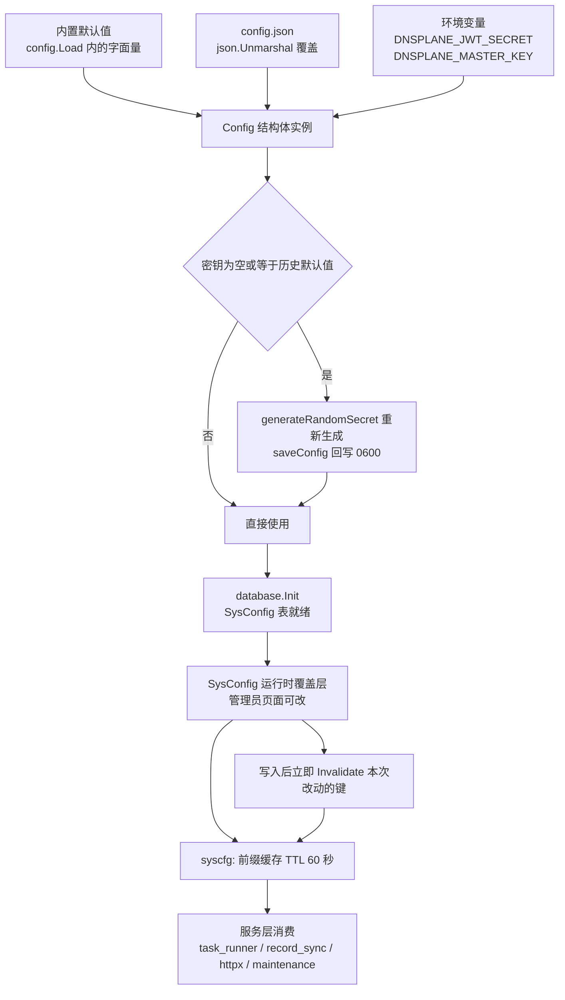
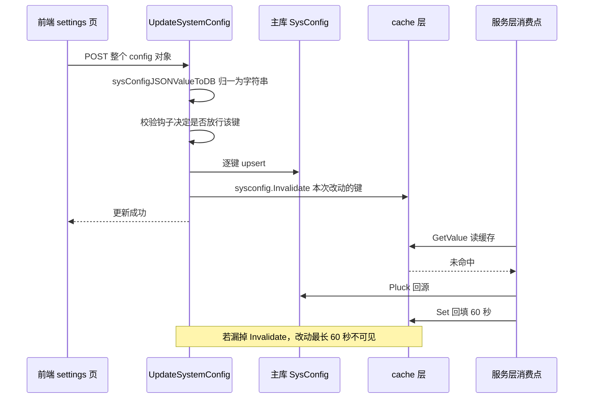
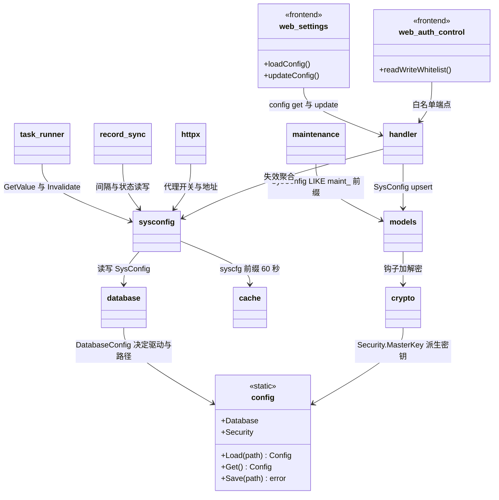
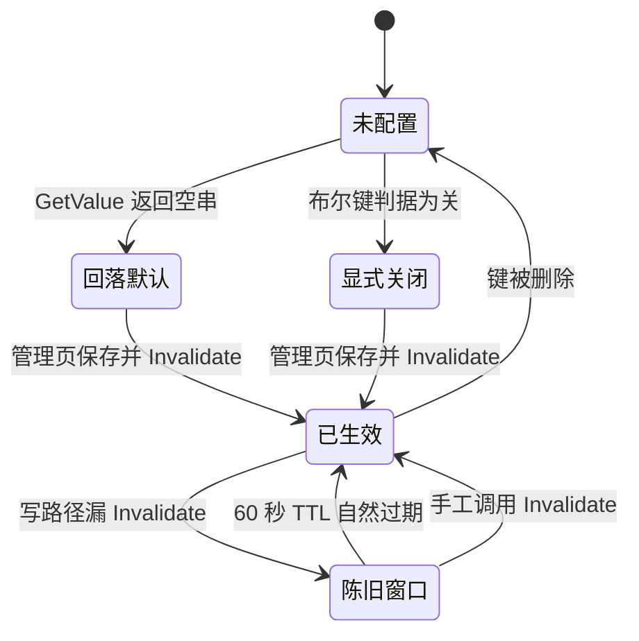

# 配置扩展

<cite>
**本文档引用的文件**
- [main.go](file://main/main.go)
- [config.go](file://main/internal/config/config.go)
- [sysconfig.go](file://main/internal/sysconfig/sysconfig.go)
- [models.go](file://main/internal/models/models.go)
- [hooks.go](file://main/internal/models/hooks.go)
- [crypto.go](file://main/internal/crypto/crypto.go)
- [database.go](file://main/internal/database/database.go)
- [maintenance.go](file://main/internal/database/maintenance.go)
- [dbcache.go](file://main/internal/dbcache/dbcache.go)
- [keys.go](file://main/internal/dbcache/keys.go)
- [user.go](file://main/internal/api/handler/user.go)
- [dashboard.go](file://main/internal/api/handler/dashboard.go)
- [auth_control.go](file://main/internal/api/handler/auth_control.go)
- [sysconfig_cache.go](file://main/internal/api/handler/sysconfig_cache.go)
- [oauth.go](file://main/internal/api/handler/oauth.go)
- [router.go（控制台路由）](file://main/internal/api/router.go)
- [routes_batch2.go（V1 路由）](file://main/internal/apiv1/routes_batch2.go)
- [task_runner.go](file://main/internal/service/task_runner.go)
- [record_sync.go](file://main/internal/service/record_sync.go)
- [proxy.go](file://main/internal/httpx/proxy.go)
- [api.ts](file://web/lib/api.ts)
- [settings/page.tsx](file://web/app/(dashboard)/dashboard/settings/page.tsx)
- [auth-control-settings.tsx](file://web/app/(dashboard)/dashboard/settings/auth-control-settings.tsx)
</cite>

## 目录

- [简介](#简介)
- [项目结构](#项目结构)
- [核心组件](#核心组件)
- [架构总览](#架构总览)
- [详细组件分析](#详细组件分析)
  - [两类配置的边界](#两类配置的边界)
  - [内置默认值与 config.json 结构体](#内置默认值与-configjson-结构体)
  - [环境变量覆盖层](#环境变量覆盖层)
  - [SysConfig 运行时覆盖](#sysconfig-运行时覆盖)
  - [热更新与缓存失效](#热更新与缓存失效)
  - [敏感键加密存储](#敏感键加密存储)
  - [新增配置项端到端示例](#新增配置项端到端示例)
  - [前端 settings 页联动](#前端-settings-页联动)
  - [值解析与判据约定](#值解析与判据约定)
- [依赖关系分析](#依赖关系分析)
- [性能考虑](#性能考虑)
- [故障排查指南](#故障排查指南)
- [结论](#结论)
- [附录](#附录)

## 简介

本文说明在 DNSPlane 中新增一个配置项的完整链路，从内置默认值一路走到前端设置页可编辑，并给出各层的既有约定与失效规则。

DNSPlane 的配置明显分成两套互不复用的机制：

- **静态配置**：`config.json` 结构体 + 环境变量，进程启动时一次性解析，改动需重启
- **运行时配置**：`SysConfig` 键值表 + `syscfg:` 前缀本地缓存，管理员可在页面在线改并即时生效

本文聚焦「开发流程」本身。配置项的**全量清单与优先级矩阵**属于跨域文档，不在此处重复：

- 配置项全表、取值范围与部署样例见 [配置管理](../配置管理.md)
- 表结构与索引清单见 [数据库设计](../数据库设计.md)
- 模型注册、钩子与缓存层规范见 [数据库开发](./数据库开发.md)

**章节来源**
- [config.go:84-146](file://main/internal/config/config.go#L84-L146)
- [sysconfig.go:12-43](file://main/internal/sysconfig/sysconfig.go#L12-L43)

## 项目结构

配置能力分散在五个位置，各自只负责一层：

```text
main/internal/
├── config/config.go            # 静态配置：结构体定义、内置默认、环境变量覆盖、落盘
├── sysconfig/sysconfig.go      # 运行时配置：SysConfig 表读写 + syscfg: 前缀 60 秒缓存
├── models/models.go            # SysConfig 模型（key 主键 32 字符，value text）
├── crypto/crypto.go            # 字段级加解密原语（enc:v1: 前缀，AES-256-GCM）
└── database/maintenance.go     # 一组运行时配置的范例：键名常量 + 默认结构 + 加载函数
main/internal/api/handler/
├── user.go                     # GetSystemConfig / UpdateSystemConfig 通用读写端点
├── auth_control.go             # 页面级键白名单端点
├── sysconfig_cache.go          # 缓存失效聚合函数
└── dashboard.go                # 按白名单键读写定时任务 cron 配置
web/lib/api.ts                  # systemApi.getConfig / updateConfig 与 SystemConfig 类型
web/app/(dashboard)/dashboard/settings/
├── page.tsx                    # 主设置页（多 Tab）
├── auth-control-settings.tsx   # 登录注册控制子页（独立端点）
└── optimize-ip-settings.tsx    # 优选 IP 子页
```

**章节来源**
- [config.go:16-77](file://main/internal/config/config.go#L16-L77)
- [maintenance.go:28-98](file://main/internal/database/maintenance.go#L28-L98)
- [user.go:625-718](file://main/internal/api/handler/user.go#L625-L718)

## 核心组件

### 三层静态配置载体

| 层 | 载体 | 解析时机 | 覆盖关系 | 改动生效方式 |
| --- | --- | --- | --- | --- |
| 内置默认 | `config.Load` 内 `sync.Once` 首次构造的 `Config` 字面量 | 进程启动 | 被后两层覆盖 | 需改代码重新构建 |
| 配置文件 | `config.json`，反序列化覆盖到默认结构上 | 进程启动 | 覆盖内置默认 | 重启进程 |
| 环境变量 | 仅 `DNSPLANE_JWT_SECRET`、`DNSPLANE_MASTER_KEY` 两项 | 配置文件解析之后 | 覆盖配置文件 | 重启进程 |

`Load` 用 `sync.Once` 保证一个进程内只解析一次，因此运行期改文件不会改变内存值；`Save(path)` 只写文件、不重载。

**章节来源**
- [config.go:79-146](file://main/internal/config/config.go#L79-L146)
- [config.go:172-186](file://main/internal/config/config.go#L172-L186)

### 运行时配置组件

| 组件 | 位置 | 职责 | 关键约束 |
| --- | --- | --- | --- |
| `SysConfig` 模型 | `models.go` | 键值对存储 | `Key` 主键且 `size:32`，键名长度上限 32 字符 |
| `sysconfig.GetValue` | `sysconfig.go` | 读穿缓存取值 | 缓存 60 秒且**不回查 DB 判断新鲜度** |
| `sysconfig.SetValue` | `sysconfig.go` | 写库并回填缓存 | `Assign` + `FirstOrCreate` 单语句 upsert |
| `sysconfig.Invalidate` | `sysconfig.go` | 显式失效 | 写路径必须调用，否则最长 60 秒不可见 |
| `sysconfig.ExplicitOn` | `sysconfig.go` | 布尔判据 | 仅 `true/1/yes/on` 为开，空串为关 |
| `GetSysConfigValue` 等聚合 | `sysconfig_cache.go` | handler 侧统一入口 | 避免各页面自行拼缓存键 |
| 通用读写端点 | `user.go` | 管理员整包读写 | 两端点均 `requireAdmin` |

**章节来源**
- [models.go:320-324](file://main/internal/models/models.go#L320-L324)
- [sysconfig.go:12-43](file://main/internal/sysconfig/sysconfig.go#L12-L43)
- [sysconfig_cache.go:14-39](file://main/internal/api/handler/sysconfig_cache.go#L14-L39)
- [user.go:625-678](file://main/internal/api/handler/user.go#L625-L678)

## 架构总览



**图表来源**
- [config.go:122-143](file://main/internal/config/config.go#L122-L143)
- [sysconfig.go:17-37](file://main/internal/sysconfig/sysconfig.go#L17-L37)

两条链路的分界线很清楚：**需要重启才生效的一律进 `Config` 结构体；需要在管理页面即时调整的一律进 `SysConfig`**。把两者混用是本项目最常见的配置类缺陷来源。

**章节来源**
- [config.go:84-154](file://main/internal/config/config.go#L84-L154)
- [sysconfig.go:17-37](file://main/internal/sysconfig/sysconfig.go#L17-L37)
- [database.go:120-134](file://main/internal/database/database.go#L120-L134)

## 详细组件分析

### 两类配置的边界

判定新配置项归属的三个问题：

1. **是否在进程启动前就必须知道？** 数据库驱动、监听端口、Redis 地址、主密钥属于此类 → 静态层
2. **是否需要非开发者在线调整？** 保留天数、开关、通知阈值、站点名称属于此类 → 运行时层
3. **是否影响已建立的资源？** 连接池大小、驱动类型改动需要重建句柄 → 静态层；纯读值分支判断 → 运行时层

`SysConfig.Key` 是 `size:32` 的主键，这直接限制运行时键名长度；较长语义名应借助前缀分组（既有实践：`maint_`、`auth_`、`auth_oauth_`、`cert_`、`record_sync_`、`proxy_`），并且 `LoadMaintenanceConfig` 正是按 `LIKE "maint_%"` 批量取回。

**章节来源**
- [models.go:320-324](file://main/internal/models/models.go#L320-L324)
- [maintenance.go:28-98](file://main/internal/database/maintenance.go#L28-L98)
- [config.go:47-55](file://main/internal/config/config.go#L47-L55)

### 内置默认值与 config.json 结构体

新增静态配置项的动作是**成对**的：结构体字段 + 默认值字面量。

```go
// 结构体字段：JSON 标签决定 config.json 中的键名
type BackupConfig struct {
    Enable     bool   `json:"enable"`
    KeepCount  int    `json:"keep_count"`
    TargetPath string `json:"target_path"`
}

type Config struct {
    Server ServerConfig `json:"server"`
    // ... 既有分组保持位置不变 ...
    Backup BackupConfig `json:"backup"`
}
```

```go
// Load 的 sync.Once 块内补默认值，缺失默认会让零值语义与「未配置」不可区分
cfg = &Config{
    Server: ServerConfig{Port: 8080, Host: "0.0.0.0", Mode: "release"},
    Database: DatabaseConfig{
        Driver:   "sqlite",
        FilePath: "data/dnsplane.db",
    },
    JWT: JWTConfig{
        Secret:     "dnsplane-secret-key-change-me",
        ExpireHour: 24,
    },
    Backup: BackupConfig{Enable: false, KeepCount: 7, TargetPath: "data/backup"},
}
```

既有默认值事实（供对齐写法）：`ServerConfig.Port` 为 8080、`Host` 为 `0.0.0.0`、`Mode` 为 `release`；`DatabaseConfig` 默认 `sqlite` + `data/dnsplane.db`；`JWTConfig.ExpireHour` 为 24。

派生路径不写入配置文件，而是由方法计算：`LogDBPath()` 与 `RequestDBPath()` 从主库文件路径同目录推导 `logs.db` 与 `request_logs.db`。新增「由已有路径派生」的配置时应沿用这一做法，不要增加冗余可配项（YAGNI）。

**章节来源**
- [config.go:16-55](file://main/internal/config/config.go#L16-L55)
- [config.go:57-67](file://main/internal/config/config.go#L57-L67)
- [config.go:87-101](file://main/internal/config/config.go#L87-L101)

### 环境变量覆盖层

当前只有两个键实现了环境变量覆盖，覆盖发生在配置文件解析之后：

| 环境变量 | 覆盖目标 | 用途 |
| --- | --- | --- |
| `DNSPLANE_JWT_SECRET` | `Config.JWT.Secret` | 容器化部署注入登录签名密钥 |
| `DNSPLANE_MASTER_KEY` | `Config.Security.MasterKey` | 字段级加密主密钥 |

新增环境变量覆盖时必须同步考虑三件事：

1. 与既有的「密钥自愈」逻辑不冲突。`Load` 在环境变量之后才判定 `JWT.Secret` 是否为空或等于历史默认值 `dnsplane-secret-key-change-me`，命中则重新随机生成并回写。若新键也属于机密，应插入同一自愈分支
2. 值一律先 `strings.TrimSpace` 再判空，空串视为「未提供」而不是「显式置空」
3. `sync.Once` 意味着环境变量只在启动时读取一次，任何「运行期改环境变量期望生效」的需求都应改走 `SysConfig`

**章节来源**
- [config.go:122-143](file://main/internal/config/config.go#L122-L143)
- [config.go:13-14](file://main/internal/config/config.go#L13-L14)
- [config.go:148-154](file://main/internal/config/config.go#L148-L154)

### SysConfig 运行时覆盖

读写有两条已存在的道路，扩展时必须二选一并保持一致：

| 路径 | 入口 | 特点 | 适用 |
| --- | --- | --- | --- |
| 通用整包 | `POST /system/config`（`handler.UpdateSystemConfig`） | 前端提交整个 config 对象，逐键 upsert，写后批量失效 | 主设置页 |
| 页面白名单 | `POST /system/auth-control`（`handler.auth_control`） | 固定键清单 + 动态 OAuth 前缀后缀放行，清单外的键整批拒绝 | 单一功能子页 |

V1 侧另有 `/config/get` 与 `/config/update` 两个映射，同样受 `adminOnly` 保护。

通用整包路径的实现要点：

- 入参先取 `middleware.GetDecryptedData(c)`，为空才回落 `ShouldBindJSON`，保证加密链路与明文 API 客户端都能写
- 值经 `sysConfigJSONValueToDB` 归一为字符串：`nil` 变空串、`bool` 变 `true`/`false`、整数浮点转十进制、数组与对象转 JSON 文本
- 每键写前先过 `proxyConfigRejectReason` 之类的校验钩子，被拒绝的键**不写库也不进入失效列表**
- 全部写完后一次性 `sysconfig.Invalidate(invalidated...)`，只失效本次改动的键

白名单路径的关键约定：读写共用同一份键清单函数，两者必须完全一致。既有注释给出理由 —— 读到多于可写的键会让整包保存失败，可写多于可读则写入永不生效。

```sql
-- 运行时配置表的实际形态
CREATE TABLE sys_configs (
    `key`   TEXT PRIMARY KEY,  -- size:32
    `value` TEXT
);

-- 单键 upsert 等价语义（实现由 GORM Assign + FirstOrCreate 生成）
INSERT INTO sys_configs (`key`, `value`) VALUES ('backup_keep_count', '7')
ON CONFLICT(`key`) DO UPDATE SET `value` = excluded.`value`;
```

**章节来源**
- [user.go:625-718](file://main/internal/api/handler/user.go#L625-L718)
- [auth_control.go:23-75](file://main/internal/api/handler/auth_control.go#L23-L75)
- [dashboard.go:540-557](file://main/internal/api/handler/dashboard.go#L540-L557)
- [router.go:238-239](file://main/internal/api/router.go#L238-L239)
- [routes_batch2.go:86-87](file://main/internal/apiv1/routes_batch2.go#L86-L87)

### 热更新与缓存失效

`sysconfig.GetValue` 是 60 秒 TTL 的读穿缓存，**不会探测数据库是否已被别处改动**：

```go
func GetValue(key string) string {
    cacheKey := cachePrefix + key          // "syscfg:" + key
    if val, ok := cache.C.Get(cacheKey); ok {
        return val
    }
    var value string
    database.DB.Model(&models.SysConfig{}).Where("`key` = ?", key).Pluck("value", &value)
    cache.C.Set(cacheKey, value, cacheTTL) // 60s
    return value
}
```

因此热更新链路的正确性完全依赖写路径主动失效：



**图表来源**
- [user.go:673-718](file://main/internal/api/handler/user.go#L673-L718)
- [sysconfig.go:17-32](file://main/internal/sysconfig/sysconfig.go#L17-L32)

失效半径的三条规则：

1. **只失效本次改动的键**。前端提交整包，全量清空会让所有读取点在下次访问同时回源，形成缓存击穿（源码注释中明确记录了这一教训）
2. 需要成组失效时走聚合函数。`InvalidateAllAuthConfigCache` 先失效固定清单，再用 `LIKE "auth_oauth_%"` 从库里捞出动态键补失效 —— 动态键无法枚举，必须回表
3. 结构性依赖要显式重载。通知渠道配置变化后需要 `taskRunner.ReloadNotifyConfig()` 或 `notify.LoadNotifiersWithGetter(mgr, sysconfig.GetValue)` 重建，仅清缓存不会改变已装配的运行对象

`TaskRunner.SetConfig` 是最小正确写法：写库 → `sysconfig.Invalidate(key)`，一步不漏。

**章节来源**
- [sysconfig.go:17-37](file://main/internal/sysconfig/sysconfig.go#L17-L37)
- [sysconfig_cache.go:19-39](file://main/internal/api/handler/sysconfig_cache.go#L19-L39)
- [user.go:693-715](file://main/internal/api/handler/user.go#L693-L715)
- [task_runner.go:976-993](file://main/internal/service/task_runner.go#L976-L993)
- [task_runner.go:86-86](file://main/internal/service/task_runner.go#L86-L86)

### 敏感键加密存储

**当前事实**：`SysConfig` 模型没有注册任何加解密钩子，`hooks.go` 中的 `BeforeSave` / `AfterFind` 只覆盖 `Account`、`CertAccount`、`CertOrder`、`CertDeploy`、`DMTask`、`User`、`UserOAuth` 七个模型。因此 `mail_password`、`tgbot_token`、`oauth_*_secret`、`turnstile_secret_key` 这类运行时凭据在数据库中是**明文**。

敏感凭据的实际保护来自三层边界，而非数据库列加密：

| 层 | 机制 | 代码位置 |
| --- | --- | --- |
| 鉴权 | `GetSystemConfig` / `UpdateSystemConfig` 均先 `requireAdmin`；V1 侧 `adminOnly` | `user.go`、`routes_batch2.go` |
| 最小暴露 | 登录控制子页的键清单**刻意是** `InvalidateAllAuthConfigCache` 清单的子集，避免把 `turnstile_secret_key` 等凭据带进该端点返回体 | `auth_control.go`、`sysconfig_cache.go` |
| 传输 | 控制台请求走加密链路，handler 优先读 `GetDecryptedData` | `user.go`、`domain.go` |

如果新配置项确实需要落库加密，**不要给 `SysConfig` 挂全局钩子**：`key` 是主键且被 `LIKE` 查询依赖，钩子会破坏按前缀批量取回的能力。正确做法是把它从键值袋里拿出来，建成独立模型并挂成对钩子（流程见 [数据库开发](./数据库开发.md)）：

```go
// 独立机密模型：凭据不落键值袋
type BackupCredential struct {
    ID       uint      `gorm:"primaryKey" json:"id"`
    Endpoint string    `gorm:"size:255" json:"endpoint"`
    Secret   string    `gorm:"type:text" json:"-"` // 密文，永不出现在 JSON
    CreatedAt time.Time `json:"created_at"`
    UpdatedAt time.Time `json:"updated_at"`
}

// 成对钩子，追加到 models/hooks.go
func (b *BackupCredential) BeforeSave(*gorm.DB) error { return encFields(&b.Secret) }
func (b *BackupCredential) AfterFind(*gorm.DB) error  { decFields(&b.Secret); return nil }
```

登记存量迁移，否则老库升级后仍是明文入库：

```go
var DefaultMigrateSpecs = []MigrateSpec{
    // ... 既有条目 ...
    {Table: "backup_credentials", Columns: []string{"secret"}},
}
```

加密原语的行为约定（决定写法是否安全）：

- 密文带 `enc:v1:` 前缀，`IsEncrypted` 据此判定；`Encrypt` 对空串返回空串、对已加密串原样返回，因此**重复保存不会二次加密**
- 主密钥经 SHA-256 派生后 `sync.Once` 缓存，AES-256-GCM
- `MustDecrypt` 对明文原样返回，历史数据不会导致读取崩溃
- 主密钥为空时 `deriveKey` 直接 panic，因此主密钥的自动生成与回写必须早于任何加解密调用

**章节来源**
- [hooks.go:9-70](file://main/internal/models/hooks.go#L9-L70)
- [models.go:320-324](file://main/internal/models/models.go#L320-L324)
- [crypto.go:17-60](file://main/internal/crypto/crypto.go#L17-L60)
- [crypto.go:95-95](file://main/internal/crypto/crypto.go#L95-L95)
- [auth_control.go:23-47](file://main/internal/api/handler/auth_control.go#L23-L47)
- [database.go:136-141](file://main/internal/database/database.go#L136-L141)

### 新增配置项端到端示例

以运行时配置项 `backup_keep_count`（int）与 `backup_enabled`（bool）为例，给出与既有范式完全一致的可编译代码。

第一步，键名常量与默认结构（放在消费方所在包，参照 `maintenance.go` 的组织方式）：

```go
package service

import (
    "fmt"
    "strings"
    "time"

    "main/internal/database"
    "main/internal/models"
    "main/internal/sysconfig"
)

// 运行时配置键：长度受 SysConfig.Key size:32 限制
const (
    KeyBackupEnabled   = "backup_enabled"      // 备份开关
    KeyBackupKeepCount = "backup_keep_count"   // 保留份数
)

// BackupConfigKeys 供设置页读写的键清单：读写必须共用同一份定义
var BackupConfigKeys = []string{KeyBackupEnabled, KeyBackupKeepCount}

// BackupConfig 备份任务的运行期配置
type BackupConfig struct {
    Enable    bool
    KeepCount int
}

// DefaultBackupConfig 未配置时的兜底值，非法值同样回落到这里
func DefaultBackupConfig() BackupConfig {
    return BackupConfig{Enable: false, KeepCount: 7}
}

// LoadBackupConfig 从 SysConfig 组装配置；缺失或非法逐项回落默认
func LoadBackupConfig() BackupConfig {
    cfg := DefaultBackupConfig()

    // 布尔判据：仅 true/1/yes/on 为开，空串为关
    cfg.Enable = sysconfig.ExplicitOn(sysconfig.GetValue(KeyBackupEnabled))

    raw := strings.TrimSpace(sysconfig.GetValue(KeyBackupKeepCount))
    if raw == "" {
        return cfg
    }
    var n int
    if _, err := fmt.Sscanf(raw, "%d", &n); err != nil || n <= 0 {
        // 与 LoadMaintenanceConfig 一致：坏值不覆盖默认，也不中断整体加载
        return cfg
    }
    cfg.KeepCount = n
    return cfg
}

// SaveBackupConfig 写入并立即失效缓存，缺一则最长 60 秒不生效
func SaveBackupConfig(cfg BackupConfig) {
    write := func(key, value string) {
        database.DB.Where("`key` = ?", key).
            Assign(models.SysConfig{Value: value}).
            FirstOrCreate(&models.SysConfig{Key: key})
    }
    value := "false"
    if cfg.Enable {
        value = "true"
    }
    write(KeyBackupEnabled, value)
    write(KeyBackupKeepCount, fmt.Sprintf("%d", cfg.KeepCount))
    sysconfig.Invalidate(BackupConfigKeys...)
}

// 让周期任务按最新配置计算间隔，演示另一种常见读法
func backupInterval() time.Duration {
    return 1 * time.Hour
}
```

第二步，若该键需要独立端点校验（可选），在写入口前加拒绝函数并只放行清单内的键：

```go
// backupConfigRejectReason 返回不可写入的原因，空串表示放行
func backupConfigRejectReason(key, value string) string {
    if key != KeyBackupKeepCount {
        return ""
    }
    var n int
    if _, err := fmt.Sscanf(value, "%d", &n); err != nil || n <= 0 || n > 1000 {
        return "取值必须为 1 到 1000 的整数"
    }
    return ""
}
```

第三步，装配点：静态配置在 `main.go` 打开数据库与缓存之后读取；运行时配置应在**每次使用时读取**，不要在 `main` 里读一次存进全局变量，否则热更新失效。既有做法是把 getter 注入运行对象，如 `notify.LoadNotifiersWithGetter(mgr, sysconfig.GetValue)`。

第四步，前端联动：见下一节。

**章节来源**
- [maintenance.go:28-98](file://main/internal/database/maintenance.go#L28-L98)
- [sysconfig.go:17-43](file://main/internal/sysconfig/sysconfig.go#L17-L43)
- [task_runner.go:619-619](file://main/internal/service/task_runner.go#L619-L619)
- [user.go:712-715](file://main/internal/api/handler/user.go#L712-L715)

### 前端 settings 页联动

前端的配置类型是**键值袋 + 开放索引签名**，这决定了新增配置项通常不需要改类型定义：

```ts
// SystemConfig：后端 SysConfig 表是 (key, value) 的开放结构。
// 既列出已知键以提供 IDE 提示，也开放索引签名兼容未来追加项
export interface SystemConfig {
  captcha_enabled?: boolean
  site_name?: string
  cert_expire_days?: number
  // ...
  // 任意未列出键值（与后端 SysConfig 开放结构一致）
  // 用 any 而非 unknown 以方便 React JSX 直接使用 value={config.foo}
  [key: string]: any
}
```

前端已知键全部是可选属性，配合 `[key: string]: any` 索引签名，新键无需先改类型即可读写；代价是拼错键名不会报错，因此**键名的唯一可信来源必须是后端清单**。

联动三步：

| 步骤 | 动作 | 位置 |
| --- | --- | --- |
| 读取 | `systemApi.getConfig()` → `GET /system/config`，返回全量键值 map 存入 `config` state | `api.ts`、`settings/page.tsx` |
| 编辑 | 表单控件直接绑 `config.<key>`；布尔用开关，数值用输入框 | `settings/page.tsx` |
| 保存 | `systemApi.updateConfig({ ...config, ...本次修正值 })` → `POST /system/config` | `api.ts`、`settings/page.tsx` |

三个必须注意的前端事实：

1. 保存是**整包提交**，所以后端才坚持「只失效本次改动的键」；前端不要试图做增量 diff 提交，既有代码在提交前只做字段级修正（例如把 `0` 归一成 `undefined`）
2. 后端返回的都是字符串，前端要做显式判定。`loadConfig` 里就有一处兼容：`captcha_enabled` 缺失时用 `login_captcha` 推导，且判定写成 `String(v) === 'true' || String(v) === '1'`
3. 未被后端消费的键必须注释标明。`captcha_site_key` / `captcha_secret_key` 在类型定义中被注明「handler 不下发、无 handler 读取，保留仅为兼容历史值」，新增键若暂无消费方应同样标注，避免形成死配置

独立子页走**专用端点**而非整包：`auth-control-settings.tsx` 读写 `/system/auth-control`，因此它不会把凭据类键带回前端。新页面若涉及敏感键，优先采用这种白名单端点形态。

**章节来源**
- [api.ts:755-756](file://web/lib/api.ts#L755-L756)
- [api.ts:1362-1404](file://web/lib/api.ts#L1362-L1404)
- [api.ts:1491-1499](file://web/lib/api.ts#L1491-L1499)
- [settings/page.tsx:131-142](file://web/app/(dashboard)/dashboard/settings/page.tsx#L131-L142)
- [settings/page.tsx:243-262](file://web/app/(dashboard)/dashboard/settings/page.tsx#L243-L262)
- [auth_control.go:15-21](file://main/internal/api/handler/auth_control.go#L15-L21)

### 值解析与判据约定

同一个布尔值在库里可能被写成 `true`、`1`、`on`、`""`，项目用两套判据明确区分「默认开」与「默认关」：

| 判据函数 | 位置 | 空串语义 | 视为开的取值 | 用途举例 |
| --- | --- | --- | --- | --- |
| `sysconfig.ExplicitOn` | `sysconfig.go` | 关 | `true/1/yes/on`（忽略大小写与空格） | 新增开关的唯一判据 |
| `sysconfigBoolExplicitOn` | `task_runner.go` | 关 | 同上（委托 `ExplicitOn`） | 签发成功通知 |
| `sysconfigBoolDefaultTrue` | `task_runner.go` | **开** | 只要不是 `false/0/no/off` | 签发失败通知（兼容旧库） |
| `httpx.ExplicitOn` | `httpx/proxy.go` | 关 | 委托 `sysconfig.ExplicitOn` | 全局代理开关 |

历史上两侧判据不一致，现已收敛到 `sysconfig.ExplicitOn` 单一实现，并有专门的奇偶性测试用「同一输入喂两侧、结果必须一致」来锁定。新增布尔键若需要「默认开」，应显式使用 `sysconfigBoolDefaultTrue` 并在类型定义处注明，不要自写判空逻辑。

数值与时间的解析约定：

- 整数：`fmt.Sscanf(raw, "%d", &v)`，`err != nil || v <= 0` 时跳过并保留默认（`LoadMaintenanceConfig`、`certExpireNoticeLeadDays` 同此写法）
- 分钟间隔：先 `strings.TrimSpace` 再解析（`record_sync_interval_min`）
- 时间戳回写：`SetValue` 存格式化字符串，读取侧再解析，空串视为「从未执行」
- 键值归一：前端来的任意 JSON 类型统一走 `sysConfigJSONValueToDB`，不要在 handler 里各自 `fmt.Sprintf("%v")`

**章节来源**
- [sysconfig.go:39-43](file://main/internal/sysconfig/sysconfig.go#L39-L43)
- [task_runner.go:736-760](file://main/internal/service/task_runner.go#L736-L760)
- [maintenance.go:62-98](file://main/internal/database/maintenance.go#L62-L98)
- [record_sync.go:196-196](file://main/internal/service/record_sync.go#L196-L196)
- [proxy.go:15-20](file://main/internal/httpx/proxy.go#L15-L20)

## 依赖关系分析



**图表来源**
- [sysconfig.go:3-10](file://main/internal/sysconfig/sysconfig.go#L3-L10)
- [maintenance.go:62-66](file://main/internal/database/maintenance.go#L62-L66)

依赖方向上有两条硬约束：`sysconfig` 不能反向被 `database` 引用（`database` 的迁移在 `sysconfig` 可用之前完成），因此 `maintenance.go` 的默认值必须能在 `DB == nil` 时返回；`crypto` 只依赖 `config`，运行期机密一律走独立模型钩子而不是 `sysconfig`。

**章节来源**
- [config.go:3-11](file://main/internal/config/config.go#L3-L11)
- [sysconfig.go:3-10](file://main/internal/sysconfig/sysconfig.go#L3-L10)
- [maintenance.go:62-66](file://main/internal/database/maintenance.go#L62-L66)
- [crypto.go:3-13](file://main/internal/crypto/crypto.go#L3-L13)

## 性能考虑

| 项 | 当前值 | 影响面 | 调整建议 |
| --- | --- | --- | --- |
| `syscfg:` 缓存 TTL | 60 秒 | 配置生效延迟与回源频率 | 保持默认，一致性靠写侧失效保证 |
| 失效粒度 | 仅本次改动键 | 全量清空会造成回源风暴 | 禁止在整包保存路径调用 `DeletePrefix` |
| `LoadMaintenanceConfig` | 每次启动一次 `LIKE` 查询 | 启动耗时，行数极少 | 不要为该表建缓存副本，`sysconfig` 已逐键缓存 |
| 维护统计快照 | 25 秒 TTL + 读写锁 | 看板读取频率 | 清理或压缩后主动失效，勿延长 |
| `GetOrSetJSON` TTL | 60 秒 | 与配置缓存同窗，便于推理 | 新增列表缓存沿用 `dbcache.DefaultTTL` |
| `config.json` 权限 | 目录 0700、文件 0600 | 密钥泄露面 | 不得放宽；密钥回写失败只记日志不阻断启动 |
| `sync.Once` | 单次解析 | 运行期改文件无效 | 需要在线调整请改用 `SysConfig` |

避免两类浪费：

- 为「读一次就用」的开关新增独立缓存层，`sysconfig.GetValue` 已经缓存
- 在循环里逐条 `GetValue` 同一键，应取一次存局部变量

**章节来源**
- [sysconfig.go:12-15](file://main/internal/sysconfig/sysconfig.go#L12-L15)
- [user.go:693-698](file://main/internal/api/handler/user.go#L693-L698)
- [maintenance.go:322-355](file://main/internal/database/maintenance.go#L322-L355)
- [config.go:156-170](file://main/internal/config/config.go#L156-L170)
- [dbcache.go:11-12](file://main/internal/dbcache/dbcache.go#L11-L12)

## 故障排查指南



**图表来源**
- [sysconfig.go:12-37](file://main/internal/sysconfig/sysconfig.go#L12-L37)
- [config.go:79-154](file://main/internal/config/config.go#L79-L154)

| 现象 | 首查位置 | 判定依据 | 处置 |
| --- | --- | --- | --- |
| 设置保存后最长 60 秒无反应 | 写路径是否调用 `Invalidate` | 库中值已变、缓存仍旧值 | 写完后失效**本次改动**的键 |
| 改了 `config.json` 不生效 | `config.Load` 的 `sync.Once` | 重启进程后才变 | 属预期行为；需在线改则迁到 `SysConfig` |
| 重启后所有凭据解密失败 | `Security.MasterKey` 是否变化 | `deriveKey` panic 或 `MustDecrypt` 原样返回密文 | 用原主密钥启动；容器场景固定环境变量 |
| 新键保存报「含不支持修改的配置项」 | 读写两份键清单不一致 | 白名单端点读到清单外的键 | 读写共用同一份清单函数 |
| 设置页看不到某键 | 后端是否有下发点 | 类型定义中标注「未被后端消费」 | 补 handler 读取或在注释标明保留原因 |
| 数值配置填了不生效 | 解析分支 | 非法值或 `<= 0` 被跳过回落默认 | 前端做取值范围校验，后端保留兜底 |
| 布尔开关语义与预期相反 | 使用了哪套判据 | `ExplicitOn` 空串为关，`sysconfigBoolDefaultTrue` 空串为开 | 按业务默认值选判据并注释说明 |
| 敏感值出现在返回体 | 端点键清单是否含凭据 | 白名单端点应是其超集清单的子集 | 拆分端点，凭据不进通用读写 |
| 缓存回源瞬时飙升 | 是否做了全量失效 | 一次保存触发所有读取点同时回源 | 改逐键失效 |
| 键名过长被截断或写入失败 | `SysConfig.Key` 主键宽度 | 值为 32 字符上限 | 用前缀分组缩短键名 |

**章节来源**
- [sysconfig.go:17-37](file://main/internal/sysconfig/sysconfig.go#L17-L37)
- [config.go:79-154](file://main/internal/config/config.go#L79-L154)
- [auth_control.go:23-47](file://main/internal/api/handler/auth_control.go#L23-L47)
- [models.go:320-324](file://main/internal/models/models.go#L320-L324)
- [api.ts:1368-1386](file://web/lib/api.ts#L1368-L1386)

## 结论

新增一个配置项的标准动作，在本文里被归纳为一条可复用的判定链：

- **先分层**：需要重启才生效的进 `Config` 结构体并补内置默认；需要在线调整的进 `SysConfig`，键名受 32 字符主键宽度约束
- **再成对**：静态项的「结构体字段 + 默认值」、白名单端点的「可读清单 + 可写清单」、加密字段的「`BeforeSave` + `AfterFind` + 迁移 spec」都是成对约定，缺一即错
- **后失效**：写库与 `Invalidate` 之间没有例外，且失效半径严格限定在本次改动的键；结构性配置还需显式重载运行对象
- **最后联动前端**：整包提交决定后端必须逐键失效，开放索引签名让前端类型无需先改；涉及凭据的子页应走白名单端点而不是通用读写

明确记录的现状与限制：`SysConfig` 未启用字段级加密，机密项依赖鉴权、最小暴露与传输加密三层边界；`config.Load` 的 `sync.Once` 使运行期改文件不生效；环境变量覆盖目前仅实现两个密钥项。上述均为既有事实而非待办缺陷，扩展时按本文给出的正解处理。

**章节来源**
- [config.go:84-146](file://main/internal/config/config.go#L84-L146)
- [maintenance.go:28-98](file://main/internal/database/maintenance.go#L28-L98)
- [user.go:673-718](file://main/internal/api/handler/user.go#L673-L718)
- [hooks.go:32-70](file://main/internal/models/hooks.go#L32-L70)

## 附录

### 新增配置项检查清单

| 步骤 | 静态层 | 运行时层 |
| --- | --- | --- |
| 定义 | 结构体字段与 JSON 标签 | 键名常量（不超过 32 字符） |
| 默认 | `Load` 的 `sync.Once` 块内补字面量 | `Default*Config()` 返回兜底结构 |
| 覆盖 | 如需环境变量，加在配置文件解析之后并 `TrimSpace` | 管理页整包写入或专用白名单端点 |
| 读取 | `config.Get()` | `sysconfig.GetValue` 并按判据解析 |
| 写入 | `config.Save`（仅落盘，不重载） | upsert 后立即 `Invalidate` 本次键 |
| 校验 | 构造期判定（如密钥自愈） | 拒绝函数返回原因串，不放行则不写库 |
| 机密 | 主密钥经环境变量注入 | 拆独立模型挂钩子并登记迁移 |
| 前端 | 部署文档与样例配置 | 类型定义登记已知键并写注释 |

**章节来源**
- [maintenance.go:28-98](file://main/internal/database/maintenance.go#L28-L98)
- [hooks.go:9-30](file://main/internal/models/hooks.go#L9-L30)

### 命名与前缀约定

| 前缀 | 归属 | 批量取回方式 |
| --- | --- | --- |
| `maint_` | 数据库维护 | `LIKE "maint_%"` |
| `auth_` | 登录注册控制 | 固定清单 + `LIKE "auth_oauth_%"` |
| `cert_` | 证书提醒与通知 | 逐键读取 |
| `record_sync_` | 解析记录同步 | 逐键读取 |
| `proxy_` | 全局代理 | 逐键读取 |
| `db:v1:` | 列表读穿缓存（非配置） | 按前缀失效 |

新增前缀时应同步提供一份键清单常量，参照 `MaintenanceConfigKeys` 的写法：清单同时服务设置页展示与整体失效，避免两处漂移。

**章节来源**
- [maintenance.go:40-44](file://main/internal/database/maintenance.go#L40-L44)
- [keys.go:10-12](file://main/internal/dbcache/keys.go#L10-L12)

### 常用 SQL 片段

```sql
-- 查看当前运行期配置（敏感值请勿在生产直接导出）
SELECT `key`, LENGTH(`value`) AS len FROM sys_configs ORDER BY `key`;

-- 单键清理（等价于恢复默认行为）
DELETE FROM sys_configs WHERE `key` = 'backup_keep_count';
```

**章节来源**
- [models.go:320-324](file://main/internal/models/models.go#L320-L324)
- [maintenance.go:40-44](file://main/internal/database/maintenance.go#L40-L44)

### 相关文档

- [数据库开发](./数据库开发.md)：模型注册、钩子成对约定、缓存层与慢查询定位
- [配置管理](../配置管理.md)：配置项全表、取值范围与部署样例
- [数据库设计](../数据库设计.md)：表字段全量清单与索引

**章节来源**
- [maintenance.go:40-44](file://main/internal/database/maintenance.go#L40-L44)
- [sysconfig_cache.go:25-39](file://main/internal/api/handler/sysconfig_cache.go#L25-L39)
- [keys.go:10-12](file://main/internal/dbcache/keys.go#L10-L12)
