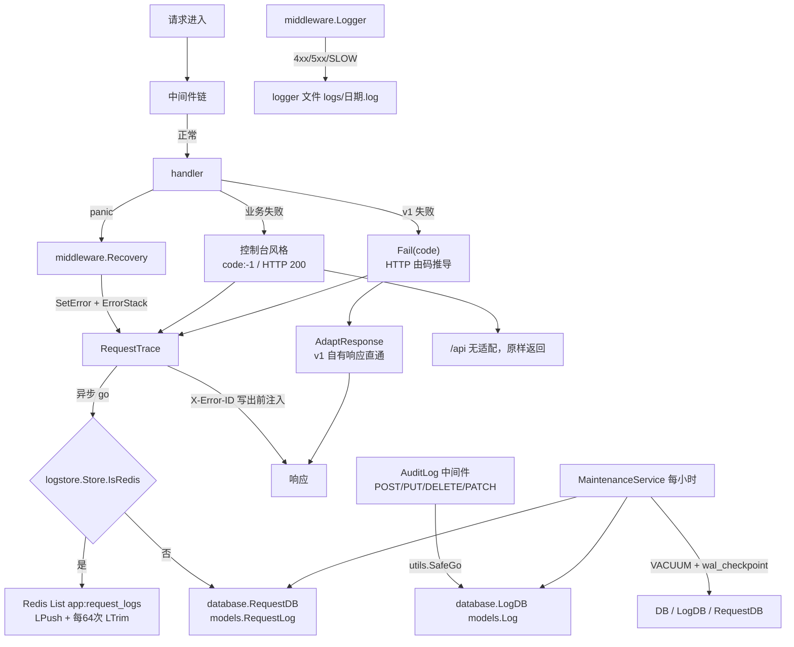
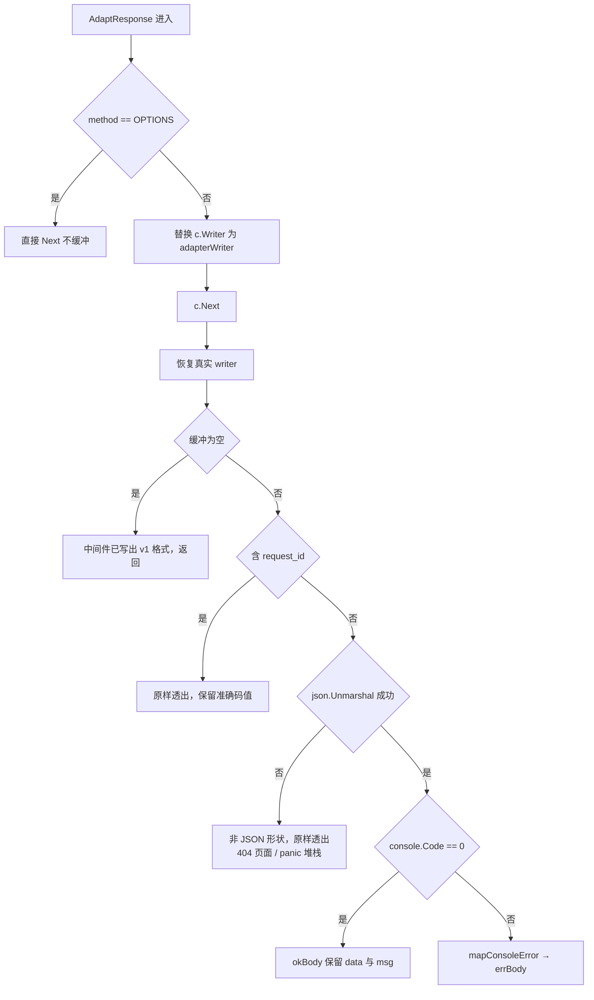
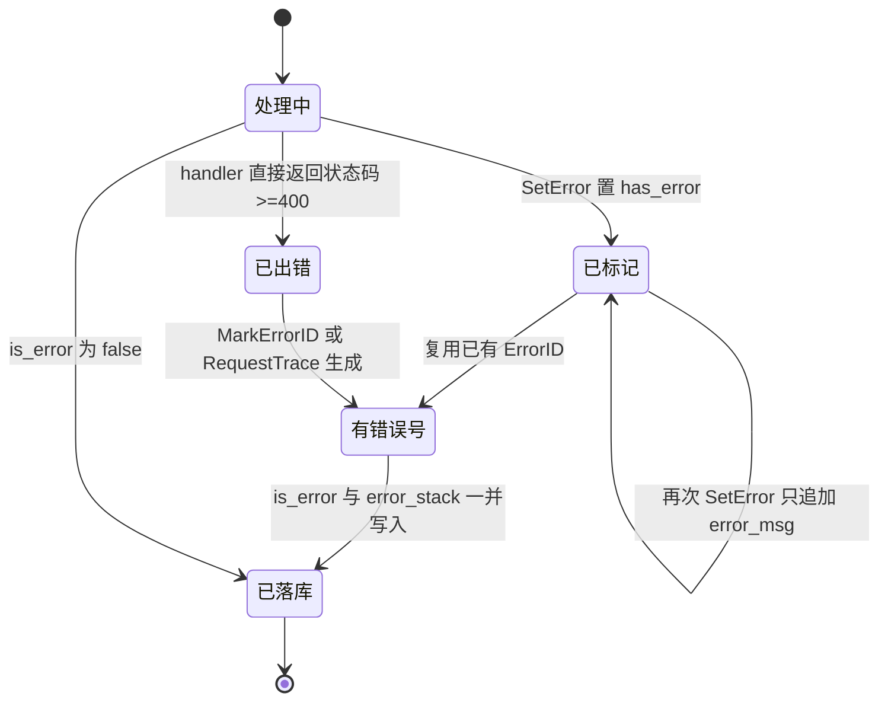
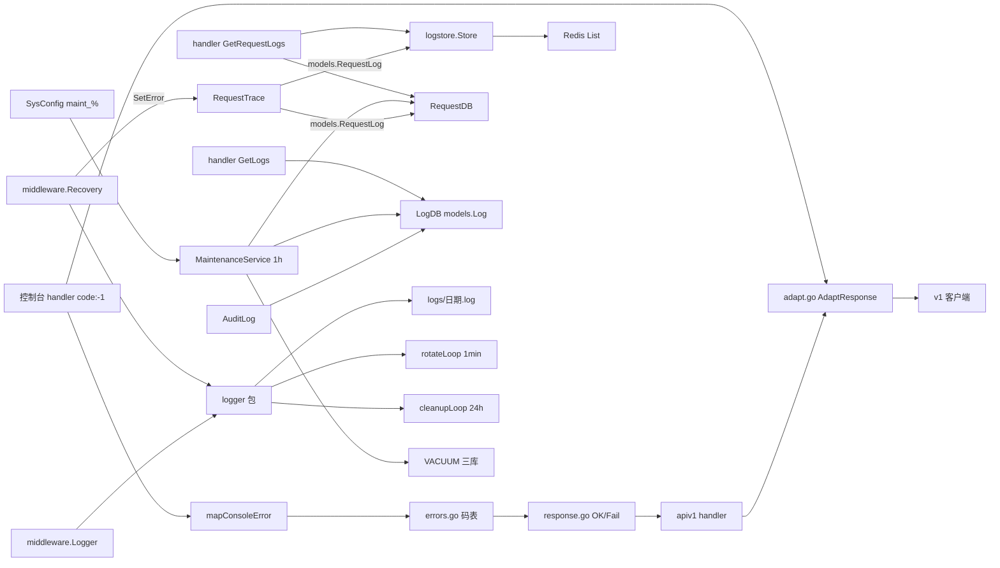

# 错误处理与日志系统

<cite>
**本文档引用的文件**
- [errors.go](file://main/internal/apiv1/errors.go)
- [response.go](file://main/internal/apiv1/response.go)
- [adapt.go](file://main/internal/apiv1/adapt.go)
- [auth.go (apiv1)](file://main/internal/apiv1/auth.go)
- [router.go (apiv1)](file://main/internal/apiv1/router.go)
- [logger.go (internal/logger)](file://main/internal/logger/logger.go)
- [store.go](file://main/internal/logstore/store.go)
- [maintenance.go](file://main/internal/database/maintenance.go)
- [database.go](file://main/internal/database/database.go)
- [models.go](file://main/internal/models/models.go)
- [request_trace.go](file://main/internal/api/middleware/request_trace.go)
- [recovery.go](file://main/internal/api/middleware/recovery.go)
- [audit.go](file://main/internal/api/middleware/audit.go)
- [logger.go (middleware)](file://main/internal/api/middleware/logger.go)
- [permission.go](file://main/internal/api/middleware/permission.go)
- [request_log.go](file://main/internal/api/handler/request_log.go)
- [user.go](file://main/internal/api/handler/user.go)
- [log_clean_route_test.go](file://main/internal/api/log_clean_route_test.go)
- [routes_batch2.go](file://main/internal/apiv1/routes_batch2.go)
</cite>

## 目录

1. [简介](#简介)
2. [项目结构](#项目结构)
3. [核心组件](#核心组件)
4. [架构总览](#架构总览)
5. [详细组件分析](#详细组件分析)
6. [依赖关系分析](#依赖关系分析)
7. [性能考虑](#性能考虑)
8. [故障排查指南](#故障排查指南)
9. [结论](#结论)
10. [附录](#附录)

## 简介

本文覆盖两个主题：**错误码体系**与**日志链路**。系统的错误语义并存三套，各自服务不同调用方：

| 体系 | 码值形态 | HTTP 状态 | 使用方 | 定义位置 |
| --- | --- | --- | --- | --- |
| 控制台协议 | `code: 0` / `code: -1` + 中文 `msg` | 大多 200，鉴权 401 | 前端页面 | `sign.go:183-206`、`permission.go:153` |
| v1 对外协议 | 分段四位码 + `message` | 由码推导 | API Key 客户端 | `apiv1/errors.go:18-63` |
| panic 兜底 | `code: -1` + 固定文案 | 500 | 任意 | `recovery.go:70-73` |

日志侧是**四条独立链路**，落在三种介质上：进程日志文件（`logger` 包）、控制台彩色行（`middleware.Logger`）、请求日志（`RequestLog` → SQLite 或 Redis List）、操作审计日志（`models.Log` → `LogDB`）。

三条结论先行：

1. v1 的 `2001` 是**兜底码**，`mapConsoleError` 未命中任何关键词时一律返回它，因此"参数不合法"在 v1 侧可能是任何未收录的中文错误。
2. 进程日志文件**不做同日归档**，超过 10MB 时直接删除当天文件重开（`logger.go:107-109`）。
3. `StartMaintenance` 会**丢弃调用方传入的配置**，改用数据库 `maint_%` 值（`maintenance.go:111-124`）。

**章节来源**

- [errors.go:5-17](file://main/internal/apiv1/errors.go#L5-L17)
- [adapt.go:113-148](file://main/internal/apiv1/adapt.go#L113-L148)
- [logger.go:96-130](file://main/internal/logger/logger.go#L96-L130)
- [maintenance.go:111-132](file://main/internal/database/maintenance.go#L111-L132)

## 项目结构

| 文件 | 行数 | 职责 | 关键导出 |
| --- | --- | --- | --- |
| `apiv1/errors.go` | 136 | 错误码枚举、HTTP 映射、默认文案 | `Code*` 常量、`httpStatusFor` |
| `apiv1/response.go` | 108 | 统一响应体与载荷形状 | `OK`、`Fail`、`Failf`、`OKPage` |
| `apiv1/adapt.go` | 148 | 控制台响应改写为 v1 | `AdaptResponse`、`mapConsoleError` |
| `logger/logger.go` | 399 | 进程日志、轮转、清理 | `Info`、`FileError`、`GetLogFiles` |
| `logstore/store.go` | 417 | Redis/内存日志读写与统计 | `Store`、`SaveRequestLog` |
| `database/maintenance.go` | 444 | 周期清理与 VACUUM | `MaintenanceConfig`、`StartMaintenance` |
| `database/database.go` | — | 三库分离初始化 | `LogDB`、`RequestDB` |
| `api/handler/request_log.go` | — | 请求日志查询与清理端点 | `GetRequestLogs`、`CleanRequestLogs` |
| `api/handler/user.go` | — | 操作日志查询与清理端点 | `GetLogs`、`CleanOperationLogs` |

入口函数定义行（当次 `rg -n '^func '` 复核）：

```go
// main/internal/apiv1/response.go
func OK(c *gin.Context, data interface{})                          // :62
func Fail(c *gin.Context, code int, message string)                // :72
func Failf(c *gin.Context, code int, format string, args ...any)   // :84
func OKPage(c *gin.Context, total int64, page, pageSize int, list any) // :103

// main/internal/apiv1/adapt.go
func AdaptResponse() gin.HandlerFunc   // :32
func mapConsoleError(msg string) int   // :120

// main/internal/logger/logger.go
func NewWithOptions(...) *Logger       // :57
func (l *Logger) rotate() error        // :96
func (l *Logger) cleanup()             // :160
func GetLogFiles() ([]LogFileInfo, error) // :302

// main/internal/logstore/store.go
func (s *LogStore) SaveRequestLog(log models.RequestLog)  // :53
func (s *LogStore) QueryRequestLogs(...)                  // :77
func (s *LogStore) GetRequestStats()                      // :186
func (s *LogStore) CleanRequestLogs(keepCount int) int64  // :245

// main/internal/database/maintenance.go
func DefaultMaintenanceConfig() MaintenanceConfig  // :47
func LoadMaintenanceConfig() MaintenanceConfig     // :62
func StartMaintenance(cfg MaintenanceConfig)       // :111
func (m *MaintenanceService) runCleanup()          // :198
func trimRequestLogs(db *gorm.DB, isError bool, keepCount int, label string) // :250
func (m *MaintenanceService) runVacuumAndOptimize() // :270
```

**章节来源**

- 上表文件的 `func` 声明行，经 `rg -n '^func '` 复核
- [response.go:56-108](file://main/internal/apiv1/response.go#L56-L108)
- [maintenance.go:198-270](file://main/internal/database/maintenance.go#L198-L270)

## 核心组件

| 组件 | 位置 | 输入 | 输出 | 失败行为 |
| --- | --- | --- | --- | --- |
| 错误码枚举 | `errors.go:18-63` | 常量 | 44 个码值 | 码值不可复用或改义 |
| HTTP 映射 | `errors.go:71-92` | `code int` | 4xx/5xx | 未知码回落 400 |
| 默认文案 | `errors.go:95-136` | `code int` | 中文说明 | 缺项返回"请求处理失败" |
| 成功体 | `response.go:62-64` | `data` | `{code,request_id,data}` | `data` 恒存在 |
| 失败体 | `response.go:72-86` | `code`、可选文案 | `{code,request_id,message}` | 空文案取默认 |
| 分页体 | `response.go:95-108` | `total/page/list` | `Page` | `nil` 归一空数组 |
| 响应适配器 | `adapt.go:32-111` | 控制台 JSON | v1 JSON | 非 JSON 原样透出 |
| 有损映射 | `adapt.go:120-148` | 中文 `msg` | v1 码 | 未命中返回 2001 |
| 结构化日志 | `logger.go:206-256` | format + 参数 | 文件 + 控制台 | 级别过滤丢弃 |
| 日志轮转 | `logger.go:96-149` | 日期/大小 | 新建文件 | 溢出**删文件** |
| 日志清理 | `logger.go:160-196` | `*.log*` | 删除超期/超额 | 静默 `os.Remove` |
| Redis 日志 | `store.go:53-70` | `RequestLog` | List LPush | 每 64 次裁剪 |
| 库维护 | `maintenance.go:198-247` | `maint_%` 配置 | DELETE 超期行 | 保留条数下限 |

**章节来源**

- [errors.go:18-136](file://main/internal/apiv1/errors.go#L18-L136)
- [store.go:16-70](file://main/internal/logstore/store.go#L16-L70)
- [maintenance.go:16-59](file://main/internal/database/maintenance.go#L16-L59)

## 架构总览

一次失败请求在系统里同时留下多少痕迹，是本设计的核心：



**图表来源**

- [request_trace.go:181-302](file://main/internal/api/middleware/request_trace.go#L181-L302)
- [store.go:41-70](file://main/internal/logstore/store.go#L41-L70)
- [adapt.go:32-110](file://main/internal/apiv1/adapt.go#L32-L110)
- [maintenance.go:164-247](file://main/internal/database/maintenance.go#L164-L247)

错误信号有两条正交通道：`X-Error-ID`（响应头，客户端上报用）与 `request_id`（响应体字段，双方对账用）。`MarkErrorID` 在状态码写出前注入，`requestIDOf` 在读不到时返回空串而非省略字段，两者都刻意保持"结构恒定"。

**章节来源**

- [request_trace.go:120-132](file://main/internal/api/middleware/request_trace.go#L120-L132)
- [response.go:46-54](file://main/internal/apiv1/response.go#L46-L54)

## 详细组件分析

### 错误码分段体系

`errors.go:5-17` 的注释给出分段规则与一条硬约束：

```go
/*
 * 分段规则（与 HTTP 状态码相互独立，客户端应以本码为准）：
 *   1xxx  认证与凭据
 *   2xxx  请求参数
 *   3xxx  权限与范围
 *   4xxx  资源与状态
 *   5xxx  业务与外部依赖
 *   9xxx  服务端内部错误
 *
 * 码值一经发布不得复用或改义：外部调用方据此分支，改义会让存量集成静默走错分支
 */
```

33 个码值分布（全量见 `errors.go:18-63`）：

| 段 | 码值区间 | 数量 | 代表码 |
| --- | --- | --- | --- |
| 认证与凭据 | 1001-1006 | 6 | `CodeSignMismatch = 1003` |
| 请求参数 | 2001-2005 | 5 | `CodeParamInvalid = 2001` |
| 权限与范围 | 3001-3006 | 6 | `CodeReadOnly = 3004` |
| 资源与状态 | 4001-4008 | 8 | `CodeResourceConflict = 4007` |
| 业务与外部依赖 | 5001-5006 | 6 | `CodeDNSWriteFailed = 5004` |
| 服务端内部 | 9001-9002 | 2 | `CodeInternalError = 9001` |

`httpStatusFor`（`:71-92`）把码映射到 HTTP，注释在 `:67-69` 说明动机：客户端可能只看 HTTP 状态（网关、重试中间件），因此两者都必须准确。映射优先级需要注意——它按 `switch` 顺序命中：

| 判定顺序 | 条件 | HTTP |
| --- | --- | --- |
| 1 | `9001`/`9002` | 500 |
| 2 | `5006` 上游超时 | 504 |
| 3 | 5000-5999 | 502 |
| 4 | 六个 NotFound 码 | 404 |
| 5 | `4007`/`4008` | 409 |
| 6 | 六个认证码 | 401 |
| 7 | 其余（含全部 2xxx、3xxx） | 400 |

**值得注意的推断路径**：3xxx 权限类统一映射为 400 而非 403，`CodeUnauthorized` 走 401。这是代码事实，不是遗漏——`errors.go` 未定义任何 403 分支。

`messageFor`（`:95-100`）从 `codeMessages`（`:102-136`）取默认中文文案，缺项时返回"请求处理失败"，保证 `message` 永不为空。

**章节来源**

- [errors.go:5-63](file://main/internal/apiv1/errors.go#L5-L63)
- [errors.go:65-136](file://main/internal/apiv1/errors.go#L65-L136)

### 统一响应封装

`response.go:17-25` 的注释是整个对外契约的立论基础：控制台的 `msg` 是给人看的中文串、码值只有 0 与 -1，页面据此分不出错误类别；因此 v1 固定 `message` 仅供参考、`code` 才是契约。

两种响应体（`:26-44`）刻意不对称：

```go
type okBody struct {
	Code      int         `json:"code"`
	RequestID string      `json:"request_id"`
	Data      interface{} `json:"data"`
	Message   string      `json:"message,omitempty"` // 仅控制台 SuccessMsg 改写时出现
}

type errBody struct {
	Code      int    `json:"code"`
	RequestID string `json:"request_id"`
	Message   string `json:"message"` // 无 omitempty，恒存在
}
```

`OK`（`:62`）在 `data` 为 nil 时仍输出 `data: null`（注释 `:56-61`），使客户端可无条件读 `resp.data`。`Fail`（`:72-81`）在 `message == ""` 时取默认文案，非空时用更具体文案（如"域名 example.com 不存在"）但**不改 code**。`Failf`（`:84`）是格式化封装，经 `sprintf`（`:13`）避免各文件重复 import。

`Page`（`:95-100`）的 `total` 是满足条件的总条数而非本页条数，并**回显服务端实际采用的 `page`/`page_size`**——注释 `:90-93` 解释：服务端会收敛越界值，回显可避免客户端误以为自己传的值生效了。`OKPage`（`:103`）把 nil 列表归一为 `[]`，消除 `null` 与空数组两种形状。

`request_id` 的实际来源是 `middleware.RequestIDKey`（`:48`），即 `RequestTrace` 写入的上下文键。这构成一条隐含依赖：**v1 链必须先挂 `RequestTrace`**，否则 `request_id` 恒为空串。`apiv1/router.go:17-18` 的注释与挂载顺序（`:27`）保证了这一点。

**章节来源**

- [response.go:12-54](file://main/internal/apiv1/response.go#L12-L54)
- [response.go:56-108](file://main/internal/apiv1/response.go#L56-L108)
- [router.go (apiv1):16-34](file://main/internal/apiv1/router.go#L16-L34)

### mapConsoleError 有损映射

控制台所有业务错误都是 `code = -1`，只有中文 `msg`。v1 若要给出四位码，只能**按文案反推类别**。`adapt.go:113-119` 的注释直说了这是有损映射，且未收录文案落到 `CodeParamInvalid`。

匹配顺序即优先级（`adapt.go:120-148`）：

| 顺序 | 关键词条件 | 映射码 | 说明 |
| --- | --- | --- | --- |
| 1 | `无权限`/`仅管理员`/`无权操作`/`权限不足` | 3002 | 权限与"不存在"竞争时优先 |
| 2 | `只读` | 3004 | — |
| 3 | `不存在` **且** `域名` | 4002 | 组合判定 |
| 4 | `不存在` **且** `账户` | 4003 | 组合判定 |
| 5 | `不存在` **且** `任务` | 4006 | 组合判定 |
| 6 | 仅 `不存在` | 4001 | 兜底资源码 |
| 7 | `已存在`/`重复` | 4007 | — |
| 8 | `账户配置` | 5002 | — |
| 9 | `不支持` | 5003 | — |
| 10 | `超时` | 5006 | 504 |
| 11 | `参数`/`缺少`/`不能为空` | 2001 | — |
| 12 | default | 2001 | **兜底** |

三处精度损失必须写入调用方预期：

1. 任何未收录文案（例如"证书签发失败"）都会变成 **2001 参数不合法**，而真实语义应为 5005。
2. 中文文案变更即改变外部码值——前端把"无权限操作该域名"改成"该域名不可操作"，v1 码就从 3002 漂到 2001。
3. 关键词组合是 `Contains` 而非精确匹配，"账户不存在但又超时"这类拼接串只会命中第一条。

```go
// adapt.go:143-147 兜底分支
case strings.Contains(msg, "参数") || strings.Contains(msg, "缺少") || strings.Contains(msg, "不能为空"):
    return CodeParamInvalid
default:
    return CodeParamInvalid
```

注释 `:118` 给出的补救方向是：**新增 v1 专用 handler 时直接调用 `Fail` 给准确码值，不依赖本函数**。这条约定是当前唯一能停止有损映射继续扩大的手段。

**章节来源**

- [adapt.go:104-148](file://main/internal/apiv1/adapt.go#L104-L148)
- [errors.go:28-63](file://main/internal/apiv1/errors.go#L28-L63)

### 2001 兜底与 request_id 直通保护

`AdaptResponse` 用**缓冲 writer** 改写下游输出，其最大风险是自反：v1 handler 直接调 `Fail`/`OK` 的响应也会落进同一缓冲，若按控制台格式解析，`message` 会被当成 `msg` 读到空串，进而被 `mapConsoleError` 重新映射，"余额的鉴权拒绝会被改写成 2001"（`adapt.go:56-61` 注释原文）。

保护判据是 `"request_id"` 子串（`:63`）——它是 v1 响应独有的字段名：



**图表来源**

- [adapt.go:32-110](file://main/internal/apiv1/adapt.go#L32-L110)
- [response.go:26-44](file://main/internal/apiv1/response.go#L26-L44)

`request_id` 在此被赋予双重角色：对客户端是对账凭据，对适配器是**格式识别指纹**。任何修改 v1 响应结构的人，若删掉该字段，就会静默触发重新映射。恢复真实 writer 再写出的顺序也有注释（`:46-47`）：否则适配后的内容仍落进缓冲。

**章节来源**

- [adapt.go:28-67](file://main/internal/apiv1/adapt.go#L28-L67)
- [adapt.go:81-101](file://main/internal/apiv1/adapt.go#L81-L101)

### logger 结构化输出

`logger` 包是进程级日志，与请求日志分属两种介质。级别枚举 `LevelDebug/Info/Warn/Error`（`logger.go:24-29`），容量常量 `MaxFileSize = 10MB`、`MaxBackups = 30`、`MaxAge = 30 天`（`:16-20`）。结构体持有 `mu`、`file`、`currentDate`、`currentSize`、`level`、`consoleOutput`、`colorEnabled`（`:41-51`）。

单条日志的两种形状（`writeWithDepth`，`:206-256`）：

```go
// :233-234 文件形状（完整时间 + 级别 + 调用点）
fileDateStr := now.Format("2006-01-02 15:04:05")
fileMsg := fmt.Sprintf("%s [%s] [%s] %s", fileDateStr, levelStr, caller, userMsg)

// :239-243 控制台形状（短时钟 + ANSI 着色）
consoleMsg := fmt.Sprintf("%s%s%s %s%-5s%s %s%-18s%s %s", ...)
```

调用点由 `runtime.Caller(callerDepth)` 取（`:215-220`），只保留 `basename:line`。`callerDepth` 固定为 4（`:199`、`:203`），因为包装层数固定：`Info → l.Info → l.write → l.writeWithDepth → runtime.Caller`。**新增一层包装就会让所有日志的行号指错位置**，这是该设计最脆弱的隐式约定。

级别过滤在 `:210-212`：`l.logger == nil || logLevel < l.level` 直接返回，即低级别日志连格式化都不做（`fmt.Sprintf` 在 `:221`，位于过滤之后）。

导出 API 分两组：同时写控制台与文件的 `Info/Warn/Error/Debug`（`:356-370`）与 `Fatal`（`:372`）；**只写文件**的 `FileInfo/FileWarn/FileError`（`:377-387`）。后者正是 `middleware.Logger` 使用的三个（`logger.go:231-241`），注释 `:222` 明确"仅写文件，避免与控制台重复"。`middleware.Recovery` 则用 `logger.Warn/Error`（`recovery.go:50`、`:58`）双写。

测试环境特殊处理：`runningUnderGoTest()`（`:344`）为真时不创建文件、不启轮转协程，直接把 logger 指向 stdout（`:66-69`），因此**在 `go test` 下看不到轮转行为**，这不是缺陷。

**章节来源**

- [logger.go:16-51](file://main/internal/logger/logger.go#L16-L51)
- [logger.go:53-82](file://main/internal/logger/logger.go#L53-L82)
- [logger.go:198-256](file://main/internal/logger/logger.go#L198-L256)
- [logger.go:340-397](file://main/internal/logger/logger.go#L340-L397)

### 日志轮转与清理

两个独立协程，由 `NewWithOptions` 启动（`:78-79`）：

| 协程 | 周期 | 触发条件 | 动作 | 位置 |
| --- | --- | --- | --- | --- |
| `rotateLoop` | 1 分钟 ticker | `currentDate != dateStr` **或** `currentSize >= 10MB` | `rotate()` | `:132-149` |
| `cleanupLoop` | 启动即执行 + 24 小时 | 恒定 | `cleanup()` | `:151-159` |

`rotate()`（`:96-130`）按日期命名文件 `logs/2006-01-02.log`（`:104-106`），用 `io.MultiWriter` 同时写文件与 stdout（`:118-124`），并 `O_APPEND` 打开（`:112`）。

**一个必须记录的行为**：`logger.go:107-109`——若当天文件已 ≥ 10MB，执行 `os.Remove(filename)` 后重开同名文件。也就是说**同日容量溢出是"删除重写"而非"编号归档"**，`MaxBackups = 30` 只在 `cleanup` 里作为文件个数上限生效（`:187-194`），并不产生 `.1`/`.2` 历史分片。对高流量实例，这意味着单日超出 10MB 的日志会丢失前段。

`cleanup()`（`:160-196`）：`cutoff = now - MaxAge`（`:161`），glob `logs/*.log*`（`:163`），逐个 `Stat`；修改时间早于 cutoff 的直接 `os.Remove` 并 `continue`（`:180-183`）；剩余按 modTime 降序排序，超出 `MaxBackups` 的尾部删除（`:187-194`）。全程无错误上报，静默删除。

`GetLogFiles()`（`:302`）向管理端暴露 `LogFileInfo`（`:330`）列表，供前端日志页选择文件。`Close()`（`:291`、`:389`）在退出时释放句柄；`SetGlobalLevel`（`:393`）与 `GetLogger`（`:397`）操作 `globalLogger`（`:338`，`init()` 于 `:340` 装配）。

**章节来源**

- [logger.go:96-149](file://main/internal/logger/logger.go#L96-L149)
- [logger.go:151-196](file://main/internal/logger/logger.go#L151-L196)
- [logger.go:291-338](file://main/internal/logger/logger.go#L291-L338)

### logstore 持久化与 Redis 链路

`logstore.Store`（`store.go:34`）在 `Init()`（`:41-47`）时绑定 `cache.C`，`IsRedis()`（`:49`）决定读写走 Redis 还是回落 SQLite。注意 `:45-46` 有一个**空的 else 分支**——非 Redis 模式下不打印任何提示，这是实现事实而非笔误推断。

两个 List 键与容量常量（`:16-22`）：`app:request_logs`、`app:system_logs`、`maxLogSize = 10000`、统计缓存键 `logstore:req_stats` 与 TTL 2 分钟。

`SaveRequestLog`（`:53-70`）的写入策略值得展开：

```go
if err := s.c.LPush(requestLogKey, string(data)); err != nil { ... return }
// 降低热路径 Redis QPS：每 64 次写入再检查长度并裁剪
if saveLogTrimCounter.Add(1)%64 == 0 {
    if length, _ := s.c.LLen(requestLogKey); length > maxLogSize+500 {
        _ = s.c.LTrim(requestLogKey, 0, maxLogSize-1)
        _ = s.c.Delete(requestStatsCacheKey)
    }
}
```

三个后果：其一，`saveLogTrimCounter` 是包级 `atomic.Uint64`（`:31`），**多实例共写同一 Redis 键时裁剪计数互不可见**，队列可能短时超过 10500；其二，裁剪后统计缓存被删除，但写入未触发裁剪时缓存保持旧值，最长 2 分钟内统计与明细不一致；其三，序列化或 LPush 失败只 `logger.Error` 后返回，请求日志静默丢失。

读取侧 `QueryRequestLogs`（`:77-118`）分两条路径：无过滤条件时直接 `LRange(start, stop)` 分页（`:88-95`）；有 `keyword/method/isError/startDate/endDate` 任一时**拉取全量再内存过滤**（`:99-105`），复杂度 O(N)。`GetRequestByID`（`:121-147`）以 500 条为批扫描。`GetRequestStats`（`:186`）配套 `requestStatsResult`（`:174`）与 `requestLogLite`（`:24-27`）——统计只反序列化 `is_error` 与 `created_at` 两字段，是明显的降载设计。`CleanRequestLogs`（`:245-257`）在 `keepCount <= 0` 时回落 `maxLogSize`，返回删除条数。

系统日志侧 `SaveSystemLog`（`:260`）每次写入都做 `LLen` 检查（不像请求日志那样每 64 次），`PurgeSystemLogs`（`:320`）为全量清空。

**章节来源**

- [store.go:16-74](file://main/internal/logstore/store.go#L16-L74)
- [store.go:77-147](file://main/internal/logstore/store.go#L77-L147)
- [store.go:174-257](file://main/internal/logstore/store.go#L174-L257)
- [store.go:260-330](file://main/internal/logstore/store.go#L260-L330)

### request_log 链路

数据模型 `models.RequestLog`（`models.go:353-375`）共 22 字段，索引为 `request_id`、`error_id`、`user_id`、`is_error`、`created_at` 五处。写入方唯一：`RequestTrace` 末尾的异步 goroutine（`request_trace.go:296-302`），Redis 模式只写 Redis，否则只写 `RequestDB`，**明确避免双写**。

`RequestDB` 与业务主库、日志库分离初始化（`database.go:23-24`、`:112-118`），并各自 `AutoMigrate`（`migrateRequestDB` 于 `:308`）。

查询端点在 `api/handler/request_log.go`：`useRedisLogs`（`:17`）决定数据源，`GetRequestLogs`（`:104`）、`GetRequestByID`（`:157`）、`GetErrorByID`（`:202`）、`GetRequestStats`（`:243`）。统计走缓存包装 `tryRequestStatsCache`/`setRequestStatsCache`/`invalidateRequestStatsCache`（`:34-50`）。清理端点 `CleanRequestLogs`（`:371`）与 SQLite 分支 `cleanRequestLogsSQLite`（`:317`）对应双模式。

与错误体系的接缝：`is_error` 由 `statusCode >= 400 || has_error` 决定（`request_trace.go:197`），所以 **HTTP 200 但 `code:-1` 的控制台业务错误同样计入 `is_error`**，`maintenance` 的 `trimRequestLogs(isError=true)` 正是按该位分桶保留。`error_msg`/`error_stack` 由 `SetError`（`:316`）与 `Recovery`（`recovery.go:62-63`）填充。

错误标记与 `ErrorID` 的生成本质是一个状态收敛过程：



**图表来源**

- [request_trace.go:122-131](file://main/internal/api/middleware/request_trace.go#L122-L131)
- [request_trace.go:196-209](file://main/internal/api/middleware/request_trace.go#L196-L209)
- [request_trace.go:314-337](file://main/internal/api/middleware/request_trace.go#L314-L337)

`SetError` 的注释（`request_trace.go:315`）明确"多次调用只保留第一次的 errorID 和堆栈，msg 会追加"，这保证同一请求的 `X-Error-ID` 与落库 `error_id` 始终同值——否则客户端上报的错误号会在多次标记后失配。

**章节来源**

- [models.go:353-375](file://main/internal/models/models.go#L353-L375)
- [request_trace.go:181-302](file://main/internal/api/middleware/request_trace.go#L181-L302)
- [database.go:23-24](file://main/internal/database/database.go#L23-L24)
- [database.go:104-130](file://main/internal/database/database.go#L104-L130)
- [request_log.go:17-104](file://main/internal/api/handler/request_log.go#L17-L104)

### operation_log 与 audit 链路

操作日志模型是 `models.Log`（`models.go:124-138`），字段含 `uid`、`username`、`action`、`entity`、`entity_id`、`domain`、`data`、`before_data`、`after_data`、`ip`、`user_agent`、`created_at`。`before_data`/`after_data` 是 **text 型 JSON 快照**，为变更前后对比保留，但中间件层不填这两个字段——`AuditLog` 只写 `Action/Domain/Data/IP/UserAgent`（`audit.go:78-87`），因此快照由 handler 层显式记录。

`AuditLog` 中间件写入 `LogDB`，注释 `audit.go:16-19` 声称"无需每个 handler 手动调用 `service.Audit`"。经全仓 `rg -n 'func Audit'` 复核，**只命中 `AuditLog` 自身，未见 `service.Audit` 定义**，故该注释提到的历史函数已不存在（记录为已验证事实：注释与现状不一致）。

读取端点在 `api/handler/user.go`：`applyOperationLogFilters`（`:394`）与前端筛选对齐，`action` 为下拉分类时按前缀匹配；`applyLogDateRange`（`:445`）处理日期区间；`GetLogs`（`:460`）为主查询；`operationLogScope`（`:547`）划定可见范围；`GetLogDetail`（`:556`）取单条。清理端点 `CleanOperationLogs`（`:596`）经 `cleanOperationLogsQuery`（`:581`）按 `days` 收敛。

该端点有一段真实回归史，`log_clean_route_test.go:9-15` 的注释记录：此 POST 此前未注册，被 `NoRoute` 逐级回落到静态页，前端解析 HTML 失败后提示"清空失败"。三条测试从两个方向锁定：路由表存在性（`:18`）、越过 CSRF 后必须返回 JSON 401 而非 HTML（`:32`）、缺 CSRF 令牌必须在到达 handler 前被拦下（`:57`）。

注册点有两处，控制台与对外各一条：

```go
// main/internal/api/router.go:236
auth.POST("/logs/clean", handler.CleanOperationLogs)

// main/internal/apiv1/routes_batch2.go:96
g.POST("/logs/clean", adminOnly, handler.CleanOperationLogs)
```

后者额外受 `adminOnly` 约束，v1 的鉴权由 `apiv1.APIKeyAuth`（`apiv1/auth.go:44`）与 `Fail(CodeUnauthorized/...)` 提供，因此清理类端点在两条链上都要求管理员级身份。

**章节来源**

- [models.go:124-138](file://main/internal/models/models.go#L124-L138)
- [audit.go:13-91](file://main/internal/api/middleware/audit.go#L13-L91)
- [user.go:393-596](file://main/internal/api/handler/user.go#L393-L596)
- [log_clean_route_test.go:9-70](file://main/internal/api/log_clean_route_test.go#L9-L70)
- [router.go:236](file://main/internal/api/router.go#L236)
- [routes_batch2.go:96](file://main/internal/apiv1/routes_batch2.go#L96)

### 数据库维护与保留策略

`MaintenanceConfig`（`maintenance.go:16-26`）定义 8 项保留策略，默认值在 `:47-59`：

| 配置项 | SysConfig 键 | 默认 | 作用对象 | 清理位置 |
| --- | --- | --- | --- | --- |
| `OperationLogDays` | `maint_operation_log_days` | 90 | `LogDB.models.Log` | `:204-206` |
| `CertLogDays` | `maint_cert_log_days` | 60 | `LogDB.models.CertLog` | `:212-214` |
| `CheckLogHours` | `maint_check_log_hours` | 72 小时 | `LogDB.models.DMCheckLog` | `:220-222` |
| `MonitorLogDays` | `maint_monitor_log_days` | 60 | 主库 `models.DMLog` | `:228-230` |
| `RequestLogDays` | `maint_request_log_days` | 7 | `RequestDB.models.RequestLog` | `:237-239` |
| `RequestSuccessKeep` | `maint_request_success_keep` | 2000 | 成功请求按条数 | `:243` |
| `RequestErrorKeep` | `maint_request_error_keep` | 1000 | 错误请求按条数 | `:245` |
| `VacuumIntervalH` | `maint_vacuum_interval_h` | 24 | 压缩间隔 | `:190-193` |

节奏：`run()`（`:164-196`）启动后**延迟 30 秒**执行首次维护，注释 `:167` 说明是避免启动期 IO 压力；此后每小时一次 `runCleanup`，VACUUM 按 `VacuumInterval` 门控（`:190-193`），`<= 0` 时回落 24 小时。

`LoadMaintenanceConfig`（`:62-98`）用 `DB.Where("`key` LIKE ?", "maint_%")` 一次取回所有项，逐项 `fmt.Sscanf` 解析，**`err != nil || val <= 0` 直接 continue**（`:73-75`），即非法值静默保留默认。`MaintenanceConfigKeys`（`:41-44`）供系统设置页面枚举。

两处实现细节需要留意：

1. `StartMaintenance(cfg)`（`:111-132`）先判断 `maintService != nil` 直接返回（**单例，重复调用不生效**），随后 `dbCfg := LoadMaintenanceConfig(); cfg = dbCfg`（`:120-121`）——传入的 `cfg` 参数实际被覆盖丢弃。调用方以为能传配置，实际配置源只有数据库。
2. `runCleanup` 每次执行前重新加载配置（`:199-200`），因此管理员改设置**无需重启**即可生效，与上一条形成对比。

`trimRequestLogs`（`:250-268`）按 `is_error` 分桶，先 `Count`，超量时用 `Order("id DESC").Offset(keepCount).Limit(1).Pluck("id", &minKeepID)` 找到保留边界，再 `WHERE is_error = ? AND id <= minKeepID` 删除。这条 SQL 依赖自增 ID 与时间同序，对无主键排序的表不成立。

`optimizeGormDB`（`:284-321`）五步顺序固定：`wal_checkpoint(TRUNCATE)` → `ANALYZE` → `PRAGMA optimize` → `VACUUM` → **重新设回 `journal_mode=WAL`**（`:311`，注释说明 VACUUM 可能重置 journal 模式）。每库执行前先 `getDBSize`（`:426`），节省超过 1KB 才记 Debug 日志（`:316-320`）。VACUUM 失败只 `logger.Warn`，不中断后续库。

观测出口 `GetMaintenanceStats`（`:336`）带缓存，`buildMaintenanceStats`（`:355`）在 `:371` 输出 `operation_log_days` 等配置值，`gormDBStats`（`:388`）逐库报告，`invalidateMaintenanceStatsCache`（`:329`）在 VACUUM 后调用（`:281`）。

**章节来源**

- [maintenance.go:16-59](file://main/internal/database/maintenance.go#L16-L59)
- [maintenance.go:62-132](file://main/internal/database/maintenance.go#L62-L132)
- [maintenance.go:164-268](file://main/internal/database/maintenance.go#L164-L268)
- [maintenance.go:270-336](file://main/internal/database/maintenance.go#L270-L336)

## 依赖关系分析



**图表来源**

- [errors.go:18-92](file://main/internal/apiv1/errors.go#L18-L92)
- [adapt.go:32-148](file://main/internal/apiv1/adapt.go#L32-L148)
- [store.go:41-70](file://main/internal/logstore/store.go#L41-L70)
- [maintenance.go:62-98](file://main/internal/database/maintenance.go#L62-L98)

跨层耦合的三个热点：

| 耦合 | 具体形式 | 变更风险 |
| --- | --- | --- |
| `response.go` → `middleware.RequestIDKey` | `requestIDOf` 读上下文键 | 键名改动则 `request_id` 恒空 |
| `adapt.go` → 中文文案 | `mapConsoleError` 关键词匹配 | 文案改动即改外部错误码 |
| `maintenance.go` → `SysConfig` | `LIKE 'maint_%'` | 键名前缀改动即静默回落默认 |

**章节来源**

- [response.go:46-54](file://main/internal/apiv1/response.go#L46-L54)
- [adapt.go:113-148](file://main/internal/apiv1/adapt.go#L113-L148)
- [maintenance.go:62-98](file://main/internal/database/maintenance.go#L62-L98)

## 性能考虑

| 成本项 | 机制 | 上界/缓解 | 位置 |
| --- | --- | --- | --- |
| 请求日志落库 | 异步 goroutine | 主链路不等待 | `request_trace.go:296` |
| Redis 裁剪 | 每 64 次写才 `LLen` | 摊薄 64 倍 QPS | `store.go:64-68` |
| 统计计算 | `requestLogLite` 只解析两字段 | 避免全量反序列化 | `store.go:24-27` |
| 统计缓存 | TTL 2 分钟 | 最多 2 分钟偏差 | `store.go:21` |
| 带过滤查询 | 全量 `LRange` + 内存过滤 | O(N)，N ≤ 10000 | `store.go:99-105` |
| 日志级别过滤 | 先判级别再 `Sprintf` | 低级别零格式化 | `logger.go:210-221` |
| 文件写入 | `io.MultiWriter` | 单次调用双写 | `logger.go:118-124` |
| 轮转检查 | 每分钟 1 次比较 | 持锁极短 | `logger.go:132-148` |
| VACUUM | 默认 24 小时 | 全库重写，属重操作 | `:270-321` |
| 启动首维 | 延迟 30 秒 | 避开启动 IO 峰值 | `:167-172` |

四个明确权衡：

1. `QueryRequestLogs` 带过滤时拉全量（`store.go:99`）——10000 条 List 元素整体读入，是当前设计的硬上界，超过 `maxLogSize` 时该接口开销线性上升。
2. `SaveSystemLog`（`:269-271`）每次写入都 `LLen`，未采用请求日志的每 64 次策略，写放大更明显。
3. `VACUUM` 之后强制恢复 `journal_mode=WAL`（`:311`），代价是多一次 PRAGMA，收益是避免长期退回 rollback journal。
4. `cleanup` 的 glob `*.log*`（`:163`）会匹配任何后缀含 log 的文件，`logs` 目录不应放置业务文件。

**章节来源**

- [store.go:53-118](file://main/internal/logstore/store.go#L53-L118)
- [store.go:260-274](file://main/internal/logstore/store.go#L260-L274)
- [logger.go:160-196](file://main/internal/logger/logger.go#L160-L196)
- [maintenance.go:270-321](file://main/internal/database/maintenance.go#L270-L321)

## 故障排查指南

| 症状 | 首要假设 | 验证方法 | 关键位置 |
| --- | --- | --- | --- |
| v1 报 2001 但明显不是参数问题 | 文案未收录，走兜底 | 抓 `message` 原文比对关键词表 | `adapt.go:145-146` |
| v1 鉴权拒绝变成 2001 | `request_id` 判据失效 | 确认 `errBody` 仍含该字段 | `adapt.go:56-67` |
| v1 响应缺 `request_id` | `RequestTrace` 未先挂 | 查 `apiv1/router.go:27` | `response.go:47-54` |
| `data` 字段时有时无 | 走了 `SuccessMsg` 形状 | 看是否含 `message` | `adapt.go:81-101` |
| 当天日志文件突然变小 | 超 10MB 被删除重写 | 对比 `currentSize` 与 rotate 时间 | `logger.go:107-109` |
| 日志行号指向错误位置 | 新增了一层函数包装 | 检查 `callerDepth` 假设 | `logger.go:199-215` |
| 管理端日志统计与明细不符 | 统计缓存未失效 | 等 2 分钟或触发裁剪 | `store.go:21`、`:66-67` |
| Redis 日志超出 10500 条 | 多实例裁剪计数不可见 | 各进程独立计数 | `store.go:31`、`:64` |
| 请求日志缺失 | 异步写失败仅记 Error | 看 `LogStore 保存请求日志失败` | `store.go:56-61` |
| panic 后请求日志全无 | `Recovery` 与 `RequestTrace` 顺序颠倒 | 查 `router.go:47-48` | `router.go:34-43` |
| 清空操作日志提示"清空失败" | 路由未注册，回落静态 HTML | 复跑三条回归测试 | `log_clean_route_test.go:18` |
| 改了保留天数不生效 | 传参被数据库配置覆盖 | 查 `StartMaintenance` 覆盖逻辑 | `maintenance.go:120-121` |
| 维护完全不生效 | `maintService` 已存在，重复启动返回 | 确认只启动一次 | `maintenance.go:112-114` |
| `maint_xxx` 配置无效 | 值非正整数被 continue | 检查 `Sscanf` 结果 | `maintenance.go:73-75` |
| 数据库文件持续膨胀 | VACUUM 间隔过长 | 调 `maint_vacuum_interval_h` | `maintenance.go:190-193` |

验证命令（只读与单测，不触碰生产数据）：

```bash
# 错误码与文案来源核对
rg -n 'Code[A-Za-z]+ += [0-9]{4}' main/internal/apiv1/errors.go
rg -n 'return Code' main/internal/apiv1/adapt.go

# 日志链路与清理入口核对
rg -n 'func (Save|Query|Get|Clean|Purge)' main/internal/logstore/store.go
rg -n 'maint_' main/internal/database/maintenance.go

# 回归：清空操作日志必须留在 JSON 语义上
go test ./main/internal/api -run 'OperationLogClean' -count=1
go test ./main/internal/apiv1 -run 'Route|Error' -count=1
```

**章节来源**

- [errors.go:18-63](file://main/internal/apiv1/errors.go#L18-L63)
- [log_clean_route_test.go:17-70](file://main/internal/api/log_clean_route_test.go#L17-L70)
- [maintenance.go:111-132](file://main/internal/database/maintenance.go#L111-L132)

## 结论

本次梳理产出的可验证结论：

1. **v1 错误码是契约，`message` 不是**（`response.go:17-25` 明文约定）。`httpStatusFor` 的 `switch` 顺序决定映射优先级，3xxx 权限段整体落 400，不存在 403 分支。
2. **2001 是双重兜底**：既是"参数不合法"的正式码，也是 `mapConsoleError` 未命中时的默认码（`adapt.go:145-146`）。任何新增中文错误文案都会先被归为参数错误，直到被显式收录。停止该漂移的唯一途径是新增 v1 handler 直接调 `Fail`。
3. **`request_id` 承担了对账与格式指纹两个职责**，它同时是 v1 响应结构识别依据，删除该字段会导致鉴权拒绝被静默改写。
4. **日志轮转不是归档**：同日超 10MB 走 `os.Remove` 重建（`logger.go:107-109`），`MaxBackups` 只是文件个数上限。
5. **请求日志与审计的写入都是异步且失败静默**（`request_trace.go:296-302`、`store.go:56-61`），配合 `has_error` 与 HTTP 状态码正交的判定，`is_error` 覆盖了 200 + `code:-1` 的业务失败。
6. **配置真正来源是数据库**：`StartMaintenance` 丢弃入参、`runCleanup` 每次重载，管理员改 `maint_%` 即可生效，但也意味着代码里的默认值只是回落。

发现的两处文档与实现不一致，已作为事实记录、未擅自修改：`audit.go:16-19` 提到的 `service.Audit` 在全仓无定义；`logstore.Init` 的非 Redis 分支为空实现（`store.go:45-46`）。

## 附录

**A. 三库与三日志职责**

| 介质 | 承载 | 写入者 | 读取者 | 清理者 |
| --- | --- | --- | --- | --- |
| `DB` 主库 | 业务表、容灾切换日志 `DMLog` | 各 handler | 各 handler | `:228-230` |
| `LogDB` | `Log`、`CertLog`、`DMCheckLog` | `AuditLog`、handler | `GetLogs`、`GetLogDetail` | `:204-222` |
| `RequestDB` | `RequestLog` | `RequestTrace` | `GetRequestLogs` | `:237-245` |
| Redis List | 同上 + `models.Log` 副本 | `logstore.Store` | 同名查询函数 | `LTrim` + `PurgeSystemLogs` |
| `logs/日期.log` | 进程运行日志 | `logger` 包 | `GetLogFiles` | `cleanupLoop` 24h |
| stdout | 彩色请求行 + 级别日志 | `middleware.Logger`、`logger` | 运维终端 | 不落盘 |

**B. 错误响应形状速查**

| 来源 | HTTP | 响应体 |
| --- | --- | --- |
| 控制台成功 | 200 | `{"code":0,"msg":"ok","data":...}` |
| 控制台业务失败 | 200 | `{"code":-1,"msg":"中文文案"}` |
| 控制台权限拒绝 | 200 | `{"code":-1,"msg":"无权限操作该域名"}` |
| `Auth` 拒绝 | 401 | `{"code":401,"msg":"未登录"}` |
| `CSRF` 拒绝 | 403 | `{"code":403,"msg":"CSRF token 缺失"}` |
| panic 兜底 | 500 | `{"code":-1,"msg":"服务器内部错误"}` |
| v1 成功 | 200 | `{"code":0,"request_id":"req_...","data":...}` |
| v1 失败 | 4xx/5xx | `{"code":1003,"request_id":"req_...","message":"签名验证失败"}` |

**C. 关键常量**

| 常量 | 值 | 位置 |
| --- | --- | --- |
| `MaxFileSize` | 10MB | `logger.go:17` |
| `MaxBackups` | 30 个文件 | `logger.go:18` |
| `MaxAge` | 30 天 | `logger.go:19` |
| `slowRequestThreshold` | 3 秒 | `middleware/logger.go:14` |
| `maxLogSize` | 10000 条 | `store.go:19` |
| `requestStatsCacheTTL` | 2 分钟 | `store.go:21` |
| `MaxBodySize` / `MaxResponseSize` | 64KB / 256KB | `request_trace.go:30-31` |
| `maxRequestLogBodyLen` | 8192 | `request_trace.go:57` |
| `maxSuccessResponseCapture` | 16384 | `request_trace.go:60` |

**章节来源**

- [logger.go:16-20](file://main/internal/logger/logger.go#L16-L20)
- [store.go:16-22](file://main/internal/logstore/store.go#L16-L22)
- [request_trace.go:24-32](file://main/internal/api/middleware/request_trace.go#L24-L32)
- [maintenance.go:198-247](file://main/internal/database/maintenance.go#L198-L247)
