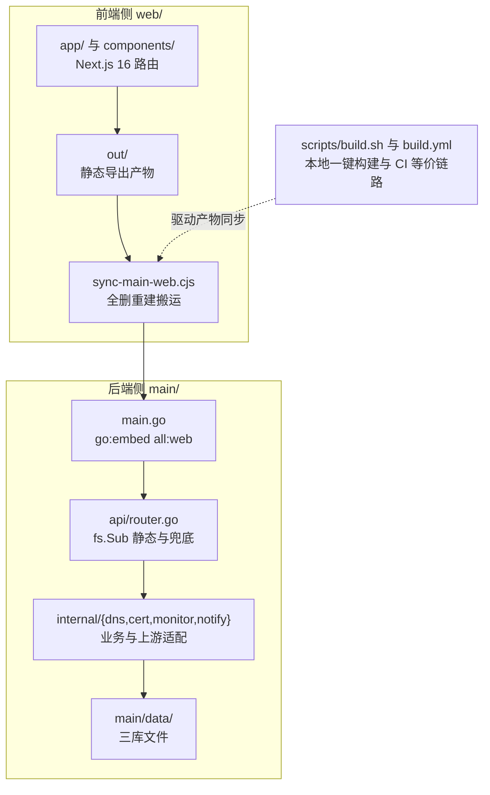
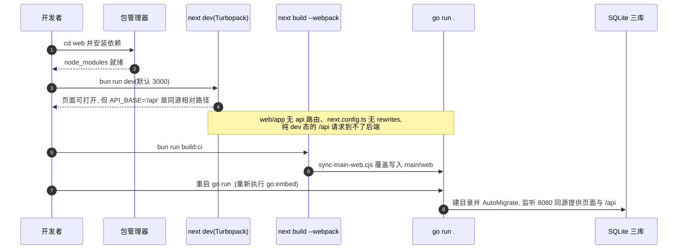
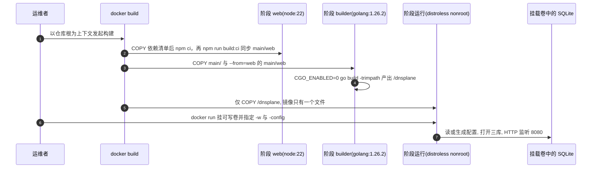
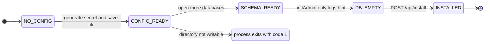
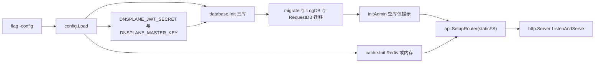

# 快速开始

<cite>
**本文档引用的文件**
- [README.md](file://README.md)
- [VERSION](file://VERSION)
- [Dockerfile](file://Dockerfile)
- [.dockerignore](file://.dockerignore)
- [.gitignore](file://.gitignore)
- [build.yml](file://.github/workflows/build.yml)
- [main.go](file://main/main.go)
- [go.mod](file://main/go.mod)
- [config.json](file://main/config.json)
- [config.go](file://main/internal/config/config.go)
- [database.go](file://main/internal/database/database.go)
- [router.go](file://main/internal/api/router.go)
- [auth.go (handler)](file://main/internal/api/handler/auth.go)
- [auth.go (middleware)](file://main/internal/api/middleware/auth.go)
- [password.go](file://main/internal/utils/password.go)
- [cache.go](file://main/internal/cache/cache.go)
- [logger.go](file://main/internal/logger/logger.go)
- [check.go](file://main/internal/monitor/check.go)
- [package.json](file://web/package.json)
- [next.config.ts](file://web/next.config.ts)
- [sync-main-web.cjs](file://web/scripts/sync-main-web.cjs)
- [api.ts](file://web/lib/api.ts)
- [page.tsx (登录/安装页)](file://web/app/(auth)/login/page.tsx)
- [build.sh](file://scripts/build.sh)
- [docker-build.sh](file://scripts/docker-build.sh)
</cite>

## 目录
1. [简介](#简介)
2. [项目结构](#项目结构)
3. [核心组件](#核心组件)
4. [架构总览](#架构总览)
5. [详细组件分析](#详细组件分析)
6. [依赖关系分析](#依赖关系分析)
7. [性能考虑](#性能考虑)
8. [故障排查指南](#故障排查指南)
9. [结论](#结论)
10. [附录](#附录)

## 简介

DNSPlane `1.0.11`（见 [VERSION](file://VERSION)）是自托管的 DNS 与 TLS 证书生命周期管理平台，
以单一 Go 二进制交付：前端 Next.js 静态导出产物在编译期被 `//go:embed all:web` 打进可执行文件
（[main.go:63-64](file://main/main.go#L63-L64)），运行时由同一个 Gin 进程同时提供 `/api` 与页面
（[router.go:344](file://main/internal/api/router.go#L344)）。本文给出从零到「浏览器可登录」的最短路径。

| 项 | 值 | 证据 |
|----|----|------|
| 后端语言与版本 | Go `1.26.2`（模块名 `main`） | [go.mod:1-3](file://main/go.mod#L1-L3) |
| 前端框架与版本 | Next.js `16.2.4` + React `19.2.4` | [package.json:34](file://web/package.json#L34)、[package.json:38](file://web/package.json#L38) |
| 官方镜像 Node 版本 | `node:22-bookworm-slim` | [Dockerfile:4](file://Dockerfile#L4)、[build.yml:50](file://.github/workflows/build.yml#L50) |
| 默认监听地址 | `0.0.0.0:8080`（本机工作区覆盖为 `8800`） | [config.go:88-92](file://main/internal/config/config.go#L88-L92)、[config.json:3](file://main/config.json#L3) |
| 数据存储 | SQLite（默认）/ MySQL（仅主库） | [database.go:82-101](file://main/internal/database/database.go#L82-L101) |
| 首次访问标志 | `GET /` 返回 302 且 `Location: /login` | [router.go:407-408](file://main/internal/api/router.go#L407-L408) |
| 安装完成标志 | `GET /api/install/status` 返回 `{"code":0,"data":{"installed":true}}` | [auth.go:575-583](file://main/internal/api/handler/auth.go#L575-L583) |

文中「实测」指本次在当前工作区真实执行的验证：`go build -o /tmp/dnsplane-qc .` 退出码 0；以临时配置
启动该二进制；`curl` 探测 `/`、`/api/install/status`、`POST /api/install`、`POST /api/login`、
`OPTIONS /api/install`；`SIGTERM` 关停；只读工作目录失败复现。未执行的部分一律标注「推断」。

## 项目结构

仓库根由「后端 Go 模块 + 前端 Next.js 应用 + 构建脚本 + 容器与 CI 定义」四块组成，
前后端不共享运行目录，仅通过一次静态产物同步与 `go:embed` 耦合。

```text
dns/
├── main/                       # Go 后端（模块名 main，go 1.26.2）
│   ├── main.go                 # 入口：配置→建库→后台协程→监听
│   ├── go.mod / go.sum         # 依赖清单（无 vendor 目录）
│   ├── config.json             # 本地配置（含密钥，被 .gitignore 忽略）
│   ├── internal/               # 22 个一级子包：api 与 apiv1、dns/providers（22 家）、
│   │                           #   cert 与 cert/deploy、monitor 与 notify、config 与 database
│   ├── web/                    # 前端产物落位目录（go:embed 源，不入库）
│   └── data/ logs/             # 运行期 SQLite 三库与文本日志
├── web/                        # Next.js 16 前端
│   ├── app/                    #   (auth) 与 (dashboard) 两组路由
│   ├── lib/api.ts              #   API_BASE = '/api'（同源相对）
│   ├── scripts/sync-main-web.cjs  # out/ → ../main/web 搬运器
│   └── out/                    # next build 静态导出产物
├── scripts/                    # build.sh、docker-build.sh
├── .github/workflows/build.yml # 唯一在用 CI（无 .cnb.yml、无 compose 文件）
├── Dockerfile                  # node22 → golang1.26.2 → distroless
└── docs/                       # 本文所在文档目录
```

| 路径 | 职责 | 语言 | 文件数 | 代表文件 | 是否入库 |
|------|------|------|:------:|----------|:--------:|
| `main/internal/` | 22 个业务与基础设施子包 | Go | 320 | [router.go](file://main/internal/api/router.go) | 是 |
| `main/web/` | `go:embed` 的前端产物目录 | 资源 | 454 | `index.html` | 否（[.gitignore:33](file://.gitignore#L33)） |
| `main/data/` | SQLite 三库文件 | 数据 | — | `data.db` | 否（[.gitignore:31](file://.gitignore#L31)） |
| `web/` | 界面、交互与静态导出 | TypeScript | 110 | [package.json](file://web/package.json) | 是 |
| `scripts/` | 本地与镜像构建 | Bash | 2 | [build.sh](file://scripts/build.sh) | 是 |
| `.github/workflows/` | CI 流水线 | YAML | 1 | [build.yml](file://.github/workflows/build.yml) | 是 |

### 装配与产物结构图

`flowchart` 表达「构建期耦合 + 运行期单体」：前端不参与 Go 编译，只以目录形态被嵌入。



**图表来源**
- [main.go:63-64](file://main/main.go#L63-L64)
- [sync-main-web.cjs:4-13](file://web/scripts/sync-main-web.cjs#L4-L13)
- [build.sh:19-33](file://scripts/build.sh#L19-L33)

**章节来源**
- [.gitignore:13-34](file://.gitignore#L13-L34)
- [build.yml:43-65](file://.github/workflows/build.yml#L43-L65)

## 核心组件

快速开始路径上真正需要理解的组件只有六个，其余子包在首启时都是被动加载。

| 组件 | 路径与行号 | 职责 | 关键符号 | 首启可观察行为 |
|------|------------|------|----------|----------------|
| 进程入口 | [main.go:66-156](file://main/main.go#L66-L156) | 装配配置、存储、协程与 HTTP | `main()` | 打印「服务器启动于 {host}:{port}」 |
| 配置加载 | [config.go:84-146](file://main/internal/config/config.go#L84-L146) | 读或生成 `config.json` | `Load`、`saveConfig` | 缺失时随机生成密钥并回写 0600 |
| 存储初始化 | [database.go:71-150](file://main/internal/database/database.go#L71-L150) | 打开三库并迁移 | `Init`、`migrate`、`initAdmin` | 空库仅打印安装指引，不建默认账号 |
| 路由装配 | [router.go:18-55](file://main/internal/api/router.go#L18-L55) | `/api/v1`、`/api`、静态兜底 | `SetupRouter` | 注册 226 条 `/api` 与 145 条 `/api/v1` |
| 安装接口 | [auth.go:526-583](file://main/internal/api/handler/auth.go#L526-L583) | 首启创建 `level=2` 管理员 | `Install`、`InstallStatus` | 返回「安装成功」，重复调用被拒 |
| 产物同步 | [sync-main-web.cjs:1-13](file://web/scripts/sync-main-web.cjs#L1-L13) | `out/` 搬到 `main/web/` | `fs.rmSync`、`fs.cpSync` | 目标目录整目录重建 |

### 安装前置依赖清单

| 依赖 | 最低版本 | 版本口径来源 | 用途 | 缺失后果 |
|------|----------|--------------|------|----------|
| Go 工具链 | `1.26.2` | [go.mod:3](file://main/go.mod#L3)、[Dockerfile:12](file://Dockerfile#L12) | 编译与 `go run .` | 低于声明版本时 `go` 拒绝构建 |
| Node.js | `22`（官方口径） | [Dockerfile:4](file://Dockerfile#L4)、[build.yml:50](file://.github/workflows/build.yml#L50) | `npm ci` 与 `next build` | 产物差异；`package.json` 无 `engines` |
| Bun（可选） | 近期版本 | [README.md:51](file://README.md#L51)、[build.sh:23-25](file://scripts/build.sh#L23-L25) | 替代 npm 装依赖 | 无 bun 时脚本回落 `npm ci` |
| Git | 任意 | [build.sh:42](file://scripts/build.sh#L42) | `git describe` 推版本 | 版本回落 `dev`，不影响构建 |
| SQLite | 无需安装 | [go.mod:9](file://main/go.mod#L9)、[go.mod:85](file://main/go.mod#L85) | 纯 Go 驱动进程内嵌 | 仅需文件系统可写；`sqlite3` 只排障用 |
| C 编译器 | 不需要 | [Dockerfile:24](file://Dockerfile#L24) | `CGO_ENABLED=0` 静态编译 | 全仓无 `import "C"`；引入 CGO 驱动才需 |
| Docker（可选） | 支持 buildx | [Dockerfile:1](file://Dockerfile#L1)、[docker-build.sh:36-41](file://scripts/docker-build.sh#L36-L41) | 容器化部署 | 不影响源码方式运行 |
| Redis（可选） | 6 或 7.x | [config.go:30-38](file://main/internal/config/config.go#L30-L38)、[cache.go:46-84](file://main/internal/cache/cache.go#L46-L84) | 缓存与会话加速 | 连接失败仅告警并回退内存缓存 |

**章节来源**
- [main.go:66-156](file://main/main.go#L66-L156)
- [config.go:30-146](file://main/internal/config/config.go#L30-L146)
- [go.mod:1-86](file://main/go.mod#L1-L86)

## 架构总览

首次可用路径分两条：**开发模式**（改代码看效果，靠 `go run` 与手工重建产物）与
**生产模式**（一次构建出二进制，容器或裸进程直接跑）。两者只在「前端产物如何进入 `main/web`」
上有差异，启动步骤完全共用 [main.go:70-128](file://main/main.go#L70-L128)；
开发态下 `next dev` 只做界面预览、接口不可用，生产态不存在该问题。

### 开发模式时序



**图表来源**
- [package.json:6-8](file://web/package.json#L6-L8)
- [next.config.ts:3-14](file://web/next.config.ts#L3-L14)
- [sync-main-web.cjs:4-13](file://web/scripts/sync-main-web.cjs#L4-L13)

**章节来源**
- [package.json:5-11](file://web/package.json#L5-L11)
- [api.ts:1](file://web/lib/api.ts#L1)

### 生产模式时序



**图表来源**
- [Dockerfile:4-10](file://Dockerfile#L4-L10)
- [Dockerfile:19-30](file://Dockerfile#L19-L30)
- [Dockerfile:32-37](file://Dockerfile#L32-L37)

**章节来源**
- [Dockerfile:4-37](file://Dockerfile#L4-L37)
- [main.go:70-156](file://main/main.go#L70-L156)
- [build.yml:43-65](file://.github/workflows/build.yml#L43-L65)

## 详细组件分析

### 本地开发环境启动

最短路径是「先出前端产物，再由后端同源服务」，共四步。README 第 40-68 行顺序基本一致，
但其中的 `bun run build` 在 Linux/macOS 不可用，本文以脚本实际内容为准。

```bash
# 步骤 1：后端依赖（对应 go.mod:1-86；仓库无 vendor 目录）
cd main && go mod download

# 步骤 2：前端依赖（对应 package.json:12-53）
cd ../web
bun install            # 走 bun.lock
# 或：npm ci           # 走 package-lock.json，与 Dockerfile:6-8 / build.yml:56-59 一致

# 步骤 3：构建前端并同步到 main/web（对应 package.json:8 与 sync-main-web.cjs:4-13）
bun run build:ci       # next build --webpack && node scripts/sync-main-web.cjs

# 步骤 4：启动后端（对应 main.go:66-156；默认读同目录 config.json）
cd ../main && go run .
```

| 步 | 动作 | 执行位置（行号） | 输入 | 输出 | 失败分支 | 可观测点 |
|:--:|------|------------------|------|------|----------|----------|
| 1 | 拉取 Go 依赖 | [go.mod:1-86](file://main/go.mod#L1-L86) | `go.mod` 与 `go.sum` | 模块缓存 | 网络失败 | 缺模块报错 |
| 2 | 安装前端依赖 | [package.json:12-53](file://web/package.json#L12-L53) | 锁文件 | `web/node_modules` | 锁文件缺失 | `next dev` 起不来 |
| 3 | 导出并搬运 | [package.json:8](file://web/package.json#L8)、[sync-main-web.cjs:12-13](file://web/scripts/sync-main-web.cjs#L12-L13) | `web/out/` | `main/web/**`（454 文件） | 缺 `out/` 退出码 1 | `main/web/index.html` |
| 4 | 启动进程 | [main.go:130-131](file://main/main.go#L130-L131) | `config.json` | 监听 8080 | 配置或建库失败退出 1 | 「服务器启动于」 |
| 5 | 首次访问 | [router.go:407-408](file://main/internal/api/router.go#L407-L408) | `GET /` | 302 到 `/login` | 无产物则 404 | 浏览器落到登录页 |

实测日志依次为「数据库未初始化，请访问前端首页或调用 POST /api/install 设置管理员账号」
（[database.go:323](file://main/internal/database/database.go#L323)）、「[Cache] 使用内存缓存」
（[cache.go:82](file://main/internal/cache/cache.go#L82)）、「服务器启动于 127.0.0.1:18080」
（[main.go:131](file://main/main.go#L131)）。开发态接口不可用的原因也是确定的：前端基址写死同源相对
路径（[api.ts:1](file://web/lib/api.ts#L1)），而 `web/app/` 下没有 `api` 路由目录、
[next.config.ts:3-14](file://web/next.config.ts#L3-L14) 也无 `rewrites`；另实测
`curl -X OPTIONS .../api/install` 返回 200 的 `text/html` 兜底页
（[router.go:456](file://main/internal/api/router.go#L456)）且无任何 `Access-Control-*` 头，
因为 `middleware.CORS()` 只对匹配到的 `/api` 子路由生效
（[router.go:64-65](file://main/internal/api/router.go#L64-L65)、
[auth.go(middleware):516-534](file://main/internal/api/middleware/auth.go#L516-L534)）。
结论：开发也请保持同源访问，需双进程联调时自行加反向代理。

**章节来源**
- [README.md:40-72](file://README.md#L40-L72)
- [package.json:5-11](file://web/package.json#L5-L11)
- [main.go:66-156](file://main/main.go#L66-L156)
- [router.go:64-456](file://main/internal/api/router.go#L64-L456)

### 前端构建产物同步

`build:ci` 是唯一跨平台可用的入口，`build` 脚本用了 `set` 与 `powershell`
（[package.json:7-8](file://web/package.json#L7-L8)），在 Linux/macOS 直接失败。
同步器语义（[sync-main-web.cjs:1-13](file://web/scripts/sync-main-web.cjs#L1-L13)）：源为 `web/out`
（第 4 行）、目标为 `../main/web`（第 5 行）；`out` 不存在时打印
`missing out/ — run next build first` 并退出码 1（第 7-10 行）；随后 `fs.rmSync` 递归删除目标、
`fs.cpSync` 全量复制（第 12-13 行），因此不做增量合并。`main/web/` 与 `web/out/` 均不入库
（[.gitignore:16](file://.gitignore#L16)、[.gitignore:33](file://.gitignore#L33)），
故干净检出后直接 `go build` 会报 `pattern all:web: no matching files found`
（本次以最小临时模块实测复现）。

```bash
# 验证产物落位（期望 index.html 存在、总数约 454）；只改后端时跳过前端（build.sh:20-33）
ls main/web/index.html && find main/web -type f | wc -l
SKIP_FRONTEND=1 scripts/build.sh
```

**章节来源**
- [package.json:5-11](file://web/package.json#L5-L11)
- [sync-main-web.cjs:1-13](file://web/scripts/sync-main-web.cjs#L1-L13)
- [build.sh:19-33](file://scripts/build.sh#L19-L33)

### 首次安装向导

需要先纠正一个常见误解：**前端不存在 `/install` 路由页**。`web/app/(auth)/` 下只有 `login`、
`register`、`forgot-password` 等目录，安装态由登录页复用；`/install` 与 `/install/status`
只是后端端点（[router.go:75-76](file://main/internal/api/router.go#L75-L76)）。

| 步 | 动作 | 执行位置 | 输入 | 输出 | 失败分支 | 可观测点 |
|:--:|------|----------|------|------|----------|----------|
| 1 | 打开任意地址 | [router.go:407-408](file://main/internal/api/router.go#L407-L408) | `GET /` | 302 到 `/login` | 无产物 404 | 浏览器 URL |
| 2 | 页面查询安装态 | [page.tsx:129-143](file://web/app/(auth)/login/page.tsx#L129-L143) | `GET /api/install/status` | `installed` 布尔 | 异常静默忽略 | 标题变「初始化系统」 |
| 3 | 提交管理员账号 | [page.tsx:203-227](file://web/app/(auth)/login/page.tsx#L203-L227) | 用户名与密码 | `POST /api/install` | 提示补全输入 | toast「安装成功」 |
| 4 | 后端幂等校验 | [auth.go:526-533](file://main/internal/api/handler/auth.go#L526-L533) | 用户表计数 | 非空即拒绝 | 返回「系统已安装」 | 日志 warn |
| 5 | 口令强度校验 | [auth.go:545-548](file://main/internal/api/handler/auth.go#L545-L548)、[password.go:7-35](file://main/internal/utils/password.go#L7-L35) | 明文口令 | 通过或中文原因 | 长度或大小写或数字 | 表单错误提示 |
| 6 | bcrypt 入库 | [auth.go:550-567](file://main/internal/api/handler/auth.go#L550-L567) | 成本因子 12 | `level=2` 且 `status=1` | 建号失败 500 | `users` 表 |
| 7 | 登录 | [auth.go:239-310](file://main/internal/api/handler/auth.go#L239-L310) | 账号与验证码 | 会话 Cookie 与令牌 | 「验证码不能为空」 | 见下方说明 |

第 7 步是首启最容易踩的坑：登录默认要求图形验证码（[auth.go:267-276](file://main/internal/api/handler/auth.go#L267-L276)
把 `needCaptcha` 初值置为 `true`，只有 `sys_configs` 里 `captcha_enabled` 或 `login_captcha` 显式为
`0` 或 `false` 才关闭，而全新库两者都不存在），实测未带验证码的 `POST /api/login` 返回「验证码不能为空」；
浏览器流程不受影响（页面先取 `/api/auth/captcha`）。安装完成后
[api.ts:218-223](file://web/lib/api.ts#L218-L223) 把这两个端点列入「401 不触发刷新」白名单。



**图表来源**
- [config.go:103-143](file://main/internal/config/config.go#L103-L143)
- [database.go:313-325](file://main/internal/database/database.go#L313-L325)
- [auth.go:526-583](file://main/internal/api/handler/auth.go#L526-L583)

**章节来源**
- [router.go:75-76](file://main/internal/api/router.go#L75-L76)
- [page.tsx (登录/安装页):129-227](file://web/app/(auth)/login/page.tsx#L129-L227)
- [auth.go:239-583](file://main/internal/api/handler/auth.go#L239-L583)

### 配置文件 main/config.json

配置为单文件 JSON，键与结构体一一对应。工作区已存在一份本地配置
（[config.json](file://main/config.json)：端口 8800、`mode: debug`、`redis.enable: true`），
该文件被 [.gitignore:28](file://.gitignore#L28) 忽略，其中密钥值本文一律脱敏。

```json
{
  "server": { "port": 8080, "host": "0.0.0.0", "mode": "release", "base_url": "" },
  "database": { "driver": "sqlite", "file_path": "data/data.db" },
  "jwt": { "secret": "{JWT_SECRET_占位}", "expire_hour": 24 },
  "proxy": { "enable": false, "url": "" },
  "redis": { "enable": false, "addr": "127.0.0.1:6379", "key_prefix": "dnsplane:" },
  "security": { "master_key": "{MASTER_KEY_占位}" }
}
```

| 配置项 | 类型 | 默认值 | 必填 | 作用域 | 安全等级 | 说明 |
|--------|------|--------|:----:|--------|----------|------|
| `server.port` | int | `8080` | 否 | 进程 | 普通 | 监听端口（[config.go:89](file://main/internal/config/config.go#L89)） |
| `server.mode` | string | `release` | 否 | 进程 | 普通 | 仅 `release` 切 Gin 发布模式（[main.go:102-104](file://main/main.go#L102-L104)） |
| `database.driver` | string | `sqlite` | 是 | 数据层 | 普通 | `mysql` 仅覆盖主库（[database.go:82-101](file://main/internal/database/database.go#L82-L101)） |
| `database.file_path` | string | `data/dnsplane.db` | 是 | 数据层 | 普通 | 同目录派生 `logs.db` 与 `request_logs.db`（[config.go:58-67](file://main/internal/config/config.go#L58-L67)） |
| `jwt.secret` | string | 空则随机 | 是 | 会话 | **机密** | 命中历史默认值时自动重生成并回写（[config.go:130-143](file://main/internal/config/config.go#L130-L143)） |
| `proxy.enable` | bool | `false` | 否 | 出站 | 普通 | 全局上游代理开关（[config.go:74-77](file://main/internal/config/config.go#L74-L77)） |
| `redis.enable` | bool | 未设即 `false` | 否 | 缓存 | 普通 | 关闭或连接失败均回退内存缓存（[cache.go:52-83](file://main/internal/cache/cache.go#L52-L83)） |
| `security.master_key` | string | 空则随机 | 是 | 字段加密 | **机密** | AES-256-GCM 主密钥，更换后旧密文不可解 |

两条自动行为：配置不存在时生成两个 32 字节随机密钥并回写整个文件
（[config.go:107-113](file://main/internal/config/config.go#L107-L113)），目录权限 `0700`、
文件权限 `0600`（[config.go:156-170](file://main/internal/config/config.go#L156-L170)）。
本次实测确认回写后密钥长度为 64 个十六进制字符、文件权限为 `0600`，并复现了
「目录不可写则 `Load` 返回错误、进程退出码 1」这条链路。

**章节来源**
- [config.json](file://main/config.json)
- [config.go:16-186](file://main/internal/config/config.go#L16-L186)

### Docker 一键启动

镜像三阶段：`node:22-bookworm-slim` 出前端、`golang:1.26.2-bookworm` 交叉编译、
`gcr.io/distroless/static-debian12:nonroot` 运行。运行阶段 `WORKDIR /app` 由 root 持有却以
`nonroot` 执行（[Dockerfile:33-35](file://Dockerfile#L33-L35)），`ENTRYPOINT` 不带 `-config`
（[Dockerfile:37](file://Dockerfile#L37)），因此必须挂可写卷并显式指定配置路径与工作目录。

```bash
# 构建本地镜像（上下文为仓库根，含 main/ 与 web/）
docker build -t dnsplane:local .

# 一键启动：卷映射宿主目录，密钥经环境变量注入，工作目录切到可写卷
docker run -d --name dnsplane \
  -p 127.0.0.1:8080:8080 \
  -v $HOME/dnsplane-data:/data \
  -w /data \
  -e DNSPLANE_JWT_SECRET='{JWT_SECRET_占位}' \
  -e DNSPLANE_MASTER_KEY='{MASTER_KEY_占位}' \
  dnsplane:local -config /data/config.json

# 验证：新卷首启应返回 installed=false；多架构推送走 docker-build.sh
curl -s http://127.0.0.1:8080/api/install/status
scripts/docker-build.sh --push v1.0.11
```

| 参数 | 取值 | 依据 | 说明 |
|------|------|------|------|
| 暴露端口 | `8080` | [Dockerfile:36](file://Dockerfile#L36) | `EXPOSE` 仅声明，映射靠 `-p` |
| 容器内目录 | `/data` | [Dockerfile:33-35](file://Dockerfile#L33-L35) | `/app` 本身不可写 |
| `-w /data` | 必需 | [logger.go:53-55](file://main/internal/logger/logger.go#L53-L55) | 日志按相对目录 `logs/` 落盘 |
| `-config /data/config.json` | 必需 | [main.go:67](file://main/main.go#L67) | 默认值是相对 cwd 的 `config.json` |
| 两个密钥变量 | 建议固定 | [config.go:122-128](file://main/internal/config/config.go#L122-L128) | 换密钥后旧密文不可解 |
| 运行身份 | `nonroot` | [Dockerfile:35](file://Dockerfile#L35) | 无 `CAP_NET_RAW`，ICMP 探测降级 TCP:80 |

两点提示：[docker-build.sh:13](file://scripts/docker-build.sh#L13) 的默认镜像名与 `:47` 的
OCI label 仍指向 CNB，而 CI 用 `ghcr.io/{repository}`（[build.yml:25](file://.github/workflows/build.yml#L25)）；
[.dockerignore:1-6](file://.dockerignore#L1-L6) 未排除 `main/config.json`、`main/data/`、
`main/logs/`、`main/main`，它们会随 `COPY main/ ./`（[Dockerfile:21](file://Dockerfile#L21)）进入构建缓存层——
最终镜像只 `COPY /dnsplane`，密钥不进产物但会留在构建层。上述镜像结论基于文件内容与
本地同进程实测推断，本次未执行 `docker build` 与 `docker run`。

**章节来源**
- [Dockerfile:1-37](file://Dockerfile#L1-L37)
- [docker-build.sh:13-65](file://scripts/docker-build.sh#L13-L65)
- [check.go:151-157](file://main/internal/monitor/check.go#L151-L157)

### 生产二进制构建

`scripts/build.sh` 把「前端、交叉编译、校验和」串成一条命令。

```bash
# 本机架构一次出（对应 build.sh:13-17 与 47-57）；多架构见 build.sh:47 的循环
scripts/build.sh
scripts/build.sh amd64 arm64

# 只重建后端，复用现有 main/web；版本优先级见 build.sh:38-45
SKIP_FRONTEND=1 VERSION=1.0.11 scripts/build.sh

# 单条等效命令（与 CI 的 binaries 任务一致，build.yml:133-141）
cd main && CGO_ENABLED=0 go build -buildvcs=false -trimpath \
  -ldflags="-s -w" -o dist/dnsplane-linux-amd64 .

# 运行与优雅关闭（Ctrl-C 即 SIGINT，10 秒超时）
./dist/dnsplane-linux-amd64 -config config.json
```

脚本内五步依序为：前端构建（[build.sh:20-33](file://scripts/build.sh#L20-L33)，输出 `main/web/`）、
版本推导（[build.sh:38-45](file://scripts/build.sh#L38-L45)，拼出 `-ldflags` 串）、交叉编译
（[build.sh:47-57](file://scripts/build.sh#L47-L57)，产出 `dist/dnsplane-linux-*`）、校验和
（[build.sh:60-67](file://scripts/build.sh#L60-L67)，无 sha 工具则跳过）、优雅关闭
（[main.go:145-155](file://main/main.go#L145-L155)，超 10 秒被强杀）。

实测：`SIGTERM` 关停序列依次输出「HTTP服务已关闭」（[main.go:155](file://main/main.go#L155)）、
RecordSync 停止、维护任务停止、Monitor 停止，端口随即释放。CI 链路等价，差异是 CI 跑 12 平台矩阵
（[build.yml:73-110](file://.github/workflows/build.yml#L73-L110)）且缓存缺失即失败
（[build.yml:115-119](file://.github/workflows/build.yml#L115-L119)）。一处口径问题：
[build.sh:45](file://scripts/build.sh#L45) 与 [Dockerfile:29](file://Dockerfile#L29) 都带
`-X main.Version=${VERSION}`，但 `package main` 未声明 `Version` 符号，链接器静默忽略，
因此不要用二进制自证版本。

**章节来源**
- [build.sh:1-69](file://scripts/build.sh#L1-L69)
- [main.go:140-156](file://main/main.go#L140-L156)

## 依赖关系分析

启动链路上的依赖是单向的：配置决定存储路径，存储与缓存决定业务可用性，路由最后装配。



**图表来源**
- [main.go:67-128](file://main/main.go#L67-L128)
- [config.go:84-146](file://main/internal/config/config.go#L84-L146)
- [cache.go:46-84](file://main/internal/cache/cache.go#L46-L84)

### 后端顶层依赖（go.mod）

| 依赖 | 版本 | 用途 | 首启必需 |
|------|------|------|:--------:|
| `github.com/gin-gonic/gin` | `v1.12.0` | HTTP 框架与路由 | 是 |
| `gorm.io/gorm` | `v1.31.2` | ORM 与 `AutoMigrate` | 是 |
| `github.com/glebarez/sqlite` | `v1.11.0` | 纯 Go SQLite 驱动，免 CGO | 是 |
| `github.com/golang-jwt/jwt/v5` | `v5.3.1` | 令牌签发与校验 | 是 |
| `github.com/mojocn/base64Captcha` | `v1.3.8` | 图形验证码 | 是 |
| `golang.org/x/crypto` | `v0.57.0` | bcrypt 口令哈希 | 是 |
| `gorm.io/driver/mysql` 与 `github.com/redis/go-redis/v9` | `v1.6.0` / `v9.23.0` | 主库切 MySQL、缓存后端 | 否 |
| 四家云 SDK 与 `golang.org/x/net` | 见 [go.mod:6-23](file://main/go.mod#L6-L23) | 上游适配与 ICMP 探测 | 否 |

间接依赖里的 `modernc.org/sqlite`（[go.mod:85](file://main/go.mod#L85)）与
`modernc.org/libc`（[go.mod:82](file://main/go.mod#L82)）是纯 Go SQLite 的实现底座。

**章节来源**
- [go.mod:5-28](file://main/go.mod#L5-L28)
- [go.mod:82-85](file://main/go.mod#L82-L85)

### 前端依赖（package.json）

| 分组 | 条目数 | 关键成员与版本 | 说明 |
|------|:------:|----------------|------|
| `dependencies` | 29 | `next` 16.2.4、`react` 与 `react-dom` 19.2.4、`radix-ui` ^1.4.3、`go-captcha-react` ^1.0.4 | 运行时 |
| `devDependencies` | 9 | `tailwindcss` ^4、`typescript` ^5、`eslint` ^9、`eslint-config-next` 16.2.4 | 构建与检查 |

两份锁文件并存：Docker 与 CI 只认 npm 锁（[Dockerfile:6](file://Dockerfile#L6)、
[build.yml:52](file://.github/workflows/build.yml#L52)），而
[build.sh:23-25](file://scripts/build.sh#L23-L25) 检测到 bun 时优先用 bun 锁，官方产物以 npm 锁为准。
README 仍写 Go 1.23+ 与 Node 20+（[README.md:163-164](file://README.md#L163-L164)），
与 [go.mod:3](file://main/go.mod#L3)、[Dockerfile:4](file://Dockerfile#L4) 不一致，本文以代码口径为准。

**章节来源**
- [go.mod:1-86](file://main/go.mod#L1-L86)
- [package.json:12-53](file://web/package.json#L12-L53)
- [README.md:163-164](file://README.md#L163-L164)

## 性能考虑

- **开发冷启动**：`next dev --turbopack`（[package.json:6](file://web/package.json#L6)）增量快，
  但生产构建显式走 `next build --webpack`（[package.json:8](file://web/package.json#L8)），
  目的是让本地产物与 CI 及镜像一致；不要为求快把 `build:ci` 换成 turbopack。
- **构建层缓存**：依赖清单与源码分层，`go mod download` 独立成层
  （[Dockerfile:19-20](file://Dockerfile#L19-L20)），前端同理（[Dockerfile:6-9](file://Dockerfile#L6-L9)）；
  层序颠倒会击穿缓存。前端只在 `BUILDPLATFORM` 构建一次（[Dockerfile:2-4](file://Dockerfile#L2-L4)），
  以规避多架构并行 `npm ci` 拖垮网络。
- **仅改后端时跳过前端**：`SKIP_FRONTEND=1 scripts/build.sh` 复用现有 `main/web/`
  （[build.sh:20-33](file://scripts/build.sh#L20-L33)），省掉一次完整 Next.js 构建；清理 `main/main`
  与 `main/data/` 等残留还可缩短 `docker build` 的上下文传输时间。
- **SQLite 吞吐**：DSN 固定 `journal_mode(WAL)`、`busy_timeout(5000)`、`mmap_size(67108864)`
  （[database.go:39-46](file://main/internal/database/database.go#L39-L46)），连接池上限 8
  （[database.go:54](file://main/internal/database/database.go#L54)），并全局关闭 GORM 默认事务
  （[database.go:78](file://main/internal/database/database.go#L78)）；三库分离让日志写入与业务
  写入互不排队（[database.go:105-118](file://main/internal/database/database.go#L105-L118)）。
- **Redis 收益与降级**：开启后请求日志与配置读取走缓存，`PING` 超时 3 秒即回退内存
  （[cache.go:69-83](file://main/internal/cache/cache.go#L69-L83)），功能不减但多实例不共享。
- **静态资源缓存头**：HTML 与 txt 为 `no-cache`，其余 `max-age=31536000` 并以 SHA-256 作 `ETag`
  支持 304（[router.go:384-405](file://main/internal/api/router.go#L384-L405)），
  与内容哈希文件名配套——只有 HTML 变更会被立即感知。

[本节为通用指导，无需特定文件来源]

## 故障排查指南

### 问题 1：端口被占用，进程活着但没有服务

**症状**：日志先出现「服务器启动于 …」，紧接
`ERROR main.go:142 HTTP服务启动失败: listen tcp ...: bind: address already in use`；进程不退出。

**可能原因**：`ListenAndServe` 的错误只记日志、不触发退出（[main.go:140-144](file://main/main.go#L140-L144)）；
旧实例或其他程序占用同一端口。本次实测复现：第二次启动打印该错误且进程持续存活。

**排查步骤**：
1. `ss -ltnp | grep 8080` 看占用者，`pgrep -af dnsplane` 看自己的实例
2. 改 `server.port` 或用 `-config` 指定另一份配置，而不是盲目杀进程

**解决方案**：停掉旧实例后重启；生产环境用 systemd 或 compose 的 `restart` 策略保证单实例。
排障命令为 `ss -ltnp | grep -E '8080|8800'` 与 `curl -s http://127.0.0.1:8080/api/install/status`。

**章节来源**
- [main.go:130-144](file://main/main.go#L130-L144)
- [config.go:88-92](file://main/internal/config/config.go#L88-L92)

### 问题 2：node_modules 或前端产物缺失导致构建失败

**症状**：`go build` 报 `pattern all:web: no matching files found`；或 `bun run dev` 报模块找不到；
或 `build:ci` 打印 `missing out/`；或照 README 用 `bun run build` 时 `set: command not found`。

**可能原因**：`web/node_modules`、`web/out/`、`main/web/` 都不入库
（[.gitignore:14-16](file://.gitignore#L14-L16)、[.gitignore:33](file://.gitignore#L33)），干净检出后必须
先建前端；而 `build` 脚本本身是 Windows 专用写法（[package.json:7](file://web/package.json#L7)），
README 却引导它（[README.md:58](file://README.md#L58)）。

**排查步骤**：
1. `ls -d web/node_modules` 与 `ls main/web/index.html`
2. 顺序纠正：`cd web && npm ci && npm run build:ci`，再 `cd ../main && go build`

**解决方案**：把「装依赖、`build:ci`、编译后端」当硬顺序；只改后端时用
`SKIP_FRONTEND=1 scripts/build.sh` 复用现有产物；跨平台一律 `build:ci`。

**章节来源**
- [main.go:63-64](file://main/main.go#L63-L64)
- [.gitignore:13-34](file://.gitignore#L13-L34)

### 问题 3：CGO_ENABLED=0 与本地构建习惯冲突

**症状**：本地 `go build` 能出包，但交叉编译到 `arm` 或 `386` 时报找不到 C 编译器；
或照搬 `CGO_ENABLED=1` 后产物不再静态、目标机缺对应 glibc。

**可能原因**：本项目 SQLite 驱动是纯 Go 实现（[go.mod:9](file://main/go.mod#L9)、
[go.mod:85](file://main/go.mod#L85)），全仓无 `import "C"`，官方链路一律 `CGO_ENABLED=0`
（[Dockerfile:24](file://Dockerfile#L24)、[build.sh:52](file://scripts/build.sh#L52)、
[build.yml:140](file://.github/workflows/build.yml#L140)）；一旦开启 CGO，交叉编译就要求目标架构的 GCC。

**排查步骤**：
1. `go env CGO_ENABLED` 看当前默认
2. `grep -rn 'import "C"' main --include=*.go`（期望无输出）
3. 确认是否自行引入了 CGO 版 SQLite 驱动

**解决方案**：保持 `CGO_ENABLED=0`；确需 CGO 时改用目标架构的交叉工具链，
并接受产物不再完全静态。

**章节来源**
- [go.mod:9-85](file://main/go.mod#L9-L85)
- [Dockerfile:24-27](file://Dockerfile#L24-L27)

### 问题 4：install 未跳转，或装完仍进不去

**症状**：以为存在 `/install` 向导页却打不开；或安装成功后 `POST /api/login` 返回
`{"code":-1,"msg":"验证码不能为空"}`（本次实测复现）。

**可能原因**：安装态是登录页的分支而非独立路由
（[page.tsx:129-143](file://web/app/(auth)/login/page.tsx#L129-L143)）；`needCaptcha` 默认为 `true`，
新库不存在 `captcha_enabled` 与 `login_captcha` 记录（[auth.go:267-276](file://main/internal/api/handler/auth.go#L267-L276)）；
`main/web/` 缺失时未知路径会落到 `_not-found` 兜底（[router.go:456](file://main/internal/api/router.go#L456)）。

**排查步骤**：
1. `curl -s http://127.0.0.1:8080/api/install/status` 判断是否已安装；浏览器打开 `/login/`
   看标题是「初始化系统」还是「欢迎回来」
2. 纯接口调试先 `GET /api/auth/config` 读 `captcha_enabled` 与 `captcha_type`；多次失败会触发按
   IP 与用户名的 15 分钟锁定并返回 429（[auth.go:258-262](file://main/internal/api/handler/auth.go#L258-L262)）

**解决方案**：走浏览器流程；确需脚本登录时在系统设置里显式关闭登录验证码。

**章节来源**
- [auth.go:239-310](file://main/internal/api/handler/auth.go#L239-L310)
- [auth.go:526-583](file://main/internal/api/handler/auth.go#L526-L583)

### 问题 5：SQLite 报 database is locked 或写入变慢

**症状**：日志出现写入失败，或并发操作长时间等待后报错。

**可能原因**：多个进程指向同一 `file_path`（`database.Init` 只按路径打开，不做单实例互斥）；
或数据目录位于不支持 WAL 的网络文件系统。

**排查步骤**：
1. `ps aux | grep dnsplane` 确认同一库只有一个实例
2. `ls -l main/data/` 检查 `-wal` 与 `-shm` 是否同时存在且可写（本次实测正常生成）
3. 确认 `busy_timeout` 未被改成 0（[database.go:42](file://main/internal/database/database.go#L42)）

**解决方案**：保持单实例；需扩容可把主库切 MySQL，但 `logs.db` 与 `request_logs.db`
恒为 SQLite（[database.go:105-118](file://main/internal/database/database.go#L105-L118)），
仍必须放在本地可写盘。可用 `ls -l main/data/` 与 `grep -n busy_timeout main/internal/database/database.go` 复核。

**章节来源**
- [database.go:39-58](file://main/internal/database/database.go#L39-L58)
- [database.go:93-118](file://main/internal/database/database.go#L93-L118)
- [config.go:58-67](file://main/internal/config/config.go#L58-L67)

### 排障速查

| 症状 | 首查文件 | 首查命令 | 根因定位 |
|------|----------|----------|----------|
| 进程在但无响应 | [main.go:140-144](file://main/main.go#L140-L144) | `ss -ltnp` | 端口占用 |
| 编译期 embed 报错 | [main.go:63](file://main/main.go#L63) | `ls main/web` | 前端未构建 |
| 交叉编译要 C 编译器 | [build.sh:52](file://scripts/build.sh#L52) | `go env CGO_ENABLED` | CGO 被打开 |
| 容器退出码 1 | [Dockerfile:33-35](file://Dockerfile#L33-L35) | `docker logs` | 目录不可写 |
| 登录提示验证码或 429 | [auth.go:258-276](file://main/internal/api/handler/auth.go#L258-L276) | `GET /api/auth/config` | 默认开启或失败锁定 |
| 容灾 ping 结果异常 | [check.go:151-157](file://main/internal/monitor/check.go#L151-L157) | `curl -s /api/monitor/tasks` | 非 root 下降级 TCP:80 |

**章节来源**
- [main.go:63-144](file://main/main.go#L63-L144)
- [check.go:151-157](file://main/internal/monitor/check.go#L151-L157)

## 结论

按「`go mod download` → `npm ci` → `npm run build:ci` → `go run .` → 浏览器 `/login` 初始化」四步，
即可得到可登录的 DNSPlane；这条链路每个环节都定位到了行号，编译、启动、安装、访问、关闭
五个可观察点均经本次实测确认。三点值得强调：

- **单一产物是设计核心**：前端只在构建期参与一次（`sync-main-web.cjs` 到 `go:embed`），
  运行期没有前后端两套进程，这也决定了「必须先建前端再编后端」的硬顺序。
- **同源假设贯穿全局**：`API_BASE = '/api'` 加静态导出让界面与后端同端口，代价是 `next dev`
  单独使用无法联调接口，且预检链路未覆盖 `OPTIONS`。
- **默认安全的取舍**：密钥随机生成、`0600` 落盘、不再硬编码默认账号、口令强度与 bcrypt 成本 12、
  登录默认带验证码——首启多几步操作，换来的是不存在默认凭据。

改进建议（本次未改动任何源码）：README 的 `bun run build` 与「Go 1.23+ / Node 20+」口径应与
`build:ci`、`go.mod:3`、`Dockerfile:4` 对齐；`.dockerignore` 建议补 `main/main`、`main/data/`、
`main/logs/`、`main/config.json`；若需版本自证应显式声明 `var Version` 并暴露只读端点。

[本节为总结，无需特定文件来源]

## 附录

### 环境变量清单

运行期只有两个环境变量参与配置覆盖，其余均为构建期变量。

| 变量 | 阶段 | 取值 | 默认 | 作用 | 证据 |
|------|------|------|------|------|------|
| `DNSPLANE_JWT_SECRET` | 运行 | 十六进制串 | 空即不覆盖 | 覆盖 `jwt.secret` | [config.go:123-125](file://main/internal/config/config.go#L123-L125) |
| `DNSPLANE_MASTER_KEY` | 运行 | 十六进制串 | 空即不覆盖 | 覆盖字段加密主密钥 | [config.go:126-128](file://main/internal/config/config.go#L126-L128) |
| `CGO_ENABLED` | 构建 | `0` | `1` | 关闭 CGO 出静态二进制 | [Dockerfile:24](file://Dockerfile#L24)、[build.sh:52](file://scripts/build.sh#L52) |
| `GOOS` 与 `GOARCH` 与 `GOARM` | 构建 | 目标平台 | 本机 | 交叉编译 | [Dockerfile:24-27](file://Dockerfile#L24-L27)、[build.yml:128-131](file://.github/workflows/build.yml#L128-L131) |
| `TARGETOS` 与 `TARGETARCH` 与 `TARGETVARIANT` | 构建 | buildx 注入 | 无 | 多架构分派 | [Dockerfile:13-16](file://Dockerfile#L13-L16) |
| `VERSION` | 构建 | 版本串 | `dev` | ldflags 注入（当前无对应符号） | [build.sh:38-45](file://scripts/build.sh#L38-L45)、[Dockerfile:16](file://Dockerfile#L16) |
| `SKIP_FRONTEND` | 构建 | `0` 或 `1` | `0` | 跳过前端构建 | [build.sh:20-33](file://scripts/build.sh#L20-L33) |
| `IMAGE` 与 `PLATFORMS` 与 `BUILDER` | 镜像 | 见默认值 | CNB 地址、`linux/amd64,linux/arm64`、`dnsplane-multiarch` | 多架构构建与推送 | [docker-build.sh:13-15](file://scripts/docker-build.sh#L13-L15) |
| `GH_TOKEN` | CI | Actions 令牌 | 无 | Release 创建与上传 | [build.yml:35-36](file://.github/workflows/build.yml#L35-L36)、[build.yml:146](file://.github/workflows/build.yml#L146) |

**章节来源**
- [config.go:122-128](file://main/internal/config/config.go#L122-L128)
- [build.sh:20-45](file://scripts/build.sh#L20-L45)
- [docker-build.sh:13-15](file://scripts/docker-build.sh#L13-L15)

### Docker Compose 示例

仓库未提供任何 compose 文件（实测 `find` 全仓无 `*compose*`），以下示例按
[Dockerfile:32-37](file://Dockerfile#L32-L37) 的运行阶段约束与
[config.go:122-128](file://main/internal/config/config.go#L122-L128) 的环境变量口径编写。
启用其中 Redis 时，`config.json` 的 `redis.addr` 需写成 `redis:6379`；连接失败只告警并
回退内存缓存，不阻断启动（[cache.go:69-83](file://main/internal/cache/cache.go#L69-L83)）。

```yaml
services:
  dnsplane:
    image: dnsplane:local
    container_name: dnsplane
    restart: unless-stopped
    ports: ["127.0.0.1:8080:8080"]
    working_dir: /data
    command: ["-config", "/data/config.json"]
    environment:
      DNSPLANE_JWT_SECRET: "{JWT_SECRET_占位}"
      DNSPLANE_MASTER_KEY: "{MASTER_KEY_占位}"
    volumes: ["./dnsplane-data:/data"]
    networks: [dnsplane]

  redis:
    image: redis:7-alpine
    container_name: dnsplane-redis
    restart: unless-stopped
    command: ["redis-server", "--appendonly", "yes"]
    volumes: ["./dnsplane-redis:/data"]
    networks: [dnsplane]

networks:
  dnsplane:
    driver: bridge
```

**章节来源**
- [Dockerfile:32-37](file://Dockerfile#L32-L37)
- [config.go:30-38](file://main/internal/config/config.go#L30-L38)
- [cache.go:69-83](file://main/internal/cache/cache.go#L69-L83)
