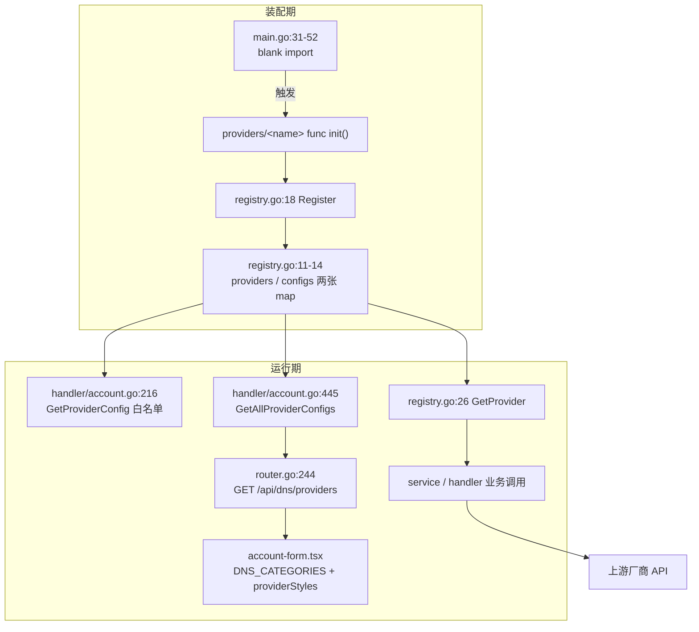

# DNS 服务商扩展

<cite>
**本文档引用的文件**
- [interface.go](file://main/internal/dns/interface.go)
- [registry.go](file://main/internal/dns/registry.go)
- [ensure_challenge.go](file://main/internal/dns/ensure_challenge.go)
- [empty_record_list.go](file://main/internal/dns/empty_record_list.go)
- [provider_form_test.go](file://main/internal/dns/provider_form_test.go)
- [main.go](file://main/main.go)
- [aliyun.go](file://main/internal/dns/providers/aliyun/aliyun.go)
- [dnspod.go](file://main/internal/dns/providers/dnspod/dnspod.go)
- [cloudflare.go](file://main/internal/dns/providers/cloudflare/cloudflare.go)
- [lines.go](file://main/internal/dns/providers/cloudflare/lines.go)
- [lines_test.go](file://main/internal/dns/providers/cloudflare/lines_test.go)
- [huoshan.go](file://main/internal/dns/providers/huoshan/huoshan.go)
- [timeout_test.go](file://main/internal/dns/providers/timeout_test.go)
- [account.go](file://main/internal/api/handler/account.go)
- [domain.go](file://main/internal/api/handler/domain.go)
- [cert.go](file://main/internal/api/handler/cert.go)
- [router.go](file://main/internal/api/router.go)
- [capabilities.go](file://main/internal/monitor/capabilities.go)
- [schedule.go](file://main/internal/service/schedule.go)
- [account-form.tsx](file://web/components/account-form.tsx)
- [api.ts](file://web/lib/api.ts)
- [analysis-ext.md](file://../.wiki-context/analysis-ext.md)
</cite>

## 目录

1. [简介](#简介)
2. [项目结构](#项目结构)
3. [核心组件](#核心组件)
4. [架构总览](#架构总览)
5. [详细组件分析](#详细组件分析)
6. [依赖关系分析](#依赖关系分析)
7. [性能考虑](#性能考虑)
8. [故障排查指南](#故障排查指南)
9. [结论](#结论)
10. [附录](#附录)

## 简介

本文是「新增一家 DNS 服务商」的端到端实现教程，覆盖建包、模板、接口实现、线路、
DNS-01、注册、装配、测试与排坑；全部结论来自当前工作区实测。关键事实：

- `dns.Provider` 接口共 15 个方法，声明在 `main/internal/dns/interface.go:41-86`。
  少实现任意一个即编译失败。注册入口 `dns.Register(name, factory, config)`（`registry.go:18`），
  取用入口 `dns.GetProvider(...)`（`registry.go:26`）。
- **接口中没有 `QueryWhois`**。WHOIS 由独立包 `main/internal/whois` 提供，经
  `handler.QueryWhois` 进入（路由 `apiv1/domain.go:41` 的 `/api/v1/domains/whois`），
  与 provider 注册表无关。新增服务商**不需要**实现 WHOIS。
- 装配靠 `main/main.go:31-52` 的 blank import。**漏掉这一行，`init()` 永不执行，
  且没有任何编译错误**——本扩展点最主要的静默失败源。

代表实现：`aliyun`（SDK 系、动态线路）、`dnspod`（SDK 系、含三个可选接口）、
`cloudflare`（自研 HTTP、静态线路编目）、`huoshan`（自研签名 HTTP、硬编码线路）。

**章节来源**
- [interface.go](file://main/internal/dns/interface.go#L41-L86)
- [registry.go](file://main/internal/dns/registry.go#L18-L89)
- [main.go](file://main/main.go#L31-L52)

## 项目结构

DNS 扩展点全部落在 `main/internal/dns/` 一棵子树下，宿主包与实现包分离：

```text
main/internal/dns/
├── interface.go            # Record / PageResult / Provider / 三个可选接口 / 表单类型
├── registry.go             # ProviderFactory、Register、GetProvider、DefaultLineMapping
├── ensure_challenge.go     # DNS-01 写记录的公共算法（两个导出函数）
├── empty_record_list.go    # 「查无记录」错误归一化为空列表
├── provider_form_test.go   # 注册表不变量测试（表单不含 proxy 键）
└── providers/              # 22 个实现目录 + timeout_test.go
    ├── aliyun/aliyun.go            477 行  SDK 系，动态线路，含 RecordGrouper
    ├── dnspod/dnspod.go            546 行  含三个可选接口
    ├── cloudflare/{cloudflare.go,lines.go,lines_test.go}   503/19/59 行
    ├── huoshan/huoshan.go          478 行  自研火山签名
    └── 其余 17 目录：aws/ huawei/ baidu/ bt/ dnsla/ dnsmgr/ dynv6/ goedge/
        henet/ jdcloud/ namesilo/ powerdns/ qingcloud/ spaceship/
        technitium/ tencenteo/ west/ aliyunesa
```

命名约定 22/22 遵循：目录名 = 包名 = 注册键 = 文件名，即 `providers/<name>/<name>.go`。
只有 `cloudflare` 额外拆出 `lines.go` 与 `lines_test.go`，是本扩展点唯一带测试的实现包。

**章节来源**
- [interface.go](file://main/internal/dns/interface.go)
- [registry.go](file://main/internal/dns/registry.go)
- [lines.go](file://main/internal/dns/providers/cloudflare/lines.go#L1-L19)

## 核心组件

| 组件 | 位置 | 签名 / 取值 | 职责 |
| --- | --- | --- | --- |
| `Provider` | `interface.go:41-86` | 15 个方法 | 唯一必实现抽象 |
| `ProviderFactory` | `registry.go:9` | `func(config map[string]string, domain, domainID string) Provider` | 工厂，同步返回，无 error |
| `ProviderConfig` | `interface.go:130-137` | `Type/Name/Icon/Note/Config/Features` | 表单与特性声明 |
| `Register` | `registry.go:18-23` | 同表写两张 map | 重复注册静默覆盖 |
| `GetProvider` | `registry.go:26-37` | 键不存在报 `unknown DNS provider` | 实例化 |
| `GetAllProviderConfigs` | `registry.go:48-56` | 返回拷贝 | `/api/dns/providers` 数据源 |
| `DefaultLineMapping` | `registry.go:58-80` | `map[string]map[string]string` | 逻辑线路码 → 厂商线路值 |
| `DefaultDNSLine` | `registry.go:82-89` | 缺项回落 `"default"` | 无显式线路时的写入值 |
| `EnsureChallengeRecord` | `ensure_challenge.go:48-111` | 幂等写挑战记录 | DNS-01 复用 |
| `TreatAsEmptySubDomainRecordListError` | `empty_record_list.go:14-31` | 错误归一化 | 「无记录」当空列表 |

由工厂签名决定的三条约束：`ProviderFactory` **不返回 error**，凭据错误、客户端创建失败只能
塞进 `lastErr` 并让实例继续存在——`aliyun.go:52` 就是 `return &Provider{lastErr: err.Error()}`，
因此所有方法都要防 `p.client == nil`。业务方法都收 `ctx`，但 SDK 系上游方法**没有 ctx 变体**，
关停信号传不进去，`providers/timeout_test.go:11-30` 显式记录了该事实并把三家 SDK 超时统一到 30s。
`GetMinTTL()` 是唯一无 ctx 的同步方法（`interface.go:82`）。

**章节来源**
- [registry.go](file://main/internal/dns/registry.go#L9-L89)
- [interface.go](file://main/internal/dns/interface.go#L102-L127)
- [timeout_test.go](file://main/internal/dns/providers/timeout_test.go#L11-L30)

## 架构总览

从「用户点保存」到「上游 API 落地」，注册表是唯一耦合点：



**图表来源**
- [main.go](file://main/main.go#L31-L52)
- [registry.go](file://main/internal/dns/registry.go#L11-L45)
- [account.go](file://main/internal/api/handler/account.go#L216-L449)
- [router.go](file://main/internal/api/router.go#L244-L245)

## 详细组件分析

本节按「一个实现一节」推进，每节内部拆为接口约定、注册写法、调用与消费。

### 文件模板与包骨架

#### 接口约定

一个 provider 包只需四个顶层声明：`init()`、`Provider` 结构体、`NewProvider` 工厂、
以及 15 个方法实现。最小可编译骨架：

```go
package mydns

import (
	"context"
	"main/internal/dns"
)

/* Provider 示例 DNS 服务商 */
type Provider struct {
	token    string
	domain   string
	domainID string
	lastErr  string
}

func init() {
	dns.Register("mydns", NewProvider, dns.ProviderConfig{
		Type: "mydns",
		Name: "示例 DNS",
		Config: []dns.ConfigField{
			{Name: "API Token", Key: "token", Type: "input", Required: true},
		},
		Features: dns.ProviderFeatures{Remark: 1, Status: true, Add: true},
	})
}

/* NewProvider 工厂签名必须与 registry.go:9 的 ProviderFactory 完全一致 */
func NewProvider(config map[string]string, domain, domainID string) dns.Provider {
	return &Provider{token: config["token"], domain: domain, domainID: domainID}
}
```

`domain` 是域名全称，`domainID` 是上游 zone/实例标识（`registry.go:9`）。
所有 provider 都额外带 `lastErr string`，唯一读者是 `GetError()`。

#### 注册写法

`ProviderConfig.Type` 必须与 `Register` 首参逐字相同：`aliyun.go:18` 的注册键对应
`aliyun.go:19` 的 `Type: "aliyun"`。两者不一致时不报错，但前端拿到的 `type` 来自
`ProviderConfig.Type`、账户表存的是注册键，会出现「表单能显示、实例化取不到」的分裂。

`Config` 数组直接映射前端 `ProviderConfigField`（`api.ts:1339-1350`），可用键只有
`name/key/label/type/required/placeholder/options/value/note/show`。后端 `ConfigField`
（`interface.go:140-148`）的其余字段前端不读。`Type` 实际消费的取值是 `input`、`select`、
`radio`（`interface.go:143`）；`radio` 必须配 `Options` 与 `Value`，参考 `cloudflare.go:24`
的认证方式二选一。

#### 调用与消费

`Features`（`interface.go:157-167`）不是装饰，实测读取点：

| 特性位 | 语义 | 实测要点 |
| --- | --- | --- |
| `Remark` | 0 不支持 / 1 单独设置 / 2 随记录设置 | `aliyun` 取 1、`cloudflare` 与 `huoshan` 取 2 |
| `Status` | 是否支持启用暂停 | 决定 `SetDomainRecordStatus` 是否被调用 |
| `Log` | 是否支持解析日志 | 对应 `GetDomainRecordLog` 是否返回有效数据 |
| `Add` | 是否支持添加域名 | `handler/account.go:457` 唯一读取点 |
| `RecordGroup` | 是否支持记录分组 | 配合 `RecordGrouper` 断言 |
| `DomainAlias` | 是否支持域名别名 | 声明位，当前无生产消费方 |

`Remark: 2` 表示 remark 与记录同一次请求写入（`cloudflare.go:385` 把它塞进 `comment`）；
`Remark: 1` 的 `aliyun.go:231-233` 是先建记录再单独调 `UpdateDomainRecordRemark`，
且**忽略第二次调用的错误**。上游若支持一次写入务必声明 2，否则「建成功但备注丢了」。

**章节来源**
- [aliyun.go](file://main/internal/dns/providers/aliyun/aliyun.go#L17-L60)
- [cloudflare.go](file://main/internal/dns/providers/cloudflare/cloudflare.go#L19-L69)
- [interface.go](file://main/internal/dns/interface.go#L130-L167)
- [api.ts](file://web/lib/api.ts#L1339-L1350)

### 十五个接口方法逐项实现

#### 接口清单与契约

按 `interface.go:41-86` 声明顺序：

| 方法 | 声明行 | 返回契约 | 实测要点 |
| --- | --- | --- | --- |
| `GetError` | 43 | 最近一次错误串 | 全库无生产调用方，仍必须实现 |
| `Check` | 46 | 凭据有效性 | 常委托一次轻量列表调用 |
| `GetDomainList` | 49 | `Records` 为 `[]DomainInfo` | 分页起点为 1 |
| `GetDomainRecords` | 52 | `Records` 为 `[]Record` | 8 个过滤参数，上游多只支持子集 |
| `GetSubDomainRecords` | 55 | `Records` 为 `[]Record` | DNS-01 前置查询，**必须可返回空** |
| `GetDomainRecordInfo` | 58 | `*Record` | 单条回读 |
| `AddDomainRecord` | 61 | `(recordID, error)` | `weight` 用指针区分「未设置」与 0 |
| `UpdateDomainRecord` | 64 | `error` | 入参同 Add，多一个 `recordID` |
| `UpdateDomainRecordRemark` | 67 | `error` | 不支持时返回 error 或 no-op |
| `DeleteDomainRecord` | 70 | `error` | — |
| `SetDomainRecordStatus` | 73 | `error` | 布尔入参，上游多为字符串 |
| `GetDomainRecordLog` | 76 | `*PageResult` | 与 `Features.Log` 对应 |
| `GetRecordLine` | 79 | `[]RecordLine` | 与 `DefaultLineMapping` 双轨 |
| `GetMinTTL` | 82 | `int` | 无 ctx，同步 |
| `AddDomain` | 85 | `error` | 与 `Features.Add` 对应 |

`PageResult.Records` 是 `interface{}`（`interface.go:37`），这是新 provider 最容易出错处：
填错具体类型不会编译失败，只在运行时炸。公共兜底是 `recordsFromPageResult`
（`ensure_challenge.go:9-18`），它断言 `[]dns.Record`，不匹配即报
`dns: unexpected PageResult.Records type %T`。

推荐实现顺序：先把无外部依赖的三个方法（`GetError`/`GetMinTTL`/
`UpdateDomainRecordRemark`）钉住结构体 → 再做 `request`/签名/错误映射 →
读路径 → 写路径 → `AddDomain`/`GetRecordLine`/`GetDomainRecordLog`/`Check`。
`Check` 的最低成本实现是复用列表接口打一发小分页请求（`dnspod.go:68-71`）：

```go
func (p *Provider) Check(ctx context.Context) error {
	_, err := p.GetDomainList(ctx, "", 1, 1)
	return err
}
```

#### 可选扩展接口

三个可选接口默认**不要**实现。判据：

| 接口 | 消费点 | 实现建议 |
| --- | --- | --- |
| `RecordGrouper` | `handler/domain.go:811`、`domain_ext.go:369`/`:407` | 上游确有分组 API 且 `RecordGroup=true` 才实现 |
| `SubdomainDelegator` | `handler/domain.go:1653`，且**绕过注册表直接 import 具体包** | 实现后该入口也不会识别，属现状限制 |
| `DomainAliaser` | **无**（别名走本地表 `models.DomainAlias`，`domain_ext.go:129`） | 实现即死代码 |

`monitor` 侧另有独立能力表 `platformCapabilities`（`capabilities.go:10-26`，15 个键），
与 provider 注册表**不同步**。缺项时 `GetPlatformCaps`（`:28-33`）回落
`{Pause:false, Delete:true, Mixed:false}`。需要参与容灾探测就必须补一行。

#### 调用与消费

实例化的三个生产调用点，参数含义不同：

- `handler/account.go:402`：`dns.GetProvider(account.Type, config, "", "")`，
  账户连通性校验，两参传空串。若 `Check` 依赖 `p.domain`，此处必然失败。
- `handler/cert.go:964`：`dns.GetProvider(account.Type, config, domain.Name, domain.ThirdID)`，
  DNS-01 写记录。
- `service/optimize_task.go:248`：批量任务从域名行取两参后调 `GetSubDomainRecords`。

**章节来源**
- [interface.go](file://main/internal/dns/interface.go#L41-L127)
- [ensure_challenge.go](file://main/internal/dns/ensure_challenge.go#L9-L18)
- [dnspod.go](file://main/internal/dns/providers/dnspod/dnspod.go#L68-L71)
- [account.go](file://main/internal/api/handler/account.go#L402)
- [cert.go](file://main/internal/api/handler/cert.go#L964-L977)
- [capabilities.go](file://main/internal/monitor/capabilities.go#L10-L33)

### 线路映射与 DefaultLineMapping

#### 接口约定

「线路」在本项目承担两种不同语义：运营商分流（`aliyun`/`dnspod`/`huawei`/`huoshan`/
`baidu`/`west`）与功能性开关（`cloudflare` 的灰云/橙云，即 `proxied`）。
`DefaultLineMapping`（`registry.go:58-80`）是逻辑线路码到厂商线路值的常量表，
五个固定码 `DEF`/`CT`/`CU`/`CM`/`AB` 对应默认、电信、联通、移动、海外。
只有 `DEF` 被 `DefaultDNSLine`（`registry.go:82-89`）消费，其余四码供上层任务换算。

#### 注册写法

新增服务商时在表里补一行。实测值：

```go
// registry.go:59-68 节选
"aliyun":     {"DEF": "default", "CT": "telecom", "CU": "unicom", "CM": "mobile", "AB": "oversea"},
"dnspod":     {"DEF": "", "CT": "10=0", "CU": "10=1", "CM": "10=3", "AB": "3=0"},
"huoshan":    {"DEF": "default", "CT": "telecom", "CU": "unicom", "CM": "mobile", "AB": "oversea"},
"cloudflare": {"DEF": "0"},
```

表内的实测不一致点，新服务商须自选一种并在注释写明：`dnspod` 的 `DEF` 是空串而
`aliyun`/`huoshan` 是 `"default"`；`cloudflare` 只有 `DEF`（上游本就没有运营商线路）；
`bt` 缺 `AB` 码（`:67`）；`qingcloud` **整张表无条目**，`DefaultDNSLine("qingcloud")`
走 `:88` 兜底返回 `"default"`。

#### 调用与消费

`GetRecordLine`（`interface.go:79`）是另一轨，返回前端下拉用的线路列表。三种实现风格：

| 风格 | 代表 | 位置 | 特点 |
| --- | --- | --- | --- |
| 动态查询上游 | `aliyun` | `aliyun.go:325-342` | 调 `DescribeSupportLines`，`LineCode` 填进 `ID` |
| 硬编码常量 | `huoshan` | `huoshan.go:459-467` | 直接 return 六条，`ID` 与表值同源 |
| 包级编目 + 拷贝 | `cloudflare` | `cloudflare.go:488-493` + `lines.go:16-19` | 编目单列一文件，返回前 `copy` 防污染 |

`cloudflare` 最值得抄，因为它把「线路值会被写入逻辑解读」显式化了：
`AddDomainRecord` 用 `proxied := line == "1"`（`cloudflare.go:381`）判定代理开关，
线路 `ID` 因此是控制数据而非展示数据。`lines_test.go:15-32` 用固定期望值锁定编目，
`:39-58` 额外断言返回值是副本——改 `lines[0].ID` 不污染包级 `Lines`。

写入时判空须与所选 `DEF` 一致，两种惯用法：

```go
// aliyun.go:219-221：DEF 是 "default"，所以显式排除
if line != "" && line != "default" {
	request.Line = line
}

// dnspod.go:55-60：DEF 是空串，但历史配置曾用 "0"，需归一化
func normalizeRecordLine(line string) string {
	line = strings.TrimSpace(line)
	if line == "" || strings.EqualFold(line, "default") || line == "0" {
		return "默认"
	}
	return line
}
```

`dnspod` 的 `RecordLine` 在 v20210323 里是**线路名称**（如「默认」）而非数字 ID，
与 `DEF = ""` 构成「表里空串、写入时翻译」的两段式。
上游线路标识若是数字 ID，直接让 `DEF` 存该 ID，不必加归一化层。

**章节来源**
- [registry.go](file://main/internal/dns/registry.go#L58-L89)
- [aliyun.go](file://main/internal/dns/providers/aliyun/aliyun.go#L219-L342)
- [dnspod.go](file://main/internal/dns/providers/dnspod/dnspod.go#L53-L61)
- [huoshan.go](file://main/internal/dns/providers/huoshan/huoshan.go#L459-L467)
- [cloudflare.go](file://main/internal/dns/providers/cloudflare/cloudflare.go#L381-L493)
- [lines_test.go](file://main/internal/dns/providers/cloudflare/lines_test.go#L15-L58)

### registry 注册与装配链路

#### 接口约定

`Register` 的实现极简（`registry.go:18-23`），一次调用写两张 map，三条确定行为：
重复注册**静默覆盖**且不 panic（与 `notify` 的 panic 级防重复相反）；允许写入 `nil` 工厂，
`GetProvider` 在 `:33-35` 检查并返回 `nil factory` 错误，但 DNS 侧**没有**「表单与工厂分离」
用法（那是 `cert` 的双阶段模式），新服务商不要传 `nil`；锁为 `sync.RWMutex`（`:12`），
注册只发生在 `init()`，运行期只读。

#### 注册写法

装配完全依赖 `main/main.go:31-52` 的 blank import，共 22 行按字母序排列，形如
`_ "main/internal/dns/providers/aliyun"`。新增服务商时插入一行，位置按字母序。
同文件 `:27-30` 是证书签发子包、`:55-58` 是部署器子包，三组互不影响。

#### 调用与消费

```mermaid
sequenceDiagram
participant Main as "main.go blank import"
participant Init as "providers/&lt;name&gt; init()"
participant Reg as "dns.Register"
participant Store as "providers / configs map"
participant API as "GET /api/dns/providers"
participant Web as "account-form.tsx"
Main->>Init : 触发包初始化
Init->>Reg : Register(name, NewProvider, ProviderConfig)
Reg->>Store : 写入两张 map
API->>Store : GetAllProviderConfigs() 取快照
Store-->>Web : JSON 表单定义
Web->>Web : DNS_CATEGORIES 分组 + providerStyles 配色
```

**图表来源**
- [main.go](file://main/main.go#L31-L52)
- [registry.go](file://main/internal/dns/registry.go#L18-L56)
- [account.go](file://main/internal/api/handler/account.go#L445-L449)
- [router.go](file://main/internal/api/router.go#L244)

注册后消费面完全注册表驱动，**不需要改 handler 或路由**。账户创建的白名单在
`handler/account.go:216`：`if _, ok := dns.GetProviderConfig(req.Type); !ok` 即拒绝。
表单渲染在 `account.go:445` 的 `GetDNSProviders`，路由 `router.go:244`，
前端消费方 `api.ts:781` 的 `getDNSProviders()`。

**章节来源**
- [registry.go](file://main/internal/dns/registry.go#L11-L56)
- [main.go](file://main/main.go#L31-L52)
- [account.go](file://main/internal/api/handler/account.go#L216-L449)

### ensure_challenge 与 DNS-01 特化

#### 接口约定

`dns.EnsureChallengeRecord`（`ensure_challenge.go:48-111`）是公共包函数而非接口方法，
签名接受任意 `Provider`。它对 provider 的隐式要求：

1. `GetSubDomainRecords(ctx, subHost, 1, 100, "", "")` 必须能返回空结果而不报 error；
   若上游以业务错误表达「查无记录」，错误串须含 `NoDataOfRecord` 才能被
   `TreatAsEmptySubDomainRecordListError`（`empty_record_list.go:14-31`）识别。
   该函数沿 `errors.Unwrap` 链逐层比对，支持包装错误。
2. `PageResult.Records` 必须是 `[]dns.Record`（值切片，非指针切片）。
3. `Record.ID` 为空时函数当作「不可复用」跳过；非 TXT 分支删旧记录用 `rec.Line != line`
   做线路隔离，故 `Record.Line` 需可靠。
4. `AddDomainRecord` 对同一 `subHost` + `TXT` 必须允许多条并存。

#### 实现要点

TXT 分支**只追加不更新**（`ensure_challenge.go:89-95`），因为同一 `_acme-challenge`
主机记录可能同时需要多个不同 TXT 值（`*.example.com` 与 `example.com` 并行申请）；
非 TXT 分支先删同类型旧记录再写入（`:97-110`）。值比较走 `challengeValuesEqual`
（`:31-46`），归一化含去空格、去尾点、TXT 去成对双引号，TXT 额外做去全部引号与空格后的
二次比较，因此 provider 返回的 TXT 是否带引号都能被正确识别。

TTL 策略（`:54-57`）：入参 `<= 0` 或 `> 600` 一律压到 60。带探测的
`EnsureChallengeRecordWithTTLProbe`（`:114-177`）按 `ttlList` 依次尝试写入，
失败换下一个 TTL，返回 `usedTTL`。

#### 调用与消费

| 调用点 | 函数 | 线路来源 | TTL |
| --- | --- | --- | --- |
| `handler/cert.go:977` | `EnsureChallengeRecord` | `dns.DefaultDNSLine(account.Type)`（`:971`） | 600，`namesilo` 特例 3600 |
| `handler/domain.go:1703` | `EnsureChallengeRecord` | `dns.DefaultDNSLine(account.Type)`（`:1702`） | 600，DNSPod 子域托管校验 |

`handler/cert.go:971-974` 的写法值得注意——它对 `namesilo` 做了硬编码 TTL 特例：

```go
line := dns.DefaultDNSLine(account.Type)
ttl := 600
if account.Type == "namesilo" {
	ttl = 3600
}
```

**若服务商最小 TTL 大于 600，必须在这里补分支**，否则 DNS-01 会因 TTL 被拒。
`GetMinTTL()` 在该路径上没有被读取。批量任务侧 `service/schedule.go:160-164` 同样只用
`DefaultDNSLine`，线路缺项即回落 `"default"`。

**章节来源**
- [ensure_challenge.go](file://main/internal/dns/ensure_challenge.go#L9-L177)
- [empty_record_list.go](file://main/internal/dns/empty_record_list.go#L14-L31)
- [cert.go](file://main/internal/api/handler/cert.go#L964-L977)
- [domain.go](file://main/internal/api/handler/domain.go#L1702-L1703)
- [schedule.go](file://main/internal/service/schedule.go#L160-L164)

### 单元测试与验证

#### 现有测试模式

现有三层测试：`dns/provider_form_test.go`（`dns_test`，注册表不变量，不触网）、
`dns/providers/timeout_test.go`（`providers_test`，SDK 系超时常量一致性，仅构造）、
`dns/providers/cloudflare/lines_test.go`（`cloudflare`，线路编目与副本隔离，不触网）。

`provider_form_test.go` 的模式最值得复用：用 blank import 把待测子包拉进测试进程，
再断言注册表非空。`proxyFormProviders`（`:30-34`）硬编码 16 个名字，
`TestDNSProviderFormsCarryNoProxyField`（`:66`）逐个检查命中，未注册即 `t.Errorf`「断言将空转」：

```go
func TestDNSProviderFormsCarryNoProxyField(t *testing.T) {
	all := dns.GetAllProviderConfigs()
	for _, name := range proxyFormProviders {
		cfg, ok := all[name]
		if !ok {
			t.Errorf("DNS 提供商 %s 未注册，断言将空转", name)
			continue
		}
		assertNoProxyKey(t, "dns/"+name, dnsFieldKeys(cfg.Config))
	}
}
```

该清单**不含** `aliyun`/`dnspod`/`huoshan`/`cloudflare`/`qingcloud`——它们只在 `main.go`
里 blank import，测试进程不加载。新服务商若要纳入，需同时往 `proxyFormProviders`
与 blank import 块各加一行。

#### 测试写法

推荐的包级测试三件套，全部不触网：

```go
package mydns

/* 锁定注册：工厂可实例化、Type 与注册键一致 */
func TestRegisteredAndConstructs(t *testing.T) {
	cfg, ok := dns.GetProviderConfig("mydns")
	if !ok {
		t.Fatal("mydns 未注册，检查是否漏了 blank import")
	}
	if cfg.Type != "mydns" {
		t.Errorf("ProviderConfig.Type 与注册键不一致，实际 %q", cfg.Type)
	}
	if p := NewProvider(map[string]string{"token": "t"}, "example.com", "zone1"); p == nil {
		t.Fatal("工厂返回 nil")
	}
}

/* 锁定线路：GetRecordLine 的 ID 集合须覆盖 DefaultLineMapping 全部已声明码 */
func TestLinesCoverDefaultMapping(t *testing.T) {
	p := NewProvider(map[string]string{"token": "t"}, "example.com", "zone1")
	lines, err := p.GetRecordLine(context.Background())
	if err != nil {
		t.Fatal(err)
	}
	for code, want := range dns.DefaultLineMapping["mydns"] {
		if code != "DEF" && !containsLineID(lines, want) {
			t.Errorf("线路码 %s 的值 %q 不在 GetRecordLine 返回值中", code, want)
		}
	}
}
```

`timeout_test.go:11-30` 的注释提供了另一判据：它坦言「实例化后无法直接读超时」，
因此退化为断言构造不 panic 且返回非 nil——超时值在构造时注入，构造成功即说明参数被接受。
遇到不可观测的内部状态时采用同类降级，并**在注释里写明为什么这样断言**。

#### 验证命令

```bash
cd main
go build ./...
go vet ./internal/dns/... ./internal/api/handler/...
go test ./internal/dns/... -run 'TestProvider|TestLines|TestRegistered' -count=1
# 关键：确认新包进了二进制，这是证伪漏 blank import 的直接手段
go list -deps . | grep 'dns/providers/mydns'
```

`go list -deps` 必须命中新包路径，否则注册表 `init()` 永不执行。
前端侧验证是打开「添加账户」页，确认新服务商出现在预期分组；
若落到「其他」，说明 `DNS_CATEGORIES`（`account-form.tsx:23-27`）没登记。

**章节来源**
- [provider_form_test.go](file://main/internal/dns/provider_form_test.go#L30-L97)
- [timeout_test.go](file://main/internal/dns/providers/timeout_test.go#L1-L40)
- [lines_test.go](file://main/internal/dns/providers/cloudflare/lines_test.go#L15-L58)
- [account-form.tsx](file://web/components/account-form.tsx#L23-L27)

### 常见坑与回归点

#### 静默失败类

| 坑 | 触发条件 | 表现 | 定位手段 |
| --- | --- | --- | --- |
| 漏 blank import | `main.go` 未加行 | 表单不出现该服务商，创建被 `account.go:216` 拒绝 | `go list -deps .` 过滤包路径 |
| 注册键与 `Type` 不一致 | 两处手写字面量不同 | 表单能显示、实例化报 `unknown DNS provider` | 比对 `Register` 首参与 `ProviderConfig.Type` |
| `Records` 填成 `[]*Record` | 类型断言失败 | 列表页正常，DNS-01 报 `unexpected PageResult.Records type` | 看 `recordsFromPageResult` 错误串 |

#### 行为偏差类

| 坑 | 后果 | 正确做法 |
| --- | --- | --- |
| `DEF` 值与 `GetRecordLine` 的 `ID` 不同源 | 上游拒绝或记录落到错误线路 | 两处取值同源，加表驱动测试锁定 |
| `GetSubDomainRecords` 对空结果返回 error | DNS-01 每次先查后写都失败 | 返回空列表，或错误串含 `NoDataOfRecord` |
| 忽略 `weight *int` 的 nil 语义 | 权重 0 被当有效值写入 | `if weight != nil` 判定（`interface.go:61`） |
| `SetDomainRecordStatus` 不支持时返回 nil | 前端点了暂停但记录没变 | 返回 `error`，同时 `Features.Status` 置 false |
| `GetMinTTL` 未参与 DNS-01 | 挑战记录 TTL 被上游拒绝 | 见 `cert.go:972-974`，需在上层加分支 |
| 凭据错误时在工厂返回 nil | 违反 `ProviderFactory` 无 error 契约 | 照 `aliyun.go:52` 存 `lastErr` 并返回可用实例 |

#### 限流与重试

**实测结论：`main/internal/dns/providers/` 全树下没有任何 429 / RateLimit / 退避重试处理。**
唯一的「重试」字样在 `technitium/technitium.go:467`/`:534`/`:571`/`:602`，
且是返回给用户的文案「记录不存在，请刷新页面重试」，不是自动重试。

由此：上游限流直接以 `error` 冒泡到 handler 由用户重试，配额严格的服务商须**自行在包内节流**。
最易触发限流的两处是批量任务连续翻页调 `GetSubDomainRecords`（`optimize_task.go:248`）与
DNS-01 的先查后写。对照事实：`cert/acme` 侧**有**成体系退避
（`acmeComputeRetryWait`/`acmeClampRetry`），说明限流处理是「按扩展点各自实现」而非公共中间件。

#### 图标与前端登记的已知偏差

`ProviderConfig.Icon`（`interface.go:133`）会写进 JSON 并被前端类型声明
（`api.ts:1328`），但 `account-form.tsx` **完全不读该字段**，改用硬编码表 `providerStyles`
（`:70` 起），未登记类型走字母兜底。因此除放图标到 `web/public/icons/`，
还须在 `providerStyles` 加 `color/bgColor/icon/image` 四项；只放文件不改表不会生效。

**章节来源**
- [registry.go](file://main/internal/dns/registry.go#L18-L37)
- [empty_record_list.go](file://main/internal/dns/empty_record_list.go#L14-L31)
- [cert.go](file://main/internal/api/handler/cert.go#L971-L977)
- [account-form.tsx](file://web/components/account-form.tsx#L70)
- [analysis-ext.md](file://../.wiki-context/analysis-ext.md)

## 依赖关系分析

依赖方向严格单向，实现包依赖宿主包，宿主包不依赖任何实现包：

| 关系 | 方向 | 后果 |
| --- | --- | --- |
| `main.go` → 各 provider 子包 | blank import | 决定 `init()` 是否执行，顺序按字母序 |
| 子包 `init()` → `dns.Register` | 单向调用 | 注册表在 `main` 包初始化完成时定型 |
| `dns` 包 → 子包 | **不存在** | 宿主包不知道任何实现存在，符合依赖倒置 |
| `handler`/`service` → `dns` | 只用抽象 | 新增服务商不需改动这两层 |

规模实测：`providers/` 下 22 个实现目录、`DefaultLineMapping` 21 个键（缺 `qingcloud`）、
`monitor/capabilities.go` 的 `platformCapabilities` 15 个键。三个集合互不重合，
是本扩展点的主要一致性风险。

**章节来源**
- [main.go](file://main/main.go#L26-L58)
- [registry.go](file://main/internal/dns/registry.go#L1-L80)
- [capabilities.go](file://main/internal/monitor/capabilities.go#L10-L26)

## 性能考虑

- **HTTP 超时统一 30s。** 自研 provider 一律 `&http.Client{Timeout: 30 * time.Second}`
  （`cloudflare.go:68`、`huoshan.go:57`）。SDK 系各带默认值（`aliyun` 10s、`dnspod` 60s、
  `huawei` 120s），`aliyun.go:44` 用 `WithTimeout(30 * time.Second)` 显式对齐。
- **ctx 不贯通。** SDK 系方法无 ctx 变体（`timeout_test.go:22-25`），超时是唯一耗时上界，
  不要再叠加更长的自定义超时。
- **强制 HTTPS。** `aliyun.go:41-44` 显式 `WithScheme("https")`，因为该路径携带
  AccessKey 签名凭据，明文传输可被中间人重放。
- **`GetAllProviderConfigs()` 每次拷贝整张 map**（`registry.go:48-56`）。
  `/api/dns/providers` 是热路径，22 键量级可接受，但不要在循环里高频调用。
- **分页语义。** `Page` 位（`interface.go:163`）区分服务端与客户端分页。
  `qingcloud.go:163` 把 `GetDomainRecords` 转发到 `GetSubDomainRecords`、`:264` 用 `1, 500`
  一次拉全；`aliyun`/`dnspod` 走服务端分页。上游无分页能力时声明 `Page: true` 并一次返回。
  DNS-01 前置查询页大小固定 100（`ensure_challenge.go:59`），新实现须能吃下该值。

**章节来源**
- [aliyun.go](file://main/internal/dns/providers/aliyun/aliyun.go#L39-L50)
- [cloudflare.go](file://main/internal/dns/providers/cloudflare/cloudflare.go#L64-L69)
- [timeout_test.go](file://main/internal/dns/providers/timeout_test.go#L11-L30)
- [registry.go](file://main/internal/dns/registry.go#L48-L56)

## 故障排查指南

### 注册失效定位表

| 现象 | 首查位置 | 判定条件 | 修复 |
| --- | --- | --- | --- |
| 服务商不出现在账户表单 | `go list -deps .` 过滤 `providers/<name>` | 无输出 | 补 `main.go` blank import |
| 有输出但接口不返回 | `registry.go:18` | 同键被重复注册覆盖 | 全仓搜索该键的 `Register` |
| 接口返回但前端落「其他」 | `account-form.tsx:23-27` | `DNS_CATEGORIES` 未含该类型 | 加进对应分组，并在 `providerStyles`（`:70`）补四项配色，否则图标退化为字母 |
| 创建账户被拒 | `account.go:216` | `GetProviderConfig` 未命中 | 确认 `init()` 真的执行 |
| 实例化报 unknown | `registry.go:31` | 键拼写或大小写不符 | 对齐账户表 `type` 字面量 |
| 报 nil factory | `registry.go:34` | 注册时传了 `nil` | DNS 侧不要传 nil |

### 行为异常定位表

| 现象 | 根因 | 取证方法 |
| --- | --- | --- |
| DNS-01 建记录总是失败 | `GetSubDomainRecords` 空结果返回 error | 日志中 `NoDataOfRecord` 未被识别 |
| DNS-01 报类型断言错 | `PageResult.Records` 不是 `[]Record` | 错误串含 `unexpected PageResult.Records type` |
| 记录写到错误线路 | `DEF` 与 `GetRecordLine` 的 `ID` 不同源 | 比对 `registry.go` 表项与方法返回值 |
| 备注丢失 | `Remark` 声明 1 但二次调用被忽略 | 看 `AddDomainRecord` 是否 `_ =` 丢弃错误 |
| 暂停不生效 | `SetDomainRecordStatus` 返回 nil | 改为返回 error 并置 `Features.Status=false` |
| 批量任务被限流 | provider 无退避 | 包内自行节流；公共层不处理 |

### 扩展自查检查表

```bash
# 仓库根执行
cd main
go build ./... && go vet ./internal/dns/... ./internal/api/handler/...
go test ./internal/dns/... -count=1
go list -deps . | grep -c 'dns/providers/<name>'      # 必须为 1
```

再用文本检索确认三处登记：`Register("<name>"` 在 `providers/` 下恰好 1 处、
`DefaultLineMapping` 已补、需要容灾探测时 `capabilities.go` 含该键、
前端 `account-form.tsx` 的分组与样式已登记。

**章节来源**
- [registry.go](file://main/internal/dns/registry.go#L18-L45)
- [account.go](file://main/internal/api/handler/account.go#L216)
- [ensure_challenge.go](file://main/internal/dns/ensure_challenge.go#L9-L20)
- [capabilities.go](file://main/internal/monitor/capabilities.go#L10-L33)
- [account-form.tsx](file://web/components/account-form.tsx#L23-L70)

## 结论

本文给出「第 1-5 步即可用、第 6-11 步决定体验」的分层落地路径。

- **必做五步**：建包 → 工厂 → 15 方法 → `Register` → `main.go` blank import。
  完成后账户校验与表单渲染自动打通，无需改动 handler 或路由。
- **建议六步**：补 `DefaultLineMapping`、放图标、登记 `providerStyles` 与
  `DNS_CATEGORIES`、按需补 `platformCapabilities`、写包级测试、核对 `GetMinTTL`
  与 DNS-01 TTL 特例。
- 本扩展点的核心风险是「静默」：漏 import 不报错、线路缺项回落默认值、
  `Records` 类型错误只在运行时炸、重复注册无告警。因此 `go list -deps`
  与表驱动的注册测试是必要门禁，不是可选优化。三个已知结构性缺陷
  （`GetError()` 无消费方属 ISP 违规、`DomainAliaser` 是死抽象、`Icon` 字段前端不读）
  本文只记录不修复，新实现照现状跟随即可，不要自行扩大改动范围。

**章节来源**
- [interface.go](file://main/internal/dns/interface.go#L41-L167)
- [registry.go](file://main/internal/dns/registry.go#L9-L89)
- [analysis-ext.md](file://../.wiki-context/analysis-ext.md)

## 附录

### 术语表

| 术语 | 含义 |
| --- | --- |
| 注册键 / 工厂 | `Register` 第一参数（账户表 `type` 存该值）；`ProviderFactory` 同步返回、无 error |
| 表单 | `ProviderConfig` + `ConfigField` 数组，驱动前端动态渲染 |
| 线路码 / 线路值 | `DEF`/`CT`/`CU`/`CM`/`AB` 五个逻辑键；`DefaultLineMapping[provider][code]` 的厂商取值 |

### 落地检查清单

| 序 | 项 | 位置 | 必需性 |
| --- | --- | --- | --- |
| 1 | 建包并写模板，工厂签名对齐 | `main/internal/dns/providers/<name>/<name>.go`、`registry.go:9` | 必需 |
| 2 | 实现 15 方法 | `interface.go:41-86` | 必需 |
| 3 | `init()` 中 `Register`，键与 `Type` 一致 | 参照 `aliyun.go:17-30` | 必需 |
| 4 | blank import | `main.go:31-52` 按字母序 | 必需，漏则静默失败 |
| 5 | 线路映射 | `registry.go:58-80` | 建议 |
| 6 | 可选接口与探测能力表 | `interface.go:102/109/123`、`monitor/capabilities.go:10-26` | 按需 |
| 7 | 图标 + 前端分组与样式 | `web/public/icons/`、`account-form.tsx:23`/`:70` | 建议 |
| 8 | 包级测试 | `providers/<name>/<name>_test.go` | 建议 |

### 相关文档索引

| 文档 | 关系 |
| --- | --- |
| [扩展开发.md](./扩展开发.md) | 四类扩展点总览 |
| [证书提供商扩展.md](./证书提供商扩展.md) | 姊妹篇，双阶段注册对比 |
| [DNS提供商抽象层.md](../DNS管理功能/DNS提供商抽象层.md) | 抽象层现状说明 |

[本节为通用指导，无需特定文件来源]
