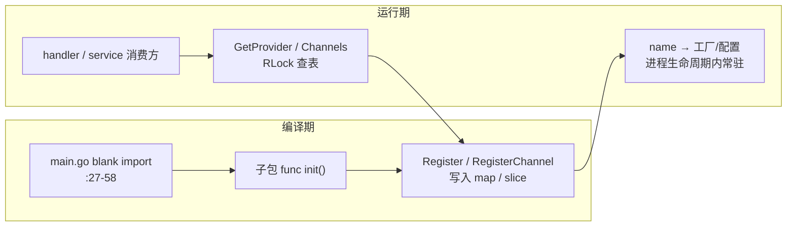
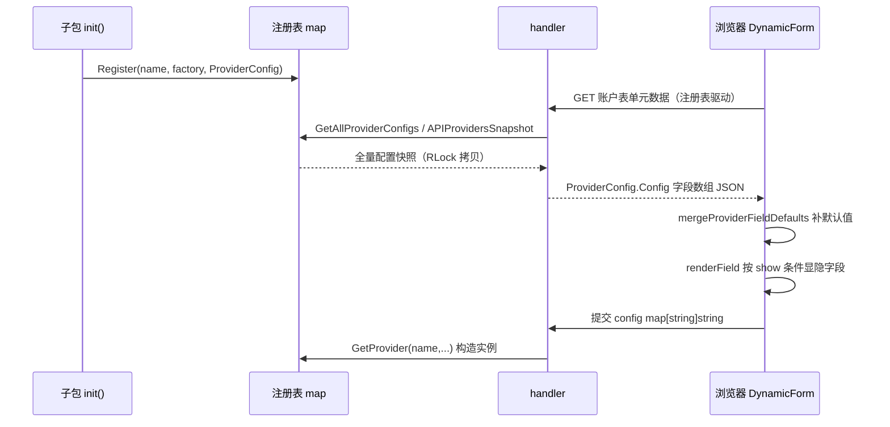
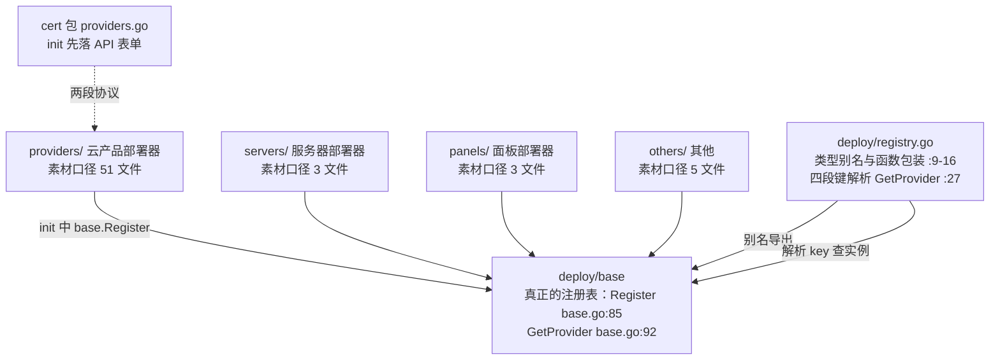
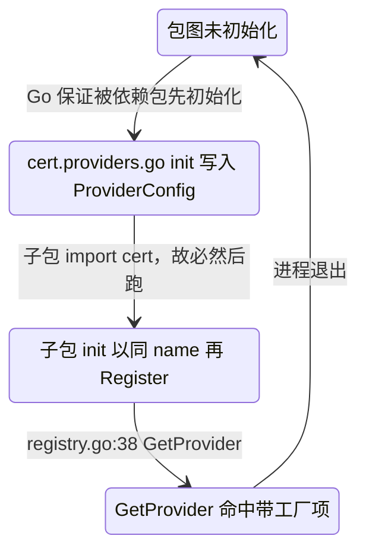

# 扩展开发

<cite>
**本文档引用的文件**
- [interface.go](file://main/internal/dns/interface.go)
- [registry.go](file://main/internal/dns/registry.go)
- [interface.go](file://main/internal/cert/interface.go)
- [registry.go](file://main/internal/cert/registry.go)
- [registry.go](file://main/internal/cert/deploy/registry.go)
- [base.go](file://main/internal/cert/deploy/base/base.go)
- [channel_registry.go](file://main/internal/notify/channel_registry.go)
- [channel_adapters.go](file://main/internal/notify/channel_adapters.go)
- [main.go](file://main/main.go)
- [router.go](file://main/internal/api/router.go)
- [deploy-config-form.ts](file://web/lib/deploy-config-form.ts)
- [DynamicForm.tsx](file://web/components/deploy/DynamicForm.tsx)
- [analysis-ext.md](file://../.wiki-context/analysis-ext.md)
</cite>

## 目录

1. [简介](#简介)
2. [项目结构](#项目结构)
3. [核心组件](#核心组件)
4. [架构总览](#架构总览)
5. [详细组件分析](#详细组件分析)
6. [依赖关系分析](#依赖关系分析)
7. [性能考虑](#性能考虑)
8. [故障排查指南](#故障排查指南)
9. [结论](#结论)
10. [附录](#附录)

## 简介

DNSPlane 的插件化能力由**四个注册表扩展点**承载：DNS Provider（解析服务商）、Cert Provider（证书签发/账户提供商）、Deploy Provider（证书部署器）、Notify Channel（通知渠道）。四者共享同一套 Registry 模式：宿主包定义接口（`interface.go`）与注册函数（`registry.go` 的 `Register`/`RegisterChannel`），各实现子包在 `func init()` 中自我注册，入口 `main/main.go` 以 blank import 保证子包被链接进二进制。

本文是四个扩展点的**总览与选型指南**：给出共性骨架、逐项差异对照、装配行号取证，以及 Cloudflare「逃逸到独立 handler」这一反模式的原因与代价。逐扩展点的 step-by-step 实现教程由以下子文档承担（尚未生成，链接先行）：

- [DNS服务商扩展.md](./DNS服务商扩展.md)
- [证书提供商扩展.md](./证书提供商扩展.md)
- [部署器扩展.md](./部署器扩展.md)
- [面板集成扩展.md](./面板集成扩展.md)

行号与数量均为当前工作区实测或引用素材中的探针结论；引用素材的行号未经二次核实的，以「素材口径」标注。

**章节来源**
- [main.go](file://main/main.go)
- [registry.go](file://main/internal/dns/registry.go)
- [analysis-ext.md](file://../.wiki-context/analysis-ext.md)

## 项目结构

### 四个注册表宿主包

```bash
# 实测目录结构（省略无关文件）
main/internal/
├── dns/
│   ├── interface.go        # Provider 接口 + ProviderConfig + 3 个可选接口
│   ├── registry.go         # Register/GetProvider（89 行）
│   └── providers/          # 22 个服务商子包（aliyun..west）
├── cert/
│   ├── interface.go        # 9 方法 Provider 接口
│   ├── registry.go         # Register/GetProvider/Snapshot（114 行）
│   ├── providers.go        # cert 包自身 init：先落表单
│   ├── acme/ aliyun/ huoshan/ tencent/   # 已链接的 4 个子包
│   ├── ucloud/             # 死包：缺 blank import（见故障排查）
│   └── deploy/
│       ├── base/base.go    # 真正的注册表宿主
│       ├── registry.go     # 向后兼容别名 + 四段键解析
│       └── providers/ servers/ panels/ others/  # 部署器子包四组
└── notify/
    ├── channel_registry.go # Channel 接口 + RegisterChannel（129 行）
    └── channel_adapters.go # 单文件 init() 注册 13 个渠道
```

| 扩展点 | 宿主包 | 注册入口 | 实现分布 | 实测规模 |
| --- | --- | --- | --- | --- |
| DNS Provider | `main/internal/dns` | `Register`（registry.go:18） | `providers/` 22 子包 | `main.go:31-52` blank import 22 行 |
| Cert Provider | `main/internal/cert` | `Register`（registry.go:23） | 包自身表单 + 4 实现子包 | `main.go:27-30` blank import 4 行 |
| Deploy Provider | `cert/deploy/base` | `Register`（base.go:85） | `deploy/` 四组子包 | `main.go:55-58` blank import 4 组 |
| Notify Channel | `main/internal/notify` | `RegisterChannel`（channel_registry.go:56） | `channel_adapters.go` 单文件 | 同包，无需 blank import |

Deploy 四组的子包数量（providers 51、servers 3、panels 3、others 5，另有 11 个纯辅助文件）为素材口径（analysis-ext.md 注册触发一节）。

**章节来源**
- [main.go](file://main/main.go)
- [registry.go](file://main/internal/dns/registry.go)
- [channel_registry.go](file://main/internal/notify/channel_registry.go)
- [analysis-ext.md](file://../.wiki-context/analysis-ext.md)

### main.go 装配段取证

`main/main.go` 的 import 块即「链接保证」清单，实测行号：

```go
// main/main.go（:27-58 摘要）
_ "main/internal/cert/acme"      // :27
_ "main/internal/cert/aliyun"    // :28
_ "main/internal/cert/huoshan"   // :29
_ "main/internal/cert/tencent"   // :30
_ "main/internal/dns/providers/aliyun"   // :31  DNS 共 22 行（:31-52）
_ "main/internal/dns/providers/cloudflare" // :36
// ... 按字母序至 west（:52）
_ "main/internal/cert/deploy/others"    // :55   Deploy 共 4 组（:55-58）
_ "main/internal/cert/deploy/panels"    // :56
_ "main/internal/cert/deploy/providers" // :57
_ "main/internal/cert/deploy/servers"   // :58
```

新增实现子包时**必须在此列表补一行 blank import（DNS 段按字母序插入）**，遗漏的后果是静默不注册——编译、测试、运行全部正常，只有新能力在界面上不存在。

**章节来源**
- [main.go](file://main/main.go)

## 核心组件

### Registry 模式共性骨架

四个扩展点的注册表都遵循同一最小结构：**互斥锁保护的 map + init 自注册 + 消费方查表**。



**图表来源**
- [main.go](file://main/main.go)
- [registry.go](file://main/internal/dns/registry.go)
- [channel_registry.go](file://main/internal/notify/channel_registry.go)

共性清单（实测四处代码）：

| 要素 | DNS | Cert | Deploy | Notify |
| --- | --- | --- | --- | --- |
| 并发原语 | `sync.RWMutex`（registry.go:11） | 同型 | 同型（base） | `registryMu sync.RWMutex`（channel_registry.go:37） |
| 注册键 | `name string` | `name string` | `name string` | 键取自 `Channel.Type()` |
| 重复注册 | 静默覆盖 map | 静默覆盖 map | 静默覆盖 map | 素材口径：重复 Type 直接 panic |
| 查表失败 | `unknown DNS provider: %s`（registry.go:30-31） | error 返回 | error 返回 | `LookupChannel` 返回 `(Channel, bool)`（:92） |

**章节来源**
- [registry.go](file://main/internal/dns/registry.go)
- [base.go](file://main/internal/cert/deploy/base/base.go)
- [channel_registry.go](file://main/internal/notify/channel_registry.go)

### 四类扩展点差异总表

横向对比（结构列实测行号；数量列为素材探针口径）：

| 维度 | DNS Provider | Cert Provider | Deploy Provider | Notify Channel |
| --- | --- | --- | --- | --- |
| 接口位置 | `dns/interface.go:41` | `cert/interface.go:52` | `base/base.go:45` | `channel_registry.go:20` |
| 接口方法数 | 15 | 9 | 素材口径：见 base.go | 6（Type/Label/ConfigKeys/EnabledKey/NoticeKey/Build） |
| 工厂签名 | `func(map[string]string, domain, domainID)`（registry.go:9） | `func(config, ext map[string]interface{})`（registry.go:9） | `func(config map[string]interface{})`（base.go:77） | `Build(map[string]string) (Notifier, bool)`（接口方法） |
| 配置载体 | `ProviderConfig`（interface.go:130） | `ProviderConfig`（含 DeployConfig/IsDeploy/CNAME，素材口径） | 双层：cert 视图 + `DeployProviderConfig` | 无独立结构，元数据内聚于 Channel |
| 凭据形态 | `map[string]string` | `map[string]interface{}` 双参数 | 账户 + 任务两级配置 | `SysConfig` 键值对 |
| 日志注入 | 无（靠返回 error） | `SetLogger` 接口方法（素材口径） | `BaseProvider.Logger` 提升 | 无 |
| 链接保证 | `main.go:31-52` | `main.go:27-30` | `main.go:55-58` | 同包 init，无需 blank import |
| 可选扩展接口 | `RecordGrouper`/`DomainAliaser`/`SubdomainDelegator`（:102/:109/:123） | 无 | `DeployWithInfoProvider`（素材口径） | 空串表达「不适用」 |
| 成熟度评价 | 驱动式，handler 零改动 | 两段协议有序但无测试守护 | **四段键回退，最脆弱** | **最干净，唯一满足开闭原则** |

**章节来源**
- [interface.go](file://main/internal/dns/interface.go)
- [registry.go](file://main/internal/cert/registry.go)
- [base.go](file://main/internal/cert/deploy/base/base.go)
- [channel_registry.go](file://main/internal/notify/channel_registry.go)
- [analysis-ext.md](file://../.wiki-context/analysis-ext.md)

## 架构总览

注册表从后端到前端的完整消费链：



**图表来源**
- [registry.go](file://main/internal/dns/registry.go)
- [deploy-config-form.ts](file://web/lib/deploy-config-form.ts)
- [DynamicForm.tsx](file://web/components/deploy/DynamicForm.tsx)

四组部署器子包与共享宿主的关系：



**图表来源**
- [registry.go](file://main/internal/cert/deploy/registry.go)
- [base.go](file://main/internal/cert/deploy/base/base.go)
- [main.go](file://main/main.go)

## 详细组件分析

### DNS Provider 扩展

接口本体（实测 `dns/interface.go:41` 起）是「域名与解析记录 CRUD」抽象：`GetError`、`Check`、`GetDomainList`、`GetDomainRecords`、`GetSubDomainRecords`、`GetDomainRecordInfo`、`AddDomainRecord` 等 15 个方法（方法总数为素材口径，逐行清点见素材 interface.go:41-86）。

表单侧数据结构（实测行号）：

- `ProviderConfig`（:130）：`Type/Name/Icon/Note/Config/Features`
- `ConfigField`（:140）：`Name/Key/Type(input,select,radio)/Placeholder/Required/Options/Value`
- `ConfigOption`（:151）、`ProviderFeatures`（:157，9 个特性位：`Remark`(0/1/2)、`Status`、`Redirect`、`Log`、`Weight`、`Page`、`Add`、`RecordGroup`、`DomainAlias`）

可选接口按能力断言启用，不实现即不支持：`RecordGrouper`（:102）、`DomainAliaser`（:109）、`SubdomainDelegator`（:123）。

新增服务商的最小骨架：

```go
// main/internal/dns/providers/example/example.go
package example

import "main/internal/dns"

func init() {
	dns.Register("example", NewProvider, dns.ProviderConfig{
		Type: "example", Name: "示例服务商",
		Config: []dns.ConfigField{
			{Name: "API Token", Key: "token", Type: "input", Required: true},
		},
		Features: dns.ProviderFeatures{Page: true},
	})
}

type Provider struct{ token string }

func NewProvider(config map[string]string, domain, domainID string) dns.Provider {
	return &Provider{token: config["token"]}
}
// 其余至 15 个接口方法...
```

配套动作：在 `main.go:31-52` 字母序插入 `_ "main/internal/dns/providers/example"`。表单枚举与实例构造均由注册表驱动，**无需改动 handler 或路由**（素材口径：消费点 `handler/account.go:445`）。

**章节来源**
- [interface.go](file://main/internal/dns/interface.go)
- [registry.go](file://main/internal/dns/registry.go)
- [main.go](file://main/main.go)
- [analysis-ext.md](file://../.wiki-context/analysis-ext.md)

### Cert Provider 扩展

证书扩展点是四个中唯一存在**两段协议**的：`cert` 包自身的 `providers.go` 在包级 `init()` 先注册完整表单（`ProviderConfig`），实现子包（acme/aliyun/huoshan/tencent）在各自 `init()` 中 `cert.Register` 补工厂——同 name 二次覆盖 map 项，后注册者以「带工厂的配置」覆盖「仅有表单的配置」。



**图表来源**
- [registry.go](file://main/internal/cert/registry.go)
- [analysis-ext.md](file://../.wiki-context/analysis-ext.md)

该次序依赖 Go 的包初始化保证（cert 被子包 import，必先完成 init），**成立但没有任何测试守护**（素材结论）。工厂签名为 `func(config, ext map[string]interface{}) Provider`（registry.go:9），比 DNS 多一个 `ext` 参数承载扩展信息。接口为 9 方法（`cert/interface.go:52` 起，方法数素材口径）。

消费方入口除通用 `GetProvider`/`GetAllProviderConfigs`（:38/:60）外，还有面向 API 的分类快照：`GetCertProviderConfigs`（:71）、`GetDeployProviderConfigs`（:95）、`APIProvidersSnapshot`（:108）——签发与部署两类配置在同一注册表内共存。

**章节来源**
- [registry.go](file://main/internal/cert/registry.go)
- [interface.go](file://main/internal/cert/interface.go)
- [analysis-ext.md](file://../.wiki-context/analysis-ext.md)

### Deploy Provider 扩展

部署器的真实宿主是 `deploy/base`（`DeployProvider` 接口 base.go:45，工厂 :77，`Register(name, factory)` :85，`GetProvider` :92）。`deploy/registry.go` 仅做两件事：类型别名与函数包装保持向后兼容（:9-16），以及实现**四段键解析**（:27 起，实测逐段）：

1. 直接用账户类型查（如 `doge`、`qiniu` 无子产品类型）
2. `taskConfig["product"]` 组合 `{type}_{product}`（如 `tencent` + `cdn` → `tencent_cdn`）
3. `accConfig["product"]` 同样组合（兼容旧数据）
4. 常见后缀回退 `cdn/acm/cloudfront`

配套的配置合并（`config.go` 及 `config_cloud/selfhosted/server.go`、`MergeDeployProviderConfigsForAPI`）负责把 cert 视图与 `DeployProviderConfig`（Class/Inputs/TaskInputs）对齐；素材将「两份配置 + 四段回退」列为**当前最脆弱的扩展点**——探针显示 `deployCfgWithoutImpl` 有 11 项、`baseImplsWithoutCertDeployCfg` 有 52 项（数量素材口径）。

面板类部署器（宝塔、1Panel 等，位于 `panels/` 组）的专项教程见 [面板集成扩展.md](./面板集成扩展.md) 与 [部署器扩展.md](./部署器扩展.md)（尚未生成，链接先行）。

**章节来源**
- [registry.go](file://main/internal/cert/deploy/registry.go)
- [base.go](file://main/internal/cert/deploy/base/base.go)
- [analysis-ext.md](file://../.wiki-context/analysis-ext.md)

### Notify Channel 扩展

通知渠道是设计上的正面样板：`Channel` 接口把「渠道标识 / 显示名 / 配置键 / 启用开关 / 容灾告警开关 / 构造方式」聚合在一处（channel_registry.go:20-33 的 6 方法），使装载方遍历注册表而不写 if 块。文件头注释（:8-18）明说动机：此前 monitor、dashboard 等三处装载各自维护渠道清单且已发生分叉。

实测注册方式：同包单文件 `channel_adapters.go` 的 `init()` 一次性 `RegisterChannel` 13 个渠道（:330-344，逐行确认：mail、telegram、webhook、customWebhook、discord、bark、wechatWork、dingTalk、feishu、wxWorkApp、wxTpl、wxPusher、qqBot）。`Build` 返回 `(Notifier, bool)`，配置不全或渠道关闭时 `ok=false`，把「装不上」与「出错」分离。

新增渠道只需两步：实现 `Channel` 6 方法 + 在 `init()` 加一行注册。**无需 blank import（同包），重复 Type 会 panic（素材口径）**，配置键清单由 `ChannelConfigKeys`（:108）自动推导，素材称其为「全库唯一满足开闭原则的扩展点」。专项教程见 [部署器扩展.md](./部署器扩展.md) 与 [DNS服务商扩展.md](./DNS服务商扩展.md) 之外的第四篇：[面板集成扩展.md](./面板集成扩展.md) 不涉及通知；通知渠道的 step-by-step 归入本总览的附录检查表。

**章节来源**
- [channel_registry.go](file://main/internal/notify/channel_registry.go)
- [channel_adapters.go](file://main/internal/notify/channel_adapters.go)
- [analysis-ext.md](file://../.wiki-context/analysis-ext.md)

### 前端扩展联动

后端 `ConfigField` 数组经 API 成为前端 `ProviderConfigField`（`@/lib/api`），由两个纯函数模块驱动渲染，全部实测行号：

`web/lib/deploy-config-form.ts`（72 行）：

| 函数 | 行号 | 职责 |
| --- | --- | --- |
| `evaluateDeployFieldShow` | :3 | 解析 `show` 表达式：支持 `==`、`!=`、`&&`、`\|\|`；空条件与异常一律返回 true（宁可多显示） |
| `mergeProviderFieldDefaults` | :37 | 用字段的 `value` 补全空缺表单值，保证 `product` 等默认值参与 show 求值 |
| `isDeployFieldVisible` | :52 | show 判定包装 |
| `resolveSelectFieldValue` | :62 | Radix Select 要求值必在选项内，无效值回落默认值或首项 |

`web/components/deploy/DynamicForm.tsx`（102 行）：`:14` 组件入口接收 `fields/values/onChange`，`:27` `renderField` 先判 show 条件（不满足 `return null`），再按 `field.type` 分支渲染 radio（:40 起）/select（:55 起）/其余文本输入。

show 条件求值的核心实现（逐字实测）：

```ts
// web/lib/deploy-config-form.ts（evalOne 片段，:12-24）
const evalOne = (condition: string): boolean => {
  const c = condition.trim()
  if (c.includes('!=')) {
    const [key, val] = c.split('!=').map(stripQuotes)
    return (values[key] ?? '') !== val
  }
  if (c.includes('==')) {
    const [key, val] = c.split('==').map(stripQuotes)
    return (values[key] ?? '') === val
  }
  return true
}
```

Go 与前端字段契约（实测对照）：

| Go `ConfigField`（dns/interface.go:140） | JSON | 前端消费点 |
| --- | --- | --- |
| `Key` | key | values 字典主键、show 条件变量名 |
| `Type` | type | renderField 分支（input/select/radio） |
| `Required` | required | 星号标记（DynamicForm.tsx:36） |
| `Options` | options | select/radio 选项；`resolveSelectFieldValue` 回落依据 |
| `Value` | value | 默认值；经 `mergeProviderFieldDefaults` 注入 |
| （cert 部署器扩展字段） | show | `evaluateDeployFieldShow` 表达式串 |

**章节来源**
- [deploy-config-form.ts](file://web/lib/deploy-config-form.ts)
- [DynamicForm.tsx](file://web/components/deploy/DynamicForm.tsx)
- [interface.go](file://main/internal/dns/interface.go)

### Cloudflare 为何逃逸到独立 handler

DNS Provider 注册表假设能力可被「记录 CRUD + 固定特性位」表达，Cloudflare 是实测反例（构件规模素材口径，路由面为工作区实测）：

| 构件 | 规模 | 与抽象的关系 |
| --- | --- | --- |
| `providers/cloudflare/cloudflare.go` | 503 行 | 正常实现 `dns.Provider`，未实现可选接口 |
| `handler/cloudflare.go` | **2509 行，全库第一大文件** | **完全绕过 `dns.Provider`**，走 `service.EnhanceService` |
| `service/cloudflare_enhance.go` | 733 行 | 自建 HTTP 客户端/认证/分页 |
| `handler/acceleration.go` | 498 行 | `Platform: "cloudflare"` 硬编码 |
| `models/cloudflare.go` | 79 行 | 4 张专属表（Hostname/Tunnel/CIDRRoute/HostnameRoute） |

逃逸的三点根因（均为接口层面的硬缺口）：

1. `dns.Provider` 是解析记录抽象（interface.go:41-86 全为域名/记录方法），自定义主机名、Tunnel、CIDR 路由、DCV 委派、Fallback Origin **没有能落进该接口的形状**，三个可选接口也仍是记录语义。
2. `ProviderFactory` 入参只有 `(config, domain, domainID)`（registry.go:9），**账户级、跨 zone 资源无法用该签名构造**——Tunnel/CIDR 都是 account 级，抽象缺 `AccountProvider` 这一层。
3. `ProviderFeatures` 是固定布尔位（interface.go:157-167），无法声明「支持隧道」这类新维度，加位即触碰全部 provider。

代价（实测路由 + 素材取证）：认证逻辑与 base URL 各两份实现；「逃逸文件」仍反向依赖被逃逸的抽象 3 处（取显示名、默认线路、挑战记录）；`account.Type != "cloudflare"` 硬门使同类能力必须复制 handler；`main/internal/api/router.go:297-316` 为其注册了 20 条专属路由，新增能力同时触碰 router/service/handler 三层。

交叉阅读：[Cloudflare DNS.md](../DNS管理功能/支持的DNS服务商/Cloudflare%20DNS.md)。选型启示：**新服务商若能力仍是「记录 CRUD 变体」，走注册表；若引入账户级新资源维度，先评估是否会被迫走 Cloudflare 模式**。

**章节来源**
- [interface.go](file://main/internal/dns/interface.go)
- [registry.go](file://main/internal/dns/registry.go)
- [router.go](file://main/internal/api/router.go)
- [analysis-ext.md](file://../.wiki-context/analysis-ext.md)

## 依赖关系分析

### 装配与初始化依赖

- `main.go:31-52`（22 个 DNS 子包）、`:27-30`（4 个 cert 子包）、`:55-58`（4 组 deploy 子包）是全部链接保证；notify 因同包 init 不在此列。
- cert 段存在**实测缺口**：`main/internal/cert/ucloud/` 目录存在但未出现在 blank import 中，成为死包（目录实测：`ls main/internal/cert/` 含 ucloud；import 块无该行）。
- 初始化次序依赖仅 cert 一处：表单（providers.go）先于工厂（子包），由 Go 包依赖序保证，无测试守护。
- deploy 的 `registry.go` 依赖 `base` 包（:4 import），四组子包同样只依赖 `base`——`base` 是星型中心。

**章节来源**
- [main.go](file://main/main.go)
- [registry.go](file://main/internal/cert/deploy/registry.go)
- [analysis-ext.md](file://../.wiki-context/analysis-ext.md)

### 注册表规模探针

素材一次性探针（数量口径，工作区行数仅做旁证）：

| 指标 | 值 | 指标 | 值 |
| --- | --- | --- | --- |
| DNS provider | 22 | cert 全量键 | 45 |
| cert 签发 | 8 | cert 部署 | 37 |
| 部署器配置 | 53 | 合并视图 | 63 |
| base 实现 | 88 | 通知渠道 | 13 |
| 通知配置键 | 71 | ucloud 缺工厂键 | 1 |

实测旁证：`dns/providers/` 子包目录 22 个（`ls` 清点）、`main.go:31-52` blank import 恰 22 行、`channel_adapters.go` init 恰 13 条注册（:330-344），与探针的 dns=22、notifyChannels=13 相互印证。

**章节来源**
- [main.go](file://main/main.go)
- [registry.go](file://main/internal/cert/deploy/registry.go)
- [analysis-ext.md](file://../.wiki-context/analysis-ext.md)

## 性能考虑

注册表本身的运行期成本可以忽略，但有三处值得知晓的取舍（实测代码）：

- **锁策略一致**：写路径（Register）持写锁且只发生在 init 阶段，读路径（GetProvider 等）用读锁；热路径实际是无竞争的只读 map 查询。
- **快照拷贝**：`GetAllProviderConfigs`（dns/registry.go:48-55）每次返回新建 map 深一层拷贝，防止外部改写注册表；调用频率为表单枚举级（低频），代价可接受。
- **注册即常驻**：map 项生命周期等于进程，工厂按次调用构造实例（dns/registry.go:36），实例不缓存——每次操作服务商都是新对象，避免共享可变状态，代价是重复构造（字符串 map 级开销，可忽略）。
- **新增服务商的成本模型**：纯编译期增量（多一个包、init 多执行一次 Register），无运行时开关、无动态加载；想「不重编译换服务商」在本架构下不存在。

**章节来源**
- [registry.go](file://main/internal/dns/registry.go)
- [channel_registry.go](file://main/internal/notify/channel_registry.go)

## 故障排查指南

### 注册失效定位表

| 症状 | 根因 | 取证方法 | 修复 |
| --- | --- | --- | --- |
| 界面无此服务商，编译测试全绿 | 漏 blank import | `rg '_ "main/internal/dns/providers' main/main.go` 核对行数 | 字母序补一行（main.go:31-52 段） |
| 同上但包确实存在 | 死包（ucloud 型） | `go list -deps` 检查是否被链接（素材推荐手段） | 补 import 或删除目录 |
| `unknown DNS provider: x` | name 拼写与注册键不一致 | 对照子包 `Register("<name>"...)` 与数据库账户 type | 统一命名，注册键为唯一真相 |
| cert 表单有、实例造不出 | 子包未跑 init 或 `DNS provider x has no implementation (nil factory)` | registry.go:33-34 该错误串即两段协议未闭合的显性信号 | 检查子包 init 是否 Register 带工厂配置 |
| 部署器键解析失败 | 四段回退全落空（`{type}_{product}` 组合不存在） | deploy/registry.go:27 起逐段打日志 | 补注册组合键或修正 product 值 |
| 通知渠道缺失 | Channel 未进 `channel_adapters.go` init 列表 | 对照 :330-344 的 13 条 | 追加 `RegisterChannel(...)` |
| 服务启动即 panic（重复 Type） | 两渠道复用同一 NotifyType | 素材口径：RegisterChannel 防重复 | 换唯一 Type |
| 前端字段应隐藏却显示 | show 表达式异常被吞（一律 true 的保守设计） | deploy-config-form.ts:3 的 catch 分支 | 修正表达式语法（仅支持 ==/!=/&&/\|\|） |
| select 值与选项不符 | `resolveSelectFieldValue` 回落首项覆盖预期 | deploy-config-form.ts:62 | 核对 options 与默认 value |

**章节来源**
- [registry.go](file://main/internal/dns/registry.go)
- [registry.go](file://main/internal/cert/deploy/registry.go)
- [channel_registry.go](file://main/internal/notify/channel_registry.go)
- [deploy-config-form.ts](file://web/lib/deploy-config-form.ts)

### 扩展自查检查表

```bash
# 新 DNS 服务商落地后的最小验证（仓库根）
rg -c '_ "main/internal/dns/providers' main/main.go   # 期望 = providers 子包数
go list -deps ./main | grep 'internal/dns/providers' | wc -l
cd main && go build -o /tmp/dnsplane . && /tmp/dnsplane  # 界面枚举验证
```

- 接口方法是否全部实现（缺一个即编译失败，无静默风险）
- `ProviderConfig.Config` 每字段 key 是否与工厂内读取的 map 键一致
- 新能力是否实为「记录 CRUD 之外」——若是，停止并阅读 Cloudflare 逃逸一节
- blank import 是否按字母序插入正确段（DNS :31-52 / cert :27-30 / deploy :55-58）

**章节来源**
- [main.go](file://main/main.go)
- [registry.go](file://main/internal/dns/registry.go)
- [deploy-config-form.ts](file://web/lib/deploy-config-form.ts)

## 结论

- 四扩展点共享「接口 + Register + init 自注册 + blank import 链接」骨架，但成熟度分层明显：**notify 最干净（开闭原则成立）→ dns 规整（注册表全驱动）→ cert 依赖无守护的初始化次序 → deploy 最脆弱（双层配置 + 四段键回退）**。
- 最大的静默风险是 blank import 遗漏（main.go:31-52 为唯一链接保证，ucloud 是现成反例）；唯一的显性风险是 notify 的重复 Type panic。
- Cloudflare 证明了抽象边界的价值与局限：接口表达不了的账户级新资源会催生 2509 行独立 handler；扩展选型前必须先判定能力形状。
- 子文档落地后，本文的 step-by-step 细节（含示例代码、完整方法清单）应移入四篇扩展教程，本文保持总览职责。

**章节来源**
- [main.go](file://main/main.go)
- [analysis-ext.md](file://../.wiki-context/analysis-ext.md)

## 附录

### 术语表

| 术语 | 含义 |
| --- | --- |
| 注册表（Registry） | 宿主包内锁保护的 name→工厂/元数据 map |
| blank import | `_ "包路径"`，只为触发 init 的导入 |
| 两段协议 | cert 表单先落表、子包后补工厂的覆盖式注册约定 |
| 四段键解析 | deploy.GetProvider 的直接键/任务 product/账户 product/后缀回退链 |
| 逃逸 | 能力超出接口形状、绕过注册表另立 handler/service 层的路径 |
| 死包 | 目录存在但未被任何 import 链接、init 永不执行的包 |

[本节为通用指导，无需特定文件来源]

### 四类扩展文档索引

| 扩展点 | 教程文档 | 状态 |
| --- | --- | --- |
| DNS Provider | [DNS服务商扩展.md](./DNS服务商扩展.md) | 已生成 |
| Cert Provider | [证书提供商扩展.md](./证书提供商扩展.md) | 已生成 |
| Deploy Provider | [部署器扩展.md](./部署器扩展.md) | 已生成 |
| 面板集成（panels 组） | [面板集成扩展.md](./面板集成扩展.md) | 已生成 |
| Notify Channel | 本总览「Notify Channel 扩展」节 | 已覆盖最小步骤 |

相关既有文档：[Cloudflare DNS.md](../DNS管理功能/支持的DNS服务商/Cloudflare%20DNS.md)、[支持的DNS服务商.md](../DNS管理功能/支持的DNS服务商/支持的DNS服务商.md)。

[本节为通用指导，无需特定文件来源]
