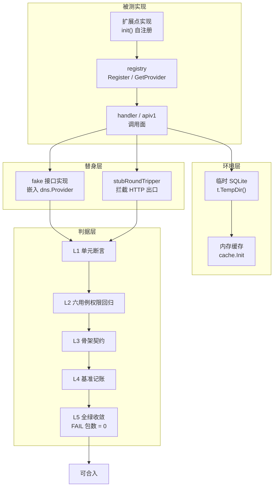
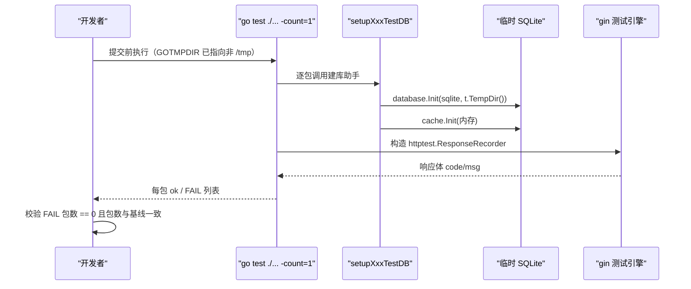
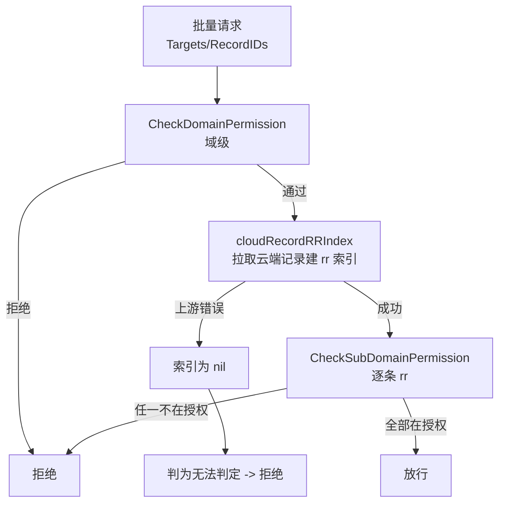
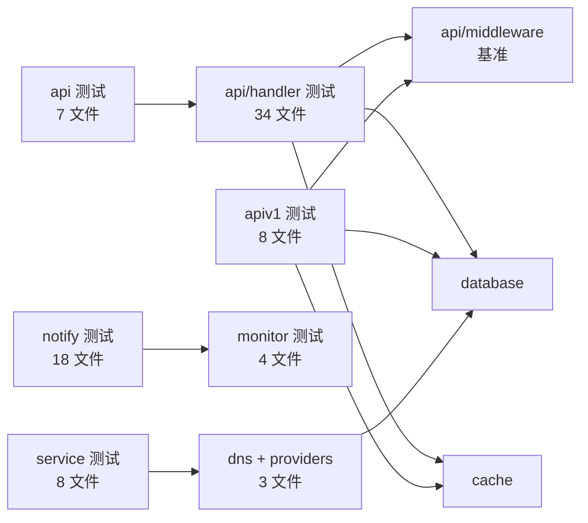

# 扩展测试与验证

<cite>
**本文档引用的文件**
- [batch_authz_test.go](file://main/internal/api/handler/batch_authz_test.go)
- [param_guard_test.go](file://main/internal/api/handler/param_guard_test.go)
- [testhelpers_test.go](file://main/internal/api/handler/testhelpers_test.go)
- [cert_deploy_authz_test.go](file://main/internal/api/handler/cert_deploy_authz_test.go)
- [skeleton_test.go](file://main/internal/apiv1/skeleton_test.go)
- [sanitize_bench_test.go](file://main/internal/api/middleware/sanitize_bench_test.go)
- [optimize_test.go](file://main/internal/service/optimize_test.go)
- [record_sync_test.go](file://main/internal/service/record_sync_test.go)
- [provider_form_test.go](file://main/internal/dns/provider_form_test.go)
- [timeout_test.go](file://main/internal/dns/providers/timeout_test.go)
- [lines_test.go](file://main/internal/dns/providers/cloudflare/lines_test.go)
- [channel_registry_test.go](file://main/internal/notify/channel_registry_test.go)
- [mail_content_test.go](file://main/internal/notify/mail_content_test.go)
- [channel_switch_test.go](file://main/internal/monitor/channel_switch_test.go)
- [registry.go](file://main/internal/dns/registry.go)
- [channel_registry.go](file://main/internal/notify/channel_registry.go)
- [main.go](file://main/main.go)
- [go.mod](file://main/go.mod)
- [devlog.md](file://devlog.md)
- [analysis-ext.md](file://../.wiki-context/analysis-ext.md)
</cite>

## 目录

1. [简介](#简介)
2. [项目结构](#项目结构)
3. [核心组件](#核心组件)
4. [架构总览](#架构总览)
5. [详细组件分析](#详细组件分析)
6. [依赖关系分析](#依赖关系分析)
7. [性能考虑](#性能考虑)
8. [故障排查指南](#故障排查指南)
9. [结论](#结论)
10. [附录](#附录)

## 简介

新增一个扩展点实现（DNS Provider、Cert Provider、Deploy Provider、Notify Channel 四者之一）之后，
怎么证明它「没把别的弄坏」，是本篇要回答的唯一问题。DNSPlane 不做端到端真云联调，
验证体系完全建立在**进程内替身 + 临时 SQLite + 表驱动契约断言**三件东西上，
因此可以离线、无凭据、无网络地跑完全部回归。

本篇按「层次」而非「模块」组织，给出五层验证体系：

- **L1 单元测试**：接口嵌入 + 方法覆写的 provider mock 模式，从现有 `*_test.go` 归纳
- **L2 权限回归范式**：`batch_authz_test.go` 的六用例结构，逐案拆解其立论与判据
- **L3 集成层**：临时 SQLite（`t.TempDir()` + `database.Init`）与完整中间件链装配
- **L4 离线基准**：`sanitize_bench_test.go` 与 `-cpuprofile` 的取材方式
- **L5 全绿验收口径**：以「测试包数 / FAIL 包数 = 0」为唯一收敛判据

以及常见失败的处置（`GOTMPDIR` 磁盘配额、`-gcflags="-lang=go1.26"` 口径）。

行号、包数、文件数均为当前工作区实测；devlog 中的命令与结论按「devlog 取证口径」标注。
四篇扩展点子文档尚未生成，链接先行：
[DNS服务商扩展.md](./DNS服务商扩展.md)、[证书提供商扩展.md](./证书提供商扩展.md)、
[部署器扩展.md](./部署器扩展.md)、[面板集成扩展.md](./面板集成扩展.md)。

**章节来源**
- [batch_authz_test.go](file://main/internal/api/handler/batch_authz_test.go)
- [analysis-ext.md](file://../.wiki-context/analysis-ext.md)
- [devlog.md](file://devlog.md)

## 项目结构

### 测试文件分布（实测）

统计命令（本机 `find` 别名到 `fd`，必须用 `/usr/bin/find`）：

```bash
cd main
# 按包统计测试文件数
/usr/bin/find . -name '*_test.go' | sed 's|/[^/]*$||' | sort | uniq -c | sort -rn
# 总数
/usr/bin/find . -name '*_test.go' | wc -l
# 参与测试的包数（分母口径）
/usr/bin/find . -name '*_test.go' | sed 's|/[^/]*$||' | sort -u | wc -l
```

实测结果：**88 个 `*_test.go`，分布在 15 个包**。

| 包 | 测试文件数 | 承载的验证职责 | 关键助手 |
|---|---|---|---|
| `main/internal/api/handler` | 34 | 控制台 handler 的权限、参数守卫、配额 | `setupHandlerTestDB`、`setupCertTestDB` |
| `main/internal/notify` | 18 | 通知渠道注册与渲染（扩展点之一） | `test_helper_test.go` |
| `main/internal/api` | 7 | 路由表、中间件链、恢复与限流 | `newRecorder` 系列 |
| `main/internal/apiv1` | 8 | 对外 API v1 的骨架与契约 | `setupV1TestDB`、`v1TestEngine` |
| `main/internal/service` | 8 | 任务编排、记录同步、智能解析 | `fakeProvider` |
| `main/internal/monitor` | 4 | 巡检与渠道切换 | — |
| `main/internal/dns` | 1 | Provider 表单契约 | — |
| `main/internal/dns/providers` | 1 | 构造超时与 `SafeBuild` 回归 | `timeout_test.go` |
| `main/internal/dns/providers/cloudflare` | 1 | 线路表 | — |
| `main/internal/cert/aliyun` | 1 | 证书提供商实现 | — |
| `main/internal/cert/tencent` | 1 | 证书提供商实现 | — |
| `main/internal/api/middleware` | 1 | 脱敏热路径基准 | `BenchmarkIsSensitiveKey` |
| `main/internal/cache` | 1 | 内存/Redis 缓存 | — |
| `main/internal/logstore` | 1 | 日志库 | — |
| `main/internal/httpx` | 1 | 代理与传输层 | — |

四个注册表扩展点里，DNS/Cert/Notify 三个都已有专属测试包；
Deploy Provider 的验证目前挂在 `handler` 包（`cert_deploy_authz_test.go`），
没有独立测试目录——新增部署器时，测试落点应当跟随被改动的调用面。

**章节来源**
- [batch_authz_test.go](file://main/internal/api/handler/batch_authz_test.go)
- [cert_deploy_authz_test.go](file://main/internal/api/handler/cert_deploy_authz_test.go)
- [sanitize_bench_test.go](file://main/internal/api/middleware/sanitize_bench_test.go)

### 放置与命名约定

- 测试与被测代码**同包**（`package handler` 而非 `handler_test`），以便直接调用未导出的
  判定函数——`checkBatchRecordSubDomain`、`cloudRecordRRIndex`、`httpStatusFor` 都没有导出，
  跨包测试写不出来
- 同包共享一个命名空间，**助手重名是编译期错误**。历史上本包发生过
  `setupHandlerTestDB` 重复定义，因此通用助手已集中到 `testhelpers_test.go` 并在文件头
  列出「有意未搬入的领域专用助手」查重表
- 领域专用助手随用例留在原文件（`callQQBotWebhook`、`stubCaptchaUpstream`、
  `notifierConfigField` 等），新增前必须连带那张表一起查重

**章节来源**
- [testhelpers_test.go](file://main/internal/api/handler/testhelpers_test.go)

## 核心组件

### 五层验证体系

| 层 | 验证对象 | 最小命令 | 失败意味着 |
|---|---|---|---|
| L1 单元 | 单个函数/方法的判定语义 | `go test -run TestXxx ./internal/dns/...` | 实现本身错了，先于一切 |
| L2 权限回归 | 授权判定链的可观测结果 | `go test ./internal/api/handler/ -count=1` | 越权或误拒，属安全缺陷 |
| L3 集成 | 中间件链 + DB + 缓存装配 | `go test ./internal/apiv1/ -count=1` | 骨架被破坏，所有模块接口整体失效 |
| L4 基准 | 热路径开销与分配 | `go test -run '^$' -bench . -benchmem ./internal/api/middleware/` | 性能回归，不阻塞功能但需记账 |
| L5 验收 | 全仓收敛 | `go test ./... -count=1` | 任一包 FAIL 即不得合入 |

这五层不是「逐步加强」的关系，而是**责任不同**：L1 的绿不能推出 L2 的绿
（批量接口越权 bug 的每一条单测都是绿的，问题出在调用面选错了校验函数），
L2 的绿也不能推出 L3 的绿（认证中间件顺序错误时，单条权限判定依然全对）。

**章节来源**
- [batch_authz_test.go](file://main/internal/api/handler/batch_authz_test.go)
- [skeleton_test.go](file://main/internal/apiv1/skeleton_test.go)
- [sanitize_bench_test.go](file://main/internal/api/middleware/sanitize_bench_test.go)

### 新增扩展点的最小验证矩阵

| 扩展点 | L1 必测 | L2 必测 | L3 必测 |
|---|---|---|---|
| DNS Provider | 表单字段解析、记录结构映射 | 该 provider 下的子域写权限判定 | `GetEnabledProviders` 出现在列表中 |
| Cert Provider | 账户/订单构造、错误分支 | 部署与签发接口的管理员门控 | 注册表 `Register` 后能被工厂取到 |
| Deploy Provider | 目标参数校验 | `cert_deploy_authz_test.go` 同族越权用例 | 触发队列实际下发 |
| Notify Channel | 渲染与转义（`strip_tags` 同族） | — | 渠道注册与开关切换（`channel_switch_test.go` 同族） |

**章节来源**
- [channel_registry.go](file://main/internal/notify/channel_registry.go)
- [registry.go](file://main/internal/dns/registry.go)

## 架构总览

### 验证链路



**图表来源**
- [batch_authz_test.go](file://main/internal/api/handler/batch_authz_test.go)
- [testhelpers_test.go](file://main/internal/api/handler/testhelpers_test.go)
- [skeleton_test.go](file://main/internal/apiv1/skeleton_test.go)
- [main.go](file://main/main.go)

### 一次验收的时序



**图表来源**
- [testhelpers_test.go](file://main/internal/api/handler/testhelpers_test.go)
- [skeleton_test.go](file://main/internal/apiv1/skeleton_test.go)
- [devlog.md](file://devlog.md)

## 详细组件分析

### L1：provider mock 模式

现有测试里的替身只有四种写法，新增扩展点时照抄对应那一种即可，不要发明第五种。

| 替身类型 | 定义位置 | 覆写方式 | 适用场景 |
|---|---|---|---|
| `fakeRecordProvider` | `handler/batch_authz_test.go` | 嵌入 `dns.Provider`，只实现 `GetDomainRecords`/`GetError` | 只需记录列表的权限判定 |
| `fakeProvider` | `service/optimize_test.go` | 同族，`record_sync_test.go` 复用四次 | 服务层编排与同步 |
| `recordingNotifier` | `notify/mail_content_test.go` | 记录调用入参供事后断言 | 渲染/发送类，断言「发了什么」 |
| `stubRoundTripper` | `handler/captcha_test.go` | 实现 `http.RoundTripper` | 任何出网调用，替代真实上游 |

关键技巧是**嵌入接口而不是实现接口**：

```go
/* fakeRecordProvider 只实现批量校验所需方法的 Provider 桩 */
type fakeRecordProvider struct {
	dns.Provider
	records []dns.Record
	err     error
}

func (f *fakeRecordProvider) GetDomainRecords(ctx context.Context, page, pageSize int,
	keyword, subDomain, value, recordType, line, status string) (*dns.PageResult, error) {
	if f.err != nil {
		return nil, f.err
	}
	// 只有第一页有数据，让分页聚合能在第二页正确收尾
	if page > 1 {
		return &dns.PageResult{Records: []dns.Record{}}, nil
	}
	return &dns.PageResult{Records: f.records}, nil
}
```

三个细节都带信息量：

1. 嵌入 `dns.Provider`（nil 接口）使未实现的方法在被调用时才 panic，
   从而把「这条路径不该碰其他方法」也变成了隐式断言
2. `page > 1` 返回空页而不是错误，是为了让被测代码的分页聚合循环**正常收尾**；
   如果返回错误，测的就是错误分支而不是索引构建
3. `err` 字段让同一替身能同时覆盖「成功」和「上游不可达」两条路径

新增 DNS Provider 时，若实现的是可选接口（表单、线路等），
`provider_form_test.go` 与 `lines_test.go` 是同族参考；
构造阶段的超时与 SDK panic 回归看 `timeout_test.go`——
该文件的反向验证方式是「把 `SafeBuild()` 换回 `Build()` 后用例 panic」，
即先用例复现、再确认修复，这是本仓的标准动作。

**章节来源**
- [batch_authz_test.go](file://main/internal/api/handler/batch_authz_test.go)
- [optimize_test.go](file://main/internal/service/optimize_test.go)
- [mail_content_test.go](file://main/internal/notify/mail_content_test.go)
- [timeout_test.go](file://main/internal/dns/providers/timeout_test.go)
- [provider_form_test.go](file://main/internal/dns/provider_form_test.go)

### L2：六用例权限回归范式

`batch_authz_test.go` 是这套范式的样板。它锁住的缺陷背景（devlog 取证口径）是：
单条接口 `CreateRecord`/`UpdateRecord` 走 `CheckSubDomainPermission`，
而批量族只走 `CheckDomainPermission`——域级校验回答得了「这个域名归不归你管」，
回答不了「这条记录归不归你管」，于是持有 rr 级委派的用户可以往该域名下任意子域写入。

六用例的完整结构：

| # | 用例 | 断言的可观测结果 | 守住的不变式 |
|---|---|---|---|
| 1 | `TestBatchSubDomainScopeRejectsWriteOutsideGrant` | 仅授权 `www` 时写 `www,blog` 返回 false | 域级授权不足以写未授权子域 |
| 2 | `TestBatchSubDomainScopeAllowsWriteInsideGrant` | 仅授权 `www` 时写 `www` 返回 true | 授权范围内不得误拒 |
| 3 | `TestBatchSubDomainScopeRejectsStranger` | 无授权用户写 `www` 返回 false | 别人的授权不构成我的通行证 |
| 4 | `TestBatchSubDomainScopeRejectsForeignRecordID` | 混入他域 `record_id` 判定链拒绝 | 判据来自云端真实 rr，不信请求字段 |
| 5 | `TestCloudRecordRRIndexReturnsNilOnError` | 上游失败时索引为 `nil` | 无法判定必须拒绝，不能放行 |
| 6 | `TestCloudRecordRRIndexIndexesByRecordID` | 键是 record_id、值是真实 rr | 索引语义正确 |

这套范式的可复制性在于四条硬规则：

- **正反成对**：1/3/5 拒，2/6 放。只写拒绝用例会「把越权修成不可用」而无人察觉
- **判据来源不可控即视为攻击面**：用例 4 的注释直接写明
  「请求里的 record_id 是攻击者可控的，按请求字段反查 rr 等于让攻击者自证清白」
- **失败态显式建模**：用例 5 用 `errFakeUpstream` 强制「无法判定」，断言 `nil`
  而非断言 panic 或空 map
- **种子数据最小化**：`seedSubDelegatedUser` 只造两个用户 + 一个账户 + 一个域名 + 一条委派

判定链本身可以画成一张图，新增扩展点时逐条对齐：



**图表来源**
- [batch_authz_test.go](file://main/internal/api/handler/batch_authz_test.go)
- [registry.go](file://main/internal/dns/registry.go)

**章节来源**
- [batch_authz_test.go](file://main/internal/api/handler/batch_authz_test.go)
- [devlog.md](file://devlog.md)

### L2b：参数守卫范式（param_guard_test.go）

与权限范式同族的第二个样板，专治「空路径参数落到 GORM 主键条件」。
它的立论不是推测，而是文件第一个用例亲自测出来的：

```go
// 修复前：First(&got, "") 退化为不带主键条件的查询，静默命中全表第一条
var got models.DomainCategory
if err := database.DB.First(&got, "").Error; err != nil {
	t.Fatalf("空主键查询意外报错: %v", err)
}
if got.Name != "first-cat" {
	t.Errorf("空主键查询命中 %q，预期退化为全表第一条", got.Name)
}
// 数值零值走正常主键条件，不会退化——两类写法必须区分开
var zero models.DomainCategory
if err := database.DB.First(&zero, uint(0)).Error; err == nil {
	t.Error("uint(0) 主键查询应报 record not found，实际命中了记录")
}
```

触发条件是对外 API 的路由表全部为无路径参数的 POST（`g.POST("/categories/update", ...)`），
`c.Param("id")` 恒为空串。该文件对六个位置逐一覆盖
（`UpdateDomainCategory`、`DeleteDomainCategory`、`UpdateScheduleTask`、
`DeleteScheduleTask`、`ToggleScheduleTask`、`UpdateRecordWeight`），
断言的是**可观测结果**——第一条记录的名称、行数、`active` 布尔位是否被改动，
而不是「是否返回了错误码」这类实现细节。

**新增扩展点时若引入任何以 ID 定位的写接口，必须复制这个范式的三件套**：
① 显式早退；② 用例断言「第一条数据未被改动」；③ 空串与数值零值分别建模。

**章节来源**
- [param_guard_test.go](file://main/internal/api/handler/param_guard_test.go)

### L3：骨架契约与集成装配

集成层的入口不是「起一个服务」，而是**装配一个与生产同构的最小引擎**。
`apiv1/skeleton_test.go` 的做法：

```go
/* v1TestEngine 构造与生产同构的 v1 路由，但不挂载具体业务模块 */
func v1TestEngine(register func(*gin.RouterGroup)) *gin.Engine {
	gin.SetMode(gin.TestMode)
	r := gin.New()
	v1 := r.Group("/api/v1")
	v1.Use(middleware.RequestTrace())
	v1.Use(APIKeyAuth())
	v1.Use(JSONBodyToDecryptedData())
	v1.Use(AdaptResponse())
	if register != nil {
		register(v1)
	}
	return r
}
```

它覆盖三件正确性前提：认证拦截、响应格式转换、异步接口确已同步化。
文件注释写明了为什么放在骨架层——「这些一旦破坏，任何模块的接口都会整体失效」。

建库助手有三个同构变体，选哪个取决于测试落在哪个包：

| 助手 | 所在文件 | 数据库文件名 | 额外初始化 |
|---|---|---|---|
| `setupHandlerTestDB` | `handler/testhelpers_test.go` | `handler.db` | `cache.Init` |
| `seedOAuthTestDB` | `handler/testhelpers_test.go` | `oauth.db` | 同上，但不建用户 |
| `setupCertTestDB` | `handler/cert_deploy_authz_test.go` | — | 证书/部署族共用 |
| `setupV1TestDB` | `apiv1/skeleton_test.go` | `apiv1.db` | `cache.Init` |

三者都是同一模板：

```go
if err := database.Init(&config.DatabaseConfig{
	Driver:   "sqlite",
	FilePath: filepath.Join(t.TempDir(), "handler.db"),
}); err != nil {
	t.Fatalf("初始化测试数据库失败: %v", err)
}
cache.Init(&cache.Config{})
t.Cleanup(func() {
	_ = cache.Close()
	_ = database.Close()
})
```

注意 `t.Cleanup` 的**关闭顺序是先 cache 再 database**，与初始化顺序相反；
`RequestTrace()` 中间件在请求结束时落库到 RequestDB，
未建库就跑完整中间件链会触发 nil 解引用 panic——这就是 `setupV1TestDB` 存在的全部理由。

契约类用例（`TestErrorCodeHTTPStatusMapping`、`TestEveryCodeHasMessage`、
`TestMapConsoleError`）都是**表驱动**，不构造 HTTP 请求。
以错误码到 HTTP 状态映射为例，其立论是：

| 错误码族 | 映射 | 误映射的后果（文件注释原意） |
|---|---|---|
| `CodeUnauthorized` / `CodeSignMismatch` | 401 | 降级为 4xx 泛化码，调用方无法区分时钟漂移与密钥错误 |
| `CodeModuleDenied` / `CodeReadOnly` 等 | 400 | 权限不足映射成 5xx 会让调用方误判服务端故障而反复重试 |
| `CodeDomainNotFound` / `CodeRecordNotFound` | 404 | — |
| `CodeResourceConflict` | 409 | — |
| `CodeProviderError` | 502 | 上游错误映射成 4xx 会掩盖真实故障 |
| `CodeUpstreamTimeout` | 504 | — |
| `CodeInternalError` | 500 | — |

`TestEveryCodeHasMessage` 还额外断言文案不等于兜底值「请求处理失败」，
否则「调用方仍能拿到码，但排查时看不到任何线索」。

**章节来源**
- [skeleton_test.go](file://main/internal/apiv1/skeleton_test.go)
- [testhelpers_test.go](file://main/internal/api/handler/testhelpers_test.go)
- [cert_deploy_authz_test.go](file://main/internal/api/handler/cert_deploy_authz_test.go)

### L4：离线基准与 CPU profile

`sanitize_bench_test.go` 只有两个基准，但覆盖了脱敏的两个尺度——
单 key 判定与完整 body 处理：

| 基准 | 样本 | 度量 | 关注点 |
|---|---|---|---|
| `BenchmarkIsSensitiveKey` | 10 个 key 轮询 | `b.ReportAllocs()` | 每 key 一次调用，O(表大小) 线性扫描会随字段数放大 |
| `BenchmarkSanitizeBodyForLog` | 50 条记录的标准列表响应 | `ReportAllocs` + `SetBytes` | 接近真实请求日志落库内容 |

跑基准并把 CPU 火焰图数据落盘：

```bash
cd main
# 只跑基准，不跑用例（-run '^$' 是关键，否则会顺带跑全部单测）
go test -run '^$' -bench . -benchmem -benchtime=2s \
  ./internal/api/middleware/ | tee /dev/stderr > bench.txt

# 单基准 + CPU profile
go test -run '^$' -bench BenchmarkSanitizeBodyForLog \
  -cpuprofile cpu.out -o middleware.test ./internal/api/middleware/

go tool pprof -top -nodecount=25 cpu.out
# 需要交互式/图形界面时
go tool pprof -http=:0 cpu.out
```

基准的验收方式不是「必须小于某个绝对值」——本机负载会改变绝对值。
仓库的做法是把基准当**回归探测器**：同一改动前后各跑一次，
`ns/op` 与 `B/op` 的数量级变化才是要记账的东西。
`SetBytes` 提供 `MB/s` 口径，用于跨形状比较。

新增扩展点若涉及任何在请求路径上的循环（例如逐记录脱敏、逐域名映射），
应当补一个同族基准，样本量取「真实响应的常见规模」而不是 1。

**章节来源**
- [sanitize_bench_test.go](file://main/internal/api/middleware/sanitize_bench_test.go)

### L5：全绿验收口径

验收只看两个数：**测试包数**与 **FAIL 包数**。

```bash
cd main
export GOTMPDIR="$HOME/.cache/go-work"   # 见故障排查指南
mkdir -p "$GOTMPDIR"

go build ./...            ; echo "BUILD=$?"
go vet ./...              ; echo "VET=$?"
gofmt -l internal/        # 只允许出现既有未触碰项
go test ./... -count=1 | tee test.log

# 收敛判据：FAIL 包数必须为 0
grep -c '^FAIL' test.log
# 分母口径：参与测试的包数
grep -c '^ok' test.log
```

devlog 的取证口径（实际出现过的验收行）：

| devlog 行 | 命令 | 记录结果 |
|---|---|---|
| L533 | `go test ./...` | `TEST=0` |
| L760 / L1159 / L1351 | `go test -count=1 ./...` | `TEST=0`（L1351 注：8 个包全绿） |
| L1547 | `go test -count=1 ./...` | `TEST=0`（9 个包全绿） |
| L1890 | `go test ./... -count=1` | 13 包全 `ok`，FAIL 包数 = 0 |
| L2101 / L2181 | `go test ./... -count=1` | 14/14 包全绿 |
| L2271 / L2368 | `GOTMPDIR=... go test ./... -count=1` | 14/14 包全绿 |
| L2494 / L2597 | `GOTMPDIR=... go test ./... -count=1` | 15/15 包全绿 |
| L2668 | `go test ./... -count=1` | 15/15 包全绿 |
| L3210 | `go test ./... -count=1` | 15/15 包全绿 |

包数从 8 → 9 → 13 → 14 → 15 是随功能推进的**基线漂移**，
因此验收表述必须是「与当前基线一致且 FAIL 包数 = 0」，
不能写成「必须 15/15」。当前工作区实测的 `*_test.go` 分母仍是 **15 个包 / 88 个文件**。

**章节来源**
- [devlog.md](file://devlog.md)

## 依赖关系分析

### 测试包的依赖方向



**图表来源**
- [testhelpers_test.go](file://main/internal/api/handler/testhelpers_test.go)
- [skeleton_test.go](file://main/internal/apiv1/skeleton_test.go)
- [optimize_test.go](file://main/internal/service/optimize_test.go)

依赖关系上有三条约束需要显式记住：

- `handler` 测试依赖 `api/middleware` 的判定函数（`CheckSubDomainPermission`），
  改中间件签名会同时冲击 34 个文件，属于最大爆炸半径
- `apiv1` 测试依赖 `middleware.RequestTrace()` 已建库，
  这是顺序依赖而非可选优化
- `dns/providers/*` 测试不依赖 `database`，可单独快速运行——
  新增 provider 的 L1 迭代应把这一层跑通再向上

包内共享助手（`testhelpers_test.go`）承担的是**消除重复**职责：
建库、写种子、拼请求上下文此前散落在六个 `_test.go` 里。
代价是它把「命名冲突」变成了唯一需要人工守护的约束，
文件头的查重表就是这一代价的缓解措施。

**章节来源**
- [testhelpers_test.go](file://main/internal/api/handler/testhelpers_test.go)
- [skeleton_test.go](file://main/internal/apiv1/skeleton_test.go)

## 性能考虑

脱敏是唯一的「每请求每字段」热路径，因此也是唯一的基准落点。
`BenchmarkIsSensitiveKey` 的文件注释写明了它的放大逻辑：
该函数对请求/响应 JSON 的每一个 key 调用一次，
因此 O(表大小) 的线性扫描会随字段数放大。

三条与扩展点直接相关的性能纪律：

1. **不要在 provider 的记录转换循环里做正则**。
   `isSensitiveKey` 的基准样本刻意取 10 个 key，
   就是在给「字段数 × 表大小」这个乘积留一个可观测锚点
2. **分页聚合要有收尾条件**。
   `fakeRecordProvider.GetDomainRecords` 用 `page > 1` 返回空页来模拟真实分页，
   新增 provider 若返回恒定非空页，测试里会表现为用例超时或死循环
3. **基准不进 L5 门禁**。`-benchtime` 拉长后基准耗时以十秒计，
   把它挂到每次提交的全绿验收上会让反馈变慢；
   基准只在改动命中热路径时跑，并把前后对比写进 devlog

`timeout_test.go` 记录了一个非测试自身造成的代价：
改用 `SafeBuild()` 后构造时会多一次 IAM 请求（约 0.4s），
这是 SDK 的行为。测试断言的是「能构造成功」，所以这个开销只影响测试时长，不影响判据。

**章节来源**
- [sanitize_bench_test.go](file://main/internal/api/middleware/sanitize_bench_test.go)
- [timeout_test.go](file://main/internal/dns/providers/timeout_test.go)
- [batch_authz_test.go](file://main/internal/api/handler/batch_authz_test.go)

## 故障排查指南

### 环境类：`/tmp` 用户配额被打满

这是本仓**实际发生过并留下绕行方案**的事故（devlog L2273-2292 取证口径）：

- 症状：`go build` 报 `write $WORK/_pkg_.a: disk quota exceeded`
- 根因：`/tmp` 是 `usrquota` 的 tmpfs，**用户配额**已满，而 tmpfs 整体仍有 6.3G 可用；
  `df` 看不出问题（`Used 73%`），只有实际写入会失败
- 处置：`GOTMPDIR` 指向非 `/tmp` 路径（devlog 用的是 `$HOME/.cache/go-work`），
  全程构建与测试都在该路径下完成
- **不要**批量清理 `/tmp` 下的大目录：devlog 明确记录占用方
  （`/tmp/engperf` 5.9G、`/tmp/perf-wafdata` 4.0G 等）**归属未经逐个确认**，
  删错就是「杀错进程」的重演
- `$HOME/.cache/go-build` 可增至数十 GB，`go clean -cache` 能回收，
  但那是全局缓存、会拖慢后续所有构建，同样需先确认

```bash
mkdir -p "$HOME/.cache/go-work"
export GOTMPDIR="$HOME/.cache/go-work"
go build ./... && go vet ./... && go test ./... -count=1
```

**章节来源**
- [devlog.md](file://devlog.md)

### 版本口径类：`-gcflags="-lang=go1.26"`

devlog 中几乎每轮验证都带这一 flag（L532、L759、L1350、L2269…L3210）。
但 L510-519 的结论把它的定位说清楚了：

- 本机工具链是 `go1.27.x`，`main/go.mod` 声明 `go 1.26.2`
- `-lang` 默认取 **`go.mod` 声明值**，不是工具链版本
- 因此「本机更宽松、CI 更严格」这条通道**不存在**，加 `-lang` 是**显式钉住**而非必需

正确理解是：这是把语言版本从「隐式跟随 go.mod」变成「命令行可见」的审计动作。
新环境照抄无害；但如果发现「不加就挂」，说明 go.mod 声明与实际依赖的语法版本
存在真实冲突，那是需要修的问题，不是加 flag 掩盖的问题。

**章节来源**
- [devlog.md](file://devlog.md)
- [go.mod](file://main/go.mod)

### 判据类：常见误测

| 症状 | 根因 | 正确处置 |
|---|---|---|
| 跑完整中间件链时 nil 解引用 panic | 未初始化 DB，`RequestTrace` 结束时落库失败 | 先 `setupV1TestDB` / `setupHandlerTestDB` |
| 助手函数重名编译失败 | 同包共享命名空间 | 到 `testhelpers_test.go` 查重，或改为领域专用名 |
| 用例显示 `SKIP` 但以为通过了 | `GetEnabledProviders` 需要凭据才返回列表项 | 用 `seedProvider` 写 `oauth_*_client_id/secret`，否则应 `t.Fatalf` |
| 更新类用例测不到退化路径 | body 缺字段，在必填校验处提前返回 | 把 body 填全（`param_guard_test.go` L147 注释原意） |
| 空主键用例「通过」但没意义 | 只断言了响应码 | 回查第一条记录字段是否被改动 |
| 判定链用例全绿但仍越权 | 断言了实现细节而非可观测结果 | 断言「拒绝来自子域而非一律拒绝」，成对写放行用例 |
| `go test -bench` 顺带跑了全部单测 | 未加 `-run '^$'` | 基准命令必须显式空跑用例 |
| 并行跑测试后 SQLite 报锁 | 误用 `t.Setenv`/共享临时文件 | 保持 `t.TempDir()` 每用例独立文件 |

**章节来源**
- [devlog.md](file://devlog.md)
- [skeleton_test.go](file://main/internal/apiv1/skeleton_test.go)
- [testhelpers_test.go](file://main/internal/api/handler/testhelpers_test.go)
- [param_guard_test.go](file://main/internal/api/handler/param_guard_test.go)

## 结论

新增扩展点后的验证不依赖真实云凭据，而依赖一套**可复制的结构**：
以接口嵌入的 provider mock 做 L1，以六用例正反成对做 L2，
以同构引擎 + 临时 SQLite 做 L3，以热路径基准做 L4，
最后以「包数与基线一致且 FAIL 包数 = 0」的 L5 收敛。

三件最值得内化的事：

- **拒绝必须成对配一条放行**，否则安全修复会静默变成可用性缺陷（范式内用例 1 与 2 的关系）
- **判据来源不可控即视为攻击面**，权限判定不信请求字段、取云端真实 rr
- **无法判定不是放行而是拒绝**，上游失败返回 `nil` 索引就是这条规则的实现

`-gcflags="-lang=go1.26"` 与 `GOTMPDIR` 都是**环境口径**而非质量口径，
把它们写进命令模板是为了让验证可复现，不代表它们是判据的一部分。

**章节来源**
- [batch_authz_test.go](file://main/internal/api/handler/batch_authz_test.go)
- [devlog.md](file://devlog.md)

## 附录

### 命令速查

```bash
cd main
export GOTMPDIR="$HOME/.cache/go-work"; mkdir -p "$GOTMPDIR"

# L1：只跑某扩展点所在包
go test -count=1 -run 'TestBatchSubDomain' ./internal/api/handler/ -v

# L1 快速迭代：provider 包不依赖 database
go test -count=1 ./internal/dns/...

# L3：骨架契约
go test -count=1 ./internal/apiv1/ ./internal/api/

# L4：基准 + profile
go test -run '^$' -bench . -benchmem ./internal/api/middleware/
go test -run '^$' -bench BenchmarkSanitizeBodyForLog -cpuprofile cpu.out \
  -o middleware.test ./internal/api/middleware/
go tool pprof -top -nodecount=25 cpu.out

# L5：全绿收敛
go build ./... && go vet ./... && go test ./... -count=1 | tee test.log
grep -c '^FAIL' test.log      # 必须 0
grep -c '^ok' test.log        # 与当前基线一致
```

**章节来源**
- [devlog.md](file://devlog.md)

### 新增扩展点验收清单

| 阶段 | 检查项 | 通过判据 |
|---|---|---|
| 提交前 | `gofmt -l internal/` | 无新增项 |
| 提交前 | `go vet ./...` | 退出码 0 |
| L1 | 至少一个接口嵌入式 mock | 未实现方法不被调用 |
| L1 | 上游失败分支 | 断言 `nil`/错误，而非放行 |
| L2 | 越权用例 | 拒绝 + 成对放行 |
| L2 | ID 定位写接口 | 空串与数值零值分别建模 |
| L3 | 中间件链装配 | 已建库，无 panic |
| L3 | 契约表驱动 | 错误码均有文案与稳定 HTTP 映射 |
| L4 | 热路径改动 | 前后 `ns/op`、`B/op` 对比入档 |
| L5 | 全仓 | FAIL 包数 = 0，包数与基线一致 |

**章节来源**
- [batch_authz_test.go](file://main/internal/api/handler/batch_authz_test.go)
- [param_guard_test.go](file://main/internal/api/handler/param_guard_test.go)

### 交叉链接

- 四个扩展点的实现骨架：[扩展开发.md](./扩展开发.md)
- 逐扩展点教程（尚未生成，链接先行）：
  [DNS服务商扩展.md](./DNS服务商扩展.md)、[证书提供商扩展.md](./证书提供商扩展.md)、
  [部署器扩展.md](./部署器扩展.md)、[面板集成扩展.md](./面板集成扩展.md)
- 运行形态与部署验证：[部署运维.md](../部署运维/部署运维.md)
- 常见失败的环境侧处置：[故障排除.md](../故障排除/故障排除.md)

**章节来源**
- [devlog.md](file://devlog.md)
- [analysis-ext.md](file://../.wiki-context/analysis-ext.md)
