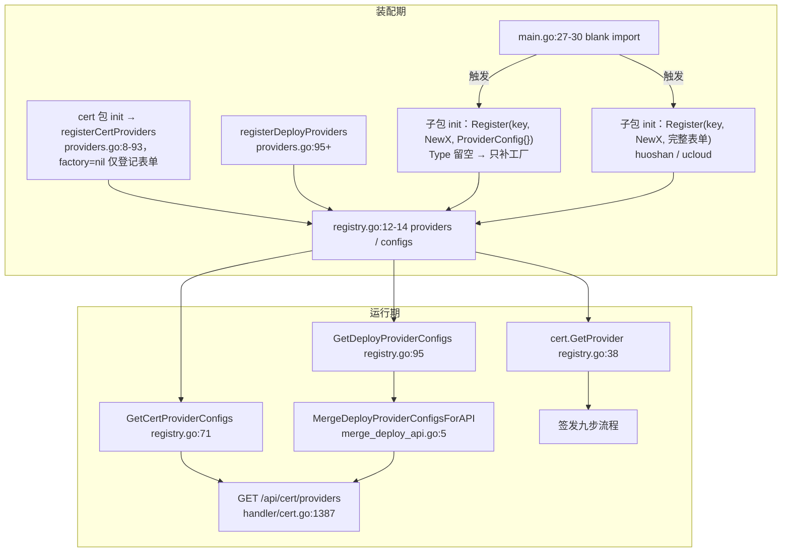
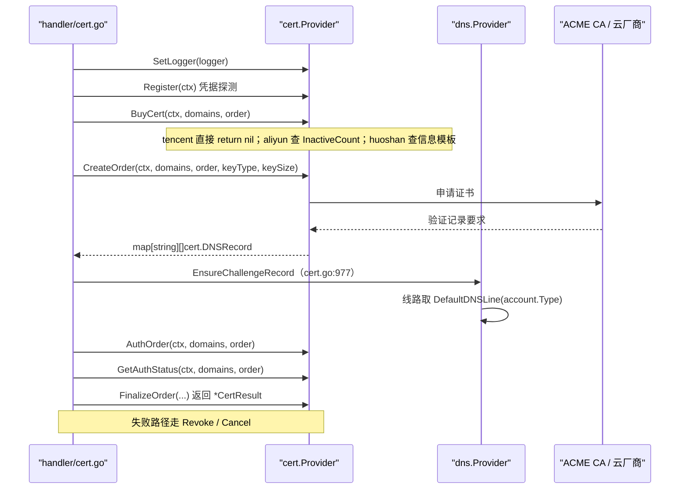

# 证书提供商扩展

<cite>
**本文档引用的文件**
- [interface.go](file://main/internal/cert/interface.go)
- [registry.go](file://main/internal/cert/registry.go)
- [providers.go](file://main/internal/cert/providers.go)
- [acme.go](file://main/internal/cert/acme/acme.go)
- [aliyun.go](file://main/internal/cert/aliyun/aliyun.go)
- [aliyun_test.go](file://main/internal/cert/aliyun/aliyun_test.go)
- [tencent.go](file://main/internal/cert/tencent/tencent.go)
- [tencent_test.go](file://main/internal/cert/tencent/tencent_test.go)
- [huoshan.go](file://main/internal/cert/huoshan/huoshan.go)
- [ucloud.go](file://main/internal/cert/ucloud/ucloud.go)
- [base.go](file://main/internal/cert/deploy/base/base.go)
- [merge_deploy_api.go](file://main/internal/cert/deploy/merge_deploy_api.go)
- [main.go](file://main/main.go)
- [cert.go](file://main/internal/api/handler/cert.go)
- [router.go](file://main/internal/api/router.go)
- [api.ts](file://web/lib/api.ts)
- [account-form.tsx](file://web/components/account-form.tsx)
- [cert-accounts/add/page.tsx](file://web/app/(dashboard)/dashboard/cert-accounts/add/page.tsx)
- [cert-accounts/page.tsx](file://web/app/(dashboard)/dashboard/cert-accounts/page.tsx)
- [cert/page.tsx](file://web/app/(dashboard)/dashboard/cert/page.tsx)
- [deploy-config-form.ts](file://web/lib/deploy-config-form.ts)
- [analysis-ext.md](file://../.wiki-context/analysis-ext.md)
</cite>

## 目录

1. [简介](#简介)
2. [项目结构](#项目结构)
3. [核心组件](#核心组件)
4. [架构总览](#架构总览)
5. [详细组件分析](#详细组件分析)
6. [依赖关系分析](#依赖关系分析)
7. [性能考虑](#性能考虑)
8. [故障排查指南](#故障排查指南)
9. [结论](#结论)
10. [附录](#附录)

## 简介

本文是「新增一个证书签发渠道」的端到端实现教程。与 DNS 扩展点最大的差别在于：
证书注册表同时容纳「签发」与「部署」两类视图，并存在**表单与工厂分离的双阶段注册**约定。
全部结论来自当前工作区实测。关键事实：

- `cert.Provider` 接口共 9 个方法，声明在 `main/internal/cert/interface.go:52-79`。
  注册入口 `cert.Register(name, factory, config)`（`cert/registry.go:23-35`）不是简单覆盖：
  `factory != nil` 才写工厂（`:27`）；`config.Type == "" && hadCfg` 时跳过配置写入（`:31-33`）。
  这两条构成「先登记表单、后补工厂」的语义基础。
- 装配靠 `main/main.go:27-30`，**只有 4 行**：`acme`、`aliyun`、`huoshan`、`tencent`。
  `ucloud` 不在其中，其 `init()`（`ucloud.go:24`）永不执行，注册表里的 `ucloud` 实际来自
  `providers.go:549`（`IsDeploy: true`、工厂 `nil`）。这是本仓库现存的活反例。
- **证书账户创建不校验渠道是否存在**：`handler/cert.go:152` 的 `CreateCertAccount`
  只做 JSON 绑定与入库，不像 DNS 侧 `handler/account.go:216` 那样查注册表白名单。
  未注册的渠道能建账户，直到真正签发时才在 `cert.GetProvider` 报错。
- 签发与部署的边界由 `ProviderConfig.IsDeploy`（`interface.go:91`）切分，
  两个视图分别由 `GetCertProviderConfigs()`（`registry.go:71-81`）与
  `GetDeployProviderConfigs()`（`registry.go:95-105`）导出。

**章节来源**
- [interface.go](file://main/internal/cert/interface.go#L52-L92)
- [registry.go](file://main/internal/cert/registry.go#L23-L105)
- [main.go](file://main/main.go#L26-L30)
- [cert.go](file://main/internal/api/handler/cert.go#L152-L176)

## 项目结构

证书扩展点分布在 `main/internal/cert/` 一棵树下：宿主包 + 签发实现包 + 部署实现包。

```text
main/internal/cert/
├── interface.go             # OrderInfo / DNSRecord / CertResult / Provider / 表单类型
├── registry.go              # ProviderFactory、Register、四个视图函数、sync.Once 快照
├── providers.go             # 623 行，表单登记（全部 factory=nil），init 在 :3
├── acme/acme.go             # 1052 行，ACME 协议，5 个渠道共用一个 ACMEClient
├── aliyun/aliyun.go         # 512 行 阿里云免费 SSL；_test.go 279 行
├── tencent/tencent.go       # 495 行 腾讯云免费 SSL；_test.go 315 行
├── huoshan/huoshan.go       # 488 行 火山引擎证书
├── ucloud/ucloud.go         # 445 行 UCloud 证书；当前未链接（死包）
└── deploy/                  # base/base.go(DeployProvider:45, Register:85)、registry.go、
                             # merge_deploy_api.go(:5)、config_cloud.go、providers|panels|servers|others

web/  ── lib/api.ts(getProviders:677)、lib/deploy-config-form.ts(show 求值:3-34)、
        components/account-form.tsx(CERT_CATEGORIES:29 + providerStyles:70)、
        app/(dashboard)/dashboard/{cert-accounts/add/page.tsx:71, cert-accounts/page.tsx:437, cert/page.tsx:1512}
```


与 DNS 侧不同，证书子包**不遵循**「目录名 = 注册键」（`cert/aliyun/` 注册 `aliyun_cert`）；
`cert/` 与 `dns/providers/` 是两棵独立子树，不冲突但易混淆。

**章节来源**
- [interface.go](file://main/internal/cert/interface.go)
- [providers.go](file://main/internal/cert/providers.go)
- [cert-accounts/add/page.tsx](file://web/app/(dashboard)/dashboard/cert-accounts/add/page.tsx)

## 核心组件

| 组件 | 位置 | 签名 / 取值 | 职责 |
| --- | --- | --- | --- |
| `Provider` | `interface.go:52-79` | 9 个方法 | 唯一必实现抽象 |
| `ProviderFactory` | `registry.go:9` | `func(config, ext map[string]interface{}) Provider` | 工厂，同步返回，无 error |
| `OrderInfo` | `interface.go:6-16` | `OrderURL/FinalizeURL/CertURL/Authorizations/Status/Identifiers/Challenges/PreferredChallenge` | 跨方法传递的订单载体 |
| `DNSRecord` / `CertResult` / `Logger` | `interface.go:33-49` | `Name/Type/Value`；`FullChain/PrivateKey/Issuer/ValidFrom/ValidTo`；`func(msg string)` | 分别是 `CreateOrder` 返回值元素、`FinalizeOrder` 返回、订单日志回调 |
| `ProviderConfig` | `interface.go:82-92` | `Type/Name/Icon/Note/Config/DeployConfig/DeployNote/CNAME/IsDeploy` | 表单与视图归属 |
| `ConfigField` | `interface.go:95-109` | 12 字段，前端只读 8 | 动态表单定义 |
| `Register` / `GetProvider` | `registry.go:23-49` | 三段条件写入；键不存在报 `unknown cert provider` | 双阶段注册执行者 / 实例化 |
| `GetCertProviderConfigs` | `registry.go:71-81` | 过滤 `!IsDeploy` | 签发视图 |
| `GetDeployProviderConfigs` | `registry.go:95-105` | 过滤 `IsDeploy` | 部署视图 |
| `APIProvidersSnapshot` | `registry.go:108-114` | `sync.Once` | 当前无调用方，属死代码 |

工厂入参与 DNS 侧有两点关键差异：参数是 `map[string]interface{}` 而非 `map[string]string`，
值可为数组或嵌套对象——`aliyun/aliyun.go:71` 的 `getSlice` 与 `:478` 的 `getNumber`
就是为承接非字符串值而存在；第二个参数 `ext` 是**账户持久化状态的回填通道**，与 `config`
（用户填的表单）分离，ACME 用它承载 `account_key` 与 `account_url`（`acme.go:104-112`），
云证书渠道目前普遍忽略它。

**章节来源**
- [interface.go](file://main/internal/cert/interface.go#L6-L109)
- [registry.go](file://main/internal/cert/registry.go#L9-L114)
- [acme.go](file://main/internal/cert/acme/acme.go#L100-L115)

## 架构总览

双阶段注册与视图切分：



**图表来源**
- [providers.go](file://main/internal/cert/providers.go#L3-L95)
- [registry.go](file://main/internal/cert/registry.go#L12-L105)
- [cert.go](file://main/internal/api/handler/cert.go#L1387)
- [merge_deploy_api.go](file://main/internal/cert/deploy/merge_deploy_api.go#L5)

签发主链路由 `processCertOrderAsync`（`handler/cert.go:646`）驱动：



**图表来源**
- [cert.go](file://main/internal/api/handler/cert.go#L646-L656)
- [interface.go](file://main/internal/cert/interface.go#L52-L79)
- [aliyun.go](file://main/internal/cert/aliyun/aliyun.go#L102-L121)
- [tencent.go](file://main/internal/cert/tencent/tencent.go#L111-L116)

**章节来源**
- [cert.go](file://main/internal/api/handler/cert.go#L646-L977)

## 详细组件分析

本节按「一个实现一节」推进，每节内部拆为接口约定、注册写法、调用与消费。

### 新增证书渠道文件模板

#### 接口约定

最小可编译骨架，采用「子包带完整表单」写法（`huoshan` 风格）：

```go
package myca

import (
	"context"
	"main/internal/cert"
)

/* Provider 示例证书渠道 */
type Provider struct {
	appKey string
	secret string
	logger cert.Logger
	// apiURL 独立成字段便于测试注入本地服务端，生产路径始终用默认端点
	apiURL string
}

func init() {
	cert.Register("myca", NewProvider, cert.ProviderConfig{
		Type: "myca",
		Name: "示例 CA",
		Note: "签发前需在控制台完成实名认证",
		Config: []cert.ConfigField{
			{Name: "AppKey", Key: "app_key", Type: "input", Required: true},
			{Name: "AppSecret", Key: "app_secret", Type: "input", Required: true},
		},
		CNAME:    false,
		IsDeploy: false,
	})
}

/* NewProvider 工厂签名必须与 registry.go:9 一致 */
func NewProvider(config, ext map[string]interface{}) cert.Provider {
	return &Provider{appKey: getString(config, "app_key"), secret: getString(config, "app_secret")}
}
```

`apiURL` 不是可选装饰。`aliyun/aliyun.go:46-47` 与 `tencent/tencent.go:52-53` 都用
「端点做成可注入字段」来支撑 `httptest` 假服务端，`aliyun_test.go:53-60` 的
`newTestProvider` 直接把它指到 `srv.URL + "/"`。不预留该字段，测试只能打真实 CA。

#### 注册写法

两种风格必须择一，不可混用同一条 `Register`：

| 风格 | 代表 | 写法 | 适用 |
| --- | --- | --- | --- |
| 子包带完整表单 | `huoshan.go:27`、`ucloud.go:24` | `cert.Register(key, NewProvider, cert.ProviderConfig{Type: key, ...})` | 新渠道首选，自包含 |
| 表单在宿主、工厂在子包 | `tencent.go:42`、`aliyun.go:37`、`acme.go:70/73/76` | 子包传 `cert.ProviderConfig{}`，`Type` 留空 | 表单已在 `providers.go` 登记时 |

选第二种的前提是 Go 的包初始化顺序：`cert` 包 `init()` 必定早于其依赖者
（`acme`/`tencent`/`aliyun`/`huoshan`）执行，所以「先有表单、后补工厂」成立。
`providers.go:45-50` 的注释显式锁定该约定并警告：若移除该处登记而子包不带完整表单，
`/api/cert/providers` 会丢字段。**该前提没有任何测试守护。**

#### 调用与消费

`CNAME` 与 `IsDeploy` 决定渠道出现在哪个视图：`IsDeploy` 由 `registry.go:76`/`:88`/`:100`
路由到签发视图或部署视图，`CNAME` 由 `handler/cert.go:673` 读取以决定是否允许 CNAME 凭证签发，
`DeployConfig` 经 `merge_deploy_api.go` 供 `deploy/page.tsx:125` 渲染部署任务字段。
`huoshan.go:36-38` 记录了一个易错点：同一名字可在签发视图与部署视图各有一份定义——
火山的部署用途由 `deploy/config_cloud.go` 提供并经 `MergeDeployProviderConfigsForAPI`
输出到 `deploy` 视图，与 `cert/huoshan/huoshan.go` 的签发注册互不覆盖。

**章节来源**
- [huoshan.go](file://main/internal/cert/huoshan/huoshan.go#L26-L52)
- [tencent.go](file://main/internal/cert/tencent/tencent.go#L40-L60)
- [aliyun.go](file://main/internal/cert/aliyun/aliyun.go#L35-L60)
- [providers.go](file://main/internal/cert/providers.go#L45-L93)
- [cert.go](file://main/internal/api/handler/cert.go#L673)

### CertProvider 九方法逐项实现

#### 接口清单与契约

按 `interface.go:52-79` 声明顺序：

| 方法 | 声明行 | 返回契约 | 实测要点 |
| --- | --- | --- | --- |
| `Register(ctx)` | 54 | `(map[string]interface{}, error)` | 返回值实测四处全为 `nil` map，仅作凭据探测 |
| `BuyCert(ctx, domains, order)` | 57 | `error` | 语义是「额度/前置资源检查」，不是真购买 |
| `CreateOrder(ctx, domains, order, keyType, keySize)` | 60 | `(map[string][]DNSRecord, error)` | 唯一返回验证记录的方法 |
| `AuthOrder(ctx, domains, order)` | 63 | `error` | 触发 CA 校验 |
| `GetAuthStatus(ctx, domains, order)` | 66 | `(bool, error)` | 返回「是否全部通过」，非终态返回 `false, nil` |
| `FinalizeOrder(...)` | 69 | `(*CertResult, error)` | 产出 PEM |
| `Revoke(ctx, order, pem)` | 72 | `error` | 吊销 |
| `Cancel(ctx, order)` | 75 | `error` | 取消订单 |
| `SetLogger(logger)` | 78 | 无 | 注入 `cert.Logger` |

四条跨方法硬约定：`OrderInfo` 是**跨请求可变载体**，`CreateOrder` 必须把上游订单标识写进
`order.OrderURL` 等字段供后续方法续接（`handler/cert.go:668-670` 在返回后立即
`json.Marshal(orderInfo)` 落库）；返回 map 的键是域名、值是该域名需要的记录列表，
`certCountChallengeRecords`（`cert.go:341`）据此统计 DNS 类与 http-01 类条数；
`getMainDomain` 在三个包内各自存在（`aliyun.go:505`、`tencent.go:488`、`acme.go:799`）
用于裁掉验证记录名的主域后缀，`aliyun_test.go:260` 专门锁定该裁剪；
`buildCertResult` 同样包内各自实现（`aliyun.go:486`、`tencent.go:469`），
负责解析 PEM 填 `ValidFrom`/`ValidTo`。

#### 分渠道实现差异

九个方法中真正分化的是 `Register`、`BuyCert`、`CreateOrder`、`FinalizeOrder`：

| 方法 | `acme` | `aliyun_cert` | `tencent` | `huoshan` |
| --- | --- | --- | --- | --- |
| `Register` | `acme.go:487` 真实注册账户，返回账户 URL 与私钥 | `aliyun.go:89` 校验必填后打 `ListInstances` | `tencent.go:100` 校验必填后打 `DescribeCertificates` | `huoshan.go:78` 直接打 `CertificateGetInstance`，**不校验必填** |
| `BuyCert` | `acme.go:573` 空实现 | `aliyun.go:102` 查 `InactiveCount`，为 0 报「请先购买测试证书」 | `tencent.go:111` 直接 `return nil` | `huoshan.go:87` 查组织模板，缺失报「请先添加信息模板」 |
| `CreateOrder` | `acme.go:577` 走 new-order，返回 DNS-01 TXT | `aliyun.go:122` 申请后轮询 `GetTaskAttribute` 再 `GetInstanceDetail` 组装 | `tencent.go:118` 申请后由 `buildDNSRecords`(`:158`) 组装 | `huoshan.go:114` 在 `:179` 组装 `dnsRecords` |
| `FinalizeOrder` | `acme.go:887` finalize + 轮询下载 | `aliyun.go:281` 取回证书内容 | `tencent.go:240` **下载 zip 再解包**：`download`(`:397`) → `extractCertificate`(`:421`) → `readZipEntry`(`:456`) | `huoshan.go:255` |

`Register` 的 map 返回值设计上是「预留位」：ACME 需要把 `account_key`/`account_url`
回填到 `ext` 供下次实例化使用，云证书渠道无账户概念故统一返回 `nil`。
新渠道若无状态可回填，返回 `nil, nil` 即可，但**必须做凭据探测**，
否则表单填错要到签发时才暴露。

#### 调用与消费

实例化的三个生产调用点都在 `handler/cert.go`：`:436`、`:506`、`:593`，
形态均为 `provider, err := cert.GetProvider(account.Type, config, ext)`。
`PreferredChallenge` 由 `order.ChallengeType` 小写后注入（`cert.go:649-652`），
`interface.go:14` 定义取值：空或 `dns-01` 为默认 DNS TXT，`http-01` 对非通配符域名走
HTTP 校验，IP 标识符始终 `http-01`。**该字段只有 `acme` 会读**，云证书渠道原样忽略。

**章节来源**
- [interface.go](file://main/internal/cert/interface.go#L14-L79)
- [acme.go](file://main/internal/cert/acme/acme.go#L487-L636)
- [aliyun.go](file://main/internal/cert/aliyun/aliyun.go#L89-L281)
- [tencent.go](file://main/internal/cert/tencent/tencent.go#L100-L240)
- [huoshan.go](file://main/internal/cert/huoshan/huoshan.go#L78-L179)
- [cert.go](file://main/internal/api/handler/cert.go#L436-L673)

### registry 双阶段注册机制

#### 接口约定

`cert.Register`（`registry.go:23-35`）是四个注册表中唯一带条件分支的：

```go
func Register(name string, factory ProviderFactory, config ProviderConfig) {
	providersMu.Lock()
	defer providersMu.Unlock()
	_, hadCfg := configs[name]
	if factory != nil {
		providers[name] = factory
	}
	// acme 包 init 会用空 ProviderConfig 仅补全工厂，避免覆盖 providers.go 中的名称/说明/表单字段
	if config.Type == "" && hadCfg {
		return
	}
	configs[name] = config
}
```

由此推出四种确定行为：

| 入参组合 | 工厂表 | 配置表 | 语义 |
| --- | --- | --- | --- |
| `factory != nil` + `Type` 非空 | 写入 | 整体覆盖 | 一步到位（`huoshan`、`ucloud`） |
| `factory != nil` + `Type` 为空 | 写入 | 保持不变 | 只补工厂（`tencent`、`aliyun_cert`、`google` 等） |
| `factory == nil` + `Type` 非空 | **不动** | 整体覆盖 | 只登记表单（`providers.go` 全部条目） |
| `factory == nil` + `Type` 为空 | 不动 | 覆盖为空配置 | 破坏性写法，禁止使用 |

与 DNS 侧的关键差异：`dns.Register`（`dns/registry.go:18-23`）无条件写两张 map，
允许把已有工厂覆盖成 `nil`；`cert` 侧的 `factory != nil` 判断使「表单后到」不会摧毁实现。

#### 注册写法

`providers.go` 的 5 条签发登记全部 `factory = nil`：`google`(:11)、`litessl`(:33)、
`tencent`(:51)、`aliyun_cert`(:65)、`customacme`(:81)；部署登记自 `:95` 起，
其中 `ucloud`(:549) 是 `IsDeploy: true` + `nil` 工厂。新渠道**不要**往 `providers.go`
加表单条目，除非同时确保某子包会补工厂；按 `huoshan` 风格在子包内一次写全是当前最安全的路径。

#### 调用与消费

视图切分完全靠 `IsDeploy`：`GetCertProviderConfigs`（`:71-81`）取 `!IsDeploy`、
`GetDeployProviderConfigs`（`:95-105`）取 `IsDeploy`、`GetAllProviderConfigs`
（`:60-68`）不过滤。部署视图还要经 `MergeDeployProviderConfigsForAPI`
（`merge_deploy_api.go:5`）合并，它在 `:40` 回查 `cert.GetProviderConfig(typ)`
把 cert 表同键配置并入。端点是 `handler/cert.go:1387` 的 `GetCertProviders`，
路由 `router.go:245`。`APIProvidersSnapshot`（`registry.go:108-114`）本意是把合并视图
固化一次，但实测全库仅在定义处与注释出现，无调用方，`/api/cert/providers` 每次重算拷贝；
这是已记录的性能问题，新渠道不必依赖该函数。

**章节来源**
- [registry.go](file://main/internal/cert/registry.go#L23-L114)
- [providers.go](file://main/internal/cert/providers.go#L8-L95)
- [dns registry.go](file://main/internal/dns/registry.go#L18-L23)
- [merge_deploy_api.go](file://main/internal/cert/deploy/merge_deploy_api.go#L5-L40)
- [router.go](file://main/internal/api/router.go#L245)

### 云证书渠道与部署器的边界

#### 接口约定

证书扩展点有三个互不相同的抽象：`cert.Provider`（`cert/interface.go:52`，9 方法，
**签发**证书产出 PEM）、`base.DeployProvider`（`deploy/base/base.go:45`，仅
`Check`、`Deploy(ctx, fullchain, privateKey, config)`、`SetLogger` 三方法，把 PEM
**推送**到 CDN/面板/服务器）、`base.DeployWithInfoProvider`（`:69`，多一个回传附加信息的方法）。
部署器注册表是独立的 `base.Register(name, factory)`（`base.go:85`），工厂签名只有
`config` 一个参数。

#### 上传与列表的落位

「云证书上传」在不同渠道落在不同抽象，这是新渠道最容易选错的位置：

| 需求 | 应实现 | 依据 |
| --- | --- | --- |
| 向上游 CA 申请一张新证书 | `cert.Provider.CreateOrder` + `FinalizeOrder` | `aliyun.go:122`/`:281` |
| 把已签发证书推到云厂商 CDN | `base.DeployProvider.Deploy` | `deploy/providers/*`，注册键如 `aliyun_cdn` |
| 把证书导入云厂商证书库（不部署到具体资源） | 仍属部署侧 | `providers.go` 的 `aws_acm`(:251) 等条目 |
| 列出云厂商已有证书 | **无公共接口位** | `cert.Provider` 无 List 方法 |

`cert.Provider` 接口**没有证书列表方法**：`tencent.go:103` 的 `DescribeCertificates`
只用作 `Register` 的凭据探测，不外露。若新渠道需要「拉取上游已有证书」，
当前抽象无处安放，只能作渠道内部辅助函数，或评估是否改走部署器抽象。

**章节来源**
- [interface.go](file://main/internal/cert/interface.go#L52-L79)
- [base.go](file://main/internal/cert/deploy/base/base.go#L45-L95)
- [providers.go](file://main/internal/cert/providers.go#L251)
- [tencent.go](file://main/internal/cert/tencent/tencent.go#L100-L103)

### 与 ACME 渠道的分界

#### 接口约定与判定标准

`cert/acme/acme.go` 用一个 `ACMEClient` 结构体承接 5 个渠道（`letsencrypt`:46、
`zerossl`:57、`google`:70、`litessl`:73、`customacme`:76），差异全落在构造函数的
`directoryURL`、`email`、`eabKID`、`eabHMACKey` 四个字段（`:100-216`）。「何时该走 `acme/`」
的实测判据：

| 条件 | 归属 | 理由 |
| --- | --- | --- |
| 上游实现 RFC 8555（newAccount/newOrder/authorization/finalize） | `acme/` | 九步流程完全复用，只需新增构造函数 |
| 需要 EAB 凭证 | `acme/` | `createEAB`（`acme.go:541`）已实现，`google`/`litessl`/`zerossl` 共用 |
| 需要自定义 directory URL，或要支持 `http-01` | `acme/` | `customacme`(`:76`) 即为此存在；只有 `acme` 读 `PreferredChallenge` |
| 上游返回「工单 + 轮询 + 证书包」，甚至返回 zip/tar 而非 PEM 链 | 独立子包 | `aliyun`/`tencent`/`huoshan`/`ucloud` 全属此类；`tencent.go:421` 的解包逻辑是渠道专有 |
| 需要联系人姓名/手机号等实名字段 | 独立子包 | `providers.go:70-73` 的 `username`/`phone` 仅云证书用 |

判定为 ACME 渠道时最小改动是在 `acme.go` 加一个构造函数与一条 `Register`，**不需要新建子包**：

```go
func NewMyACMEProvider(config, ext map[string]interface{}) cert.Provider {
	client := &ACMEClient{
		directoryURL: "https://example-acme/dir",
		email:        getString(config, "email"),
		eabKID:       getString(config, "kid"),
		eabHMACKey:   getString(config, "key"),
		client:       &http.Client{Timeout: 30 * time.Second},
	}
	if ext != nil {
		if key, ok := ext["account_key"].(string); ok {
			client.accountKey = parsePrivateKey(key)
		}
		if url, ok := ext["account_url"].(string); ok {
			client.accountURL = url
		}
	}
	return client
}
```

`acme.go` 已实现 `Revoke`(:1032) 与 `Cancel`(:1050)，新渠道直接免费获得。

#### 调用与消费

ACME 的 DNS-01 落地不在 `acme` 包内，而在 handler：`CreateOrder` 返回
`map[string][]cert.DNSRecord` 后，由 `handler/cert.go:977` 调 `dns.EnsureChallengeRecord`
写入解析；`certPreVerifyDNS`（`:1401`）在触发 CA 校验前用公共 DNS 复查 TXT 是否生效，
注释明确「仅做等待确认，不做无效修复」。这条边界值得记住：**证书渠道包永远不要直接依赖
`internal/dns`**，写解析的职责在编排层，渠道包只负责返回「需要哪些记录」。

**章节来源**
- [acme.go](file://main/internal/cert/acme/acme.go#L45-L216)
- [acme.go](file://main/internal/cert/acme/acme.go#L541-L1050)
- [cert.go](file://main/internal/api/handler/cert.go#L977-L1401)

### 前端证书账户表单联动点

#### 接口约定

前端消费的契约由三个类型构成，全部在 `web/lib/api.ts`：

| 类型 | 位置 | 字段 | 与后端差异 |
| --- | --- | --- | --- |
| `CertProviderConfig` | `api.ts:1319-1333` | `type/name/icon/note/config/is_deploy/cname/deploy_config/deploy_note` | 基本对齐后端 9 字段 |
| `CertProvider` | `api.ts:1303-1317` | 多 `max_domains`/`wildcard` | **后端无这两字段**，前端单方面声明 |
| `ProviderConfigField` | `api.ts:1339-1350` | 10 项 | 后端 12 项，`Disabled`/`Validator`/`Min`/`Max` 前端不读 |

#### 联动点清单

新增证书渠道时前端只有两处真正需要动：

| 序 | 文件 | 位置 | 改动 | 不改的后果 |
| --- | --- | --- | --- | --- |
| 1 | `web/public/icons/` | — | 放图标文件 | 图标退化为字母兜底 |
| 2 | `account-form.tsx` | `CERT_CATEGORIES`（`:29-33`） | 加进「免费证书」或「云厂商证书」 | 按 `:264` 的分类选择逻辑可能不显示 |
| 3 | `account-form.tsx` | `providerStyles`（`:70` 起） | 加 `color/bgColor/icon/image` | 走字母兜底配色 |
| 4 | `web/lib/api.ts` | — | **无需改动** | 表单由后端元数据驱动，故不属登记点 |

`CERT_CATEGORIES`（`account-form.tsx:29-33`）实测分三组：免费证书
`['letsencrypt','zerossl','google','litessl']`、云厂商证书
`['tencent','aliyun_cert','huoshan','ucloud']`、自定义 `['customacme']`。

`:31` 的 `'ucloud'` 是**陈旧条目**：`/api/cert/providers` 的 `cert` 视图不含 `ucloud`
（它被 `providers.go:549` 标成 `IsDeploy: true`），因此该选项在证书账户 UI 中永不出现，
但代码仍在维护它。新增渠道时不要仿照这一行。

#### 调用与消费

表单页数据流实测：`cert-accounts/add/page.tsx:19` 调 `certApi.getProviders()`，`:22` 只取
`res.data.cert`，`:24-32` 映射为 `Provider[]`，`:63` 渲染 `<AccountForm type="cert">`，
`:44` 提交 `api.post('/cert/accounts', {type, name, config, remark, is_deploy:false})`；
列表页 `cert-accounts/page.tsx:49`/`:54`、签发主页面 `cert/page.tsx:206`、
部署账户页 `deploy-accounts/add/page.tsx:19`（读 `res.data.deploy`）共用该端点。

关键风险：`CreateCertAccount`（`handler/cert.go:152`）**不校验 `req.Type` 是否在注册表里**。
正常路径靠前端下拉不会出问题，但经 `/api/v1/cert/accounts/create` 或篡改请求可创建任意
`type` 的账户，错误推迟到 `cert.GetProvider`（`:436`/`:506`/`:593`）才暴露——新渠道上线前
必须确认 blank import 已生效，否则用户看到的是「创建成功、签发失败」。另需注意
`show` 条件 DSL 受限于 `web/lib/deploy-config-form.ts:3-34`，只支持 `==`、`!=`、`&&`、`||`
与引号剥离，未识别条件一律返回 `true`；超出该 DSL 的显隐逻辑会静默显示全部字段。

**章节来源**
- [api.ts](file://web/lib/api.ts#L677-L1350)
- [account-form.tsx](file://web/components/account-form.tsx#L29-L70)
- [cert-accounts/add/page.tsx](file://web/app/(dashboard)/dashboard/cert-accounts/add/page.tsx#L19-L66)
- [deploy-config-form.ts](file://web/lib/deploy-config-form.ts#L3-L34)
- [cert.go](file://main/internal/api/handler/cert.go#L152-L593)

### 测试与验证

#### 现有测试形态

证书侧只有两个测试文件，都是「假服务端 + 注入端点」模式：
`aliyun/aliyun_test.go`（279 行）用 `newTestProvider`(`:53`) 起 `httptest.Server`(`:55`)，
把 `apiURL` 指到 `srv.URL + "/"`(`:60`)；`tencent/tencent_test.go`（315 行）手法相同，
并额外走公共注册表：`cert.GetProvider("tencent", ...)`(`:206`)、
`cert.GetProviderConfig("tencent")`(`:216`)。

`aliyun_test.go` 的用例分布给出完整覆盖模板：签名纯函数 `TestCanonicalQuery`(`:18`)、
`TestPercentEncode`(`:44`)；传输层 `TestRequestSendsSignedForm`(`:89`)、
`TestRequestSurfacesAPIMessage`(`:124`)；凭据边界 `TestRegisterRequiresCredentials`(`:152`)；
主流程 `TestCreateOrderFlowAgainstFakeAPI`(`:159`)、`TestCreateOrderSurfacesTaskFailure`(`:203`)；
状态 `TestGetAuthStatus`(`:225`)；前置检查 `TestBuyCertRequiresInactiveInstance`(`:249`)；
数据裁剪 `TestBuildDNSRecordsTrimsMainDomainSuffix`(`:260`)。

#### 测试写法

新渠道最少覆盖四类，全部不触网：

```go
/* 锁定注册：Type 与注册键一致，且落在签发视图 */
func TestRegistered(t *testing.T) {
	cfg, ok := cert.GetProviderConfig("myca")
	if !ok {
		t.Fatal("myca 未注册，检查是否漏了 blank import")
	}
	if cfg.IsDeploy {
		t.Error("签发渠道不应标记 IsDeploy，否则不出现在证书账户表单")
	}
	if cfg.Type != "myca" {
		t.Errorf("ProviderConfig.Type 与注册键不一致，实际 %q", cfg.Type)
	}
}

/* 锁定凭据边界：必填缺失时 Register 必须报错而不是打网络 */
func TestRegisterRequiresCredentials(t *testing.T) {
	p := NewProvider(map[string]interface{}{}, nil)
	if _, err := p.Register(context.Background()); err == nil {
		t.Fatal("空凭据应返回错误")
	}
}

/* 锁定主流程：假服务端返回成功任务，CreateOrder 应给出可写入的记录 */
func TestCreateOrderFlowAgainstFakeAPI(t *testing.T) {
	p, srv := newTestProvider(t, fakeUpstreamHandler)
	defer srv.Close()
	records, err := p.(*Provider).CreateOrder(context.Background(),
		[]string{"example.com"}, &cert.OrderInfo{}, "RSA", "2048")
	if err != nil {
		t.Fatal(err)
	}
	if len(records["example.com"]) == 0 {
		t.Error("CreateOrder 未返回任何验证记录")
	}
}
```

建议照 `tencent_test.go:206`/`:216` 补一条「经公共注册表取实例」的断言——它比直接调用
包内 `NewProvider` 更有价值，因为同时验证了 blank import 与工厂写入。

#### 验证命令

```bash
cd main
go build ./...
go vet ./internal/cert/... ./internal/api/handler/...
go test ./internal/cert/... -count=1
# 关键：确认新包进了二进制（ucloud 反例就是这条没通过）
go list -deps . | grep 'internal/cert/<name>'
```

前端验证：证书账户「添加」页应出现新渠道并落在预期分组；
`GET /api/cert/providers` 响应的 `cert` 对象里应含该键。

**章节来源**
- [aliyun_test.go](file://main/internal/cert/aliyun/aliyun_test.go#L18-L260)
- [tencent_test.go](file://main/internal/cert/tencent/tencent_test.go#L206-L216)
- [registry.go](file://main/internal/cert/registry.go#L23-L57)

## 依赖关系分析

| 关系 | 方向 | 后果 |
| --- | --- | --- |
| `cert` 包 `init()` → 子包 `init()` | Go 保证依赖者后执行 | 双阶段注册的成立前提，**无测试守护** |
| 子包 → `cert` | 单向 | 宿主包不认识任何渠道实现 |
| `handler/cert.go` → `cert` + `dns` | 编排层同时依赖两抽象 | 签发与写解析在此交汇 |
| 渠道包 → `internal/dns` | **不存在，且不应引入** | 渠道包只返回记录需求 |
| `merge_deploy_api` → `cert.GetProviderConfig` | 反向回查 | `ucloud` 部署视图依赖此回查 |

规模实测：`cert` 注册表共 45 个键（`analysis-ext.md` 探针），签发登记 5 条
（`providers.go`）+ 子包注册 9 条（`acme` 5 条 + `tencent`/`aliyun_cert`/`huoshan` 各 1）；
`main.go` 只链接 4 个证书子包，`ucloud` 为孤儿。

**章节来源**
- [providers.go](file://main/internal/cert/providers.go#L8-L93)
- [registry.go](file://main/internal/cert/registry.go#L23-L40)
- [analysis-ext.md](file://../.wiki-context/analysis-ext.md)

## 性能考虑

- **HTTP 超时统一 30s。** ACME 各构造函数都写 `&http.Client{Timeout: 30 * time.Second}`
  （`acme.go:106`/`:122`），新渠道请对齐该值。
- **ACME 有完整退避，云证书渠道普遍没有。** `acmeClampRetry`（`acme.go:252`）与
  `acmeComputeRetryWait`（`:265`）读 HTTP 头与响应体计算等待时长并夹紧上限；
  `aliyun`/`tencent`/`huoshan`/`ucloud` 的 `request` 内**没有** 429 或退避处理，限流直接以
  error 冒泡。上游配额严格需自行实现。
- **轮询型渠道要显式设上限。** `aliyun.go:210` 的 `waitTaskDone` 是任务轮询，
  `tencent.go:240` 的 `FinalizeOrder` 走下载解包；不加次数上限订单会长期停在中间态。
- **合并视图每请求重算。** `GetCertProviders`（`cert.go:1387`）每次调
  `GetCertProviderConfigs()` + `MergeDeployProviderConfigsForAPI(GetDeployProviderConfigs())`，
  两个视图函数各全表拷贝（`registry.go:74-80`/`:98-104`）。`registry.go:16` 的注释
  自己说明「提供商在 init 中注册完毕后不变」，`APIProvidersSnapshot`（`:108-114`）
  正是为此设计但无调用方；45 键量级下影响可忽略。
- **日志回调是订单日志唯一出口。** `SetLogger` 在九步之前调用，各包用 `p.log(...)` 包裹
  （`aliyun.go:83`、`tencent.go:91`、`huoshan.go:72`、`ucloud.go:73`、`acme.go:246`），
  新渠道必须实现并在关键分支打点，否则订单日志页对你是空白。

**章节来源**
- [acme.go](file://main/internal/cert/acme/acme.go#L100-L288)
- [aliyun.go](file://main/internal/cert/aliyun/aliyun.go#L210)
- [tencent.go](file://main/internal/cert/tencent/tencent.go#L240)
- [registry.go](file://main/internal/cert/registry.go#L16-L114)
- [cert.go](file://main/internal/api/handler/cert.go#L1387)

## 故障排查指南

### 注册失效定位表

| 现象 | 根因 | 定位 | 修复 |
| --- | --- | --- | --- |
| 渠道在证书账户表单不出现 | 漏 blank import | `go list -deps .` 过滤包路径 | 补 `main.go:27-30` 一行 |
| 出现在「部署」而非「证书」视图 | `IsDeploy: true` | `registry.go:76`/`:100` 过滤方向 | 签发渠道置 `false` |
| 表单字段丢失 | 移除 `providers.go` 登记而子包传空 `ProviderConfig{}` | `registry.go:31-33` 跳过分支 | 子包带完整表单或恢复登记 |
| `nil factory` 错误 | `providers.go` 有登记但无子包补工厂 | `registry.go:45-47`；对照 `ucloud`（`providers.go:549`） | 新增子包并链接，或删除登记 |
| 账户能创建、签发报 unknown | 创建端点无白名单校验 | `cert.go:152` 不查注册表 | 先补 blank import，别指望创建端点拦截 |
| `Type` 与注册键不一致 | 两处手写字面量不同 | `Register` 首参 vs `ProviderConfig.Type` | 对齐字面量 |

### 签发流程定位表

| 阶段 | 失败表现 | 首查 |
| --- | --- | --- |
| `Register` | 报「必填参数不能为空」 | `huoshan.go:78` 不校验必填，错误来自上游；`aliyun.go:89`/`tencent.go:100` 会先本地拦截 |
| `BuyCert` | 「请先购买测试证书」/「请先添加信息模板」 | 属预期前置检查（`aliyun.go:115`、`huoshan.go:97`），需在控制台补资源；无额度概念时直接 `return nil`（`tencent.go:111`、`acme.go:573`） |
| `CreateOrder` | 返回空 `dnsRecords` | 检查 `buildDNSRecords`（`aliyun.go:235`、`tencent.go:158`）对上游字段路径的假设 |
| `CreateOrder` | 记录名带主域后缀 | `getMainDomain` 裁剪逻辑（`aliyun.go:505` 等） |
| DNS-01 写记录失败 | `dns.GetProvider` 报错 | 是 DNS 账户问题不是渠道问题，看 `cert.go:964-970` |
| `GetAuthStatus` 恒 false | 上游验证未过或轮询判错 | `aliyun.go:260`、`tencent.go:217`、`acme.go:827` |
| `FinalizeOrder` 无 PEM | 上游返回 zip 而非证书链 | `tencent.go:421` 的 `extractCertificate` 是这类渠道必写辅助 |

### 自查检查表

```bash
cd main
go build ./... && go vet ./internal/cert/... ./internal/api/handler/...
go test ./internal/cert/... -count=1
go list -deps . | grep -c 'internal/cert/<name>'   # 必须为 1
```

再文本检索确认三处登记：`cert.Register("<name>"` 出现次数是否符合所选风格、
`providers.go` 是否残留该键的 `nil` 工厂登记、前端 `CERT_CATEGORIES` 与 `providerStyles` 是否已加。

**章节来源**
- [registry.go](file://main/internal/cert/registry.go#L23-L49)
- [cert.go](file://main/internal/api/handler/cert.go#L152-L970)
- [aliyun.go](file://main/internal/cert/aliyun/aliyun.go#L89-L260)
- [tencent.go](file://main/internal/cert/tencent/tencent.go#L100-L421)
- [huoshan.go](file://main/internal/cert/huoshan/huoshan.go#L78-L97)
- [providers.go](file://main/internal/cert/providers.go#L549)

## 结论

本文给出的是「先判归属、再选注册风格、最后接前端」的落地路径。

- 第一步不是写代码，是判定归属：走 `acme/`（RFC 8555 兼容）还是独立子包（工单式云证书），
  核心区分是**协议形态**而非品牌。
- 第二步选注册风格。**新渠道一律推荐 `huoshan` 风格的子包一次写全**（`Type` 非空 +
  真实工厂），因为它不依赖包初始化顺序这条无测试守护的前提。
- 第三步补 `main.go:27-30` 的 blank import。`ucloud` 是最有力的反例：445 行完整实现
  因缺一行导入成为死包，注册表里只剩一条 `IsDeploy: true` + `nil` 工厂。
- 双阶段注册带来三种合法组合与一种破坏性写法，`registry.go:23-35` 的四个分支必须逐一理解，
  否则会写出「表单在宿主、工厂在子包、子包忘了链接」的静默残缺态。
- 前端只需登记 `CERT_CATEGORIES` 与 `providerStyles` 两处，`api.ts` 不用改；但注意
  `CertProvider`（`api.ts:1303`）声明了后端不存在的 `max_domains`/`wildcard`，
  这是已存在的契约漂移，不要在其上追加假设。已知缺陷本文只记录不修复：
  `CreateCertAccount` 缺白名单校验、`APIProvidersSnapshot` 是死代码、`ucloud` 未链接、
  `CERT_CATEGORIES` 含陈旧项、云证书渠道无限流退避、`cert.Provider` 无列表方法。

**章节来源**
- [registry.go](file://main/internal/cert/registry.go#L23-L114)
- [providers.go](file://main/internal/cert/providers.go#L45-L549)
- [ucloud.go](file://main/internal/cert/ucloud/ucloud.go#L23-L37)
- [api.ts](file://web/lib/api.ts#L1303-L1350)

## 附录

### 术语表

| 术语 | 含义 |
| --- | --- |
| 签发视图 / 部署视图 | `GetCertProviderConfigs()` 的 `!IsDeploy` 集合 / `GetDeployProviderConfigs()` 的 `IsDeploy` 集合 |
| 双阶段注册 | `providers.go` 先登记表单（`nil` 工厂）、子包后补工厂 |
| 空 `Type` 跳过 | `registry.go:31-33`：`Type` 为空且已有配置时不覆盖配置 |
| `ext` / 订单载体 | 工厂第二参数，账户状态回填通道（`account_key`/`account_url`）/ `OrderInfo` 跨九方法传递的可变状态 |
| 验证记录 / EAB | `CreateOrder` 返回的 `map[域名][]DNSRecord` / ACME External Account Binding（`acme.go:541`） |
| 死包 | 存在于仓库但未被任何链接路径引用的包，判据是 `go list -deps` 不命中 |

### 落地检查清单

| 序 | 项 | 位置 | 必需性 |
| --- | --- | --- | --- |
| 1 | 判定走 `acme/` 还是独立子包 | 本文「与 ACME 渠道的分界」 | 必需 |
| 2 | 建包 `cert/<name>/<name>.go`，工厂签名对齐 | `main/internal/cert/<name>/`、`registry.go:9` | 独立子包时必需 |
| 3 | 实现 9 方法 | `interface.go:52-79` | 必需 |
| 4 | 预留 `apiURL` 类可注入端点 | 参照 `aliyun.go:46` | 强烈建议 |
| 5 | `init()` 一次写全注册，`IsDeploy` 归属正确 | 参照 `huoshan.go:27-41`、`interface.go:91` | 必需 |
| 6 | blank import；部署字段（如需） | `main.go:27-30`；`ProviderConfig.DeployConfig` | 必需，漏则静默残缺 |
| 7 | 图标 + 前端两处登记 + 包级测试 | `CERT_CATEGORIES:29`、`providerStyles:70`、参照 `aliyun_test.go:53` | 建议 |

### 相关文档索引

| 文档 | 关系 |
| --- | --- |
| [扩展开发.md](./扩展开发.md) | 四类扩展点总览 |
| [DNS服务商扩展.md](./DNS服务商扩展.md) | 姊妹篇，单阶段注册对比 |

[本节为通用指导，无需特定文件来源]
