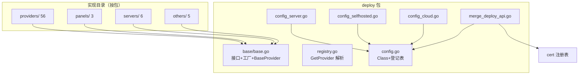
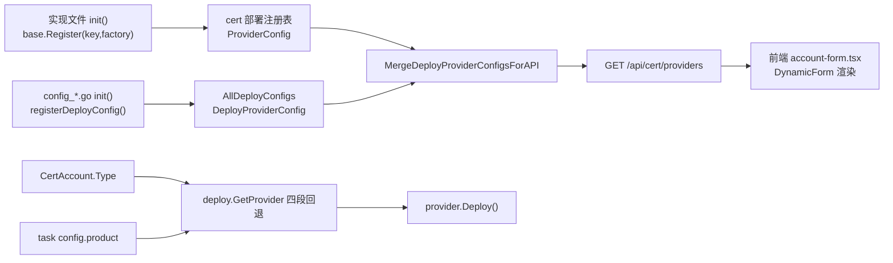
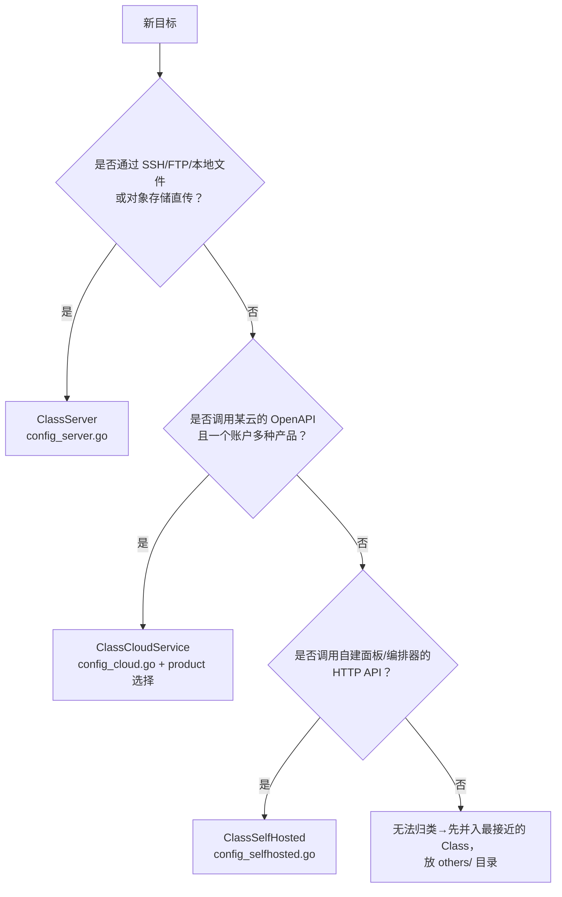
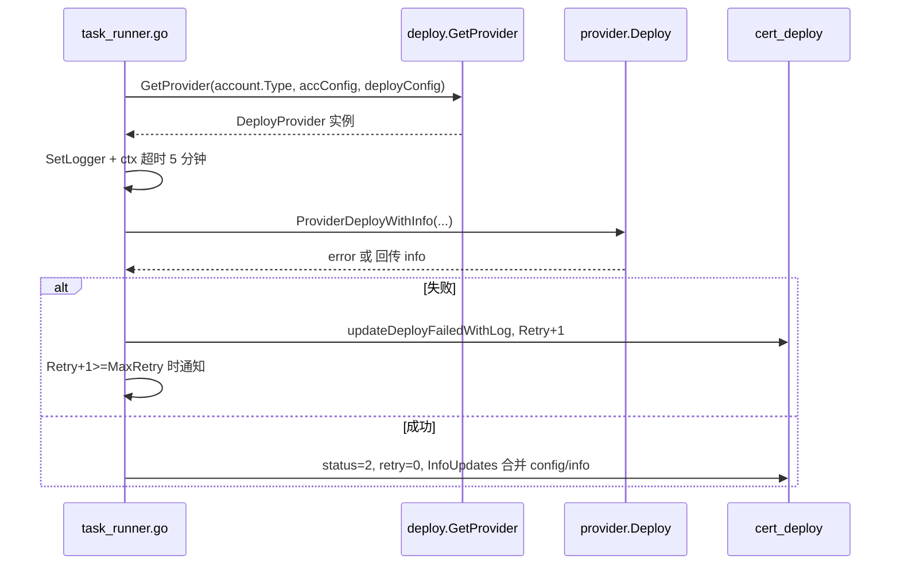

# 部署器扩展

<cite>
**本文档引用的文件**
- [base.go](file://main/internal/cert/deploy/base/base.go)
- [registry.go](file://main/internal/cert/deploy/registry.go)
- [config.go](file://main/internal/cert/deploy/config.go)
- [config_server.go](file://main/internal/cert/deploy/config_server.go)
- [config_selfhosted.go](file://main/internal/cert/deploy/config_selfhosted.go)
- [config_cloud.go](file://main/internal/cert/deploy/config_cloud.go)
- [merge_deploy_api.go](file://main/internal/cert/deploy/merge_deploy_api.go)
- [README.md](file://main/internal/cert/deploy/README.md)
- [interface.go](file://main/internal/cert/interface.go)
- [ssh.go](file://main/internal/cert/deploy/servers/ssh.go)
- [btpanel.go](file://main/internal/cert/deploy/providers/btpanel.go)
- [axisnow.go](file://main/internal/cert/deploy/providers/axisnow.go)
- [acepanel.go](file://main/internal/cert/deploy/panels/acepanel.go)
- [task_runner.go](file://main/internal/service/task_runner.go)
- [hooks.go](file://main/internal/models/hooks.go)
- [crypto.go](file://main/internal/crypto/crypto.go)
- [deploy-config-form.ts](file://web/lib/deploy-config-form.ts)
- [DynamicForm.tsx](file://web/components/deploy/DynamicForm.tsx)
- [api.ts](file://web/lib/api.ts)
- [account-form.tsx](file://web/components/account-form.tsx)
</cite>

## 目录

1. [简介](#简介)
2. [项目结构](#项目结构)
3. [核心组件](#核心组件)
4. [架构总览](#架构总览)
5. [详细组件分析](#详细组件分析)
6. [依赖关系分析](#依赖关系分析)
7. [性能考虑](#性能考虑)
8. [故障排查指南](#故障排查指南)
9. [结论](#结论)
10. [附录](#附录)

## 简介

本文面向需要为 DNSPlane 新增一个「证书部署目标」的扩展开发者，给出一条从后端接口实现到前端表单渲染的端到端落地路径。部署器体系采用「工厂注册 + 表单登记 + 双注册表合并 + 前端元数据驱动」的四段结构，新增一个部署器不是改一个文件，而是需要在若干个互不引用的登记点保持同步。

读完本文你将能够回答：

- `DeployProvider` 接口有哪些方法，扩展时应以哪一处定义为准。
- 工厂如何注册，运行时如何按账户类型解析到具体部署器。
- 一个新目标应归入 `config_server` / `config_selfhosted` / `config_cloud` 中的哪一类。
- 代码文件应放入 `servers` / `panels` / `providers` / `others` 的哪个目录，目录分组与配置 `Class` 是否等价。
- 前端字段 schema 与条件显示（`show` DSL）如何联动，哪些后端字段前端根本不消费。
- 密钥 / Token / 账密三类认证方式如何声明，凭证如何加密落库。
- 一次部署失败后系统如何重试，扩展者应如何自测与验证回滚语义。

本文与以下既有文档互补，不重复其面向功能的描述：

- 部署目标的用户视角说明见 [证书部署策略](../证书管理功能/证书部署策略/证书部署策略.md)。
- 面板类部署器的功能清单见 [面板部署](../证书管理功能/证书部署策略/面板部署.md)。
- 证书申请侧提供商扩展见 [扩展开发](扩展开发.md)。

**章节来源**
- [README.md](file://main/internal/cert/deploy/README.md#L1-L20)

## 项目结构

部署器相关代码集中在 `main/internal/cert/deploy/` 下。以磁盘实测为准，目录与文件分布如下。

| 路径 | 角色 | 实测规模 |
|------|------|----------|
| `base/base.go` | 接口、工厂注册表、`BaseProvider` 基类与配置读取工具 | 339 行 |
| `registry.go` | 类型别名与带解析逻辑的 `GetProvider` 包装 | 73 行 |
| `config.go` | `DeployProviderConfig` 结构、`Class` 常量、`AllDeployConfigs` 登记表 | 49 行 |
| `config_server.go` | 服务器类表单登记（ssh/ftp/local/s3storage） | 121 行 |
| `config_selfhosted.go` | 自建系统类表单登记（各面板与编排器） | 400+ 行 |
| `config_cloud.go` | 云服务商类表单登记（含 `product` 子产品） | 长文件 |
| `merge_deploy_api.go` | cert 注册表与 deploy 表单的合并裁决 | 50+ 行 |
| `providers/` | 实现文件目录 | 56 个 `.go` |
| `panels/` | 实现文件目录 | 3 个 `.go` |
| `servers/` | 实现文件目录 | 6 个 `.go`（其中 3 个注册部署器） |
| `others/` | 实现文件目录 | 5 个 `.go` |

重要事实：`deploy/README.md` 自述的「providers 16 / panels 15 / servers 4」分组数字与磁盘实际不符，磁盘实测为 `providers 56 / servers 6 / panels 3 / others 5`。以磁盘为准，不要照抄 README 的旧数字。

进一步说，目录分组与配置 `Class` 不是同一维度。多数「面板」实现（如 `btpanel`、`cloudpanel`、`directadmin`、`axisnow`、`qzyun`）落在 `providers/` 目录，而 `panels/` 目录只有 `acepanel`、`amh`、`btwin` 三个文件。这些类型在 `config_selfhosted.go` 中统一登记为 `ClassSelfHosted`。也就是说：目录只决定 Go 包归属，`Class` 字段与前端 `DEPLOY_CATEGORIES` 才决定 UI 归类。



**图表来源**
- [base.go](file://main/internal/cert/deploy/base/base.go#L1-L117)
- [registry.go](file://main/internal/cert/deploy/registry.go#L1-L73)
- [config.go](file://main/internal/cert/deploy/config.go#L1-L49)

**章节来源**
- [README.md](file://main/internal/cert/deploy/README.md#L1-L88)

## 核心组件

扩展一个部署器会触及四个核心构件，理解它们的职责边界是避免踩坑的前提。

### DeployProvider 接口

接口以 `base/base.go` 的实测定义为准（`deploy/registry.go` 仅通过类型别名再导出，不重复定义方法）。

```go
// main/internal/cert/deploy/base/base.go
type DeployProvider interface {
	Check(ctx context.Context) error
	Deploy(ctx context.Context, fullchain, privateKey string, config map[string]interface{}) error
	SetLogger(logger Logger)
}
```

- `Check` 用于「连通性 / 凭证有效性」探测，前端保存账户或任务前的校验按钮会调用它。
- `Deploy` 接收已解析证书链 `fullchain`、私钥 `privateKey`，以及任务级配置 `config`（注意与账户级 `Config` 区分）。
- `SetLogger` 由基类提供默认实现，仅当你需要覆盖日志去向时才显式实现。

存在一个可选的扩展接口 `DeployWithInfoProvider`，用于部署后回传附加信息（如自动生成的资源 ID）：

```go
type DeployWithInfoProvider interface {
	DeployProvider
	DeployWithInfo(ctx context.Context, fullchain, privateKey string,
		config map[string]interface{}, info *DeployInfo) error
}
```

它被「单独拆分而不并入 `DeployProvider`」，是为了让所有现有部署器无需改动即可满足 `DeployProvider`。执行器通过 `ProviderDeployWithInfo` 做类型断言：实现该接口走回传路径，未实现则退化为普通 `Deploy`。

**章节来源**
- [base.go](file://main/internal/cert/deploy/base/base.go#L44-L74)
- [base.go](file://main/internal/cert/deploy/base/base.go#L137-L150)

### 工厂注册表

注册表是一张受读写锁保护的 `map[string]ProviderFactory`。

```go
type ProviderFactory func(config map[string]interface{}) DeployProvider

var (
	providers = make(map[string]ProviderFactory)
	mu        sync.RWMutex
)

func Register(name string, factory ProviderFactory) {
	mu.Lock(); defer mu.Unlock(); providers[name] = factory
}
```

`Register` 采用「静默覆盖」语义：同名后注册者覆盖前者，不报错、不 panic。`GetProvider` 在工厂为 `nil` 时返回 `nil factory` 错误，未知键返回 `unknown deploy provider`。这意味着重复的 `init()` 键名不会编译失败，只会运行时静默错位——排查时先看键名是否撞车。

**章节来源**
- [base.go](file://main/internal/cert/deploy/base/base.go#L76-L117)

### BaseProvider 基类

绝大多数部署器以「结构体嵌入 `base.BaseProvider`」方式获得配置读取与日志能力，无需重复实现。

```go
type BaseProvider struct {
	Config map[string]interface{}
	Logger Logger
}
```

常用读取工具（均以 `base.go` 实测为准）：

| 方法 | 用途 | 关键行为 |
|------|------|----------|
| `GetString(key)` | 读账户配置字符串 | 精确→大小写不敏感→下划线转驼峰→驼峰转下划线，四级回退 |
| `GetInt(key, def)` | 读整数 | JSON 数字解析为 `float64`，需兼容两种类型 |
| `GetStringFrom(config, key)` | 任务配置优先、账户配置兜底 | 空串视为缺失，回落到 `GetString` |
| `base.GetConfigString(config, key)` | 从任意 map 读字符串 | 独立包函数，不依赖接收者 |
| `base.GetConfigBool(config, key)` | 读布尔 | 兼容 `bool` 与 `"1"/"true"` 字符串 |
| `base.GetConfigDomains(config)` | 解析域名列表 | 依次尝试 `domainList`/`domains`/`domain` |
| `base.SplitDomains(input)` | 换行/逗号切分 | 归一 `\r\n`、`\r`、`,` 为换行后去空 |

`GetString` 的四级命名回退是为兼容历史数据里 `access_key_id` 与 `AccessKeyId` 混用而设计，新部署器应优先使用一致的键名，避免依赖回退。

**章节来源**
- [base.go](file://main/internal/cert/deploy/base/base.go#L119-L339)

## 架构总览

部署器体系的整体数据流可分为「注册期」与「运行期」两条线。



关键点：`/api/cert/providers` 最终只输出一份合并视图，由 `merge_deploy_api.go` 的 `MergeDeployProviderConfigsForAPI` 裁决。它以 cert 注册表为基底遍历 `AllDeployConfigs`，其中 `patchServer` 是硬编码白名单 `{ssh, ftp, local}`——只有这三个类型的表单字段以 `AllDeployConfigs` 为准覆盖 cert 侧；其余同名类型保留 cert 侧定义，落在 `AllDeployConfigs` 独有的类型经 `deployConfigToAPIProviderConfig` 补入。

```go
// main/internal/cert/deploy/merge_deploy_api.go（节选语义）
patchServer := map[string]struct{}{"ssh": {}, "ftp": {}, "local": {}}
```

因此「改表单字段前必须确认自己改的是生效的那一份」：对绝大多数类型，前端看到的字段来自 `cert.Register` 携带的 `ProviderConfig`，而非 `config_*.go`；只有 `ssh/ftp/local` 走 `config_*.go`。这是本体系最易出错处，README 的双注册规则章节对此有完整统计。

**图表来源**
- [merge_deploy_api.go](file://main/internal/cert/deploy/merge_deploy_api.go#L5-L50)
- [registry.go](file://main/internal/cert/deploy/registry.go#L27-L68)
- [README.md](file://main/internal/cert/deploy/README.md#L89-L149)

**章节来源**
- [merge_deploy_api.go](file://main/internal/cert/deploy/merge_deploy_api.go#L1-L50)
- [README.md](file://main/internal/cert/deploy/README.md#L89-L149)

## 详细组件分析

下面按扩展的实际顺序，逐段给出可操作的最小改动。

### 第 1 步：实现 DeployProvider

在实现目录新建文件，嵌入 `base.BaseProvider`，实现 `Check` 与 `Deploy`。以下样板参考最简的面板实现 `acepanel.go`。

```go
package providers // 或 panels，仅决定 Go 包名

import (
	"context"
	"fmt"
	"main/internal/cert/deploy/base"
)

type MyTargetProvider struct {
	base.BaseProvider
}

func NewMyTargetProvider(config map[string]interface{}) base.DeployProvider {
	return &MyTargetProvider{BaseProvider: base.BaseProvider{Config: config}}
}

func (p *MyTargetProvider) Check(ctx context.Context) error {
	// 读账户级凭证并做一次连通/鉴权探测
	if p.GetString("url") == "" {
		return fmt.Errorf("请填写部署地址")
	}
	return nil
}

func (p *MyTargetProvider) Deploy(ctx context.Context,
	fullchain, privateKey string, config map[string]interface{}) error {
	domains := base.GetConfigDomains(config)
	if len(domains) == 0 {
		return fmt.Errorf("没有要部署的域名")
	}
	// 逐域名写入并触发重载，失败聚合策略见后文
	return nil
}

func init() { base.Register("my_target", NewMyTargetProvider) }
```

若需要把部署过程中生成的 ID 回存任务，改实现 `DeployWithInfo`，把要持久化的键写入 `info.Config`（合并回任务 `config`）或 `info.Data`（存入任务 `info` 字段）。回传字段最终由 `base.InfoUpdates` 转成 `cert_deploy` 表的更新列。

**章节来源**
- [acepanel.go](file://main/internal/cert/deploy/panels/acepanel.go#L19-L68)
- [base.go](file://main/internal/cert/deploy/base/base.go#L152-L183)
- [axisnow.go](file://main/internal/cert/deploy/providers/axisnow.go#L53-L90)

### 第 2 步：注册到工厂

`init()` 内的 `base.Register("key", New)` 即完成工厂注册。约束：

- `key` 必须与运行时 `CertAccount.Type`（或 `Type + "_" + product` 组合键）一致，否则解析不到。
- 一个文件内可注册多个键（如 `aliyun` 系多个子产品各自 `Register`）。
- 同键覆盖为静默行为，务必确认全局唯一。

`registry.go` 的 `GetProvider` 解析顺序决定键名策略，共四段回退：

```go
// 语义化描述 deploy/registry.go:27-68
1. 直接用 accountType 查找            // doge/gcore/upyun 等无子产品类型
2. accountType + "_" + taskConfig.product   // tencent + cdn → tencent_cdn
3. accountType + "_" + accConfig.product    // 兼容旧数据
4. 依次尝试 accountType + _cdn/_acm/_cloudfront 后缀  // AWS 控制台默认走 acm
```

设计要点：若你的目标无子产品，注册裸键（如 `my_target`）即可；若一个账户下有多种部署形态（如某云的 CDN/WAF/存储），应注册 `<type>_<product>` 组合键，并在配置里提供 `product` 选择项驱动第 2 段回退。

**章节来源**
- [registry.go](file://main/internal/cert/deploy/registry.go#L20-L68)

### 第 3 步：登记配置结构与归类

表单登记在 `config_*.go`，通过 `registerDeployConfig(DeployProviderConfig{...})` 写入 `AllDeployConfigs`。三个文件的归类判据如下。

| Class 常量 | 值 | 语义 | 归入文件 | 典型类型 |
|------------|----|------|----------|----------|
| `ClassServer` | 3 | 直接落文件/命令的目标 | `config_server.go` | `ssh`、`ftp`、`local`、`s3storage` |
| `ClassSelfHosted` | 1 | 自建面板/编排器 API | `config_selfhosted.go` | `btpanel`、`acepanel`、`opanel`、`k8s` |
| `ClassCloudService` | 2 | 公有云产品，常带 `product` | `config_cloud.go` | `aliyun`、`tencent`、`huawei` |

归类判断规则（决策树）：



**图表来源**
- [config.go](file://main/internal/cert/deploy/config.go#L5-L17)
- [config_server.go](file://main/internal/cert/deploy/config_server.go#L5-L10)
- [config_selfhosted.go](file://main/internal/cert/deploy/config_selfhosted.go#L5-L9)

目录归属（`servers/panels/providers/others`）与 `Class` 独立：目录只影响 Go 包名，`Class` 与前端分组才影响 UI。实测中大量 `ClassSelfHosted` 的面板实现放在 `providers/` 包，这是历史习惯，不要求你把面板一律搬进 `panels/`。新目标建议：纯 SSH/FTP/本地/对象存储放 `servers/`，其余按包内既有聚合就近放置（云厂商进 `providers/`，独立小面板可进 `panels/`）。

**章节来源**
- [config.go](file://main/internal/cert/deploy/config.go#L5-L30)
- [config_server.go](file://main/internal/cert/deploy/config_server.go#L5-L121)
- [config_selfhosted.go](file://main/internal/cert/deploy/config_selfhosted.go#L9-L103)

### 第 4 步：字段 schema 与条件显示

`DeployProviderConfig` 用两组字段区分「账户级」与「任务级」：`Inputs` 是保存账户时填的凭证/地址，`TaskInputs` 是建部署任务时填的目标参数。两者都是 `[]cert.ConfigField`。

`ConfigField` 的实测字段全集（`main/internal/cert/interface.go:95-109`）：

| 后端字段 | JSON | 前端是否消费 | 说明 |
|----------|------|--------------|------|
| `Name` | `name` | 是 | 显示名 |
| `Key` | `key` | 是 | 落库键名，供 `GetString/GetConfigString` 读取 |
| `Type` | `type` | 是 | `input`/`textarea`/`radio`/`select`/`password` |
| `Placeholder` | `placeholder` | 是 | 输入提示 |
| `Required` | `required` | 是 | 仅前端标注红星，后端不强制 |
| `Options` | `options` | 是 | `radio`/`select` 选项 |
| `Value` | `value` | 是 | 默认值，参与 `show` 判定与选择回落 |
| `Note` | `note` | 是 | 字段下方说明 |
| `Show` | `show` | 是 | 条件显示 DSL |
| `Disabled` | `disabled` | **否** | 前端无渲染点 |
| `Validator` | `validator` | **否** | 全仓仅 2 处写 `"email"` 且不生效 |
| `Min` / `Max` | `min`/`max` | **否** | 前后端均无使用 |

条件显示 `Show` 由前端 `evaluateDeployFieldShow` 解析，是一个受限 DSL：

```ts
// web/lib/deploy-config-form.ts（语义）
支持：key==value、key!=value、&& 、|| 、单双引号剥离
不支持：>、<、括号、in、嵌套；未识别条件一律返回 true
解析异常：整体 try/catch 回落 true（即全部显示）
```

因此 `show` 只能表达「等值与/或」组合，例如 `ssh` 的认证切换：

```go
{Name: "认证方式", Key: "auth", Type: "radio",
 Options: []cert.ConfigOption{{Value:"0",Label:"密码认证"},{Value:"1",Label:"密钥认证"}}, Value:"0"},
{Name: "密码", Key: "password", Type: "input", Show: "auth==0", Required: true},
{Name: "私钥", Key: "privatekey", Type: "textarea", Show: "auth==1", Required: true},
{Name: "私钥密码", Key: "passphrase", Type: "input", Show: "auth==1"},
```

云类里出现的最复杂条件是 `product=='ga'&&deploy_type=='1'`，仍在 DSL 能力内。若你的目标需要「大于某值」「括号分组」这类逻辑，前端会静默显示全部字段，与后端预期不符——此时必须同步扩展 `deploy-config-form.ts` 的 DSL，否则 UI 会错乱。

字段可见性联动由 `DynamicForm.tsx` 实现：每次 `onChange` 更新本地 `values`，`renderField` 用最新 `localValues` 重新求值 `show`，实现「选了认证方式，动态出现/隐藏对应字段」。

```tsx
// web/components/deploy/DynamicForm.tsx（关键片段）
const renderField = (field: ProviderConfigField) => {
  if (!evaluateDeployFieldShow(field.show, localValues)) return null
  const value = localValues[field.key] ?? field.value ?? ''
  // radio / select / textarea / input(password) 分支渲染
}
```

注意 `api.ts` 的 `ProviderConfigField` 只声明 10 项（`name/key/label/type/required/placeholder/options/value/note/show`），比后端少 4 项——契约被前端单方面裁剪，新增 `Disabled` 之类字段不会自动透传到 UI。

**章节来源**
- [interface.go](file://main/internal/cert/interface.go#L94-L115)
- [config_server.go](file://main/internal/cert/deploy/config_server.go#L18-L42)
- [deploy-config-form.ts](file://web/lib/deploy-config-form.ts#L1-L72)
- [DynamicForm.tsx](file://web/components/deploy/DynamicForm.tsx#L27-L93)
- [api.ts](file://web/lib/api.ts#L1339-L1350)

### 第 5 步：前端注册点

前端并非「零改动」，共需触碰 2 处登记 + 1 个静态资源，且都不与后端互相校验：

| 步 | 位置 | 改动 | 不改的后果 |
|----|------|------|------------|
| 1 | `web/components/account-form.tsx` `DEPLOY_CATEGORIES` | 在某个分组数组里加入类型键 | 落入未列出的默认分组 |
| 2 | 同文件 `providerStyles` | 增加 `color/bgColor/icon/image` | 走字母兜底样式 |
| 3 | `web/public/icons/<key>.png` | 放图标文件 | `image` 指向 404 |

`DEPLOY_CATEGORIES` 当前只有三组：`远程与本地`(ssh/ftp/local)、`面板 / 编排`、`CDN / 云`。实测中 `acepanel`、`amh`、`directadmin`、`cloudpanel`、`qzyun`、`axisnow`、`nginxproxymanager` 等并未列入分组数组，故不会出现在这三组标题下——它们靠合并 API 输出仍可用，但 UI 分组不完整。新增部署器若希望归到「面板 / 编排」，必须显式加进 `DEPLOY_CATEGORIES`。

后端 `Class`、前端 `DEPLOY_CATEGORIES`、图标资源三者语义各异，没有任何编译期或测试期手段保证对齐，这是「双注册 + 前端两登记」体系最大的脆弱点。

**章节来源**
- [account-form.tsx](file://web/components/account-form.tsx#L35-L99)
- [README.md](file://main/internal/cert/deploy/README.md#L119-L149)

### 第 6 步：认证方式与安全存储

`Inputs` 里的凭证字段（`password`、`token`、`api_key`、`AccessKeySecret`、`privatekey` 等）通过 `Key` 落进 `CertAccount.Config`。落库加密由 GORM 钩子透明完成，扩展者无需自行加解密：

```go
// main/internal/models/hooks.go
func (c *CertAccount) BeforeSave(*gorm.DB) error { return encFields(&c.Config, &c.Ext) }
func (c *CertAccount) AfterFind(*gorm.DB) error  { decFields(&c.Config, &c.Ext); return nil }
```

`encFields` 调用 `crypto.Encrypt`（AES-256，密钥由 `security.master_key` 派生）。同理 `CertDeploy.Config`/`CertDeploy.Info` 也加解密，因此任务级回传的 `info.Data` 若含敏感值同样受保护。

三类认证在 schema 上的声明约定（取实测范式）：

| 认证形态 | 典型键 | schema 写法 | 代表实现 |
|----------|--------|-------------|----------|
| 密钥/PEM | `privatekey`+`passphrase` | `textarea` + `Show:"auth==1"` | `ssh`（服务器） |
| API Token | `token`/`key`/`apikey` | `input`，通常 `Required:true` | `acepanel`、`axisnow`、`amh` |
| 账密 | `username`+`password` | 两个 `input`，密码用 `Type:"password"` 或 `input` | `cloudpanel`、`directadmin`、`nginxproxymanager` |

安全要点：`directadmin`/`cloudpanel` 对自签面板证书使用 `InsecureSkipVerify`（放宽 TLS），新实现应尽量改为可配置校验；`ssh` 已加入 `host_key` 校验以缓解 MITM，未配置时回退不校验并打警告日志。新部署器若走 HTTPS 且目标为公网受信证书，不要默认关校验。

**章节来源**
- [hooks.go](file://main/internal/models/hooks.go#L35-L52)
- [crypto.go](file://main/internal/crypto/crypto.go#L18-L96)
- [ssh.go](file://main/internal/cert/deploy/servers/ssh.go#L99-L138)
- [config_selfhosted.go](file://main/internal/cert/deploy/config_selfhosted.go#L121-L138)

## 依赖关系分析

扩展触及的登记点彼此独立，一张表看清「谁依赖谁」。

| 构件 | 依赖 | 被依赖 | 说明 |
|------|------|--------|------|
| `base.Register` | `base` 包读写锁 map | `deploy.GetProvider` | 运行期解析的源头 |
| `deploy.GetProvider` | 账户 `Type`、任务 `product` | `task_runner`、`handler/cert_deploy.go` | 四段回退 |
| `registerDeployConfig` | `AllDeployConfigs` | `merge_deploy_api` | 仅 `ssh/ftp/local` 覆盖 cert |
| `MergeDeployProviderConfigsForAPI` | cert 表 + `AllDeployConfigs` | `/api/cert/providers` | 输出唯一合并视图 |
| `deploy-config-form.ts` | `ProviderConfigField.show` | `DynamicForm` | 受限 DSL |
| `account-form.tsx` | 分组/样式/图标 | 账号新增页 UI | 需手工加键 |



**图表来源**
- [task_runner.go](file://main/internal/service/task_runner.go#L322-L391)
- [registry.go](file://main/internal/cert/deploy/registry.go#L27-L68)

**章节来源**
- [task_runner.go](file://main/internal/service/task_runner.go#L300-L392)

## 性能考虑

- **上下文超时**：执行器对单次部署统一设 `context.WithTimeout(ctx, 5*time.Minute)`。实现 `Check`/`Deploy` 时务必把 `ctx` 透传到底层 `http.NewRequestWithContext` / `ssh.Dial`，否则超时不可控。
- **HTTP 客户端超时**：各实现自建 `http.Client{Timeout:...}`（如 `btpanel` 30s、`acepanel` 60s）。多站点循环部署应复用同一 client，不要在循环里新建连接。
- **逐域名串行**：面板类普遍对每个站点/域名串行请求。域名多时耗时线性增长，若目标 API 支持批量优先用批量接口（如 `btpanel` 的 set 接口按名单一次处理）。
- **失败聚合**：`acepanel`/`cloudpanel` 采用「逐站点尽力部署，全部失败才报错、部分失败仅记日志」的策略；`btpanel` 则是「任一站点失败即返回」。扩展时按业务容忍度二选一，避免一个无关站点失败导致整任务判负。
- **锁竞争**：`base.Register`/`GetProvider` 用 `sync.RWMutex`，注册只在 `init()` 期发生，读多写少，不构成运行瓶颈。

**章节来源**
- [task_runner.go](file://main/internal/service/task_runner.go#L345-L362)
- [acepanel.go](file://main/internal/cert/deploy/panels/acepanel.go#L49-L67)
- [btpanel.go](file://main/internal/cert/deploy/providers/btpanel.go#L212-L224)

## 故障排查指南

| 症状 | 根因 | 定位 | 处置 |
|------|------|------|------|
| 保存账户报 `unknown deploy provider` | `Type` 与 `Register` 键不一致，或子产品未组合 | 对照 `registry.go` 四段回退 | 校正键名或补 `product` |
| 表单字段改了不生效 | 改错了注册表那份（多数看 cert 表，非 `config_*.go`） | README 双注册规则、`patchServer` | 确认该键是否在白名单 |
| `show` 条件字段一直显示 | 用了 DSL 不支持的运算符 | `deploy-config-form.ts` | 改用 `==`/`!=`/`&&`/`||` 或扩 DSL |
| UI 分组里找不到新类型 | 未加 `DEPLOY_CATEGORIES` | `account-form.tsx:35-67` | 显式加入分组数组 |
| 图标缺失/字母兜底 | `providerStyles` 或图标文件未配 | `account-form.tsx:70+` | 补样式与 `/icons` 资源 |
| 部署静默覆盖 | 同键被二次 `Register` | 全局搜 `Register("同键"` | 保证键唯一 |
| 私钥泄露担忧 | 误以为配置明文 | `hooks.go`/`crypto.go` | 确认走 `BeforeSave` 加密 |
| 主机被 MITM | SSH 未配 `host_key` | `ssh.go:109-121` 警告日志 | 录入 known_hosts 行 |

验证清单（新增部署器后逐项自检）：

1. `go build ./...` 通过，`init()` 确有 `base.Register`。
2. 单独调用 `Check`：填错凭证应返回可读错误，不 panic。
3. `deploy.GetProvider(type, {}, {product})` 能解析到实例。
4. `curl /api/cert/providers` 能看到该键的表单字段与正确 `show`。
5. 前端新建任务，`show` 字段随选择动态显隐。
6. 落库后直连数据库确认 `config` 为密文（`IsEncrypted` 前缀）。
7. 断网/错误目标触发一次失败，观察 `cert_deploy.status`、`retry` 递增与最终通知。

**章节来源**
- [registry.go](file://main/internal/cert/deploy/registry.go#L27-L68)
- [README.md](file://main/internal/cert/deploy/README.md#L119-L149)
- [deploy-config-form.ts](file://web/lib/deploy-config-form.ts#L3-L34)

## 结论

新增一个部署器本质是「一次后端工厂注册 + 一次表单登记 + 前端两处分组/样式登记 + 一个图标资源」的多点对齐工作，接口以 `base.DeployProvider`（可选 `DeployWithInfoProvider`）为唯一权威定义，解析以 `deploy.GetProvider` 的四段回退为准，UI 以 `MergeDeployProviderConfigsForAPI` 合并后的 `/api/cert/providers` 为准。凭证由 GORM 钩子透明加密，扩展者只需正确声明 `Inputs`/`TaskInputs` 并保证键名一致。体系最大风险在「双注册表谁生效」与「前后端字段契约裁剪」两处，本文的验证清单即为对冲该风险的最低手段。

## 附录

### A. 最小落地检查表

| 序 | 动作 | 文件 | 关键符号 |
|----|------|------|----------|
| 1 | 定义 provider 结构体并嵌入基类 | `deploy/<目录>/x.go` | `base.BaseProvider` |
| 2 | 实现 `Check`/`Deploy`（可选 `DeployWithInfo`） | 同上 | `DeployProvider` |
| 3 | `init()` 注册工厂 | 同上 | `base.Register` |
| 4 | 登记表单 | `config_<class>.go` | `registerDeployConfig` |
| 5 | 前端分组 | `account-form.tsx` | `DEPLOY_CATEGORIES` |
| 6 | 前端样式/图标 | `account-form.tsx`/`web/public/icons` | `providerStyles` |

### B. Class 与配置文件映射速查

| 场景 | Class | 文件 | 目录建议 |
|------|-------|------|----------|
| SSH/FTP/本地/对象存储 | `ClassServer(3)` | `config_server.go` | `servers/` |
| 自建面板/编排 API | `ClassSelfHosted(1)` | `config_selfhosted.go` | `providers/` 或 `panels/` |
| 公有云产品（多子产品） | `ClassCloudService(2)` | `config_cloud.go` | `providers/` |

### C. 相关文档

- 面板类部署器专题：[面板集成扩展](面板集成扩展.md)
- 部署目标用户文档：[证书部署策略](../证书管理功能/证书部署策略/证书部署策略.md)
- 证书申请提供商扩展：[扩展开发](扩展开发.md)

**章节来源**
- [README.md](file://main/internal/cert/deploy/README.md#L151-L185)
- [config.go](file://main/internal/cert/deploy/config.go#L5-L17)
