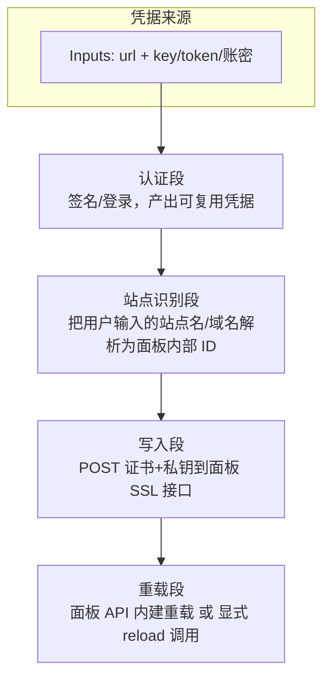
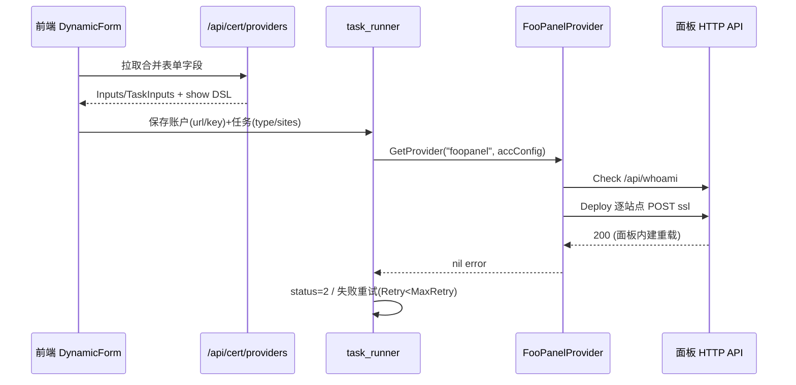
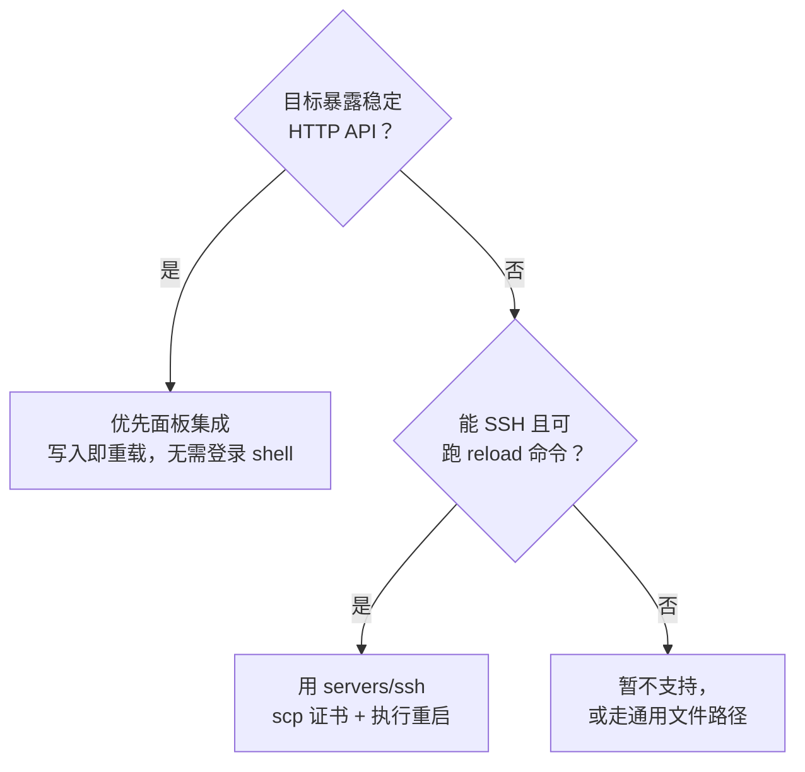

# 面板集成扩展

<cite>
**本文档引用的文件**
- [base.go](file://main/internal/cert/deploy/base/base.go)
- [registry.go](file://main/internal/cert/deploy/registry.go)
- [config.go](file://main/internal/cert/deploy/config.go)
- [config_selfhosted.go](file://main/internal/cert/deploy/config_selfhosted.go)
- [config_server.go](file://main/internal/cert/deploy/config_server.go)
- [acepanel.go](file://main/internal/cert/deploy/panels/acepanel.go)
- [amh.go](file://main/internal/cert/deploy/panels/amh.go)
- [btwin.go](file://main/internal/cert/deploy/panels/btwin.go)
- [btpanel.go](file://main/internal/cert/deploy/providers/btpanel.go)
- [cloudpanel.go](file://main/internal/cert/deploy/providers/cloudpanel.go)
- [directadmin.go](file://main/internal/cert/deploy/providers/directadmin.go)
- [axisnow.go](file://main/internal/cert/deploy/providers/axisnow.go)
- [qzyun.go](file://main/internal/cert/deploy/providers/qzyun.go)
- [ssh.go](file://main/internal/cert/deploy/servers/ssh.go)
- [task_runner.go](file://main/internal/service/task_runner.go)
- [hooks.go](file://main/internal/models/hooks.go)
- [deploy-config-form.ts](file://web/lib/deploy-config-form.ts)
- [DynamicForm.tsx](file://web/components/deploy/DynamicForm.tsx)
- [interface.go](file://main/internal/cert/interface.go)
</cite>

## 目录

1. [简介](#简介)
2. [项目结构](#项目结构)
3. [核心组件](#核心组件)
4. [架构总览](#架构总览)
5. [详细组件分析](#详细组件分析)
6. [依赖关系分析](#依赖关系分析)
7. [性能考虑](#性能考虑)
8. [故障排查指南](#故障排查指南)
9. [结论](#结论)
10. [附录](#附录)

## 简介

本文是 [部署器扩展](部署器扩展.md) 的面板专题，聚焦「面板类部署器」这一子集：即通过自建 Web 面板/编排器的 HTTP 接口，把证书写入并触发重载的目标。相比通用部署器扩展，面板集成有三点特殊性：认证签名形态各异、站点识别方式不一、重载触发是「面板 API 内建」而非「SSH 跑命令」。

本文以磁盘实测为准回答：

- 现有面板类部署器到底有哪些，分布在哪些目录（README 的旧分组数字不可信）。
- 各面板 API 客户端的共性可归纳为哪三个动作：站点识别、证书写入、重载触发。
- 新增一个面板的最小实现路径是什么。
- 面板 API Key 如何做权限最小化。
- 何时选「面板 API」而非「servers/SSH」，二者的选型差异。

功能性的用户文档见 [面板部署](../证书管理功能/证书部署策略/面板部署.md)，本文不重复其目标清单，只讲扩展。通用扩展机制见 [部署器扩展](部署器扩展.md)。

**章节来源**
- [config.go](file://main/internal/cert/deploy/config.go#L5-L17)
- [README.md](file://main/internal/cert/deploy/README.md#L89-L99)

## 项目结构

面板类部署器并非集中在 `panels/` 目录。实测分布为：`panels/` 仅 `acepanel`、`amh`、`btwin` 三个文件，绝大多数面板实现（`btpanel`、`cloudpanel`、`directadmin`、`axisnow`、`qzyun`、`opanel` 等）放在 `providers/` 包。它们在 `config_selfhosted.go` 中统一登记为 `ClassSelfHosted`。

结论：目录只决定 Go 包归属，是否属于「面板」由 `Class==ClassSelfHosted` 与是否调用面板 HTTP API 决定，不由文件所在目录决定。

### 现有面板清单（磁盘 + 配置实测）

`config_selfhosted.go` 登记的自建系统类部署器，按认证形态归类如下。

| 类型键 | 显示名 | 认证形态 | 实现所在目录 |
|--------|--------|----------|--------------|
| `btpanel` | 宝塔面板 | md5 请求令牌 | `providers/` |
| `btwin` | 宝塔 Windows 极速版 | md5 请求令牌 | `panels/` |
| `acepanel` | ACE Panel | HMAC-SHA256 令牌 | `panels/` |
| `amh` | AMH | HMAC-SHA256（带过期） | `panels/` |
| `opanel` | 1Panel | API 密钥 | `providers/` |
| `cloudpanel` | CloudPanel | 账密（CSRF+Cookie） | `providers/` |
| `directadmin` | DirectAdmin | 账密/Login Key | `providers/` |
| `safeline` | 雷池WAF | API Token | `providers/` |
| `nginxproxymanager` | Nginx Proxy Manager | 邮箱+密码登录 | `providers/` |
| `axisnow` | AxisNow | Bearer Token | `providers/` |
| `qzyun` | 全栈云 | 账密（Next.js Server Action） | `providers/` |
| `btwaf`/`cdnfly`/`lecdn`/`goedge`/`kangle`/`kangleadmin`/`mwpanel`/`ratpanel`/`xp`/`synology`/`lucky`/`fnos`/`proxmox`/`k8s`/`uusec` | 其余自建系统 | 各异 | `providers/` |

以上均为 `ClassSelfHosted`。注意 `proxmox`/`k8s` 严格说是「编排/虚拟化平台」而非传统 Web 面板，但共用同一套部署器抽象与配置类。

**章节来源**
- [config_selfhosted.go](file://main/internal/cert/deploy/config_selfhosted.go#L9-L490)
- [acepanel.go](file://main/internal/cert/deploy/panels/acepanel.go#L19-L28)

## 核心组件

面板集成完全复用通用部署器抽象，本专题只强调面板特有的三个动作语义。

```go
// main/internal/cert/deploy/base/base.go
type DeployProvider interface {
	Check(ctx context.Context) error
	Deploy(ctx context.Context, fullchain, privateKey string, config map[string]interface{}) error
	SetLogger(logger Logger)
}
```

面板实现里，`Check` 通常是「登录/探测一个只读接口」，`Deploy` 是「认证 → 识别站点 → 写入证书 → 触发重载」的组合。以 `acepanel` 为最小范例：

```go
// main/internal/cert/deploy/panels/acepanel.go
func (p *AcePanelProvider) Check(ctx context.Context) error {
	_, err := p.request(ctx, "GET", "/user/info", nil)
	return err
}

func (p *AcePanelProvider) Deploy(ctx context.Context, fullchain, privateKey string, config map[string]interface{}) error {
	deployType := base.GetConfigString(config, "type")
	if deployType == "1" {
		_, err := p.request(ctx, "POST", "/setting/cert",
			map[string]interface{}{"cert": fullchain, "key": privateKey})
		return err
	}
	// 否则逐站点部署
	sites := base.SplitDomains(base.GetConfigString(config, "sites"))
	// ...
}
```

`deployType` 分支是面板类普遍模式：同一部署器既支持「更新面板自身证书」又支持「更新网站证书」，用任务配置里的 `type` 单选切换。

**章节来源**
- [base.go](file://main/internal/cert/deploy/base/base.go#L44-L54)
- [acepanel.go](file://main/internal/cert/deploy/panels/acepanel.go#L30-L68)

## 架构总览

所有面板 API 客户端，无论签名算法如何，都可拆成相同的三段。



三段在各面板的具体落点：

| 段 | acepanel | btpanel | cloudpanel | directadmin | axisnow |
|----|----------|---------|------------|-------------|---------|
| 认证 | HMAC-SHA256 签请求 | `md5(ts+md5(key))` | 表单登录+CSRF+Cookie | `CMD_API_LOGIN_TEST` | Bearer Token |
| 站点识别 | 直接用站点名 | `getSiteID` 名→ID | HTML 抓取 `/site/xxx` | 直接用域名 | 用证书 UUID |
| 写入 | `/website/cert` | `/site/set_site_ssl` | 站点 SSL 表单 | `/CMD_API_SSL` | `/client/v1/certificates` |
| 重载 | 面板内建 | 面板内建 | 面板内建 | 面板内建 | 面板内建 |

关键差异：面板类几乎都把「重载」交给面板 API 内建处理，无需像 `ssh` 那样显式跑 `service nginx reload`。这正是「面板 vs SSH」选型的核心分水岭（详见后文对比表）。

**图表来源**
- [acepanel.go](file://main/internal/cert/deploy/panels/acepanel.go#L70-L110)
- [btpanel.go](file://main/internal/cert/deploy/providers/btpanel.go#L99-L351)
- [cloudpanel.go](file://main/internal/cert/deploy/providers/cloudpanel.go#L111-L130)

**章节来源**
- [axisnow.go](file://main/internal/cert/deploy/providers/axisnow.go#L41-L90)
- [directadmin.go](file://main/internal/cert/deploy/providers/directadmin.go#L77-L119)

## 详细组件分析

### 认证段：签名形态各异

面板认证没有统一 SDK，每家一套签名算法，但都遵循「账户级凭据 → 请求签名 → 失败即 `Check` 报错」的流程。实测覆盖四种主流：

```go
// 形态一：HMAC-SHA256 规范串签名（acepanel）
canonicalRequest := strings.Join([]string{method, path, rawQuery, sha256Hex(bodyBytes)}, "\n")
stringToSign := strings.Join([]string{"HMAC-SHA256", ts, sha256Hex(canonicalRequest)}, "\n")
mac := hmac.New(sha256.New, []byte(token)); mac.Write([]byte(stringToSign))
signature := hex.EncodeToString(mac.Sum(nil))
req.Header.Set("Authorization", "HMAC-SHA256 Credential="+id+", Signature="+signature)

// 形态二：md5 请求令牌（btpanel）
timestamp := fmt.Sprintf("%d", time.Now().Unix())
token := md5Hex(timestamp + md5Hex(apiKey))
data.Set("request_time", timestamp); data.Set("request_token", token)

// 形态三：账密表单登录 + CSRF + Cookie（cloudpanel / directadmin / qzyun）
// Check → login 建立会话，凭据存 cookie 复用

// 形态四：Bearer Token（axisnow / safeline / amh 变体）
```

| 认证方式 | 代表面板 | 凭据键 | 会话 | 安全注意 |
|----------|----------|--------|------|----------|
| HMAC 签名 | acepanel/amh | `id`+`token`/`apikey` | 无状态 | 时间戳参与签名，需控时钟偏差 |
| md5 令牌 | btpanel/btwin | `key` | 无状态 | 令牌可轮换，建议只授 API 权限 |
| 账密登录 | cloudpanel/directadmin/qzyun | `username`+`password` | Cookie 会话 | 用 Login Key 代替主密码更安全 |
| Bearer Token | axisnow/safeline | `token` | 无状态 | 用最小权限令牌 |
| 邮箱密码 | nginxproxymanager | `email`+`password` | 会话令牌 | NPM 无细粒度 API Key，只能账号级 |

### 站点识别段：从名字到内部 ID

面板写入证书几乎都需要「面板内部的站点标识」，而用户只会填站点名/域名，识别段负责翻译：

- **直用型**：`acepanel`、`directadmin`、`cloudpanel` 直接把用户填的站点名/域名作为 API 参数，不查 ID。
- **查询型**：`btpanel` 在 v1 分支通过 `getSiteID` 用 `/datalist/get_data_list` 按站点名精确匹配返回内部数字 ID：

```go
// main/internal/cert/deploy/providers/btpanel.go
result, err := p.request(ctx, "/datalist/get_data_list", params)
if data, ok := result["data"].([]interface{}); ok {
	for _, item := range data {
		if site, ok := item.(map[string]interface{}); ok {
			if name, ok := site["name"].(string); ok && name == siteName {
				if id, ok := site["id"].(float64); ok { return int(id), nil }
			}
		}
	}
}
return 0, fmt.Errorf("站点不存在: %s", siteName)
```

- **抓取型**：`cloudpanel` 无稳定 JSON API，登录页/站点列表返回 HTML，用正则 `href="/site/([^"/]+)"` 抽取站点句柄；`qzyun` 更进一步解析 Next.js 的 `self.__next_f.push(...)` RSC 流来定位 Server Action，脆弱性高（面板前端改版即失效）。

新增面板应优先走「直用型/查询型」，避免抓取型；若目标无 JSON API，考虑回落到 `ssh` 方式而非爬 HTML。

**章节来源**
- [btpanel.go](file://main/internal/cert/deploy/providers/btpanel.go#L325-L351)
- [cloudpanel.go](file://main/internal/cert/deploy/providers/cloudpanel.go#L25-L31)
- [qzyun.go](file://main/internal/cert/deploy/providers/qzyun.go#L24-L44)

### 写入段与重载段

写入段是把 `fullchain` 与 `privateKey` 提交到面板 SSL 接口。两种数据形态：

- 分离提交：`cert`/`key` 两个字段（`acepanel`、`btpanel`）。
- 合并提交：`directadmin` 把私钥规范化后与证书拼成单个 `certificate` 再 POST，且对内容做 `trim` 与非空校验。

```go
// main/internal/cert/deploy/providers/directadmin.go
normalizedKey, err := directAdminNormalizePrivateKey(privateKey)
certificate := strings.TrimRight(normalizedKey, daTrimCutset) + "\n" +
	strings.TrimLeft(fullchain, daTrimCutset)
form.Set("certificate", certificate)
p.request(ctx, "POST", "/CMD_API_SSL", form)
```

重载段在面板类几乎不需自实现——面板 SSL 接口写成功后由面板自身重载服务。`qzyun`/`axisnow` 这类云端面板则以「证书上传即生效」完成。因此 `Deploy` 的返回语义 = 「写入是否被面板接受」，而非「线上是否已 reload」。

工厂无法返回错误的补救模式值得注意：`directadmin` 在构造函数里校验面板地址（必须 https、不带路径/凭据/查询/片段），校验失败不 panic，而是记录到 `configErr`，延后到 `Check`/`Deploy` 报出。这是「`ProviderFactory` 签名不含 error」约束下的标准应对。

**章节来源**
- [directadmin.go](file://main/internal/cert/deploy/providers/directadmin.go#L44-L119)
- [acepanel.go](file://main/internal/cert/deploy/panels/acepanel.go#L35-L44)

### 新增一个面板的最小路径

下面给出一条最小可落地路径，覆盖后端三段 + 配置登记 + 前端联动。

第 1 步：建实现文件（放 `providers/` 或 `panels/` 均可，只决定包名）。

```go
package panels

import (
	"context"
	"fmt"
	"strings"
	"time"
	"encoding/json"
	"io"
	"net/http"
	"main/internal/cert/deploy/base"
)

type FooPanelProvider struct {
	base.BaseProvider
	client *http.Client
}

func NewFooPanelProvider(config map[string]interface{}) base.DeployProvider {
	return &FooPanelProvider{
		BaseProvider: base.BaseProvider{Config: config},
		client:       &http.Client{Timeout: 30 * time.Second},
	}
}

func (p *FooPanelProvider) Check(ctx context.Context) error {
	_, err := p.get(ctx, "/api/whoami")
	return err
}

func (p *FooPanelProvider) Deploy(ctx context.Context, fullchain, privateKey string, config map[string]interface{}) error {
	if strings.TrimSpace(fullchain) == "" || strings.TrimSpace(privateKey) == "" {
		return fmt.Errorf("证书或私钥为空")
	}
	sites := base.SplitDomains(base.GetConfigString(config, "sites"))
	if len(sites) == 0 {
		return fmt.Errorf("请填写站点")
	}
	failed := 0
	for _, s := range sites {
		if _, err := p.post(ctx, "/api/site/"+s+"/ssl", map[string]string{
			"cert": fullchain, "key": privateKey,
		}); err != nil {
			failed++
			p.Log("站点 " + s + " 失败: " + err.Error())
		}
	}
	if failed == len(sites) {
		return fmt.Errorf("全部站点部署失败")
	}
	return nil
}

func (p *FooPanelProvider) get(ctx context.Context, path string) (map[string]interface{}, error) { /* 带 token 头 */ return nil, nil }
func (p *FooPanelProvider) post(ctx context.Context, path string, body interface{}) (map[string]interface{}, error) {
	_ = io.Discard; _ = json.Marshal; return nil, nil
}

func init() { base.Register("foopanel", NewFooPanelProvider) }
```

第 2 步：在 `config_selfhosted.go` 追加登记（`ClassSelfHosted`）。

```go
registerDeployConfig(DeployProviderConfig{
	Type: "foopanel", Name: "Foo面板", Class: ClassSelfHosted,
	Icon: "foopanel.png", Desc: "部署证书到 Foo 面板",
	Inputs: []cert.ConfigField{
		{Name: "面板地址", Key: "url", Type: "input", Required: true},
		{Name: "API 密钥", Key: "key", Type: "input", Required: true},
	},
	TaskInputs: []cert.ConfigField{
		{Name: "部署类型", Key: "type", Type: "radio", Required: true, Value: "0",
			Options: []cert.ConfigOption{{Value: "0", Label: "网站证书"}, {Value: "1", Label: "面板本身"}}},
		{Name: "网站名称列表", Key: "sites", Type: "textarea",
			Placeholder: "每行一个网站名称", Show: "type==0", Required: true},
	},
})
```

第 3 步：确认生效的注册表。若 `foopanel` 也需兼作证书申请（`cert.Register` 带非空 `ProviderConfig`），字段以 cert 侧为准，除非它落在 `patchServer` 白名单 `{ssh,ftp,local}`。纯部署类型可只在 `AllDeployConfigs` 登记。

第 4 步：前端联动。`type==0` 的 `Show` 由 `evaluateDeployFieldShow` 解析，`DynamicForm` 在 `onChange` 后重算显隐：选「面板本身」时隐藏站点列表。若面板要进「面板 / 编排」分组，把 `foopanel` 加入 `DEPLOY_CATEGORIES`，并在 `providerStyles` 补样式与图标。

显隐联动完全由元数据驱动，前端无需为 `foopanel` 写任何分支代码，`show` DSL 求值后即决定是否渲染：

```tsx
// web/components/deploy/DynamicForm.tsx（联动语义）
const renderField = (field: ProviderConfigField) => {
  // field.show = "type==0"：仅当任务配置里 type 取值为 0 时渲染站点列表
  if (!evaluateDeployFieldShow(field.show, localValues)) return null
  const value = localValues[field.key] ?? field.value ?? ''
  return <div key={field.key}>{/* radio / textarea / input 渲染 */}</div>
}
```

若 `type` 切换后 `sites` 字段未按预期隐藏，多半是 `show` 写成了 DSL 不支持的表达式（如 `type>0`），求值会兜底 `true` 而常显。

**章节来源**
- [acepanel.go](file://main/internal/cert/deploy/panels/acepanel.go#L19-L113)
- [config_selfhosted.go](file://main/internal/cert/deploy/config_selfhosted.go#L34-L49)
- [deploy-config-form.ts](file://web/lib/deploy-config-form.ts#L3-L34)
- [DynamicForm.tsx](file://web/components/deploy/DynamicForm.tsx#L27-L93)

### API Key 权限最小化

面板 API 的授权粒度决定「令牌被窃取的影响半径」。新增面板时应按最小权限原则选择凭据类型。

| 面板 | 可用凭据 | 建议最小化策略 |
|------|----------|----------------|
| btpanel | 面板 API 密钥 | 仅开启证书相关接口，关闭 shell/文件管理权限 |
| acepanel | id + token | 用只可写证书的令牌，勿用管理员全权令牌 |
| directadmin | 账户密码 或 Login Key | 优先 Login Key，绑定到具体域名 |
| cloudpanel | 管理员账密 | 面板无细粒度 API Key，用专用低权账号 |
| axisnow | Bearer Token | 用租户级只读+上传范围令牌 |
| nginxproxymanager | 登录邮箱密码 | 无 API Key 机制，账号密码入库需确保加密与轮换 |

无论哪种凭据，落库都由 GORM 钩子透明加密，扩展者不应把密钥写进任务 `TaskInputs` 的明文可见字段，也不应回显在日志里。

```go
// main/internal/models/hooks.go
func (c *CertAccount) BeforeSave(*gorm.DB) error { return encFields(&c.Config, &c.Ext) }
func (c *CertAccount) AfterFind(*gorm.DB) error  { decFields(&c.Config, &c.Ext); return nil }
```

**章节来源**
- [hooks.go](file://main/internal/models/hooks.go#L35-L52)
- [config_server.go](file://main/internal/cert/deploy/config_server.go#L18-L42)

## 依赖关系分析

面板集成的运行期时序如下。



依赖要点：

- 面板实现依赖 `base`（接口/工具/注册），不依赖其它部署器，包内互不引用。
- `config_selfhosted.go` 依赖 `main/internal/cert` 的 `ConfigField`/`ConfigOption`。
- 前端依赖后端 `show` 契约；`ProviderConfigField`（`web/lib`）裁剪到 10 项，`Disabled/Validator/Min/Max` 不透传。
- 运行期依赖 `task_runner` 统一超时与重试，面板实现只需正确返回 `error`。

**图表来源**
- [task_runner.go](file://main/internal/service/task_runner.go#L322-L377)
- [DynamicForm.tsx](file://web/components/deploy/DynamicForm.tsx#L14-L30)

**章节来源**
- [interface.go](file://main/internal/cert/interface.go#L94-L115)

## 性能考虑

- **尽力部署 vs 快速失败**：`acepanel`/`cloudpanel` 对多站点采用「逐个尝试、全败才报错」，适合站点间无依赖场景；`btpanel` 任一站点失败即返回，适合「要么全成要么暴露首个问题」。按面板事务性选择策略。
- **登录开销**：账密型（cloudpanel/directadmin/qzyun）每次 `Deploy` 都要先 `login` 建会话，多站点应复用同一会话，勿逐站点重复登录。
- **抓取型脆弱**：`cloudpanel`/`qzyun` 抓取 HTML/RSC 定位接口，改版即失效且难测；有官方 JSON API 时优先 JSON。
- **TLS 放宽的成本**：`directadmin`/`cloudpanel`/`qzyun` 用 `InsecureSkipVerify` 兼容自签面板证书，省去证书管理但引入 MITM 面；`qzyun` 甚至准备主/降级两套客户端以适配不同 TLS 协商。新实现默认不放宽，确需放宽时提供开关。
- **超时透传**：所有 `http.NewRequestWithContext` 必须带 `ctx`，否则 `task_runner` 的 5 分钟总超时不可控。

**章节来源**
- [cloudpanel.go](file://main/internal/cert/deploy/providers/cloudpanel.go#L74-L124)
- [qzyun.go](file://main/internal/cert/deploy/providers/qzyun.go#L46-L60)
- [btpanel.go](file://main/internal/cert/deploy/providers/btpanel.go#L212-L224)

## 故障排查指南

| 症状 | 可能根因 | 定位 |
|------|----------|------|
| `Check` 一直 401/403 | 签名串拼接顺序/时钟偏差/令牌权限不足 | 对照面板签名规范与本机时间 |
| 部署成功但线上未更新 | 面板未触发重载，或写入被面板拒绝但返回 200 | 看面板审计；`Deploy` 应校验响应体而非仅状态码 |
| 站点不存在 | 站点名与面板不一致，或 `getSiteID` 未命中 | 精确名匹配区分大小写 |
| `qzyun`/`cloudpanel` 突然失效 | 面板前端改版导致 HTML/RSC 抓取错位 | 更新正则/Server Action 定位 |
| IIS 站点报错 | 面板接口只接受 PEM，IIS 需 PFX | 见 `btpanel` 对 `is_iis` 的显式拒绝 |
| 私钥入库明文 | 误把密钥放入不加密字段 | 确认走 `CertAccount.Config` |
| 前端字段不显隐 | `show` 用了 DSL 不支持的运算符 | 退回 `==`/`!=`/`&&`/`\|\|` |

选型判断（面板 API 还是 SSH）：



面板 API 与 SSH 的对照：

| 维度 | 面板集成 | servers/SSH |
|------|----------|-------------|
| 触发方式 | 面板 HTTP API | 建立 SSH，scp + 执行命令 |
| 重载 | 面板内建，无需自己 reload | 需在任务里显式写 `cmd`（如 `service nginx reload`） |
| 站点定位 | 依赖面板内部标识（名/ID） | 依赖文件系统路径 |
| 凭证面 | 面板令牌/账密（受 API 权限约束） | 主机 root/用户口令或私钥（权限更大） |
| 格式支持 | 多为 PEM | PEM（PFX/JKS 由 local 处理） |
| 失败回滚 | 面板侧原子性由其保证 | 上传前命令可预置备份 |
| 适用 | 有官方/稳定 API 的面板 | 通用 Linux 服务、自签面板无 API |

**图表来源**
- [ssh.go](file://main/internal/cert/deploy/servers/ssh.go#L140-L219)
- [btpanel.go](file://main/internal/cert/deploy/providers/btpanel.go#L168-L171)

**章节来源**
- [ssh.go](file://main/internal/cert/deploy/servers/ssh.go#L140-L219)
- [btpanel.go](file://main/internal/cert/deploy/providers/btpanel.go#L162-L225)

## 结论

面板类部署器是 `DeployProvider` 在「自建面板 HTTP API」场景下的具体化，可统一拆解为认证 / 站点识别 / 写入 / 重载四段，其中重载几乎都由面板内建完成，这是它区别于 `ssh` 方式的根本点。磁盘实测的面板家族以 `ClassSelfHosted` 登记、散布于 `providers/` 与 `panels/` 两目录。新增面板的最小路径是：实现三段 + `init()` 注册 + `config_selfhosted.go` 登记 + 前端分组/样式；安全上坚持令牌最小权限、凭据走加密入库、默认不放宽 TLS、优先 JSON API 而非 HTML 抓取。

## 附录

### A. 面板三段动作速查

| 动作 | 目的 | 直用型 | 需识别型 |
|------|------|--------|----------|
| 认证 | 取得请求凭据 | HMAC/md5/Bearer | 表单登录+Cookie |
| 站点识别 | 名字→内部标识 | 名/域名即标识 | getSiteID/HTML 抓取 |
| 写入重载 | 提交并生效 | 面板内建重载 | 面板内建重载 |

### B. 面板 vs SSH 选择要点

- 有稳定 API、想要「写入即生效」→ 面板集成。
- 无 API、可 SSH、能接受自管重载命令 → `servers/ssh`。
- 需要 PFX/JKS → `local`/`ssh`（面板多为 PEM）。

### C. 相关文档

- 通用部署器扩展：[部署器扩展](部署器扩展.md)
- 面板目标用户文档：[面板部署](../证书管理功能/证书部署策略/面板部署.md)
- SSH 目标用户文档：[SSH远程部署](../证书管理功能/证书部署策略/SSH远程部署.md)

**章节来源**
- [base.go](file://main/internal/cert/deploy/base/base.go#L241-L303)
- [config_selfhosted.go](file://main/internal/cert/deploy/config_selfhosted.go#L9-L103)
