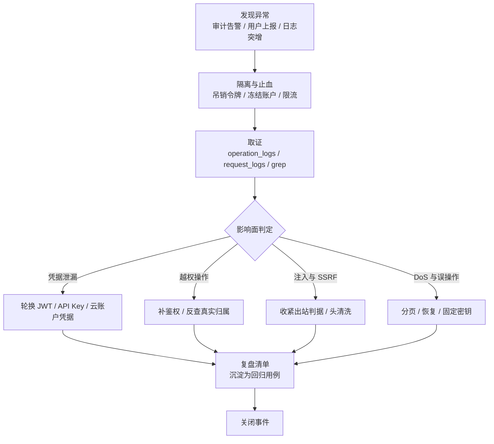
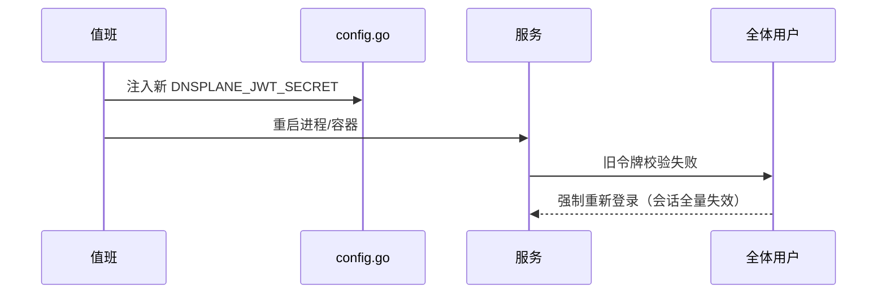
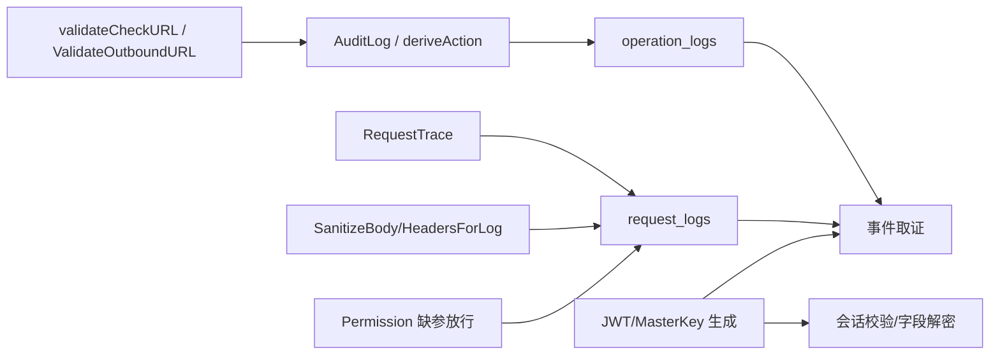
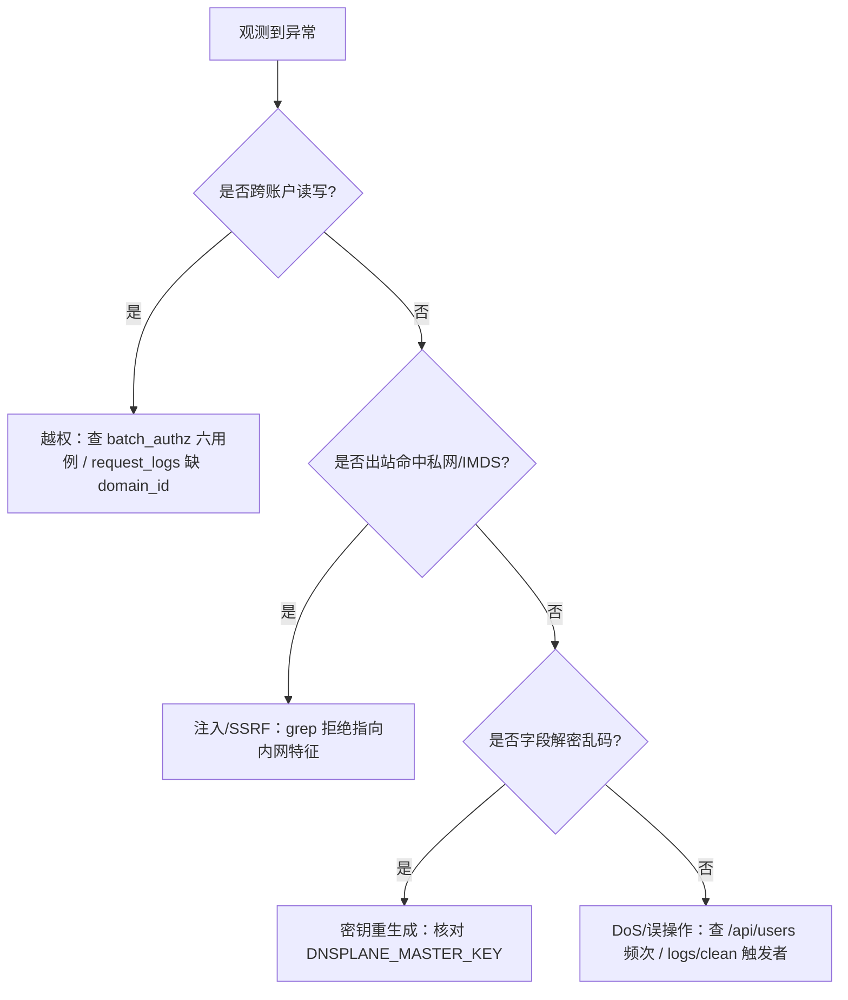

# 安全事件响应

DNSPlane 安全事件响应手册，覆盖凭据与会话、越权操作、注入与 SSRF、拒绝服务与异常操作四类事件的「发现 → 隔离 → 取证 → 修复 → 复盘」闭环。机制性防御细节见[安全防护](../用户权限系统/安全防护.md)，本文不重复其实现，只描述事件发生后的定位与处置。

<cite>
**本文档引用的文件**
- [config.go](file://main/internal/config/config.go)
- [permission.go](file://main/internal/api/middleware/permission.go)
- [user.go](file://main/internal/api/handler/user.go)
- [batch_authz_test.go](file://main/internal/api/handler/batch_authz_test.go)
- [oauth.go](file://main/internal/api/handler/oauth.go)
- [ssrf.go](file://main/internal/monitor/ssrf.go)
- [safe_url.go](file://main/internal/notify/safe_url.go)
- [sanitize.go](file://main/internal/api/middleware/sanitize.go)
- [audit.go](file://main/internal/api/middleware/audit.go)
- [csrf.go](file://main/internal/api/middleware/csrf.go)
- [util.go](file://main/internal/apiv1/util.go)
- [问题检测报告.md](file://docs/问题检测报告.md)
- [Chanlog.md](file://docs/Chanlog.md)
</cite>

## 目录

1. [简介](#简介)
2. [项目结构](#项目结构)
3. [核心组件](#核心组件)
4. [架构总览](#架构总览)
5. [详细组件分析](#详细组件分析)
   - [凭据与会话泄漏响应流程](#凭据与会话泄漏响应流程)
   - [越权操作响应流程](#越权操作响应流程)
   - [注入与 SSRF 响应流程](#注入与-ssrf-响应流程)
   - [拒绝服务与异常操作响应流程](#拒绝服务与异常操作响应流程)
6. [依赖关系分析](#依赖关系分析)
7. [性能考虑](#性能考虑)
8. [故障排查指南](#故障排查指南)
9. [结论](#结论)
10. [附录](#附录)

## 简介

本文档面向值班与应急响应人员，给出四类安全事件的定位路径与处置动作。每一类事件都遵循同一条响应主线：先用可观测信号发现异常，再隔离止血保留现场，然后通过 `operation_logs`、`request_logs` 与运行日志取证，完成修复，最后以复盘清单沉淀。事件分级沿用[问题检测报告](../问题检测报告.md)的 `严重 / 高 / 中 / 低` 口径。

响应原则：

- 先止血后追因：凭据泄漏与批量越权优先吊销与限流，避免损失扩大。
- 取证不改现场：所有查询走只读 SQL 与 `grep`，处置动作单独记录到 `operation_logs`。
- 可追溯：每个处置动作都要能对应到中间件写入的审计字段，见 [audit.go](file://main/internal/api/middleware/audit.go)。

**章节来源**
- [问题检测报告.md](file://docs/问题检测报告.md)
- [Chanlog.md](file://docs/Chanlog.md)

## 项目结构

安全事件相关代码集中在后端 `main/internal` 下，按职责分层：

```text
main/internal
├── api
│   ├── middleware          # permission / audit / csrf / sanitize / request_trace
│   ├── handler             # user / oauth / cert / cloudflare / quicklogin / qqbot
│   └── router.go           # 控制台路由链（api.Use 挂载中间件）
├── apiv1                   # 对外 V1 签名链（独立 router.go）
├── config                  # JWT Secret / MasterKey 生成与覆盖
├── crypto                  # 字段加解密（SEC-04 主密钥漂移）
├── monitor                 # ssrf.go 探测任务出站判据
├── notify                  # safe_url.go 通知出站与邮件头
└── database                # maintenance.go 日志清理
```

| 目录 | 事件相关性 | 关键文件 |
|------|-----------|---------|
| api/middleware | 鉴权、审计、脱敏落点 | permission.go、audit.go、sanitize.go |
| api/handler | 越权与凭据读写面 | user.go、oauth.go、cert.go、quicklogin.go |
| apiv1 | 外链能力不对等、无入口限流 | router.go、util.go、auth.go |
| config、crypto | 密钥生成与不可解风险 | config.go、crypto.go |
| monitor、notify | 出站 SSRF 与邮件头注入 | ssrf.go、safe_url.go |
| database | 日志清理与数据不可逆 | maintenance.go |

**章节来源**
- [router.go](file://main/internal/api/router.go)
- [apiv1/router.go](file://main/internal/apiv1/router.go)

## 核心组件

响应流程依赖以下可观测与处置组件，均以实测函数为锚：

| 组件 | 位置 | 取证/处置作用 |
|------|------|--------------|
| `AuditLog()` | [audit.go:21](file://main/internal/api/middleware/audit.go) | 写 `operation_logs`，`deriveAction` 归一动作 |
| `SanitizeBodyForLog` | [sanitize.go:101](file://main/internal/api/middleware/sanitize.go) | 落库前对敏感键与 JSON 脱敏 |
| `Permission()` | [permission.go:132](file://main/internal/api/middleware/permission.go) | 域名级鉴权，缺 `domain_id` 时放行 |
| `CSRF()` | [csrf.go:70](file://main/internal/api/middleware/csrf.go) | `SameSite=Strict` + token 双重防御 |
| `validateCheckURL` | [ssrf.go:31](file://main/internal/monitor/ssrf.go) | 探测任务出站协议/地址判据 |
| `ValidateOutboundURL` | [safe_url.go:15](file://main/internal/notify/safe_url.go) | 通知出站私网/CGNAT/IMDS 拒绝 |
| `SanitizeMailHeader` | [safe_url.go:79](file://main/internal/notify/safe_url.go) | 拒 `\r\n\x00`，阻断邮件头注入 |
| `generateRandomSecret` | [config.go:148](file://main/internal/config/config.go) | JWT/主密钥随机生成，轮换基元 |

**章节来源**
- [audit.go](file://main/internal/api/middleware/audit.go)
- [config.go](file://main/internal/config/config.go)

## 架构总览

四类事件共享同一条响应主干。发现信号来自审计与运行日志，隔离靠吊销与限流，取证靠 `operation_logs` / `request_logs` 关联，修复落在中间件与配置，复盘回到[问题检测报告](../问题检测报告.md)的分级清单。



**图表来源**
- [audit.go](file://main/internal/api/middleware/audit.go)
- [permission.go](file://main/internal/api/middleware/permission.go)
- [ssrf.go](file://main/internal/monitor/ssrf.go)

事件分级沿用[问题检测报告](../问题检测报告.md)的 `严重/高/中/低` 与 `P0/P1/P2` 口径，映射到响应窗口与首要动作：

| 级别 | 典型事件 | 响应窗口 | 首要止血动作 |
|------|---------|---------|-------------|
| 严重 P0 | cert 私钥下载 IDOR、系统配置零鉴权、主密钥漂移 | 立即 | 下线涉事路由 + 轮换 Secret |
| 高 P0 | 缺 domain_id 放行、SSRF 触达 IMDS、全量 users 拉取 | 当日 | 限流 + 补鉴权/出站判据 |
| 中 P1 | 通知出站私网、脱敏集合绕过（SEC-06/SEC-10） | 计划 | 收紧集合 + 连接期二次拦截 |
| 低 P2 | 登录时序泄露（SEC-24 `auth.go:99`） | 观察 | 统一 50-150 ms 抖动与单来源阈值 |

分级依据 v1.0.2 前端项（L-2 时序抖动）与 v1.0.7 后端项，处置顺序遵循「凭据与私钥类先于可用性类」。

**章节来源**
- [问题检测报告.md](file://docs/问题检测报告.md)
- [Chanlog.md](file://docs/Chanlog.md)

## 详细组件分析

四类事件各一节，每节按「发现途径 → 隔离 → 取证命令 → 修复 → 复盘清单」展开。

### 凭据与会话泄漏响应流程

#### 发现途径

- 登录态异常集中失效或异地会话暴增，指向 JWT Secret 泄漏。
- `operation_logs` 出现非本人发起的高权限动作，指向 API Key 或账户凭据外泄。
- 云服务商控制台出现异常 API 调用量，指向 provider 侧凭据泄漏。

JWT 与会话密钥来自 [config.go](file://main/internal/config/config.go)：启动时若配置文件缺失或密钥等于历史默认值 `dnsplane-secret-key-change-me`（`legacyDefaultJWTSecret`，:14）会用 `generateRandomSecret(32)` 生成（:132-137），环境变量 `DNSPLANE_JWT_SECRET`、`DNSPLANE_MASTER_KEY` 优先覆盖（:123-127）。

#### 隔离

1. 泄漏确认后立即停止受影响路由的对外暴露。
2. 冻结涉事账户（`models.User.Status`），不删除，保留取证字段。

#### 取证命令

`operation_logs` 由 `AuditLog()` 落库，`deriveAction(path, method)`（[audit.go:149](file://main/internal/api/middleware/audit.go)）归一动作，可按用户与时间窗拉取可疑面：

```bash
# 拉取某窗口内全部写操作，定位泄漏凭据被用于哪些动作
# 预期输出：若干行 (id, user_id, action, ip, created_at)
psql "$PG_DSN" -c "SELECT id, user_id, action, ip, created_at \
FROM operation_logs WHERE created_at >= '2026-10-12T00:00:00Z' \
AND action <> 'login' ORDER BY created_at DESC LIMIT 200;"
```

#### 修复

**JWT Secret 轮换 + 全员会话失效**：所有已签发令牌绑定旧 Secret，轮换即天然使全员会话失效。

```bash
# 生成新密钥并注入环境变量后重启容器/进程
# 预期输出：一段 32 字节随机串的十六进制/base64 表示（示例占位）
NEW_SECRET="$(head -c 32 /dev/urandom | od -An -tx1 | tr -d ' \n')"
export DNSPLANE_JWT_SECRET="{新生成的随机串}"
# 重启服务后旧令牌全部校验失败，用户需重新登录
```

会话吊销缺口见 SEC-13：注销、改密、重置均不吊销刷新令牌（`auth.go:406`）。轮换 Secret 是当前唯一能强制全量失效的兜底动作，须在复盘项中登记补吊销逻辑（见[安全防护](../用户权限系统/安全防护.md)）。

**API Key 滥用吊销**：`user.go` 提供重生成入口，`Update("api_key", newKey)`（[user.go:387](file://main/internal/api/handler/user.go)）覆盖旧键即吊销。对外 V1 签名链的密钥泄露影响更大（SEC-12，`models.go:16` api_key 无加密钩子且随列表下发），须同步轮换并检查列表回传。

**DNS/云账户凭据泄漏**：在 provider 侧（云厂商控制台）轮换 AccessKey/Token，再更新本地 `cert_accounts` 与 DNS 账户配置。解密面见 SEC-21（`account.go:119`）：解密后账户配置会入响应与读穿缓存，轮换后须失效缓存。



**图表来源**
- [config.go](file://main/internal/config/config.go)
- [user.go](file://main/internal/api/handler/user.go)

#### 复盘清单

- 轮换程序是否落到 IaC/env，而非仅临时 `export`。
- SEC-13（注销不吊销刷新令牌）是否已补统一吊销。
- API Key 是否已纳入列表不回传（SEC-12）。

**章节来源**
- [config.go](file://main/internal/config/config.go)
- [user.go](file://main/internal/api/handler/user.go)
- [问题检测报告.md](file://docs/问题检测报告.md)

### 越权操作响应流程

#### 发现途径

- 普通用户可读写非授权域名/记录/证书订单。
- 子域委派场景下，批量接口对委派外记录生效（SEC-07/08/09）。

历史案例：v1.0.7 修复 `cert.go` 全线 IDOR（任意登录用户列他人证书订单、经 `?type=key` 下载他人私钥、`POST /process` 强签烧 Let's Encrypt 配额），以及 `GET/POST /api/system/config` 零鉴权可读写 `mail_password`、`oauth_secret`、`webhook_url`（可改 `site_url` 钓鱼、改 `webhook_url` 触发 SSRF）。

#### 隔离

对涉事记录接口临时限流或下线；对涉事账户按上一节冻结。

#### 取证：Permission 缺参放行排查

`Permission()` 在提不到 `domain_id` 时直接放行（[permission.go:143-147](file://main/internal/api/middleware/permission.go)），交由 handler 判断；SEC-05 记录路径参数被无条件回落为域名标识（`permission.go:229`），可致大批非域名路由误拒或误提示。排查这类放行/回落，用 `request_logs` 按路径过滤缺失 `domain_id` 的记录：

```bash
# 统计未带 domain_id 却命中域名类路径的请求，定位放行面
# 预期输出：(path, method, cnt) 聚合，cnt 降序
psql "$PG_DSN" -c "SELECT path, method, count(*) AS cnt \
FROM request_logs WHERE path LIKE '/api/record%' AND query NOT LIKE '%domain_id=%' \
GROUP BY path, method ORDER BY cnt DESC LIMIT 50;"
```

批量子域越权的回归面已有测试锚点 [batch_authz_test.go](file://main/internal/api/handler/batch_authz_test.go)，六用例覆盖委派内外与外键：`RejectsWriteOutsideGrant`（:96 委派外拒绝）、`AllowsWriteInsideGrant`（:109 委派内放行）、`RejectsStranger`（:122 无关用户拒绝）、`RejectsForeignRecordID`（:145 外部记录 ID 拒绝）、`CloudRecordRRIndexReturnsNilOnError`（:177 索引错误返回 nil）、`CloudRecordRRIndexIndexesByRecordID`（:186 按记录 ID 建索引）。这六例是「主机名反查真实归属」教训的固化，任何越权修复须跑通全部六例。

#### 修复

- 子域判定改用云端反查真实值（SEC-09，`domain.go:1000`），删除/启停复用批量侧反查（SEC-07 `domain.go:1076`、SEC-08 `domain.go:1155`）。
- 证书部署侧补 `requireCertAccountOwner` / `requireCertOrderOwner` 与 deploy 族校验（`cert_authz.go`），目标域名同样过域权限（SEC-03，`cloudflare.go:1153`）。
- 系统配置补鉴权并建立键白名单（SEC-19，`user.go:673` 对任意键一律落库）。

#### 复盘清单

- `batch_authz_test` 六用例是否纳入 CI。
- 缺 `domain_id` 放行的路由清单是否逐条补 handler 侧归属校验。
- 证书 IDOR 修复是否覆盖下载与 `process` 两个外送面（SEC-06）。

**章节来源**
- [permission.go](file://main/internal/api/middleware/permission.go)
- [batch_authz_test.go](file://main/internal/api/handler/batch_authz_test.go)
- [Chanlog.md](file://docs/Chanlog.md)

### 注入与 SSRF 响应流程

#### 发现途径

- 出站探测/通知命中内网或云厂商元数据地址（IMDS）。
- 邮件标题/发送者出现异常换行，或投递到非预期收件人。
- 前端渲染异常（XSS）。

#### 隔离

立即停用涉事通知渠道或探测任务，阻断出站跳板。

#### 取证

Webhook/探测出站判据分两处：

- monitor 侧 [ssrf.go](file://main/internal/monitor/ssrf.go)：`validateCheckURL`（:31）做协议与主机白名单，`isPrivateOrReservedIP`（:62）拒私网/回环/链路本地，`169.254.0.0/16` 含云厂商 IMDS（:86），`ssrfDialControl`（:99）在连接阶段二次拦截解析后的私网地址防 DNS rebinding，`validateHostIP`（:115）校验 `host_ip` 字段。
- notify 侧 [safe_url.go](file://main/internal/notify/safe_url.go)：`ValidateOutboundURL`（:15）协议白名单 + 私网/回环/链路本地/`100.64.0.0/10` CGNAT/IMDS 拒绝（:62）。

`request_logs` 落库前由 [sanitize.go](file://main/internal/api/middleware/sanitize.go) 脱敏：`SanitizeBodyForLog`（:101）、`redactJSON`（:135）、`SanitizeHeadersForLog`（:155）、`isSensitiveKey`（:92）。注意 SEC-06（`cert.go:1068` 私钥随文本响应入日志）与 SEC-10（`request_trace.go:278` 查询串原样入库，脱敏集合只覆盖体与头）是两处脱敏绕过，取证时须确认命中集合。

邮件头注入取证：`SanitizeMailHeader(field, raw)`（[safe_url.go:79](file://main/internal/notify/safe_url.go)）拒绝含 `\r\n\x00` 的 `Subject/From/FromName/To`。可在出站队列日志中 grep 控制字符残留：

```bash
# 在容器/运行日志中检索疑似头注入或 SSRF 目标
# 预期输出：命中行含 169.254. / 100.64. / \r\n 特征，或对应告警文本
grep -RnE '拒绝指向(内网|私网)[^ ]*地址|169\.254\.|100\.64\.' /var/log/dnsplane/ 2>/dev/null | tail -50
```

#### 修复

- 通知侧 SEC-22（`safe_url.go:15` 仅字面量判私网且自动跟随重定向）：连接期二次拦截，禁自动跟随重定向。
- 探测侧保持 `ssrfDialControl` 连接期判据，覆盖 `TestProxy`（v1.0.3 M-6 修复 IMDS 穿透）。
- XSS 侧：v1.0.2 前端已把 `innerHTML=''` 改 `replaceChildren()` 并加 `isValidSiteKey`（`[A-Za-z0-9_-]`，长 1-128）；OAuth 绑定 URL 仅允许 `https://`（v1.0.2 M-2）。生产包 `apiv1/util.go` 仍 `import "testing"`（:8）且 `decodeBody(t *testing.T, ...)`（:41）把测试类型带入运行时 helper，属需清理的边界混淆，登记复盘。

#### 复盘清单

- 出站是否全部经 `ValidateOutboundURL`/`validateCheckURL`，无裸 `http.Get`。
- 脱敏集合是否覆盖查询串（SEC-10）与非结构化响应（SEC-06）。
- `apiv1/util.go` 的 `testing`/`httptest` 依赖是否移出生产路径。

**章节来源**
- [ssrf.go](file://main/internal/monitor/ssrf.go)
- [safe_url.go](file://main/internal/notify/safe_url.go)
- [sanitize.go](file://main/internal/api/middleware/sanitize.go)

### 拒绝服务与异常操作响应流程

#### 发现途径

- `GET /api/users` 单次返回全量用户且含 `api_key`，被高频拉取放大带宽与泄露面。
- `POST /logs/clean` 传入 `days<=0` 触发全量清空。
- 大量字段解密失败返回原串或乱码，指向容器重建后密钥重生成。

#### 隔离

对无分页端点加网关侧限流；冻结继续执行清理的会话。

#### 取证与影响面

- 无分页端点：`GetUsers`（[user.go:55](file://main/internal/api/handler/user.go)）SELECT 列表含 `api_key`（:67），`models.User.APIKey`（:35）无加密钩子且随列表下发（SEC-12）。用 `request_logs` 量化该端点调用频次：

```bash
# 统计 /api/users 调用频次与来源，判断滥用面
# 预期输出：(ip, cnt) 降序，暴露高频来源
psql "$PG_DSN" -c "SELECT ip, count(*) AS cnt FROM request_logs \
WHERE path = '/api/users' GROUP BY ip ORDER BY cnt DESC LIMIT 30;"
```

- V1 外链无入口限流：控制台链在 `router.go` 经 `api.Use` 挂载中间件，而 `apiv1/router.go` 的 `v1.Use` 仅见 `RequestTrace`，未见限流器（`rg` 在 `apiv1/` 无 `RateLimit`/`limiter`/`Bucket`/`Throttle` 命中），同一角色在控制台被拒而外链可读（问题检测报告「两条接口链能力不对等」）。
- 日志全清：`CleanOperationLogs`（[user.go:596](file://main/internal/api/handler/user.go)）经 `cleanOperationLogsQuery(days)`（:581）——`days>0` 才加 `created_at <` 条件（:584-585），`days<=0` 时不追加 `WHERE`，`Delete(&models.Log{})`（:608）即全表清空。该动作本身有审计留痕：`service.Audit.LogAction(c, "clean_logs", ...)`（:621），可在清空后的 `operation_logs` 中定位触发者与 IP。

#### 修复与数据恢复

- 无分页端点：补分页与 `api_key` 不回传（SEC-12）；V1 链补入口限流。
- 日志误删恢复：`maintenance.go` 默认清理 7-90 天前日志且全仓无备份/导出实现（PRA-02）。清理不可逆，恢复路径只能依赖数据库快照/binlog，处置前先落一份当前库快照，恢复流程参照[备份恢复策略](../部署运维/备份恢复策略.md)。
- 容器密钥重生成导致不可解：现象是 `crypto.go:95` 解密失败返回原串、上层继续误用（SEC-04）。根因是 `config.go` 在无持久化配置时用 `generateRandomSecret` 重新生成 `DNSPLANE_MASTER_KEY`（:110/:137），新旧密钥错位使全列解密失败（SEC-17）。识别方法：

```bash
# 比对启动时是否落到随机生成分支（无环境变量注入即高风险信号）
# 预期输出：命中 config.go 的随机生成日志/或 env 缺失提示
grep -RnE 'DNSPLANE_MASTER_KEY|generateRandomSecret|随机生成' /var/log/dnsplane/ 2>/dev/null | tail
# 确认容器已把主密钥固定注入，且以指纹校验失败即显式退出（SEC-04 建议）
echo "DNSPLANE_MASTER_KEY 是否为受管 Secret：{是/否/未知}"
```

#### 复盘清单

- `GET /api/users` 是否已分页且剥离 `api_key`。
- V1 外链是否补齐入口限流，消除能力不对等。
- 主密钥是否以受管 Secret 注入，杜绝容器重建随机重生成。

**章节来源**
- [user.go](file://main/internal/api/handler/user.go)
- [config.go](file://main/internal/config/config.go)
- [问题检测报告.md](file://docs/问题检测报告.md)

## 依赖关系分析

响应链路的依赖关系如下：审计与脱敏是所有取证的公共底座，鉴权与出站判据是修复落点，密钥管理横跨凭据与不可解两类事件。



**图表来源**
- [audit.go](file://main/internal/api/middleware/audit.go)
- [sanitize.go](file://main/internal/api/middleware/sanitize.go)
- [config.go](file://main/internal/config/config.go)

依赖要点：

- `sanitize.go` 脱敏集合若未覆盖查询串（SEC-10）与非结构化响应（SEC-06），则 `request_logs` 取证本身可能含明文凭据，取证读取须按敏感处理。
- `Permission` 与 handler 归属校验互为兜底，任一侧缺失都会在 `request_logs` 留下放行痕迹。
- 密钥依赖：凭据轮换与不可解识别同源于 `config.go`，处置凭据事件时须一并确认主密钥注入方式。

**章节来源**
- [permission.go](file://main/internal/api/middleware/permission.go)
- [safe_url.go](file://main/internal/notify/safe_url.go)

## 性能考虑

拒绝服务类事件的处置本身有性能边界，需在止血与可用性间权衡：

- 无分页端点（`GET /api/users`）补分页前，网关侧限流优先于应用层改造，避免全量结果集持续放大内存。
- 批量授权存在重建全量索引的开销（PRF-01：索引移到循环外构建一次），高并发越权排查时以 `request_logs` 聚合而非逐条回放，降低取证对在线库压力。
- `ssrfDialControl` 在连接阶段二次解析拦截，对高频探测任务有额外 DNS 开销，隔离期可临时下调探测频率而非直接关停全部渠道。
- `operation_logs` / `request_logs` 查询务必带时间窗与 `LIMIT`，防止取证查询自身演变为二次 DoS。

**章节来源**
- [ssrf.go](file://main/internal/monitor/ssrf.go)
- [问题检测报告.md](file://docs/问题检测报告.md)

## 故障排查指南

按信号快速归类的决策树：



**图表来源**
- [permission.go](file://main/internal/api/middleware/permission.go)
- [ssrf.go](file://main/internal/monitor/ssrf.go)
- [config.go](file://main/internal/config/config.go)

常用取证命令速查：

| 目的 | 命令锚点 |
|------|---------|
| 泄漏凭据动作面 | `operation_logs` 按 `action`/`created_at` 过滤 |
| 放行/回落排查 | `request_logs` 按 `path LIKE '/api/record%'` 且无 `domain_id` |
| 无分页滥用量化 | `request_logs` 按 `/api/users` 聚合 `ip` |
| 日志全清追责 | `operation_logs` 过滤 `action='clean_logs'` |
| 出站拦截证据 | `grep -RnE '拒绝指向(内网|私网)...|169\.254\.'` |

**章节来源**
- [audit.go](file://main/internal/api/middleware/audit.go)
- [user.go](file://main/internal/api/handler/user.go)

取证与通报要点：

- 取证前冻结涉事记录而非删除；`clean_logs` 动作本身留有审计痕迹（[user.go:621](file://main/internal/api/handler/user.go)），据此回溯触发者与 IP。
- 所有排查 SQL 走只读、带时间窗与 `LIMIT`，避免取证查询演变为二次 DoS。
- `request_logs` 若命中 SEC-06/SEC-10 未覆盖路径，可能含明文凭据，读取与导出一律按机密处理，不外发。
- 修复验收以 [batch_authz_test.go](file://main/internal/api/handler/batch_authz_test.go) 六用例全绿为门禁，越权类新事件补对应回归用例。
- 处置动作要单独落 `operation_logs`，与攻击流量在同一张表中区分。

通报与升级路径：

| 触发条件 | 通报对象 | 动作 |
|---------|---------|------|
| 云账户凭据泄漏 | provider 侧工单 + 本地账户缓存 | 控制台轮换 + 失效读穿缓存（SEC-21） |
| 证书私钥外泄 | Let's Encrypt/CA + 运维 | 吊销订单、停止 `process` 重签 |
| 全站凭据疑似泄漏 | 全体用户 | 轮换 `DNSPLANE_JWT_SECRET` 强制重新登录 |
| 数据误删 | 数据负责人 | 落快照后按[备份恢复策略](../部署运维/备份恢复策略.md)评估 binlog 恢复 |

**章节来源**
- [问题检测报告.md](file://docs/问题检测报告.md)
- [user.go](file://main/internal/api/handler/user.go)

## 结论

四类事件在同一主干下处置：以 `audit`/`request_trace`/`sanitize` 构成的可观测层为取证底座，以 `permission`、出站判据、密钥管理为修复落点。凭据事件优先轮换以强制会话失效；越权事件以 `batch_authz` 六用例固化反查归属；注入与 SSRF 以连接期二次拦截兜底；DoS 与误操作暴露出无分页、无入口限流、无备份三处结构性缺口。机制细节见[安全防护](../用户权限系统/安全防护.md)，本文聚焦响应动作与证据链。

**章节来源**
- [问题检测报告.md](file://docs/问题检测报告.md)
- [Chanlog.md](file://docs/Chanlog.md)

## 附录

### CVE / 审计修复历史速查表

来源为 [Chanlog.md](file://docs/Chanlog.md) 实测条目（提交 SHA 取自 `git log` 口径）。

| 版本 | 提交 | 类别 | 关键修复要点 |
|------|------|------|-------------|
| v1.0.0 | d14559a | 审计基线 | 一轮审计 14 项修复 + 残留英文汉化 |
| v1.0.2 | 61f5ac1 | 前端安全 | 6 项：OAuth 绑定 URL 仅 `https://`、captcha `innerHTML`→`replaceChildren` + `isValidSiteKey`、登录失败统一 50-150 ms 抖动 |
| v1.0.3 | cdda231 | 第三轮审计 | 7 项高危 + 中危；M-6 `TestProxy` 拒私网/回环/链路本地（IMDS 穿透） |
| v1.0.4 | — | 中危收尾 | 第三轮剩余中危收尾（`M-5`/`M-6` 已在 `cdda231` 处置） |
| v1.0.7 | b664c13 | 第四轮深度审计 | cert.go 全线 IDOR、系统配置零鉴权、`EmailNotifier` CRLF→`SanitizeMailHeader`、四 notifier SSRF→`ValidateOutboundURL`、删 `typescript.ignoreBuildErrors` |
| v1.0.8 | 59dacf8 | 依赖 CVE | React / Next CVE 升级 |

关联风险口径（[问题检测报告](../问题检测报告.md) Top 20 高危，节选与本文四类对应）：

| 编号 | 事件类 | 位置 | 现象 |
|------|--------|------|------|
| SEC-04 | 密钥不可解 | `crypto.go:95` | 解密失败返回原串且主密钥可随机重生成 |
| SEC-13 | 凭据与会话 | `auth.go:406` | 注销与改密不吊销既有会话 |
| SEC-05 | 越权 | `permission.go:229` | 路径参数无条件回落为域名标识 |
| SEC-09 | 越权 | `domain.go:1000` | 子域判定依据请求自带名称 |
| SEC-22 | SSRF | `safe_url.go:15` | 仅字面量判私网且自动跟随重定向 |
| SEC-12 | DoS/凭据 | `models.go:16` | API Key 无加密且随列表下发 |
| PRA-02 | 误操作 | `maintenance.go` | 无备份实现且默认清理历史日志 |

回溯部署须按提交 SHA 指定，勿按 Git 标签：标签仅到 `v1.0.3`，`git checkout v1.0.3` 取到的是 cloudflare 功能提交，不含 v1.0.4-v1.0.11 的 cert 族 IDOR、系统配置零鉴权、路径遍历、JWT 算法混淆等修复。

**章节来源**
- [Chanlog.md](file://docs/Chanlog.md)
- [问题检测报告.md](file://docs/问题检测报告.md)

### 占位写法示例

以下为标准占位来源块，供后续补写小节沿用：

**章节来源**
- [相关源码](file://main/internal/api/middleware/audit.go)
