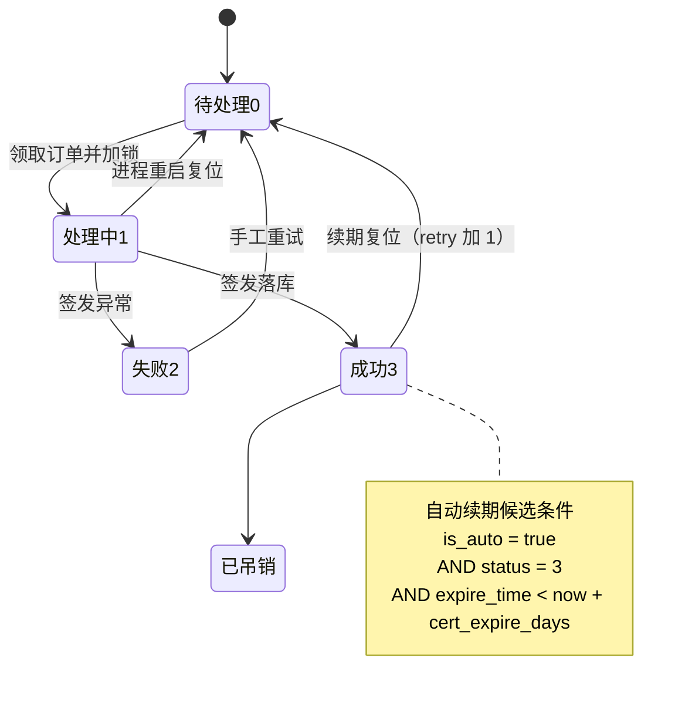
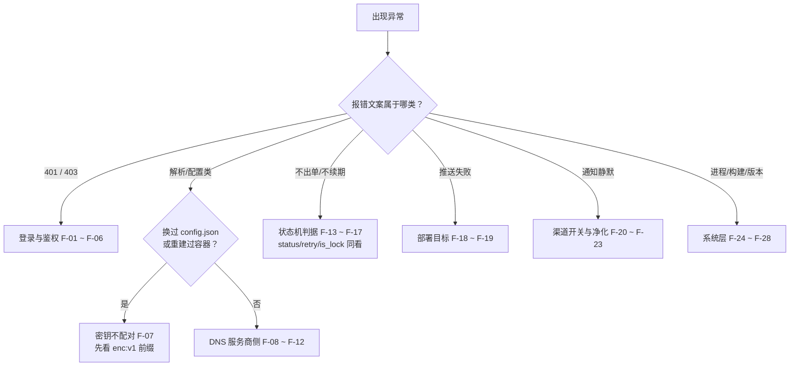
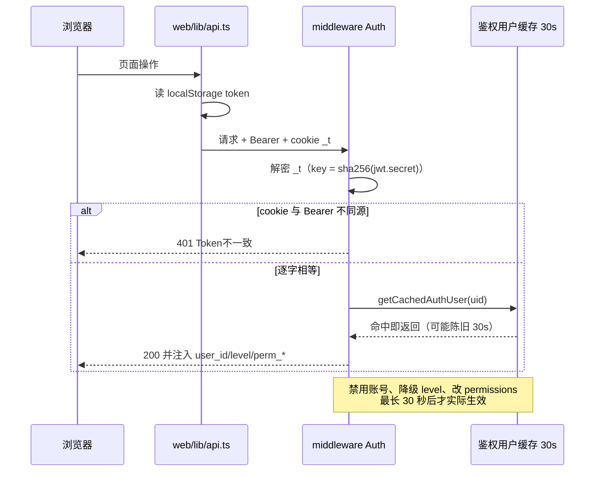

# 常见问题解决

<cite>
**本文档引用的文件**
- [auth.go](file://main/internal/api/middleware/auth.go)
- [csrf.go](file://main/internal/api/middleware/csrf.go)
- [permission.go](file://main/internal/api/middleware/permission.go)
- [totp.go](file://main/internal/utils/totp.go)
- [auth.go](file://main/internal/api/handler/auth.go)
- [account.go](file://main/internal/api/handler/account.go)
- [domain.go](file://main/internal/api/handler/domain.go)
- [batch.go](file://main/internal/api/handler/batch.go)
- [batch_authz.go](file://main/internal/api/handler/batch_authz.go)
- [record_sync.go](file://main/internal/service/record_sync.go)
- [main.go](file://main/main.go)
- [acme.go](file://main/internal/cert/acme/acme.go)
- [ensure_challenge.go](file://main/internal/dns/ensure_challenge.go)
- [task_runner.go](file://main/internal/service/task_runner.go)
- [cert.go](file://main/internal/api/handler/cert.go)
- [ssh.go](file://main/internal/cert/deploy/servers/ssh.go)
- [fnos.go](file://main/internal/cert/deploy/providers/fnos.go)
- [local.go](file://main/internal/cert/deploy/servers/local.go)
- [merge_deploy_api.go](file://main/internal/cert/deploy/merge_deploy_api.go)
- [notify.go](file://main/internal/notify/notify.go)
- [custom_webhook.go](file://main/internal/notify/custom_webhook.go)
- [safe_url.go](file://main/internal/notify/safe_url.go)
- [ssrf.go](file://main/internal/monitor/ssrf.go)
- [optimize.go](file://main/internal/service/optimize.go)
- [dashboard.go](file://main/internal/api/handler/dashboard.go)
- [database.go](file://main/internal/database/database.go)
- [maintenance.go](file://main/internal/database/maintenance.go)
- [config.go](file://main/internal/config/config.go)
- [crypto.go](file://main/internal/crypto/crypto.go)
- [hooks.go](file://main/internal/models/hooks.go)
- [api.ts](file://web/lib/api.ts)
- [Dockerfile](file://Dockerfile)
- [devlog.md](file://devlog.md)
- [故障排除.md](file://docs/故障排除/故障排除.md)
- [问题检测报告.md](file://docs/问题检测报告.md)
- [部署运维.md](file://docs/部署运维/部署运维.md)
- [analysis-auth.md](file://../.wiki-context/analysis-auth.md)
- [analysis-dns.md](file://../.wiki-context/analysis-dns.md)
- [analysis-cert.md](file://../.wiki-context/analysis-cert.md)
- [analysis-notify.md](file://../.wiki-context/analysis-notify.md)
- [analysis-ext.md](file://../.wiki-context/analysis-ext.md)
- [scan-infra.md](file://../.wiki-context/scan-infra.md)
</cite>

## 目录

1. [简介](#简介)
2. [项目结构](#项目结构)
3. [核心组件](#核心组件)
4. [架构总览](#架构总览)
5. [详细组件分析](#详细组件分析)
6. [依赖关系分析](#依赖关系分析)
7. [性能考虑](#性能考虑)
8. [故障排查指南](#故障排查指南)
9. [结论](#结论)
10. [附录](#附录)

## 简介

本篇是 DNSPlane 故障处置的**条目库**：按 6 个域给出 28 条高频问题的
「症状 / 原因 / 方案」三段式解法，每条附定位命令或文件路径。

| 文档 | 职责 | 什么时候看 |
|:---|:---|:---|
| [故障排除.md](./故障排除.md) | 分诊方法、通用处置流程、现场采集口径 | 还不知道问题属于哪个域 |
| 本篇 | 已知症状的直接解法（F 编号可引用） | 已有明确症状或报错文案 |
| [备份恢复策略.md](../部署运维/备份恢复策略.md) | 密钥、备份、恢复演练 | 恢复后凭据不可用 |

取证标记（全篇统一）：`实测` = 本次已在当前工作区执行并核过输出
（如 `sqlite3 main/data/data.db "PRAGMA journal_mode"` 返回 `wal`、
`rg -n "Token不一致"` 命中 `auth.go:147`）；`源码` = 结论来自代码路径与行号；
`未实机` = 命令形态取自源码或文档口径，本次未执行。凭据一律 `{占位}`。

**章节来源**
- [故障排除.md](file://docs/故障排除/故障排除.md)
- [database.go](file://main/internal/database/database.go)
- [auth.go](file://main/internal/api/middleware/auth.go)

## 项目结构

### 六个域的条目分布
> **章节来源**：本小节取证文件与下一小节合并列出，见其末尾**章节来源**块。


> 条目级文件归属见各域小节末尾的**章节来源**。

| 编号段 | 域 | 条数 | 主要取证位置 |
|:---|:---|:---:|:---|
| F-01 ~ F-06 | 安装与登录 | 6 | `middleware/auth.go`、`handler/auth.go`、`web/lib/api.ts` |
| F-07 ~ F-12 | DNS 操作 | 6 | `crypto/crypto.go`、`middleware/permission.go`、`handler/domain.go` |
| F-13 ~ F-17 | 证书 | 5 | `cert/acme/acme.go`、`service/task_runner.go` |
| F-18 ~ F-19 | 部署 | 2 | `cert/deploy/servers/ssh.go`、`cert/deploy/providers/` |
| F-20 ~ F-23 | 通知 | 4 | `notify/notify.go`、`notify/safe_url.go`、`monitor/ssrf.go` |
| F-24 ~ F-28 | 系统 | 5 | `main/main.go`、`handler/dashboard.go`、`config/config.go` |

### 三处最容易被误判为故障的设计语义

| 现象 | 真实语义 | 出处 |
|:---|:---|:---|
| HTTP 200 但页面报错 | 业务失败统一以 `200 + code:-1` 返回，前端按 `code` 分支 | 权限与 handler 层通用约定，`故障排除.md` 术语表 |
| `logs` 表查不到登录记录 | `/api/auth/` 前缀被审计跳过，口令登录本身不进库 | `analysis-auth.md` 审计条目 |
| 系统信息页版本 `1.0.0` | `dashboard.go:500` 写死常量，非运行时版本 | 详见 F-25 |


**章节来源**
- [auth.go](file://main/internal/api/middleware/auth.go)
- [permission.go](file://main/internal/api/middleware/permission.go)
- [dashboard.go](file://main/internal/api/handler/dashboard.go)
- [故障排除.md](file://docs/故障排除/故障排除.md)

## 核心组件

### 六个域各自的失败落点
> **章节来源**：本小节取证文件与下一小节合并列出，见其末尾**章节来源**块。


> **章节来源**：同上表「关键文件」列。

| 域 | 失败落点 | 关键文件 | 关联条目 |
|:---|:---|:---|:---|
| 安装与登录 | 双通道一致性 + 用户缓存 | `middleware/auth.go:128-181` | F-01 ~ F-06 |
| DNS 操作 | 密文列解密 + rr 级权限 | `crypto/crypto.go`、`permission.go:132-207` | F-07 ~ F-12 |
| 证书 | 订单状态机 + 续期计数 | `service/task_runner.go:163-207` | F-13 ~ F-17 |
| 部署 | 主机密钥校验 + 面板回写 | `cert/deploy/servers/ssh.go:86-120` | F-18 ~ F-19 |
| 通知 | 头部净化 + 双层渠道开关 | `notify/notify.go:113-131` | F-20 ~ F-23 |
| 系统 | 监听不退出 + 版本常量 | `main.go:133-144`、`dashboard.go:500` | F-24 ~ F-28 |

### 证书订单状态机

F-13 ~ F-17 的判据全部落在这张状态机上。`status = 1`（处理中）
只有在进程重启时才会被 `resetStuckOrders` 复位为 `0`（`database.go:152-157`）。



**图表来源**
- [task_runner.go](file://main/internal/service/task_runner.go)
- [cert.go](file://main/internal/api/handler/cert.go)
- [database.go](file://main/internal/database/database.go)

**章节来源**
- [auth.go](file://main/internal/api/middleware/auth.go)
- [task_runner.go](file://main/internal/service/task_runner.go)
- [ssh.go](file://main/internal/cert/deploy/servers/ssh.go)

## 架构总览

### 症状分诊决策树
> **章节来源**：本小节取证文件与下一小节合并列出，见其末尾**章节来源**块。


先归域再进条目。归错域是排障时间浪费的主因——
尤其「账户报解析错」看着像服务商问题，实际是密钥配对问题。



**图表来源**
- [crypto.go](file://main/internal/crypto/crypto.go)
- [auth.go](file://main/internal/api/middleware/auth.go)
- [task_runner.go](file://main/internal/service/task_runner.go)

### 会话校验的双通道结构

登录态由 `_t`（access）cookie 与 `Authorization: Bearer` 同时携带，
`middleware/auth.go` 要求**解密后的 cookie 值与 Bearer 头逐字相等**，
不一致直接 401 `Token不一致`（`:147`）。



**图表来源**
- [auth.go](file://main/internal/api/middleware/auth.go)
- [api.ts](file://web/lib/api.ts)
- [analysis-auth.md](file://../.wiki-context/analysis-auth.md)

**章节来源**
- [auth.go](file://main/internal/api/middleware/auth.go)
- [config.go](file://main/internal/config/config.go)
- [crypto.go](file://main/internal/crypto/crypto.go)

## 详细组件分析

### 安装与登录（F-01 ~ F-06）

#### F-01 登录后立即 401，响应 `Token不一致`

- **症状**：口令正确，跳转后第一个鉴权请求即 401，文案 `Token不一致`；
  清 cookie 有时好，换浏览器又复现
- **原因**：`middleware/auth.go:147` 要求 `_t` 解密结果与 Bearer 逐字相等。
  前端 `web/lib/api.ts` 每次请求从 `localStorage` 取 token，多标签页里另一处
  已刷新过 token，或反代缓存了旧 cookie，两通道即不同源
- **方案**：退出 → 清 `localStorage` 的 token 与 `_t`/`_rt` cookie → 重新登录；
  脚本客户端只走 Bearer 一条通道（不带 cookie 就不触发一致性判定）

#### F-02 服务重启后全员被踢下线

- **症状**：无人操作，重启实例后所有人 401，必须重新登录
- **原因**：`jwt.secret` 变了。它既是 token 签名密钥，也是 cookie 加密密钥
  （`AES-GCM(key = sha256(jwt.secret))`）。容器重建且 `config.json` 未持久化时，
  `config.Load` 会随机生成新值并回写（`config.go:105-113`）
- **方案**：固定注入 `DNSPLANE_JWT_SECRET` 并把 `config.json` 挂为持久卷；
  已发生的下线只能全员重登，无兼容路径。同时确认 `DNSPLANE_MASTER_KEY` 一起固定，
  否则连带 F-07


#### F-03 TOTP 一直提示验证码错误

- **症状**：令牌码看着没错，提交就失败；换设备同样失败
- **原因**：TOTP 为 30 秒周期、窗口前后各 1 格（`utils/totp.go:70-82`），
  校验用的是**服务端时钟**，偏移超过约 ±60 秒必然失败。
  另一成因是 `users.totp_secret` 解不开（见 F-07），表现为恒定失败
- **方案**：先校时再判码；确认是密钥损坏时走 `forgot-totp` → `reset-totp`
  重置链路（需邮箱验证码 + 人机验证，`handler/auth.go:942/:997`）

```bash
date -u            # 实测：取服务器 UTC 与手机原子钟比对即可判定偏移
# 未实机：校时后复测
chronyc -a makestep 2>/dev/null || ntpdate pool.ntp.org
```

#### F-04 管理员改了权限，用户侧「不生效」

- **症状**：已禁用账号或调整 `permissions`，对方几十秒内仍能继续操作
- **原因**：鉴权用户缓存 `authUserCacheTTL = 30 * time.Second`
  （`middleware/auth.go:99`），命中即返回；失效函数 `InvalidateAuthUserCache`
  定义后无任何调用点（`analysis-auth.md` 实测）
- **方案**：等 30 秒；需立即阻断就让对方退出登录或临时重启。
  这是缓存陈旧，**不要**顺着权限判定逻辑去查代码

#### F-05 写请求返回 403 `CSRF token 缺失 / 不匹配`

- **症状**：GET 正常，POST/PUT 一律 403，登录状态看着没问题
- **原因**：`_csrf` cookie 为**非 HttpOnly、SameSite=Strict**
  （`middleware/csrf.go:62-67`），需前端回显到 `X-CSRF-Token`。
  反代改写协议导致 `Secure` 判定与 `X-Forwarded-Proto` 不一致、
  或跨子域调用不带 cookie，都会丢头（`csrf.go:106/:110` 两个 403 分支）
- **方案**：确认反代透传 `X-Forwarded-Proto`、前端同源访问；
  接口型客户端改走 API Key 通道（`apiv1` 不挂 CSRF 链）

#### F-06 全新安装后无法登录，提示未初始化

- **症状**：日志出现「数据库未初始化，请访问前端首页或调用 POST /api/install」
- **原因**：用户表为空时 `initAdmin` **不会**自动建号
  （旧版 `admin/admin123` 已因安全审计 H-1 移除，`database.go:316-326`）
- **方案**：访问前端首页走安装向导，或 `POST /api/install` 设置管理员账号。
  这一步同时是整库重建后的数据回填入口，流程见
  [备份恢复策略.md](../部署运维/备份恢复策略.md)

**章节来源**
- [auth.go](file://main/internal/api/middleware/auth.go)
- [csrf.go](file://main/internal/api/middleware/csrf.go)
- [totp.go](file://main/internal/utils/totp.go)
- [auth.go](file://main/internal/api/handler/auth.go)
- [database.go](file://main/internal/database/database.go)
- [api.ts](file://web/lib/api.ts)
- [analysis-auth.md](file://../.wiki-context/analysis-auth.md)

### DNS 操作（F-07 ~ F-12）

#### F-07 账户点开报配置解析错误、域名列表整体失败

- **症状**：账户列表能显示行，进详情或拉记录就报解析类错误，
  **全程没有「解密失败」字样**
- **原因**：`enc:v1:` 列解密失败时 `MustDecrypt` 静默返回原文
  （`crypto.go:95-101`），服务商 SDK 收到的是密文字符串。
  根因几乎都是 `master_key` 与库不配对：换过 `config.json`、
  容器重建自动生成新密钥、或恢复时只恢复了库
- **方案**：用与库同时点的 `config.json`（或固定 `DNSPLANE_MASTER_KEY`）重启；
  配对确认后跑账户校验接口验证链路（`handler.CheckAccount`，`router.go:115`）

```bash
# 实测：库可读、账户行数与明文混杂度取证（sqlite3 3.50.6 本机可用）
sqlite3 "file:main/data/data.db?mode=ro" "SELECT count(*) FROM accounts;"   # 4
sqlite3 "file:main/data/data.db?mode=ro" \
  "SELECT count(*) FROM accounts WHERE config NOT LIKE 'enc:v1:%';"
```

#### F-08 记录改了但线上解析还是旧值

- **症状**：面板显示已更新，`dig` 仍返回旧值或时有时无
- **原因**：三层。① 云端 TTL 未到期，属正常缓存；
  ② 空 `line`/`ttl` 走默认补齐（`handler/domain.go:915-920` → `default`/`600`），
  而「更新前取回原 TTL 防零值覆盖」的保护实际未接线
  （`service/record_sync.go:370` 的 `CurrentRecordTTL` 无调用方）；
  ③ 服务商口径差异，`namesilo` 强制 3600（`namesilo.go:312`）
- **方案**：先看服务商控制台的真实 TTL 再设值；
  用 `dig +noall +answer` 多 resolver 对比，并核对面板回写的 `min_ttl`


#### F-09 子域委派用户提示 `无权限操作该子域名`

- **症状**：同一账号在部分子域可用，另一些写入被拒，HTTP 仍是 200
- **原因**：`permissions.sub` 为空或 `*` 时全覆盖，否则按逗号列表
  **精确匹配 rr**（`subGrantCoversRR`）。`www.example.com` 与 `www` 混写、
  或 rr 带尾点都会判定失败；拒绝分支在 `middleware/permission.go:194`
- **方案**：统一按 rr 短名填写委派列表；改完等 30 秒缓存过期（见 F-04）

#### F-10 委派用户删掉了不该管的记录 / 记录被静默改名

- **症状**：只授权 `www` 的用户能删 `admin` 的记录；
  或更新 `www` 时把 `admin` 那条改成了 `www`
- **原因**：单条删除与启停只查域权限与只读位，未回查 rr
  （`handler/domain.go:1068`、`:1147`）；更新路径用**请求里的 rr** 做子域判定，
  却按 `record_id` 覆盖（`:1000`、`:1019`）。批量接口已经通过
  `batch_authz.go:87` 云端反查堵住，单条路径仍敞开（问题检测报告 I-02/I-03）
- **方案**：委派场景优先使用批量接口，单条操作需管理员复核。
  这是**越权风险而非偶发故障**，修复前应作为操作纪律约束

#### F-11 某家服务商在账户类型下拉里根本不出现

- **症状**：源码目录里有该 provider，界面上选不到
- **原因**：provider 靠 `main.go` 的 blank import 在 `init()` 期注册，
  缺行即静默不注册；工作区实测存在 `ucloud` 死包（`analysis-ext.md` P1）
- **方案**：确认 `main.go:31-52` 是否包含该包；用依赖图证伪，
  不要靠 `ls providers/` 判断注册状态


#### F-12 配额显示已满，云端实际没有那么多记录

- **症状**：新增记录被配额拦截，去服务商控制台一看远未达上限
- **原因**：配额判定读本地副本表 `dns_records`，而批量删除成功后不清理该表
  （`handler/batch.go:375-388`）
- **方案**：先跑一次记录同步把工作区行清准；删除类操作后人工核对本地副本

**章节来源**
- [crypto.go](file://main/internal/crypto/crypto.go)
- [hooks.go](file://main/internal/models/hooks.go)
- [account.go](file://main/internal/api/handler/account.go)
- [domain.go](file://main/internal/api/handler/domain.go)
- [record_sync.go](file://main/internal/service/record_sync.go)
- [permission.go](file://main/internal/api/middleware/permission.go)
- [batch_authz.go](file://main/internal/api/handler/batch_authz.go)
- [batch.go](file://main/internal/api/handler/batch.go)
- [main.go](file://main/main.go)
- [analysis-dns.md](file://../.wiki-context/analysis-dns.md)
- [analysis-ext.md](file://../.wiki-context/analysis-ext.md)

### 证书（F-13 ~ F-17）

#### F-13 签发报 `newAccount` 429 / rate limited

- **症状**：同一账户连续下单后 Let's Encrypt 返回 429，之后数小时无法再签
- **原因**：ACME 账户密钥从未持久化——`CreateOrder` 内部自调 `Register` 时
  丢弃返回值（`acme.go:582-586`），也不写回 `cert_accounts.ext`
  （`cert.go:726-733`），于是**每单新建一个账户**，直接撞速率限制
- **方案**：短期降频并复用同一证书账户、等窗口过去；
  根治是把 `account_key`/`account_url` 写回账户扩展字段（P1 第 8 项）

#### F-14 DNS-01 通过后 `_acme-challenge` TXT 一直残留

- **症状**：同一域名堆积多条过期 TXT，部分服务商报 TXT 条数超限
- **原因**：签发成功后全仓无删除逻辑，只调 `EnsureChallengeRecord`；
  TXT 分支还是「异值追加不覆盖」（`ensure_challenge.go:89-95`）
- **方案**：手工清理该域名的 `_acme-challenge` TXT；
  下次签发前确认没有历史多值干扰校验

#### F-15 换 ZeroSSL / Google / LiteSSL 后注册失败

- **症状**：报 `externalAccountRequired`、`badJwk` 一类 EAB 错误
- **原因**：这三家与自定义 ACME 需要 EAB 参数，表单键为 `eab_kid` /
  `eab_hmac_key`（Google、LiteSSL 侧为 `kid`/`key`）；
  **Let's Encrypt 不适用 EAB**。参数缺失或填到不支持 EAB 的 CA 上都会失败
- **方案**：按 `providers.go` 表单与 `acme.go` 工厂口径补齐；
  自定义 ACME 的 `directory` 必须是完整 directory URL

#### F-16 证书到期了却没有自动续期

- **症状**：`expire_time` 已过，任务不再尝试，日志出现「已连续尝试5次仍未成功」
- **原因**：续期计数 `retry` 每轮 +1 但成功路径不归零
  （`task_runner.go:203`、`cert.go:810`），累计到 5 即被 `:172` 永久停摆，
  90 天证书约 15 个月就会撞上。另一常见成因是不满足候选条件：
  必须 `is_auto = true AND status = 3 AND expire_time < now + cert_expire_days`
  （默认提前 30 天），手工签发或未成功的证书不在候选集内
- **方案**：手工触发一次签发（`TriggerCertOrderProcessing`，`cert.go:552`）
  并确认 `is_auto` 已勾选；根治是续期成功后重置计数（P1 第 9 项）

#### F-17 订单一直停在「处理中」不动

- **症状**：`status = 1` 长时间不变，页面无进展也不会自动重试
- **原因**：领取订单的 goroutine 随进程退出丢失，状态残留在库中；
  只有下次启动的 `resetStuckOrders` 才会复位为 0（`database.go:152-157`）
- **方案**：重启实例即自动复位；急用时手工
  `UPDATE cert_orders SET status = 0 WHERE status = 1`，
  但要确认没有其他实例并发处理（`is_lock` 位）


**章节来源**
- [acme.go](file://main/internal/cert/acme/acme.go)
- [ensure_challenge.go](file://main/internal/dns/ensure_challenge.go)
- [task_runner.go](file://main/internal/service/task_runner.go)
- [cert.go](file://main/internal/api/handler/cert.go)
- [database.go](file://main/internal/database/database.go)
- [analysis-cert.md](file://../.wiki-context/analysis-cert.md)
- [问题检测报告.md](file://docs/问题检测报告.md)

### 部署（F-18 ~ F-19）

#### F-18 SSH 部署报主机密钥校验失败

- **症状**：部署任务失败提示主机密钥不匹配；
  或日志出现「未配置 host_key，当前跳过主机密钥校验（MITM 风险）」
- **原因**：`servers/ssh.go:86` 用 `buildHostKeyCallback(host, p.GetString("host_key"))`，
  接受 known_hosts 整行或裸公钥两种格式；未配置时**退回不校验并打 Warn**
  （`:111-113`），格式非法解析失败同样退回不校验（`:115-118`）
- **方案**：在 `CertDeploy.Config` 填入 `host_key`；目标机换过 host key 时同步更新。
  注意 `providers/fnos.go:155` 仍是固定不校验，属未收口点


#### F-19 面板类目标（宝塔 / NPM / kangle 等）报权限或证书 ID 错误

- **症状**：证书已签发但推到面板失败，返回 403、要求密钥或 IP 未授权
- **原因**：面板侧要求 API key / 账号口令 / Token，多数还校验来源 IP；
  另有回写语义——NPM 首次成功后回写证书 ID（`analysis-cert.md` 面板条目），
  换面板实例后旧 ID 失效。面板凭据存在 `CertDeploy.Config` 密文列，
  受 F-07 的密钥配对问题连带影响
- **方案**：核对面板 API 白名单与密钥有效期；跨实例迁移时重建部署配置
  而不是复用旧证书 ID；先排除密钥配对再看面板返回

**章节来源**
- [ssh.go](file://main/internal/cert/deploy/servers/ssh.go)
- [fnos.go](file://main/internal/cert/deploy/providers/fnos.go)
- [merge_deploy_api.go](file://main/internal/cert/deploy/merge_deploy_api.go)
- [local.go](file://main/internal/cert/deploy/servers/local.go)
- [hooks.go](file://main/internal/models/hooks.go)
- [analysis-cert.md](file://../.wiki-context/analysis-cert.md)

### 通知（F-20 ~ F-23）

#### F-20 邮件渠道保存成功但发送失败

- **症状**：测试按钮报错，或含中文/特殊字符的发件人、收件人始终发不出去
- **原因**：`notify/safe_url.go:79` 的 `SanitizeMailHeader` 拒绝 `\r`、`\n`、NUL
  （防 CRLF 注入），调用点覆盖 Subject/From/FromName/每个 To
  （`notify.go:113-131`）。另 `mail_recv` 为空时回退 `mail_from`，
  端口非法或缺省回 `25`（`analysis-notify.md`）
- **方案**：清掉发件人显示名里的换行与不可见字符；显式填写 `mail_recv`；
  核对 `mail_port` 与实际 SMTP 端口。`mail_type` 为 API 通道时
  改校验 `mail_api_user`/`mail_api_key`

#### F-21 测试通知能收到，真实事件却不发

- **症状**：系统设置里「测试」成功，容灾切换或证书到期时静默
- **原因**：渠道开关分两层——全局 `*_enabled` 与任务级 `notice_mail` /
  `notice_tgbot` / `notice_qqbot` / `notice_webhook` / `notice_custom_webhook`
  （`channel_registry.go:47-49`）；且 `discord`/`wechat`/`dingtalk`/`feishu`
  等渠道**不受任务白名单管辖**。另有已知缺口：渠道清单未由注册表生成，
  测试端点与任务白名单口径不一致（P1 第 12 项）
- **方案**：两层开关都要打开；核对任务上勾选的渠道键名；
  不受管辖的渠道只看全局开关


#### F-22 内网地址的探测或代理目标被拒

- **症状**：报 `拒绝指向内网域名 "xxx" 的探测任务`，或请求在 connect 阶段被拒
- **原因**：监控探测侧有完整 SSRF 防线——`monitor/ssrf.go:21-99` 拒绝私网、
  回环、链路本地（含 `169.254.0.0/16` IMDS）、组播与保留段以及内网 TLD，
  并在 `ssrfDialControl` 于 `connect(2)` 前二次拦截解析后指向私网的地址
  （防 DNS rebinding）；优化 IP 的代理前缀同样强制校验
  （`service/optimize.go:140,260,273`）
- **方案**：探测与代理类目标必须公网可达；确需访问内网改走受控反代。
  需明确一点：**通知侧 `webhook_url`/`custom_webhook_url`/`bark_server`/`tgbot_url`
  并未做同等校验**（`analysis-notify.md` SSRF 条目），那是风险敞口而不是拦截行为，
  不要把内网服务地址填进通知 URL

#### F-23 自建接收端被当成群机器人处理

- **症状**：自建 Webhook 收到的是钉钉 markdown 结构，而不是自定义模板 JSON
- **原因**：`detectWebhookBot`（`notify.go:529-539`）用 `strings.Contains`
  匹配域名子串，URL 任意位置（包括 query）出现 `oapi.dingtalk.com` 等片段都会命中
- **方案**：把特征串移出 URL；需要自定义载荷时改用「自定义 Webhook」渠道
  （`custom_webhook.go:50`）

**章节来源**
- [safe_url.go](file://main/internal/notify/safe_url.go)
- [notify.go](file://main/internal/notify/notify.go)
- [custom_webhook.go](file://main/internal/notify/custom_webhook.go)
- [ssrf.go](file://main/internal/monitor/ssrf.go)
- [optimize.go](file://main/internal/service/optimize.go)
- [analysis-notify.md](file://../.wiki-context/analysis-notify.md)

### 系统（F-24 ~ F-28）

#### F-24 进程活着但端口不监听

- **症状**：`ps` 能看到 `dnsplane`，curl 无响应，日志里只有一条 error
- **原因**：`ListenAndServe` 失败仅 `logger.Error` 而**不退出进程**
  （`main.go:133-144`；`scan-infra.md` R-9）。端口被占时表现为静默无服务。
  默认 `8080`，工作区实配 `8800`；容器 `EXPOSE 8080` 改端口后元数据失真
  （`Dockerfile:36`）
- **方案**：先确认监听与占用，再核对 `server.port`；
  编排层不要依赖进程存活判健康（全仓无健康端点）

```bash
# 实测：本机 8080/8800 均无监听（仅打印表头）
ss -ltnp | awk 'NR==1 || /:8080|:8800/'
grep -E '"port"|"host"' main/config.json
sqlite3 "file:main/data/data.db?mode=ro" "PRAGMA journal_mode;"   # 输出：wal
```

#### F-25 系统信息页版本恒为 `1.0.0`

- **症状**：明明升到 `VERSION` 里的 1.0.11，页面还是 1.0.0
- **原因**：`GetSystemInfo` 返回写死的 `"version": "1.0.0"`（`dashboard.go:500`），
  且 `main` 包不存在 `Version` 符号，构建时
  `-ldflags "-X main.Version=..."` 实际是空操作（`部署运维.md` 已核）
- **方案**：版本口径以 `VERSION` 文件、镜像 tag 与 OCI label 为准，不记录面板值

```bash
cat VERSION    # 实测：当前工作区输出 1.0.11
# 未实机：容器形态的镜像标签口径
docker inspect --format '{{ index .Config.Labels "org.opencontainers.image.version"}}' {container}
```

#### F-26 构建或测试报 `no space left on device`，磁盘却有余量

- **症状**：`go build` / `go vet` / `go test` 中途失败，`df -h /` 显示充足
- **原因**：Go 工具链临时目录落在 `/tmp`，而 `/tmp` 常是容量受限的 tmpfs，
  配额触发 ENOSPC。本项目 devlog 记录：`GOTMPDIR` 指向非 `/tmp` 路径后
  构建、`go vet`、`go test` 全部通过
- **方案**：显式设 `GOTMPDIR` 到有空间的目录后重跑，CI 同理

```bash
mkdir -p "$HOME/.cache/go-work" && export GOTMPDIR="$HOME/.cache/go-work"
cd main && go build ./... && go vet ./...
df -h /tmp "$HOME"    # 对照两个文件系统的可用量
```

#### F-27 `no such column` 或更新后数据没变

- **症状**：日志或接口报 `no such column: xxx`；或 `Updates(map)` 返回成功但值未变
- **原因**：模型列与库结构不同步（`dm_tasks` 错误计数类列为已知实例），
  SQLite 缺列属逻辑错误、GORM 更新不报错
- **方案**：确认启动时 `AutoMigrate` 是否跑过，比对表结构；
  手工补列要与模型定义一致，不要绕过模型改语义


#### F-28 请求日志里能看到令牌或私钥片段

- **症状**：`request_logs.response` 出现可复用令牌、`otpauth://` 明文密钥
- **原因**：脱敏只覆盖结构化 JSON 字段，`uri` 这类键名不在敏感列表、
  非结构化响应体与 `accounts.config` 这种 **JSON 字符串**不会被递归掩码
  （`analysis-auth.md` 多个条目）
- **方案**：把 `request_logs.db` 按凭据级对待——不外发、不进公共备份；
  需要缩小暴露面就调低 `maint_request_log_days`（默认 7 天）


**章节来源**
- [main.go](file://main/main.go)
- [dashboard.go](file://main/internal/api/handler/dashboard.go)
- [config.go](file://main/internal/config/config.go)
- [maintenance.go](file://main/internal/database/maintenance.go)
- [database.go](file://main/internal/database/database.go)
- [Dockerfile](file://Dockerfile)
- [devlog.md](file://devlog.md)
- [scan-infra.md](file://../.wiki-context/scan-infra.md)
- [部署运维.md](file://docs/部署运维/部署运维.md)
- [analysis-auth.md](file://../.wiki-context/analysis-auth.md)

## 依赖关系分析

28 条问题背后只有四个共享根因层，同一层的条目会**同时引爆**：

| 根因层 | 触发点 | 连带条目 | 判据 |
|:---|:---|:---|:---|
| `master_key` 漂移 | `config.json` 更换或容器重建 | F-03、F-07、F-19 | `enc:v1:` 前缀在但解不开 |
| `jwt.secret` 漂移 | 同上 | F-01、F-02、F-05 | 全员 401 但密文列正常 |
| 证书状态机 | `retry` 不归零 + `resetStuckOrders` 无条件复位 | F-16、F-17、恢复后签发风暴 | `status`/`retry`/`is_lock` 同看 |
| 校验层边界 | SSRF 拦截与头部净化 | F-20、F-22、F-23 | 是「被拒」还是「未校验」 |

三条判读要点：

- 一次 `master_key` 漂移会同时引爆 F-03/F-07/F-19，**先修密钥配对再看业务**
- F-17（卡处理中）与恢复后「订单全部重跑」是同一机制的两面：复位让卡单能动，也让恢复窗口出现签发风暴

**章节来源**
- [crypto.go](file://main/internal/crypto/crypto.go)
- [config.go](file://main/internal/config/config.go)
- [database.go](file://main/internal/database/database.go)

## 性能考虑

四类「看着像故障、实际是性能边界」的现象，处置原则是先排除机制再怀疑服务：

| 症状 | 实际机制 | 取证口径 | 关联条目 |
|:---|:---|:---|:---|
| 列表页秒级卡顿 | 最长匹配父域时全表 `Find`（万级域名放大延迟） | `handler/domain.go:1599`、`cloudflare.go:1365`（I-14） | F-08 ~ F-12 |
| 批量中途失败暴增 | 无厂商侧限流与退避，仅靠串行规避 | `record_sync.go:124-127`（I-26） | F-12 |
| 写请求偶发 `database is locked` | `busy_timeout(5000)`，超时即报错 | `database.go:40-46` | 与备份窗口重叠 |
| token 到期瞬间一次可感知往返 | 前端未消费 `X-Token-Expiring`，只能 401 后被动刷新 | `middleware/auth.go:194`、`api.ts:216-237` | F-01 |

**章节来源**
- [database.go](file://main/internal/database/database.go)
- [analysis-dns.md](file://../.wiki-context/analysis-dns.md)
- [analysis-auth.md](file://../.wiki-context/analysis-auth.md)

## 故障排查指南

### 按症状快速定位条目
> **章节来源**：本小节取证文件与下一小节合并列出，见其末尾**章节来源**块。


| 我看到的样子 | 先查这里 | 条目 |
|:---|:---|:---|
| 401（各文案） | `middleware/auth.go:130-181` 七个分支 | F-01、F-02 |
| 验证码总错 | 服务器时钟 → `totp_secret` 前缀 | F-03、F-07 |
| 账户报解析错 | `master_key` 配对 | F-07 |
| `无权限操作该子域名` | `permissions.sub` 写法 | F-09 |
| 签发 429 / TXT 残留 | 下单密度、挑战记录清理 | F-13、F-14 |
| 到期没续 | `retry` 与 `is_auto`/`status=3` | F-16 |
| 订单卡处理中 | `resetStuckOrders` | F-17 |
| SSH 或面板推送失败 | `host_key`、面板白名单 | F-18、F-19 |
| 通知静默 | 双层渠道开关 | F-21 |
| 进程活无监听 | 端口占用 + 日志 error | F-24 |
| 构建 ENOSPC 但磁盘够 | `GOTMPDIR` | F-26 |

### 401 文案对照表
> **章节来源**：本小节取证文件与下一小节合并列出，见其末尾**章节来源**块。


`middleware/auth.go` 鉴权失败分支全部返回 HTTP 401：

| 文案 | 含义 | 首查动作 |
|:---|:---|:---|
| `未登录` | 既无 `_t` 也无 Bearer | 是否携带 cookie |
| `会话已过期` | access 过期（15m） | 走 `POST /api/auth/refresh` |
| `Token不一致` | cookie 与 Bearer 不同源 | F-01 |
| `Token无效或已过期` | 签名校验失败 | F-02（`jwt.secret` 是否变过） |
| `无效的Token类型` | 把 refresh 当 access 用 | 客户端用法 |
| `用户不存在` | 缓存回源后查不到 | 是否被删除 |
| `账户已被禁用` | 账号 `active` 位为否 | 管理员操作记录 |

### 现场采集三件套

```bash
# 1. 请求现场：最近失败请求（path/status/耗时）
sqlite3 -readonly main/data/request_logs.db \
  "SELECT id, method, path, status, duration FROM request_logs
   WHERE is_error = 1 ORDER BY id DESC LIMIT 20;"

# 2. 进程现场：panic 与恢复标记，取 ErrorID 回查请求日志
rg -n "panic|ErrorID" main/logs/$(date +%F).log | tail -30

# 3. 业务现场：订单与任务状态机快照
sqlite3 -readonly main/data/data.db \
  "SELECT id, status, is_auto, retry, is_lock FROM cert_orders ORDER BY id DESC LIMIT 20;"
```

预期输出：三件套齐全即可归域。`-readonly` 是刻意保留的，
避免排障过程与备份争用写锁。

**章节来源**
- [auth.go](file://main/internal/api/middleware/auth.go)
- [maintenance.go](file://main/internal/database/maintenance.go)
- [故障排除.md](file://docs/故障排除/故障排除.md)

## 结论

28 条里真正的结构性大头只有三处，其余是可查表解决的局部问题：

1. **密钥配对**：`master_key` 一处漂移同时引爆账户、证书、TOTP 三个域，
   且失败静默无报错。这是本篇最难定位的一类，必须按 F-07 的前缀取证法处理
2. **会话双通道**：`_t` 与 Bearer 逐字相等校验叠加 30 秒用户缓存，使「看着已登录却一直 401 / 权限不生效」重复出现
3. **证书状态机**：`retry` 不归零、账户密钥不持久化、TXT 不清理、
   `resetStuckOrders` 无条件复位，四条互相掩盖，判据要回到
   `status`/`retry`/`is_lock` 三字段一起看

另有一类需要明确态度：**F-10（越权）、F-22（通知侧 SSRF 敞口）、
F-28（日志泄漏凭据）是已知安全缺口**，修复前只能靠操作纪律约束，
不能通过重试或改配置规避。

**章节来源**
- [crypto.go](file://main/internal/crypto/crypto.go)
- [task_runner.go](file://main/internal/service/task_runner.go)
- [问题检测报告.md](file://docs/问题检测报告.md)

## 附录

### 域归属与修复优先级
> **章节来源**：本小节取证文件与下一小节合并列出，见其末尾**章节来源**块。


| 条目 | 域 | 类型 | 修复归属 |
|:---|:---|:---|:---|
| F-01、F-02、F-05 | 安装与登录 | 配置 / 用法 | 部署方（固定密钥、反代透传） |
| F-03、F-04 | 安装与登录 | 环境 / 代码缺口 | 部署方校时；项目侧补缓存失效 |
| F-07 ~ F-09、F-12 | DNS | 配置 / 代码缺口 | 部署方配密钥；项目侧接线与清理 |
| F-10、F-11 | DNS | 越权 / 注册缺口 | 纪律 + 项目侧 |
| F-13 ~ F-17 | 证书 | 代码缺口 + 操作 | 项目侧优先 |
| F-18 ~ F-19 | 部署 | 配置 / 白名单 / 权限 | 双方 |
| F-20、F-21、F-23 | 通知 | 配置 | 部署方 |
| F-22 | 通知 | 校验层边界 | 双方（敞口需项目侧补） |
| F-24 ~ F-28 | 系统 | 进程语义 / 常量 / 环境 | 项目侧 + 部署方 + CI |

### 交叉链接

- 分诊方法与现场采集：[故障排除.md](./故障排除.md)
- 备份、密钥与恢复演练：[备份恢复策略.md](../部署运维/备份恢复策略.md)
- 端口、版本与运行形态：[部署运维.md](../部署运维/部署运维.md)
- 容器卷与密钥注入：[Docker容器化部署.md](../部署运维/Docker容器化部署.md)
- 配置项逐项：[配置管理.md](../配置管理.md)；表结构与迁移：[数据库设计.md](../数据库设计.md)
- 认证与会话细节：[认证机制.md](../用户权限系统/认证机制.md)
- 权限判定链：[权限控制.md](../用户权限系统/权限控制.md)
- 证书生命周期：[证书生命周期管理.md](../证书管理功能/证书生命周期管理.md)；ACME 与 EAB：[ACME协议实现.md](../证书管理功能/ACME协议实现.md)
- 通知渠道注册：[通知系统.md](../监控告警系统/通知系统.md)
- 高危清单与修复顺序：[问题检测报告.md](../问题检测报告.md)

**章节来源**
- [故障排除.md](file://docs/故障排除/故障排除.md)
- [analysis-cert.md](file://../.wiki-context/analysis-cert.md)
- [analysis-notify.md](file://../.wiki-context/analysis-notify.md)
