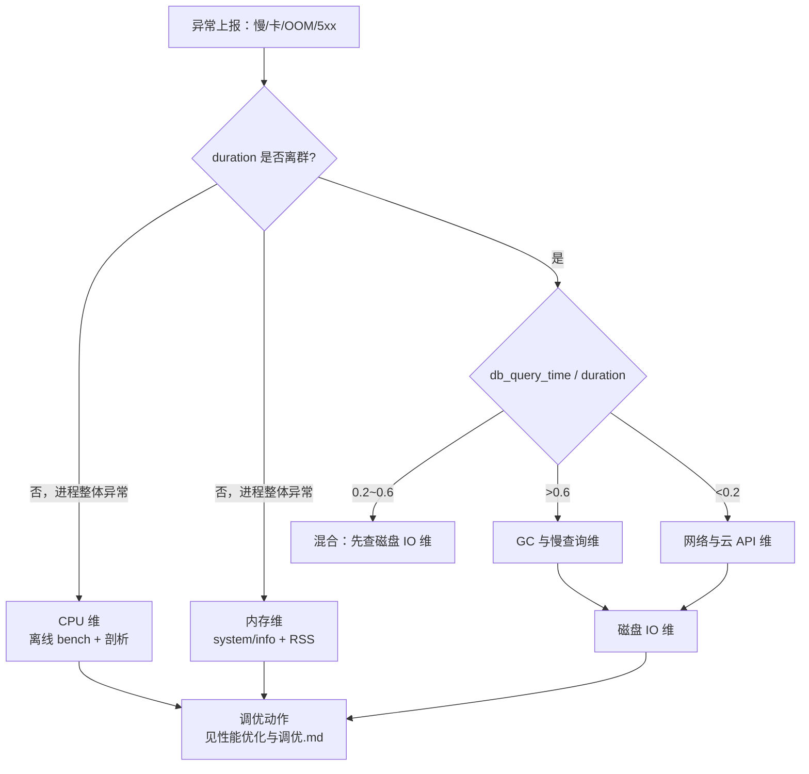
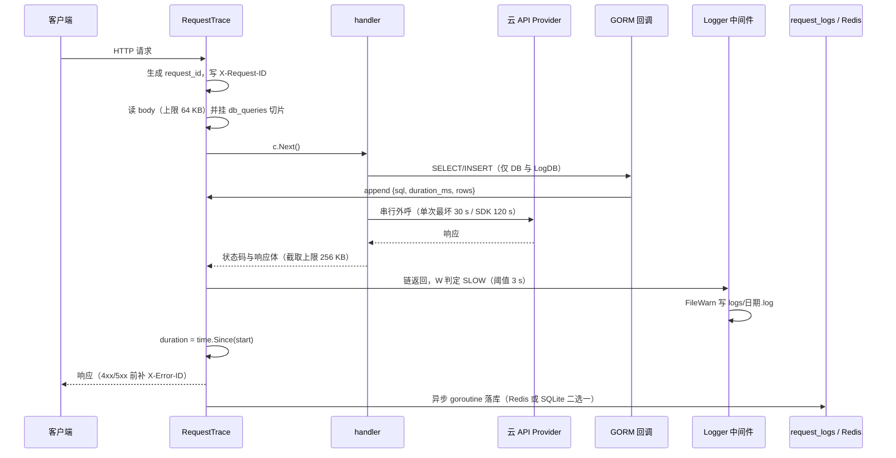
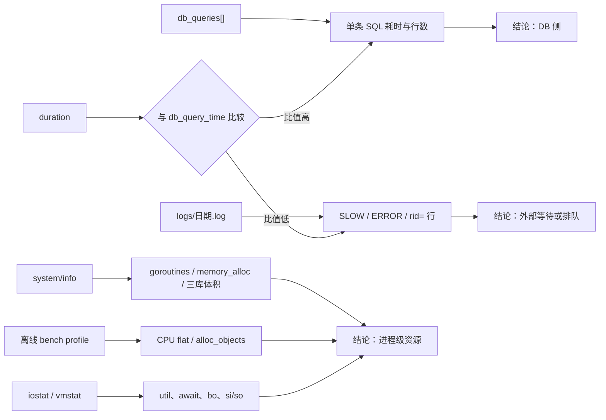

# 性能诊断

<cite>
**本文档引用的文件**
- [main.go](file://main/main.go)
- [router.go](file://main/internal/api/router.go)
- [database.go](file://main/internal/database/database.go)
- [trace_gin.go](file://main/internal/database/trace_gin.go)
- [maintenance.go](file://main/internal/database/maintenance.go)
- [request_trace.go](file://main/internal/api/middleware/request_trace.go)
- [logger.go](file://main/internal/api/middleware/logger.go)
- [sanitize.go](file://main/internal/api/middleware/sanitize.go)
- [sanitize_bench_test.go](file://main/internal/api/middleware/sanitize_bench_test.go)
- [dashboard.go](file://main/internal/api/handler/dashboard.go)
- [domain.go](file://main/internal/api/handler/domain.go)
- [batch.go](file://main/internal/api/handler/batch.go)
- [logs.go](file://main/internal/api/handler/logs.go)
- [request_log.go](file://main/internal/api/handler/request_log.go)
- [store.go](file://main/internal/logstore/store.go)
- [models.go](file://main/internal/models/models.go)
- [timeout_test.go](file://main/internal/dns/providers/timeout_test.go)
- [devlog.md](file://devlog.md)
- [analysis-deploy.md](file://../.wiki-context/analysis-deploy.md)
- [性能优化与调优.md](file://docs/部署运维/性能优化与调优.md)
- [日志分析.md](file://docs/故障排除/日志分析.md)
- [故障排除.md](file://docs/故障排除/故障排除.md)
</cite>

## 目录

1. [简介](#简介)
2. [项目结构](#项目结构)
3. [核心组件](#核心组件)
4. [架构总览](#架构总览)
5. [详细组件分析](#详细组件分析)
6. [依赖关系分析](#依赖关系分析)
7. [性能考虑](#性能考虑)
8. [故障排查指南](#故障排查指南)
9. [结论](#结论)
10. [附录](#附录)

## 简介

本篇解决的是**"慢在哪里、由什么驱动"**，即诊断方法；**"改哪个参数"**属于
[性能优化与调优](file://docs/部署运维/性能优化与调优.md)，两篇严格分工、互为交叉链接。

DNSPlane 的可观测面比一般服务窄，诊断前必须先接受三条实测事实：

- **没有 pprof 端点**：全仓检索 `net/http/pprof`、`pprof.` 零命中（实测于
  [router.go](file://main/internal/api/router.go) 与 `main/` 全目录），任何
  "访问 `/debug/pprof/`" 的写法在本项目不可用。CPU/内存剖析只有**离线 bench** 一条路。
- **没有 `/metrics`、`/health`**：进程内指标只有一个管理员接口
  `GET /api/dashboard/system/info`（[router.go:248](file://main/internal/api/router.go#L248)）。
- **每个请求自带一份微剖析**：`RequestTrace` 把 `duration`、`db_query_time`、
  `db_queries[]` 逐条落库，这就是本项目的事实上的 per-request profile。

因此本文的五维（CPU / 内存 / 磁盘 IO / 网络与云 API / GC 与慢查询）不是五套工具，
而是**同一批已有数据源的五种切法**。

**章节来源**
- [router.go](file://main/internal/api/router.go#L248)
- [request_trace.go](file://main/internal/api/middleware/request_trace.go#L271-L302)
- [故障排除.md](file://docs/故障排除/故障排除.md)

## 项目结构

诊断只关心三类目录：代码里的观测点、运行期的数据落点、离线剖析的产物落点。

| 路径 | 诊断中的角色 | 实测状态 |
|---|---|---|
| `main/logs/` | 应用文本日志，`SLOW`/`ERROR` 行的出处 | 3 个文件，15/29/55 行 |
| `main/data/` | 三个 SQLite 库与 WAL/SHM 伴生文件 | 428K/180K/40K + 两个 32K `-shm` |
| `main/internal/database/trace_gin.go` | goroutine↔gin.Context 关联，慢查询样本来源 | 69 行，仅注入不判定 |
| `main/internal/api/middleware/sanitize_bench_test.go` | 全仓唯一 bench 文件，离线剖析入口 | 2 个 Benchmark |
| `main/internal/dns/providers/*/` | 云 API 出站，30 s 客户端超时 | 19 个文件命中同一写法 |

```
main/
├── logs/                 # 文本日志：诊断"何时开始慢"的时间轴
│   └── 2006-01-02.log
├── data/                 # 体积与 WAL 抖动：磁盘 IO 维度的观测对象
│   ├── data.db  (+-wal +-shm)
│   ├── logs.db  (+-wal +-shm)
│   └── request_logs.db
└── internal/
    ├── database/         # PRAGMA 与回调：慢查询样本的产生处
    ├── logstore/         # Redis 环形缓冲：查询侧 O(N) 成本来源
    └── api/middleware/   # RequestTrace：per-request 微剖析
```

**章节来源**
- [analysis-deploy.md](file://../.wiki-context/analysis-deploy.md#L113-L114)
- [trace_gin.go](file://main/internal/database/trace_gin.go#L14-L69)

## 核心组件

### 观测面清单

能采到什么，决定了能诊断什么。下表为全量清单，无一行推测。

| 信号 | 采集点 | 粒度 | 读取方式 | 局限 |
|---|---|---|---|---|
| `duration`(ms) | `request_trace.go:271-294` | 单请求 | `POST /api/request-logs/list` | 异步任务不计入 |
| `db_queries[]` | `database.go:428-497` | 单条 SQL | 请求日志详情的 `db_queries` 字段 | 仅 DB/LogDB，不含 RequestDB |
| `db_query_time` | `request_trace.go` 聚合 | 单请求 SQL 总耗时 | 同上 | 与 `duration` 差值即非 DB 时间 |
| `SLOW` 行 | `middleware/logger.go:238-241` | 阈值 3 s | `logs/*.log` grep | 只写文件，不落库 |
| `goroutines` | `dashboard.go:491-511` | 进程瞬时 | `GET /api/dashboard/system/info` | 无历史序列 |
| `memory_alloc/sys` | `runtime.ReadMemStats` 同上 | 进程瞬时 | 同上 | 无 GC 周期数、无 pause |
| 库文件体积 | `dashboard.go:495-497` | 三库 `.db` | 同上 | 不含 `-wal`/`-shm`，见磁盘维度 |
| `X-Request-ID` / `X-Error-ID` | `request_trace.go:145-150`、`:126-137` | 单请求闭环 | 响应头 | 状态码写出后不再补头 |

**章节来源**
- [request_trace.go](file://main/internal/api/middleware/request_trace.go#L126-L302)
- [database.go](file://main/internal/database/database.go#L428-L497)
- [logger.go](file://main/internal/api/middleware/logger.go#L238-L241)
- [dashboard.go](file://main/internal/api/handler/dashboard.go#L485-L521)

### 五维诊断模型

五维共享同一条主干：**先用 `duration` 定位离群请求，再用 `db_queries` 与外部调用把
时间拆成"DB / 云 API / 自代码"三段**，三段之外才回到 CPU、内存、IO 的进程级观测。



**图表来源**
- [request_trace.go](file://main/internal/api/middleware/request_trace.go#L271-L302)
- [database.go](file://main/internal/database/database.go#L428-L497)
- [dashboard.go](file://main/internal/api/handler/dashboard.go#L485-L521)
- [sanitize_bench_test.go](file://main/internal/api/middleware/sanitize_bench_test.go#L8-L45)

**章节来源**
- [request_trace.go](file://main/internal/api/middleware/request_trace.go#L138-L302)
- [性能优化与调优.md](file://docs/部署运维/性能优化与调优.md)

## 架构总览

### 请求生命周期与采样点

一次 `/api` 请求在链上产生的可观测数据，就是五维诊断的全部原料。理解"谁在什么时候写下哪个数字"，
才能解释数字为什么会失真。



**图表来源**
- [request_trace.go](file://main/internal/api/middleware/request_trace.go#L138-L302)
- [logger.go](file://main/internal/api/middleware/logger.go#L170-L244)
- [database.go](file://main/internal/database/database.go#L373-L497)
- [router.go](file://main/internal/api/router.go#L26-L58)

三条必须记住的失真来源：

- **异步落库不计入响应**：`request_trace.go:296-301` 用裸 goroutine 写日志，进程退出时尾部可能丢失，
  排查"最后几条不见了"要交叉看 [日志分析](file://docs/故障排除/日志分析.md)。
- **批量动作不在请求日志里**：`batch.go:119-183` 把逐条云 API 调用放进 `utils.SafeGo`，
  `duration` 只反映"提交成功"，真实耗时在后台。
- **后台任务没有 SQL 样本**：GORM 回调要求 `ginCtx` 携带 `db_queries` 键
  （`database.go:441-444`），定时任务与 monitor 协程不满足，`db_queries` 恒空。

**章节来源**
- [request_trace.go](file://main/internal/api/middleware/request_trace.go#L296-L302)
- [batch.go](file://main/internal/api/handler/batch.go#L119-L183)
- [database.go](file://main/internal/database/database.go#L441-L444)

### 信号与数据源的映射



**图表来源**
- [request_log.go](file://main/internal/api/handler/request_log.go#L104-L236)
- [logger.go](file://main/internal/api/middleware/logger.go#L223-L243)
- [dashboard.go](file://main/internal/api/handler/dashboard.go#L485-L521)
- [analysis-deploy.md](file://../.wiki-context/analysis-deploy.md#L318-L345)

**章节来源**
- [analysis-deploy.md](file://../.wiki-context/analysis-deploy.md#L318-L400)

## 详细组件分析

### CPU 维度：症状 → 采样 → 判据

**症状**：单请求 `duration` 偏高但 `db_queries` 总耗时极低；批量或整点窗口 CPU 打满；
GC 变密（表现为耗时呈周期性尖峰）。

**采样**：本项目没有常驻 pprof，唯一可用路径是在 `sanitize_bench_test.go` 上做离线剖析。
先取基准数（本机实测，go1.27.2 / linux-amd64 / i5-10200H）：

```bash
cd main && go test -run '^$' \
  -bench 'BenchmarkSanitizeBodyForLog|BenchmarkIsSensitiveKey' \
  -benchtime=2000x -benchmem ./internal/api/middleware/
```

预期输出（本机实采）：

```
goos: linux
goarch: amd64
pkg: main/internal/api/middleware
cpu: Intel(R) Core(TM) i5-10200H CPU @ 2.40GHz
BenchmarkIsSensitiveKey-8       	    2000	       826.6 ns/op	      64 B/op	       8 allocs/op
BenchmarkSanitizeBodyForLog-8   	    2000	    339090 ns/op	  16.84 MB/s	   61408 B/op	    1879 allocs/op
PASS
ok  	main/internal/api/middleware	0.691s
```

再取 CPU profile（`-o` 与 profile 都用绝对路径，避免把 26 MB 测试二进制和 `cpu.out`
落在包目录里——本机实测包目录未生成 `internal/api/middleware/cpu.out`）：

```bash
mkdir -p /tmp/dnsperf && cd main && go test -run '^$' \
  -bench BenchmarkSanitizeBodyForLog -benchtime=20000x \
  -cpuprofile /tmp/dnsperf/cpu.out -o /tmp/dnsperf/middleware.test \
  ./internal/api/middleware/
go tool pprof -top -nodecount=8 /tmp/dnsperf/cpu.out
```

预期输出（本机实采，节选）：

```
File: middleware.test
Type: cpu
Duration: 9.27s, Total samples = 9940ms (107.21%)
Showing top 8 nodes out of 195
      flat  flat%   sum%        cum   cum%
     350ms  3.52%  3.52%      350ms  3.52%  internal/runtime/maps.memHashAES
     310ms  3.12%  6.64%      460ms  4.63%  internal/runtime/maps.(*Map).getWithoutKeySmallFastStr
     240ms  2.41%  9.05%      530ms  5.33%  runtime.mallocgcSmallScanNoHeaderSC2
     200ms  2.01% 15.19%      670ms  6.74%  strings.ToLower
```

**判据**：

| 观测 | 结论 | 下一步 |
|---|---|---|
| flat 首位是 `maps.*` / `mallocgc*` | CPU 花在哈希与分配，不在算法 | 走内存维与 GC 维 |
| `strings.ToLower` cum 占比高 | 脱敏与过滤做大小写归一的热路径 | 见调优文档的脱敏章节 |
| `ns/op` 高但 `allocs/op` 低 | 真 CPU 密集 | 剖析调用方，非分配问题 |
| `duration` 高、`db_queries` 空、CPU 不高 | 不在 CPU 维 | 走网络维 |

**边界**：离线 bench 只覆盖请求/响应脱敏链路，**不能**外推为线上整机 CPU 结论（推断）；
线上 CPU 归因仍需 `duration` + `db_queries` 的分段法。

**章节来源**
- [sanitize_bench_test.go](file://main/internal/api/middleware/sanitize_bench_test.go#L8-L45)
- [sanitize.go](file://main/internal/api/middleware/sanitize.go)
- [devlog.md](file://devlog.md#L222-L293)
- [性能优化与调优.md](file://docs/部署运维/性能优化与调优.md)

### 内存维：症状 → 采样 → 判据

**症状**：RSS 单调上涨、容器被 OOMKilled、长驻后接口整体变慢。

**采样一：进程内唯一指标源**。`GetSystemInfo` 直接返回 `runtime.ReadMemStats` 的两个字段与
协程数（`dashboard.go:491-511`），路由为 `GET /api/dashboard/system/info`，**仅管理员**：

```bash
curl -s -H "Authorization: Bearer <token>" \
  http://127.0.0.1:8080/api/dashboard/system/info | jq '.data | {goroutines, memory_alloc, memory_sys, num_cpu}'
```

预期输出（形态，键名与 `dashboard.go:499-512` 一致；本机服务未运行故未实采）：

```json
{"goroutines": 24, "memory_alloc": 18874368, "memory_sys": 73400320, "num_cpu": 8}
```

注意：控制台会话下响应体可能被载荷加密，`jq` 只能看到信封。`sign.go:152-156` 的分支表明
**`auth_type=apikey` 时返回明文**，因此诊断脚本优先走 `/api/v1/system/*` 族（API Key 通道）。

**采样二：SQLite 页缓存的算术上界**。当前 DSN 与连接池为实测值：

| 参数 | 值 | 出处 |
|---|---|---|
| `cache_size` | `-16000`（每连接 16 MB） | `database.go:39-46` |
| `mmap_size` | `67108864`（每连接 64 MB 映射） | `database.go:45` |
| `MaxOpenConns` | `8`（三个库各一套） | `database.go:48-58` |
| 页缓存上界 | 8 × 16 MB = 128 MB/库，三库约 384 MB | 上述两行相乘（推断自参数值） |

`devlog.md:36` 记录了历史形态：连接池 64 配 `cache_size=-64000` 时最坏约 4 GB，属已修复口径，
见到旧部署包要按旧值核算。

**采样三：单请求缓冲上限**。`request_trace.go` 的常量决定每个在途请求最多占用多少内存：
`MaxBodySize = 64 KB`（读请求体）、`maxRequestLogBodyLen = 8192`、
`maxSuccessResponseCapture = 16384`（响应截取）、`MaxResponseSize = 256 KB`（落库响应上限）。
在途请求数 × 上述量级是内存突增的第一解释项。

```bash
cd main/data && du -sh data/* 2>/dev/null; vmstat 1 2
```

预期输出（本机实采，容器外开发机）：

```
428K	data/data.db
32K	data/data.db-shm
0	data/data.db-wal
180K	data/logs.db
32K	data/logs.db-shm
0	data/logs.db-wal
40K	data/request_logs.db
 r  b   swpd   free   buff  cache   si   so    bi    bo   in   cs us sy id wa st gu
 2  0 4175776 3150416 4682924 21526556 6 112  920  4858 19705  58 37  8 55  1  0  0
```

**判据**：`memory_alloc` 是存活堆，`memory_sys` 是运行时向系统拿的总量；两者同步抬升且不回落
→ 真实增长；`memory_alloc` 锯齿回落但 RSS 抬升 → 还给了 OS 的延迟或页缓存/mmap 贡献（推断）。

**通用手段（本项目未使用，标注为推断）**：`GODEBUG=madvdontneed=1` 用于让运行时更早归还页面。
全仓检索 `GODEBUG` 零命中（`main/` 目录实测），故它只能作为外部验证手段，不能当作现成能力描述。

**协程现场**：`main.go:146` 只注册了 `SIGINT`/`SIGTERM`，`SIGQUIT` 未被接管，因此 Go 运行时的默认
行为仍在——向进程发 `SIGQUIT` 会 dump 全部协程栈**并终止进程**。这是破坏性动作，
仅在愿意接受服务中断时使用，且优先用 `system/info` 的 `goroutines` 数值做趋势判断。

**章节来源**
- [dashboard.go](file://main/internal/api/handler/dashboard.go#L485-L521)
- [database.go](file://main/internal/database/database.go#L34-L69)
- [request_trace.go](file://main/internal/api/middleware/request_trace.go#L23-L58)
- [sign.go](file://main/internal/api/middleware/sign.go#L140-L176)
- [main.go](file://main/main.go#L132-L150)
- [devlog.md](file://devlog.md#L36)

### 磁盘 IO 维：症状 → 采样 → 判据

**症状**：长尾与整点对齐（维护任务窗口）；`-wal` 文件膨胀；写入报忙或延迟；日志文件突然归零。

**采样**：三个库都跑在 WAL 模式，参数为实测：

```go
// database.go:39-46 —— PRAGMA 必须写进 DSN，才对连接池每条连接生效
path + "?_pragma=journal_mode(WAL)&_pragma=synchronous(NORMAL)&_pragma=busy_timeout(5000)" +
     "&_pragma=cache_size(-16000)&_pragma=temp_store(MEMORY)&_pragma=mmap_size(67108864)"
```

```bash
ls -la main/data
timeout 20 iostat -x 1 2 | tail -3
timeout 20 lsof +D main/data
```

预期输出（本机实采）：`ls` 显示 `-wal` 为 0 字节、`-shm` 各 32 K，且三个 `.db` 权限为 `0755`
（`logs/*.log` 为 `0644`）；`iostat` 末行为设备级 `%util`/`await` 序列；`lsof +D` 本次**无命中行**
（进程未运行），运行期预期每个库出现 `.db`、`-wal`、`-shm` 句柄（推断）。

**判据**：`%util` 逼近 100 且 `await` 同步抬升 → 设备饱和；`bo`（块写出）尖峰与
`VACUUM` 窗口对齐 → 维护任务驱动，而非业务流量。

**三个体积口径的坑**（务必在结论里排除）：

- `dashboard.go:495-497` 用**硬编码相对路径** `data/data.db`、`data/logs.db`、
  `data/request_logs.db` 取体积，只算 `.db`，**不含 `-wal`/`-shm`**；本机这两类伴生文件共 64 KB，
  相对总量约 9% 的低估。
- 同一段代码依赖进程 cwd。容器内 cwd 为 `/app` 时口径正确；
  从仓库根启动 `go run main/main.go` 时三个 size 会同时为 0（`getFileSize` 吞掉错误返回 0，
  `dashboard.go:515-521`），此时"体积为 0"不代表没有数据。
- `database.file_path` 可配置，但 `GetSystemInfo` 不读该配置，改目录后指标固定失真。

**维护任务对 IO 的形状**：`maintenance.go` 每小时执行清理，`VACUUM` 间隔默认 24 小时
（`:24`、`:37`），压缩序列为五步（`:283-311`）：
`wal_checkpoint(TRUNCATE)` → `ANALYZE` → `PRAGMA optimize` → `VACUUM` → `journal_mode=WAL` 恢复。
`VACUUM` 需要重写整库，是三库中唯一的独占型 IO 尖峰；`GetMaintenanceStats` 的行数取自
`sqlite_stat1`（`:406`），**未跑过 `ANALYZE` 时该数字陈旧**，不得当作实时行数用。

**交叉链接**：文本日志"当日 10 MB 超限即删除重建"的语义与后果由
[日志分析](file://docs/故障排除/日志分析.md) 承担；本篇只关心它带来的写放大与丢失窗口。

**章节来源**
- [database.go](file://main/internal/database/database.go#L34-L69)
- [dashboard.go](file://main/internal/api/handler/dashboard.go#L494-L521)
- [maintenance.go](file://main/internal/database/maintenance.go#L17-L56)
- [maintenance.go](file://main/internal/database/maintenance.go#L283-L311)
- [日志分析.md](file://docs/故障排除/日志分析.md)

### 网络与云 API 维：症状 → 采样 → 判据

**症状**：`duration` 很高、`db_query_time` 接近 0、状态码 200、日志无 `ERROR`。

**串行外呼点（取证清单）**：本项目的云 API 调用绝大多数是**请求路径内串行**，
耗时随目标数量线性放大，这是最长尾问题的第一因。

| 位置 | 形态 | 串行次数 | 后果 |
|---|---|---|---|
| `domain.go:783-789` | 多子域列表合并，`for _, sub := range allowedSubs` 内 `GetDomainRecords(1,500)` | N 次（每子域 1 次） | 列表页耗时 ≈ N × 单呼 |
| `domain.go:716` | 同一请求前置 `GetRecordLine` | 1 次 | N+1 形态 |
| `domain.go:1709-1717` | 子域托管校验轮询，`for i:=0;i<4` + `Sleep(3s)` | 4 次外呼 + 最多 9 s 睡眠 | 单请求可稳定挂 12 s 以上 |
| `domain.go:1738-1743` | `for _, ns := range nameServers` 调 `ensureNSRecord` | 每个 NS 2 次（查询+新增） | NS 越多越慢 |
| `domain.go:381-383` | 30 s `context.WithTimeout` 包住 `GetDomainList` | 1 次 | 上限被显式钉死 |
| `logs.go:69-84` | 域名操作日志优先服务商，失败降级本地 | 1 次 + 降级查询 | 响应带 `source` 字段可判 |
| `batch.go:157`、`:180`、`:302-315`、`:415` | 批量增改删，逐条串行，`utils.SafeGo` 异步 | 每条 1–2 次，ctx 120 s | **请求日志 duration 不反映真实耗时** |

**超时口径不一致（实测计数）**：`http.Client{Timeout: 30 * time.Second}` 在
`main/internal/dns/providers/` 下命中 19 个文件；而 `timeout_test.go:15-25` 记录了三个 SDK 系
provider 的默认值：**aliyun 10 s、dnspod 60 s、huawei 120 s**，且"三者都不接收 ctx"，
关停信号传不进去。

```bash
curl -s -X POST http://127.0.0.1:8080/api/v1/system/request-logs/list \
  -H "X-API-Key: <key>" -H 'Content-Type: application/json' \
  -d '{"page":1,"page_size":50,"path_filter":"/api/domains/records"}' \
  | jq -r '.data.list[] | [.duration, .path, .db_query_time] | @tsv' | sort -rn | head
```

预期输出（形态，列序为 `duration / path / db_query_time`，取自 `requestLogListSelect` 与
`models.RequestLog` 的 json 标签；本机服务未运行故未实采）：

```
31002	/api/domains/records/list	4
12003	/api/domains/records/list	2
8312	/api/cert/orders/create	37
```

**判据**：

- `duration` ≈ 30 000 → 撞自研 provider 的 30 s 客户端超时。
- `duration` ≈ 60 000 / 120 000 → 命中 dnspod / huawei 的 SDK 默认值，说明该域名走 SDK 系。
- `duration` ≈ 子域数 × 单次耗时 → 串行扇出，优先看 `allowedSubs` 规模。
- `duration` 稳定含 3 的倍数秒（如 12 s）→ `domain.go` 的轮询 `Sleep(3s)`，属实现内建等待。
- 批量接口 `duration` 很小但用户仍报"卡" → 真实耗时在 `SafeGo` 后台，改查
  `logs/*.log` 的 SLOW 行与服务商侧限流。

**章节来源**
- [domain.go](file://main/internal/api/handler/domain.go#L379-L400)
- [domain.go](file://main/internal/api/handler/domain.go#L700-L830)
- [domain.go](file://main/internal/api/handler/domain.go#L1700-L1790)
- [batch.go](file://main/internal/api/handler/batch.go#L119-L183)
- [logs.go](file://main/internal/api/handler/logs.go#L27-L87)
- [timeout_test.go](file://main/internal/dns/providers/timeout_test.go#L11-L30)

### GC 与慢查询维：症状 → 采样 → 判据

**症状**：日志页统计接口长尾、带关键词的查询慢、周期性整体变慢。

**机制（先弄清样本从哪来）**：`database.go:373-426` 给 `DB` 与 `LogDB` 的六类操作
（Query/Create/Update/Delete/Row/Raw）各注册 before+after 回调，after 回调
`recordQueryCallback`（`:428-497`）做三件事：取 gin 上下文、算 `time.Since(start)`、
把 `{sql, duration_ms, rows, error}` 追加进 `db_queries`。四个约束直接决定样本可信度：

- **`RequestDB` 不注册回调**（`:373-377` 注释：避免写请求日志本身再被追踪）。
- **无请求上下文则不记录**（`:441-444`）：定时任务、monitor 协程、启动迁移都没有样本。
- **SQL 截断 2000 字符**（`:477-479`），长 `IN` 列表看不到尾部。
- **没有阈值**：本项目不存在"慢查询阈值"常量，`duration_ms` 是全量样本，
  判定完全依赖读取端排序（实测 `database.go` 与 `trace_gin.go` 无阈值分支）。

`trace_gin.go` 用 `runtime.Stack` 解析 goroutine id 建立 `goroutine → *gin.Context` 映射
（`:16-L38`），再由 `injectGinIntoDBStatement` 注入语句上下文——这是"哪条 SQL 属于哪个请求"
能被还原的原因，也解释了并发协程为何会丢样本（协程切换后 id 不同）。

**采样一：单请求 SQL 明细**。详情的 `db_queries` 是 JSON 文本，取回后排序：

```bash
curl -s -X POST http://127.0.0.1:8080/api/v1/system/request-logs/detail \
  -H "X-API-Key: <key>" -H 'Content-Type: application/json' \
  -d '{"request_id":"req_1759..._12"}' \
  | jq -r '.data.db_queries | fromjson | sort_by(-.duration_ms) | .[0:5][] | [.duration_ms,.rows,.sql[0:60]] | @tsv'
```

预期输出（形态，字段名取自 `database.DBQuery` 的 json 标签 `sql/duration_ms/rows/error`；
本机服务未运行，数值为示意）：

```
412	1840	SELECT * FROM "request_logs" WHERE (request_id LIKE '%www%'...
96	20	SELECT "id","request_id","error_id","user_id","username","...
12	1	SELECT count(*) FROM "logs" WHERE uid = 7
```

**采样二：确认是"全表扫"还是"排队"**。SQLite 侧没有服务端慢日志，只能从查询构造反推：

| 查询点 | 构造 | 成本形态 |
|---|---|---|
| `request_log.go:72-100` | `keyword` 对 5 列 `LIKE '%..%'` | 无法走索引，整表扫 |
| `request_log.go:104-145` | `Count` 与 `Find` 双 goroutine 并发 | 连接池 8 下互相排队 |
| `request_log.go:270-300` | `GetRequestStats` 单条聚合全表 `SUM(CASE)` | 每次缓存过期即全表扫 |
| `store.go:77-120` | Redis 侧带筛选时 `LRange(0, total-1)` | O(N) 拉取 + 内存过滤 |
| `store.go:186-243` | Redis 统计：500 条一批全扫 + 2 min 缓存 + 互斥合并 | 冷缓存时首个请求承担全扫 |
| `models.go:353-377` | 索引仅 `request_id`/`error_id`/`user_id`/`is_error`/`created_at` | `path`/`body`/`response` 无索引 |

**GC 侧**：没有 `runtime/metrics` 暴露、没有 pprof 端点，因此 GC 只能间接观测。
可用组合是：CPU profile 的 `alloc_objects`（本机实采）+ `bench` 的 `allocs/op`（实测 1879
allocs/op 对应约 16 KB body）+ `memory_alloc` 趋势。

```bash
cd main && go test -run '^$' -bench BenchmarkSanitizeBodyForLog -benchtime=5000x \
  -memprofile /tmp/dnsperf/mem.out -o /tmp/dnsperf/middleware.test ./internal/api/middleware/
go tool pprof -top -sample_index=alloc_objects -nodecount=6 /tmp/dnsperf/mem.out
```

预期输出（本机实采，节选）：

```
Type: alloc_objects
Showing top 6 nodes out of 41
   4664042 58.88% 58.88%    4664042 58.88%  reflect.unsafe_New
   1703962 21.51% 80.39%    2555943 32.27%  main/internal/api/middleware.redactJSON
    851981 10.76% 91.14%     851981 10.76%  internal/bytealg.MakeNoZero
    327694  4.14% 95.28%     327694  4.14%  reflect.makemap
```

**判据**：`reflect.unsafe_New` + `redactJSON` 合计约 91% 的对象分配 → 脱敏走反射路径，
分配量随响应体大小线性增长；`duration` 尖峰若与大响应体请求同批出现，GC 压力优先于 SQL。

**章节来源**
- [database.go](file://main/internal/database/database.go#L373-L497)
- [trace_gin.go](file://main/internal/database/trace_gin.go#L14-L69)
- [request_log.go](file://main/internal/api/handler/request_log.go#L67-L145)
- [request_log.go](file://main/internal/api/handler/request_log.go#L243-L308)
- [store.go](file://main/internal/logstore/store.go#L77-L243)
- [models.go](file://main/internal/models/models.go#L353-L377)

## 依赖关系分析

### 中间件链对诊断的影响

诊断数据的产生顺序被链顺序钉死（`router.go:26-58`）：链首是
`SecurityHeaders → gin.Recovery → Logger`，`/api` 组内是
`CORS → RequestTrace → Recovery → CSRF → AuditLog`。

- `Logger` 在链首，位于 `RequestTrace` **之外**：它的 `latency` 与 RequestTrace 的 `duration`
  统计区间不同（前者不含 CORS 之前的排队），两者对不上不是 Bug。
- `RequestTrace` 之后的 panic 才会被内层 `Recovery` 标记 `has_error` 并保留堆栈；
  顺序一旦被改，`db_queries` 与请求日志同时归零（见
  [日志分析](file://docs/故障排除/日志分析.md) 的实证结论）。
- `auth_type=apikey` 由 `apiv1/auth.go:109` 写入，决定响应是否明文，从而影响
  `jq` 类诊断脚本能否直接解析。

**章节来源**
- [router.go](file://main/internal/api/router.go#L21-L58)
- [request_trace.go](file://main/internal/api/middleware/request_trace.go#L138-L160)
- [auth.go](file://main/internal/apiv1/auth.go#L109)

### 指标与存储的耦合点

| 指标 | 依赖 | 失真条件 |
|---|---|---|
| `duration` | 请求在链上的起止 | 异步 `SafeGo` 不计入 |
| `db_queries` | gin 上下文 + `DB`/`LogDB` | 后台任务、`RequestDB` 操作恒空 |
| `db_query_time` | `request_trace.go` 聚合 | 同上，与 `duration` 同源不同区间 |
| `SLOW` 行 | `Logger` 中间件阈值常量 | 只覆盖 `/api` 前缀，静态资源不判 |
| 三库体积 | cwd 相对路径 | 非 `main/` 目录启动即 0 |
| `goroutines` | `runtime.NumGoroutine()` | 瞬时值，无历史 |
| 行数统计 | `sqlite_stat1` | 未 `ANALYZE` 则陈旧 |

**章节来源**
- [request_trace.go](file://main/internal/api/middleware/request_trace.go#L243-L266)
- [logger.go](file://main/internal/api/middleware/logger.go#L223-L243)
- [dashboard.go](file://main/internal/api/handler/dashboard.go#L494-L521)
- [maintenance.go](file://main/internal/database/maintenance.go#L406)

## 性能考虑

本篇不给调参结论，只给**归因顺序**，具体动作见
[性能优化与调优](file://docs/部署运维/性能优化与调优.md)。

- **先分段再深挖**：`duration` − `db_query_time` 是外部等待与自代码时间之和，
  未做这一步就剖析 CPU，通常白干。
- **串行外呼是本项目的主瓶颈形状**：耗时随目标数线性放大，任何"偶发很慢"应先数外呼次数。
- **观测本身有成本**：`RequestTrace` 会为每个 `/api` 请求截取 body/response 并序列化
  `db_queries`；`sanitize_bench_test.go` 的实测显示一条 16 KB 响应要 1879 次分配。
  关掉追踪能降低开销，但同时失去唯一的 per-request 剖析源。
- **Redis 与 SQLite 的查询成本不对称**：Redis 侧带筛选查询是 O(N) 全量拉取，
  SQLite 侧是 `LIKE '%..%'` 全表扫；两者都不随数据量给出优雅退化。
- **维护窗口是可预测的 IO 尖峰源**：每小时清理、默认 24 小时 `VACUUM`，
  长尾若集中在同一时刻，先看维护配置而不是业务代码。
- **无 pprof 是硬约束**：所有 CPU/内存结论只能来自离线剖析或进程内瞬时指标，
  跨时间窗的趋势需要外部采集器自建（本仓未提供）。

**章节来源**
- [性能优化与调优.md](file://docs/部署运维/性能优化与调优.md)
- [sanitize_bench_test.go](file://main/internal/api/middleware/sanitize_bench_test.go#L22-L45)
- [store.go](file://main/internal/logstore/store.go#L77-L120)
- [maintenance.go](file://main/internal/database/maintenance.go#L283-L311)

## 故障排查指南

### 五维速查

| 维度 | 入口信号 | 采样动作 | 结论判据 |
|---|---|---|---|
| CPU | `duration` 高且 `db_query_time` 低 | 离线 bench + `-cpuprofile` | flat 首位是分配/哈希还是业务函数 |
| 内存 | RSS 单调升、`memory_alloc` 不回落 | `system/info` + `vmstat` | 是堆增长还是页缓存/mmap |
| 磁盘 IO | 长尾与整点对齐、`-wal` 膨胀 | `du`/`ls -la data`/`iostat` | `%util` 饱和且与 VACUUM 窗口相关 |
| 网络与云 API | `duration` 高、`db_query_time≈0`、无错误 | 请求日志排序 + 数外呼次数 | 撞 30 s / 120 s / N×单呼 / 含 3 s 倍数 |
| GC 与慢查询 | 统计接口长尾、keyword 慢 | `db_queries` 排序 + `alloc_objects` | 全表扫语句或大分配热点 |

**章节来源**
- [request_log.go](file://main/internal/api/handler/request_log.go#L104-L236)
- [dashboard.go](file://main/internal/api/handler/dashboard.go#L485-L521)
- [timeout_test.go](file://main/internal/dns/providers/timeout_test.go#L11-L30)

### 典型场景一：记录列表页随子域数量变慢

- 现象：同一账号秒开，另一账号 8 秒以上。
- 取证：`domain.go:783-789` 对每个 `allowedSubs` 元素发一次 `GetDomainRecords(1, 500)`，
  前置还有 `GetRecordLine`（`:716`）。
- 验证：把慢账号的子域数与 `duration` 相除，若接近单次云 API 耗时即定性。
- 关联：[日志分析](file://docs/故障排除/日志分析.md) 的 `rid` 追踪闭环可定位具体请求。

**章节来源**
- [domain.go](file://main/internal/api/handler/domain.go#L700-L830)

### 典型场景二：日志统计接口偶发 3 秒以上

- 现象：日志页刷新偶发卡顿，`logs/*.log` 出现 `SLOW` 行（本机实测该标记命中 3 次）。
- 取证：`request_log.go:26-55` 有 60 s 进程内缓存，`store.go:186-243` 另有 2 min Redis 缓存；
  缓存过期后的首个请求承担全量扫描，表现为**周期性单点长尾**而非普遍慢。
- 验证：对比 `SLOW` 行时间戳与 `duration` 分布，若长尾间隔≈缓存 TTL 即定性。

**章节来源**
- [request_log.go](file://main/internal/api/handler/request_log.go#L20-L55)
- [store.go](file://main/internal/logstore/store.go#L17-L243)
- [logger.go](file://main/internal/api/middleware/logger.go#L14)

### 典型场景三：写入抖动与库体积异常

- 现象：某时刻接口整体变慢，或 `system/info` 报三库体积为 0/远小于实际。
- 取证：先确认进程 cwd（`dashboard.go` 硬编码相对路径），再确认 Redis 开关
  （`request_trace.go:296-301` 只写一处，Redis 开启时 `request_logs.db` 会长期偏小）。
- 验证：`du -sh main/data` 与 API 数值对照；本机实采 712 KB vs API 口径 648 KB。

**章节来源**
- [dashboard.go](file://main/internal/api/handler/dashboard.go#L494-L521)
- [request_trace.go](file://main/internal/api/middleware/request_trace.go#L296-L302)

## 结论

- **五维共享一套数据源**：`duration` / `db_query_time` / `db_queries` / `SLOW` 行 /
  `system/info` / 离线 bench profile。诊断能力的上限由这六项决定，不是由工具数量决定。
- **两条硬事实约束了方法**：无 pprof 端点（全仓检索零命中），无慢查询阈值常量（回调全量记录）。
  任何"打开 /debug/pprof"或"设置慢查询日志"的方案在本项目都不成立。
- **主要瓶颈形状已知**：请求路径内的串行云 API 扇出（`domain.go` 多处）与
  SDK provider 的超时不一致（10/60/120 s 且不接 ctx），足以解释绝大多数长尾。
- **观测自身有成本**：脱敏与截取的分配量已被 bench 量化（约 16 KB 响应 1879 allocs/op）。
- **口径陷阱要背下来**：三库体积不含 `-wal`/`-shm` 且依赖 cwd；`db_queries` 在后台任务里恒空；
  批量动作的真实耗时不在请求日志里；行数统计取自 `sqlite_stat1` 可能陈旧。
- 下一步：把本篇的分段判据固化成采集脚本，与
  [性能优化与调优](file://docs/部署运维/性能优化与调优.md) 的动作表逐条对齐。

**章节来源**
- [domain.go](file://main/internal/api/handler/domain.go#L700-L830)
- [timeout_test.go](file://main/internal/dns/providers/timeout_test.go#L11-L30)
- [性能优化与调优.md](file://docs/部署运维/性能优化与调优.md)

## 附录

### 采样命令速查

| 目的 | 命令 | 输出用途 |
|---|---|---|
| 基准回归比对 | `cd main && go test -run '^$' -bench=. -benchmem ./internal/api/middleware/` | `ns/op`、`allocs/op` 趋势 |
| CPU 归因 | `go test -run '^$' -bench BenchmarkSanitizeBodyForLog -cpuprofile /tmp/cpu.out -o /tmp/t.test ./internal/api/middleware/ && go tool pprof -top /tmp/cpu.out` | flat/cum 首位函数 |
| 分配归因 | 同上加 `-memprofile /tmp/mem.out`，`go tool pprof -top -sample_index=alloc_objects /tmp/mem.out` | 对象数热点 |
| 进程瞬时指标 | `curl -s -H "Authorization: Bearer <t>" http://127.0.0.1:8080/api/dashboard/system/info \| jq .data` | 协程数、堆、三库体积 |
| 慢请求时间轴 | `/usr/bin/grep -c 'SLOW' main/logs/*.log` | 与 `duration` 分布对照 |
| 库体积真值 | `du -sh main/data/*` | 校正 API 口径低估 |
| WAL 与权限 | `ls -la main/data` | `-wal`/`-shm` 存在性与文件权限 |
| 设备饱和 | `iostat -x 1 2` | `%util`、`await` |
| 页换入换出 | `vmstat 1 2` | `si`/`so`、`bo` |
| 句柄占用 | `lsof +D main/data` | 谁在写库 |

兼容性提示：本机 `grep` 实际指向 ripgrep，`-ohE` 组合会被解释为编码参数，
需要 POSIX 语义时显式写 `/usr/bin/grep`（本表已按此写法给出）。

**章节来源**
- [sanitize_bench_test.go](file://main/internal/api/middleware/sanitize_bench_test.go#L8-L45)
- [dashboard.go](file://main/internal/api/handler/dashboard.go#L485-L521)

### 术语与口径

| 术语 | 本文口径 | 定义位置 |
|---|---|---|
| `duration` | `time.Since(start).Milliseconds()`，含中间件与落库前全部时间 | `request_trace.go:192` |
| `db_query_time` | 单请求内所有被记录 SQL 的 `duration_ms` 求和 | `request_trace.go:243-L256` |
| `db_queries` | JSON 数组文本，元素 `{sql, duration_ms, rows, error?}` | `database.go:347-L353` |
| `SLOW` | `latency >= 3 * time.Second` 时写入文本日志的标记 | `middleware/logger.go:14`、`:238-241` |
| `memory_alloc` | `runtime.MemStats.Alloc`，当前存活堆字节数 | `dashboard.go:491-505` |
| `rid` | 文本日志中的请求 ID 关联标记，值为 `request_id` | `middleware/logger.go:231-L241` |
| 串行扇出 | 循环内逐个等待云 API 返回，总耗时为各次之和 | `domain.go:783-789` |

**章节来源**
- [request_trace.go](file://main/internal/api/middleware/request_trace.go#L192-L266)
- [database.go](file://main/internal/database/database.go#L347-L353)
- [logger.go](file://main/internal/api/middleware/logger.go#L14-L241)
- [dashboard.go](file://main/internal/api/handler/dashboard.go#L491-L511)

### 与调优文档的衔接

| 诊断结论 | 交给谁处理 |
|---|---|
| 串行扇出、超时不一致 | [性能优化与调优](file://docs/部署运维/性能优化与调优.md) 的外呼并发与超时章节 |
| 全表扫、缓存 TTL 错配 | 同上，查询与缓存章节 |
| VACUUM 窗口、WAL 参数 | 同上，SQLite 参数章节 |
| 日志丢失、顺序破坏回归 | [日志分析](file://docs/故障排除/日志分析.md) |
| 认证与权限类故障（非性能） | [故障排除](file://docs/故障排除/故障排除.md) |

**章节来源**
- [性能优化与调优.md](file://docs/部署运维/性能优化与调优.md)
- [日志分析.md](file://docs/故障排除/日志分析.md)
- [故障排除.md](file://docs/故障排除/故障排除.md)
