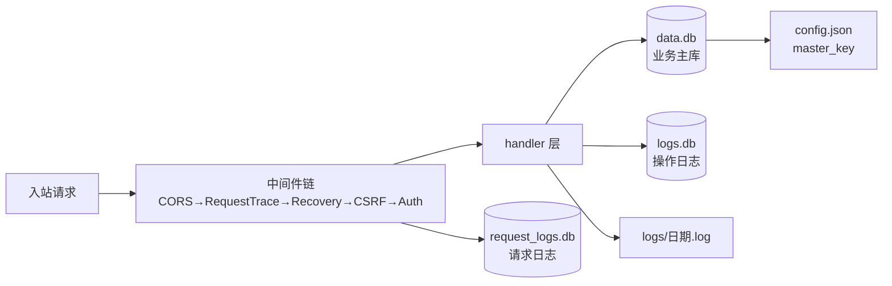
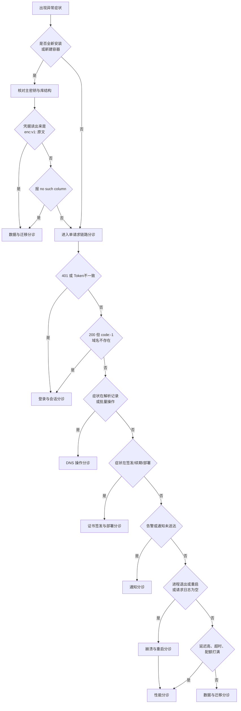
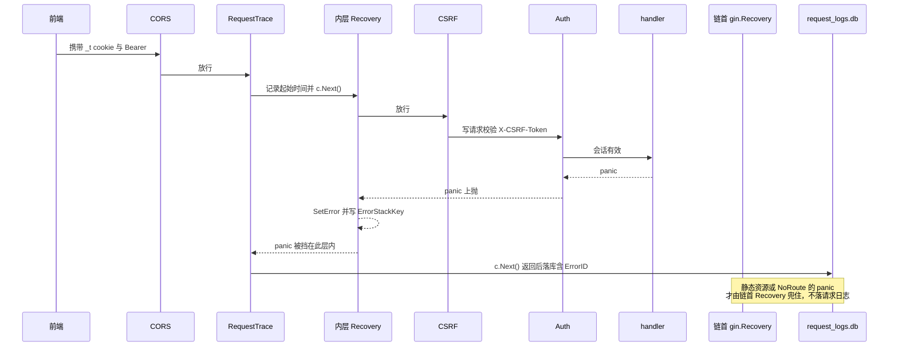
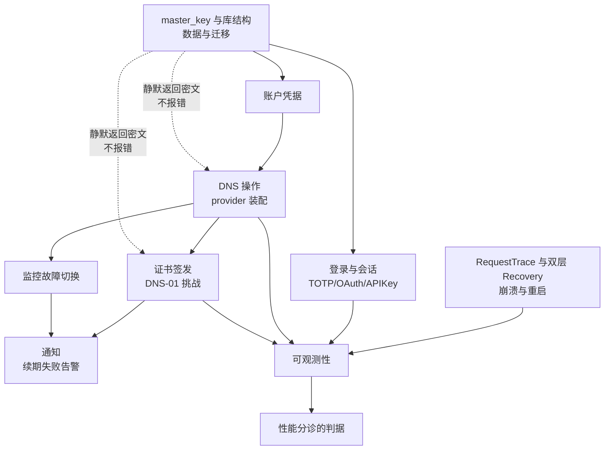
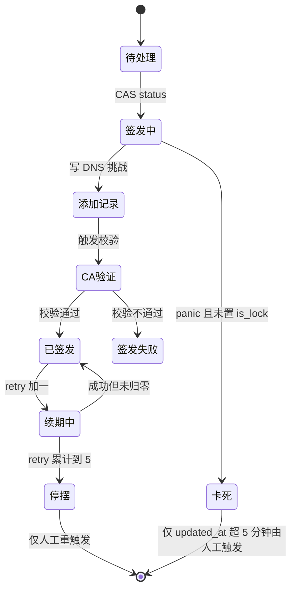

# 故障排除

<cite>
**本文档引用的文件**
- [router.go](file://main/internal/api/router.go)
- [main.go](file://main/main.go)
- [auth.go](file://main/internal/api/middleware/auth.go)
- [permission.go](file://main/internal/api/middleware/permission.go)
- [request_trace.go](file://main/internal/api/middleware/request_trace.go)
- [sanitize.go](file://main/internal/api/middleware/sanitize.go)
- [audit.go](file://main/internal/api/middleware/audit.go)
- [auth.go](file://main/internal/api/handler/auth.go)
- [user.go](file://main/internal/api/handler/user.go)
- [dashboard.go](file://main/internal/api/handler/dashboard.go)
- [monitor.go](file://main/internal/api/handler/monitor.go)
- [domain.go](file://main/internal/api/handler/domain.go)
- [batch.go](file://main/internal/api/handler/batch.go)
- [batch_authz.go](file://main/internal/api/handler/batch_authz.go)
- [cert.go](file://main/internal/api/handler/cert.go)
- [cert_deploy.go](file://main/internal/api/handler/cert_deploy.go)
- [captcha.go](file://main/internal/captcha/captcha.go)
- [task_runner.go](file://main/internal/service/task_runner.go)
- [notify.go](file://main/internal/notify/notify.go)
- [monitor.go](file://main/internal/monitor/monitor.go)
- [models.go](file://main/internal/models/models.go)
- [hooks.go](file://main/internal/models/hooks.go)
- [migrate.go](file://main/internal/crypto/migrate.go)
- [crypto.go](file://main/internal/crypto/crypto.go)
- [database.go](file://main/internal/database/database.go)
- [maintenance.go](file://main/internal/database/maintenance.go)
- [logger.go](file://main/internal/logger/logger.go)
- [config.go](file://main/internal/config/config.go)
- [acme.go](file://main/internal/cert/acme/acme.go)
- [registry.go](file://main/internal/dns/registry.go)
- [ensure_challenge.go](file://main/internal/dns/ensure_challenge.go)
- [Dockerfile](file://Dockerfile)
- [问题检测报告.md](file://docs/问题检测报告.md)
- [devlog.md](file://devlog.md)
- [日志分析.md](file://docs/故障排除/日志分析.md)
- [性能诊断.md](file://docs/故障排除/性能诊断.md)
- [常见问题解决.md](file://docs/故障排除/常见问题解决.md)
- [安全事件响应.md](file://docs/故障排除/安全事件响应.md)
</cite>

## 目录

1. [简介](#简介)
2. [项目结构](#项目结构)
3. [核心组件](#核心组件)
4. [架构总览](#架构总览)
5. [详细组件分析](#详细组件分析)
6. [依赖关系分析](#依赖关系分析)
7. [性能考虑](#性能考虑)
8. [故障排查指南](#故障排查指南)
9. [结论](#结论)
10. [附录](#附录)

## 简介

本篇是 DNSPlane 故障排除域的总览文档，目标是把"出现异常"这一模糊输入收敛为**可执行的七类分诊**，
并为每一类给出：症状表、可复制的定位命令、以及指向子文档的下钻入口。

七类分诊口径（与代码域一一对应，不引入新分类）：

- 登录与会话：验证码、令牌签发与吊销、Cookie 与 Bearer 双通道、权限判定
- DNS 操作：记录增删改查、批量路径、服务商能力与配额
- 证书签发与部署：ACME 订单状态机、续期计数、部署器落地
- 通知：渠道可达性、告警风暴、同步发送阻塞
- 性能：厂商调用放大、分页失效、慢连接与超时缺配
- 崩溃与重启：panic 恢复层级、请求日志丢失、优雅关闭
- 数据与迁移：主密钥、密文列、缺列静默失败、日志清理与保留

**反幻觉声明**：本文所有源码结论均给出文件与行号锚点。标注"实测"的条目来自
`docs/问题检测报告.md` 与 `.wiki-context/analysis-*.md` 的取证记录；标注"推断"的条目为源码路径
推演，未做运行期复现。命令块中的输出为**预期输出**，不代表本次已执行。

本域的四篇子文档按取证手段划分，交叉链接见 [日志分析](file://docs/故障排除/日志分析.md)、
[性能诊断](file://docs/故障排除/性能诊断.md)、[常见问题解决](file://docs/故障排除/常见问题解决.md)、
[安全事件响应](file://docs/故障排除/安全事件响应.md)。

**章节来源**
- [问题检测报告.md](file://docs/问题检测报告.md#L472-L530)

## 项目结构

排障时需要知道的不是源码树，而是**证据树**：一次故障的可观测面分散在五处产物中。

| 证据位置 | 内容 | 写入者 | 可信度 |
|:---|:---|:---|:---|
| `main/logs/<日期>.log*` | 结构化运行日志、panic 堆栈 | `logger.NewWithOptions` | 受轮转与级别过滤影响 |
| `main/data/logs.db` | 控制台"操作日志" | `middleware/audit.go` | Redis 开启时改落 Redis |
| `main/data/request_logs.db` | 请求追踪（Query/Body/Response/db_queries） | `middleware.RequestTrace` | panic 穿透时为空 |
| `main/data/data.db` | 业务主库（域名、账户、订单、任务） | GORM | 密文列需解密读 |
| `main/config.json` | `master_key` 与运行配置 | `config.go` | 缺失时会被随机重建 |



**图表来源**
- [router.go](file://main/internal/api/router.go#L26-L58)
- [request_trace.go](file://main/internal/api/middleware/request_trace.go#L91-L278)
- [logger.go](file://main/internal/logger/logger.go#L57-L124)
- [config.go](file://main/internal/config/config.go#L105-L142)

关键事实：`dashboard.go` 用**硬编码相对路径**读取三个库体积，与 `database.file_path` 配置无关，
改过数据目录后该指标恒为 0，排障时不得作为判据。

**章节来源**
- [dashboard.go](file://main/internal/api/handler/dashboard.go#L494-L496)
- [database.go](file://main/internal/database/database.go#L93-L118)

## 核心组件

排障视角下需要重点理解的组件只有五个。

### 认证双通道与会话缓存

`middleware/auth.go` 的 `Auth` 采用 **Cookie `_t` + Authorization Bearer 双写一致性校验**：先从
`_t` cookie 取密文并 `DecryptCookie`，再提取 Bearer token 比对，两者不一致直接
`401 {"code":401,"msg":"Token不一致"}`。这是"能登录但接口全 401"最常见的第一因。

Cookie 属性（`:308-309`）：`_t` 的 path 为 `/`，`_rt` 的 path 为 `/api/auth/refresh`，两者均 HttpOnly，
`secure` 取决于运行期配置。前端把 access token 另存 `localStorage`，因此任何"清 cookie 但不清
localStorage"或"反向代理吞掉 `Authorization` 头"的变更都会命中上述不一致分支。

第二处易踩点：`getCachedAuthUser` 命中即返回，`authUserCacheTTL = 30 * time.Second`，且
`InvalidateAuthUserCache` 无调用点（实测 `rg` 零命中），因此禁用账户、降级 `level`、改权限 JSON
都要等缓存过期才生效，30 秒窗口内的"改权限没反应"属预期行为。

**章节来源**
- [auth.go](file://main/internal/api/middleware/auth.go#L45-L147)
- [auth.go](file://main/internal/api/middleware/auth.go#L308-L317)
- [analysis-auth.md](file://../.wiki-context/analysis-auth.md#L395-L401)

### 权限中间件的放行与回落

`Permission()` 有两处与直觉相反的行为，必须同时记住：

- `permission.go:143-148`：请求中解析不到 `domain_id` 时**直接 `c.Next()` 放行**，把判定责任交给
  handler。若某条写路径 handler 自身未做域校验，就构成越权面。
- `permission.go:229-231` → `:152`：`domainID` 最终回落到 `c.Param("id")`，随后无条件按 `domains.id`
  查库，查不到即 `200 {"code":-1,"msg":"域名不存在"}`。这污染约 40 条带 `:id` 但语义非域名的路由
  （`/monitor/tasks/:id/*`、`/cert/accounts/:id/*`、`/accounts/:id/*`、`/logs/:id` 等）。
  `level >= 2` 在 `:138` 直通，故**该误拒只在普通用户身上显现**。

**章节来源**
- [permission.go](file://main/internal/api/middleware/permission.go#L132-L156)
- [permission.go](file://main/internal/api/middleware/permission.go#L229-L231)
- [analysis-auth.md](file://../.wiki-context/analysis-auth.md#L295-L299)

### 请求追踪与双层 Recovery

`RequestTrace` 的落库代码位于 `c.Next()` **之后**。若只有链首的 `gin.Recovery()`，panic 会穿透到
链首而跳过落库，请求日志完全丢失（analysis-auth 记录为实测：仅外层 Recovery 时 RequestLog 零记录）。
因此 `applyAPIMiddleware` 在 `RequestTrace` 之后内联挂载 `middleware.Recovery()`，先 `SetError`
并写 `ErrorStackKey`，把 panic 挡在 RequestTrace 之内。链首的 `gin.Recovery()` 保留，用于兜住
不经 RequestTrace 的静态资源、页面路由与 `NoRoute`。

**章节来源**
- [router.go](file://main/internal/api/router.go#L26-L58)
- [analysis-auth.md](file://../.wiki-context/analysis-auth.md#L283-L290)

### 证书订单状态机与调度器

`cert_orders.status` 的语义在三处不一致：模型注释、通知名映射、实际赋值互相错位；`-7` 无赋值点，
`2`/`4` 从未使用。后果是**用户看到的错误名不等于失败环节**：所谓"添加 DNS 失败"实为 CA 验证触发
失败。自动续期的 `retry` 只在 `task_runner.go:203` 每轮 +1，成功路径 `cert.go:810` 不重置，累计到 5
即永久停摆并误报"已连续尝试5次仍未成功"。

**章节来源**
- [analysis-cert.md](file://../.wiki-context/analysis-cert.md#L394-L412)
- [task_runner.go](file://main/internal/service/task_runner.go#L168-L207)

### 主密钥与密文列

`crypto.MustDecrypt` 在解密失败时**静默返回原串**，不报错。叠加 `config.go:105-111` 在
`config.json` 缺失时生成随机 `master_key` 并回写，形成最危险的静默故障：容器重建或未持久化该文件
→ 新密钥读不到旧密文 → 所有 `enc:v1:` 列（账户凭据、证书私钥、TOTP、OAuth token）表现为"值变成
一长串乱码字符"而不是"解密失败"。

**章节来源**
- [crypto.go](file://main/internal/crypto/crypto.go#L95-L101)
- [config.go](file://main/internal/config/config.go#L105-L142)
- [analysis-deploy.md](file://../.wiki-context/analysis-deploy.md#L487-L492)

## 架构总览

下图是七类分诊的决策树。判据顺序刻意遵循"先止血、再收口、后清债"：先排除主密钥与库结构等
全局性根因，再看单请求链路，最后归入性能与工程债务。



**图表来源**
- [analysis-deploy.md](file://../.wiki-context/analysis-deploy.md#L487-L510)
- [analysis-auth.md](file://../.wiki-context/analysis-auth.md#L283-L300)
- [analysis-monitor.md](file://../.wiki-context/analysis-monitor.md#L350-L372)
- [analysis-cert.md](file://../.wiki-context/analysis-cert.md#L394-L412)

次级视图：一次请求在"panic 恰好发生在 handler 内"时的实际走向，这是判断"请求日志为什么没记录"的依据。



**图表来源**
- [router.go](file://main/internal/api/router.go#L26-L58)
- [request_trace.go](file://main/internal/api/middleware/request_trace.go#L91-L278)

**章节来源**
- [router.go](file://main/internal/api/router.go#L26-L58)
- [问题检测报告.md](file://docs/问题检测报告.md#L472-L500)

## 详细组件分析

### 通用处置流程：复现→采集→定位→修复→回归

任何一类分诊都走同一条五步流程，且**每一步都有可验证的产物**，不允许跳步。

| 步骤 | 动作 | 产物 | 判定标准 |
|:---|:---|:---|:---|
| 复现 | 固定账号、固定输入、一次只改一个变量 | 可重放请求（含 `X-Request-ID`） | 三次中至少两次一致 |
| 采集 | 同时取运行日志、请求日志、库内状态 | `logs/*.log` 切片 + `request_logs` 行 + SQL 结果 | 时间轴可对齐 |
| 定位 | 按决策树收敛到单一组件，比对源码锚点 | 文件+行号+触发条件 | 能解释全部观测 |
| 修复 | 最小范围改动，不夹带重构 | diff | 公共 API 与返回结构不破坏 |
| 回归 | 先确认回归测试失败，再实施修复 | `go test` 结果 | 包数与全绿口径一致 |

回归阶段的可验证口径来自 `devlog.md` 的真实执行记录。本仓库 `go.mod` 声明 `go 1.26.2`，
本机工具链更高，不带语言级别参数直接构建会失败；同时默认 `TMPDIR` 不可写，需显式指定 `GOTMPDIR`：

```bash
# 预期输出：构建与静态检查均无输出、退出码 0
GOTMPDIR=/home/clfchen/.cache/go-work go build -gcflags="-lang=go1.26" ./...   # LANG126=0
GOTMPDIR=/home/clfchen/.cache/go-work go vet ./...                             # VET=0
```

```bash
# 预期输出：每包一行 ok，FAIL 包数 0；当前基线口径为 15/15 包全绿
GOTMPDIR=/home/clfchen/.cache/go-work go test ./... -count=1                   # TEST=0
```

`devlog.md` 中该口径随测试补全从 8 包、9 包、13 包、14 包推进到 **15/15 包全绿**（`devlog.md:2494`）。
回归验收以"包数不减、FAIL 包数为 0"为准，而不是只看退出码。

**章节来源**
- [devlog.md](file://devlog.md#L2269-L2292)
- [devlog.md](file://devlog.md#L2492-L2494)
- [问题检测报告.md](file://docs/问题检测报告.md#L500-L530)

### 登录与会话故障

| 症状 | 可能原因 | 定位入口 | 关联文档 |
|:---|:---|:---|:---|
| 登录成功但接口一律 401 `Token不一致` | `_t` cookie 与 `Authorization` 头不同源（代理吞头、localStorage 与 cookie 版本分叉） | `auth.go:128-147` | [常见问题解决](file://docs/故障排除/常见问题解决.md) |
| 验证码明明答对仍失败 | 行为验证码答错即删缓存键，一次性实现导致必须重取 | `captcha.go:272` | [常见问题解决](file://docs/故障排除/常见问题解决.md) |
| 提交显示"人机校验"绕过成功 | `Verify` 采信请求体 `captcha_type` 而非缓存中的 `type`，三种错配均可通过（P0 实测路径推演） | `captcha.go:265-283` | [安全事件响应](file://docs/故障排除/安全事件响应.md) |
| 改密/禁用账户后旧会话仍可用 | 注销与改密均不删 `rtjti:<uid>`；用户缓存 30 秒且无失效调用点 | `handler/auth.go:406-411` | [安全事件响应](file://docs/故障排除/安全事件响应.md) |
| 普通用户访问监控/证书/账户接口报"域名不存在" | `Permission()` 回落 `c.Param("id")` 按 `domains.id` 查库 | `permission.go:229-231`、`:152` | [常见问题解决](file://docs/故障排除/常见问题解决.md) |
| 操作日志页看不到口令登录记录 | 审计跳过前缀含 `/api/login` 与 `/api/auth/`，仅 OAuth 登录落审计 | `middleware/audit.go:98-102` | [日志分析](file://docs/故障排除/日志分析.md) |
| 前端报"服务器返回了无效的响应格式" | 未注册的 `/api/*` 命中 `NoRoute` 并以 200 返回 HTML | `router.go:411` | [常见问题解决](file://docs/故障排除/常见问题解决.md) |

```bash
# 预期输出：能定位到 cookie 与 Bearer 一致性校验分支（401 文案）
grep -n 'Token不一致' main/internal/api/middleware/auth.go
```

```bash
# 预期输出：确认审计跳过前缀，口令登录不进 logs 表
grep -n '"/api/login"\|"/api/auth/"' main/internal/api/middleware/audit.go
```

```bash
# 预期输出：logs 表的 action 分布中无 login（实测口径），只有 OAuth 登录有
sqlite3 main/data/logs.db "SELECT action, COUNT(*) FROM logs GROUP BY action ORDER BY 2 DESC;"
```

修复方向（不改公共 API）：`Verify` 以缓存 `type` 为准、请求侧 `captcha_type` 仅作一致性比对；
`Permission()` 去掉对 `c.Param("id")` 的无条件回落；注销与改密链路统一吊销 refresh JTI 并清用户缓存。
详细步骤见 [安全事件响应](file://docs/故障排除/安全事件响应.md)。

**章节来源**
- [auth.go](file://main/internal/api/middleware/auth.go#L128-L147)
- [audit.go](file://main/internal/api/middleware/audit.go#L98-L102)
- [permission.go](file://main/internal/api/middleware/permission.go#L143-L156)
- [analysis-auth.md](file://../.wiki-context/analysis-auth.md#L283-L400)

### DNS 操作故障

| 症状 | 可能原因 | 定位入口 | 关联文档 |
|:---|:---|:---|:---|
| 批量删除"成功 N 条"但云端无变化 | `action=remove`（正确值 `delete`）落入无 `default` 的 switch，`opErr` 保持 nil | `batch.go:376-388` | [常见问题解决](file://docs/故障排除/常见问题解决.md) |
| 批量新增后本地副本与云端不一致 | `upsertBatchLocalRecord` 在部分工作区状态下未定义，包不可编译 | `batch.go:154`、`:172` | [常见问题解决](file://docs/故障排除/常见问题解决.md) |
| 记录列表显示 0 条但厂商控制台有 | `PageResult.Records` 为 `interface{}`，类型断言失败静默退化为空列表 | `domain.go:788`、`interface.go:34-38` | [日志分析](file://docs/故障排除/日志分析.md) |
| 委派子域用户能删任意记录 | 单条删除/启停只查域权限与只读，未回查真实 `rr` | `domain.go:1068`、`:1147` | [安全事件响应](file://docs/故障排除/安全事件响应.md) |
| 记录被静默改名 | 以请求 `name` 做子域判定，`record_id` 指向别的记录 | `domain.go:1000`、`:1019` | [安全事件响应](file://docs/故障排除/安全事件响应.md) |
| 主机名验证写进了别人的域名 | 目标域名在全表按 FQDN 最长匹配，无 uid 过滤 | `cloudflare.go:1153`、`:1361-1365` | [安全事件响应](file://docs/故障排除/安全事件响应.md) |
| 某些厂商分页失效、千条整表渲染 | AWS/百度/NameSilo/PowerDNS/Spaceship 忽略分页参数并返回全量 | `aws.go:652`、`domain.go:828-831` | [性能诊断](file://docs/故障排除/性能诊断.md) |
| 凭据泄露或连接失败（PowerDNS/青云） | 两家厂商 base URL 走明文 HTTP | `powerdns.go:68`、`qingcloud.go:33` | [安全事件响应](file://docs/故障排除/安全事件响应.md) |

```bash
# 预期输出：定位批量 action 分支，确认无 default 兜底
grep -n 'case "delete"\|default:' main/internal/api/handler/batch.go
```

```bash
# 预期输出：编译期即暴露缺失符号（回归基线，修复后应无输出）
GOTMPDIR=/home/clfchen/.cache/go-work go vet -gcflags="-lang=go1.26" ./internal/api/handler/...
```

能力位口径必须记住一处陷阱：`interface.go` 的 `ProviderFeatures` 与 `monitor/capabilities.go` 的
`platformCapabilities` 是两套并行结论，dnspod 标 `Log=true` 但实现返回 error，cloudflare/baidu 的
Status 与 Pause 判断相反。"支持吗"这类问题不能只看一处定义。

**章节来源**
- [batch.go](file://main/internal/api/handler/batch.go#L376-L388)
- [domain.go](file://main/internal/api/handler/domain.go#L1000-L1155)
- [analysis-dns.md](file://../.wiki-context/analysis-dns.md#L505-L540)

### 证书签发与部署故障

| 症状 | 可能原因 | 定位入口 | 关联文档 |
|:---|:---|:---|:---|
| 签发被 429 卡住（每 IP 3 小时 5 个新账户） | ACME 账户密钥从未持久化，每单新建 LE 账户 | `acme.go:582-586`、`cert.go:726-733` | [常见问题解决](file://docs/故障排除/常见问题解决.md) |
| 订单长期停在 `status=1` | 只 CAS `status`，从不置 `is_lock`/`lock_time`，锁回收分支条件不成立 | `cert.go:536-543`、`task_runner.go:441-442` | [日志分析](file://docs/故障排除/日志分析.md) |
| 续期成功却停止续期并报"连续尝试5次" | `retry` 每轮 +1，成功路径不归零 | `task_runner.go:203`、`:172`、`cert.go:810` | [常见问题解决](file://docs/故障排除/常见问题解决.md) |
| 错误提示与实际失败环节不符 | `status` 语义三处错位，`-7` 无赋值点、`2`/`4` 未使用 | `models.go:228`、`task_runner.go:543-563` | [日志分析](file://docs/故障排除/日志分析.md) |
| 下载证书后私钥出现在请求日志里 | `c.String` 输出 PEM，`RequestTrace` 无条件截取响应体，脱敏只处理 JSON/form | `cert.go:1098-1104`、`request_trace.go:91-101`、`sanitize.go:119-131` | [安全事件响应](file://docs/故障排除/安全事件响应.md) |
| MySQL 部署报 `Error 1406` | `process_id` 列宽 32，却存 70+ 字符的 ACME 订单 URL | `models.go:224`、`cert.go:670` | [常见问题解决](file://docs/故障排除/常见问题解决.md) |
| 手动部署点了没反应 | 约 700 行带鉴权的 `Deploy*` handler 未注册路由 | `cert_deploy.go:331-1032`、`router.go` | [常见问题解决](file://docs/故障排除/常见问题解决.md) |
| 表单能选 pfx/jks，运行却失败 | SSH/local 部署器显式报"仅支持 PEM"，与表单声明矛盾 | `ssh.go:142`、`local.go:55`、`config_server.go:33-41` | [常见问题解决](file://docs/故障排除/常见问题解决.md) |
| `_acme-challenge` TXT 越积越多 | 签发成功后无清理逻辑，TXT 分支还是异值追加 | `cert.go:718`、`ensure_challenge.go:89-95` | [性能诊断](file://docs/故障排除/性能诊断.md) |

```bash
# 预期输出：确认账户密钥返回值被丢弃，未写回 cert_accounts.ext
grep -n 'if _, err := c.Register(ctx)' main/internal/cert/acme/acme.go
```

```bash
# 预期输出：订单状态与续期计数分布，用于判断 retry 是否已封顶
sqlite3 main/data/data.db \
 "SELECT status, COUNT(*), MAX(retry) FROM cert_orders GROUP BY status;"
```

```bash
# 预期输出：确认部署路由缺失（无输出即为已验证的结论）
grep -n 'handler\.Deploy' main/internal/api/router.go
```

```bash
# 预期输出：响应体列中存在私钥文本，说明脱敏未覆盖非 JSON 输出
sqlite3 main/data/request_logs.db \
 "SELECT id, path FROM request_logs WHERE response LIKE '%BEGIN PRIVATE KEY%' LIMIT 5;"
```

**章节来源**
- [acme.go](file://main/internal/cert/acme/acme.go#L582-L586)
- [cert.go](file://main/internal/api/handler/cert.go#L670-L1104)
- [analysis-cert.md](file://../.wiki-context/analysis-cert.md#L394-L420)

### 通知故障

| 症状 | 可能原因 | 定位入口 | 关联文档 |
|:---|:---|:---|:---|
| 某渠道在页面里选不到、也无法测试 | 渠道清单为硬编码，未由注册表生成 | 问题检测报告 P1 动作"渠道清单与测试端点由注册表生成" | [常见问题解决](file://docs/故障排除/常见问题解决.md) |
| 告警"未送达"但无任何错误 | 同步执行的通知在探测协程内阻塞，SMTP 分支不受任务 ctx 约束 | `monitor.go:324-329`、`notify.go:184` | [日志分析](file://docs/故障排除/日志分析.md) |
| 同一故障被反复推送紧急告警 | 切换失败后 `status` 仍为 0，下一轮条件再次成立，无退避与渠道节流 | `monitor.go:325-330` | [性能诊断](file://docs/故障排除/性能诊断.md) |
| 走对外 API 建的任务永不振告 | `CreateMonitorTaskRequest` 无 `notify_enabled`/`notify_channels` 字段 | `handler/monitor.go:171-196` | [常见问题解决](file://docs/故障排除/常见问题解决.md) |
| 新增渠道后通知名映射显示未知 | `task_runner.go` 的状态名映射与通知模板各自维护一份枚举 | `task_runner.go:543-563` | [常见问题解决](file://docs/故障排除/常见问题解决.md) |

```bash
# 预期输出：通知发送点为同步调用，位于状态落库之前
grep -n 'sendNotification' main/internal/monitor/monitor.go
```

```bash
# 预期输出：SMTP 拨号与阶段超时为固定常量，不受任务 ctx 约束
grep -n 'smtpDialTimeout\|smtpPhaseDeadline' main/internal/notify/notify.go
```

SMTP 最坏延迟由 `smtpDialTimeout`（12 秒）与 `smtpPhaseDeadline`（15 秒）叠加，直接推迟
`monitor.go:334` 的落库，从而放大重复告警窗口。排障时先看发送点是否同步，再看渠道是否在白名单内。

**章节来源**
- [monitor.go](file://main/internal/monitor/monitor.go#L311-L334)
- [analysis-monitor.md](file://../.wiki-context/analysis-monitor.md#L350-L392)
- [问题检测报告.md](file://docs/问题检测报告.md#L500-L530)

### 性能故障

| 症状 | 可能原因 | 定位入口 | 关联文档 |
|:---|:---|:---|:---|
| 一次批量操作打满厂商 API 配额 | 权限校验对每个 `record_id` 重建全量索引，200 条最多 2000 次调用 | `batch_authz.go:77-84`、`:134-135` | [性能诊断](file://docs/故障排除/性能诊断.md) |
| 记录页每翻一页都变慢 | 列表接口每次额外调用线路编目，每页 2 次厂商调用 | `domain.go:716` | [性能诊断](file://docs/故障排除/性能诊断.md) |
| 高并发下 TLS 握手反复 | 每请求新建 provider（含 SDK client 与 `http.Client`） | `domain.go:48`、`registry.go:36` | [性能诊断](file://docs/故障排除/性能诊断.md) |
| 撞限流直接计为失败 | 无任何厂商侧限流与重试退避，429 与业务错误混合统计 | `rg -i 'rate\|limiter\|retry'` 零命中（推断） | [性能诊断](file://docs/故障排除/性能诊断.md) |
| 万级域名时子域托管极慢 | 全表 `Find(&domains)` 载入后做最长匹配 | `cloudflare.go:1365`、`domain.go:1602` | [性能诊断](file://docs/故障排除/性能诊断.md) |
| 接口偶发数秒到数分钟阻塞 | 无 `ReadTimeout`/`WriteTimeout`，慢连接堆积 | `main.go:133-138` | [性能诊断](file://docs/故障排除/性能诊断.md) |
| 前端长期显示"监控未运行" | `run_time` 由 60 秒 ticker 刷新，判定阈值却是 10 秒与 15 秒 | `monitor.go:114`、`handler/monitor.go:803`、`:664-671` | [常见问题解决](file://docs/故障排除/常见问题解决.md) |
| 证书流程日志把写放大撑大 | 每条日志整串重写并重新 AES-GCM 加密，且 `fmt.Printf` 绕过 logger | `cert.go:626-633` | [日志分析](file://docs/故障排除/日志分析.md) |

```bash
# 预期输出：确认无读写超时与优雅关闭超时固定
grep -n 'ReadTimeout\|WriteTimeout\|Shutdown' main/main.go
```

```bash
# 预期输出：goroutine 数异常增长时用于抓现场（pprof 未挂载，只能靠日志与信号）
curl -sS 'http://127.0.0.1:8080/api/dashboard/system/info' -H "Authorization: Bearer $TOKEN" | head -30
```

`/api/dashboard/system/info` 的 `version` 字段为硬编码字符串 `"1.0.0"`（`dashboard.go:500` 实测），
与 `VERSION` 文件的 `1.0.11`、`git tag` 最新的 `v1.0.3` 三处分裂。**该接口可用于确认 goroutine
与内存指标，但绝不能用于确认运行版本**，否则版本比对与 CVE 核对都会失真。

**章节来源**
- [dashboard.go](file://main/internal/api/handler/dashboard.go#L494-L510)
- [main.go](file://main/main.go#L133-L144)
- [analysis-dns.md](file://../.wiki-context/analysis-dns.md#L520-L536)

### 崩溃与重启故障

| 症状 | 可能原因 | 定位入口 | 关联文档 |
|:---|:---|:---|:---|
| panic 发生了但请求日志为空 | 只有链首 `gin.Recovery()`，`c.Next()` 之后的落库被跳过（实测：RequestLog 零记录） | `router.go:26-58` | [日志分析](file://docs/故障排除/日志分析.md) |
| `/api` 之外页面 500 但不落请求日志 | 静态资源、页面路由、`NoRoute` 由链首 Recovery 兜住，不经 RequestTrace | `router.go`、`:411` | [日志分析](file://docs/故障排除/日志分析.md) |
| 容器启动即退出 | `MkdirAll` 失败 → `os.Exit(1)`；distroless nonroot 需挂可写卷 | `database.go:93-96`、`logger.go:70-77`、`Dockerfile:33-35` | [常见问题解决](file://docs/故障排除/常见问题解决.md) |
| "进程存活但服务无响应" | 无 `HEALTHCHECK`、无健康端点；`ListenAndServe` 失败仅记日志不退出 | `Dockerfile`、`main.go:140-144` | [常见问题解决](file://docs/故障排除/常见问题解决.md) |
| 停机后 DNS 记录无法自动重建 | 优雅关闭只等主循环，不等探测协程；状态未落库 | `monitor.go:93-104`、`:171` | [日志分析](file://docs/故障排除/日志分析.md) |
| 单订单协程数小时不退出 | `context.Background()` 无超时，配合最长 2 小时 ACME 退避 | `cert.go:647`、`acme.go:39` | [性能诊断](file://docs/故障排除/性能诊断.md) |
| provider 构造失败却无错误，首个调用即 panic | `GetError()` 为死接口，`GetProvider` 返回 nil client 且 `err == nil` | `registry.go:36`、`aliyun.go:44-46` | [常见问题解决](file://docs/故障排除/常见问题解决.md) |

```bash
# 预期输出：按日期列出日志文件，确认崩溃时刻附近有对应文件
ls -la main/logs/ | tail -10
```

```bash
# 预期输出：命中 panic 与恢复标记，取出 ErrorID 后回查请求日志
grep -n 'panic\|error_stack\|ErrorID' main/logs/$(date +%F).log | tail -20
```

```bash
# 预期输出：确认双层恢复挂载顺序（RequestTrace 之后紧跟内层 Recovery）
grep -n 'RequestTrace()\|Recovery()' main/internal/api/router.go
```

```bash
# 预期输出：无输出即确认全仓无健康端点，编排层只能靠进程存活判断
grep -n 'health\|/healthz' main/internal/api/router.go
```

上述"provider nil client panic"的可见性极差：panic 被 `utils.SafeGo` 的 recover 吞成一条 error 日志，
若此时 RequestTrace 不在链上，连这条 error 都不会进请求日志。排障顺序应是：先查文件日志，再查
`request_logs.db`，两者都空时优先怀疑日志层级问题而不是"没发生"。

**章节来源**
- [router.go](file://main/internal/api/router.go#L26-L58)
- [main.go](file://main/main.go#L133-L144)
- [analysis-deploy.md](file://../.wiki-context/analysis-deploy.md#L490-L500)

### 数据与迁移故障

| 症状 | 可能原因 | 定位入口 | 关联文档 |
|:---|:---|:---|:---|
| 账户凭据/私钥读出来是 `enc:v1:` 原文 | `config.json` 缺失时随机重建 `master_key`，`MustDecrypt` 静默返回原串 | `config.go:105-111`、`crypto.go:95-101` | [安全事件响应](file://docs/故障排除/安全事件响应.md) |
| 新装库监控完全不切换、不告警 | `DMTask` 缺 `last_error`/`backup_health`/`fault_time`/`recover_time`，UPDATE 报 no such column 且返回值被丢弃 | `models.go:134-176`、`monitor.go:277-279`、`:334` | [常见问题解决](file://docs/故障排除/常见问题解决.md) |
| 编辑任务后代理口令被清空 | `ProxyPassword json:"-"` 使前端回填 undefined，提交空串被无条件覆盖 | `models.go:171`、`handler/monitor.go:383` | [常见问题解决](file://docs/故障排除/常见问题解决.md) |
| 同一列既有密文又有明文 | `Updates(map)` 路径绕过 `BeforeSave`；`user_oauths` 迁移规格表名与实际 `user_o_auths` 不匹配致整表跳过 | `migrate.go:21`、`hooks.go` | [安全事件响应](file://docs/故障排除/安全事件响应.md) |
| 操作日志被整表清空 | `POST /api/logs/clean` 中 `days <= 0` 时不带 WHERE 且显式 `AllowGlobalUpdate` | `user.go:581-608`、`router.go:236` | [日志分析](file://docs/故障排除/日志分析.md) |
| Redis 部署下控制台看不到部分操作日志 | `AuditLog` 恒写 SQLite，`service.Audit` 在 Redis 时只写 Redis；`GetLogs` 只读 SQLite | `audit.go:88`、`service/audit.go:20-26` | [日志分析](file://docs/故障排除/日志分析.md) |
| 选 MySQL 后日志仍散落在各副本 | `LogDB`/`RequestDB` 硬编码本地 SQLite | `database.go:105-118` | [日志分析](file://docs/故障排除/日志分析.md) |
| 维护任务报"成功"但体积不变 | 5 条维护语句为 SQLite 专用，MySQL 下逐条失败且除 `VACUUM` 外错误未检查 | `maintenance.go:297-311` | [常见问题解决](file://docs/故障排除/常见问题解决.md) |

```bash
# 预期输出：确认 days 非正时清空全部（无 WHERE 分支 + AllowGlobalUpdate）
sed -n '576,588p' main/internal/api/handler/user.go
```

```bash
# 预期输出：新库缺列的实证形态
sqlite3 main/data/data.db "PRAGMA table_info(dm_tasks);" | grep -E 'backup_health|fault_time|last_error'
```

```bash
# 预期输出：明文与密文混杂比例，enc:v1: 前缀缺失即为迁移未覆盖
sqlite3 main/data/data.db "SELECT COUNT(*) FROM user_o_auths WHERE access_token NOT LIKE 'enc:v1:%';"
```

```bash
# 预期输出：日志文件权限与目录权限（应为 0755/0644，属过宽而非报错）
stat -c '%a %n' main/data main/data/*.db main/logs/*.log 2>/dev/null | head -10
```

`POST /api/logs/clean` 的入参字段名是 `days`（`CleanOperationLogsRequest{Days int json:"days"}`），
`days <= 0` 或缺省即整表清空，且该接口仅要求 `requireAdmin`。任何脚本化清日志都必须显式带正整数。

**章节来源**
- [user.go](file://main/internal/api/handler/user.go#L576-L618)
- [migrate.go](file://main/internal/crypto/migrate.go#L19-L27)
- [analysis-monitor.md](file://../.wiki-context/analysis-monitor.md#L350-L360)

## 依赖关系分析

分诊类之间的依赖不是平行的：**数据与迁移是根因层**，它一旦异常，会伪装成登录、DNS、证书、监控四类
的独立故障。



**图表来源**
- [config.go](file://main/internal/config/config.go#L105-L142)
- [ensure_challenge.go](file://main/internal/dns/ensure_challenge.go#L89-L95)
- [task_runner.go](file://main/internal/service/task_runner.go#L168-L207)
- [router.go](file://main/internal/api/router.go#L26-L58)

中间件挂载顺序本身构成一条硬依赖，任何"改了顺序看看"的尝试都会破坏可观测性：
`CORS` → `RequestTrace` → 内层 `Recovery` → `CSRF` → `Auth` → `Permission`。
`RequestTrace` 必须在 CORS 之后（OPTIONS 不记日志）、在内层 Recovery 之前（否则 panic 穿透丢日志），
`Permission` 必须在 `Auth` 之后（依赖 `user_id` 与 `level` 上下文键）。

对外 API（`apiv1`）与控制台共用 handler 但**不共用权限链**：控制台走 `Permission()`，
`apiv1` 走 HMAC 签名 + `scope.go`。同一动作在两条路径上表现不一致时，先确认走的是哪条链。

**章节来源**
- [router.go](file://main/internal/api/router.go#L43-L58)
- [analysis-auth.md](file://../.wiki-context/analysis-auth.md#L385-L392)

## 性能考虑

排障中的性能结论必须区分"放大调用次数"与"延长单次延迟"两类，二者的证据来源不同。

| 类型 | 现象 | 度量入口 | 首选缓解 |
|:---|:---|:---|:---|
| 调用放大 | 配额瞬间打满 | 厂商控制台配额曲线 | 循环外构建索引、结果缓存 |
| 全量返回 | 整表渲染、分页失效 | 响应记录条数 | handler 层统一本地分页 |
| 连接不复用 | 首字节延迟高 | TLS 握手计数 | 按 `aid+type` 缓存实例 |
| 同步阻塞 | 单周期耗时叠加 | 发送点前后时间戳 | 异步扇出与渠道节流 |
| 无超时 | 慢连接堆积、fd 增长 | goroutine/fd 曲线 | 读写超时与 ctx 传播 |
| 写放大 | 磁盘 IO 持续高 | 加密调用次数 | 追加写而非整串重写 |

三点必须在排障中明确排除的"假指标"：

- `data_db_size`/`logs_db_size`/`request_db_size`：来自硬编码相对路径 `data/*.db`，改过数据目录后
  恒为 0，不能据此判断"库没长大"。
- `version`：硬编码 `"1.0.0"`，不能用于版本核对。
- 监控"运行状态"：判定阈值（10 秒/15 秒）与心跳周期（60 秒）矛盾，约 75-83% 时间显示未运行，
  不能据此判断调度器停了。

延迟类故障优先看 `request_logs.db` 的单请求耗时分布，而不是文件日志；命令与索引用法见
[性能诊断](file://docs/故障排除/性能诊断.md)。

**章节来源**
- [dashboard.go](file://main/internal/api/handler/dashboard.go#L494-L510)
- [analysis-dns.md](file://../.wiki-context/analysis-dns.md#L520-L536)
- [analysis-monitor.md](file://../.wiki-context/analysis-monitor.md#L373-L382)

## 故障排查指南

处置顺序沿用 `docs/问题检测报告.md` 的"先止血、再收口、后清债"。下面是跨类通用的最小证据采集包，
建议在任何一类分诊开始前一次性采完。

```bash
# 预期输出：一次性打印版本、goroutine、库体积，用于快速排除"进程不健康"
curl -sS 'http://127.0.0.1:8080/api/dashboard/system/info' \
  -H "Authorization: Bearer $TOKEN" -b "$JAR" | head -40
```

```bash
# 预期输出：最近失败的请求，含 path、status、耗时与 ErrorID
sqlite3 -header main/data/request_logs.db \
 "SELECT id, method, path, status, duration FROM request_logs ORDER BY id DESC LIMIT 20;"
```

```bash
# 预期输出：证书订单状态机快照，用于确认是否卡在 status=1 或 retry 已封顶
sqlite3 -header main/data/data.db \
 "SELECT id, domain, status, retry, is_lock, updated_at FROM cert_orders ORDER BY updated_at DESC LIMIT 20;"
```

```bash
# 预期输出：监控任务的错误计数与备用健康位；若报 no such column，直接进"数据与迁移"分诊
sqlite3 -header main/data/data.db \
 "SELECT id, domain, err_count, cycle, status, backup_health FROM dm_tasks LIMIT 20;"
```

证书订单在故障视角下的可达状态如下。注意 `-7` 在源码中无赋值点，`2`/`4` 从未使用，
把它们当作幻影状态，不要为其编造运维含义。



**图表来源**
- [analysis-cert.md](file://../.wiki-context/analysis-cert.md#L394-L412)
- [cert.go](file://main/internal/api/handler/cert.go#L536-L622)

高危项优先处置（口径与 `docs/问题检测报告.md` 一致，均为 P0/P1）：

| 顺位 | 类别 | 处置 | 验收判据 |
|:----:|:---|:---|:---|
| 1 | 数据与迁移 | 固定 `master_key` 并挂载可写卷 | 重建容器后凭据仍可解密 |
| 2 | 数据与迁移 | 任务模型补齐缺失列并检查更新返回值 | 新库上错误计数随失败递增 |
| 3 | 登录与会话 | 验证码校验只信缓存中的 `type` | 三种错配提交全部返回假 |
| 4 | 登录与会话 | 修正迁移规格表名且令牌写入走结构体路径 | 列值带密文前缀 |
| 5 | 登录与会话 | 去掉权限中间件的参数无条件回落 | 带路径参数的非域名路由不再误拒 |
| 6 | 崩溃与重启 | 保持 RequestTrace 在内层 Recovery 之前的顺序 | panic 请求仍进请求日志 |
| 7 | 证书 | 账户密钥写回账户扩展字段 | 同账户第二单不再新建签发账户 |
| 8 | 证书 | 续期成功路径把计数归零 | 长期运行订单不会累计到上限 |
| 9 | 通知 | 渠道清单与测试端点由注册表生成 | 13 个渠道全部可选可测 |
| 10 | DNS | 批量入口补配额与 `default` 失败分支 | 错误 action 计入失败 |

**章节来源**
- [问题检测报告.md](file://docs/问题检测报告.md#L500-L530)
- [request_log.go](file://main/internal/api/handler/request_log.go#L367-L391)

## 结论

七类分诊并非并列关系，而是**分层关系**：数据与迁移（主密钥、库结构）位于最底层，它的失败模式是
"静默返回错误值"而非"报错"，因此会向上伪装成登录、DNS、证书、监控四类故障；可观测性层
（`RequestTrace` 与双层 `Recovery` 的顺序）决定"你能不能看到证据"，其重要性仅次于根因层。

三条硬结论：

- 排障前必须先确认三个"假指标"不可用：`version` 硬编码、库体积路径硬编码、监控运行状态阈值矛盾。
  否则会把观测缺陷误判为业务故障。
- 大量"看起来是权限 bug"的症状源于 `Permission()` 的两处设计（缺 `domain_id` 放行、回落 `c.Param("id")`），
  单点修复即可覆盖约 40 条路由的误拒面。
- 任何修复都必须走 `GOTMPDIR` + `-gcflags="-lang=go1.26"` 的构建与 `go test ./... -count=1` 回归，
  以"15/15 包全绿、FAIL 包数为 0"为验收口径；包数只减不增视为回归。

本域后续四篇子文档承担具体操作细节：症状到修法映射见[常见问题解决](file://docs/故障排除/常见问题解决.md)，
取证与日志结构见[日志分析](file://docs/故障排除/日志分析.md)，指标与压测口径见
[性能诊断](file://docs/故障排除/性能诊断.md)，凭据泄露与越权的处置见
[安全事件响应](file://docs/故障排除/安全事件响应.md)。

**章节来源**
- [问题检测报告.md](file://docs/问题检测报告.md#L472-L530)
- [devlog.md](file://devlog.md#L2492-L2494)

## 附录

### 分诊入口速查

| 我要查什么 | 去哪个位置 | 命令形态 |
|:---|:---|:---|
| 一次请求的完整现场 | `request_logs.db` | `sqlite3 ... "SELECT ... FROM request_logs WHERE id=?"` |
| 谁在什么时候做了什么 | `logs.db` 的 `logs` 表 | `sqlite3 ... "SELECT * FROM logs ORDER BY id DESC"` |
| 进程级错误与 panic 堆栈 | `main/logs/<日期>.log` | `grep -n 'panic' main/logs/*.log` |
| 订单为什么不动 | `data.db` 的 `cert_orders` | `sqlite3 ... "SELECT status, retry, is_lock FROM cert_orders"` |
| 监控为什么不切换 | `data.db` 的 `dm_tasks` | `sqlite3 ... "PRAGMA table_info(dm_tasks)"` |
| 密文列是否被明文污染 | `data.db` 各 `enc:v1:` 列 | `sqlite3 ... "WHERE col NOT LIKE 'enc:v1:%'"` |

**章节来源**
- [logger.go](file://main/internal/logger/logger.go#L57-L124)
- [user.go](file://main/internal/api/handler/user.go#L548-L618)

### 术语与状态码约定

| 记号 | 含义 | 出处 |
|:---|:---|:---|
| `200 + code:-1` | 业务失败但 HTTP 成功，前端按 `code` 分支 | 权限与 handler 层通用返回 |
| `401 Token不一致` | `_t` cookie 与 Bearer 头不同源 | `middleware/auth.go:147` |
| `enc:v1:` | 静态加密列的密文前缀 | `crypto` 包 |
| `no such column` | 模型缺列导致 `Updates(map)` 静默失败 | SQLite 逻辑错误 |
| 幻影状态 | 源码中无赋值点的状态值（`-7`、`2`、`4`） | 证书订单状态 |
| 实测 / 推断 | 已取证复现 / 仅源码路径推演 | `docs/问题检测报告.md` 与 `analysis-*.md` |

**章节来源**
- [auth.go](file://main/internal/api/middleware/auth.go#L128-L147)
- [analysis-monitor.md](file://../.wiki-context/analysis-monitor.md#L350-L360)
- [analysis-cert.md](file://../.wiki-context/analysis-cert.md#L394-L412)
