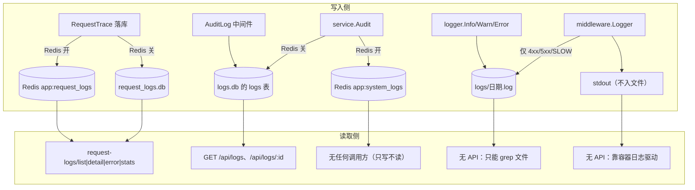
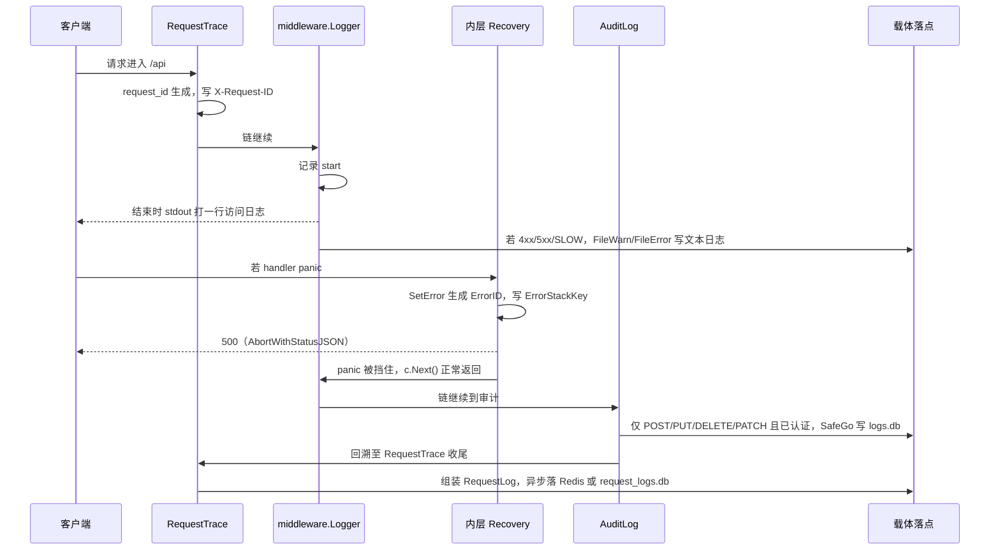

# 日志分析

<cite>
**本文档引用的文件**
- [logger.go](file://main/internal/logger/logger.go)
- [store.go](file://main/internal/logstore/store.go)
- [request_trace.go](file://main/internal/api/middleware/request_trace.go)
- [logger.go](file://main/internal/api/middleware/logger.go)
- [recovery.go](file://main/internal/api/middleware/recovery.go)
- [audit.go](file://main/internal/api/middleware/audit.go)
- [sanitize.go](file://main/internal/api/middleware/sanitize.go)
- [sign.go](file://main/internal/api/middleware/sign.go)
- [router.go](file://main/internal/api/router.go)
- [routes_batch2.go](file://main/internal/apiv1/routes_batch2.go)
- [auth.go](file://main/internal/apiv1/auth.go)
- [logs.go](file://main/internal/api/handler/logs.go)
- [request_log.go](file://main/internal/api/handler/request_log.go)
- [user.go](file://main/internal/api/handler/user.go)
- [dashboard.go](file://main/internal/api/handler/dashboard.go)
- [audit.go](file://main/internal/service/audit.go)
- [models.go](file://main/internal/models/models.go)
- [maintenance.go](file://main/internal/database/maintenance.go)
- [trace_gin.go](file://main/internal/database/trace_gin.go)
- [database.go](file://main/internal/database/database.go)
- [main.go](file://main/main.go)
- [devlog.md](file://devlog.md)
- [analysis-deploy.md](file://../.wiki-context/analysis-deploy.md)
- [性能诊断.md](file://docs/故障排除/性能诊断.md)
- [故障排除.md](file://docs/故障排除/故障排除.md)
- [logs](file://main/logs)
- [data](file://main/data)
</cite>

## 目录

1. [简介](#简介)
2. [项目结构](#项目结构)
3. [核心组件](#核心组件)
4. [架构总览](#架构总览)
5. [详细组件分析](#详细组件分析)
6. [依赖关系分析](#依赖关系分析)
7. [性能考虑](#性能考虑)
8. [故障排查指南](#故障排查指南)
9. [结论](#结论)
10. [附录](#附录)

## 简介

DNSPlane 的"日志"不是一个东西，而是**四条互不相通的写入通道**：logger 文本日志
（`logs/<日期>.log` + stdout）、logstore 系统日志（Redis `app:system_logs`，**只写不读**）、
request_logs（`RequestTrace` 逐请求落库）、operation_logs（`AuditLog` 与 `service.Audit`）。
排障最常见的误判是拿其中一条的缺失去否定另一条的存在。四者的保留策略、读取入口、脱敏规则、
丢失条件全都不同，故本文同时给出**字段字典**与**"日志为什么不见了"的判定链**。
诊断方法与采样命令属 [性能诊断](file://docs/故障排除/性能诊断.md)，本文只讲内容解读与检索。

**章节来源**
- [logger.go](file://main/internal/logger/logger.go#L16-L54)
- [store.go](file://main/internal/logstore/store.go#L14-L47)
- [request_trace.go](file://main/internal/api/middleware/request_trace.go#L138-L302)
- [analysis-deploy.md](file://../.wiki-context/analysis-deploy.md#L318-L400)

## 项目结构

日志相关代码按"写入侧/存储侧/读取侧"三层分离，落在四个包内。

```
main/
├── logs/                          # 载体 A/C：文本日志，按日命名（实测 3 个 .log）
├── data/                          # 载体 C/D：SQLite 落点
│   ├── data.db (+-wal +-shm)
│   ├── logs.db (+-wal +-shm)      # 操作日志 + 证书日志 + 巡检日志
│   └── request_logs.db            # 请求日志（Redis 关闭时）
└── internal/
    ├── logger/logger.go           # 写入侧：文件+控制台双通道、轮转、清理
    ├── logstore/store.go          # 存储侧：Redis 环形缓冲与裁剪
    ├── api/middleware/            # 写入侧：request_trace / logger / recovery / audit
    ├── service/audit.go           # 写入侧：手动审计（Redis 优先）
    └── api/handler/               # 读取侧：user.go / request_log.go / logs.go
```

`main/logs/` 与 `main/data/` 的实测形态（**只取目录结构与体积，不读业务数据内容**）：

| 目录 | 实测条目 | 说明 |
|---|---|---|
| `main/logs/` | 3 个 `.log`，15 / 29 / 55 行，共 99 行 | 命名即 `2006-01-02.log` 日期格式 |
| `main/data/` | `data.db` 428K、`logs.db` 180K、`request_logs.db` 40K | WAL 已 checkpoint，`-wal` 为 0 字节 |
| `main/data/` | `data.db-shm`、`logs.db-shm` 各 32K | `request_logs.db` 无伴生文件 |
| 权限 | `.db` 为 `0755`，`.log` 为 `0644` | 数据库文件全局可读（口径过宽，非本次主题） |

**章节来源**
- [logger.go](file://main/internal/logger/logger.go#L104-L112)
- [analysis-deploy.md](file://../.wiki-context/analysis-deploy.md#L113-L114)
- [analysis-deploy.md](file://../.wiki-context/analysis-deploy.md#L292-L300)

## 核心组件

### 四类日志载体总览

| 载体 | 物理位置 | 写入者 | 读取入口 | 保留规则 | 脱敏 |
|---|---|---|---|---|---|
| A 运行文本日志 | `logs/<日期>.log` + stdout | `logger.Info/Warn/Error/Debug` | 无 API，只能读文件 | 单文件 10 MB、30 份、30 天 | 无（由调用方自律） |
| B 访问日志 | **仅 stdout** | `middleware.Logger` 的 `consoleLine` | 无 API，靠外部采集器 | 由外部日志驱动决定 | header/body 不进此通道 |
| C 结构化错误日志 | 同 A（仅文件） | `logger.FileError` / `FileWarn` | 无 API | 同 A | 同 A |
| D 请求日志 | Redis `app:request_logs` **或** `data/request_logs.db` | `RequestTrace` 异步落库 | `POST /api/request-logs/*` | Redis 10000 条环形；SQLite 默认 7 天 + 2000/1000 条 | header/body/response 三重脱敏 |
| E 操作日志 | Redis `app:system_logs` **或** `data/logs.db` 的 `logs` 表 | `AuditLog` 中间件、`service.Audit` | `GET /api/logs`、`GET /api/logs/:id` | SQLite 默认 90 天；Redis 10000 条环形 | 跳过登录族路径 |

三条最容易踩的规则差异：

- **B 不走 logger**：`middleware/logger.go:220` 是裸 `fmt.Fprintln(os.Stdout, consoleLine)`，
  因此它**不受日志级别开关控制**，也不受 10 MB 轮转约束。
- **D/E 都是"二选一"而非双写**：`request_trace.go:296-301` 与 `service/audit.go:20-26`
  都在 Redis 可用时**只写 Redis**，SQLite 侧不留副本。
- **E 的两个写入者口径不同**：`AuditLog` 中间件恒定写 `LogDB`（SQLite），
  而 `service.Audit.LogAction` 走 Redis 优先分支 → 同一操作可能只在其中一个里出现。

**章节来源**
- [logger.go](file://main/internal/api/middleware/logger.go#L205-L244)
- [request_trace.go](file://main/internal/api/middleware/request_trace.go#L296-L302)
- [audit.go](file://main/internal/service/audit.go#L20-L26)
- [audit.go](file://main/internal/api/middleware/audit.go#L70-L92)

### 载体全景



**图表来源**
- [logger.go](file://main/internal/logger/logger.go#L96-L129)
- [middleware logger.go](file://main/internal/api/middleware/logger.go#L205-L244)
- [request_trace.go](file://main/internal/api/middleware/request_trace.go#L296-L302)
- [store.go](file://main/internal/logstore/store.go#L53-L70)
- [audit.go](file://main/internal/service/audit.go#L20-L26)

**章节来源**
- [analysis-deploy.md](file://../.wiki-context/analysis-deploy.md#L320-L328)

## 架构总览

### 一次请求的四路写入



**图表来源**
- [router.go](file://main/internal/api/router.go#L21-L58)
- [request_trace.go](file://main/internal/api/middleware/request_trace.go#L138-L302)
- [middleware logger.go](file://main/internal/api/middleware/logger.go#L170-L244)
- [recovery.go](file://main/internal/api/middleware/recovery.go#L19-L78)
- [audit.go](file://main/internal/api/middleware/audit.go#L22-L92)

关键点：`RequestTrace` 的落库代码在 `c.Next()` **之后**，所以只有被内层 `Recovery` 挡住 panic，
这段代码才会执行。这是"请求日志整体丢失"的唯一结构性原因，详见后文实证。

**章节来源**
- [router.go](file://main/internal/api/router.go#L29-L53)
- [recovery.go](file://main/internal/api/middleware/recovery.go#L57-L70)

### 请求日志的生命周期

生命周期由两条独立规则驱动，无需图形即可判定，故此处直接给出规则表：

| 阶段 | 规则 | 位置 |
|---|---|---|
| 采集 → 落库 | `c.Next()` 之后组装，裸 goroutine 异步写 | `request_trace.go:296-302` |
| Redis 写入 | LPush 左进，头部即最新 | `store.go:53-70` |
| Redis 裁剪 | 每 64 次写入检查，`LLen > 10500` 才 `LTrim 0..9999` | `store.go:62-69` |
| SQLite 清理 | 每小时一轮，按保留配置删除（文本日志标记 `[Maintenance]`） | `maintenance.go:17-56` |
| SQLite 压缩 | 默认 24 小时一次 `VACUUM` | `maintenance.go:283-311` |
| 人工清理 | `request-logs/clean` 双端都清 | `request_log.go:371-391` |

**章节来源**
- [request_trace.go](file://main/internal/api/middleware/request_trace.go#L296-L302)
- [store.go](file://main/internal/logstore/store.go#L53-L70)
- [maintenance.go](file://main/internal/database/maintenance.go#L17-L56)
- [request_log.go](file://main/internal/api/handler/request_log.go#L317-L391)

## 详细组件分析

### logger 文本日志：格式字段字典与轮转语义

**行格式**（`writeWithDepth`，`logger.go:206-256`）：

| 字段 | 拼接来源 | 示例（本机实测前缀） |
|---|---|---|
| 时间戳 | `now.Format("2006-01-02 15:04:05")` | `2026-10-05 14:09:27` |
| 级别 | `levelStr`，取自 `INFO/WARN/ERROR/DEBUG` | `[INFO]` |
| 调用点 | `runtime.Caller(callerDepth)` → `filepath.Base(file):line` | `[database.go:318]` |
| 正文 | `fmt.Sprintf(format, v...)` | 由调用方决定 |

实采样本（只取结构前缀，不暴露消息正文）：

```
2026-10-05 14:09:27 [INFO] [database.go:318]
2026-10-05 14:48:01 [INFO] [cache.go:82]
```

控制台是另一套格式：`HH:MM:SS LEVEL file:line msg`，带 ANSI 配色（`logger.go:238-244`）。
**同一行内容在两个通道里形态不同**，解析脚本不能共用正则。

**callerDepth = 4 是硬编码**（`logger.go:199`、`:203`）。含义：调用栈必须恰好是
`公开方法 → write → writeWithDepth → runtime.Caller`，中间**不能加包装层**。
一旦有人在 `Info` 之上再包一层 helper，日志里的 `[file:line]` 会全部指向那个 helper，
定位价值归零——这是新增日志封装时必须验证的一项。

**轮转语义（重点，含一个反直觉行为）**：

- 文件名即日期：`logs/<2006-01-02>.log`，一天一个文件（`:104-106`）。
- 轮转检查每分钟一次（`rotateLoop`，`:132-148`），触发条件是**日期变更或 `currentSize >= 10 MB`**。
- 超限处置是 **`os.Remove(filename)` 后重新打开**（`:106-109`）：
  也就是说，**同一天写满 10 MB 时，当天已写入的全部历史被直接删除**，不备份、不压缩、不改名。
  这不是"切分新文件"，是"重建同名文件"。
- 大小记账是累加而非 `stat`：`l.currentSize += int64(len(fileMsg) + 1)`（`:255`），
  因此外部截断/删除文件后，进程内计数不会自愈。
- 清理：启动即执行一次 + 每 24 小时（`cleanupLoop`，`:150-158`），
  先删 mtime 超 30 天的，再按 mtime 倒序保留前 30 个（`MaxBackups = 30`、`MaxAge = 30`，`:16-20`）。
- 清理 glob 为 `*.log*`（`:163`），`GetLogFiles` 还带 `Compressed` 判定（`:318`），
  但**全仓没有 gzip 压缩实现**，该字段恒为 `false`。

**通道选择**：`FileInfo/FileWarn/FileError`（`:377-387`）走 `writeFileOnly`，即 `toConsole=false`，
**只进文件**；`Fatal`（`:372-375`）记 ERROR 后 `os.Exit(1)`，实测 `main.go` 未使用它，
走的是 `logger.Error` + 显式 `os.Exit`。

**三个"看不到"的设计后果**：

- 级别默认 `LevelInfo`（`New()` → `NewWithOptions("logs", LevelInfo, true, true)`，`:53-54`），
  **DEBUG 行不进文件**。本机实采级别计数 `INFO=81 / WARN=15 / ERROR=3 / DEBUG=0`，
  归零与默认级别一致，不代表代码里没有 Debug 调用。
- `logger.Close()` 有定义但**全仓无调用点**（实测零命中），`main.go` 的 defer 链只关数据库、
  缓存、监控与调度。退出时尾部若干行是否落盘，取决于 OS 回收时机。
- `GetLogFiles()`（`:301-328`）同样**无 handler 调用**，且路径硬编码相对目录 `"logs"`（`:303`）
  → "列出日志文件"的能力存在但未接入 API，前端日志页展示的从来不是文件清单。

**章节来源**
- [logger.go](file://main/internal/logger/logger.go#L16-L20)
- [logger.go](file://main/internal/logger/logger.go#L96-L196)
- [logger.go](file://main/internal/logger/logger.go#L199-L256)
- [logger.go](file://main/internal/logger/logger.go#L301-L328)
- [logger.go](file://main/internal/logger/logger.go#L344-L395)
- [main.go](file://main/main.go#L66-L150)

### 访问日志与结构化错误行

`middleware/logger.go` 是**第二个日志系统**，与 `internal/logger` 并行：

| 行为 | 规则 | 位置 |
|---|---|---|
| HEAD 请求 | 直接跳过，不记 | `:172-176` |
| 静态与页面路径 | `/_next/`、`/icons/`、`/favicon`、`/login`、`/dashboard` 跳过 | `:38-44` |
| `/api/` 前缀 | **始终记录** | `:47-50` |
| 控制台行 | `14:20:24 200  1.99ms GET    /api/domains/list`，出错追加 `[err_xxxx]` | `:205-219` |
| 落文件条件 | 5xx 或 `has_error` → `FileError`；4xx → `FileWarn`；≥3 s → `FileWarn` 带 `SLOW` | `:223-241` |
| 正常快速请求 | **不写文件**（注释明示，避免文件过大） | `:243` |
| 慢请求阈值 | `slowRequestThreshold = 3 * time.Second`（常量，不可配置） | `:14` |

由此得到一条重要判据：**文本日志里没有某条 200 请求，是设计使然，不是丢失**。
要查全量请求必须走 `request_logs`（载体 D）。

落文件的结构化行模板为 `[%s] %s %s %d %s ip=%s err=%s rid=%s`，字段依次是
**模块名 / 方法 / 路径 / 状态码 / 耗时 / IP / 错误信息 / 请求 ID**。模块名由 `extractModule`
的路径映射得到（`:96-L127`），例如 `request-logs` → `request-log`、`quicklogin` → `auth`。
本机实采：`rid=` 标记命中 17 次，`SLOW` 标记命中 3 次，`RECOVERY` 标记 0 次。

**章节来源**
- [middleware logger.go](file://main/internal/api/middleware/logger.go#L14-L127)
- [middleware logger.go](file://main/internal/api/middleware/logger.go#L170-L244)

### logstore 系统日志：Redis 键与裁剪规则

键与上限（`store.go:16-21`，全部为常量，不可配置）：

| 键 | 用途 | 上限 | 统计缓存 |
|---|---|---|---|
| `app:request_logs` | 请求日志环形 List | `maxLogSize = 10000` | `logstore:req_stats`，TTL 2 分钟 |
| `app:system_logs` | 系统/操作日志环形 List | `maxLogSize = 10000` | 无 |

裁剪规则两侧不对称，这是实测事实：

- **请求侧降频检查**：`saveLogTrimCounter.Add(1)%64 == 0` 时才 `LLen` + 判断
  （`:62-69`）。即**每 64 次写入才检查一次**，触发条件是 `length > 10000+500`，
  执行 `LTrim(key, 0, 9999)` 并删除统计缓存。代价是列表最坏可短暂堆到约 10563 条。
- **系统侧每次检查**：`SaveSystemLog` 每次写入都 `LLen` 再判断（`:268-271`），无降频。
- 两者都是 **LPush + 左保留**，因此列表头部永远是最新记录，分页读取从头切片即可。

读取路径的成本（决定"为什么查询慢"）：

| 方法 | 位置 | 无筛选 | 有筛选 |
|---|---|---|---|
| `QueryRequestLogs` | `:77-118` | `LRange` 分页窗口 | `LRange(0, total-1)` 全量拉 + 内存过滤 |
| `GetRequestByID` / `GetErrorByID` | `:121-171` | 500 条一批顺序扫，命中即返回 | 同左 |
| `GetRequestStats` | `:186-243` | 缓存命中直接返回 | 未命中时全扫，用 `requestLogLite{is_error, created_at}` 轻量解析，`recentErrors` 上限 5 |
| `QuerySystemLogs` | `:275-311` | 同分页规则 | 同全量规则 |

两个必须写进排障手册的事实：

- **`QuerySystemLogs` 在全仓没有任何调用方**（实测仅命中定义行），故 Redis 里的
  `app:system_logs` 是**只写不读**的缓冲：日志页查不到但 Redis 真实存在，是该缓冲的正常形态。
- **`PurgeSystemLogs` 的清空写法反直觉**（`:314-322` 注释已说明）：用
  `LTrim(key, 1, 0)`（起始大于结束）表达"清空"，因为 `LTrim(key, 0, -1)` 会**保留全部条目**，
  而内存缓存实现的 `Delete` 只作用于键值区、删不掉列表区。改成 `LTrim(0,-1)` 会让清空静默失效。

`logstore.Init()` 在 Redis 生效时打一条 INFO（`:38-44`），这是判断"当前写哪一侧"最直接的文本证据。

**章节来源**
- [store.go](file://main/internal/logstore/store.go#L14-L70)
- [store.go](file://main/internal/logstore/store.go#L77-L243)
- [store.go](file://main/internal/logstore/store.go#L260-L322)
- [analysis-deploy.md](file://../.wiki-context/analysis-deploy.md#L381-L395)

### request_logs：采集字段与追踪闭环

采集字段以 `models.RequestLog` 为准（`models.go:353-377`），逐字段给出来源与上限：

| 字段 | 来源 | 上限/规则 |
|---|---|---|
| `request_id` | `GenerateRequestID()`：`req_<unixnano>_<自增序号>` | 非加密随机，仅用于关联（`request_trace.go:41-47`） |
| `error_id` | `GenerateErrorID()`：`err_` + 8 字节 hex | 首次错误胜出，后续复用（`:126-137`、`:326-347`） |
| `user_id` / `username` | `AuthUserID(c)`、上下文 `username` | 未认证时为空 |
| `method` / `path` / `query` | 请求行 | `path` ≤1024、`query` ≤4096 |
| `body` | 读取后 `io.LimitReader` | 中间件层 `MaxBodySize = 64 KB`，落库前再截 `maxRequestLogBodyLen = 8192` |
| `headers` | 多值头合并 + `Host` | 经 `SanitizeHeadersForLog` 掩码 |
| `ip` / `user_agent` | `c.ClientIP()` / `UserAgent()` | UA 截 500 |
| `status_code` | `c.Writer.Status()`，0 视为 200 | — |
| `response` | `original_response` 优先，退化到 Writer 截取 | 错误 256 KB、成功 16 KB（`MaxResponseSize`、`maxSuccessResponseCapture`） |
| `duration` | `time.Since(start).Milliseconds()` | 含中间件开销 |
| `is_error` | `statusCode >= 400 || c.GetBool("has_error")` | 4xx 也算错误 |
| `error_msg` / `error_stack` | `SetError` 写入 | 堆栈缓冲区 4096 字节 |
| `db_queries` / `db_query_time` | GORM 回调聚合 | 仅 `DB`/`LogDB`，SQL 截 2000 |
| `extra` | `SetExtra` 聚合 map | 无上限（调用方自律） |

**追踪闭环**（这是本项目最有用的排障抓手）：

```
客户端拿到 X-Request-ID 或 X-Error-ID
  → POST /api/request-logs/detail {"request_id":"..."}
  → POST /api/request-logs/error  {"error_id":"..."}
  → 详情含 body / headers / response / db_queries / error_stack
```

**闭环的一个硬边界**：`X-Error-ID` 必须在状态码写出**之前**设置。实现用
`respCaptureWriter` 在 `WriteHeader`、`WriteHeaderNow`、`Write`、`WriteString` 四处挂钩，
在快照前补头（`request_trace.go:57-124`）。`SetError` 也直接写一次头（`:345`）。
因此：只调 `c.Status(204)` 不写 body 的路径仍能送达；
而**已经写出响应头之后再 `SetError`，客户端收不到 `X-Error-ID`**，落库仍会有 `error_id`。
这种"库里有、头里没有"的不对称是响应头顺序问题，不是丢日志。

**列表看不到正文是设计**：`request_log.go:20` 的 `requestLogListSelect` 明确排除
`body`/`headers`/`response`/`error_stack`/`db_queries`，注释理由是降低 SQLite IO 与加密载荷体积。
因此"列表页没有请求体"必须靠 `detail` 补齐，不能判为采集缺失。

**追踪范围只覆盖 `/api` 前缀**：`RequestTrace` 首行即判断
`if !strings.HasPrefix(path, "/api") { c.Next(); return }`（`:140-144`），
静态资源与页面路由不产生请求日志。

**章节来源**
- [models.go](file://main/internal/models/models.go#L353-L377)
- [request_trace.go](file://main/internal/api/middleware/request_trace.go#L23-L137)
- [request_trace.go](file://main/internal/api/middleware/request_trace.go#L140-L302)
- [request_log.go](file://main/internal/api/handler/request_log.go#L17-L100)

### operation_logs：审计写入与读取

两个写入者，规则不同，必须分开记：

**写入者一：`AuditLog` 中间件**（`middleware/audit.go`）

| 规则 | 具体 | 位置 |
|---|---|---|
| 记录范围 | 仅 `POST`/`PUT`/`DELETE`/`PATCH` | `:30-34` |
| 未认证 | `user_id` 为空直接返回，不记 | `:41-45` |
| 跳过前缀 | `/api/login`、`/api/auth/`、`/api/install` | `:100-105` |
| 跳过后缀 | `/list` `/detail` `/get` `/stats` `/status` `/info` `/log` `/history` `/uptime` `/overview` `/lines` `/providers` `/whois` `/logs` `/request` `/error` | `:106-111` |
| 跳过精确 | `/api/dashboard/stats`、`/api/system/config/get`、`/api/dns/providers` 等 12 条 | `:112-127` |
| action 生成 | 去 `/api/`、`v1/` 前缀，`/`→`_`，`/delete` 结尾加 `delete_` 前缀 | `:141-L158` |
| data 内容 | `action + " (耗时)" + " [HTTP 4xx]"` | `:57-66` |
| 写入方式 | `utils.SafeGo` 异步写 `LogDB`，`Data` 截 500 | `:69-90` |

口令登录**永远不进 `logs` 表**（前缀跳过），这是实测口径：`logs` 的 action 分布里没有 login，
只有 OAuth 相关条目。判断"谁改了密码"不能依赖操作日志。

**写入者二：`service.Audit`**（`service/audit.go`）：`LogAction` / `LogChange` 组装
`models.Log` 后经 `saveLog` 分流，Redis 可用时**只写 Redis**（`:20-26`）→
`GET /api/logs` 只查 SQLite，于是这类条目在页面上不可见。
`devlog.md:2214` 另记录一条口径：`before_data` / `after_data` 基本恒为空，
唯二写入点是 `LogChange` / `LogDomainChange`。

**读取侧：`GetLogs`**（`user.go:461-533`）用 `c.Query` 读全部条件
（`page`/`page_size`/`keyword`/`entity`/`action`/`user_id`|`uid`/`domain`/`date_from`/`date_to`），
一次请求发**五条 SQL**：计数、分页列表、今日计数、distinct uid、distinct domain。
非管理员由 `operationLogScope`（`:547-553`）收窄到 `uid = 自己`，统计卡片同步收窄，
避免"列表是自己的、数字是全站"。

`GetLogDetail`（`:556-574`）与列表共用同一作用域函数；他人的 id 与不存在的 id
返回同一句"日志不存在"，避免 id 成为可枚举预言机。

**清理**：`CleanOperationLogs`（`:596-623`）`days <= 0` 时**不带 WHERE 清空全表**，
需要 `AllowGlobalUpdate`；Redis 开启时同时 `PurgeSystemLogs`，注释理由是
"只清 SQLite 会留下日志页已看不到、但仍能被查询的旧条目"。清理本身又是一条审计写入。

**章节来源**
- [audit.go](file://main/internal/api/middleware/audit.go#L22-L158)
- [audit.go](file://main/internal/service/audit.go#L20-L70)
- [user.go](file://main/internal/api/handler/user.go#L441-L623)
- [models.go](file://main/internal/models/models.go#L328-L350)
- [devlog.md](file://devlog.md#L2214)

### 日志查询 API 端点表

控制台族（`router.go`）与对外 API 族（`apiv1/routes_batch2.go`）都在，
**v1 族把 GET 语义改为 POST + JSON body**。

| 用途 | 控制台路由 | v1 桥接路由 | Handler | 数据源 | 权限 |
|---|---|---|---|---|---|
| 操作日志列表 | `GET /api/logs` | `POST /api/v1/system/logs/list` | `GetLogs` | `logs.db` 的 `logs` 表 | 非管理员收窄到自身 |
| 操作日志详情 | `GET /api/logs/:id` | `POST /api/v1/system/logs/detail` | `GetLogDetail` | 同上 | 同上 |
| 操作日志清空 | `POST /api/logs/clean` | `POST /api/v1/system/logs/clean` | `CleanOperationLogs` | SQLite + Redis 环形 | 仅管理员 |
| 请求日志列表 | `POST /api/request-logs/list` | `POST /api/v1/system/request-logs/list` | `GetRequestLogs` | Redis 或 `request_logs.db` | 仅管理员 |
| 按 request_id 查详情 | `POST /api/request-logs/detail` | `POST /api/v1/system/request-logs/detail` | `GetRequestByID` | 同上 | 仅管理员 |
| 按 error_id 查详情 | `POST /api/request-logs/error` | `POST /api/v1/system/request-logs/error` | `GetErrorByID` | 同上 | 仅管理员 |
| 请求日志统计 | `POST /api/request-logs/stats` | `POST /api/v1/system/request-logs/stats` | `GetRequestStats` | 同上（Redis 有 2 min 缓存） | 仅管理员 |
| 请求日志清理 | `POST /api/request-logs/clean` | `POST /api/v1/system/request-logs/clean` | `CleanRequestLogs` | **Redis 与 SQLite 都清** | 仅管理员 |
| 域名操作日志 | `GET /api/domains/:id/logs` | — | `GetDomainLogs` | **服务商优先**，失败降级本地 | 用户态 + 域名权限 |
| 记录变更日志 | `GET /api/domains/:id/records/logs` | `POST /api/v1/records/logs` | `GetRecordChangeLog` | 服务商云端 | 用户态 |
| 监控任务日志 | `GET /api/monitor/tasks/:id/logs` | `POST /api/v1/monitor/tasks/logs` | `GetMonitorLogs` | `logs.db` 的 `dm_check_logs` | 用户态 |
| 系统信息 | `GET /api/dashboard/system/info` | — | `GetSystemInfo` | `runtime` + 维护统计 | 仅管理员 |

三个端点级的坑：

- `GetDomainLogs` 注释写 `@route POST /domains/logs`，实际注册为
  `GET /api/domains/:id/logs`（`router.go:273`），**注释与方法不一致（实测）**，以路由表为准；
  其响应带 `source` 字段，`provider` 表示走云端、`local` 表示已降级本地库。
- `request-logs/list` 的 `page_size` 上限 200（`request_log.go:117-121`），超出静默收敛。
- v1 族依赖 `systemParamBridge`（`routes_batch2.go:83`）把 body 参数搬到查询串，因为 `GetLogs`
  全程只读 `c.Query`（测试 `routes_batch2_test.go:194-224` 断言此搬运）。新增 v1 日志路由忘带桥接，
  症状是"分页与筛选全部失效"。

**章节来源**
- [router.go](file://main/internal/api/router.go#L151-L295)
- [routes_batch2.go](file://main/internal/apiv1/routes_batch2.go#L83-L104)
- [logs.go](file://main/internal/api/handler/logs.go#L20-L87)
- [request_log.go](file://main/internal/api/handler/request_log.go#L104-L391)

### grep 与 jq 分析命令

以下命令均在本机 `main/` 目录下实测。注意本机 `grep` 实际指向 ripgrep，
需要 POSIX 语义时显式使用 `/usr/bin/grep`。

**统计一天的级别分布**：

```bash
cd main && for lv in INFO WARN ERROR DEBUG; do
  printf "%s=%s\n" "$lv" "$(/usr/bin/grep -oh "\[$lv\]" logs/*.log | /usr/bin/wc -l)"; done
```

预期输出（本机实采，三文件共 99 行）：

```
INFO=81
WARN=15
ERROR=3
DEBUG=0
```

`DEBUG=0` 的正确解读见前文：默认级别 `LevelInfo` 直接丢弃 Debug，**不代表代码没有 Debug 调用**。

**只看慢请求**：`/usr/bin/grep -c 'SLOW' main/logs/*.log`，本机实采 3 个文件合计命中 3 次。
`SLOW` 行的字段序固定为 模块 / 方法 / 路径 / 状态码 / 耗时 / ip / rid（模板见
`middleware/logger.go:240`）；要按耗时排序，先 `sed 's/.*SLOW//'` 去掉前缀再按第 3 列 `sort -k3`。

**从文本日志反查请求 ID，再回落到结构化日志**：

```bash
/usr/bin/grep -oh 'rid=[A-Za-z0-9_]*' main/logs/*.log | /usr/bin/sort -u | /usr/bin/head
```

预期输出：若干 `rid=req_<纳秒时间戳>_<序号>` 形式的 ID（本机实采 `rid=` 命中 17 次）。
把 ID 交给详情接口即可拿到完整上下文：

```bash
curl -s -X POST http://127.0.0.1:8080/api/v1/system/request-logs/detail \
  -H "X-API-Key: <key>" -H 'Content-Type: application/json' \
  -d '{"request_id":"req_1759..._12"}' \
  | jq '{path:.data.path, status:.data.status_code, dur:.data.duration, dbtime:.data.db_query_time}'
```

预期输出（形态，键名取自 `models.RequestLog` 的 json 标签）：

```json
{"path":"/api/domains/records/list","status":200,"dur":3421,"dbtime":12}
```

**解析 `db_queries` 找最慢语句**：

```bash
... | jq -r '.data.db_queries | fromjson | sort_by(-.duration_ms) | .[0] | {ms:.duration_ms, rows:.rows, sql:.sql[0:80]}'
```

**读 Redis 环形缓冲（唯一能看到"只写不读"那批数据的方法）**：

```bash
redis-cli -a <pwd> LLEN app:request_logs
redis-cli -a <pwd> LLEN app:system_logs
redis-cli -a <pwd> LINDEX app:request_logs 0 | jq '{request_id, path, status_code, duration, is_error}'
```

预期输出：`LLEN` 返回 0..10563 之间的整数；`LINDEX ... 0` 是**最新**一条（LPush 左进）。
这两条命令也是判断"页面查不到但数据是否还在"的决定性证据。

**jq 的适用前提**：`sign.go:152-156` 表明 `auth_type=apikey`（由 `apiv1/auth.go:109` 写入）
时响应为明文 JSON；控制台会话带会话密钥时响应体是加密信封，`jq` 只能看到外层结构。
诊断脚本一律走 v1 + API Key。

**章节来源**
- [logger.go](file://main/internal/logger/logger.go#L16-L20)
- [middleware logger.go](file://main/internal/api/middleware/logger.go#L223-L243)
- [request_trace.go](file://main/internal/api/middleware/request_trace.go#L41-L47)
- [sign.go](file://main/internal/api/middleware/sign.go#L140-L176)
- [auth.go](file://main/internal/apiv1/auth.go#L109)
- [store.go](file://main/internal/logstore/store.go#L17-L18)

### 日志丢失场景：双层 Recovery 顺序破坏

`router.go:29-53` 的注释给出了**实测结论**，本文按证据复述一次：

- panic 恢复分两层：链首 `gin.Recovery()`（`newBaseEngine`，`:26-28`）与
  `/api` 组内紧跟 `RequestTrace` 的 `middleware.Recovery()`（`:44-47`）。
- `RequestTrace` 的落库代码在 `c.Next()` **之后**。若只有链首那层，
  panic 会穿透到链首，这段代码不会执行，**请求日志完全丢失**。
  注释记录的原话是：仅外层 `gin.Recovery` 时 `RequestLog` 零记录。
- 内层 `middleware.Recovery` 的作用是：先 `SetError` 与写 `ErrorStackKey`，
  再把 panic 挡在 `RequestTrace` 之内，使 `c.Next()` 正常返回并完成后继落库，
  保留 `ErrorID` 与堆栈。
- 外层 `gin.Recovery` 仍保留，兜住**不经 RequestTrace** 的静态资源、页面路由与 `NoRoute`。

```
顺序正确                          顺序被破坏
CORS → RequestTrace → Recovery → CSRF → AuditLog     CORS → Recovery → RequestTrace → ...
              ↓                                            ↓
   panic 在内层被挡住                              panic 穿透 RequestTrace
              ↓                                            ↓
   c.Next() 返回 → 落库成功                        落库代码不执行 → 请求日志零记录
   详情里有 error_stack                            文本日志仍有 [RECOVERY] 行
```

由此得到两条判据：

- **文本日志有 `[RECOVERY]` 行、`request_logs` 里没有对应记录** → 内层顺序被改坏，
  或该 panic 发生在 `RequestTrace` 之前（如 CORS）。
- 连接中断类 panic 走的是另一分支：`recovery.go:44-52` 判定 `brokenPipe` 后
  **只 `logger.Warn` + `c.Abort()`，不调 `SetError`** → 这类请求在请求日志里表现为
  `status_code` 正常或 499 语义但无 `error_stack`，属预期，不是丢失。

其余四类"看起来丢了"的真实原因，逐条给出可验证依据：

| 现象 | 真实原因 | 证据位置 |
|---|---|---|
| 当天日志文件突然变小 | 同日写满 10 MB 触发 `os.Remove` 重建 | `logger.go:106-109` |
| 200 请求在文本日志里找不到 | 正常快速请求不写文件 | `middleware/logger.go:243` |
| DEBUG 全缺 | 默认级别 `LevelInfo` | `logger.go:53-54` |
| 静态资源/页面路由无请求日志 | `RequestTrace` 只处理 `/api` 前缀 | `request_trace.go:140-144` |
| Redis 开启时 `request_logs.db` 不再增长 | 只写一处，不双写 | `request_trace.go:296-301` |
| `service.Audit` 的操作在日志页看不到 | Redis 分支不落 SQLite，而 `GetLogs` 只查 SQLite | `service/audit.go:20-26`、`user.go:547-553` |
| 进程重启后最后几行缺失 | `logger.Close` 无调用点，依赖 OS 回收；落库 goroutine 未被等待 | `logger.go:389-395`、`request_trace.go:296` |
| 清理后仍查得到旧条目 | `LTrim(0,-1)` 类改法静默失效 | `store.go:314-322` 注释 |

**章节来源**
- [router.go](file://main/internal/api/router.go#L21-L58)
- [recovery.go](file://main/internal/api/middleware/recovery.go#L19-L78)
- [request_trace.go](file://main/internal/api/middleware/request_trace.go#L138-L302)
- [logger.go](file://main/internal/logger/logger.go#L106-L109)
- [store.go](file://main/internal/logstore/store.go#L314-L322)

## 依赖关系分析

写入与读取的依赖是单向的，无环，全部由 `main/internal/api` 指向存储层：

| 角色 | 依赖对象 | 口径含义 |
|---|---|---|
| `RequestTrace` | `logstore.Store`、`database.RequestDB`、`sanitize` | Redis 与 SQLite 二选一，不双写 |
| `middleware.Recovery` | `RequestTrace` 的 `SetError` / `ErrorStackKey` | 行为耦合，顺序即语义 |
| `middleware.Logger` | `internal/logger`（仅文件通道） | 不经 `logstore` |
| `AuditLog` 中间件 | `database.LogDB` | 恒定写 SQLite |
| `service.Audit` | `logstore.Store` 优先，退化 `LogDB` | 与中间件口径分裂的来源 |
| `handler.GetLogs` | `database.LogDB` | **不依赖 `logstore`** |
| `handler.request_log.*` | `logstore.Store` + `RequestDB` | 分支由 `useRedisLogs()` 决定 |

依赖上值得注意的三点：

- `handler.GetLogs` **不依赖** `logstore`，这是"Redis 侧系统日志读不到"的结构原因，
  而不是缺陷配置。若要统一口径，必须先改读取端，而不是往写入端加双写。
- `middleware.Recovery` 与 `RequestTrace` 是**行为耦合**而非包依赖：前者调用后者的
  `SetError`、`ErrorStackKey`，因此顺序即语义。
- `trace_gin.go` 的 `db_queries` 注入依赖 `RequestTrace` 事先在上下文里放好切片
  （`database.go:441-444` 判定），非 `/api` 路径永远拿不到 SQL 明细。

**章节来源**
- [user.go](file://main/internal/api/handler/user.go#L541-L553)
- [database.go](file://main/internal/database/database.go#L428-L497)
- [trace_gin.go](file://main/internal/database/trace_gin.go#L20-L38)

## 性能考虑

日志本身是负载来源，解读时要把它算进成本：

- 每请求固定复制一次 body（上限 64 KB）与一次响应截取（16 KB / 256 KB），并序列化一次
  `db_queries` 与 `extra`；开销量化见
  [性能诊断](file://docs/故障排除/性能诊断.md) 的 GC 与慢查询维。
- Redis 路径的读放大远大于写放大：带筛选查询是全量 `LRange`，统计接口全表扫 + 2 分钟缓存。
  SQLite 路径的写是异步单条 `Create`，列表用 `Count` + `Find` 双 goroutine 并发，
  连接池上限 8 下互相排队（`request_log.go:129-143`、`database.go:48-58`）。
- "正常请求不写文件"是刻意的削峰设计；反过来，4xx/5xx 全量写文件，
  错误风暴会直接放大为磁盘写尖峰，并与 10 MB 重建规则叠加成"当天历史被清空"。
- 保留策略默认值（`maintenance.go:17-56`）：操作日志 90 天、证书日志 60 天、
  巡检日志 72 小时、容灾切换日志 60 天、请求日志 7 天 + 成功 2000 条 / 错误 1000 条。
  改配置后**下一小时的清理轮次才生效**。

**章节来源**
- [request_trace.go](file://main/internal/api/middleware/request_trace.go#L23-L58)
- [request_log.go](file://main/internal/api/handler/request_log.go#L129-L143)
- [database.go](file://main/internal/database/database.go#L48-L58)
- [maintenance.go](file://main/internal/database/maintenance.go#L17-L56)

## 故障排查指南

按"先定载体、再定分支、最后定顺序"的三步法执行。

**第一步：确认当前到底在写哪一侧。**

```bash
/usr/bin/grep -h 'LogStore' main/logs/*.log | /usr/bin/tail -2
```

预期输出：出现 `[LogStore] 使用 Redis 存储请求日志和系统日志` 即为 Redis 分支
（`store.go:38-44`）。没有这行说明走 SQLite。**这一步决定后续所有查询该打哪个接口。**

**第二步：确认对象是否真的进过采集。**

```bash
curl -s -X POST http://127.0.0.1:8080/api/v1/system/request-logs/stats \
  -H "X-API-Key: <key>" | jq '.data | {total_count, error_count, today_count, today_error_count}'
```

预期输出（键名取自 `request_log.go:243-315`；**数值为占位示意**，本机服务未运行故未实采）：

```json
{"total_count":1284,"error_count":23,"today_count":197,"today_error_count":4}
```

**第三步：按现象选分支。**

| 现象 | 首个判定 | 若成立 | 若不成立 |
|---|---|---|---|
| 某请求完全查不到 | 路径是否 `/api` 前缀 | 转文本日志与 Redis `LLEN` | 属预期，请求日志不覆盖 |
| 错误码有、详情没有 `error_stack` | 是否 brokenPipe 分支 | 属预期（`recovery.go:44-52`） | 检查内层 Recovery 顺序 |
| 文本日志有 `[RECOVERY]`、库中无记录 | 链顺序 | 顺序被改坏，恢复 `RequestTrace→Recovery` | 检查 panic 是否在 CORS 之前 |
| 日志页看不到但 Redis 有 | `service.Audit` 写入 | 读取端只查 SQLite，属已知口径分裂 | 检查保留策略是否已清理 |
| `response` 字段为空 | 列表接口不返回大字段 | 用 `detail` 取 | 检查 `original_response` 是否被写 |
| `db_queries` 为空 | 后台任务 / `RequestDB` 操作 | 属预期（回调仅 `DB`/`LogDB`） | 检查 `db_queries` 键是否被提前消费 |
| 清空后仍查得到 | `PurgeSystemLogs` 分支 | 检查 Redis 判定与 `LTrim` 写法 | 检查是否只清了 SQLite |
| 当天日志突然变短 | 是否触及 10 MB | 属设计（删除重建） | 检查外部截断或容器日志轮转 |

**回归防护**：`applyAPIMiddleware` 的顺序有对应测试守卫（`recovery_trace_test.go`、
`recovery_panic_client_test.go`、`log_clean_route_test.go`、`operation_logs_clean_test.go`）。
改动中间件链后必须跑：

```bash
cd main && go test ./internal/api/ ./internal/api/middleware/ ./internal/logstore/
```

预期输出：每包一行 `ok`，`FAIL` 包数为 0。`log_clean_route_test.go:17-27` 明确断言
`POST /api/logs/clean` 必须存在于路由表，删除该路由会直接编译期/测试期报警。

**章节来源**
- [store.go](file://main/internal/logstore/store.go#L38-L47)
- [recovery.go](file://main/internal/api/middleware/recovery.go#L44-L70)
- [log_clean_route_test.go](file://main/internal/api/log_clean_route_test.go#L17-L27)
- [request_log.go](file://main/internal/api/handler/request_log.go#L243-L315)

## 结论

- **四条载体各有独立的丢失条件**，任何"日志丢了"的结论必须先指明是哪一条；
  最常犯的错误是拿文本日志"正常请求不写文件"去推断请求日志缺失。
- **`request_logs` 是唯一的逐请求全量记录**，且只在 `/api` 前缀生效；
  `X-Request-ID` / `X-Error-ID` 构成闭环，但受"响应头写出即快照"的硬边界约束。
- **轮转语义是"同日超限删除重建"**而非切分，这是当天历史被清零的唯一路径。
- **Redis 侧 `app:system_logs` 只写不读**（`QuerySystemLogs` 无调用方，实测），
  叠加 `service.Audit` 的 Redis 优先分支，构成操作日志的口径分裂。
- **双层 Recovery 的顺序就是数据完整性**：实测过"仅外层时请求日志零记录"，
  改链顺序属高风险动作，必须依赖既有测试守卫。
- **`logger.Close` 与 `GetLogFiles` 均无调用点**：退出尾部落盘不确定，文件列表能力未接入 API。
- 下一步：把"载体判定 → `LLEN` 校验 → `rid` 回落"固化为一线脚本，并与
  [性能诊断](file://docs/故障排除/性能诊断.md) 的采样表互相引用。

**章节来源**
- [logger.go](file://main/internal/logger/logger.go#L96-L148)
- [router.go](file://main/internal/api/router.go#L21-L58)
- [store.go](file://main/internal/logstore/store.go#L275-L322)
- [性能诊断.md](file://docs/故障排除/性能诊断.md)

## 附录

### 前端入口与备份边界

控制台入口为 `web/app/(dashboard)/dashboard/logs` 与 `.../request-logs`（实测存在）。
载体 B 只到 stdout，容器场景是唯一消费者：`docker logs` 能拿到，文件里没有。
三个库均为 WAL 模式，冷备必须同时取 `.db`、`.db-wal`、`.db-shm` 或改用 `VACUUM INTO`；
本项目**不含任何备份实现**，恢复属外部运维职责
（详证见 [analysis-deploy.md](file://../.wiki-context/analysis-deploy.md#L403-L427)）。

**章节来源**
- [analysis-deploy.md](file://../.wiki-context/analysis-deploy.md#L403-L427)
- [database.go](file://main/internal/database/database.go#L34-L46)
- [故障排除.md](file://docs/故障排除/故障排除.md)
