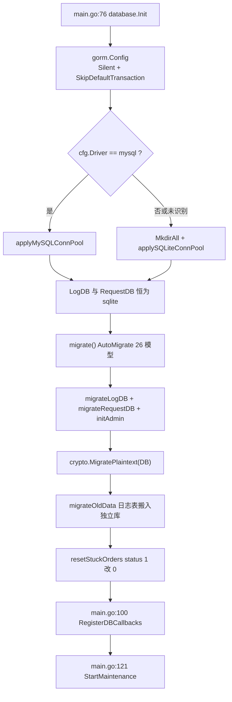
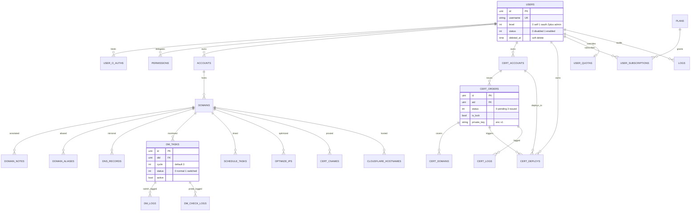
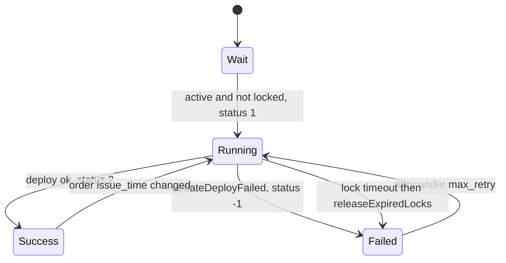
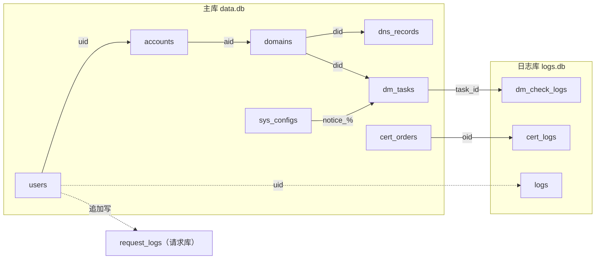

# 数据库设计

<cite>
**本文档引用的文件**
- [models.go](file://main/internal/models/models.go)
- [quota.go](file://main/internal/models/quota.go)
- [cloudflare.go](file://main/internal/models/cloudflare.go)
- [hooks.go](file://main/internal/models/hooks.go)
- [database.go](file://main/internal/database/database.go)
- [maintenance.go](file://main/internal/database/maintenance.go)
- [trace_gin.go](file://main/internal/database/trace_gin.go)
- [dbcache.go](file://main/internal/dbcache/dbcache.go)
- [keys.go](file://main/internal/dbcache/keys.go)
- [sysconfig.go](file://main/internal/sysconfig/sysconfig.go)
- [config.go](file://main/internal/config/config.go)
- [crypto.go](file://main/internal/crypto/crypto.go)
- [migrate.go](file://main/internal/crypto/migrate.go)
- [main.go](file://main/main.go)
- [task_runner.go](file://main/internal/service/task_runner.go)
- [record_sync.go](file://main/internal/service/record_sync.go)
- [schedule.go](file://main/internal/service/schedule.go)
- [audit.go](file://main/internal/service/audit.go)
- [monitor.go](file://main/internal/monitor/monitor.go)
- [quota.go (handler)](file://main/internal/api/handler/quota.go)
- [domain.go](file://main/internal/api/handler/domain.go)
- [account.go](file://main/internal/api/handler/account.go)
- [user.go](file://main/internal/api/handler/user.go)
- [monitor.go (handler)](file://main/internal/api/handler/monitor.go)
- [cert.go](file://main/internal/api/handler/cert.go)
- [registry.go (dns)](file://main/internal/dns/registry.go)
- [acme.go](file://main/internal/cert/acme/acme.go)
- [go.mod](file://main/go.mod)
- [VERSION](file://VERSION)
- [data.db](file://main/data/data.db)
- [logs.db](file://main/data/logs.db)
- [request_logs.db](file://main/data/request_logs.db)
</cite>

## 目录

1. [简介](#简介)
2. [项目结构](#项目结构)
3. [核心组件](#核心组件)
4. [架构总览](#架构总览)
5. [详细组件分析](#详细组件分析)
6. [依赖关系分析](#依赖关系分析)
7. [性能考虑](#性能考虑)
8. [故障排查指南](#故障排查指南)
9. [结论](#结论)
10. [附录](#附录)

## 简介

dnsplane（版本 `1.0.11`）的持久层是「**三库分离 + GORM AutoMigrate + 无外键 + 无显式事务**」的组合：

| 设计点 | 落地方式 | 证据 |
|--------|----------|------|
| 逻辑库拆分 | 主库 `database.DB`、日志库 `LogDB`、请求日志库 `RequestDB` | `database.go:21-25` |
| 建表能力 | 完全由 `AutoMigrate` 生成，仓库内无 `*.sql` 迁移文件与版本表 | `database.go:241-277`、`:299-311` |
| 双驱动 | SQLite（默认，纯 Go 驱动 `glebarez/sqlite v1.11.0`）与 MySQL（`gorm.io/driver/mysql v1.6.0`）；日志库与请求库**硬编码 SQLite**，不随 `database.driver` 变化 | `database.go:15-16`、`:90-118`、`go.mod:9`、`:26-27` |
| 事务与完整性 | `SkipDefaultTransaction: true`；全库零外键声明，关联由业务层手工级联 | `database.go:76-79`、`models/` 无 `constraint:FK` 标签 |
| 敏感字段 | `BeforeSave`/`AfterFind` 做字段级 AES-256-GCM，密文前缀 `enc:v1:` | `hooks.go:32-70`、`crypto.go:17`、`:42-62` |
| 读穿缓存与 SQL 追踪 | `dbcache` 对热点列表做 60 秒 JSON 缓存（DB 为权威源）；GORM 回调按请求收集 `DBQuery` 写入 `request_logs.db_queries` | `dbcache.go:12`、`:14-44`、`database.go:347-352`、`:427-496` |

结论分两层次：**已验证**＝模型标签逐字段实读，表名/DDL/索引来自运行时三库 `sqlite_master` 实查；**推断**＝`dns_records`、`user_quotas` 在本地运行时库中不存在（该库陈旧），结构按 `models/quota.go` 标签推导并在文中明确标注。脱敏约定：口令、令牌、密钥、连接串一律写作 `{占位}`。

**章节来源**
- [VERSION](file://VERSION)
- [database.go:15-25](file://main/internal/database/database.go#L15-L25)
- [hooks.go:32-70](file://main/internal/models/hooks.go#L32-L70)
- [go.mod:9-27](file://main/go.mod#L9-L27)

## 项目结构

持久层集中在三个包：

| 路径 | 行数 | 职责 | 关键符号（行号） |
|------|------|------|------------------|
| `database/database.go` | 496 | 三库连接、驱动分派、连接池、AutoMigrate、遗留搬迁、追踪回调 | `Init:71`、`migrate:241`、`Close:327` |
| `database/maintenance.go` | 444 | 保留期配置、周期清理、WAL checkpoint + VACUUM、统计快照 | `LoadMaintenanceConfig:62`、`runCleanup:198`、`optimizeGormDB:284` |
| `database/trace_gin.go` | 69 | 以 goroutine ID 关联 `gin.Context` | `GinContextKey:12`、`BindRequestGinForDBTrace:35` |
| `models/models.go` | 370 | 21 个核心业务模型 | `User:10`、`Domain:72`、`DMTask:134`、`CertOrder:217` |
| `models/quota.go` | 93 | 配额与套餐 + 云端解析记录副本 | `Plan:19`、`UserQuota:58`、`DNSRecord:75` |
| `models/cloudflare.go` | 79 | Cloudflare 镜像 + 域名别名 + 解析日志模型 | `CloudflareHostname:6`、`DomainAlias:61`、`RecordLog:70` |
| `models/hooks.go` | 70 | 7 张表的字段级加解密钩子 | `encFields:9`、`decFields:23` |
| `dbcache/dbcache.go` 与 `dbcache/keys.go` | 67 / 49 | 读穿缓存与失效原语、key 模板 | `DefaultTTL:12`、`GetOrSetJSON:14`、`KeyAccountsAdmin:14`、`KeyCertAccountsList:36` |

数据域划分（6 个域、30 张实际存在的表）：用户与权限＝`users`/`user_o_auths`/`permissions`；DNS 资源＝`accounts`/`domain_categories`/`domains`/`domain_notes`/`domain_aliases`/`dns_records`/`cloudflare_*`（4 张）；证书＝`cert_accounts`/`cert_orders`/`cert_domains`/`cert_deploys`/`cert_cnames`；监控与调度＝`dm_tasks`/`dm_logs`/`schedule_tasks`/`optimize_ips`；通知＝无独立表，落在 `sys_configs` 与 `dm_tasks.notify_channels`；系统与日志＝`sys_configs`/`plans`/`user_subscriptions`/`user_quotas` 属主库，`logs`/`cert_logs`/`dm_check_logs` 属日志库，`request_logs` 属请求库。

**章节来源**
- [database.go](file://main/internal/database/database.go)
- [models.go](file://main/internal/models/models.go)
- [quota.go:5-16](file://main/internal/models/quota.go#L5-L16)

## 核心组件

### 数据库初始化

`database.Init`（`database.go:71`）由 `main.go:76` 在配置加载后调用，阶段顺序固定；`defer database.Close()`（`main.go:80`）依次关闭三个 `sql.DB` 且恒返回 nil（`database.go:327-344`），`defer database.StopMaintenance()`（`main.go:122`）优雅停掉清理协程（`maintenance.go:155-162`）。



**图表来源**
- [main.go:76-121](file://main/main.go#L76-L121)
- [database.go:71-150](file://main/internal/database/database.go#L71-L150)
- [database.go:241-311](file://main/internal/database/database.go#L241-L311)

连接池参数差异极大，且 SQLite 的连接生命周期被刻意设为无限：

| 参数 | SQLite（`applySQLiteConnPool`） | MySQL（`applyMySQLConnPool`） |
|------|--------------------------------|-------------------------------|
| `SetMaxOpenConns` / `SetMaxIdleConns` | 8 / 4 | 100 / 25 |
| `SetConnMaxIdleTime` / `SetConnMaxLifetime` | 5 分钟 / `0`（永不主动回收） | 5 分钟 / 1 小时 |
| 定义位置 | `database.go:48-58` | `database.go:60-69` |

SQLite 的并发上限来自 DSN 内的 PRAGMA 而非连接数。`sqliteDSN`（`database.go:39-46`）串起 `journal_mode(WAL)`、`synchronous(NORMAL)`、`busy_timeout(5000)`、`cache_size(-16000)`、`temp_store(MEMORY)`、`mmap_size(67108864)`；`:34-38` 注释记录一条硬约束——`glebarez/go-sqlite` 只识别 `_pragma`/`_time_format`/`_txlock` 三类参数，且每个新连接重建时重新执行 `_pragma`，因此 **PRAGMA 必须写进 DSN**。MySQL 侧 DSN 形如 `username:{占位}@tcp(host:port)/database?charset=utf8mb4&parseTime=True&loc=Local`（`database.go:83-84`）。

**章节来源**
- [database.go:34-69](file://main/internal/database/database.go#L34-L69)
- [database.go:83-84](file://main/internal/database/database.go#L83-L84)
- [maintenance.go:155-162](file://main/internal/database/maintenance.go#L155-L162)

### 迁移策略

`migrate()`（`database.go:241-277`）注册 26 个模型、`migrateLogDB()`（`:299-305`）注册 3 个、`migrateRequestDB()`（`:307-311`）注册 1 个。因无外键，顺序**不是硬依赖**，实际按「用户与权限 → DNS 资源 → 证书 → 任务 → Cloudflare → 配额」的认知顺序排列。`AutoMigrate` 只新增表/列/索引，**不删除、不重命名、不缩窄类型**，项目在其上叠加 7 类手工兼容：

| 类型 | 机制 | 位置 |
|------|------|------|
| 数据搬迁 | `migrateOldData()`：主库若仍有 `logs`/`cert_logs`/`request_logs`，按 500 条批量搬入 LogDB/RequestDB，随后 `DELETE` + `DROP TABLE` + `VACUUM` | `database.go:160-239`，批次 `:171-172` |
| 数据搬迁 | `migrateGitHubIDToOAuth()`：`github_id > 0` 写入 `user_o_auths`，已存在则跳过（幂等） | `database.go:280-297`，调用点 `:275` |
| 数据搬迁 | `crypto.MigratePlaintext(DB)`：按 `DefaultMigrateSpecs` 白名单把不以 `enc:v1:` 开头的明文列原地加密 | `migrate.go:14-22`、`:24-41`，调用点 `database.go:137` |
| 状态修复 | `resetStuckOrders()` 把 `CertOrder.status = 1` 重置为 `0`；`cleanInvalidTasks()` 把 `did = 0` 或 `record_id` 为空的 `DMTask` 置 `active = false` | `database.go:152-157`、`maintenance.go:134-152` |
| 默认值兜底 | `initAdmin()` 不硬编码默认凭据，用户表为空时仅提示走 `POST /api/install` | `database.go:313-325` |
| 默认值规避 | `Plan.Status`/`UserSubscription.Status` 故意不加 `gorm:"default"`，避免值为 0 时被跳过而写入库默认 1 | `quota.go:25-31`、`:49` |

**章节来源**
- [database.go:152-297](file://main/internal/database/database.go#L152-L297)
- [database.go:313-325](file://main/internal/database/database.go#L313-L325)
- [quota.go:25-31](file://main/internal/models/quota.go#L25-L31)
- [migrate.go:14-41](file://main/internal/crypto/migrate.go#L14-L41)

### 维护任务

`MaintenanceService`（`maintenance.go:101-106`）为单例协程：`maintService != nil` 时直接返回以保证幂等（`:111-114`），启动后延迟 30 秒执行首轮，此后每小时 `runCleanup()`，`VACUUM` 按 `VacuumInterval` 判定（`:168-195`）。阈值来自 `sys_configs` 的 `maint_%` 键，每轮开头重新装载（`:200`），故改动下一小时生效。

| 清理目标 | 所在库 | 判据 | 默认保留 | 位置 |
|----------|--------|------|----------|------|
| `Log` / `CertLog` | LogDB | `created_at < now-Nd` | 90 天 / 60 天 | `:204-207`、`:212-215` |
| `DMCheckLog` | LogDB | `created_at < now-72h`（按小时） | 72 小时 | `:220-223` |
| `DMLog` | **主库** | `created_at < now-60d` | 60 天 | `:228-231` |
| `RequestLog` | RequestDB | 按天 `now-7d`；另按 `is_error` 分流，`Offset(keep)` 取最小保留 ID 后删 `id <=` | 7 天；成功 2000 / 错误 1000 条 | `:237-245`、`:250-268` |

压缩阶段对三库各执行五条 SQLite 专用语句：`wal_checkpoint(TRUNCATE)` → `ANALYZE` → `PRAGMA optimize` → `VACUUM` → 恢复 `journal_mode=WAL`（`:284-320`）。`GetMaintenanceStats()`（`:336-353`）是双检锁 + 25 秒 TTL 的进程内快照，行数估算读 `sqlite_stat1` 而非逐表 `COUNT(*)`，并置 `tables_approx = true`（`:406-422`）。

**章节来源**
- [maintenance.go:101-195](file://main/internal/database/maintenance.go#L101-L195)
- [maintenance.go:204-268](file://main/internal/database/maintenance.go#L204-L268)
- [maintenance.go:284-422](file://main/internal/database/maintenance.go#L284-L422)

## 架构总览

30 张表之间的关系全部是**业务关联**而非数据库外键。属性块仅列 3 个代表实体，完整字段见详细组件分析：



**图表来源**
- [models.go:10-370](file://main/internal/models/models.go#L10-L370)
- [quota.go:19-93](file://main/internal/models/quota.go#L19-L93)
- [cloudflare.go:6-79](file://main/internal/models/cloudflare.go#L6-L79)
- [database.go:242-269](file://main/internal/database/database.go#L242-L269)

一次请求会横跨三个库：热点列表读走 `dbcache` → `cache` → 主库回源并回填；业务写经主库并由 `BeforeSave` 加密敏感列；操作日志写 `LogDB`；请求日志由中间件写 `RequestDB`，而 `RequestDB` 被**故意排除**在 SQL 追踪回调之外，避免记录自身（`database.go:372-376`）。`WithLogContext` / `WithRequestContext` 只返回全局句柄、不注入请求上下文（`database.go:363-370`）。

**章节来源**
- [dbcache.go:12-44](file://main/internal/dbcache/dbcache.go#L12-L44)
- [database.go:358-376](file://main/internal/database/database.go#L358-L376)
- [hooks.go:32-70](file://main/internal/models/hooks.go#L32-L70)

## 详细组件分析

### 用户与权限域

覆盖 `users`、`user_o_auths`、`permissions`。本域不是 RBAC 三表（`roles`/`user_role` 未实现），而是 **Level 整数 + Permissions JSON 模块点 + 域名级委派行**的混合形态。

| 表 | 模型定义 | 关键字段与约束 | 索引（实测） |
|----|----------|----------------|--------------|
| `users` | `models.go:10-31` | `username uniqueIndex;size:64;not null`（`:12`）、`password size:80`（`:13`）、`api_key size:64`（`:16`）、`level`（`:17`）、`status` 默认 1（`:18`）、`permissions type:text`（`:19`）、`totp_secret`（`:21`）、`reset_*`（`:22-24`） | `idx_users_username` 唯一、`idx_users_deleted_at` |
| `user_o_auths` | `models.go:34-47` | 复合唯一 `idx_user_oauth_provider(user_id,provider)`（`:36-37`）、`provider_user_id size:191;index`（`:38`）、双令牌 TEXT（`:42-43`） | 唯一复合 + `user_id`/`provider`/`provider_user_id` 三个单列 |
| `permissions` | `models.go:105-114` | `uid`/`did` 单列索引（`:107-108`）、`domain size:255;not null`（`:109`）、`sub_domain` 空表示全部（`:110`）、`read_only`（`:111`）、`expire_time`（`:112`） | 两个单列索引；`domain` 列**无索引** |

表名注意：`UserOAuth` 被默认命名策略拆成 `user_o_auths`，与 `migrate.go:21` 声明的 `user_oauths` 不一致，导致该表加密迁移整表跳过。加密边界只覆盖 `User.TOTPSecret`（`hooks.go:56-62`）与 `UserOAuth` 双令牌（`hooks.go:64-70`）；`password` 走 bcrypt，`api_key` 与 `reset_token` **未纳入加密**（`models.go:16`、`:22`）。

```sql
-- 实测 DDL：main/data/data.db（其余列见 models.go:10-31，尾部三列为遗留列）
CREATE TABLE "users" (`id` integer PRIMARY KEY AUTOINCREMENT, `username` text NOT NULL,
  `password` text NOT NULL, `api_key` text, `level` integer DEFAULT 0,
  `status` integer DEFAULT 1, `totp_secret` text, `permissions` text, `deleted_at` datetime,
  `recovery_codes` text, `git_hub_id` integer DEFAULT 0, `github_id` integer DEFAULT 0);
CREATE UNIQUE INDEX `idx_users_username` ON `users`(`username`);
CREATE UNIQUE INDEX `idx_user_oauth_provider` ON `user_o_auths`(`user_id`,`provider`);
CREATE TABLE "permissions" (`id` integer PRIMARY KEY AUTOINCREMENT, `uid` integer,
  `did` integer, `domain` text NOT NULL, `sub_domain` text, `read_only` numeric,
  `expire_time` datetime);
```

**章节来源**
- [models.go:10-47](file://main/internal/models/models.go#L10-L47)
- [hooks.go:56-70](file://main/internal/models/hooks.go#L56-L70)
- [data.db](file://main/data/data.db)

### DNS 域

覆盖 `accounts`、`domain_categories`、`domains`、`domain_notes`、`domain_aliases`、`dns_records` 与 4 张 Cloudflare 镜像表。**没有 `records` 表**：解析记录权威源在服务商云端，本地只有 `dns_records` 副本。

| 表 | 模型定义 | 关键设计点 |
|----|----------|------------|
| `accounts` | `models.go:50-60` | 列名 `uid` 而非 `user_id`（`:52`）；`config` 加密 TEXT（`:55`）；软删除（`:59`） |
| `domains` | `models.go:72-92` | `aid`→账户（`:74`）、`cid`→分类默认 0（`:75`）、`name` 同时 `not null` 与 `index`（`:76`）、`record_count` 冗余计数（`:80`）、`check_status`（`:88`） |
| `domain_notes` | `models.go:95-102` | 唯一复合 `idx_domain_note_user_domain(uid,did)`（`:97-98`），备注按用户独立存储 |
| `domain_aliases` | `cloudflare.go:61-67` | Go 字段名 `Name` 但列名 `alias`（`:64`） |
| `dns_records` | `quota.go:75-93` | 唯一复合 `idx_dns_record_remote(did,record_id)`（`:77-78`）用于与云端对账；`uid = 0` 表示云端直接创建（`:89`）；`domain` 冗余列便于跨域名统计（`:88`） |
| `cloudflare_*` | `cloudflare.go:6-58` | `CloudflareCIDRRoute` → `cloudflare_c_id_r_routes`；`CloudflareTunnel.deleted_at` 是 `*time.Time`，**不是软删除字段**（`:36`） |

记录副本存在的原因见 `quota.go:65-74` 注释：配额判定需在创建前知道「该域名下现有多少条记录」，逐次查云端会消耗服务商 API 配额，故只读本地副本，判定偏松而非偏严（`handler/quota.go:163-171` 复核）。同步默认 30 分钟、最小 5 分钟、批量 100（`record_sync.go:34-37`），可由 `record_sync_interval_min` 覆盖（`:110-120`）。

```sql
-- 实测 DDL：main/data/data.db（其余列见 models.go:72-92）
CREATE TABLE "domains" (`id` integer PRIMARY KEY AUTOINCREMENT, `aid` integer,
  `cid` integer DEFAULT 0, `name` text NOT NULL, `record_count` integer DEFAULT 0,
  `min_ttl` integer DEFAULT 0, `check_status` integer DEFAULT 0, `deleted_at` datetime);
CREATE INDEX `idx_domains_account_id` ON `domains`(`aid`);
CREATE INDEX `idx_domains_name` ON `domains`(`name`);
CREATE TABLE "accounts" (`id` integer PRIMARY KEY AUTOINCREMENT, `uid` integer,
  `type` text NOT NULL, `name` text NOT NULL, `config` text, `deleted_at` datetime);
CREATE INDEX `idx_accounts_user_id` ON `accounts`(`uid`);
-- 按 models/quota.go:75-93 标签推导：本地运行时旧库中尚无 dns_records 表
CREATE TABLE `dns_records` (`id` integer PRIMARY KEY AUTOINCREMENT, `did` integer,
  `record_id` text, `name` text, `type` text, `value` text, `ttl` integer, `domain` text,
  `uid` integer, `synced_at` datetime);
CREATE UNIQUE INDEX `idx_dns_record_remote` ON `dns_records`(`did`,`record_id`);
```

**章节来源**
- [models.go:50-102](file://main/internal/models/models.go#L50-L102)
- [quota.go:65-93](file://main/internal/models/quota.go#L65-L93)
- [record_sync.go:34-37](file://main/internal/service/record_sync.go#L34-L37)
- [handler/quota.go:163-190](file://main/internal/api/handler/quota.go#L163-L190)

### 证书域

覆盖 `cert_accounts`、`cert_orders`、`cert_domains`、`cert_deploys`、`cert_cnames`，其中 `cert_logs`（`models.go:338-344`，`oid` 索引）物理位于日志库。

| 表 | 模型定义 | 关键字段与约束 |
|----|----------|----------------|
| `cert_accounts` | `models.go:202-214` | `config`+`ext` 双加密 TEXT（`:207-208`）、`is_deploy` 区分签发与部署账户（`:210`）、软删除 |
| `cert_orders` | `models.go:217-245` | 复合 `idx_cert_orders_auto_scan(is_auto p1, status p2, expire_time p3)`（`:226-230`）、`status` 语义见注释（`:228`）、`private_key`/`info` 加密（`:237`、`:240`）、`retry`/`retry2`/`retry_time`（`:231-233`）、`is_lock`/`lock_time`（`:234-235`） |
| `cert_domains` | `models.go:248-253` | `oid` 索引（`:250`），一订单多域名 |
| `cert_deploys` | `models.go:256-280` | 复合 `idx_cert_deploys_scan(active p1, status p2, is_lock p3)`（`:266-273`）、`max_retry` 默认 3、`retry_delay` 默认 60（`:270-271`）、`log_content` 实时部署日志（`:277`） |
| `cert_cnames` | `models.go:283-290` | **无任何索引**；`status` 默认 0（`:288`） |

`cert_deploys` 的调度状态机（`status` 语义取自写入点而非模型注释）：



**图表来源**
- [task_runner.go:217-288](file://main/internal/service/task_runner.go#L217-L288)
- [task_runner.go:395-446](file://main/internal/service/task_runner.go#L395-L446)

`cert_orders.status` 是另一套编码：`0 pending / 1 validating / 2 validated / 3 issued / 4 revoked / -1~-7 错误`（`models.go:228`）。自动续期只扫描 `is_auto = true AND status = 3 AND expire_time < now+renewDays`（`task_runner.go:163-164`），命中后写回 `0` 并递增 `retry`（`:198-205`）。账户类型取值即已注册渠道键：`letsencrypt`、`zerossl`、`google`、`litessl`、`customacme`（`acme.go:46`、`:57`、`:70`、`:73`、`:76`）与 `tencent`、`huoshan`、`aliyun_cert`、`ucloud`，另有部署专用 `local`（`cert.go:1248-1259` 对其强制管理员）；创建时**未见类型白名单校验**，`Type: req.Type` 直接落库（`cert.go:163`）。

```sql
-- 实测 DDL：main/data/data.db（其余列见 models.go:217-280）
CREATE TABLE "cert_orders" (`id` integer PRIMARY KEY AUTOINCREMENT, `aid` integer,
  `key_type` text, `key_size` text, `order_kind` text DEFAULT "",
  `challenge_type` text DEFAULT "", `expire_time` datetime, `status` integer DEFAULT 0,
  `is_auto` numeric DEFAULT false, `retry` integer DEFAULT 0, `is_lock` numeric,
  `info` text, `full_chain` text, `private_key` text, `uid` integer);
CREATE INDEX `idx_cert_orders_auto_scan` ON `cert_orders`(`is_auto`,`status`,`expire_time`);
CREATE INDEX `idx_cert_orders_user_id` ON `cert_orders`(`uid`); -- 死索引，服务于遗留列
CREATE TABLE "cert_deploys" (`id` integer PRIMARY KEY AUTOINCREMENT, `uid` integer,
  `aid` integer, `oid` integer, `config` text, `status` integer DEFAULT 0,
  `active` numeric DEFAULT false, `max_retry` integer DEFAULT 3, `is_lock` numeric,
  `log_content` text, `info` text);
CREATE INDEX `idx_cert_deploys_scan` ON `cert_deploys`(`active`,`status`,`is_lock`);
```

**章节来源**
- [models.go:202-290](file://main/internal/models/models.go#L202-L290)
- [task_runner.go:153-205](file://main/internal/service/task_runner.go#L153-L205)
- [cert.go:163](file://main/internal/api/handler/cert.go#L163)
- [acme.go:46-76](file://main/internal/cert/acme/acme.go#L46-L76)

### 监控域

覆盖 `dm_tasks`、`dm_logs`（主库）、`dm_check_logs`（日志库）、`schedule_tasks`、`optimize_ips`。

| 表 | 模型定义 | 关键点 |
|----|----------|--------|
| `dm_tasks` | `models.go:134-176` | 44 列大宽表；复合 `idx_dm_tasks_active_next(active p1, check_next_time p2)`（`:157`、`:162`）；`cycle` 默认 3（`:150`）；`backup_values` 逗号分隔且优先于 `backup_value`（`:144`）；`notify_channels` 为 JSON 数组字符串（`:173`）；`proxy_password` 加密（`:171`） |
| `dm_check_logs` | `models.go:179-190` | `task_id`/`success`/`created_at` 三个单列索引；高频追加写 |
| `dm_logs` | `models.go:193-199` | `action`：`1` 切备用、`2` 回切（`:196`） |
| `schedule_tasks` | `models.go:293-311` | 复合 `idx_schedule_tasks_active_next(active p1, next_time p2)`（`:307-308`） |
| `optimize_ips` | `models.go:320-335` | `active` 默认 `true`，与其余任务表相反（`:334`）；`recordnum`/`addtime`/`updatetime` 列名不统一 |

决策链是「扫描到期任务（`monitor/monitor.go:150-151`，条件 `active = 1 AND check_next_time <= now` 并按 `check_next_time asc` 排序，与复合索引前两列完全对齐）→ 探测主源与备用并写 `DMCheckLog`（`:254`）→ 失败则递增 `err_count`，达到 `cycle` 即切换记录并置 `status = 1` → 恢复且开启回切则回置 `status = 0` → 合并 `Updates` 写回 `dm_tasks`（`:334`）」。

需明确一处契约脱钩：`monitor.go:277-279`、`:298`、`:316` 通过 `Updates(map)` 写入 `last_error`、`backup_health`、`fault_time`、`recover_time`，而 `DMTask`（`models.go:134-176`）**未声明这些字段**。旧库因历史遗留列仍正常，新库不含它们，后果见故障排查。

```sql
-- 实测 DDL：main/data/data.db（尾部四列为遗留，当前 DMTask 未声明）
CREATE TABLE "dm_tasks" (`id` integer PRIMARY KEY AUTOINCREMENT, `did` integer,
  `rr` text NOT NULL, `record_id` text NOT NULL, `type` integer DEFAULT 0,
  `backup_values` text, `check_type` integer DEFAULT 0, `frequency` integer NOT NULL,
  `cycle` integer DEFAULT 3, `timeout` integer DEFAULT 2, `check_next_time` integer,
  `err_count` integer DEFAULT 0, `status` integer DEFAULT 0, `active` numeric,
  `notify_enabled` numeric DEFAULT false, `notify_channels` text, `proxy_password` text,
  `backup_health` text, `last_error` text, `fault_time` datetime, `recover_time` datetime);
CREATE INDEX `idx_dm_tasks_active_next` ON `dm_tasks`(`active`,`check_next_time`);
-- 实测 DDL：main/data/logs.db
CREATE TABLE "dm_check_logs" (`id` integer PRIMARY KEY AUTOINCREMENT, `task_id` integer,
  `success` numeric, `duration` integer, `error` text, `backup_healths` text,
  `created_at` datetime);
CREATE INDEX `idx_dm_check_logs_created_at` ON `dm_check_logs`(`created_at`);
```

**章节来源**
- [models.go:134-199](file://main/internal/models/models.go#L134-L199)
- [models.go:293-335](file://main/internal/models/models.go#L293-L335)
- [monitor.go:150-334](file://main/internal/monitor/monitor.go#L150-L334)
- [logs.db](file://main/data/logs.db)

### 通知域

**本域没有独立表**：不存在 `notify_channels` / `notify_logs`（`models` 目录检索无对应结构体）。配置分层落在下表，装载路径是「从渠道注册表推导键名 → 逐键读 `sys_configs` → 构造 Channel」，`sysconfig.GetValue` 提供 60 秒缓存（`sysconfig.go:12-26`），因此新增渠道不需要建表也不需要迁移。

| 层次 | 存储位置 | 载体 |
|------|----------|------|
| 渠道开关 | `sys_configs` 的 `notice_mail`、`notice_wxtpl`、`notice_tgbot`、`notice_qqbot`、`notice_webhook`、`notice_custom_webhook` | 值为 `true`/`1`/`yes`/`on` 才算开启（`sysconfig.go:40-43`） |
| 渠道凭据 | `sys_configs` 的 `mail_*`、`qqbot_*`、`turnstile_*` 等键 | `value` 整列 **TEXT 明文**（`models.go:316`），实际值写作 `{占位}` |
| 任务级选择 | `dm_tasks.notify_channels`（JSON 数组）+ `notify_enabled` | `models.go:172-173` |
| 域名级开关 | `domains.is_notice` | `models.go:82` |

```sql
-- 实测 DDL：main/data/data.db，主键为字符串列
CREATE TABLE `sys_configs` (`key` text, `value` text, PRIMARY KEY (`key`));
-- 键长度核对：SysConfig.Key 声明 size:32，SQLite 不校验、MySQL 校验
SELECT length(`key`) AS key_len, count(*) AS cnt FROM sys_configs
WHERE `key` LIKE 'notice_%' OR `key` LIKE 'mail_%' GROUP BY key_len DESC;
-- 任务级通知选择：notify_channels 是 JSON 数组字符串，无 JSON 索引可用
SELECT id, did, notify_enabled, notify_channels FROM dm_tasks
WHERE notify_enabled = 1 AND active = 1;
```

**章节来源**
- [models.go:82](file://main/internal/models/models.go#L82)
- [models.go:314-317](file://main/internal/models/models.go#L314-L317)
- [sysconfig.go:12-43](file://main/internal/sysconfig/sysconfig.go#L12-L43)

### 系统与配额域

覆盖 `sys_configs`（上节）、`plans`、`user_subscriptions`、`user_quotas`、`logs`、`cert_logs`、`request_logs`。配额是三层回落模型：全维度不限基线（`-1`）→ 套餐 JSON → 个体覆盖（`handler/quota.go:95-109`）；取值约定三表一致，`-1` 不限、`0` 禁止创建、`>0` 上限（`quota.go:12-16`）；八个维度对应 `Quota` 的 `max_domains`、`max_records`、`max_accounts`、`max_monitors`、`max_certs`、`max_schedules`、`max_deploys`、`max_optimize_ip`（`handler/quota.go:30-39`）。

| 表 | 模型定义 | 主键与索引 |
|----|----------|------------|
| `plans` | `quota.go:19-36` | 字符串主键 `id size:64`；无软删除字段；`status` 故意无 `default`（`:25-31`） |
| `user_subscriptions` | `quota.go:44-55` | 字符串主键；`user_id`/`plan_id` 单列索引（`:46-47`）；`plan_name` 冗余以便套餐删除后仍可追溯（`:38-43`） |
| `user_quotas` | `quota.go:58-63` | **主键即 `user_id`**，一用户一行 |
| `logs` | `models.go:117-131` | `uid`/`domain` 索引；`before_data`/`after_data` TEXT 快照（`:126-127`）；物理在 `logs.db` |
| `request_logs` | `models.go:347-370` | 5 个单列索引 `request_id`/`error_id`/`user_id`/`is_error`/`created_at`；`path size:1024`、`query size:4096`、`error_msg size:2000` |

写入分工：操作日志由 `service/audit.go` 产生（`:43`、`:78`、`:115`、`:138`、`:160` 五处 `models.Log{}`），证书日志由 `task_runner.go:964` 写 `LogDB`，请求日志由中间件写 `RequestDB`。

```sql
-- 实测 DDL：main/data/data.db；price/duration/deleted_at 为遗留列，Plan 模型已删除
CREATE TABLE `plans` (`id` text, `name` text NOT NULL, `description` text,
  `price` real DEFAULT 0, `duration` integer DEFAULT 0, `deleted_at` datetime,
  `is_default` numeric DEFAULT false, `sort` integer DEFAULT 0, `status` integer DEFAULT 1,
  `quotas` text, `features` text, PRIMARY KEY (`id`));
CREATE TABLE `user_subscriptions` (`id` text, `user_id` text, `plan_id` text,
  `plan_name` text, `status` integer DEFAULT 1, `expire_time` datetime, PRIMARY KEY (`id`));
CREATE UNIQUE INDEX `idx_user_subscriptions_user_id` ON `user_subscriptions`(`user_id`);
-- 按 models/quota.go:58-63 推导：旧库中尚无 user_quotas 表
CREATE TABLE `user_quotas` (`user_id` integer, `quotas` text, `remark` text,
  `updated_at` datetime, PRIMARY KEY (`user_id`));
-- 实测 DDL：main/data/request_logs.db
CREATE TABLE "request_logs" (`id` integer PRIMARY KEY AUTOINCREMENT, `request_id` text,
  `error_id` text, `user_id` integer, `path` text, `body` text, `response` text,
  `duration` integer, `is_error` numeric, `db_queries` text, `created_at` datetime);
CREATE INDEX `idx_request_logs_is_error` ON `request_logs`(`is_error`);
```

**章节来源**
- [quota.go:12-63](file://main/internal/models/quota.go#L12-L63)
- [models.go:347-370](file://main/internal/models/models.go#L347-L370)
- [handler/quota.go:30-109](file://main/internal/api/handler/quota.go#L30-L109)
- [audit.go:43-160](file://main/internal/service/audit.go#L43-L160)

## 依赖关系分析

### 业务关联与手工级联

无外键意味着任何一张表都可被单独清空而数据库不报错，级联完全依赖调用方。跨表读取全部通过显式 `Joins` 完成，配额统计最集中：`domains ↔ accounts`、`dns_records ↔ domains ↔ accounts`、`dm_tasks ↔ domains ↔ accounts`、`cert_orders ↔ cert_accounts`、`optimize_ips ↔ domains ↔ accounts`（`handler/quota.go:176-210`）；列表接口同样手工 JOIN，如监控列表以 `dm_tasks LEFT JOIN domains` 实现域名过滤（`handler/monitor.go:110`）。



**图表来源**
- [models.go:50-280](file://main/internal/models/models.go#L50-L280)
- [handler/quota.go:176-210](file://main/internal/api/handler/quota.go#L176-L210)
- [database.go:299-311](file://main/internal/database/database.go#L299-L311)

删除动作的手工级联清单（未列入者即为潜在残留）：

| 触发动作 | 被清理的表 | 位置 |
|----------|------------|------|
| 删除域名 | `permissions`（按 `domain` 名匹配）、`dm_logs`、`dm_check_logs`、`dm_tasks`、`cert_cnames`、`schedule_tasks`、`optimize_ips`、`domain_notes`，最后软删 `domains` | `handler/domain.go:602-615` |
| 删除 DNS 账户 | 先 `COUNT(*)` 校验账户下无域名，否则拒绝删除 | `handler/account.go:331-337`、`:351` |
| 删除用户 | 硬删 `user_o_auths`、`permissions`，软删 `users`；DNS 账户、证书、监控、订阅刻意保留（注释 `:249-259`） | `handler/user.go:249-262` |
| 删除证书订单 / 证书账户 | 前者连带删 `cert_domains`；后者**未清理** `cert_orders`/`cert_deploys` | `handler/cert.go:996-997`、`:212` |

**章节来源**
- [domain.go:602-615](file://main/internal/api/handler/domain.go#L602-L615)
- [account.go:331-351](file://main/internal/api/handler/account.go#L331-L351)
- [user.go:249-262](file://main/internal/api/handler/user.go#L249-L262)
- [cert.go:212](file://main/internal/api/handler/cert.go#L212)

### 表访问频次矩阵

下表为源码引用次数实测（`rg -c "models\.<Model>"` 在 `main/internal/api/handler/*.go` 的命中数，已剔除 `_test.go`）：

| 表 | 主要访问点（文件:次数） | 读/写特征 | 缓存 |
|----|--------------------------|-----------|------|
| `domains` | `domain.go:28`、`cloudflare.go:12`、`acceleration.go:8`、`domain_ext.go:5` | 读写双高，删除触发多表级联 | 无 |
| `users` | `auth.go:26`、`user.go:7`、`oauth.go:5` | 认证路径热点 | 列表 60s |
| `cert_deploys` | `cert_deploy.go:19`、`cert.go:3` | 状态机读写，锁位频繁更新 | 无 |
| `dm_tasks` | `monitor.go:16`、`domain.go:4` | 每轮探测写回 | 无 |
| `cert_orders` | `cert.go:11`、`cert_deploy.go:3` | 签发流程读写 | 无 |
| `cert_accounts` | `cert_deploy.go:11`、`cert.go:9`、`cert_authz.go:4` | 授权判定高频读 | 列表 60s |
| `accounts` | `cloudflare.go:9`、`account.go:8`、`domain.go:6` | 授权判定高频读 | 列表 60s |
| `plans` / `user_subscriptions` / `user_quotas` | `plan.go:13`、`plan.go:5`、`plan.go:4` | 配额解析读、管理端写 | 无 |
| `schedule_tasks` / `optimize_ips` | `schedule.go:8`、`optimizeip.go:9`、`domain.go:2`、`dashboard.go:2` | 列表读 + 到期或执行写回 | 无 |
| `sys_configs` / `permissions` | `dashboard.go:7`、`auth.go:5`、`user.go:5`、`domain.go:3` | 读远多于写，授权判定读 | 单键 60s |
| `dns_records` | `domain.go:1`、`batch.go:1`（`service/record_sync.go` 集中读写） | 同步写、配额读 | 无 |
| `logs` / `dm_check_logs` / `request_logs` | `user.go:6`、`logs.go:2`、`monitor.go:6`、`request_log.go:12` | 追加写、分页或检索读 | 请求日志 List 上限 10000 条 |

**章节来源**
- [account.go:103-109](file://main/internal/api/handler/account.go#L103-L109)
- [cert.go:76-79](file://main/internal/api/handler/cert.go#L76-L79)
- [user.go:64](file://main/internal/api/handler/user.go#L64)

## 性能考虑

### 索引利用、慢查询、N+1 与缓存

五条调度扫描都精确命中复合索引前缀，这是当前设计里最扎实的部分：

| 热路径 | 查询条件 | 命中索引 | 位置 |
|--------|----------|----------|------|
| 监控到期扫描 | `active = ? AND check_next_time <= ? ORDER BY check_next_time asc` | `idx_dm_tasks_active_next` | `monitor/monitor.go:150-151` |
| 证书到期续期 | `is_auto = ? AND status = ? AND expire_time < ?` | `idx_cert_orders_auto_scan` | `task_runner.go:163-164` |
| 部署任务取活 / 失败重试 | `active = ? AND is_lock = ? AND (status = ? OR status = ?)`、`active = ? AND status = ? AND is_lock = ?` | `idx_cert_deploys_scan` | `task_runner.go:219-220`、`:246` |
| 定时切换取活 | `next_time > 0 AND next_time <= ? AND active = ?` | `idx_schedule_tasks_active_next` | `service/schedule.go:98` |

关键词搜索一律写成 `%kw%`，会废掉 `idx_domains_name` 等所有 B 树索引，随表规模线性劣化：`handler/domain.go:112`、`handler/monitor.go:118`（三列）、`handler/schedule.go:65`（5 列串接）、`handler/user.go:439`、`handler/logs.go:76`、`handler/request_log.go:74`（五列）、`handler/optimizeip.go:161-163`。建议改前缀 `LIKE 'kw%'` 以复用索引；确需全文则对 `domains.name`、`request_logs.path` 引入 SQLite FTS5 或 MySQL `FULLTEXT`。

四处「循环内逐行查库」构成 N+1：`task_runner.go:174-175`（续期循环内每单 `Pluck("domain")` 查 `cert_domains`）、`:207`（每单插一条 `cert_logs`）、`:224-226` 与 `:268`（部署/重试循环内每条任务 `First(&order)`）、`record_sync.go:209-227`（差异同步对每行分别 `Updates`/`Update`/`Create`/`Delete`，批量 100）。`SkipDefaultTransaction: true`（`database.go:78`）使逐条操作各自独立提交，单条开销小但总次数不减；建议把 `First(&order)` 提为一次 `WHERE id IN (...)` 预取，`cert_domains` 用 `oid IN (...)` 分组装载。

| 缓存键模板 | TTL | 读取点 | 失效入口 |
|------------|-----|--------|----------|
| `db:v1:accounts:admin`、`db:v1:accounts:user:{uid}` | 60s | `account.go:103-109` | `BustAccounts`：`account.go:246`、`:298`、`:352` |
| `db:v1:users:list:{page}:{pageSize}:{kw段}`、`db:v1:users:admin_full` | 60s | `keys.go:16-23`、`user.go:64` | `BustUserList`：`user.go:152`、`:223`、`:263`、`:388`、`oauth.go:335` |
| `db:v1:cert:accounts:list:d{0\|1}:{admin \| u{uid}}` | 60s | `cert.go:76-79` | `BustCertAccountsList`：`cert.go:174`、`:202`、`:213`、`cert_deploy.go:108`、`:160`、`:207` |
| `syscfg:{key}` | 60s | `sysconfig.go:17-26` | `Invalidate:28-31`、`SetValue:34-37` |

三条相关细节：`GetOrSetJSON` 的回填写入失败被显式吞掉（`dbcache.go:40-42`），缓存不可用时退化为「每次回源」而不报错；`sysconfig` 不探测 DB 变更，绕过它直接写库的入口必须自行失效（`handler/user.go:712` 写入后 `:715` 立即 `Invalidate`）；缓存实例为 nil 时直接回源（`dbcache.go:19-28`）。

容量方面，`request_logs` 的 `body`/`headers`/`response`/`db_queries`/`error_stack` 全为 TEXT，行宽可达数十 KB，清理为「7 天 + 成功 2000 / 错误 1000 条」双限（`maintenance.go:237-245`）；`db_queries` 只在请求追踪开启时累积，回调以 `if _, exists := ginCtx.Get(dbQueriesKey); !exists { return }` 短路，避免无条件走 `Explain`（`database.go:441-443`），SQL 超 2000 字符截断（`:476-478`）；维护统计的行数估算依赖同一轮更早执行的 `ANALYZE`（`maintenance.go:300`、`:406-422`），若 `ANALYZE` 失败则统计陈旧而非报错。

**章节来源**
- [database.go:76-79](file://main/internal/database/database.go#L76-L79)
- [database.go:441-478](file://main/internal/database/database.go#L441-L478)
- [dbcache.go:12-44](file://main/internal/dbcache/dbcache.go#L12-L44)
- [maintenance.go:237-422](file://main/internal/database/maintenance.go#L237-L422)
- [user.go:712-715](file://main/internal/api/handler/user.go#L712-L715)

## 故障排查指南

### SQLite 锁、MySQL 兼容与字段迁移冲突

三库均为独立 SQLite 文件，路径由主库路径派生（`config.go:58-68`，默认 `file_path = data/dnsplane.db`，`:95`）。

| 现象 | 判据 | 处置 |
|------|------|------|
| `database is locked` | DSN 内已含 `busy_timeout(5000)`（`database.go:42`） | 确认 DSN 未被自改覆盖；PRAGMA 必须写在 DSN 里才作用于每条新连接（`:34-38`） |
| 主库旁 `-wal`/`-shm` 常驻 | WAL 生效（`journal_mode(WAL)`，`:40`） | 正常；`wal_checkpoint(TRUNCATE)` 由维护任务执行（`maintenance.go:297`） |
| 体积不降但空闲页多 / VACUUM 后并发退化 | `PRAGMA freelist_count`（`maintenance.go:401-404`）；`VACUUM` 可能重置 journal 模式 | 等或缩短 `maint_vacuum_interval_h`；代码在 `:311` 恢复 `WAL`，手工执行需自行恢复 |
| 主库切 MySQL 后日志看不到 / MySQL 下维护静默失效 | `LogDB`/`RequestDB` 硬编码 `sqlite.Open`（`database.go:106`、`:114`）；`optimizeGormDB` 五条全为 SQLite 专用（`maintenance.go:297-311`），仅 `VACUUM` 检查错误 | 多副本部署下各副本日志互不可见，需外部汇聚；`PRAGMA page_count` 失败使 `size` 归 0，应加 `IsSQLite()` 分支（`database.go:27-32`） |
| `sys_configs` 新键在 MySQL 报错 | `Key` 声明 `size:32`（`models.go:315`），实测最长键 `cert_expire_notice_interval_days` 恰 32 字符 | 先扩列到 64 再新增键 |
| `driver` 填错却不报错 | `case "sqlite": fallthrough` → `default`（`database.go:91-92`） | 静默落 SQLite 分支；排查先核 `IsSQLite()` |

`AutoMigrate` 只加不减，导致「旧库正常、新库静默失效」的分叉：

| 症状 | 根因 | 证据与影响 |
|------|------|------------|
| 全新库监控永不切换、永不告警、永不回切 | `DMTask` 未声明 `last_error`/`backup_health`/`fault_time`/`recover_time`，而 `monitor.go:277-279`、`:298`、`:316` 写这四列 | 新库执行 `monitor.go:334` 报 `no such column`、`rows=0`，返回值被丢弃故不可见；`err_count` 恒 0，默认 `Cycle=3` 时 `1>=3` 恒假 |
| 代理口令明文入库 | `Updates(map)` 不触发 `BeforeSave`（`hooks.go:54` 只加密结构体字段），`handler/monitor.go:383` 提交 map | 列值无 `enc:v1:` 前缀；读取侧 `MustDecrypt` 失败原样返回（`crypto.go:95-101`），运行期无报错 |
| OAuth 令牌从未加密 | `migrate.go:21` 声明表名 `user_oauths`，真实表名是 `user_o_auths` | `encryptColumn` 的 `HasTable` 判假 → 整表跳过（`migrate.go:24-41`） |
| 证书订单锁永不释放 | 全仓无 `cert_orders.is_lock = true` 写入点（仅部署侧 `task_runner.go:285`、`cert_deploy.go:821` 置锁） | `releaseExpiredLocks` 对 `cert_orders` 的 UPDATE 恒 0 行（`task_runner.go:437-446`） |
| 重复索引与死列长期留存 | AutoMigrate 不删索引、不删列 | 实测 `domain_aliases` 同时有 `idx_domain_aliases_alias` 与 `idx_domain_aliases_name`（均在 `alias` 列），`domain_notes` 有 `domain_note_user_did` 与 `idx_domain_note_user_domain` 两个同定义唯一索引；`cert_orders.uid`、`users.git_hub_id`、`users.recovery_codes`、`plans.price`/`duration`/`deleted_at` 均为死列 |
| 套餐唯一性意外收紧 | 运行时库 `idx_user_subscriptions_user_id` 为 **UNIQUE**，而 `quota.go:46` 现声明普通 `index`；且 `user_id` 列类型为 `text`，模型已改 `uint` | 旧库仍强制一用户一条订阅；SQLite 弱类型掩盖差异，迁移到 MySQL 会暴露 |
| `status` 停意图图丢失 | 带 `default` 标签的字段值为 0 时被 GORM 跳过 | 已用「不加 default」规避（`quota.go:25-31` 注释），但遗留 DDL 仍是 `plans.status DEFAULT 1` |
| 孤儿表与缺失表 | `payment_channels`、`payment_orders`、`promo_codes` 为 PHP 版遗留，无 Go 模型；`record_logs` 不存在（`cloudflare.go:70` 的 `RecordLog` **未注册** `migrate()`，对照 `database.go:242-269`），解析记录日志实际由服务商云端接口提供 | 孤儿表不会被清理；`dns_records` 亦不在域名级联清单中（`handler/domain.go:602-615`） |

```sql
-- 表行数近似值（依赖 ANALYZE 已刷新）与遗留列
SELECT tbl, CAST(stat AS INTEGER) AS approx_rows
FROM sqlite_stat1 WHERE idx IS NULL ORDER BY approx_rows DESC;
PRAGMA table_info(dm_tasks);
-- 加密边界是否被绕过（应全部带 enc:v1: 前缀）
SELECT id, substr(config, 1, 7) AS prefix FROM accounts
UNION ALL SELECT id, substr(private_key, 1, 7) FROM cert_orders;
-- 副本残留判定
SELECT count(*) FROM dns_records
WHERE did NOT IN (SELECT id FROM domains WHERE deleted_at IS NULL);
```

**章节来源**
- [database.go:27-46](file://main/internal/database/database.go#L27-L46)
- [maintenance.go:297-311](file://main/internal/database/maintenance.go#L297-L311)
- [hooks.go:54-70](file://main/internal/models/hooks.go#L54-L70)
- [migrate.go:14-41](file://main/internal/crypto/migrate.go#L14-L41)
- [crypto.go:95-101](file://main/internal/crypto/crypto.go#L95-L101)
- [monitor.go:277-334](file://main/internal/monitor/monitor.go#L277-L334)
- [task_runner.go:437-446](file://main/internal/service/task_runner.go#L437-L446)
- [data.db](file://main/data/data.db)

## 结论

三库分离 + 单文件 SQLite + 无外键，对「单机自托管面板」这一目标是合适的：零部署成本、备份即拷文件、`SkipDefaultTransaction` 与 WAL 把单条写代价压到最低。五条调度扫描与复合索引严格对齐，说明索引被真实消费；字段级加密（7 表 10 列）把云端凭据从明文风险中摘出，`enc:v1:` 前缀为换密钥留了余地。

必须优先修复的三项：

| 优先级 | 问题 | 最小修复方向 |
|--------|------|--------------|
| 1 | `DMTask` 缺列导致全新安装监控整体失效 | 在 `models.go:134-176` 补声明四字段，或改 `monitor.go:334` 只写模型已知列并检查 `Error` |
| 2 | `Updates(map)` 绕过加密钩子 | 敏感列改走 `Save(&struct)`，或写入前显式 `crypto.Encrypt` |
| 3 | `migrate.go:21` 表名 `user_oauths` 与真实 `user_o_auths` 不符 | 修正常量，并用显式 `TableName()` 切断 GORM 缩略语拆分 |

结构性建议：引入显式 `TableName()`（`user_o_auths`、`cloudflare_c_id_r_routes` 是命名策略的副产品，长期制造匹配成本）；引入最小版本化迁移（一张 `schema_version` 表 + 少量 `UP` 脚本即可，`AutoMigrate` 不删列不删索引，遗留项只增不减）；补齐删除路径的级联清单（`dns_records`、`cloudflare_hostnames`、`domain_aliases`、账户删除路径下的 `cert_orders`/`cert_deploys` 目前无人负责）；让搜索路径与索引和解（前缀匹配或 FTS 二选一）。

**章节来源**
- [models.go:134-176](file://main/internal/models/models.go#L134-L176)
- [monitor.go:334](file://main/internal/monitor/monitor.go#L334)
- [migrate.go:21](file://main/internal/crypto/migrate.go#L21)
- [handler/domain.go:602-615](file://main/internal/api/handler/domain.go#L602-L615)

## 附录

### 全表速查

30 张实际存在的表，按 `AutoMigrate` 注册顺序列出。未纳入 `migrate()` 的模型：`RecordLog`（`cloudflare.go:70`）；运行时库中另存在无对应模型的孤儿表 `payment_channels`、`payment_orders`、`promo_codes`。

| # | 表名 | 库 | 模型 | 定义位置 | 软删除 | 复合索引 |
|---|------|----|------|----------|--------|----------|
| 1 | `users` | 主库 | `User` | `models.go:10` | 是 | `idx_users_username` 唯一 |
| 2 | `user_o_auths` | 主库 | `UserOAuth` | `models.go:34` | 否 | `idx_user_oauth_provider` 唯一 |
| 3 | `accounts` | 主库 | `Account` | `models.go:50` | 是 | — |
| 4 | `domain_categories` | 主库 | `DomainCategory` | `models.go:63` | 否 | — |
| 5 | `domains` | 主库 | `Domain` | `models.go:72` | 是 | — |
| 6 | `domain_notes` | 主库 | `DomainNote` | `models.go:95` | 否 | `idx_domain_note_user_domain` 唯一 |
| 7 | `permissions` | 主库 | `Permission` | `models.go:105` | 否 | — |
| 8 | `dm_tasks` | 主库 | `DMTask` | `models.go:134` | 否 | `idx_dm_tasks_active_next` |
| 9 | `dm_logs` | 主库 | `DMLog` | `models.go:193` | 否 | — |
| 10 | `cert_accounts` | 主库 | `CertAccount` | `models.go:202` | 是 | — |
| 11 | `cert_orders` | 主库 | `CertOrder` | `models.go:217` | 否 | `idx_cert_orders_auto_scan` |
| 12 | `cert_domains` | 主库 | `CertDomain` | `models.go:248` | 否 | — |
| 13 | `cert_deploys` | 主库 | `CertDeploy` | `models.go:256` | 否 | `idx_cert_deploys_scan` |
| 14 | `cert_cnames` | 主库 | `CertCNAME` | `models.go:283` | 否 | — |
| 15 | `schedule_tasks` | 主库 | `ScheduleTask` | `models.go:293` | 否 | `idx_schedule_tasks_active_next` |
| 16 | `sys_configs` | 主库 | `SysConfig` | `models.go:314` | 否 | 字符串主键 `key` |
| 17 | `optimize_ips` | 主库 | `OptimizeIP` | `models.go:320` | 否 | — |
| 18 | `cloudflare_hostnames` | 主库 | `CloudflareHostname` | `cloudflare.go:6` | 否 | — |
| 19 | `cloudflare_tunnels` | 主库 | `CloudflareTunnel` | `cloudflare.go:26` | 否 | — |
| 20 | `cloudflare_c_id_r_routes` | 主库 | `CloudflareCIDRRoute` | `cloudflare.go:40` | 否 | — |
| 21 | `cloudflare_hostname_routes` | 主库 | `CloudflareHostnameRoute` | `cloudflare.go:51` | 否 | — |
| 22 | `domain_aliases` | 主库 | `DomainAlias` | `cloudflare.go:61` | 否 | — |
| 23 | `plans` | 主库 | `Plan` | `quota.go:19` | 否 | 字符串主键 `id` |
| 24 | `user_subscriptions` | 主库 | `UserSubscription` | `quota.go:44` | 否 | 字符串主键 `id` |
| 25 | `user_quotas` | 主库 | `UserQuota` | `quota.go:58` | 否 | 主键即 `user_id` |
| 26 | `dns_records` | 主库 | `DNSRecord` | `quota.go:75` | 否 | `idx_dns_record_remote` 唯一 |
| 27 | `logs` | 日志库 | `Log` | `models.go:117` | 否 | — |
| 28 | `cert_logs` | 日志库 | `CertLog` | `models.go:338` | 否 | — |
| 29 | `dm_check_logs` | 日志库 | `DMCheckLog` | `models.go:179` | 否 | — |
| 30 | `request_logs` | 请求库 | `RequestLog` | `models.go:347` | 否 | 5 个单列索引 |

**章节来源**
- [database.go:242-311](file://main/internal/database/database.go#L242-L311)
- [models.go](file://main/internal/models/models.go)
- [quota.go](file://main/internal/models/quota.go)
- [cloudflare.go](file://main/internal/models/cloudflare.go)

### 枚举值清单

取值全部来自模型注释或写入点，未注明者标注「未注明」。

| 列 | 取值 | 证据 |
|----|------|------|
| `users.level` | `0` 自助注册、`1` 第三方登录自动创建、`>=2` 管理员 | `models.go:17` |
| `users.status` / `reset_type` | `0` disabled、`1` enabled / `password`、`totp` | `models.go:18`、`:23` |
| `accounts.type` | 22 个 DNS 服务商键：`aliyun`、`dnspod`、`huawei`、`west`、`dnsla`、`huoshan`、`baidu`、`jdcloud`、`bt`、`cloudflare`、`dnsmgr`、`henet`、`namesilo`、`powerdns`、`spaceship`、`technitium`、`aliyunesa`、`tencenteo`、`aws`、`dynv6`、`goedge` | `dns/registry.go:18`、`:59-79` 实测键集 |
| `domains.check_status` | `0`；代码中只有置 0 的写入点，未见非零写入 | `models.go:88`、`domain.go:1513`、`:1552`、`:1580` |
| `dm_tasks`（`type` / `check_type` / `status` / `backup_type`） | `0` pause/resume、`1` delete、`2` switch backup / `0` ping、`1` tcp、`2` http、`3` https / `0` normal、`1` switched / `ip`、`cname` 等 | `models.go:141`、`:146`、`:160`、`:145` |
| `dm_logs.action` | `1` 切备用、`2` 回切 | `models.go:196` |
| `schedule_tasks`（`type` / `cycle`） | `0` modify、`1` enable、`2` pause、`3` delete / `0` once、`1` daily、`2` weekly、`3` monthly | `models.go:298-299` |
| `cert_accounts.type` | 签发：`letsencrypt`、`zerossl`、`google`、`litessl`、`customacme`、`tencent`、`huoshan`、`aliyun_cert`、`ucloud`；部署专用：`local` | `acme.go:46-76`、`cert.go:1248-1259` |
| `cert_orders.status` | `0` pending、`1` validating、`2` validated、`3` issued、`4` revoked、`-1~-7` 错误（`-6` 为锁超时释放） | `models.go:228`、`task_runner.go:441` |
| `cert_orders`（`key_type` / `key_size` / `order_kind` / `challenge_type`） | `RSA`、`EC` / `2048`、`4096`、`256`、`384` / `dns`、`ip`、`mixed` / 空、`dns-01`、`http-01`（通配符仅 `dns-01`） | `models.go:220-223`、`cert.go:379-380`、`:651` |
| `cert_deploys.status` | `0` 待执行、`1` 执行中、`2` 成功、`-1` 失败（语义取自写入点） | `task_runner.go:220`、`:246`、`:285-286`、`:395-402` |
| `optimize_ips`（`type` / `status`） | `0` A 记录、`1` CNAME 记录 / `0` 未执行、`1` 成功、`2` 失败 | `models.go:324`、`:332` |
| `cert_cnames.status` | `0` 默认；另有 `verify` 接口写入，非零值未注明 | `models.go:288`、`router.go:276-279` |
| `cloudflare_hostnames.ssl_method` / `dns_records.status` | `txt`、`http` / `enable`、`disable` | `cloudflare.go:12`、`quota.go:86` |
| `plans.status` / `user_subscriptions.status` / 配额上限 | `0` 停用、`1` 启用 / `0` 停用、`1` 启用 / `-1` 不限、`0` 禁止创建、`>0` 上限 | `quota.go:12-16`、`:31`、`:49` |
| `sys_configs` 布尔判据 | 仅 `true`/`1`/`yes`/`on` 为开，其余（含空串）为关 | `sysconfig.go:40-43` |

**章节来源**
- [models.go:17-332](file://main/internal/models/models.go#L17-L332)
- [sysconfig.go:40-43](file://main/internal/sysconfig/sysconfig.go#L40-L43)
- [registry.go:18-79](file://main/internal/dns/registry.go#L18-L79)
- [task_runner.go:217-446](file://main/internal/service/task_runner.go#L217-L446)

### 命名与配置速查

表名与列名推导规则（无 `TableName()` 覆写，全走 GORM 默认策略：结构体名 → snake_case → 复数）：

| 输入 | 输出 | 说明 |
|------|------|------|
| `UserOAuth` / `CloudflareCIDRRoute` / `CertCNAME` | `user_o_auths` / `cloudflare_c_id_r_routes` / `cert_cnames` | 缩略语 OAuth 被拆为 `o_auth`、CIDR 逐字母拆分，CNAME 未再拆分 |
| `Account.UserID` / `CertOrder.AccountID` / `CertDomain.OrderID` | 列名 `uid` / `aid` / `oid` | `models.go:52`、`:219`、`:250` |
| `DomainAlias.Name` / `SysConfig.Key` | 列名 `alias`（JSON 名 `name`）/ `key` | `cloudflare.go:64`；`key` 查询需反引号（`sysconfig.go:22`、`:35`） |

数据库配置与维护参数速查：

| 项 | 默认值 | 位置 |
|----|--------|------|
| `database.driver` | `sqlite`（填错静默落 SQLite） | `config.go:48`、`:94`、`database.go:90-92` |
| `database.file_path` | `data/dnsplane.db` | `config.go:54`、`:95` |
| `logs.db` / `request_logs.db` 路径 | `{dirname}/logs.db`、`{dirname}/request_logs.db` | `config.go:58-68` |
| `security.master_key` | 空则自动生成 32 字节随机 hex；**改动会使已加密数据不可解密** | `config.go:27`、`:110` |
| `maint_operation_log_days` | 90 | `maintenance.go:30`、`:77` |
| `maint_cert_log_days` / `maint_monitor_log_days` | 60 / 60 | `maintenance.go:31-32`、`:79`、`:81` |
| `maint_check_log_hours` / `maint_request_log_days` | 72 / 7 | `maintenance.go:33-34`、`:83`、`:85` |
| `maint_request_success_keep` / `maint_request_error_keep` | 2000 / 1000 | `maintenance.go:35-36`、`:87`、`:89` |
| `maint_vacuum_interval_h` | 24 | `maintenance.go:37`、`:91` |
| `record_sync_interval_min` | 30 分钟（最小 5） | `record_sync.go:34-37`、`:110-120` |

**章节来源**
- [config.go:27-68](file://main/internal/config/config.go#L27-L68)
- [maintenance.go:29-98](file://main/internal/database/maintenance.go#L29-L98)
- [models.go:50-250](file://main/internal/models/models.go#L50-L250)
- [cloudflare.go:61-67](file://main/internal/models/cloudflare.go#L61-L67)
- [record_sync.go:34-37](file://main/internal/service/record_sync.go#L34-L37)
