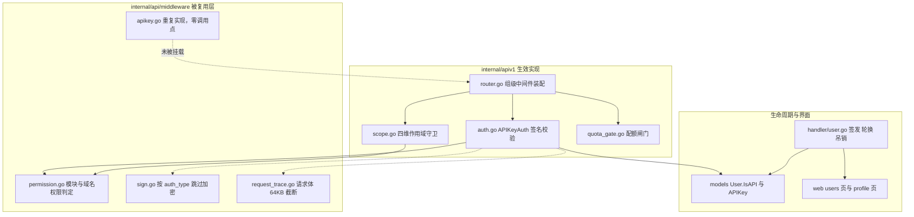
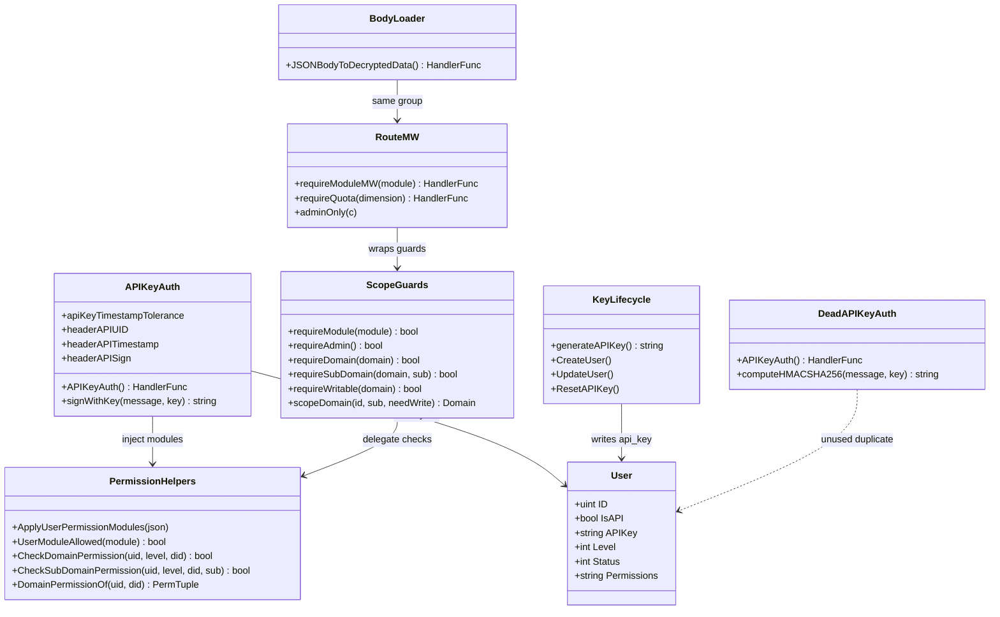
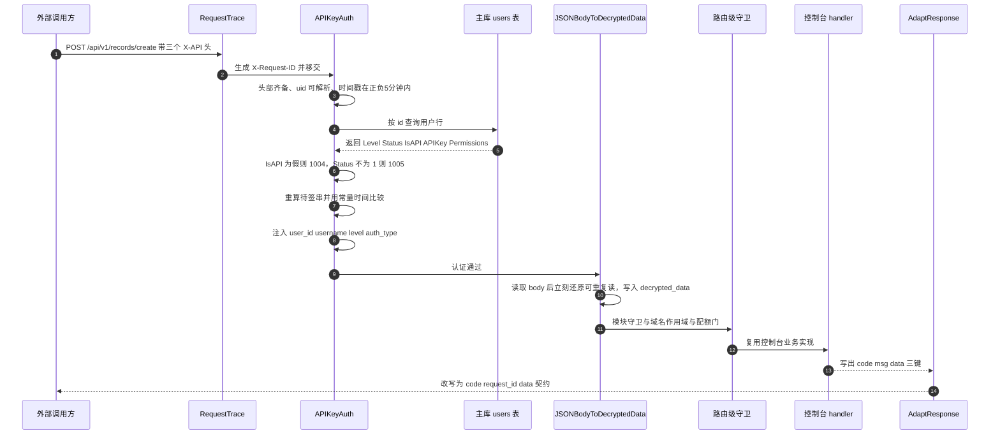
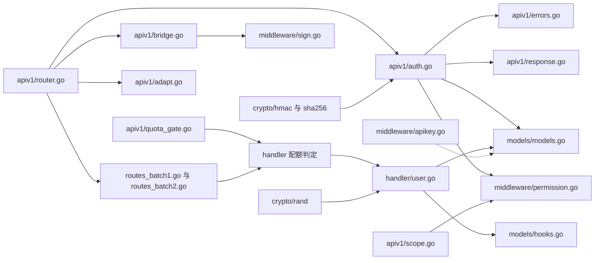
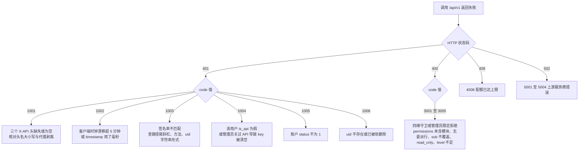

# API密钥系统

<cite>
**本文档引用的文件**
- [apiv1/auth.go](file://main/internal/apiv1/auth.go)
- [apiv1/router.go](file://main/internal/apiv1/router.go)
- [apiv1/scope.go](file://main/internal/apiv1/scope.go)
- [apiv1/domain.go](file://main/internal/apiv1/domain.go)
- [apiv1/record.go](file://main/internal/apiv1/record.go)
- [apiv1/routes_batch1.go](file://main/internal/apiv1/routes_batch1.go)
- [apiv1/routes_batch2.go](file://main/internal/apiv1/routes_batch2.go)
- [apiv1/bridge.go](file://main/internal/apiv1/bridge.go)
- [apiv1/quota_gate.go](file://main/internal/apiv1/quota_gate.go)
- [apiv1/record_sync.go](file://main/internal/apiv1/record_sync.go)
- [apiv1/errors.go](file://main/internal/apiv1/errors.go)
- [apiv1/response.go](file://main/internal/apiv1/response.go)
- [apiv1/adapt.go](file://main/internal/apiv1/adapt.go)
- [apiv1/util.go](file://main/internal/apiv1/util.go)
- [middleware/apikey.go](file://main/internal/api/middleware/apikey.go)
- [middleware/auth.go](file://main/internal/api/middleware/auth.go)
- [middleware/permission.go](file://main/internal/api/middleware/permission.go)
- [middleware/sign.go](file://main/internal/api/middleware/sign.go)
- [middleware/request_trace.go](file://main/internal/api/middleware/request_trace.go)
- [middleware/audit.go](file://main/internal/api/middleware/audit.go)
- [api/router.go](file://main/internal/api/router.go)
- [handler/user.go](file://main/internal/api/handler/user.go)
- [handler/auth.go](file://main/internal/api/handler/auth.go)
- [models/models.go](file://main/internal/models/models.go)
- [models/hooks.go](file://main/internal/models/hooks.go)
- [users/page.tsx](file://web/app/(dashboard)/dashboard/users/page.tsx)
- [profile/page.tsx](file://web/app/(dashboard)/dashboard/profile/page.tsx)
- [web/lib/api.ts](file://web/lib/api.ts)
</cite>

## 目录
1. [简介](#简介)
2. [项目结构](#项目结构)
3. [核心组件](#核心组件)
4. [架构总览](#架构总览)
5. [详细组件分析](#详细组件分析)
6. [依赖关系分析](#依赖关系分析)
7. [性能考虑](#性能考虑)
8. [故障排查指南](#故障排查指南)
9. [结论](#结论)
10. [附录](#附录)

## 简介

dnsplane 有两套完全独立的对外身份通道：控制台走 Cookie 里的 JWT，程序化调用走 `/api/v1`
上的 API Key 签名。本文只讲后者——密钥如何生成、如何参与签名、覆盖哪些作用域、如何轮换与吊销，
以及当前实现中已确认的暴露面。定位可概括为三点：

- **面向程序，不面向浏览器**。不承担会话语义，没有过期时间，签发之后一直有效到管理员轮转为止
- **一份凭据两用**。同一串 64 位十六进制值既是身份标识（`users.api_key` 列），又是
  HMAC-SHA256 的签名密钥（`apiv1/auth.go:94` 用它重算期望签名）
- **作用域由用户模型决定，而非密钥本身决定**。密钥不携带权限，权限来自该用户的 `level`、
  `permissions`、`status` 与域名授权表，因此轮转密钥不改变可访问范围

签名把「方法 + 路径」绑进待签串，同一签名无法挪用到另一条路径；但待签串不含请求体与查询串，
且 `/api/v1` 入口链上没有任何限流中间件。这两点分别对应下文的两个专节。

**章节来源**
- [apiv1/auth.go](file://main/internal/apiv1/auth.go)
- [apiv1/router.go](file://main/internal/apiv1/router.go)

## 项目结构

API Key 相关代码分布在三处：`internal/apiv1` 是实际生效的对外认证与鉴权层，
`internal/api/middleware` 同时提供被复用的权限判定函数与一份**已无调用点的重复实现**，
`internal/api/handler` 负责密钥的签发、轮换与吊销。



**图表来源**
- [apiv1/router.go](file://main/internal/apiv1/router.go)
- [apiv1/auth.go](file://main/internal/apiv1/auth.go)
- [apiv1/scope.go](file://main/internal/apiv1/scope.go)
- [internal/api/middleware/apikey.go](file://main/internal/api/middleware/apikey.go)

| 文件 | 行数 | 关键符号与位置 | 在密钥链路中的职责 |
|------|:----:|----------------|--------------------|
| `internal/apiv1/auth.go` | 165 | `APIKeyAuth`:`44`、`signWithKey`:`118`、`JSONBodyToDecryptedData`:`143` | 签名校验、身份注入、请求体装载 |
| `internal/apiv1/router.go` | 47 | `Setup`:`24`、组级 `Use` 顺序 `:27-34` | 装配 `/api/v1` 中间件链 |
| `internal/apiv1/scope.go` | 132 | `requireModule`:`28`、`requireWritable`:`94`、`scopeDomain`:`117` | 作用域四维的统一判定入口 |
| `internal/apiv1/domain.go` | 82 | `registerDomainRoutes`:`21`、`requireModuleMW`:`75` | 把模块校验包装成路由级中间件 |
| `internal/apiv1/routes_batch1.go` | 103 | `registerAccountRoutes`:`10` 等 4 个 | 证书、监控、定时族的作用域声明 |
| `internal/apiv1/routes_batch2.go` | 147 | `registerUserRoutes`:`107`、`adminOnly`:`142` | 管理员限定接口与密钥重置出口 |
| `internal/api/middleware/apikey.go` | 112 | `APIKeyAuth`:`44`、`computeHMACSHA256`:`108` | **死代码**，无任何调用点 |
| `internal/api/handler/user.go` | — | `generateAPIKey`:`49`、`ResetAPIKey`:`369` | 密钥生成与轮换 |

**章节来源**
- [apiv1/auth.go](file://main/internal/apiv1/auth.go)
- [apiv1/router.go](file://main/internal/apiv1/router.go)
- [apiv1/scope.go](file://main/internal/apiv1/scope.go)
- [apiv1/domain.go](file://main/internal/apiv1/domain.go)
- [apiv1/record.go](file://main/internal/apiv1/record.go)
- [apiv1/routes_batch1.go](file://main/internal/apiv1/routes_batch1.go)
- [apiv1/routes_batch2.go](file://main/internal/apiv1/routes_batch2.go)
- [internal/api/middleware/apikey.go](file://main/internal/api/middleware/apikey.go)
- [handler/user.go](file://main/internal/api/handler/user.go)

## 核心组件

组件之间是「一个认证器 + 一组守卫 + 一条生命周期链」的关系：认证器把外部凭据换成上下文身份，
守卫把身份换成可操作范围，生命周期链负责凭据本身的产生与消灭。



**图表来源**
- [apiv1/auth.go](file://main/internal/apiv1/auth.go)
- [apiv1/scope.go](file://main/internal/apiv1/scope.go)
- [apiv1/domain.go](file://main/internal/apiv1/domain.go)
- [apiv1/quota_gate.go](file://main/internal/apiv1/quota_gate.go)
- [internal/api/middleware/permission.go](file://main/internal/api/middleware/permission.go)
- [internal/api/middleware/apikey.go](file://main/internal/api/middleware/apikey.go)

| 组件 | 定义位置 | 输入 | 输出/副作用 | 失败码 |
|------|----------|------|-------------|--------|
| `APIKeyAuth` | `apiv1/auth.go:44` | 三个 `X-API-*` 头 | 写入 `user_id`、`username`、`level`、`auth_type`、模块权限 | `1001` 至 `1006` |
| `JSONBodyToDecryptedData` | `apiv1/auth.go:143` | POST/PUT/PATCH 请求体 | 写入 `decrypted_data` 并还原 body | 无（失败留空 map） |
| `requireModuleMW` | `apiv1/domain.go:75` | 模块名常量 | 放行或中断 | `3001` |
| `scopeDomain` | `apiv1/scope.go:117` | 域名 ID、子域、是否写 | 域名实体或中断 | `2002` `4002` `3002` `3003` `3004` |
| `requireQuota` | `apiv1/quota_gate.go:35` | 配额维度名 | 放行或中断 | `4008` |
| `generateAPIKey` | `handler/user.go:49` | `crypto/rand` 32 字节 | 64 位十六进制串写入 `api_key` 列 | 无 |

**章节来源**
- [apiv1/auth.go](file://main/internal/apiv1/auth.go)
- [apiv1/scope.go](file://main/internal/apiv1/scope.go)
- [apiv1/domain.go](file://main/internal/apiv1/domain.go)
- [apiv1/quota_gate.go](file://main/internal/apiv1/quota_gate.go)
- [handler/user.go](file://main/internal/api/handler/user.go)

## 架构总览

`/api/v1` 挂在**引擎根节点**而不是 `/api` 分组内（`api/router.go:63` 早于 `:64`）。理由写在
`apiv1/router.go:11-15` 与 `api/router.go:57-62` 两处注释里且互相一致：`/api` 分组带 CSRF
double-submit 校验，而 API Key 客户端没有 `_csrf` cookie，继承那条链会让所有写请求被拒。
签名本身就是身份与完整性的凭据，不需要再叠一层。

| 层级 | 成员 | 是否作用于 `/api/v1` | 依据 |
|------|------|:--------------------:|------|
| 引擎级 | `SecurityHeaders`、`gin.Recovery`、`Logger` | 是 | `api/router.go:28-30` |
| 组级（v1） | `RequestTrace`、`Recovery`、`CORS`、`APIKeyAuth`、`JSONBodyToDecryptedData`、`AuditLog`、`AdaptResponse` | 是 | `apiv1/router.go:27-34` |
| 组级（api） | `CSRF`、`Auth`、`Permission` | 否 | `api/router.go:45-52`、`:95-104` |
| 路由级 | `paramAlias`、`paramBridge`、`requireModuleMW`、`requireQuota`、`adminOnly` | 按接口挂载 | `apiv1/domain.go:28`、`record.go:34`、`routes_batch2.go:86` |



**图表来源**
- [apiv1/router.go](file://main/internal/apiv1/router.go)
- [apiv1/auth.go](file://main/internal/apiv1/auth.go)
- [apiv1/bridge.go](file://main/internal/apiv1/bridge.go)
- [apiv1/adapt.go](file://main/internal/apiv1/adapt.go)
- [api/router.go](file://main/internal/api/router.go)

链末的 `AdaptResponse` 有一个容易被忽略的配合点：控制台 handler 最终会调
`middleware.EncryptedResponse`（`sign.go:142`），该函数**按 `auth_type` 而不是按路径**判断是否
跳过载荷加密——`auth_type == "apikey"` 时直接返回明文（`sign.go:153-156`）。
这正是 `apiv1/auth.go:109` 必须写入 `auth_type` 的原因，也是那份死代码的危险所在。

**章节来源**
- [apiv1/router.go](file://main/internal/apiv1/router.go)
- [api/router.go](file://main/internal/api/router.go)
- [apiv1/auth.go](file://main/internal/apiv1/auth.go)
- [internal/api/middleware/sign.go](file://main/internal/api/middleware/sign.go)
- [apiv1/adapt.go](file://main/internal/apiv1/adapt.go)

## 详细组件分析

### Key 结构与存储形态

密钥本身没有任何结构化前缀、校验位或内嵌元信息，它就是一串随机十六进制。

| 属性 | 取值 | 来源 |
|------|------|------|
| 随机源 | `crypto/rand`，32 字节 | `handler/user.go:49-52` |
| 编码 | `hex.EncodeToString`，输出 64 字符 | `handler/user.go:53` |
| 列定义 | `gorm:"size:64"`，`json:"api_key,omitempty"` | `models/models.go:16` |
| 落库形态 | **明文**，无 `enc:v1:` 前缀 | `models/hooks.go:56-62` 未纳入 `APIKey` |
| 开关字段 | `users.is_api`（布尔） | `models/models.go:15` |
| 有效期 | 无过期时间列 | `models/models.go:10-31` 全字段清点 |

生成强度是刻意提升过的：`handler/user.go:43-48` 的注释记录了从 16 字节（128 bit）提到
32 字节（256 bit）的原因——HMAC 密钥的有效强度等于 `min(key_len, hash_output_len)`，
32 字节刚好把 SHA-256 的输出长度用满。`hooks.go` 的透明加解密覆盖 7 个模型的敏感列
（`Account.Config`、`CertAccount` 与 `CertDeploy` 的 `Config`/`Info`、`CertOrder.PrivateKey`、
`DMTask.ProxyPassword`、`User.TOTPSecret`、`UserOAuth` 的两列令牌），
**`User.APIKey` 不在其中**。这意味着备份文件与 `data.db` 的任意副本都直接携带可用于签名的私钥，
与同类凭据列的处理不一致。

**章节来源**
- [handler/user.go](file://main/internal/api/handler/user.go)
- [models/models.go](file://main/internal/models/models.go)
- [models/hooks.go](file://main/internal/models/hooks.go)

### 签名串构成与校验顺序

三个请求头的名字由常量固定（`apiv1/auth.go:38-40`），待签串只由四段构成（`:93`）：

```text
X-API-UID        站内用户数字 ID 的十进制字符串
X-API-Timestamp  Unix 秒级时间戳
X-API-Sign       HMAC-SHA256(待签串, api_key) 的十六进制

待签串 = uid + "\n" + timestamp + "\n" + METHOD + "\n" + URL.Path
```

`apiv1/auth.go:31-32` 的注释把这一设计与旧版 PHP 的 `md5(uid + timestamp + apikey)` 做了对比：
多绑定「这一次调用要打到哪个接口」之后，同一签名无法挪用到另一条路径上。代价是路径必须逐字一致——
`gin` 的路由树不做尾斜杠归一，因此 `/api/v1/domains/list/` 与 `/api/v1/domains/list`
是两个不同的签名对象。校验严格按固定顺序短路，每步给出独立错误码：

| 序 | 判定 | 位置 | 失败码 |
|:--:|------|------|:------:|
| 1 | 三个头都非空（先 `TrimSpace`） | `auth.go:50-54` | `1001` |
| 2 | `uid` 可解析为 `uint32` 且不为 0 | `auth.go:56-61` | `1001` |
| 3 | `timestamp` 可解析为 `int64` | `auth.go:63-68` | `1002` |
| 4 | 与服务器时刻偏差 ≤ 5 分钟 | `auth.go:69-73` | `1002` |
| 5 | 用户行存在 | `auth.go:76-81` | `1006` |
| 6 | `is_api` 为真 | `auth.go:82-86` | `1004` |
| 7 | `status == 1` | `auth.go:87-91` | `1005` |
| 8 | HMAC 常量时间比较相等 | `auth.go:93-100` | `1003` |

第 8 步用 `hmac.Equal`（`:96`）而非 `==`，`auth.go:95` 的注释点明动机：避免逐字节比较的
耗时差异泄露签名前缀。第 4 步用 `math.Abs` 做对称窗口，因此客户端时钟比服务器快或慢都会失败。

关键缺口：请求体与查询串都不参与签名。控制台那条**已经死亡的**签名链是覆盖 body 的
（`middleware/sign.go` 的 `DecryptAndVerify`:`17`），两者形成鲜明对照。后果是持有合法签名串的
人可以在 5 分钟窗口内替换 body 而签名仍然有效——与「入口无限流」叠加时风险被放大。

错误输出走 `Fail`/`Failf`（`response.go:72-92`），`AdaptResponse` 在链末跳过空缓冲
（`adapt.go:50-53`），不会把已写出的 v1 响应重新解析一遍。`httpStatusFor`（`errors.go:72-92`）
把六个认证类错误码统一映射到 **HTTP 401**，而不是把 `1004`、`1005` 这类「凭据有效但身份状态
不允许」映射到 403。后果是**不能只看状态码判断是否该重试**：`1003`（签名算错，重试有效）与
`1005`（账户被禁用，重试无效）在 HTTP 层完全同形，必须读 `code`。`errors.go:16` 另立一条
硬约束：码值一经发布不得复用或改义，因为外部调用方据此分支，改义会让存量集成静默走错分支。

**章节来源**
- [apiv1/auth.go](file://main/internal/apiv1/auth.go)
- [apiv1/errors.go](file://main/internal/apiv1/errors.go)
- [apiv1/response.go](file://main/internal/apiv1/response.go)
- [apiv1/adapt.go](file://main/internal/apiv1/adapt.go)
- [internal/api/middleware/sign.go](file://main/internal/api/middleware/sign.go)

### 作用域四维与守卫挂载

`apiv1/scope.go:20-25` 把作用域拆成四个相互独立的维度，并在 `:16-19` 说明了为什么要单独建一层：
控制台把鉴权散在各 handler 内部（`requireAdmin`、`requireUserModule`、`CheckDomainPermission`
三种混用），对外接口需要一层统一、可枚举的范围声明，否则新增接口时容易漏掉某一维度，
而且从路由表上看不出每个接口要什么权限。

| 维度 | 判定函数 | 数据来源 | 越权码 | 管理员是否豁免 |
|------|----------|----------|:------:|:--------------:|
| 模块 | `requireModule`（`scope.go:28`） | `users.permissions` JSON 注入的 `perm_modules` | `3001` | 是 |
| 域名 | `requireDomain`（`scope.go:68`） | 账户归属 或 `permissions` 表委派行 | `3002` | 是 |
| 子域 | `requireSubDomain`（`scope.go:78`） | 委派行的 `sub` 列（通配或逗号列表） | `3003` | 是 |
| 只读 | `requireWritable`（`scope.go:94`） | 委派行的 `read_only` 列 | `3004` | 是 |

模块维度有一条兼容分支值得注意：`ApplyUserPermissionModules`（`permission.go:367-380`）
在 `permissions` 列为空**或 JSON 解析失败**时把 `perm_modules_configured` 置为 `false`，
而 `UserModuleAllowed`（`:383-399`）在未配置时对非管理员**一律放行**。
也就是说「没配权限」与「配了全量」在当前实现下等效，只有显式写入合法 JSON 数组
（包括空数组）才会收窄范围。

`scopeDomain`（`scope.go:117-132`）把四步固化成唯一顺序：加载域名 → 域名权限 → 子域权限 →
写操作时补只读检查。子域校验有一处容易被绕过的细节，`record_sync.go:49-53` 与 `:68-80` 处理了它：
删除与启停这类只带 `record_id` 的调用无法从请求得知子域名，实现会先回查云端取该记录的真实名称
再做子域校验，否则持有 A 子域授权的用户可以删除同域名下 B 子域的记录。

守卫的实际挂载密度（按当前工作区四个路由文件逐条注册清点）：

| 模块 | 路由数 | 挂 `requireModuleMW` | 挂 `adminOnly` | 备注 |
|------|:------:|:--------------------:|:--------------:|------|
| `domain` | 40 | 40 | 0 | 域名 19、记录 14、账户 6、定时 6，含 Cloudflare 与优选 IP 复用 |
| `cert` | 13 | 13 | 0 | 证书账户 4、订单 8、providers |
| `deploy` | 12 | 12 | 0 | 部署任务 5、部署账户 6、类型 1 |
| `monitor` | 15 | 15 | 0 | 全族 |
| 管理员限定 | 25 | 0 | 25 | 系统 16、用户与授权 9 |
| 无显式守卫 | 2 | 0 | 0 | `POST /users/me`、`POST /users/me/password`（`routes_batch2.go:111-112`） |
| 合计 | **145** | 121 | 25 | 全部为 POST，无路径参数 |

配额是第五道闸门但不在 `scope.go` 内：`requireQuota`（`quota_gate.go:35-47`）只挂在记录的两条
创建路径（`record.go:34` 单条、`:40` 批量）。`quota_gate.go:11-23` 给出判据——「这个 handler
内部有没有 `CheckQuota`，有就不挂，没有才挂」；其余创建接口的配额门在控制台 handler 内部，
路由层重复挂会让错误码由路由层给出而非 `AdaptResponse` 按文案映射，
同一接口经两个入口调用时错误码会不一致。

**章节来源**
- [apiv1/scope.go](file://main/internal/apiv1/scope.go)
- [apiv1/record_sync.go](file://main/internal/apiv1/record_sync.go)
- [apiv1/quota_gate.go](file://main/internal/apiv1/quota_gate.go)
- [apiv1/record.go](file://main/internal/apiv1/record.go)
- [apiv1/domain.go](file://main/internal/apiv1/domain.go)
- [apiv1/routes_batch1.go](file://main/internal/apiv1/routes_batch1.go)
- [apiv1/routes_batch2.go](file://main/internal/apiv1/routes_batch2.go)
- [internal/api/middleware/permission.go](file://main/internal/api/middleware/permission.go)

### 签发、轮换与吊销的生命周期

密钥的三条写入路径都在控制台侧，对外接口只提供**管理员**级别的重置出口。

| 动作 | 触发点 | 实现位置 | 生效方式 |
|------|--------|----------|----------|
| 签发 | 创建用户时 `is_api` 为真 | `handler/user.go:137-139`，响应 `:154` | 随 `Create` 落库 |
| 补发 | 更新用户把 `is_api` 由假改真且原值为空 | `handler/user.go:211-213` | 写入 `updates` map |
| 轮转 | 管理员点击重置 | `handler/user.go:386-387` | `Update("api_key", newKey)` |
| 吊销（关 API） | `is_api` 改为假 | `handler/user.go:215-217` | 直接把 `api_key` 置空串 |
| 吊销（禁账户） | `status` 改为 0 | 由 `auth.go:87-91` 拦在签名之前 | 密钥仍在库里但不可用 |

轮转的入口有两个，权限要求相同：控制台的
`POST /api/users/:id/reset-apikey`（`api/router.go:213`）与对外的
`POST /api/v1/users/api-key/reset`（`routes_batch2.go:119`，额外挂 `adminOnly`），
两者指向同一个 `handler.ResetAPIKey`（`handler/user.go:369`）。该 handler 会先拒绝
未启用 API 的用户，避免给 `is_api=false` 的行写入可用密钥。

**这里没有自服务轮转。** 对外接口只暴露 `/users/me`（读自身）与 `/users/me/password`
（改自身口令），密钥重置需要 `level >= 2`。前端也只有管理员用户管理页提供重置按钮
（`users/page.tsx:447-461`，接口封装在 `web/lib/api.ts:677`），个人设置页只做只读展示
（`profile/page.tsx:572-575`）。吊销的实时性值得单独确认：`auth.go:76-81` 每次请求都直接查库，
**不走** `middleware.Auth` 那条 `auth_user:<uid>` 的 30 秒用户缓存。因此管理员置空 `api_key`
或关闭 `is_api` 之后，下一次请求立即失败，不存在缓存窗口内的残余可用期——
这是与 Cookie 会话相比的一处优势。

**章节来源**
- [handler/user.go](file://main/internal/api/handler/user.go)
- [api/router.go](file://main/internal/api/router.go)
- [apiv1/routes_batch2.go](file://main/internal/apiv1/routes_batch2.go)
- [apiv1/auth.go](file://main/internal/apiv1/auth.go)
- [users/page.tsx](file://web/app/(dashboard)/dashboard/users/page.tsx)
- [profile/page.tsx](file://web/app/(dashboard)/dashboard/profile/page.tsx)
- [web/lib/api.ts](file://web/lib/api.ts)

### 与 JWT 会话认证的差异

两条链路服务不同客户端，设计取舍几乎处处相反。

| 维度 | API Key（`/api/v1`） | JWT（控制台 `/api`） |
|------|----------------------|----------------------|
| 凭据载体 | `X-API-UID` + `X-API-Timestamp` + `X-API-Sign` | HttpOnly Cookie `_t`、`_rt` |
| 校验函数 | `apiv1/auth.go:44` | `middleware/auth.go:125` 的 `Auth` |
| 密钥来源 | 该用户的 `api_key` 列（每用户一把） | 全局 JWT 密钥 `{配置项}` |
| 有效期 | 无过期，直到轮转或关闭 `is_api` | access 15 分钟、refresh 7 天（`middleware/auth.go:91-92`） |
| 撤销延迟 | 立即（每次查库） | 有缓存窗口（`auth_user:<uid>` 30 秒） |
| 防重放 | 5 分钟窗口 + 路径绑定，无 nonce | refresh JTI 一次性 |
| CSRF | 不适用，无 cookie（`apiv1/router.go:11-15`） | `middleware.CSRF()` double-submit（`api/router.go:50`） |
| 入口限流 | 无 | 口令登录有 `login_fail` 分桶锁定 |

差异的本质：**JWT 的泄露有 15 分钟的自然止损，API Key 的泄露只能靠人工轮转止损。**
因此泄露响应必须按「凭据已长期失效」来处置，而不是按「等它过期」。

**章节来源**
- [apiv1/auth.go](file://main/internal/apiv1/auth.go)
- [internal/api/middleware/auth.go](file://main/internal/api/middleware/auth.go)
- [internal/api/middleware/sign.go](file://main/internal/api/middleware/sign.go)
- [apiv1/router.go](file://main/internal/apiv1/router.go)

### 入口限流缺口与放大路径

`/api/v1` 的组级链只有七件事（`apiv1/router.go:27-34`）：`RequestTrace`、`Recovery`、`CORS`、
`APIKeyAuth`、`JSONBodyToDecryptedData`、`AuditLog`、`AdaptResponse`。
**其中没有任何限流或频率控制中间件。**

已验证的是全仓范围：`internal/api/middleware/` 目录下不存在限流文件，该目录实际内容为
`apikey.go`、`audit.go`、`auth.go`、`csrf.go`、`logger.go`、`permission.go`、`recovery.go`、
`request_trace.go`、`sanitize.go`、`sign.go`。当前存在的频控全部集中在登录与公开发信等
会话类流程（`login_fail`、`rl:quicklogin_<ip>`、`rl:pubmail`、`vcode:<scene>:<email>` 等键前缀），
与 `/api/v1` 无交集。三条放大路径：

1. **凭据泄露即无限调用**。没有过期时间、没有入口频控，一把泄露的 key 可以无限制打满上游
   DNS 服务商的配额，同时把请求日志表写爆
2. **body 可替换**。待签串不含请求体，5 分钟窗口内同一签名可携带任意 body；配合无入口限流，
   抓到的一个合法包可被扩展成批量写操作
3. **明文列的连带泄露**。`GetUsers`（`handler/user.go:74`）把每个用户的 `api_key` 连同列表
   整体下发，`GetUserInfo`（`handler/auth.go:475`）无条件回显；管理员会话一旦被 XSS 或日志
   泄露波及，全部 API Key 一并落出

对外的记录接口还会真实调用上游服务商（`record_sync.go` 的五个同步写实现，超时
`recordOpTimeout = 30s`，`:29`），滥用会直接消耗第三方配额并可能触发服务商侧风控。
**缓解现状**：`AuditLog`（`apiv1/router.go:32` 挂载，实现 `middleware/audit.go:21`）与
`RequestTrace` 分别落审计库与请求日志库——**事后可追溯，但事前不可拦截**。

**章节来源**
- [apiv1/router.go](file://main/internal/apiv1/router.go)
- [internal/api/middleware/audit.go](file://main/internal/api/middleware/audit.go)
- [internal/api/middleware/request_trace.go](file://main/internal/api/middleware/request_trace.go)
- [apiv1/record_sync.go](file://main/internal/apiv1/record_sync.go)
- [handler/user.go](file://main/internal/api/handler/user.go)
- [handler/auth.go](file://main/internal/api/handler/auth.go)

### 死代码：middleware/apikey.go 的错接风险

`internal/api/middleware/apikey.go` 与 `internal/apiv1/auth.go` 是同一功能的重复实现。前者
**零调用点**——全仓检索 `middleware.APIKeyAuth` 与 `middleware.JSONBodyToDecryptedData`
均无任何挂载代码，命中的只有自身定义与注释。两份实现的语义已经分叉，分叉方向恰好是危险的：

| 差异点 | `apiv1/auth.go`（生效） | `middleware/apikey.go`（死代码） | 分叉后果 |
|--------|-------------------------|----------------------------------|----------|
| 用户校验 | 拆两次判定：`IsAPI`（`:82`）与 `Status`（`:87`） | 一条 SQL 同时校验（`:83`） | 只能给统一 401，无法区分 `1004` 与 `1005` |
| `auth_type` 注入 | 写入 `"apikey"`（`:109`） | **未写入**（`:99-101`） | 误挂会让 `EncryptedResponse` 对 API Key 客户端错误加密 |
| 模块权限注入 | 调 `ApplyUserPermissionModules`（`:111`） | 未调用 | 挂载后 `requireModule` 拿不到 `perm_modules` |
| 错误响应形状 | `Fail`/`Failf` 的 v1 契约 | 裸 `c.JSON` 的 `code:401` | 与 `AdaptResponse` 的解析规则冲突 |
| body 装载 | `io.ReadAll` 后**还原请求体**（`:154-155`） | `ShouldBindJSON`，读完不还原（`:31`） | 绕过 `BindDecryptedData` 的 handler 拿到 `io.EOF`，表现为「回成功但什么也没改」 |
| 覆盖方法 | POST、PUT、PATCH（`:146`） | 仅 POST（`:29`） | PUT 与 PATCH 场景参数丢失 |

`apiv1/auth.go:131-136` 的注释正是针对倒数第二条写的——相当一批控制台 handler 绕开
`BindDecryptedData` 直接调 `c.ShouldBindJSON`（证书账户与订单的新增、用户管理、系统配置更新、
全部 Cloudflare 接口），body 被读到 EOF 时它们拿到零值且不报错。死代码里那条 body 处理路径
已经被验证为不可用；删除它，或补齐对应端点让它真正生效，都比保留一个
「看起来能用但一挂就坏」的副本要好。

**章节来源**
- [internal/api/middleware/apikey.go](file://main/internal/api/middleware/apikey.go)
- [apiv1/auth.go](file://main/internal/apiv1/auth.go)
- [internal/api/middleware/sign.go](file://main/internal/api/middleware/sign.go)

## 依赖关系分析



**图表来源**
- [apiv1/auth.go](file://main/internal/apiv1/auth.go)
- [apiv1/scope.go](file://main/internal/apiv1/scope.go)
- [apiv1/router.go](file://main/internal/apiv1/router.go)
- [apiv1/bridge.go](file://main/internal/apiv1/bridge.go)
- [apiv1/quota_gate.go](file://main/internal/apiv1/quota_gate.go)
- [internal/api/middleware/apikey.go](file://main/internal/api/middleware/apikey.go)

| 依赖方 | 被依赖方 | 依赖内容 | 方向是否合理 |
|--------|----------|----------|:------------:|
| `apiv1` | `api/middleware` | `ApplyUserPermissionModules`、`CheckDomainPermission`、`CheckSubDomainPermission`、`DomainPermissionOf` | 合理：鉴权原语只有一份 |
| `apiv1` | `api/handler` | 145 条路由直接复用控制台 handler | 合理但有代价：v1 契约受 handler 行为牵动 |
| `api/middleware` | `apiv1` | 无 | 合理：不存在反向依赖 |
| `models.User` | `models/hooks.go` | `BeforeSave`、`AfterFind` 加解密 | **不完整**：`APIKey` 未纳入 |
| `apiv1/bridge.go` | `middleware.GetDecryptedData` | 读回 body 映射 | 合理，但注释已过时（见下） |

两处需要记录的依赖细节：

- `apiv1/bridge.go:20-22` 的注释说「`JSONBodyToDecryptedData` 用 `ShouldBindJSON` 读过一次
  请求体，body 已到 EOF」，这与**生效实现不符**——`apiv1/auth.go:154-155` 读完立刻用
  `io.NopCloser` 还原，该注释描述的是死代码那份的行为。`bridgeParams`（`bridge.go:97-101`）
  随后又用 `json.Marshal(decrypted_data)` 二次覆盖 body，两次还原中后者才是实际生效的那次
- `apiv1/scope.go:87-93` 的注释声称「`Permission` 中间件从未被挂载」，但 `api/router.go:104`
  确实挂了 `middleware.Permission()`。结论方向不受影响——`requireWritable` 直查权限表而不依赖
  上下文键的设计本来就是对的，但作为依据的那句话是错的

**章节来源**
- [apiv1/bridge.go](file://main/internal/apiv1/bridge.go)
- [apiv1/scope.go](file://main/internal/apiv1/scope.go)
- [api/router.go](file://main/internal/api/router.go)
- [internal/api/middleware/permission.go](file://main/internal/api/middleware/permission.go)
- [apiv1/util.go](file://main/internal/apiv1/util.go)

## 性能考虑

| 问题 | 定位 | 现状与影响 | 可选方向 |
|------|------|------------|----------|
| 每请求一次用户查询 | `auth.go:76-81` | 每个 v1 请求都按 `id` 主键取一行，不走 `auth_user:<uid>` 缓存。主键命中开销小，换来的是吊销零延迟 | 保持现状；若 QPS 成瓶颈再加 1 至 3 秒微缓存并显式接受吊销延迟 |
| 请求体 64KB 硬截断 | `request_trace.go:30`、`:152` | `io.LimitReader` 之后把截断结果写回 body，超限的批量写请求会被**静默截断**，`json.Unmarshal` 失败导致 `decrypted_data` 留空 map，handler 按缺参报错 | 对 v1 单独放宽上限，或解析失败时明确回 `2003` 而不是缺参 |
| 只读授权额外查库 | `scope.go:98` 经 `util.go:21` 到 `permission.go:304-318` | `getDomainPermission` 每次写操作查域名表、账户表、权限表，三次取数 | `scopeDomain` 已复用 `loadDomain` 结果，可继续往下传 |
| 记录写操作同步等待 | `record_sync.go:29` | `recordOpTimeout = 30s`，云端不返回则请求挂住；批量族未重写，仍是异步 | 保持：程序化调用需要拿到真实成败 |
| 无入口限流 | `apiv1/router.go:27-34` | 见「入口限流缺口与放大路径」小节 | 以 uid 为桶的固定窗口计数，复用既有 `cache.Incr` 模式 |

`apiv1/auth.go:138-139` 明确记录了「读取不设长度上限」的理由：最外层 `RequestTrace` 已按
`MaxBodySize` 截断过，此处再设限只会让可读范围比改动前更小。这是一处**合理的**不做重复限制，
但前提是 `MaxBodySize` 的语义要说清——它不是日志采样上限，而是当前实现下**实际生效的请求体上限**。

**章节来源**
- [apiv1/auth.go](file://main/internal/apiv1/auth.go)
- [internal/api/middleware/request_trace.go](file://main/internal/api/middleware/request_trace.go)
- [apiv1/record_sync.go](file://main/internal/apiv1/record_sync.go)
- [apiv1/scope.go](file://main/internal/apiv1/scope.go)
- [apiv1/util.go](file://main/internal/apiv1/util.go)
- [internal/api/middleware/permission.go](file://main/internal/api/middleware/permission.go)

## 故障排查指南



**图表来源**
- [apiv1/auth.go](file://main/internal/apiv1/auth.go)
- [apiv1/errors.go](file://main/internal/apiv1/errors.go)
- [apiv1/scope.go](file://main/internal/apiv1/scope.go)

| 症状 | 根因 | 排查动作 | 处置方案 |
|------|------|----------|----------|
| 全部接口都回 `1003` | 路径尾斜杠差异导致待签串不同 | 比对签名用的 path 与实际请求 path | 统一去掉尾斜杠；`gin` 路由树不做归一 |
| 只在写接口失败，读接口正常 | body 未进入 `decrypted_data`，或超过 64KB 被截断 | 看 `request_id` 对应的请求日志行的 body 列 | 缩小批量载荷；必要时调整 `MaxBodySize` |
| 昨天还能用，今天 `1004` | 管理员把 `is_api` 改回假，`api_key` 已被置空 | `handler/user.go:215-217` 的分支 | 重新开启 API 并取回新 key |
| 关掉某个用户后旧 key 仍可用 | 未真正关闭：`is_api` 为真且 `status` 为 1 | 查 `users` 行两个字段 | 置 `status=0` 或 `is_api=0`，两者都即时生效 |
| `permissions` 明明留空，模块守卫却不拦 | 空列被判定为「未配置」，非管理员一律放行 | `permission.go:367-380` 与 `:383-399` | 显式写入合法 JSON 数组，收窄到需要的模块 |
| 客户端收到无法解析的密文 | 认证链被改动导致 `auth_type` 未写入，`EncryptedResponse` 走了加密分支 | `sign.go:142-160`；确认没有误挂 `middleware/apikey.go` | 恢复 `auth.go:109` 的注入，改用生效实现 |

### Key 泄漏的处置顺序

一把 API Key 同时是身份与签名私钥，且**明文列 + 无过期**，处置必须按「凭据永久失效」
而不是「等它过期」来走：

1. **立即轮转，而不是先禁用观察**。管理员走 `POST /api/v1/users/api-key/reset` 或控制台的
   `reset-apikey`（`handler/user.go:369`）。v1 不走用户缓存，新 key 生效与旧 key 失效
   在**下一个请求**即完成
2. **确认吊销真的落地**。`is_api=false` 会连带清空 `api_key`（`handler/user.go:215-217`），
   因此「关 API」本身就是吊销；只改 `permissions` 不会吊销凭据
3. **回溯滥用范围**。`AuditLog` 落审计库、`RequestTrace` 落请求日志库，按 `user_id` 与该时间段的
   `X-Request-ID` 还原调用序列；`system/request-logs/list` 与 `system/logs/list`
   就是给这个用途开的（`routes_batch2.go:94-102`）
4. **检查上游侧损伤**。记录写操作是同步打上游服务商的，泄漏期内可能对每家服务商造成
   配额或风控影响，需要逐账户核对
5. **排查明文连带**。`GetUsers` 一次性下发全部用户的 `api_key`（`handler/user.go:74`），
   泄漏源头若是管理员凭据，需要考虑**全站轮转**而不只是单用户

**章节来源**
- [handler/user.go](file://main/internal/api/handler/user.go)
- [apiv1/routes_batch2.go](file://main/internal/apiv1/routes_batch2.go)
- [internal/api/middleware/audit.go](file://main/internal/api/middleware/audit.go)
- [internal/api/middleware/request_trace.go](file://main/internal/api/middleware/request_trace.go)

### 作用域过大的收敛顺序

| 步 | 动作 | 依据 | 注意 |
|:--:|------|------|------|
| 1 | 给集成专用账户单独建用户，不复用人类管理员账户 | `auth.go:106-108` 注入的 `level` 决定豁免范围 | `level >= 2` 会绕过全部四维守卫 |
| 2 | 把 `level` 压到 0 或 1 | `models/models.go:17` 的等级注释 | 管理员级 key 无法靠作用域收窄 |
| 3 | `permissions` 写入显式 JSON 数组，只保留需要的模块 | `permission.go:367-399` | 空串等于全放行，必须显式给数组 |
| 4 | 域名维度用委派授权表，只授必要域名 | `permission.go:304-318` 的归属判定 | 账户所有者视为完全授权，不受只读限制 |
| 5 | 子域维度用 `sub` 列限定主机记录名 | `permission.go:344-361` | 空 `sub` 与 `*` 等效，等于不限制 |
| 6 | 写场景配 `read_only`，配额维度收紧 `records` | `scope.go:94-109`、`quota_gate.go:35-47` | 配额门只覆盖记录的两条创建路径 |

**章节来源**
- [apiv1/scope.go](file://main/internal/apiv1/scope.go)
- [apiv1/quota_gate.go](file://main/internal/apiv1/quota_gate.go)
- [internal/api/middleware/permission.go](file://main/internal/api/middleware/permission.go)
- [models/models.go](file://main/internal/models/models.go)

## 结论

API Key 系统在当前工作区是一份**边界清楚但风险偏窄**的实现。核心设计选择都站得住：待签串绑定
方法与路径，让签名不可跨接口挪用；`hmac.Equal` 常量时间比较；每请求直查用户，换来吊销零延迟；
按 `auth_type` 而非路径跳过载荷加密；四维作用域在路由表上可枚举，145 条接口中 121 条挂模块守卫、
25 条限管理员。

已确认需要处理的问题，按优先级：

1. **入口无限流**（`apiv1/router.go:27-34`）。凭据无过期 + 明文存储 + 无频控，
   三者叠加后单点风险的期望损失远高于三者之和
2. **`users.api_key` 明文存储且随用户列表整体下发**（`models/hooks.go:56-62`、
   `handler/user.go:74`、`handler/auth.go:475`）。同类凭据列都已加密，这一列没有
3. **待签串不覆盖 body 与 query**（`auth.go:93`）。5 分钟窗口内签名可携带任意载荷
4. **无自服务轮转**：普通用户必须找管理员（`routes_batch2.go:119` 的 `adminOnly`）
5. **死代码 `middleware/apikey.go`**：与生效实现语义分叉，误挂即坏
6. **两处过时注释**：`bridge.go:20-22` 与 `scope.go:87-93`，结论可用但依据陈述有误

不建议做的事：不要为了「看起来更安全」给密钥加过期时间列却不同时提供自服务轮转入口，
那只会把人工轮转的负担推给运维；也不要在路由层重复挂已经存在于 handler 内部的配额门。

**章节来源**
- [apiv1/auth.go](file://main/internal/apiv1/auth.go)
- [apiv1/router.go](file://main/internal/apiv1/router.go)
- [apiv1/quota_gate.go](file://main/internal/apiv1/quota_gate.go)
- [models/hooks.go](file://main/internal/models/hooks.go)

## 附录

### 认证与作用域错误码速查

| 码 | HTTP | 常量 | 默认文案（`errors.go:103-118`） | 触发条件 |
|:--:|:----:|------|--------------------------------|----------|
| 1001 | 401 | `CodeUnauthorized` | 缺少 API 凭据 | 三个头任一为空，或 uid 非法 |
| 1002 | 401 | `CodeTimestampInvalid` | 请求时间戳已失效，请校准本机时间后重试 | 解析失败或超出正负 5 分钟窗口 |
| 1003 | 401 | `CodeSignMismatch` | 签名验证失败 | HMAC 重算不等 |
| 1004 | 401 | `CodeAPIKeyMissing` | 该用户未启用 API 访问 | `is_api` 为假 |
| 1005 | 401 | `CodeAccountDisabled` | 账户已被禁用 | `status` 不为 1 |
| 1006 | 401 | `CodeUserNotFound` | API 凭据对应的用户不存在 | 按 uid 查不到行 |
| 3001 至 3005 | 400 | `CodeModuleDenied` 等作用域族 | 模块、域名、子域、只读、管理员限定 | 四维守卫与 `requireAdmin` 拒绝 |
| 4008 | 409 | `CodeResourceLocked` | 配额上限（动态文案） | `requireQuota` 拒绝 |

| 请求要素 | 取值 | 来源 |
|----------|------|------|
| 前缀与方法 | `/api/v1`，一律 `POST`（145 条，无 GET、PUT、DELETE） | `apiv1/router.go:25` 与四个路由文件的注册清点 |
| 路径参数 | 无，全部改由 body 传 | `apiv1/domain.go:22-28`、`routes_batch2.go:12-18` |
| 头三件 | `X-API-UID`、`X-API-Timestamp`、`X-API-Sign` | `apiv1/auth.go:38-40` |
| 密钥形态 | 64 位十六进制，写作 `{64位十六进制密钥}`；响应带 `X-Request-ID` | `handler/user.go:49-53`、`request_trace.go:150` |

**章节来源**
- [apiv1/errors.go](file://main/internal/apiv1/errors.go)
- [apiv1/router.go](file://main/internal/apiv1/router.go)
- [apiv1/domain.go](file://main/internal/apiv1/domain.go)
- [apiv1/auth.go](file://main/internal/apiv1/auth.go)
- [internal/api/middleware/request_trace.go](file://main/internal/api/middleware/request_trace.go)
- [handler/user.go](file://main/internal/api/handler/user.go)

### 术语与实现边界

| 术语 | 含义 |
|------|------|
| 待签串 | `uid`、`timestamp`、`METHOD`、`PATH` 四段以换行符连接（`auth.go:93`） |
| 模块权限 | `users.permissions` 里的 JSON 字符串数组，key 为 `domain`、`cert`、`deploy`、`monitor` |
| 委派授权 | `permissions` 表按 `uid` 加 `domain` 的行，含 `sub`、`read_only`、`expire_time` |
| 账户所有者 | 域名所属账户的用户等于当前用户，视为完全授权（`permission.go:304-318`） |
| `auth_type` | 上下文键，v1 恒为 `apikey`（`auth.go:109`），`EncryptedResponse` 据此跳过加密 |

两条明确边界：本文只覆盖**认证与授权**，不覆盖 `/api/v1` 逐接口的业务入参与响应字段口径；
「入口无限流」是**对当前工作区的实测结论**而非设计意图声明，且 145 条路由、121 个
`requireModuleMW`、25 个 `adminOnly`、2 条无显式守卫这几个数字来自四个路由文件的逐条注册清点，
路由表变更后需同步更新。

**章节来源**
- [apiv1/auth.go](file://main/internal/apiv1/auth.go)
- [apiv1/scope.go](file://main/internal/apiv1/scope.go)
- [internal/api/middleware/permission.go](file://main/internal/api/middleware/permission.go)
- [internal/api/middleware/sign.go](file://main/internal/api/middleware/sign.go)
