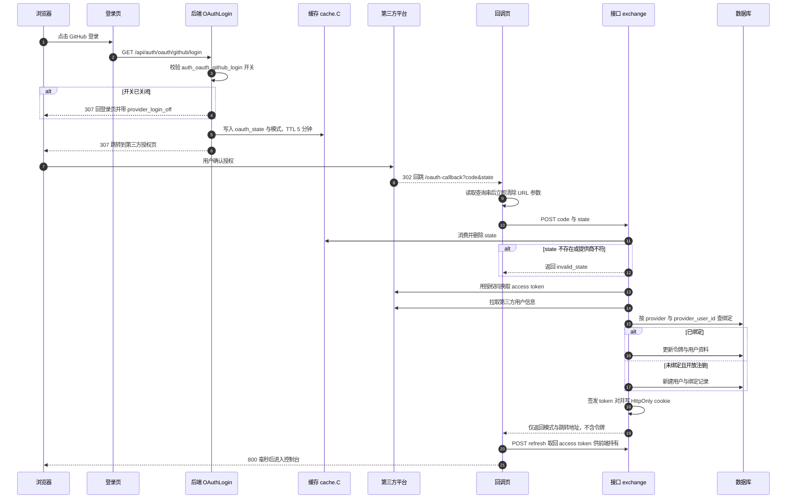
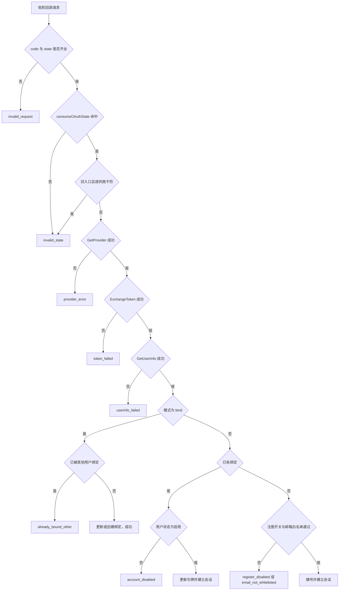
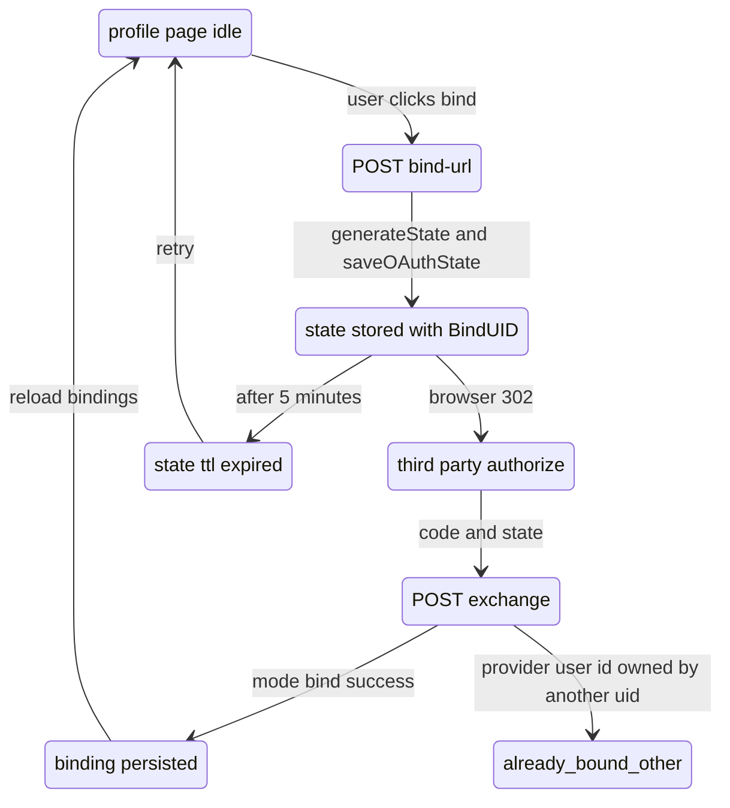
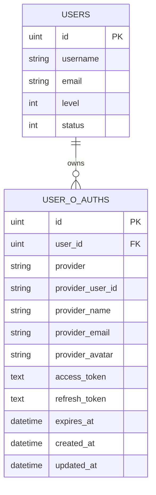
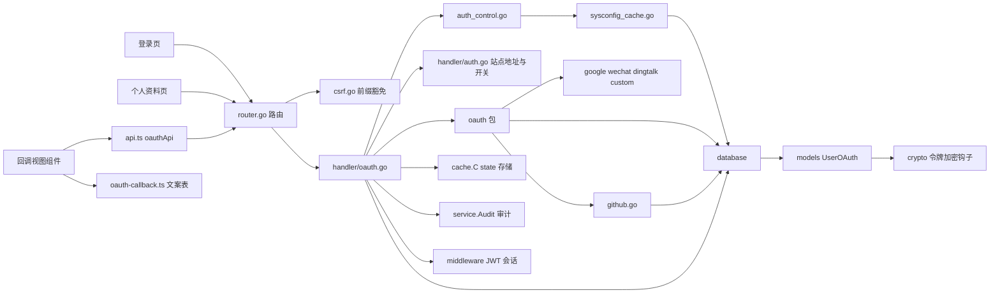

# OAuth 集成

<cite>
**本文档引用的文件**
- [oauth.go](file://main/internal/oauth/oauth.go)
- [github.go](file://main/internal/oauth/github.go)
- [google.go](file://main/internal/oauth/google.go)
- [wechat.go](file://main/internal/oauth/wechat.go)
- [dingtalk.go](file://main/internal/oauth/dingtalk.go)
- [custom.go](file://main/internal/oauth/custom.go)
- [handler/oauth.go](file://main/internal/api/handler/oauth.go)
- [handler/auth.go](file://main/internal/api/handler/auth.go)
- [handler/auth_control.go](file://main/internal/api/handler/auth_control.go)
- [handler/sysconfig_cache.go](file://main/internal/api/handler/sysconfig_cache.go)
- [middleware/csrf.go](file://main/internal/api/middleware/csrf.go)
- [router.go](file://main/internal/api/router.go)
- [models.go](file://main/internal/models/models.go)
- [hooks.go](file://main/internal/models/hooks.go)
- [crypto/migrate.go](file://main/internal/crypto/migrate.go)
- [oauth_exchange_test.go](file://main/internal/api/handler/oauth_exchange_test.go)
- [oauth_switch_test.go](file://main/internal/api/handler/oauth_switch_test.go)
- [oauth_route_test.go](file://main/internal/api/oauth_route_test.go)
- [testhelpers_test.go](file://main/internal/api/handler/testhelpers_test.go)
- [api.ts](file://web/lib/api.ts)
- [oauth-callback.ts](file://web/lib/oauth-callback.ts)
- [oauth-callback-view.tsx](file://web/components/oauth-callback-view.tsx)
- [oauth-callback/page.tsx](file://web/app/(auth)/oauth-callback/page.tsx)
- [github-callback/page.tsx](file://web/app/(auth)/github-callback/page.tsx)
- [login/page.tsx](file://web/app/(auth)/login/page.tsx)
- [profile/page.tsx](file://web/app/(dashboard)/dashboard/profile/page.tsx)
- [settings/page.tsx](file://web/app/(dashboard)/dashboard/settings/page.tsx)
- [auth-control-settings.tsx](file://web/app/(dashboard)/dashboard/settings/auth-control-settings.tsx)
</cite>

## 目录
1. [简介](#简介)
2. [项目结构](#项目结构)
3. [核心组件](#核心组件)
4. [架构总览](#架构总览)
5. [详细组件分析](#详细组件分析)
6. [依赖关系分析](#依赖关系分析)
7. [性能考虑](#性能考虑)
8. [故障排查指南](#故障排查指南)
9. [结论](#结论)
10. [附录](#附录)

## 简介

dnsplane 的 OAuth 模块为控制台提供第三方账号登录（GitHub、Google、微信、钉钉、自定义 OAuth2 端点）与已登录用户的第三方账号绑定/解绑能力。整体走标准 **OAuth2 授权码模式（Authorization Code Flow）**，但落地方式做了两处与安全边界强相关的取舍。

已验证的设计要点：

- **令牌绝不进入 URL**。第三方统一回跳到前端页面 `/oauth-callback`，页面读出 `code` 与 `state` 后调用 `POST /api/auth/oauth/exchange`，由后端换取会话并只下发 HttpOnly cookie；响应体不含任何令牌明文。理由与代码位置见 [handler/oauth.go](file://main/internal/api/handler/oauth.go#L159-L168) 与 [handler/oauth.go](file://main/internal/api/handler/oauth.go#L209-L215)
- **`state` 是一次性凭据**。存于统一缓存层 `cache.C`（Redis 或内存降级），TTL 5 分钟，读取即删除，见 [handler/oauth.go](file://main/internal/api/handler/oauth.go#L24-L62)
- **Provider 抽象收敛差异**。五家提供商的授权地址拼法、token 交换协议、用户信息字段差异全部封装在 `oauth.Provider` 接口之后，业务层只消费标准化的 `UserInfo`，见 [oauth.go](file://main/internal/oauth/oauth.go#L52-L59)
- **双回调入口长期共存**。新链路走前端页 + `exchange` 接口，旧链路 `GET /api/auth/oauth/:provider/callback` 仍保留，供第三方后台仍配置旧回调地址的实例使用，见 [handler/oauth.go](file://main/internal/api/handler/oauth.go#L184-L207)

适用范围：本文覆盖 OAuth 登录、注册、绑定、解绑四条链路。口令登录、 magic-link、TOTP、权限判定不在本文展开，见同目录《安全机制》。

**章节来源**
- [handler/oauth.go](file://main/internal/api/handler/oauth.go#L24-L62)
- [handler/oauth.go](file://main/internal/api/handler/oauth.go#L159-L215)
- [oauth.go](file://main/internal/oauth/oauth.go#L52-L59)

## 项目结构

OAuth 能力分布在「协议适配层」「业务处理层」「前端交互层」三处，目录边界清晰：

```text
main/internal/oauth/            协议适配层（无 HTTP 依赖，可独立测试）
├── oauth.go                    Provider 接口 + 注册表 + SysConfig 加载 + HTTP 工具
├── github.go                   GitHub（含旧 github_* 配置兼容）
├── google.go                   Google
├── wechat.go                   微信开放平台（扫码登录）
├── dingtalk.go                 钉钉新版 OAuth2
└── custom.go                   通用 OAuth2 / OIDC 端点

main/internal/api/handler/oauth.go   业务处理层（state / 交换 / 登录 / 绑定 / 解绑）
main/internal/api/router.go          路由注册
main/web/components/oauth-callback-view.tsx  前端回调页主体
main/web/app/(auth)/oauth-callback/page.tsx  统一回调路由
main/web/app/(auth)/github-callback/page.tsx 旧书签兼容路由
main/web/lib/oauth-callback.ts       错误码到中文文案的映射表
```

代码规模实测（`wc -l`，工作区当前状态）：

| 文件 | 行数 | 职责 | 关键导出/入口 |
| --- | --- | --- | --- |
| [oauth.go](file://main/internal/oauth/oauth.go) | 201 | 接口定义、提供商注册表、配置加载、HTTP 与解析工具 | `Provider`:52、`GetProvider`:79、`GetEnabledProviders`:137 |
| [dingtalk.go](file://main/internal/oauth/dingtalk.go) | 106 | 钉钉 JSON body 交换与 userinfo 头注入 | `NewDingTalk`:16 |
| [custom.go](file://main/internal/oauth/custom.go) | 95 | 通用 OAuth2/OIDC，字段多路回落 | `NewCustom`:12 |
| [github.go](file://main/internal/oauth/github.go) | 89 | GitHub Web Flow 与旧配置兼容 | `NewGitHub`:14、`LoadGitHubConfig`:61 |
| [wechat.go](file://main/internal/oauth/wechat.go) | 88 | 微信 GET token 与 openid 语义 | `NewWeChat`:12 |
| [google.go](file://main/internal/oauth/google.go) | 54 | Google 标准授权码模式 | `NewGoogle`:12 |
| [handler/oauth.go](file://main/internal/api/handler/oauth.go) | 565 | state 生命周期、9 个 handler、绑定与用户创建 | `OAuthLogin`:71、`OAuthExchange`:216、`UnbindOAuth`:468 |

前端侧由四个文件承载交互：[oauth-callback-view.tsx](file://web/components/oauth-callback-view.tsx)（270 行，回调页三阶段状态机与 `exchange` 调用）、[api.ts](file://web/lib/api.ts)（`oauthApi` 封装位于 #L832-L854）、[oauth-callback.ts](file://web/lib/oauth-callback.ts)（23 行，16 条错误码中文文案表），以及 `profile/page.tsx` 的绑定/解绑 UI 与 `?bind=success` 回执处理、`settings/page.tsx` 的提供商凭据录入与 OAuth App / GitHub App 模式切换。

**章节来源**
- [oauth.go](file://main/internal/oauth/oauth.go#L52-L152)
- [handler/oauth.go](file://main/internal/api/handler/oauth.go#L64-L565)
- [oauth-callback-view.tsx](file://web/components/oauth-callback-view.tsx#L58-L271)

## 核心组件

### Provider 接口与注册表

`oauth.Provider` 是整个模块唯一的扩展点，六个方法把「拼授权 URL」与「换 token、拉用户」两件事标准化：

| 方法 | 签名要点 | 调用位置 | 失败后果 |
| --- | --- | --- | --- |
| `Name()` | 返回提供商标识字符串 | `GetEnabledProviders` [oauth.go](file://main/internal/oauth/oauth.go#L144-L149) | 决定 `user_o_auths.provider` 取值 |
| `DisplayName()` | 前端按钮文案 | 同上 | 仅影响展示 |
| `Icon()` | 图标名 | 同上 | 仅影响展示 |
| `AuthorizeURL(state, redirectURI)` | 纯字符串拼接，无网络调用 | `OAuthLogin`:102、`GetOAuthBindURL`:462 | 拼错即整条链路失败 |
| `ExchangeToken(ctx, code, redirectURI)` | 授权码换 `TokenResult` | `handleOAuthCallback`:133 | 返回 `token_failed` |
| `GetUserInfo(ctx, token)` | 换 `UserInfo` | `handleOAuthCallback`:139 | 返回 `userinfo_failed` |

工厂注册表 `providerFactories` 是一张 `map[string]func(ProviderConfig) Provider`，键固定为 `github` / `google` / `wechat` / `dingtalk` / `custom` 五项，见 [oauth.go](file://main/internal/oauth/oauth.go#L70-L76)。`GetProvider(name)` 先查表、再加载配置、最后校验凭据非空，三步任一失败即返回 error：

- 未知提供商 → `unknown oauth provider: <name>`，[oauth.go](file://main/internal/oauth/oauth.go#L80-L83)
- `ClientID`、`AppID`、`AppKey` 全为空 → `oauth provider <name> not configured`，[oauth.go](file://main/internal/oauth/oauth.go#L93-L95)
- `github` 走 `LoadGitHubConfig()` 特判以兼容旧键，[oauth.go](file://main/internal/oauth/oauth.go#L85-L91)

**章节来源**
- [oauth.go](file://main/internal/oauth/oauth.go#L52-L98)
- [github.go](file://main/internal/oauth/github.go#L60-L89)
- [handler/oauth.go](file://main/internal/api/handler/oauth.go#L101-L105)

### 标准化数据结构

协议差异在适配层内消化，业务层只见四个结构体：

| 结构 | 位置 | 字段要点 |
| --- | --- | --- |
| `UserInfo` | [oauth.go](file://main/internal/oauth/oauth.go#L16-L22) | `ID` / `Name` / `Email` / `Avatar`；`ID` 统一为 string |
| `TokenResult` | [oauth.go](file://main/internal/oauth/oauth.go#L24-L33) | 标准 OAuth2 五字段 + 微信专用 `OpenID` |
| `ProviderConfig` | [oauth.go](file://main/internal/oauth/oauth.go#L35-L49) | 覆盖 client/secret、OIDC 三 URL、scopes、app 系列字段 |
| `ProviderInfo` | [oauth.go](file://main/internal/oauth/oauth.go#L61-L67) | 供前端的公开信息，**不含任何密钥** |

`UserInfo.ID` 的类型统一值得注意：GitHub 返回的是数字 `int64`，适配层显式 `fmt.Sprintf("%d", u.ID)` 转成字符串，见 [github.go](file://main/internal/oauth/github.go#L52-L57)；微信与钉钉返回 `openid` / `openId`，见 [wechat.go](file://main/internal/oauth/wechat.go#L84-L87) 与 [dingtalk.go](file://main/internal/oauth/dingtalk.go#L102-L105)。这个字段最终落库为 `provider_user_id`，是登录时反查绑定的唯一依据。

配置加载入口 `LoadProviderConfig(name)` 用 `key LIKE 'oauth_<name>_%'` 一条 SQL 拉全部键，再按前缀裁剪出字段名：

```go
prefix := "oauth_" + name + "_"
database.DB.Where("`key` LIKE ?", prefix+"%").Find(&configs)
```

见 [oauth.go](file://main/internal/oauth/oauth.go#L100-L124)。字段名映射关系为 `client_id` / `client_secret` / `authorize_url` / `token_url` / `userinfo_url` / `scopes` / `name` / `app_id` / `app_key` / `app_secret`。

**章节来源**
- [oauth.go](file://main/internal/oauth/oauth.go#L16-L49)
- [oauth.go](file://main/internal/oauth/oauth.go#L100-L124)
- [github.go](file://main/internal/oauth/github.go#L38-L58)

### 会话与绑定组件

业务层组件按职责划分为四组，全部集中在 `handler/oauth.go`：

| 组件 | 位置 | 单一职责 |
| --- | --- | --- |
| `oauthStateEntry` + `generateState` / `saveOAuthState` / `consumeOAuthState` | #L31-L62 | CSRF 防护凭据的生命周期 |
| `applyOAuthLogin` | #L278-L343 | 查绑定 → 命中即登录；未命中则按开关建号 |
| `applyOAuthBind` | #L345-L367 | 已登录用户绑定第三方账号，冲突即拒绝 |
| `establishSession` | #L389-L420 | 签发 token 对、写 HttpOnly cookie、记审计 |

`oauthStateEntry` 只带三个字段，但 `Mode` + `BindUID` 的组合让同一条回调链路同时服务「登录」与「绑定」两种意图：

```go
type oauthStateEntry struct {
    Provider string `json:"provider"`
    BindUID  uint   `json:"bind_uid"` // >0 表示这是绑定操作（已登录用户绑定第三方账号）
    Mode     string `json:"mode"`     // "login" 或 "bind"
}
```

模式判定只有一处：`handleOAuthCallback` 的 `entry.Mode == "bind" && entry.BindUID > 0` 分支，见 [handler/oauth.go](file://main/internal/api/handler/oauth.go#L145-L149)。由于 `state` 条目由后端签发、前端不参与拼装，攻击者无法通过篡改查询串把「登录」变成「绑定他人账号」。

**章节来源**
- [handler/oauth.go](file://main/internal/api/handler/oauth.go#L31-L62)
- [handler/oauth.go](file://main/internal/api/handler/oauth.go#L145-L149)
- [handler/oauth.go](file://main/internal/api/handler/oauth.go#L278-L420)

## 架构总览

登录链路端到端时序（新链路）：



**图表来源**
- [handler/oauth.go](file://main/internal/api/handler/oauth.go#L71-L157)
- [handler/oauth.go](file://main/internal/api/handler/oauth.go#L216-L245)
- [oauth-callback-view.tsx](file://web/components/oauth-callback-view.tsx#L66-L137)
- [api.ts](file://web/lib/api.ts#L838-L853)

回调分支决策（两条入口共用同一段核心逻辑）：



**图表来源**
- [handler/oauth.go](file://main/internal/api/handler/oauth.go#L116-L157)
- [handler/oauth.go](file://main/internal/api/handler/oauth.go#L278-L367)

两条入口的差异集中在「谁拿到 code」与「失败如何告知用户」：

| 维度 | 新链路（前端回调页） | 旧链路（后端回调） |
| --- | --- | --- |
| 第三方配置的回调地址 | `getSiteURL() + "/oauth-callback"` | 同一地址；若仍是旧值则走后端 |
| 后端入口 | `POST /api/auth/oauth/exchange` | `GET /api/auth/oauth/:provider/callback` |
| handler | `OAuthExchange`:216 | `OAuthCallback`:185 |
| 提供商来源 | 由 `state` 条目决定，不校验路径 | 取路径参数并强制比对，见 #L123-L125 |
| 失败呈现 | JSON 错误码，前端查表转中文 | 307 重定向带 `?error=` 查询串 |
| 成功落点 | 返回 `redirect` 字段，页面延时跳转 | 直接 302 到 `/dashboard/` 或 `/dashboard/profile?bind=success` |
| 令牌暴露面 | 无（仅 HttpOnly cookie） | 无（历史上曾拼进 302 fragment，现已移除） |

**章节来源**
- [handler/oauth.go](file://main/internal/api/handler/oauth.go#L116-L245)
- [handler/auth.go](file://main/internal/api/handler/auth.go#L805-L816)

## 详细组件分析

### GitHub OAuth App 与 GitHub App 模式

GitHub 是唯一有「双配置格式」历史包袱的提供商，因此获得 `GetProvider` 的特判。`LoadGitHubConfig()` 的取舍顺序如下：

1. 先按新格式 `oauth_github_*` 读取，`ClientID` 或 `AppID` 任一非空即采用，见 [github.go](file://main/internal/oauth/github.go#L61-L66)
2. 否则回退旧格式，用一条 `key IN (...)` 拉取 5 个键：`github_mode`、`github_client_id`、`github_client_secret`、`github_app_id`、`github_app_private_key`，见 [github.go](file://main/internal/oauth/github.go#L68-L78)

关键结论（源码注释已明确）：**无论 OAuth App 还是 GitHub App 模式，登录都走同一套 OAuth Web Flow**，都只需要 Client ID + Client Secret；App 模式额外保存的 `github_app_id` 供 API 使用、不参与登录，见 [github.go](file://main/internal/oauth/github.go#L80-L88)。前端设置页据此把 `github_mode` 只当作展示与字段显隐开关，见 [settings/page.tsx](file://web/app/(dashboard)/dashboard/settings/page.tsx#L876-L890)。

授权 URL 与 token 交换的实现有两条容易被忽略的细节：

```go
// 授权：scope 固定 user:email，无 response_type
"https://github.com/login/oauth/authorize?client_id=%s&redirect_uri=%s&scope=user:email&state=%s"

// 交换：只带 client_id / client_secret / code，不带 redirect_uri 与 grant_type
```

见 [github.go](file://main/internal/oauth/github.go#L20-L36)。这与 Google、custom 形成对比——后两者在 token 交换时**必须**回传 `redirect_uri`（[google.go](file://main/internal/oauth/google.go#L24-L37)、[custom.go](file://main/internal/oauth/custom.go#L36-L52)），因此「换 token 期间修改 `site_url`」对 GitHub 无影响、对 Google/custom 直接致命。

用户信息取自 `https://api.github.com/user`，以 `ID == 0` 作为解析失败的判据（而非错误码），见 [github.go](file://main/internal/oauth/github.go#L38-L58)。

**章节来源**
- [github.go](file://main/internal/oauth/github.go#L12-L89)
- [oauth.go](file://main/internal/oauth/oauth.go#L85-L91)
- [settings/page.tsx](file://web/app/(dashboard)/dashboard/settings/page.tsx#L876-L953)

### 授权码换 token：五家协议差异

`Provider` 接口方法一致，但底层协议完全不同构。下表为实测差异：

| 提供商 | 授权端点 | token 交换方式 | `redirect_uri` 是否参与交换 | 用户信息主键字段 | 特殊点 |
| --- | --- | --- | --- | --- | --- |
| GitHub | `github.com/login/oauth/authorize` | POST 表单，`Accept: application/json` | 否 | `id`（int64） | scope 固定 `user:email` |
| Google | `accounts.google.com/o/oauth2/v2/auth` | POST 表单 | 是 | `id`（string） | `access_type=offline` 才有 refresh token |
| 微信 | `open.weixin.qq.com/connect/qrconnect` | **GET**，参数拼在查询串 | 否 | `openid` | 凭据名是 `appid`/`secret`；URL 末尾需 `#wechat_redirect` |
| 钉钉 | `login.dingtalk.com/oauth2/auth` | POST **JSON body** | 否 | `openId` | 令牌走自定义头 `x-acs-dingtalk-access-token` |
| custom | 由 `oauth_custom_authorize_url` 决定 | POST 表单 | 是 | `sub` → 回落 `id` | 缺 `token_url`/`userinfo_url` 直接报错 |

两处易错实现细节：

- 微信与钉钉都用「字段回落」兼容新旧键：微信 `appID()` 优先 `AppID`、否则 `ClientID`；钉钉 `appKey()` 优先 `AppKey`、否则 `ClientID`，见 [wechat.go](file://main/internal/oauth/wechat.go#L18-L30) 与 [dingtalk.go](file://main/internal/oauth/dingtalk.go#L22-L34)。因此只填 `client_id` 也能工作，但与 `GetProvider` 的非空校验组合起来才成立
- 微信的 token 响应**不用** `parseTokenResponse`，因为它需要额外解析 `openid` 与 `errcode`/`errmsg`，见 [wechat.go](file://main/internal/oauth/wechat.go#L38-L66)。钉钉同理，自行解析 `accessToken` / `expireIn` 驼峰字段，见 [dingtalk.go](file://main/internal/oauth/dingtalk.go#L42-L79)。共用工具 `parseTokenResponse` 仅服务于 GitHub / Google / custom，并把「空 access_token」显式当成错误，见 [oauth.go](file://main/internal/oauth/oauth.go#L192-L201)

custom 提供商的字段回落最完整，值得单独说明：`ID` 依次尝试 `sub` → `id`，都为空则报错并把原始 body 打进错误信息；`Name` 依次 `name` → `login`；`Avatar` 依次 `picture` → `avatar_url`。见 [custom.go](file://main/internal/oauth/custom.go#L54-L95)。

**章节来源**
- [oauth.go](file://main/internal/oauth/oauth.go#L154-L201)
- [github.go](file://main/internal/oauth/github.go#L20-L36)
- [google.go](file://main/internal/oauth/google.go#L24-L37)
- [wechat.go](file://main/internal/oauth/wechat.go#L18-L66)
- [dingtalk.go](file://main/internal/oauth/dingtalk.go#L22-L79)
- [custom.go](file://main/internal/oauth/custom.go#L36-L95)

### 用户绑定：bind 模式与状态持久化

绑定链路从已登录用户的个人资料页发起。后端只负责签发授权 URL，不做跳转：



**图表来源**
- [handler/oauth.go](file://main/internal/api/handler/oauth.go#L431-L465)
- [handler/oauth.go](file://main/internal/api/handler/oauth.go#L345-L367)
- [profile/page.tsx](file://web/app/(dashboard)/dashboard/profile/page.tsx#L187-L207)

三步关键实现：

1. `GetOAuthBindURL` 从会话取 `userID`（`middleware.AuthUserID(c)`），写入 `state` 条目的 `BindUID`，返回 `{"url": authURL}`，见 [handler/oauth.go](file://main/internal/api/handler/oauth.go#L431-L465)。用户身份只存在于服务端缓存条目里，客户端无法指定
2. 前端对返回的 URL 做**协议白名单**校验，仅允许 `https://` 绝对地址，拒绝 `javascript:` / `data:` 之类注入，见 [profile/page.tsx](file://web/app/(dashboard)/dashboard/profile/page.tsx#L188-L207)
3. `applyOAuthBind` 的冲突判定：同一 `(provider, provider_user_id)` 已被别的 `user_id` 占用 → `already_bound_other`；已属于当前用户 → 就地更新资料与令牌；全新 → `createOAuthBinding`，见 [handler/oauth.go](file://main/internal/api/handler/oauth.go#L345-L367)

绑定记录的状态字段落地在 `models.UserOAuth`，唯一索引 `idx_user_oauth_provider` 建在 `(user_id, provider)` 上，即**一个用户同一提供商只能有一条绑定**；`provider_user_id` 仅普通索引，见 [models.go](file://main/internal/models/models.go#L34-L47)。



**图表来源**
- [models.go](file://main/internal/models/models.go#L34-L47)
- [handler/oauth.go](file://main/internal/api/handler/oauth.go#L369-L387)

`createOAuthBinding` 会把 `tokenResult.ExpiresIn` 换算成 `ExpiresAt` 绝对时间，仅当 `ExpiresIn > 0` 时才写入，见 [handler/oauth.go](file://main/internal/api/handler/oauth.go#L382-L385)。GitHub 的响应不含 `expires_in`，因此 `expires_at` 保持 `NULL`——这是正常状态而非缺陷。

**章节来源**
- [handler/oauth.go](file://main/internal/api/handler/oauth.go#L345-L387)
- [handler/oauth.go](file://main/internal/api/handler/oauth.go#L431-L465)
- [models.go](file://main/internal/models/models.go#L34-L47)
- [profile/page.tsx](file://web/app/(dashboard)/dashboard/profile/page.tsx#L188-L207)

### 解绑

用户自助解绑的语义是「按 `(user_id, provider)` 删除绑定行」，条件删除 + `RowsAffected` 判空，不存在的绑定不会被误报成功：

实现为条件删除后判 `RowsAffected`：`Where("user_id = ? AND provider = ?", userID, req.Provider).Delete(&models.UserOAuth{})`，命中 0 行即返回「未找到绑定记录」，见 [handler/oauth.go](file://main/internal/api/handler/oauth.go#L482-L486)。删除成功后写审计 `oauth_unbind`，见 [handler/oauth.go](file://main/internal/api/handler/oauth.go#L489-L490)。

管理员侧存在 `AdminGetUserOAuthBindings`（#L494-L513）与 `AdminUnbindOAuth`（#L516-L534）两个 handler，内部都有 `checkAdmin` 兜底。**但在 `router.go` 中未检索到这两个函数的注册点**，因此当前不可达；实际解绑只能走用户自助接口，或由管理员在数据库层面处置。该结论为「基于 `rg` 全量检索 router.go 与 handler 目录的已验证结果」，若后续版本新增路由需同步更新本节。

解绑后的行为需要明确预期：`AccessToken` / `RefreshToken` 随记录一起删除，但**第三方平台的授权撤销不会自动发生**。要彻底收回权限，用户需在第三方「已授权应用」列表中手动撤销。

**章节来源**
- [handler/oauth.go](file://main/internal/api/handler/oauth.go#L468-L534)
- [router.go](file://main/internal/api/router.go#L287-L289)

### 与主账号合并

结论先行：**当前实现不做基于邮箱的自动账号合并**。判定依据是 `applyOAuthLogin` 的身份解析只有单一维度——按 `(provider, provider_user_id)` 查绑定，命中即登录，未命中即走建号分支，全程没有用 `userInfo.Email` 去 `users` 表匹配已有账号，见 [handler/oauth.go](file://main/internal/api/handler/oauth.go#L279-L343)。

由此推出三条实际影响：

| 场景 | 现有行为 | 依据 |
| --- | --- | --- |
| 已用邮箱注册过账号，再用同邮箱的 GitHub 登录 | 新建一条 `github_<login>` 账号并绑定，两个账号并存 | #L279-L343 无邮箱匹配分支 |
| 用户解绑后再次用第三方登录 | 同上，再次新建账号，历史数据留在旧账号 | #L279-L343、#L468-L491 |
| 第三方账号已被他人绑定，本人再登录 | 返回 `already_bound_other`（bind 模式）；login 模式则落到新建分支 | #L349-L352 |

新建账号的可控性来自四道闸门，顺序固定：

1. 全局 `register_enabled` 必须为 `"true"`，#L305-L309
2. 该来源开关 `auth_oauth_<provider>_register` 必须开启（未配置视为开启），#L310-L312
3. 邮箱白名单校验 `registerEmailPassesWhitelist`，#L314-L317
4. 用户名生成 `generateUniqueUsername`，按 `<provider>_<name>` → `<provider>_<id>` → `<provider>_<name>_<id>` 三级候选，全冲突则追加 4 字节随机十六进制后缀，#L537-L565

新建账号 `Password` 为空串、`Level` 为 1，因此**无法用口令登录，只能走该第三方**，见 [handler/oauth.go](file://main/internal/api/handler/oauth.go#L322-L329)。若该绑定随后被解绑且没有其他登录方式，该用户将失去入口——这是「不做邮箱合并」策略的必然代价。

关于微信：`GetUserInfo` 返回的 `UserInfo.Email` 恒为空（微信 userinfo 接口无邮箱字段，见 [wechat.go](file://main/internal/oauth/wechat.go#L68-L88)）。白名单一旦启用，空邮箱在 `registerEmailPassesWhitelist` 直接返回 false（[auth.go](file://main/internal/api/handler/auth.go#L1160-L1166)），于是微信首登用户必然落到 `email_not_whitelisted`。白名单未启用时恒为 true（[auth.go](file://main/internal/api/handler/auth.go#L1161-L1162)），不受影响。

如果部署确实需要「同一邮箱只保留一个账号」，当前唯一可行的合规做法是：关闭对应来源的 `auth_oauth_<provider>_register`，让未绑定用户直接失败，再由管理员建号后在数据库写入绑定行。此路径需要人工介入，属于运维手段而非产品特性。

**章节来源**
- [handler/oauth.go](file://main/internal/api/handler/oauth.go#L279-L343)
- [handler/oauth.go](file://main/internal/api/handler/oauth.go#L537-L565)
- [auth.go](file://main/internal/api/handler/auth.go#L1139-L1172)
- [wechat.go](file://main/internal/oauth/wechat.go#L68-L88)

### 会话建立与前端令牌回补

`establishSession` 只做四件事：签发 token 对、写 cookie、登记 refresh JTI、更新 `last_time` 并写审计，见 [handler/oauth.go](file://main/internal/api/handler/oauth.go#L396-L420)。函数签名刻意不含任何 URL 参数，从源头杜绝「把 token 拼进 302 fragment」。

前端在 `mode === "login"` 时立刻调 `api.refreshSession({ persist: false })` 取回 access token 交给内存持有，原因是 `Auth` 中间件仍要求 `Authorization` 头与 cookie 内会话一致，缺头一律 401，见 [api.ts](file://web/lib/api.ts#L838-L853)。`persist: false` 意在避免写入 localStorage，但需注意 `tryRefreshSession()` 默认 `persist = true` 的路径会在首个 401 后重新落盘，该问题已记录在素材分析中，属于本文口径外的既有风险。

回调页的三阶段状态机（`verifying` → `success` / `error`）有两处工程细节：

- 在发起 `exchange` **之前**用 `window.history.replaceState` 清掉查询串，防止 `code`/`state` 被复制进书签或留在历史，见 [oauth-callback-view.tsx](file://web/components/oauth-callback-view.tsx#L92-L93)
- 不用 `useSearchParams`：静态导出下该 hook 会把子树推给客户端渲染，预渲染 HTML 只剩占位；改为在 effect 内直接读 `window.location`，见 [oauth-callback-view.tsx](file://web/components/oauth-callback-view.tsx#L259-L271)

`github-callback` 路由仅保留为旧书签兼容，内容与统一回调页完全相同，见 [github-callback/page.tsx](file://web/app/(auth)/github-callback/page.tsx#L1-L6)。

**章节来源**
- [handler/oauth.go](file://main/internal/api/handler/oauth.go#L389-L420)
- [api.ts](file://web/lib/api.ts#L832-L854)
- [oauth-callback-view.tsx](file://web/components/oauth-callback-view.tsx#L58-L137)
- [github-callback/page.tsx](file://web/app/(auth)/github-callback/page.tsx#L1-L6)

## 依赖关系分析



**图表来源**
- [router.go](file://main/internal/api/router.go#L83-L88)
- [handler/oauth.go](file://main/internal/api/handler/oauth.go#L1-L22)
- [oauth.go](file://main/internal/oauth/oauth.go#L1-L14)
- [csrf.go](file://main/internal/api/middleware/csrf.go#L27-L33)

依赖清单（按被依赖模块归集）：

| 被依赖模块 | 用途 | 关键位置 | 缺失后果 |
| --- | --- | --- | --- |
| `main/internal/cache` | `state` 存取与一次性消费 | [handler/oauth.go](file://main/internal/api/handler/oauth.go#L44-L62) | `cache.C == nil` 时保存报错、消费恒 false，所有 OAuth 登录失败 |
| `main/internal/database` | 绑定读写、SysConfig 加载 | [oauth.go](file://main/internal/oauth/oauth.go#L104)、[handler/oauth.go](file://main/internal/api/handler/oauth.go#L282) | 登录与注册全部失败 |
| `main/internal/models` | `User` / `UserOAuth` / `SysConfig` | [models.go](file://main/internal/models/models.go#L34-L47) | — |
| `main/internal/api/middleware` | `GenerateTokenPair` / `SetAuthCookies` / `StoreRefreshJTI` | [handler/oauth.go](file://main/internal/api/handler/oauth.go#L399-L412) | 会话无法建立 |
| `main/internal/service`（审计） | `oauth_login` / `oauth_register` / `oauth_unbind` | [handler/oauth.go](file://main/internal/api/handler/oauth.go#L340) | 操作日志缺失 |
| `main/internal/dbcache` | 建号后 `BustUserList` | [handler/oauth.go](file://main/internal/api/handler/oauth.go#L335) | 用户列表缓存陈旧 |
| `main/internal/crypto` | 令牌列透明加解密 | [hooks.go](file://main/internal/models/hooks.go#L64-L69) | 令牌明文落库 |

反向依赖很干净：`oauth` 包只依赖 `database` 与 `models`，不依赖 `gin`，因此提供商实现可在无 HTTP 上下文时单测；`handler/oauth.go` 是唯一把两者粘起来的接缝。`auth_control.go` 与前端 `auth-control-settings.tsx` 通过 `auth_oauth_<provider>_login` / `_register` 键名约定耦合，键名拼法在前端 #L173-L184 与后端 #L83、#L310 各写一遍，属于字符串级耦合而非接口耦合，测试 `TestOAuthRegisterSwitchKeySpelling` 正是为锁定拼法而存在，见 [oauth_switch_test.go](file://main/internal/api/handler/oauth_switch_test.go#L83-L97)。

**章节来源**
- [router.go](file://main/internal/api/router.go#L83-L88)
- [handler/oauth.go](file://main/internal/api/handler/oauth.go#L1-L62)
- [oauth.go](file://main/internal/oauth/oauth.go#L100-L152)
- [oauth_switch_test.go](file://main/internal/api/handler/oauth_switch_test.go#L83-L97)
- [auth-control-settings.tsx](file://web/app/(dashboard)/dashboard/settings/auth-control-settings.tsx#L173-L184)

## 性能考虑

**外呼次数与串行度**。单次 OAuth 登录对第三方至少两次串行 HTTP 调用（token 交换 + 用户信息），无并发化空间——第二次依赖第一次的 access token。数据库侧另有 2～4 次查询：绑定查询、（登录时）用户读取与令牌更新，或（注册时）两次 SysConfig 查询、建号、建绑定。`GetEnabledProviders` 是隐藏热点：它对五个提供商各调一次 `GetProvider`，而每次 `GetProvider` 都会执行一条 `LIKE` 查询，即登录页一次 `GET /api/auth/oauth/providers` 触发约 5 条 SQL，见 [oauth.go](file://main/internal/oauth/oauth.go#L137-L152)。`LIKE 'oauth_x_%'` 在 `sys_configs.key` 上有前缀可利用性，但 GitHub 走 `key IN (...)` 分支，两条路径不同。

**超时与连接复用**。适配层每次调用都新建 `&http.Client{Timeout: 15 * time.Second}`，见 [oauth.go](file://main/internal/oauth/oauth.go#L164) 与 [oauth.go](file://main/internal/oauth/oauth.go#L183)，钉钉更进一步自建 client（[dingtalk.go](file://main/internal/oauth/dingtalk.go#L58)、[dingtalk.go](file://main/internal/oauth/dingtalk.go#L88)）。15 秒上界足以兜住慢速第三方，但每请求新建 client 意味着不复用连接池、每次可能重新握手。第三方长时间不可用时，最坏单次请求占用 30 秒（两次外呼各 15 秒），且 `ctx` 来自 `c.Request.Context()`，客户端断开可提前取消，见 [handler/oauth.go](file://main/internal/api/handler/oauth.go#L132)——这是当前最重要的止损机制。

**缓存层选择**。`state` 必须落在 `cache.C`，其设计动机写在文件头注释：进程内 map 在多实例部署下会丢 state、且可被刷爆内存。这是「正确性优先于性能」的典型取舍，Redis 后端会带来每请求 2 次网络往返（写 + 读删），但换来多实例可用，见 [handler/oauth.go](file://main/internal/api/handler/oauth.go#L24-L29)。

**配置缓存失效面**。`auth_oauth_%` 开关与 `github_client_id` / `github_client_secret` 都在 `InvalidateAllAuthConfigCache` 的失效清单里，其中 OAuth 键是运行时 `Pluck` 出来再批量失效的，见 [sysconfig_cache.go](file://main/internal/api/handler/sysconfig_cache.go#L25-L38)。管理员保存设置后开关即时生效，无需重启。

**索引与写放大**。`user_o_auths` 上 `(user_id, provider)` 唯一索引 + `provider_user_id` 普通索引足以支撑当前两类查询；但每次成功登录都会 UPDATE 一次令牌与资料字段，在 Redis/加密钩子参与下产生 `enc:v1:` 重写。GitHub token 若长期有效，这条写入的必要性有限，属于可优化点。

**章节来源**
- [oauth.go](file://main/internal/oauth/oauth.go#L137-L201)
- [handler/oauth.go](file://main/internal/api/handler/oauth.go#L24-L62)
- [handler/oauth.go](file://main/internal/api/handler/oauth.go#L279-L343)
- [sysconfig_cache.go](file://main/internal/api/handler/sysconfig_cache.go#L25-L38)
- [models.go](file://main/internal/models/models.go#L34-L47)

## 故障排查指南

### state 校验失败（invalid_state）

`invalid_state` 是最高频错误，前端文案为「请求已过期，请重试」，见 [oauth-callback.ts](file://web/lib/oauth-callback.ts#L16)。后端有且只有两处产出该码：

| 触发点 | 条件 | 位置 |
| --- | --- | --- |
| `consumeOAuthState` 未命中 | `state` 不存在、已过期（>5 分钟）、已被消费、或 `cache.C == nil` | [handler/oauth.go](file://main/internal/api/handler/oauth.go#L52-L62)、#L119-L122 |
| 提供商与条目不符 | 仅旧回调路径（`expectProvider` 非空）| [handler/oauth.go](file://main/internal/api/handler/oauth.go#L123-L125) |

排查顺序建议：

1. 确认用户没有「打开授权页后放置超过 5 分钟再确认」，这是最常见的正常失败
2. 确认没有把 `code` 与 `state` 复用第二次——`state` 读一次即删，回归测试 `TestOAuthExchangeStateIsSingleUse` 就是锁这一行为，见 [oauth_exchange_test.go](file://main/internal/api/handler/oauth_exchange_test.go#L140-L166)
3. 多实例部署下检查所有实例是否连同一 Redis 且 key 前缀一致；若回退到内存缓存（Redis Ping 失败即降级），A 实例签发、B 实例消费必然失败
4. 若用户走的是旧回调地址，检查路径上的 `:provider` 是否与发起时一致

**章节来源**
- [handler/oauth.go](file://main/internal/api/handler/oauth.go#L52-L62)
- [handler/oauth.go](file://main/internal/api/handler/oauth.go#L116-L157)
- [oauth_exchange_test.go](file://main/internal/api/handler/oauth_exchange_test.go#L127-L166)

### redirect_uri 不匹配

`redirect_uri` 在 OAuth2 中要求「授权请求」与「令牌交换」两处**逐字一致**，且必须与第三方后台登记的回调地址匹配。本项目两处都调用同一个函数 `oauthCallbackPageURL()`，值恒为 `getSiteURL() + "/oauth-callback"`，见 [handler/oauth.go](file://main/internal/api/handler/oauth.go#L159-L168)。这意味着代码层面不会不一致，风险全部来自 `site_url` 配置：

| 现象 | 根因 | 处置 |
| --- | --- | --- |
| 第三方直接报错页，进不到回调 | 第三方后台登记的回调地址与实际 `site_url` 不同（如登记 `https://a.com/oauth-callback` 而 `site_url` 是 `http://localhost:8080`） | 在第三方应用设置里改为实际地址，或修正 `site_url` |
| 授权页正常、交换期失败（Google / custom） | 用户在授权期间管理员改了 `site_url`，交换时 `redirect_uri` 变了 | 授权期内冻结 `site_url` |
| 未配置 `site_url` 时回跳到 `http://localhost:<port>` | `getSiteURL()` 的兜底逻辑，**刻意不复用恒定端口** | 生产必须显式配置 `site_url` |
| 前端提示与实际回跳地址不同 | 设置页展示的是 `config.site_url \|\| 'https://dns.example.com'` 拼的值，纯展示 | 以 `sys_configs.site_url` 为准 |

`getSiteURL` 兜底实现与注释见 [auth.go](file://main/internal/api/handler/auth.go#L805-L816)；设置页给出的填写指引见 [settings/page.tsx](file://web/app/(dashboard)/dashboard/settings/page.tsx#L920) 与 [settings/page.tsx](file://web/app/(dashboard)/dashboard/settings/page.tsx#L953)。**GitHub / 微信 / 钉钉的交换请求不回传 `redirect_uri`**，因此第二类风险只影响 Google 与 custom。

路由侧还有一条测试专门锁定「授权 URL 必须指向前端回调页」，见 [oauth_route_test.go](file://main/internal/api/oauth_route_test.go#L82-L93)。

**章节来源**
- [handler/oauth.go](file://main/internal/api/handler/oauth.go#L159-L168)
- [handler/auth.go](file://main/internal/api/handler/auth.go#L805-L816)
- [settings/page.tsx](file://web/app/(dashboard)/dashboard/settings/page.tsx#L876-L953)
- [oauth_route_test.go](file://main/internal/api/oauth_route_test.go#L82-L93)

### 常见错误码定位表

| 错误码 | 中文文案 | 后端产出点 | 首要排查项 |
| --- | --- | --- | --- |
| `provider_login_off` | 管理员已关闭该来源的登录 | [handler/oauth.go](file://main/internal/api/handler/oauth.go#L83-L86) | `auth_oauth_<provider>_login` 是否被写成 `0/false/no/off` |
| `invalid_request` | 请求参数无效 | #L190-L193、#L221-L231 | 第三方是否带回了 `code`；请求体 JSON 是否合法 |
| `provider_error` | 第三方登录配置错误 | #L127-L130 | 提供商凭据是否在授权期间被清空 |
| `token_failed` | 登录令牌获取失败 | #L133-L137、#L153-L155 | 日志 `[OAuth] <p> token exchange failed`；secret 是否错配 |
| `userinfo_failed` | 获取第三方用户信息失败 | #L139-L143 | 令牌 scope 不足；custom 的 `userinfo_url` 是否返回 `sub` |
| `register_disabled` | 未开放新用户注册 | #L305-L312 | `register_enabled` 与 `auth_oauth_<p>_register` 两道开关 |
| `email_not_whitelisted` | 邮箱不在白名单 | #L314-L317 | 微信等无邮箱来源叠加白名单必然命中 |
| `account_disabled` | 账户已被禁用 | #L288-L290 | `users.status != 1` |
| `user_not_found` | 本地账号不存在 | #L285-L287 | 绑定行残留但用户已被删除 |
| `create_failed` | 创建账户失败 | #L330-L333 | 用户名/邮箱唯一约束冲突 |
| `already_bound_other` | 该第三方账号已被其他用户绑定 | #L349-L352 | 团队共用同一第三方账号 |

日志定位锚点：`[OAuth] %s token exchange failed`、`[OAuth] %s get user info failed`、`[OAuth] create user failed`、`[OAuth] 登录成功: %s (via %s)`、`[OAuth] 新用户注册: %s (via %s: %s)`，全部位于 [handler/oauth.go](file://main/internal/api/handler/oauth.go#L133-L156) 与 [handler/oauth.go](file://main/internal/api/handler/oauth.go#L330-L343)。

**章节来源**
- [handler/oauth.go](file://main/internal/api/handler/oauth.go#L116-L343)
- [handler/oauth.go](file://main/internal/api/handler/oauth.go#L345-L367)
- [oauth-callback.ts](file://web/lib/oauth-callback.ts#L1-L23)

### 结构性缺陷与规避

以下为源码级已验证事实，排障时容易被误判为「配置错误」：

| 现象 | 真实原因 | 证据 | 规避 |
| --- | --- | --- | --- |
| 令牌列时而密文时而明文 | `applyOAuthLogin` / `applyOAuthBind` 用 `Updates(map)` 写令牌，绕过 `BeforeSave` 加密钩子；`Create` 路径才会加密 | [handler/oauth.go](file://main/internal/api/handler/oauth.go#L293-L299)、[hooks.go](file://main/internal/models/hooks.go#L64-L69) | 加密迁移覆盖后避免依赖列内容做一致性判断 |
| 历史明文令牌未被迁移 | `crypto/migrate.go` 声明表名 `user_oauths`，GORM 实际表名为 `user_o_auths`，`HasTable` 判假整表跳过 | [migrate.go](file://main/internal/crypto/migrate.go#L15-L22) | 修正迁移规格表名后重跑 |
| 管理员接口 404 | `AdminUnbindOAuth` 等未在路由注册 | [handler/oauth.go](file://main/internal/api/handler/oauth.go#L494-L534) 与 [router.go](file://main/internal/api/router.go#L287-L289) 检索结果 | 走用户自助解绑 |
| 请求日志含 `code` 与 `state` | 旧回调是 `GET`，查询串被日志中间件截取入库 | [router.go](file://main/internal/api/router.go#L88) | 优先切到新链路（前端页 + POST） |
| `OAuthLogin` 未配置时返回 JSON 而非回跳 | 提供商获取失败分支直接写 JSON，而开关关闭分支写重定向 | [handler/oauth.go](file://main/internal/api/handler/oauth.go#L88-L92) 对比 #L83-L86 | 前端按钮按 `providers` 列表渲染可规避 |

前端侧还有一条常见误判：登录页的按钮显隐只看 `provider.enabled`，而该字段在当前实现中**恒为 true**（只要凭据配置齐全），不能当作「管理员允许该来源登录」使用——这个陷阱在源码注释里被明确写出，见 [oauth.go](file://main/internal/oauth/oauth.go#L126-L152)。管理员关闭某来源后，用户点了按钮仍会到达后端并被拒为 `provider_login_off`。

回归测试清单（`go test ./internal/api/... -run OAuth` 覆盖）：

| 测试 | 断言目标 | 位置 |
| --- | --- | --- |
| `TestOAuthExchangeRouteRegistered` | `POST /api/auth/oauth/exchange` 在路由表内 | [oauth_route_test.go](file://main/internal/api/oauth_route_test.go#L24) |
| `TestOAuthExchangeExemptFromCSRF` | `/api/auth/oauth/` 前缀跳过 CSRF | [oauth_route_test.go](file://main/internal/api/oauth_route_test.go#L40) |
| `TestOAuthCallbackRouteKeepsWorking` | 旧回调路径未被删除 | [oauth_route_test.go](file://main/internal/api/oauth_route_test.go#L60) |
| `TestOAuthExchangeRejectsMissingParams` | 缺 `code`/`state`/全空白 → `invalid_request` | [oauth_exchange_test.go](file://main/internal/api/handler/oauth_exchange_test.go#L101-L126) |
| `TestOAuthExchangeStateIsSingleUse` | 重放 `state` → `invalid_state` | [oauth_exchange_test.go](file://main/internal/api/handler/oauth_exchange_test.go#L140-L166) |
| `TestOAuthExchangeBindRejectsOtherUserAccount` | 跨用户绑定 → `already_bound_other` | [oauth_exchange_test.go](file://main/internal/api/handler/oauth_exchange_test.go#L268) |
| `TestOAuthLoginHonoursProviderSwitch` | 来源开关在跳转前生效 | [oauth_switch_test.go](file://main/internal/api/handler/oauth_switch_test.go#L32) |
| `TestOAuthRegisterSwitchLeavesBoundUsersUnaffected` | 关注册不影响已绑定用户 | [oauth_switch_test.go](file://main/internal/api/handler/oauth_switch_test.go#L108) |

**章节来源**
- [handler/oauth.go](file://main/internal/api/handler/oauth.go#L279-L367)
- [hooks.go](file://main/internal/models/hooks.go#L64-L69)
- [migrate.go](file://main/internal/crypto/migrate.go#L15-L22)
- [oauth_route_test.go](file://main/internal/api/oauth_route_test.go#L24-L93)
- [oauth_exchange_test.go](file://main/internal/api/handler/oauth_exchange_test.go#L101-L296)
- [oauth_switch_test.go](file://main/internal/api/handler/oauth_switch_test.go#L32-L131)

## 结论

模块以 633 行适配层 + 565 行处理层实现了五家提供商与自定义端点的统一接入，核心成就可以归纳为四点：

1. **抽象边界正确**。`oauth.Provider` 是纯粹的协议适配器，`ExchangeToken` / `GetUserInfo` 把五家不同的报文形态收敛为 `TokenResult` / `UserInfo`，业务层完全不感知 `appid` 与 `client_id`、`openid` 与 `sub` 的差异；适配层不依赖 `gin`，可在无 HTTP 上下文下单测
2. **凭据暴露面被系统性压缩**。令牌只经 HttpOnly cookie 下发、响应体不含明文、回调页主动清理查询串、`ProviderInfo` 不含密钥、`UserOAuth` 的令牌字段 `json:"-"`。这五处约束方向一致，构成可验证的纵深
3. **`state` 语义完备**。TTL 5 分钟、一次性消费、条目内携带 provider 与 bind 模式， CSRF 防护与「谁发起绑定」两件事在同一数据结构里解决，且多实例安全
4. **失败可观测**。13 个错误码与前端 16 条文案逐字对应并集中为常量，避免字面量散落导致编译期不可见的错配

需要正视的边界与遗留：不做邮箱合并（解绑再登录会产生新账号）、微信来源与邮箱白名单天然冲突、`Updates(map)` 与迁移表名两处导致令牌加密不完整、两个管理员 handler 未注册。前两条是设计选择，后两条是可修复缺陷，均已在上文给出证据位置与规避手段。

后续可验证的改进方向（按投入产出排序）：修正 `crypto/migrate.go` 表名并把令牌写入改走 `Create`/`Save`；为 `AdminUnbindOAuth` 补路由或删除死代码；把 `GetEnabledProviders` 的 5 次 `LIKE` 查询合并为一次并复用 SysConfig 缓存层。

**章节来源**
- [oauth.go](file://main/internal/oauth/oauth.go#L52-L152)
- [handler/oauth.go](file://main/internal/api/handler/oauth.go#L24-L276)
- [models.go](file://main/internal/models/models.go#L34-L47)

## 附录

### 错误码与文案对应关系

后端常量共 13 项，见 [handler/oauth.go](file://main/internal/api/handler/oauth.go#L257-L276)；前端表共 16 条，见 [oauth-callback.ts](file://web/lib/oauth-callback.ts#L7-L23)。两者逐字对应，前端另有三项不由后端产出：`user_info_failed` 为历史别名、`access_denied` 来自用户在第三方授权页点取消、`login_failed` 是前端兜底文案。后端 13 项的中文文案与产出点已逐条列于[常见错误码定位表](#常见错误码定位表)，此处不再重复。

**章节来源**
- [handler/oauth.go](file://main/internal/api/handler/oauth.go#L257-L276)
- [oauth-callback.ts](file://web/lib/oauth-callback.ts#L1-L23)

### 路由与权限矩阵

| 方法 | 路径 | handler | 认证 | 路由位置 |
| --- | --- | --- | --- | --- |
| GET | `/api/auth/oauth/providers` | `GetOAuthProviders` | 匿名 | [router.go](file://main/internal/api/router.go#L83) |
| GET | `/api/auth/oauth/:provider/login` | `OAuthLogin` | 匿名（CSRF 前缀豁免） | [router.go](file://main/internal/api/router.go#L84) |
| POST | `/api/auth/oauth/exchange` | `OAuthExchange` | 匿名（CSRF 前缀豁免） | [router.go](file://main/internal/api/router.go#L86) |
| GET | `/api/auth/oauth/:provider/callback` | `OAuthCallback` | 匿名（CSRF 前缀豁免） | [router.go](file://main/internal/api/router.go#L88) |
| GET | `/api/user/oauth/bindings` | `GetOAuthBindings` | 会话 | [router.go](file://main/internal/api/router.go#L287) |
| POST | `/api/user/oauth/bind-url` | `GetOAuthBindURL` | 会话 | [router.go](file://main/internal/api/router.go#L288) |
| POST | `/api/user/oauth/unbind` | `UnbindOAuth` | 会话 | [router.go](file://main/internal/api/router.go#L289) |

CSRF 豁免来自前缀匹配 `/api/auth/oauth/`，理由写在注释中：第三方 302 回跳无法携带自定义头，见 [csrf.go](file://main/internal/api/middleware/csrf.go#L27-L33)。

**章节来源**
- [router.go](file://main/internal/api/router.go#L83-L88)
- [router.go](file://main/internal/api/router.go#L287-L289)
- [csrf.go](file://main/internal/api/middleware/csrf.go#L27-L33)

### SysConfig 键清单

配置键按用途分三类（所有密钥值一律以 `{占位}` 表示，实际值不得写入文档或日志）：

| 类别 | 键 | 消费点 |
| --- | --- | --- |
| GitHub 旧格式 | `github_mode` = `oauth` \| `app` | 设置页展示；[github.go](file://main/internal/oauth/github.go#L68-L78) |
| GitHub 旧格式 | `github_client_id` = `{ClientID}` | `LoadGitHubConfig` |
| GitHub 旧格式 | `github_client_secret` = `{ClientSecret}` | `LoadGitHubConfig` |
| GitHub 旧格式 | `github_app_id` = `{AppID}`、`github_app_private_key` = `{PrivateKey}` | 仅 API 用，登录不参与 |
| 统一新格式 | `oauth_<provider>_client_id` / `_client_secret` | `LoadProviderConfig` [oauth.go](file://main/internal/oauth/oauth.go#L100-L124) |
| 统一新格式 | `oauth_google_client_id`、`oauth_wechat_app_id`、`oauth_wechat_app_secret`、`oauth_dingtalk_app_key`、`oauth_dingtalk_app_secret` | 前端表单字段，见 [api.ts](file://web/lib/api.ts#L1467-L1479) |
| custom 专属 | `oauth_custom_name` / `_authorize_url` / `_token_url` / `_userinfo_url` / `_scopes` | [custom.go](file://main/internal/oauth/custom.go#L23-L60) |
| 开关 | `auth_oauth_<provider>_login` / `_register` | [handler/oauth.go](file://main/internal/api/handler/oauth.go#L83)、#L310 |
| 全局 | `register_enabled`、`site_url`、`auth_email_whitelist_enabled`、`auth_email_whitelist` | [handler/oauth.go](file://main/internal/api/handler/oauth.go#L305-L317) |

开关语义须特别记住：**未配置视为开启**。`handlerSwitchOn` 只在值显式为 `0` / `false` / `no` / `off` 时判关，理由是旧实例根本没有这些键，按「未配置=关」会让升级即失效，见 [auth.go](file://main/internal/api/handler/auth.go#L1139-L1148)。

**章节来源**
- [oauth.go](file://main/internal/oauth/oauth.go#L100-L124)
- [github.go](file://main/internal/oauth/github.go#L60-L89)
- [custom.go](file://main/internal/oauth/custom.go#L23-L60)
- [handler/oauth.go](file://main/internal/api/handler/oauth.go#L83-L317)
- [auth.go](file://main/internal/api/handler/auth.go#L1139-L1148)
- [api.ts](file://web/lib/api.ts#L1467-L1479)

### 配置与验证自查清单

上线或排障时逐项核对：

1. `sys_configs.site_url` 已配置为浏览器实际访问的 https 地址，且与第三方后台登记的 `<site_url>/oauth-callback` 完全一致
2. 目标提供商的凭据键至少填满 `client_id`（或 `app_id` / `app_key`）与对应 secret，否则 `GetProvider` 返回 `not configured`
3. `GET /api/auth/oauth/providers` 返回体包含该提供商，且 `enabled` 为 true
4. `auth_oauth_<provider>_login` 未被显式关闭；需要首登建号时 `auth_oauth_<provider>_register` 与 `register_enabled` 同时放开
5. 若启用了邮箱白名单且需要微信首登，先确认能否接受微信无邮箱导致的 `email_not_whitelisted`
6. `cache.C` 已连上共享 Redis（多实例场景），否则 `state` 校验在跨实例时必然失败
7. 跑一遍 `go test ./internal/api/... -run OAuth`，确认 8 个 OAuth 回归用例全绿
8. 前端入口必须是整页 `<a href="/api/auth/oauth/<p>/login">`，不能用客户端路由——该地址返回 307，走 SPA 跳转拿不到结果，见 [login/page.tsx](file://web/app/(auth)/login/page.tsx#L575-L590)

**章节来源**
- [oauth.go](file://main/internal/oauth/oauth.go#L100-L152)
- [github.go](file://main/internal/oauth/github.go#L60-L89)
- [custom.go](file://main/internal/oauth/custom.go#L14-L60)
- [handler/oauth.go](file://main/internal/api/handler/oauth.go#L83-L317)
- [auth.go](file://main/internal/api/handler/auth.go#L1139-L1172)
- [api.ts](file://web/lib/api.ts#L1467-L1479)
- [login/page.tsx](file://web/app/(auth)/login/page.tsx#L568-L590)
- [oauth_route_test.go](file://main/internal/api/oauth_route_test.go#L24-L93)
- [testhelpers_test.go](file://main/internal/api/handler/testhelpers_test.go#L132-L141)
