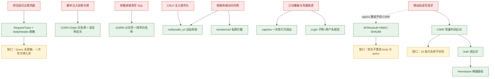
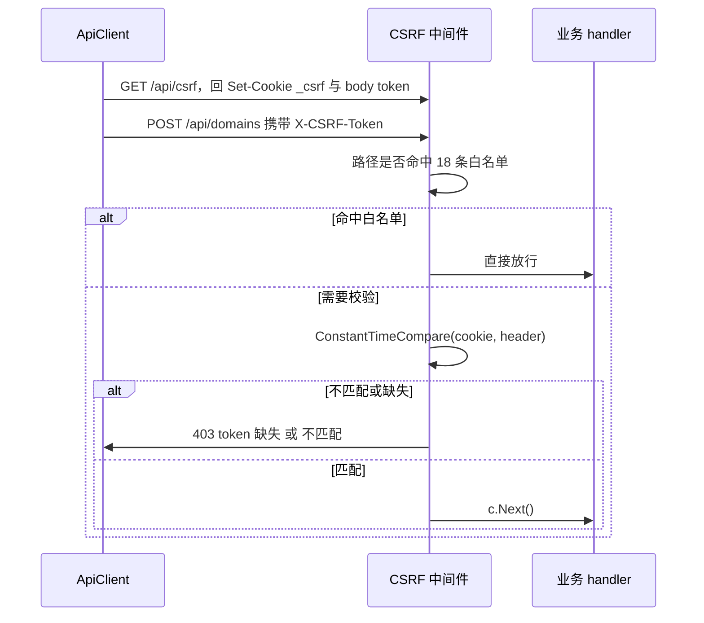
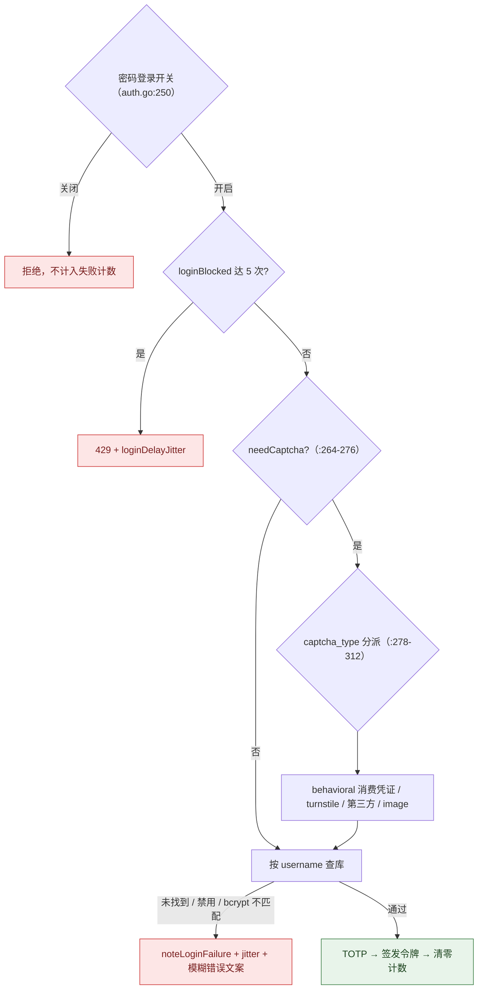
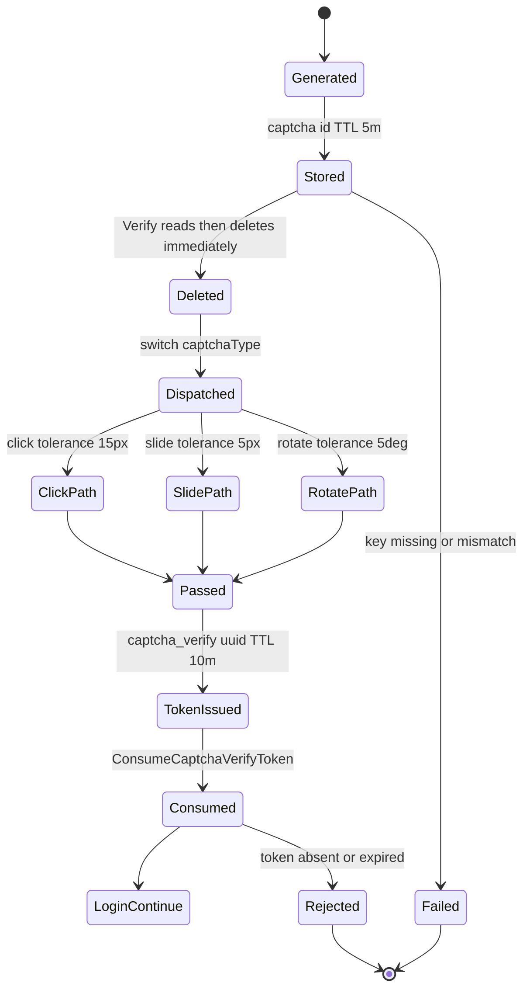
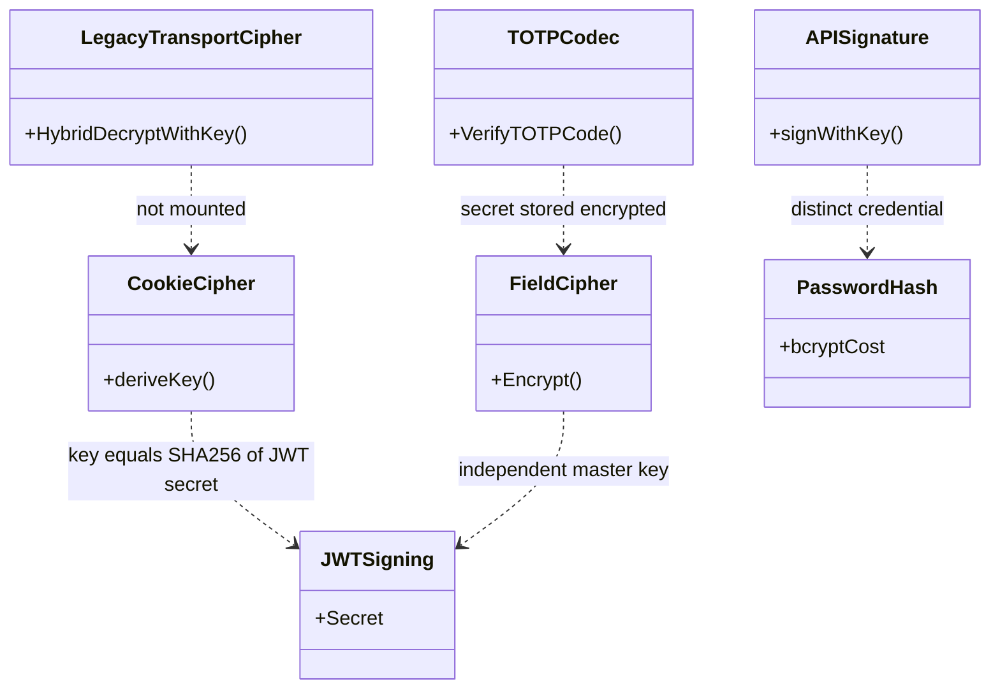
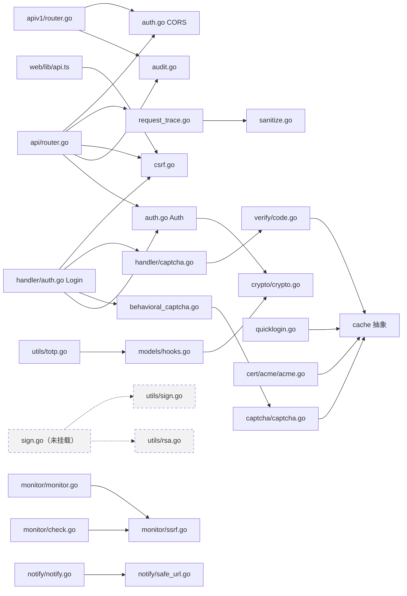

# 安全防护

<cite>
**本文档引用的文件**
- [csrf.go](file://main/internal/api/middleware/csrf.go)
- [sanitize.go](file://main/internal/api/middleware/sanitize.go)
- [sanitize_bench_test.go](file://main/internal/api/middleware/sanitize_bench_test.go)
- [sign.go](file://main/internal/api/middleware/sign.go)
- [audit.go](file://main/internal/api/middleware/audit.go)
- [auth.go (中间件)](file://main/internal/api/middleware/auth.go)
- [request_trace.go](file://main/internal/api/middleware/request_trace.go)
- [apikey.go](file://main/internal/api/middleware/apikey.go)
- [router.go (api)](file://main/internal/api/router.go)
- [router.go (apiv1)](file://main/internal/apiv1/router.go)
- [auth.go (apiv1)](file://main/internal/apiv1/auth.go)
- [auth.go (handler)](file://main/internal/api/handler/auth.go)
- [captcha.go (handler)](file://main/internal/api/handler/captcha.go)
- [behavioral_captcha.go](file://main/internal/api/handler/behavioral_captcha.go)
- [quicklogin.go](file://main/internal/api/handler/quicklogin.go)
- [domain.go](file://main/internal/api/handler/domain.go)
- [optimizeip.go](file://main/internal/api/handler/optimizeip.go)
- [logs.go](file://main/internal/api/handler/logs.go)
- [monitor.go (handler)](file://main/internal/api/handler/monitor.go)
- [schedule.go](file://main/internal/api/handler/schedule.go)
- [captcha.go (captcha)](file://main/internal/captcha/captcha.go)
- [code.go](file://main/internal/verify/code.go)
- [crypto.go](file://main/internal/crypto/crypto.go)
- [migrate.go](file://main/internal/crypto/migrate.go)
- [hooks.go](file://main/internal/models/hooks.go)
- [config.go](file://main/internal/config/config.go)
- [database.go](file://main/internal/database/database.go)
- [ssrf.go (monitor)](file://main/internal/monitor/ssrf.go)
- [check.go](file://main/internal/monitor/check.go)
- [monitor.go (monitor)](file://main/internal/monitor/monitor.go)
- [safe_url.go](file://main/internal/notify/safe_url.go)
- [notify.go](file://main/internal/notify/notify.go)
- [acme.go](file://main/internal/cert/acme/acme.go)
- [cache.go](file://main/internal/cache/cache.go)
- [go_redis.go](file://main/internal/cache/go_redis.go)
- [sign.go (utils)](file://main/internal/utils/sign.go)
- [rsa.go](file://main/internal/utils/rsa.go)
- [totp.go](file://main/internal/utils/totp.go)
- [api.ts](file://web/lib/api.ts)
- [site-key.ts](file://web/lib/site-key.ts)
- [totp/page.tsx](file://web/app/(auth)/magic-login/totp/page.tsx)
- [Chanlog.md](file://docs/Chanlog.md)
</cite>

## 目录

1. [简介](#简介)
2. [项目结构](#项目结构)
3. [核心组件](#核心组件)
4. [架构总览](#架构总览)
5. [详细组件分析](#详细组件分析)
6. [依赖关系分析](#依赖关系分析)
7. [性能考虑](#性能考虑)
8. [故障排查指南](#故障排查指南)
9. [结论](#结论)
10. [附录](#附录)

## 简介

本文覆盖 dnsplane 的横向安全能力——与具体 DNS 业务无关、跨所有请求生效的防护机制。回答三个问题：某类攻击由哪个文件拦、拦不住的原因在哪、密钥从哪来且存在哪里。

| 攻击面 | 主防线 | 实现位置 | 生效范围 | 已知未覆盖 |
|:---|:---|:---|:---|:---|
| CSRF | double-submit cookie + SameSite=Strict | `middleware/csrf.go:70` | `/api` 组写请求 | `/api/v1` 整组、18 条白名单 |
| XSS | CSP + 安全响应头 + React 默认转义 | `middleware/auth.go:483` | 全部响应 | CSP 含 `unsafe-inline`/`unsafe-eval` |
| SQL 注入 | GORM `?` 占位符 + 排序白名单 | `handler/domain.go:89`、`handler/optimizeip.go:177` | 全部查询 | 用户输入不可达表名/列名 |
| SSRF | 协议白名单 + 私网拦截（探测另有 dial 二次校验） | `monitor/ssrf.go:31`、`notify/safe_url.go:15` | 探测 CheckType 2/3、出站通知 | Ping/TCP 探测无拦截；通知链无 dial 回调 |
| 邮件头注入 | 控制字符拒绝 | `notify/safe_url.go:79` | 三套邮件后端 12 处 | — |
| 暴力破解 | 子网 + 用户名双维锁定 + 时序抖动 | `handler/auth.go:87`、`:107`、`:128`、`:41` | `POST /api/login` | 用户名喷洒可绕过 |
| 凭据入日志 | 39 键 + 正则的 body/header 掩码 | `middleware/sanitize.go:17`、`:71` | 请求日志 body 与 header | `Query` 字段完全未脱敏 |

两个必须先纠正的认知偏差：

- `middleware/sanitize.go` 容易被读成「HTML 净化器」，但它的全部职责是**请求日志脱敏**——把命中敏感关键字的值替换为固定掩码 `***REDACTED***`（`sanitize.go:13`）。代码库中不存在 HTML sanitizer，XSS 防御完全依赖响应头与 React 默认转义。
- 设计层面的「请求体加密 + 报文签名 + 响应混淆」链路在当前工作区**没有任何生产调用点**（`sign.go:17` 未挂载、`web/lib/crypto.ts` 零引用），因此不计入防护层，本文单列小节给出证据。

**章节来源**
- [csrf.go:70-115](file://main/internal/api/middleware/csrf.go#L70-L115)
- [sanitize.go:13-57](file://main/internal/api/middleware/sanitize.go#L13-L57)
- [ssrf.go:31-59](file://main/internal/monitor/ssrf.go#L31-L59)
- [safe_url.go:15-84](file://main/internal/notify/safe_url.go#L15-L84)

## 项目结构

安全能力散落在五个包中，没有集中的 `security` 目录。按「谁负责拦」而非「谁负责算」划分归属。

| 文件 | 行数 | 安全职责 | 关键导出与行号 |
|:---|---:|:---|:---|
| `api/middleware/csrf.go` | 130 | CSRF 校验与 token 发放 | `CSRF():70`、`IssueCSRFHandler():119`、`newCSRFToken():55` |
| `api/middleware/sanitize.go` | 169 | 请求日志脱敏 | `SanitizeBodyForLog():101`、`SanitizeHeadersForLog():155`、`redactJSON():135` |
| `api/middleware/sign.go` | 206 | 解密验签（未挂载）+ 响应出口 | `DecryptAndVerify():17`、`BindDecryptedData():104`、`EncryptedResponse():142` |
| `api/middleware/audit.go` | 176 | 写操作审计落库 | `AuditLog():21`、`shouldSkipAudit():128`、`deriveAction():149` |
| `api/middleware/auth.go` | 572 | 安全头、CORS、cookie 加密、JWT | `SecurityHeaders():483`、`CORS():516`、`EncryptForCookie():45`、`ParseToken():423` |
| `api/middleware/request_trace.go` | 372 | 请求/响应落库并调用脱敏 | 脱敏调用点 `:172`、`:228`、`:248` |
| `captcha/captcha.go`、`handler/behavioral_captcha.go` | 391 + 97 | 行为验证码生成与校验 | `Generate():134`、`Verify():265`、`ConsumeCaptchaVerifyToken():88` |
| `verify/code.go` | 130 | 邮箱验证码 + 两级限流 | `Verify():62`、`CheckIPLimit():108`、`AllowPublicEmailRequest():120` |
| `crypto/crypto.go`、`models/hooks.go` | 101 + 70 | 字段级 AES-256-GCM 与列钩子 | `Encrypt():42`、`MustDecrypt():95`、`encFields():9` |
| `monitor/ssrf.go`、`notify/safe_url.go` | 127 + 84 | 出站拦截 + 邮件头净化 | `validateCheckURL():31`、`ssrfDialControl():99`、`ValidateOutboundURL():15`、`SanitizeMailHeader():79` |
| `utils/{sign,rsa}.go` | 266 + 345 | 报文签名原语（未挂载） | `ParseSignedRequestWithKey():89`、`HybridDecryptWithKey():209` |

文件层面两个特征值得注意。**同一职责存在两份实现**：`isPrivateOrReservedIP` 在 `monitor/ssrf.go:62` 与 `notify/safe_url.go:45` 各一份，逻辑几乎逐行相同；`middleware/apikey.go`（112 行）与 `apiv1/auth.go:44` 是同功能重复品，前者零调用点。**限流没有独立文件**：登录锁定写在 `handler/auth.go`、公开发信限流写在 `verify/code.go`、快速登录限流写在 `handler/quicklogin.go`，四处各自拼键名，仅共用 `cache.Incr` 一个原子原语。

**章节来源**
- [csrf.go](file://main/internal/api/middleware/csrf.go)
- [sanitize.go](file://main/internal/api/middleware/sanitize.go)
- [sign.go](file://main/internal/api/middleware/sign.go)
- [audit.go](file://main/internal/api/middleware/audit.go)
- [ssrf.go:62-95](file://main/internal/monitor/ssrf.go#L62-L95)
- [apikey.go](file://main/internal/api/middleware/apikey.go)

## 核心组件

五个中间件加一组散点限流构成实际生效的防护主体。

| 组件 | 挂载点 | 失败响应 | 状态 |
|:---|:---|:---|:---|
| `SecurityHeaders` | `router.go:28`（引擎链首） | 不拦，仅写头 | 生效 |
| `CORS` | `router.go:44`、`apiv1/router.go:27` | 不回显 Origin | 生效 |
| `CSRF` | `router.go:49` | `403 {code:403,msg:"CSRF token 缺失"/"CSRF token 不匹配"}` | 生效 |
| `AuditLog` | `router.go:51`、`apiv1/router.go:31` | 不拦 | 生效 |
| `Auth` | `router.go:96` 等组级 | `401` 七种口径（`middleware/auth.go:130-181`） | 生效 |
| `APIKeyAuth` | `apiv1/router.go:28` | `CodeUnauthorized`/`CodeTimestampInvalid`/`CodeSignMismatch` | 生效 |
| `DecryptAndVerify` / `EncryptedResponse` | 前者无挂载点；后者是所有响应出口 `sign.go:142` | — | 前者为死代码；后者生效但恒走明文分支 |

四层频控的实际阈值与位置是本节核心可核对信息。

| 层次 | 键格式 | 阈值 | 窗口 | 位置 |
|:---|:---|:---|:---|:---|
| 快速登录兑换 | `rl:quicklogin_<ip>` | 30 次 | 1 小时 | `handler/quicklogin.go:126` 调 `checkRateLimit():110` |
| 魔法登录补验 | `vcode:ip:<ip>` | 60 次 | 1 小时 | `verify/code.go:108` |
| 公开发信双维 | `rl:pubmail:<kind>:ip:<ip>` / `:em:<email>` | 12/5、15/5、24/8、30/12 | 1 小时 | `verify/code.go:120` |
| ACME 上游限流 | 无键（对端 429/503） | 12 次尝试 | 退避等待 | `cert/acme/acme.go:39` 常量、`:344` 循环、`:410` 上限 |

三层「放行语义」完全一致：`cache.Incr` 返回错误时一律**放行**，不做保守拒绝。证据点为 `handler/quicklogin.go:113`（`return true`）、`verify/code.go:112`（`return nil`）、`verify/code.go:126-128`（`return true`）。这是可用性优先的既定取舍，代价是 Redis 故障期间限流整体失效。

**章节来源**
- [router.go:24-53](file://main/internal/api/router.go#L24-L53)
- [router.go:24-32](file://main/internal/apiv1/router.go#L24-L32)
- [sign.go](file://main/internal/api/middleware/sign.go)
- [quicklogin.go:109-129](file://main/internal/api/handler/quicklogin.go#L109-L129)
- [code.go:108-130](file://main/internal/verify/code.go#L108-L130)
- [acme.go:38-40](file://main/internal/cert/acme/acme.go#L38-L40)

## 架构总览

把请求生命周期上的攻击面与防护层叠加：左侧是攻击向量，中间是中间件链的实际拦阻点，右侧是穿透后的残留缺口。



**图表来源**
- [router.go:44-52](file://main/internal/api/router.go#L44-L52)
- [router.go:26-32](file://main/internal/apiv1/router.go#L26-L32)
- [csrf.go:30-53](file://main/internal/api/middleware/csrf.go#L30-L53)
- [request_trace.go:172-278](file://main/internal/api/middleware/request_trace.go#L172-L278)

链式结构的三个设计要点：**CSRF 只在控制台链存在**——`apiv1` 挂在引擎根而非 `/api` 分组下（`apiv1/router.go:24`），因此不继承组级 CSRF，理由在 `apiv1/router.go:9-15` 与 `api/router.go:57-62` 两处注释中完全一致：API Key 客户端没有 cookie，继承该链会让所有写请求被拒，而签名本身即身份凭据。**审计必须在认证之后**——`AuditLog` 读 `c.GetString("user_id")`（`audit.go:42`），该值由 `Auth` 或 `APIKeyAuth` 注入，`audit.go:45` 对空 `user_id` 整条不记，未认证请求不会污染审计库。**请求追踪必须最外层**——`RequestTrace` 的落库代码在 `c.Next()` 之后，panic 穿透到链首则该段不执行（`api/router.go:35-42` 注释记录了实测结论），这决定了 `Recovery` 的内层位置。

**章节来源**
- [router.go:31-53](file://main/internal/api/router.go#L31-L53)
- [router.go:9-23](file://main/internal/apiv1/router.go#L9-L23)
- [audit.go:21-47](file://main/internal/api/middleware/audit.go#L21-L47)

## 详细组件分析

### CSRF：双链差异与白名单

double-submit cookie 的核心是「无服务端状态」：token 不存储，仅比对 cookie 与 header 是否同值。

| 要素 | 实现 | 位置 |
|:---|:---|:---|
| cookie / header 名 | `_csrf` / `X-CSRF-Token` | `csrf.go:23-24` |
| token 强度 | 32 字节 `crypto/rand` → 64 位 hex | `csrf.go:55-59` |
| cookie 属性 | 非 HttpOnly、`SameSite=Strict`、`Path=/`、TTL 7 天、`Secure` 随协议 | `csrf.go:62-67` |
| 安全方法处理 | GET/HEAD/OPTIONS 不校验；缺 cookie 时补发 | `csrf.go:84-90` |
| 比对方式 | `subtle.ConstantTimeCompare` | `csrf.go:109` |
| 跳过集合 | 前缀 2 项 + 精确 16 项 = 18 | `csrf.go:30-33`、`:36-53` |
| 发放端点 | `GET /api/csrf` → `{code:0,data:{token}}` | `router.go:68` → `csrf.go:119` |
| 前端取 token | 优先读 cookie，缺失则 bootstrap 并合并并发 | `web/lib/api.ts:41-64`、`:196-200` |

非 HttpOnly 是模式要求而非缺陷：前端必须能读出 cookie 值并回显到 header。代价是 XSS 一旦发生即可直接读取 token，因此该模式的安全性完全依赖「XSS 不可能发生」这一前提。



**图表来源**
- [csrf.go:70-130](file://main/internal/api/middleware/csrf.go#L70-L130)
- [api.ts:41-64](file://web/lib/api.ts#L41-L64)

双链差异是排查「接口在控制台能通、在对外 API 报错」的第一入口：

| 维度 | 控制台链 `/api` | 对外链 `/api/v1` |
|:---|:---|:---|
| 挂载位置 | `api := r.Group("/api")` + `applyAPIMiddleware` | `v1 := engine.Group("/api/v1")`（引擎根） |
| CSRF | 校验（白名单除外） | 完全不经 CSRF |
| 身份凭据 | JWT（cookie `_t` + `Authorization`） | `X-API-UID`/`X-API-Timestamp`/`X-API-Sign` |
| 待签串覆盖 | — | 仅 `uid + ts + METHOD + PATH`（`apiv1/auth.go:93`） |
| 重放防护 | refresh JTI 一次性（`middleware/auth.go:353`） | ±5 分钟窗口（`apiv1/auth.go:37`、`:69`），**无 nonce** |

值得记录的薄弱点：V1 签名不覆盖请求体与查询串，也没有 nonce 去重（对照：已死掉的控制台签名链是覆盖的，`utils/sign.go:196`）。同一条签名在 5 分钟窗口内可被原样重放，也可在保持签名有效的前提下替换请求体参数。

**章节来源**
- [csrf.go:22-67](file://main/internal/api/middleware/csrf.go#L22-L67)
- [router.go:24-32](file://main/internal/apiv1/router.go#L24-L32)
- [auth.go:37-96](file://main/internal/apiv1/auth.go#L37-L96)
- [sign.go:196-203](file://main/internal/utils/sign.go#L196-L203)

### XSS：响应头与前端渲染约束

代码库不含 HTML sanitizer，XSS 防御由响应头与前端约束两层构成。

| 层 | 具体值 | 位置 | 缺口 |
|:---|:---|:---|:---|
| CSP `script-src` / `style-src` | 均含 `'unsafe-inline'`，前者另含 `'unsafe-eval'` + 三家验证码域名 | `middleware/auth.go:492-493` | `unsafe-*` 使白名单机制基本失效 |
| CSP `frame-src` | `'self'` + 三家验证码域名 | `middleware/auth.go:497` | 缺该指令会回落 `default-src 'self'` 拦死 SDK（注释 `:496`） |
| 点击劫持 / MIME 嗅探 | `X-Frame-Options: SAMEORIGIN`、`frame-ancestors 'self'`、`X-Content-Type-Options: nosniff` | `middleware/auth.go:485-486`、`:501` | — |
| HSTS | `max-age=31536000`，仅 HTTPS 时写 | `middleware/auth.go:503-505` | 不含 `includeSubDomains`（避免误伤兄弟域） |
| 前端渲染 | React JSX 默认转义 | 本次 `web/` 全量检索 `dangerouslySetInnerHTML` 零命中 | — |
| 第三方 siteKey | `^[A-Za-z0-9_-]+$`，长度 1-128 | `web/lib/site-key.ts:7-9` | — |
| 重定向目标 | 仅允许 `/` 开头且非 `//` 起始的站内相对路径 | `web/app/(auth)/magic-login/totp/page.tsx:95` | — |

CSP 里 `unsafe-eval` 的存在说明该策略不是按最小权限设计的，而是「加一层但不影响现有前端」的产物。因此不能把 CSP 当作可信边界来评估 CSRF token 与 localStorage 中 access token 的安全性。

**章节来源**
- [auth.go:480-508](file://main/internal/api/middleware/auth.go#L480-L508)
- [site-key.ts:1-10](file://web/lib/site-key.ts#L1-L10)
- [totp/page.tsx:95](file://web/app/(auth)/magic-login/totp/page.tsx#L95)

### SQL 注入：参数化与排序白名单

全仓实际做法可归为四类，均可在当前工作区直接验证。

| 场景 | 写法 | 代表位置 | 可注入性 |
|:---|:---|:---|:---|
| 值比较 | `Where("domains.name LIKE ?", "%"+req.Keyword+"%")` | `handler/domain.go:112`、`handler/logs.go:76`、`handler/monitor.go:118` | 否，关键词进占位符 |
| 集合/多列 | `Where("a.rr LIKE ? OR b.name LIKE ?", like, like)` | `handler/schedule.go:65`、`handler/optimizeip.go:161` | 否 |
| 排序子句 | 白名单 map 取值，未命中回退默认 | `handler/domain.go:89-94` + `:159-165`、`handler/optimizeip.go:177-190` | 否，用户串只作 map key |
| 原生 SQL（列名拼接） | `fmt.Sprintf("SELECT id AS id, %s AS value FROM %s ...")` | `crypto/migrate.go:47-50`、`:65` | 否，表名列名来自硬编码 spec（`migrate.go:14-22`） |

`ORDER BY` 是唯一「必须把字符串直接放进 SQL」的场景，因此实现成映射而非拼接：

```go
// main/internal/api/handler/domain.go:88-94
var domainSortFieldWhitelist = map[string]string{ // 排序字段白名单，防止 SQL 注入
	"name": "domains.name", "record_count": "domains.record_count",
	"expire_time": "domains.expire_time", "created_at": "domains.created_at",
}
// main/internal/api/handler/domain.go:158-165：命中白名单才拼，方向只取 ASC/DESC 二值
orderClause := "domains.id DESC"
if col, ok := domainSortFieldWhitelist[req.SortField]; ok {
	dir := "ASC"
	if strings.ToLower(req.SortOrder) == "desc" { dir = "DESC" }
	orderClause = col + " " + dir
}
```

`optimizeip.go:177-180` 用同构写法（`allowedSort` map + `strings.TrimSpace(req.SortName)` 查键 + `strings.EqualFold(req.SortOrder, "asc")` 定方向）。`crypto/migrate.go` 是唯一拼 SQL 处，其风险取决于 `DefaultMigrateSpecs` 可否被外部影响——该切片是包级常量、无写入点，故表名列名不可控；它的 `NOT LIKE ?` 值仍走占位符（`db.Raw(query, encPrefix+"%")`，`:52`），`UPDATE` 的表达式与 ID 也走占位符（`:65-66`）。`database/database.go:164-236` 的日志清理语句则完全静态，不含外部输入。

**章节来源**
- [domain.go:88-94](file://main/internal/api/handler/domain.go#L88-L94)
- [domain.go:158-166](file://main/internal/api/handler/domain.go#L158-L166)
- [optimizeip.go:177-191](file://main/internal/api/handler/optimizeip.go#L177-L191)
- [migrate.go:14-71](file://main/internal/crypto/migrate.go#L14-L71)
- [logs.go:76-80](file://main/internal/api/handler/logs.go#L76-L80)
- [database.go:164-236](file://main/internal/database/database.go#L164-L236)

### SSRF：两条出站链路的覆盖差异

系统有两类由用户配置驱动的出站请求：容灾探测与通知外发。两者各有一份拦截实现，能力不对等。探测链（`monitor/ssrf.go`）的构成：

| 校验 | 位置 | 规则 |
|:---|:---|:---|
| `validateCheckURL` | `ssrf.go:31-59` | 协议仅 `http`/`https`（`:16-19`）；host 非空；拒 `localhost`/`.localhost`/`.internal`/`.local`（`:49-52`）；IP 字面量走私网判定（`:53-57`） |
| `isPrivateOrReservedIP` | `ssrf.go:62-95` | 回环/未指定/链路本地/组播 + `IsPrivate()` + IPv4 的 `0/8`、`100.64/10`（CGNAT）、`127/8`、`169.254/16`（含云厂商 IMDS）、`224/4`、`240/4` |
| `ssrfDialControl` | `ssrf.go:99-112` | 挂到 `net.Dialer.Control`（`check.go:222`），在 `connect(2)` 前对**解析后** IP 再判一次，专防 DNS rebinding |
| `validateHostIP` | `ssrf.go:115-127` | 用户显式指定的 `HostIP` 不得指向私网（`check.go:216`） |

通知链（`notify/safe_url.go`）：`ValidateOutboundURL`（`:15-43`）做协议白名单、内网名拒绝、IP 字面量私网判定；`isPrivateOrReservedIP`（`:45-77`）是探测链同名函数的第二份拷贝。

关键差异有两点。第一，**探测链有 dial 阶段回调，通知链没有**：通知链只在构造 URL 时校验一次，其后由 `http.Client` 自行解析域名，存在 TOCTOU/重绑定窗口。`ssrf.go:29-30` 注释记录了设计取舍——`validateCheckURL` 本身不做 DNS 解析（「避免慢解析 + TOCTOU 漂移」），把二次拦截放在 dial 阶段，而通知链缺这后半段。第二，**探测链只覆盖 HTTP/HTTPS**：`validateCheckURL` 仅在 `monitor.go:363` 与 `monitor.go:377` 两处被调，Ping 与 TCP 型探测的拨号路径不经过该函数，私网拦截缺失——这是已验证的能力缺口，不是配置问题。

**章节来源**
- [ssrf.go:11-127](file://main/internal/monitor/ssrf.go#L11-L127)
- [safe_url.go:10-77](file://main/internal/notify/safe_url.go#L10-L77)
- [check.go:216-222](file://main/internal/monitor/check.go#L216-L222)
- [monitor.go:363-377](file://main/internal/monitor/monitor.go#L363-L377)

### 邮件头注入与正文转义

邮件头防御与正文转义是两个独立动作。`SanitizeMailHeader`（`notify/safe_url.go:79-84`）以 `strings.ContainsAny(raw, "\r\n\x00")` 判定，命中即返回错误；调用覆盖 Subject / From / FromName / 每个 To 共 12 处：`notify/notify.go:115-128`、`mail_sendcloud.go:53-67`、`mail_aliyun.go:58-72`。

| 环节 | 函数 | 位置 | 处理方式 |
|:---|:---|:---|:---|
| 头字段控制字符拒绝 | `SanitizeMailHeader(field, raw)` | `safe_url.go:79-84` | 含 `\r` `\n` NUL 即拒绝，四字段全走校验 |
| 正文纯文本转 HTML | `emailHTMLContent` / `mailContentAdapter.Send` | `notify/notify.go:78-87` / `:98-100` | 先 `strings.NewReplacer` 转义 `&` `<` `>` 再换 `<br/>`；三后端共用同一契约 |

`emailHTMLContent` 的判定条件是「首个非空字符是否为 `<`」（`notify.go:79`）。若纯文本正文恰好以 `<` 开头会被当成 HTML 原样透传、跳过转义。注释 `notify.go:74-76` 记录了误判方向的取舍：纯文本被当成 HTML 只是换行不生效（可接受），反之无条件替换会破坏模板邮件样式表。替换表中 `&` 在最前（`NewReplacer` 单次扫描不重复替换），因此不会出现 `&amp;lt;` 的双重转义。

**章节来源**
- [safe_url.go:79-84](file://main/internal/notify/safe_url.go#L79-L84)
- [notify.go:74-100](file://main/internal/notify/notify.go#L74-L100)
- [notify.go:113-128](file://main/internal/notify/notify.go#L113-L128)

### 频控：四层限流与一次性凭证

登录链的防护顺序本身就是限流设计的一部分：任何一步失败都不应消耗下一步的配额。



**图表来源**
- [auth.go:239-340](file://main/internal/api/handler/auth.go#L239-L340)
- [auth.go:72-131](file://main/internal/api/handler/auth.go#L72-L131)

登录锁定与抖动的关键参数：

| 项 | 值/签名 | 位置 |
|:---|:---|:---|
| 窗口 / 阈值 | `loginFailWindow = 15 * time.Minute`、`loginFailThreshold = 5` | `handler/auth.go:76-77` |
| IP 分桶 | IPv4 → `/24`，IPv6 → `/64`；键为 `login_fail:<bucket>:<lower(username)>` | `bucketLoginFailIP:87-97`、`loginFailKey:99-101` |
| 原子累加 | `cache.C.Incr(key, loginFailWindow)` | `noteLoginFailure:128-131` |
| 时序抖动 | 50-150ms，`crypto/rand` 取值 | `loginDelayJitter:41-47` |

抖动的目的写在 `handler/auth.go:38-40`：让「用户不存在」「密码错」「账户禁用」「TOTP 错」四条分支耗时趋同，降低通过响应时序推断账号状态与是否启用 TOTP 的可行性。分桶本身是容量修复——原实现以原始 IP 为键，内存缓存模式下海量随机 IP 会无上限撑爆 map（注释 `:83-86`）。原子性是另一处修复：原 `GetJSON` + 自增 + `SetJSON` 三步在并发下存在 lost-update，实际计数远低于阈值使锁定形同虚设（注释 `:124-127`）。

两种缓存后端的 `Incr` 语义**并不相同**，这是排查「阈值与预期不符」时容易忽略的点：Redis 走 `INCR` 后仅当 `n == 1` 时 `EXPIRE`，即**固定窗口**，过期时刻由首次请求决定（`cache/go_redis.go:81-92`，判定 `:88-90`）；内存走 `mu.Lock` 内重写条目，每次 `Incr` 把 `ExpireAt` 推后 `ttl`，即**滑动窗口**（`cache/cache.go:259-281`，推后 `:266-272`）。后果是 Redis 部署下「1 小时 30 次」是硬性配额，而内存部署下持续低于阈值的请求流可让计数器永不过期，从而更早触发锁定。同一份阈值代码在两种后端表现不同。

**章节来源**
- [auth.go:41-47](file://main/internal/api/handler/auth.go#L41-L47)
- [auth.go:72-131](file://main/internal/api/handler/auth.go#L72-L131)
- [auth.go:239-340](file://main/internal/api/handler/auth.go#L239-L340)
- [cache.go:259-281](file://main/internal/cache/cache.go#L259-L281)
- [go_redis.go:81-92](file://main/internal/cache/go_redis.go#L81-L92)

### 行为验证码与第三方人机验证

行为验证码引入「签发 → 校验 → 换通过凭证 → 一次性消费」四步，凭证与答案分离。



**图表来源**
- [captcha.go:134-188](file://main/internal/captcha/captcha.go#L134-L188)
- [captcha.go:265-284](file://main/internal/captcha/captcha.go#L265-L284)
- [behavioral_captcha.go:54-97](file://main/internal/api/handler/behavioral_captcha.go#L54-L97)

| 层 | 位置 | 参数 |
|:---|:---|:---|
| 类型选择 | `behavioral_captcha.go:22-30` | 查询 `type` 命中三种之一则用之，否则随机 |
| 生成 / 校验 | `captcha.go:134` / `:265-284` | id 为 UUID，答案写 `captcha:<id>` TTL 5 分钟（`:29-32`）；先 `Get` 再**立即** `Delete`（`:272`） |
| 容差 | `captcha.go:309`、`:333`、`:360` | click 15px、slide ±5px（判定式 `abs(dx) <= 5 && abs(dy) <= 5`）、rotate ±5° |
| 通过凭证 / 消费 | `behavioral_captcha.go:69-80` / `:88-97` | `captcha_verify:<uuid>` TTL 10 分钟（`:18-19`）；读取即删 |
| 图形验证码 | `GetCaptcha` `handler/auth.go:156` | `base64Captcha.DefaultMemStore`（`:32`），4 字符，`store.Verify(id, code, true)`（`:307`） |
| Turnstile / 第三方 | `handler/captcha.go:111-116` / `:83-92` | 判据分别为 `turnstile_secret_key` 非空；类型属第三方集合**且** `captcha_secret_key` 非空 |
| 敏感流程合流 | `requireSensitiveCaptcha` `:130-136` | 两者都配置时要求「都通过」，接入点置于各自限流**之前** |

「类型配错即放行」是刻意选择而非疏漏，理由写在 `handler/captcha.go:74-78`：若管理员选了 `recaptcha` 却只填了 Turnstile 私钥，拒绝会让管理员连改回类型的设置页都进不去。

必须记录的真实缺陷：`captcha.Verify` 用**请求体里的** `captcha_type` 决定分支，不使用缓存记录的 `type`（`storeCache` 写入该字段但 `Verify` 从不读取；`behavioral_captcha.go:60` 直接采信 `body.CaptchaType`）。后果是类型混淆——click 图按 `slide` 提交时 `verifySlide`（`:316` 起）反序列化得全零值而 `abs(0) <= 5` 恒成立即通过；slide 图按 `click` 提交时 `cached.Dots` 为 nil，`len(points) == len(cached.Dots) == 0` 直接返回 `true`。因此 `captcha_type=behavioral` 配置下登录的人机验证可被绕过。修复方向是让 `Verify` 以缓存类型为准，请求侧类型仅作一致性校验。

另两项运维约束：`base64Captcha.DefaultMemStore` 是进程内存储，多实例部署下 A 实例签发、B 实例校验必然失败（`oauth_state` 与行为验证码答案都已在共享 `cache.C`，图形验证码是唯一未迁移的）；`Verify` 在校验前就删除缓存键，导致坐标偏 1px 也要重新获取整张验证码。

**章节来源**
- [captcha.go:29-32](file://main/internal/captcha/captcha.go#L29-L32)
- [captcha.go:265-340](file://main/internal/captcha/captcha.go#L265-L340)
- [behavioral_captcha.go:18-97](file://main/internal/api/handler/behavioral_captcha.go#L18-L97)
- [captcha.go:74-136](file://main/internal/api/handler/captcha.go#L74-L136)
- [auth.go:156-307](file://main/internal/api/handler/auth.go#L156-L307)

### 密码学：四类密钥与算法选型

系统同时使用多套互不相干的密钥材料，混用是主要风险来源，先画清边界。



**图表来源**
- [auth.go:35-70](file://main/internal/api/middleware/auth.go#L35-L70)
- [crypto.go:16-45](file://main/internal/crypto/crypto.go#L16-L45)
- [totp.go:26-82](file://main/internal/utils/totp.go#L26-L82)
- [auth.go:108-125](file://main/internal/apiv1/auth.go#L108-L125)

| 用途 | 算法 | 密钥来源 | 存储 | 备注 |
|:---|:---|:---|:---|:---|
| JWT 签名 | HMAC-SHA256（`middleware/auth.go:262`、`:281`） | `config.jwt.secret`，可用 `DNSPLANE_JWT_SECRET` 覆盖（`config/config.go:123`） | `config.json`（0600），值 `{JWT 密钥占位}` | `ParseToken` 显式断言 `*jwt.SigningMethodHMAC`（`middleware/auth.go:429`），拒 `alg=none` 与 RS256 |
| 会话 cookie | AES-256-GCM | `sha256(JWT.Secret)`（`middleware/auth.go:35-39`） | 不落盘 | 输出 `hex(nonce‖ciphertext‖tag)`，`Seal` 把 nonce 前置（`:58-59`），外部无 JWT 特征 |
| 字段级加密 | AES-256-GCM，前缀 `enc:v1:`（`crypto/crypto.go:17`） | `sha256(security.master_key)`（`:26-34`），可用 `DNSPLANE_MASTER_KEY` 覆盖（`config/config.go:126`） | `config.json`（0600），值 `{主密钥占位}` | `sync.Once` 缓存；主密钥为空**直接 panic**（`:28-31`）；`MustDecrypt` 失败时原样返回（`:95-101`） |
| 口令哈希 | bcrypt | — | `users.password` | `bcryptCost = 12`（`handler/auth.go:36`） |
| TOTP | HMAC-SHA1，30s，6 位，窗口 ±1 格 | `utils/totp.go:26` 生成随机 secret → Base32（`:32`） | `users.totp_secret`（密文列，`hooks.go:56`） | `VerifyTOTPCodeWithCounter` `:70`；`GenerateTOTPURI` `:36` |
| API Key | `crypto/rand` 32B → 64 hex | — | `users.api_key`，**明文列**（未进 `hooks.go`） | 同时充当 V1 HMAC 密钥（`apiv1/auth.go:94` 传 `user.APIKey`），值 `{64hex 占位}` |
| CSRF / JTI | `crypto/rand` 32B / 16B → hex | — | cookie / cache | `csrf.go:55-59`、`middleware/auth.go:446` |

加密列清单在 `models/hooks.go:32-70`：`Account.Config`、`CertAccount.{Config,Ext}`、`CertOrder.{PrivateKey,Info}`、`CertDeploy.{Config,Info}`、`DMTask.ProxyPassword`、`User.TOTPSecret`、`UserOAuth.{AccessToken,RefreshToken}`，共 7 模型 9 列，由 `BeforeSave`/`AfterFind` 透明加解密。字段加密的 nonce 由 `gcm.NonceSize()` 决定并逐次随机（`crypto/crypto.go:50-54`），不存在复用。

**章节来源**
- [auth.go:35-70](file://main/internal/api/middleware/auth.go#L35-L70)
- [auth.go:423-445](file://main/internal/api/middleware/auth.go#L423-L445)
- [crypto.go:16-101](file://main/internal/crypto/crypto.go#L16-L101)
- [hooks.go:9-70](file://main/internal/models/hooks.go#L9-L70)
- [config.go:122-128](file://main/internal/config/config.go#L122-L128)
- [auth.go:37-125](file://main/internal/apiv1/auth.go#L37-L125)

### 未挂载的传输加密链路

`middleware/sign.go` 与 `utils/{rsa,sign}.go` 描述了一条完整的前端加密请求链，但它不生效，且会误导读代码的人，因此单列说明。

设计链路（`sign.go:17-72`）：`{key,iv,data}` → `utils.HybridDecryptWithKey`（`utils/rsa.go:209`，RSA-OAEP 解 AES key，AES-GCM 解 body）→ 由 `Authorization: Bearer` + `X-Refresh-Token` + `X-Secret-Token` 派生 signKey（`utils/sign.go:79`）→ `ParseSignedRequestWithKey` 校验 `_t`/`_n`/`_s`（时间戳窗口 ±5 分钟 `utils/sign.go:24`、nonce 10 分钟去重 `:25` 与 `:152`、HMAC-SHA256）→ 写 `decrypted_data`。

| 符号 | 定义 | 生产调用点 |
|:---|:---|:---|
| `middleware.DecryptAndVerify` | `sign.go:17` | 0（路由与 handler 均未挂载） |
| `utils.InitRSAKey` / `utils.InitSignKey` | `rsa.go:130` / `sign.go:35` | 0 / 0 |
| `middleware.GetAESKey` | `sign.go:94` | 仅 `EncryptedResponse`（`sign.go:160`） |
| `web/lib/crypto.ts` | 373 行前端实现 | 0（无任何 import） |

推理链条很短：`aes_key` 只由 `DecryptAndVerify` 在 `sign.go:45` 写入 context；该中间件无调用点，故 `GetAESKey` 恒返回 `nil`（`:94-101`）；于是 `EncryptedResponse` 在 `:161-164` 必然走 `c.JSON(http.StatusOK, data)` 明文分支，响应混淆同样不可达。它还引出一个命名陷阱：`web/lib/api.ts:298-303` 的 `encryptedPost` 只是 `api.post` 的别名，但找回密码与重置 TOTP 页面仍用它提交请求，容易误判该链路存在加密。

对本文的安全含义是明确的：**不能把「请求体加密 + 报文签名」计入防护层**。控制台写请求的真实防护只有 CSRF、Origin 白名单、HTTPS 与 handler 内校验；对外 API 只有 V1 的 HMAC 签名，且该签名不覆盖请求体。

**章节来源**
- [sign.go:17-101](file://main/internal/api/middleware/sign.go#L17-L101)
- [sign.go:142-172](file://main/internal/api/middleware/sign.go#L142-L172)
- [sign.go:20-60](file://main/internal/utils/sign.go#L20-L60)
- [rsa.go:121-160](file://main/internal/utils/rsa.go#L121-L160)
- [api.ts:298-303](file://web/lib/api.ts#L298-L303)

### 日志脱敏与其覆盖边界

`sanitize.go` 是凭据在日志侧的最后一道掩码，但作用域有明确边界。

| 输入位置 | 是否脱敏 | 依据 |
|:---|:---|:---|
| 请求 body（JSON / 表单） | 是 | `request_trace.go:228` → `SanitizeBodyForLog` `sanitize.go:101`；表单分支 `:120-129` |
| 请求 headers / 响应 body | 是 | `request_trace.go:172` → `sanitize.go:155`（7 项名单 `:71-79`）；`request_trace.go:248` 复用同一函数 |
| **URL 查询串** | **否** | `request_trace.go:278` 直接落 `c.Request.URL.RawQuery` |
| 嵌在 JSON 字符串内部的凭据 | 否 | `redactJSON`（`sanitize.go:135`）只对 map/slice 递归，不解析字符串 |

匹配规则是「归一化查表 + 正则兜底」：`normalizeKey`（`sanitize.go:84-89`）转小写并去掉 `-` `_`，与预建的 `normalizedSensitiveKeys`（`:63-69`）比对，再叠加 `longCredentialRe`（`:82`）匹配 `access_key*`/`secret_key*` 变体。预编译表的存在理由写在 `:59-62`——否则每次判断会从 O(1) 退化为 O(表大小) 次字符串分配。

Query 未脱敏的影响面可从两条已存在路径确认：`GET /api/quicklogin?token=<64hex>`（`router.go:337`）与 `GET /api/auth/oauth/<provider>/callback?code=...&state=...`（`router.go:88`），两者都以明文写入 `request_logs` 并可被管理员检索。响应侧同样有键名不在名单中的情况：`otpauth://totp/...?secret=<明文密钥>` 所在的 `uri` 字段（`utils/totp.go:36-62` 构造）会被原样入库，而同响应中的 `secret` 字段会被命中掩码。

**章节来源**
- [sanitize.go:13-97](file://main/internal/api/middleware/sanitize.go#L13-L97)
- [sanitize.go:101-169](file://main/internal/api/middleware/sanitize.go#L101-L169)
- [request_trace.go:172-278](file://main/internal/api/middleware/request_trace.go#L172-L278)
- [totp.go:36-62](file://main/internal/utils/totp.go#L36-L62)

## 依赖关系分析

下图只画安全相关依赖方向，虚线边框节点为「已定义但无生产调用点」。



**图表来源**
- [router.go:18-53](file://main/internal/api/router.go#L18-L53)
- [router.go:24-32](file://main/internal/apiv1/router.go#L24-L32)
- [request_trace.go:172-248](file://main/internal/api/middleware/request_trace.go#L172-L248)
- [check.go:216-222](file://main/internal/monitor/check.go#L216-L222)

三条值得关注的耦合：**cookie 加密密钥与 JWT 密钥同源**——`deriveKey` 直接对 `cfg.JWT.Secret` 取 SHA-256（`middleware/auth.go:35-38`），好处是不新增配置项，代价是轮换 JWT 密钥会同时使所有现存 cookie 失效，两者不是独立可轮换的凭据。**`crypto` 对配置是 fail-fast 而非降级**——`deriveKey` 在 `crypto/crypto.go:28-31` 对空主密钥直接 `panic`，与 `cache.Incr` 出错放行的可用性优先取向形成对比：加密路径不容错，限流路径不容拒。**私网判定两处重复**——`monitor/ssrf.go:62` 与 `notify/safe_url.go:45` 各持一份，新增保留地址段必须两处同改，属可识别的 DRY 违背；`middleware/apikey.go` 与 `apiv1/auth.go:44` 是同功能重复品且语义已分叉。

**章节来源**
- [auth.go:35-39](file://main/internal/api/middleware/auth.go#L35-L39)
- [crypto.go:26-34](file://main/internal/crypto/crypto.go#L26-L34)
- [ssrf.go:62-95](file://main/internal/monitor/ssrf.go#L62-L95)
- [safe_url.go:45-77](file://main/internal/notify/safe_url.go#L45-L77)

## 性能考虑

防护开销按「每请求常数」与「随载荷线性」两类分看。

| 环节 | 复杂度 | 热路径位置 | 说明 |
|:---|:---|:---|:---|
| CSRF 比对 | O(64) 字符 | `csrf.go:109` | 常量时间是刻意的耗时不裁剪，代价可忽略 |
| CSRF / 审计白名单 | O(1) map + 定长切片 | `csrf.go:93-102`、`audit.go:128-146` | 精确匹配走 map 并先于前后缀扫描 |
| header 脱敏 | O(header 数) | `sanitize.go:155-169` | 纯 map 查找 |
| body 脱敏 | O(JSON 节点数) + 一次解析一次序列化 | `sanitize.go:101-132` | 全链最贵的一步 |
| `isSensitiveKey` | O(1) 查表 + 1 次正则 | `sanitize.go:92-97` | 归一化表避免 O(表大小) 重算 |
| cookie AES-GCM | O(len(token)) | `middleware/auth.go:45-64` | 每请求一次解密 |
| JWT / V1 HMAC 验签 | 各一次 HMAC | `middleware/auth.go:423-445`、`apiv1/auth.go:94-96` | 微秒级；V1 少一次 cookie 解密与一次 JWT 解析 |
| bcrypt 比对 | 2^12 轮 | `handler/auth.go:333` | 单次数百毫秒量级，**仅口令复核路径触发** |

**bcrypt 不属于签名校验开销。** 依赖 `users.password` 的路径只有 `Login`、`ChangePassword`（`handler/auth.go:487`）、`DisableTOTP`（`:688`）这类口令复核入口；`middleware.Auth` 只做一次 HMAC 与一次 AES-GCM 解密，并命中 30 秒用户缓存（`authUserCacheTTL`，`middleware/auth.go:99`），因此常规请求的密码学成本恒定极低。真正需要担心的是登录洪峰——锁定阈值（5 次/15 分钟）本身就是对 bcrypt 成本的容量保护。

**请求日志脱敏会随响应体积放大。** `SanitizeBodyForLog` 对 JSON 走「解析 + 递归 + 再序列化」（`sanitize.go:109-117`），CPU 与分配双密集。项目为此留了基准入口：`sanitize_bench_test.go:12`（`BenchmarkIsSensitiveKey`，覆盖每 key 成本）与 `:26`（`BenchmarkSanitizeBodyForLog`，样本为 50 条记录的标准列表响应）。复现命令：

```bash
cd main && go test ./internal/api/middleware/ -run '^$' -bench 'Sanitize' -benchmem
```

需提醒的是这两个基准**未覆盖** Query 路径，因为该路径根本没有脱敏逻辑（`request_trace.go:278`）。

**章节来源**
- [csrf.go:93-112](file://main/internal/api/middleware/csrf.go#L93-L112)
- [audit.go:128-146](file://main/internal/api/middleware/audit.go#L128-L146)
- [sanitize.go:92-132](file://main/internal/api/middleware/sanitize.go#L92-L132)
- [sanitize_bench_test.go:12-49](file://main/internal/api/middleware/sanitize_bench_test.go#L12-L49)
- [auth.go:96-99](file://main/internal/api/middleware/auth.go#L96-L99)
- [auth.go:333](file://main/internal/api/handler/auth.go#L333)

## 故障排查指南

```mermaid
flowchart TD
    Q1["写请求返回 403"] --> C1{"msg 是 token 缺失 还是 不匹配"}
    C1 -->|"缺失"| D1["查 _csrf cookie 是否存在，查是否带 credentials"]
    C1 -->|"不匹配"| D2["比对 cookie 与 X-CSRF-Token，查代理是否丢自定义头"]
    C1 -->|"其他 403"| D3["转 CORS 或 Permission 排查分支"]
    Q2["V1 报 CodeSignMismatch"] --> G1{"三个 X-API-* 头是否齐全"}
    G1 -->|"缺失"| F2["apiv1/auth.go:50-54"]
    G1 -->|"齐全"| F3["CodeTimestampInvalid 即校时钟与 UTC（±5 分钟）"]
    F3 --> F4["待签串须为 uid NL ts NL METHOD NL PATH，PATH 不含 query"]
    Q3["登录被锁定但只错 1 次"] --> H1{"缓存后端是 Redis 还是内存"}
    H1 -->|"内存"| F5["Incr 每次推后过期，滑动窗口"]
    H1 -->|"Redis"| F6["固定窗口，n==1 才 EXPIRE"]
    H1 -->|"都不符"| F7["/24 分桶使同 NAT 用户互相触发"]
    Q4["日志出现明文 token"] --> I1{"出现在 Query 还是 Body"}
    I1 -->|"Query"| F8["设计缺口：request_trace.go:278 未脱敏"]
    I1 -->|"Body"| F9["键名不在 39 项名单，或值被包在 JSON 字符串内"]
    classDef q fill:#eef3fb,stroke:#3b5f8a,color:#1d3557;
    classDef fix fill:#fdf3e6,stroke:#c2792a,color:#6b4315;
    class Q1,Q2,Q3,Q4,C1,G1,H1,I1 q;
    class D1,D2,D3,F2,F3,F4,F5,F6,F7,F8,F9 fix;
```



**图表来源**
- [csrf.go:104-112](file://main/internal/api/middleware/csrf.go#L104-L112)
- [auth.go:50-96](file://main/internal/apiv1/auth.go#L50-L96)
- [auth.go:107-131](file://main/internal/api/handler/auth.go#L107-L131)
- [request_trace.go:278](file://main/internal/api/middleware/request_trace.go#L278)

按现象索引的速查表：

| 现象 | 首要判定点 | 位置 | 常见成因 |
|:---|:---|:---|:---|
| 控制台写请求全部 403 | `_csrf` 与 `X-CSRF-Token` 是否为空 | `csrf.go:105-107` | 前端未 bootstrap `/api/csrf`；`credentials` 缺失；反代丢自定义头 |
| 个别接口 403 而 GET 正常 | 路径是否不在 18 条白名单内 | `csrf.go:36-53` | 第三方集成按控制台契约实现，应改用 `/api/v1` |
| 刷新后立刻 401 `会话已过期` | refresh JTI 一次性校验 | `middleware/auth.go:353` | 并发刷新重放同一 `_rt` |
| 401 `Token不一致` | cookie `_t` 与 `Authorization` 不同源 | `middleware/auth.go:147` | 前端 localStorage 与 cookie 分叉 |
| 报「请先完成验证码」 | `ConsumeCaptchaVerifyToken` 返回 false | `handler/auth.go:284-288` | 通过凭证 10 分钟过期或已被消费 |
| 行为验证码答对仍失败 | `Verify` 在校验前就 `Delete` | `captcha/captcha.go:272` | 任何偏差都作废整张，须重新 GET |
| 换实例后图形验证码必败 | store 为进程内 | `handler/auth.go:32` | 多实例部署需共享后端 |
| 探测或 Webhook 被拒「拒绝指向私网」 | `validateCheckURL` / `ValidateOutboundURL` | `ssrf.go:54-56`、`safe_url.go:38-40` | 目标确为内网名，或 CGNAT `100.64/10` 段被拒 |
| 邮件报「包含非法控制字符」 | `SanitizeMailHeader` | `safe_url.go:80-82` | 主题/发件人由上游数据带入换行 |
| ACME 反复重试后失败 | 12 次尝试上限 | `acme.go:39`、`:410` | 上游 429/503，需换签发方或降频 |

两条排障边界：`AuditLog` 不调用 `Abort`，所以「操作没被审计」不等于「请求被拒」；`/api/login` 与 `/api/auth/` 前缀被审计跳过（`audit.go:98-102`），口令登录的成功与失败都**不会**出现在操作日志页，暴力破解痕迹只能去文件日志与请求日志中找。

**章节来源**
- [csrf.go:30-53](file://main/internal/api/middleware/csrf.go#L30-L53)
- [audit.go:97-122](file://main/internal/api/middleware/audit.go#L97-L122)
- [auth.go:130-181](file://main/internal/api/middleware/auth.go#L130-L181)
- [auth.go:284-312](file://main/internal/api/handler/auth.go#L284-L312)
- [captcha.go:74-116](file://main/internal/api/handler/captcha.go#L74-L116)
- [acme.go:340-416](file://main/internal/cert/acme/acme.go#L340-L416)

## 结论

**已达成**：CSRF 用无服务端状态的 double-submit cookie，token 为 32 字节随机值、常量时间比对并配 SameSite=Strict（`csrf.go:55-67`、`:109`），且控制台与对外 API 的链差异有代码级解释与两处同步注释；SQL 注入面上不存在用户可控的 SQL 片段（`domain.go:89-94`、`optimizeip.go:177-190`、`migrate.go:14-22`）；密码学选型符合当前基线——JWT 强制 HMAC 系算法拒 `alg=none`（`middleware/auth.go:429`）、会话 cookie 与字段级各用独立密钥、TOTP secret 密文入库（`hooks.go:56`）、口令统一走 `bcryptCost`（`handler/auth.go:36`）；限流与失败计数统一到 `cache.Incr` 单一原子原语并对失败分支加抖动（`handler/auth.go:128-131`、`:41-47`）；探测链的出站防护做到「URL 校验 + dial 阶段二次拦截」双层结构，私网段覆盖含 CGNAT 与 IMDS（`ssrf.go:31`、`:99`）；请求加密与报文签名链路已被证实未挂载，不计入防护层。

**未达成（按优先级）**：

1. 行为验证码存在类型混淆绕过（`captcha.go:265-284` 采信请求体类型）与「一次性删除导致无重试」。
2. `Query` 字段未脱敏（`request_trace.go:278`），一次性登录令牌与 OAuth 授权码明文入请求日志库。
3. V1 签名不覆盖请求体与查询串、无 nonce（`apiv1/auth.go:93`、`:69`），存在窗口内重放与参数替换。
4. SSRF 覆盖不完整：Ping/TCP 型探测不经 `validateCheckURL`；通知链无 dial 回调。
5. CSP 含 `unsafe-inline`/`unsafe-eval`（`middleware/auth.go:492-493`），不能当作 XSS 可信边界。
6. CORS 对 `localhost`/`127.0.0.1` 无条件放行且允许携带凭据（`middleware/auth.go:546-549`），无环境判断。
7. 内存与 Redis 的 `Incr` 窗口语义不一致（滑动 vs 固定），同一阈值表现不同。
8. `isPrivateOrReservedIP` 两处重复、`middleware/apikey.go` 与 `apiv1/auth.go` 重复且语义分叉。

上述第 1、2、3 项已在分析素材中登记为待修复项，本文只做定位与成因说明，不改动代码。

**章节来源**
- [csrf.go:55-109](file://main/internal/api/middleware/csrf.go#L55-L109)
- [request_trace.go:278](file://main/internal/api/middleware/request_trace.go#L278)
- [auth.go:492-549](file://main/internal/api/middleware/auth.go#L492-L549)
- [cache.go:259-281](file://main/internal/cache/cache.go#L259-L281)

## 附录

### CVE 与安全缺陷修复历史

版本与提交对应关系取自 `docs/Chanlog.md`；锚点：v1.0.8 见 `:105`，v1.0.7 见 `:127`，v1.0.3 见 `:235`，v1.0.2 见 `:266`。

| 版本 | 提交 | 安全主题 | 关键处置 |
|:---|:---|:---|:---|
| v1.0.2 | `61f5ac1` | 前端安全专项 6 项 | 签名密钥不再从 localStorage 读 `refresh_token`，改 `SHA-256(access+secret)`；magic-login 开放重定向白名单；移除 `?token=` 兼容路径改走 URL fragment；OAuth 绑定 URL 仅允许 `https://`；captcha `siteKey` 由 `innerHTML=''` 改 `replaceChildren()` 并加格式校验 |
| v1.0.3 | `cdda231` | 第三轮审计 7 项高危+中危 | 用户管理接口全量补 `requireAdmin`；新增 `cert/deploy/servers/path_guard.go` 阻路径遍历；登录失败计数改原子 `Incr`；`local` 部署器强制管理员；`ParseToken` 显式断言 HMAC；禁用账户同样计入失败计数；`TestProxy` 加私网拒绝 |
| v1.0.4 | `156e21c` | 第三轮中危收尾 | 承接 v1.0.3 未收尾项 |
| v1.0.7 | `b664c13` | 第四轮审计：证书越权 / 配置提权 / 通知 SSRF / 邮件头注入 | 新增 `handler/cert_authz.go`（`requireCertAccountOwner:32`、`requireCertOrderOwner:46`、`scopeCertAccountQuery:68`、`scopeCertOrderQuery:76`）；`SystemConfig` 加 `requireAdmin`；`SetRecordStatus` 补 `CheckDomainPermission`；新增 `notify/safe_url.go` 的 `ValidateOutboundURL` 与 `SanitizeMailHeader`；证书订单处理改 CAS；`enqueueNotifyMail` 加 32 槽信号量；前端删 `typescript.ignoreBuildErrors`；移除 `lib/crypto.ts` 的 `currentAesKey` 全局变量 |
| v1.0.8 | `59dacf8` | 依赖 CVE 升级 | React Server Components DoS：`react`/`react-dom` `19.2.3` → `19.2.4`；Next.js Server Components DoS：`next`/`eslint-config-next` `16.0.0-beta.0 ~ 16.2.2` → `16.2.4` |

v1.0.2 明确记录的三项「本轮未修」同样需要保留，因为它们决定了当前架构：H-3 是三家 captcha CDN 动态版本无官方 SRI 哈希发布，改由后端 CSP `script-src` 纵深防御（`middleware/auth.go:492`）；M-3 的 HKDF 签名派生需前后端协同升级报文，而该链路后被证实前后端均为死代码，属待清理项；M-5 是前端路由守卫的后端二次校验属架构性改动，后端 `Permission` 虽已挂载但存在 `c.Param("id")` 回落问题。

一条部署风险记录：`git checkout v1.0.3` 取到的是含 cloudflare 功能的提交而非上述安全修复，按 Git 标签回溯的部署必须显式改用提交 SHA 指定（`Chanlog.md:498`）。

**章节来源**
- [Chanlog.md:105-176](file://docs/Chanlog.md#L105-L176)
- [Chanlog.md:235-300](file://docs/Chanlog.md#L235-L300)
- [Chanlog.md:498](file://docs/Chanlog.md#L498)

### 防护能力速查清单

| 检查项 | 期望观测 | 核对位置 |
|:---|:---|:---|
| CSRF 生效 | 无 `X-CSRF-Token` 的 `POST /api/domains` 返回 403 | `csrf.go:105-107` |
| CSRF 白名单 | `POST /api/login` 不带 token 可通过 CSRF 层 | `csrf.go:38` |
| 安全头存在 / HSTS 条件性 | 响应含 `X-Content-Type-Options: nosniff`、`X-Frame-Options: SAMEORIGIN`；`Strict-Transport-Security` 仅 HTTPS 时出现 | `middleware/auth.go:485-486`、`:503-505` |
| JWT 算法锁定 | `alg=none` 或 RS256 头返回 401 | `middleware/auth.go:429` |
| cookie 无 JWT 特征 | `_t` 值为纯 hex，不含 `.` 分隔 | `middleware/auth.go:58-60` |
| 字段密文前缀 | `accounts.config` 以 `enc:v1:` 开头 | `crypto/crypto.go:17`、`hooks.go:32` |
| 排序注入防护 | 非法 `sort_field` 回退默认排序而非报错 | `domain.go:159-165` |
| 私网探测 / 邮件头拦截 | `check_url` 指向 `169.254.169.254` 被拒；主题含换行时发送返回错误 | `ssrf.go:53-56`、`:84-87`；`safe_url.go:80-82` |
| 登录锁定 | 同子网同用户名 5 次失败后 429 | `handler/auth.go:76-77`、`:259-264` |
| 快速登录限流 | 同 IP 每小时 30 次后 429 | `handler/quicklogin.go:126` |
| 验证码一次性 | 同一 `captcha_id` 第二次校验必失败 | `captcha/captcha.go:272` |
| V1 时钟窗口 | 时间戳偏差 >5 分钟返回 `CodeTimestampInvalid` | `apiv1/auth.go:37`、`:69` |
| 审计覆盖 | `POST /api/login` 不产生 `logs` 记录 | `audit.go:98-102` |

**章节来源**
- [csrf.go:36-38](file://main/internal/api/middleware/csrf.go#L36-L38)
- [auth.go:485-505](file://main/internal/api/middleware/auth.go#L485-L505)
- [quicklogin.go:126](file://main/internal/api/handler/quicklogin.go#L126)
- [audit.go:98-102](file://main/internal/api/middleware/audit.go#L98-L102)

### 术语

| 术语 | 含义 | 位置 |
|:---|:---|:---|
| 固定窗口 / 滑动窗口 | 前者过期时刻由首次请求决定（Redis `INCR` + 首次 `EXPIRE`）；后者每次 `Incr` 重设过期时刻（内存） | `go_redis.go:88-90`、`cache.go:266-272` |
| 子网分桶 | IP 归一到 `/24`（IPv4）或 `/64`（IPv6）前缀作为锁定键一部分 | `handler/auth.go:87-97` |
| 一次性凭证 | 读取即删除的 cache 条目，如 `rtjti:<uid>`、`captcha_verify:<uuid>`、`ql:<64hex>` | `middleware/auth.go:353`、`behavioral_captcha.go:88` |
| 时序抖动 | 失败分支插入 50-150ms 随机延迟以抹平账号存在性差异 | `handler/auth.go:41-47` |
| CAS 更新 | `WHERE ... AND status != 1` 判 `RowsAffected` 实现原子抢锁，v1.0.7 引入 | `Chanlog.md:152` |
| 类型混淆（验证码） | 校验分支由请求体 `captcha_type` 决定而非缓存记录类型 | `captcha/captcha.go:265-284` |

**章节来源**
- [go_redis.go:81-92](file://main/internal/cache/go_redis.go#L81-L92)
- [cache.go:259-281](file://main/internal/cache/cache.go#L259-L281)
- [Chanlog.md:140-160](file://docs/Chanlog.md#L140-L160)
