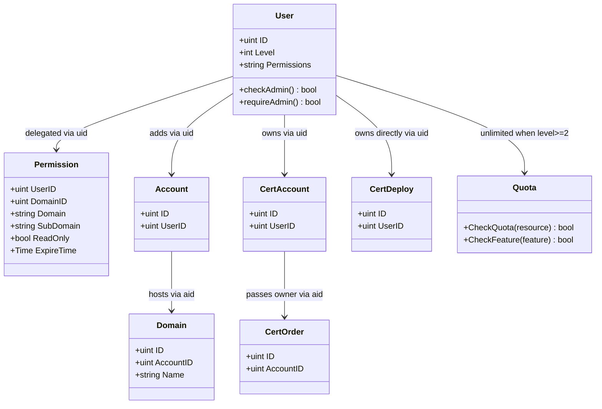
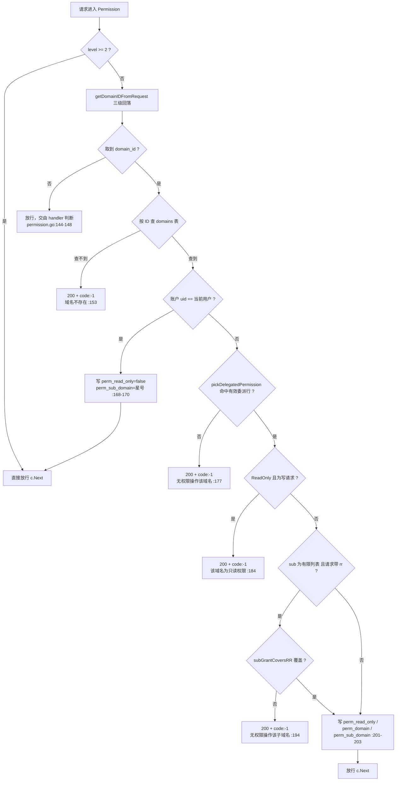
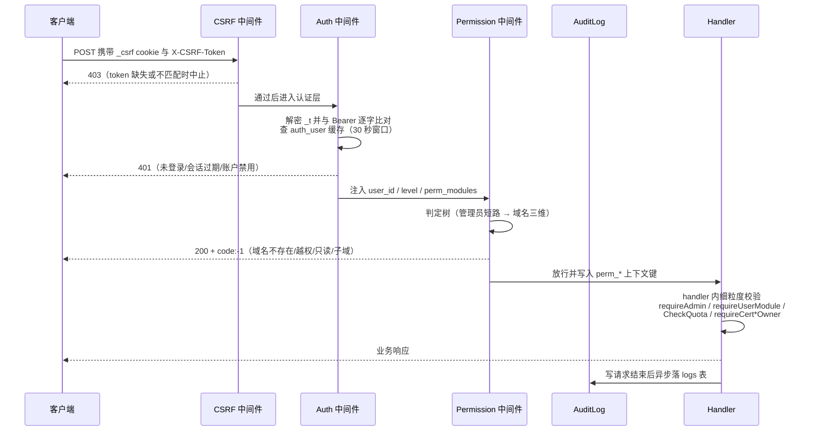
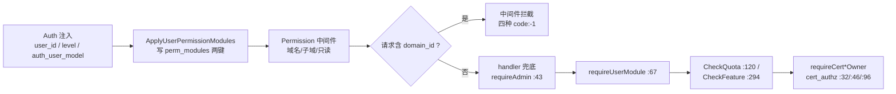
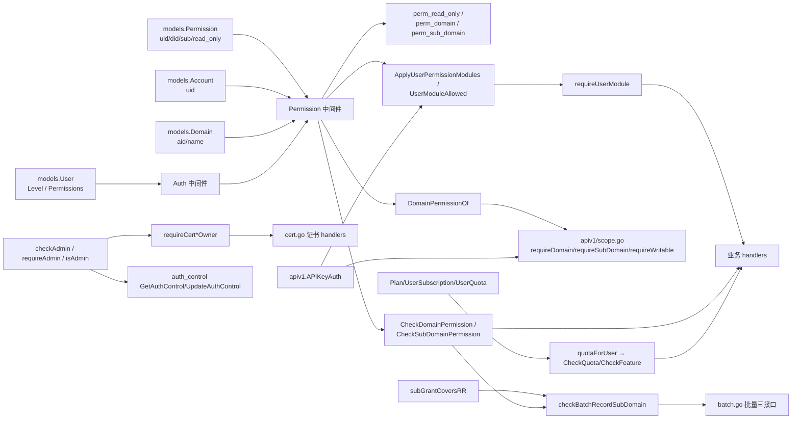
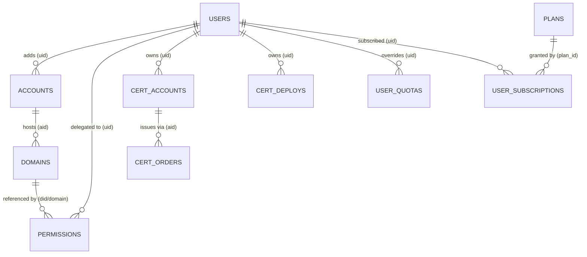

# 权限控制

<cite>
**本文档引用的文件**
- [permission.go](file://main/internal/api/middleware/permission.go)
- [auth.go（中间件）](file://main/internal/api/middleware/auth.go)
- [router.go](file://main/internal/api/router.go)
- [cert_authz.go](file://main/internal/api/handler/cert_authz.go)
- [batch_authz.go](file://main/internal/api/handler/batch_authz.go)
- [auth_control.go](file://main/internal/api/handler/auth_control.go)
- [account.go（handler）](file://main/internal/api/handler/account.go)
- [quota.go（handler）](file://main/internal/api/handler/quota.go)
- [models.go](file://main/internal/models/models.go)
- [quota.go（模型）](file://main/internal/models/quota.go)
- [scope.go](file://main/internal/apiv1/scope.go)
- [auth.go（apiv1）](file://main/internal/apiv1/auth.go)
- [layout.tsx](file://web/app/(dashboard)/layout.tsx)
- [utils.ts](file://web/lib/utils.ts)
</cite>

## 目录

1. [简介](#简介)
2. [项目结构](#项目结构)
3. [核心组件](#核心组件)
4. [架构总览](#架构总览)
5. [详细组件分析](#详细组件分析)
6. [依赖关系分析](#依赖关系分析)
7. [性能考虑](#性能考虑)
8. [故障排查指南](#故障排查指南)
9. [结论](#结论)
10. [附录](#附录)

## 简介

dnsplane 的授权体系由「一个中间件 + 六类权限点 + 一层兜底」构成：控制台 `auth` 路由组（201 条路由）在 `Auth` 认证之后统一挂载 `middleware.Permission()`（注册位置 `main/internal/api/router.go:104`，函数定义 `main/internal/api/middleware/permission.go:132`），由它完成域名、子域、只读三个维度的判定；其余更细的权限点（管理员、功能模块、资源属主、配额、特性开关）分布在 handler 函数主体内逐条生效。

按路由所指向 handler 的函数主体扫描（口径见 `.wiki-context/scan-backend.md` §5 与 §8.4），201 条已登录路由的权限点分布如下：

- `admin`（`requireAdmin` / `isAdmin`）：64 条
- `module`（`requireUserModule` / `UserModuleAllowed`）：47 条
- `domain`（`CheckDomainPermission` 等）：16 条
- `certOwner`（`requireCert*Owner`）：13 条
- `quota`（`CheckQuota`）：8 条
- `subdomain`（`CheckSubDomainPermission` / `checkBatchRecordSubDomain`）：3 条
- `feature`（`CheckFeature`）：3 条
- **无任何细粒度标签**：90 条，仅依赖 `Auth` + `Permission`（多标签路由按每个标签各计一次）

本文聚焦「权限如何被判定」这条主线：`Permission` 中间件的判定树、七类权限点各自的数据源与判定函数、`CheckDomainPermission` 与 `CheckSubDomainPermission` 的差异，以及「缺 `domain_id` 直接放行」与「`:id` 路径参数回落污染」两个已知风险点。认证与会话管理（JWT、Cookie、刷新链）不在本文范围，参见同目录《安全防护》与《认证系统》。

证据口径说明：本文全部 `文件:行号` 均在当前工作区实读校验（2026-10-11 快照）；路由权限点计数沿用扫描产物实测结果；工作区为非干净基线，行号以当前文件为准。

**章节来源**
- [permission.go](file://main/internal/api/middleware/permission.go)
- [router.go](file://main/internal/api/router.go)

## 项目结构

权限判定代码集中在三个层次：中间件层（`Permission` 与模块权限）、handler 层（细粒度校验函数族）、模型层（权限数据结构）。

```text
main/internal/
├── api/
│   ├── router.go                        # auth 组挂载 Auth(:96) + Permission(:104)
│   ├── middleware/
│   │   ├── permission.go                # 400 行：域名/子域/只读三维判定 + 模块权限
│   │   └── auth.go                      # 572 行：Auth 注入 user_id/level（权限判定的输入）
│   ├── handler/
│   │   ├── account.go                   # 466 行：checkAdmin:24 / requireAdmin:43 / isAdmin:52 / requireUserModule:67
│   │   ├── cert_authz.go                # 115 行：证书资产属主判定族
│   │   ├── batch_authz.go               # 155 行：批量记录的逐条子域校验
│   │   ├── auth_control.go              # 157 行：登录/注册准入开关读写（admin 限定）
│   │   └── quota.go                     # 351 行：quotaForUser:84 / CheckQuota:120 / CheckFeature:294
│   └── apiv1/
│       ├── scope.go                     # 132 行：V1 侧四维鉴权（模块/域名/子域/只读）
│       └── auth.go                      # APIKeyAuth:44，:111 注入模块权限
└── models/
    ├── models.go                        # User:10（Level/Permissions 列）、Permission:105
    └── quota.go                         # 配额上限取值约定（-1/0/>0）
web/
├── app/(dashboard)/layout.tsx           # filteredNavigation:232-249（仅导航可见性）
└── lib/utils.ts                         # hasModuleAccess:118
```

各文件在权限链路中的职责：

| 文件 | 行数 | 核心符号（工作区实测行号） | 在权限链路中的角色 |
| --- | --- | --- | --- |
| `main/internal/api/middleware/permission.go` | 400 | `Permission`:132、`getDomainIDFromRequest`:210、`getDomainPermission`:304、`CheckDomainPermission`:335、`CheckSubDomainPermission`:344、`ApplyUserPermissionModules`:367、`UserModuleAllowed`:383 | 域名/子域/只读判定唯一入口，另承载模块权限注入与判定 |
| `main/internal/api/handler/cert_authz.go` | 115 | `requireCertAccountOwner`:32、`requireCertOrderOwner`:46、`requireCertDeployOwner`:96 及三个 `scope*Query`:68/:76/:110 | 证书账户/订单/部署三类资产的独立属主判定族 |
| `main/internal/api/handler/batch_authz.go` | 155 | `checkBatchRecordSubDomain`:87（调用点 `batch.go:95`、`:259`、`:363`） | 批量编辑/动作对每条记录逐一判子域授权 |
| `main/internal/api/handler/auth_control.go` | 157 | `authControlFixedKeys`:37、`isWritableAuthControlKey`:62、`GetAuthControl`:97、`UpdateAuthControl`:124 | 认证准入开关的受白名单约束读写（仅管理员） |
| `main/internal/api/handler/account.go` | 466 | `checkAdmin`:24、`requireAdmin`:43、`isAdmin`:52、`requireUserModule`:67 | 管理员与模块权限的 handler 级判定函数 |
| `main/internal/api/handler/quota.go` | 351 | `quotaForUser`:84、`CheckQuota`:120、`CheckFeature`:294 | 创建前的配额闸门与套餐特性开关 |
| `main/internal/models/models.go` | 370 | `User`:10、`Permission`:105 | 权限数据模型：`Level`、`Permissions`（JSON 文本列）、委派权限表 |

**章节来源**
- [permission.go](file://main/internal/api/middleware/permission.go)
- [router.go](file://main/internal/api/router.go)
- [cert_authz.go](file://main/internal/api/handler/cert_authz.go)
- [batch_authz.go](file://main/internal/api/handler/batch_authz.go)
- [auth_control.go](file://main/internal/api/handler/auth_control.go)

## 核心组件

### Role（角色层级 Level）

角色不是独立表，而是 `users.level` 整型列（`main/internal/models/models.go:10-19`，注释口径「0: 自助注册, 1: 第三方登录自动创建, >=2: 管理员」）。授予点：安装时写入 level=2，自助注册写 level=0，第三方登录自动建号写 level=1（行号沿用分析产物 `.wiki-context/analysis-auth.md` §3.1，本次未逐行复核，标记为「素材已验证」口径）。

`level >= 2` 是整条权限链路的**总短路**，出现在三处：

- `Permission` 中间件入口：`permission.go:138`，管理员直接 `c.Next()`，不做任何域名判定
- `CheckDomainPermission` / `CheckSubDomainPermission`：`permission.go:336-338`、`:345-347`，管理员恒为 `true`
- `UserModuleAllowed`：`permission.go:384-386`，管理员恒可访问任意模块

handler 级判定函数集中在 `account.go`：`checkAdmin`:24（兼容 `int`/`float64` 两种上下文取值形态）、`requireAdmin`:43（失败时写「权限不足，仅管理员可操作」响应并返回 false，安全审计 C-1 的兜底）、`isAdmin`:52（无副作用的谓词版本，供 `cert_authz.go` 与查询收窄使用）。

**章节来源**
- [models.go](file://main/internal/models/models.go)
- [permission.go](file://main/internal/api/middleware/permission.go)
- [account.go（handler）](file://main/internal/api/handler/account.go)

### Permission（委派权限表）

委派权限是唯一独立的权限实体表 `permissions`（模型 `main/internal/models/models.go:105-114`）：

| 列 | 模型字段 | 语义 |
| --- | --- | --- |
| `uid` | `Permission.UserID`:107 | 被授权用户 |
| `did` | `Permission.DomainID`:108 | 域名 ID（索引列） |
| `domain` | `Permission.Domain`:109 | 域名快照，判定按名称匹配 |
| `sub` | `Permission.SubDomain`:110 | 子域限制，空表示所有 |
| `read_only` | `Permission.ReadOnly`:111 | 只读授权标志 |
| `expire_time` | `Permission.ExpireTime`:112 | 过期时间，`*time.Time` |

读取入口 `activeDelegatedPermissionsByUID`（`permission.go:19`）按 `uid + domain` 查询并剔除 `expire_time` 已过期的行；同一用户对同一域名可能有多行（不同子域段），由 `mergePermissionRows`（`:52`）把子域列表并集、`read_only` 取「全部只读才是只读」的语义合并；`pickDelegatedPermission`（`:93`）再按请求携带的 `rr` 挑选精确匹配行或返回合并行。

**章节来源**
- [models.go](file://main/internal/models/models.go)
- [permission.go](file://main/internal/api/middleware/permission.go)

### Owner（账户归属）

「域主」判定不需要 `permissions` 表：`domains.aid → accounts.id → accounts.uid`，若账户的 `uid` 等于当前用户即为属主（`Permission` 内联判定 `permission.go:159-164`；`getDomainPermission` 同构逻辑 `:310-314`）。属主获得完全开放：`perm_read_only=false`、`perm_sub_domain="*"`（`permission.go:168-170`）。

证书资产的属主判定是独立一族（`cert_authz.go`），因为资产链不同：`CertOrder.aid → CertAccount.uid` 两级传递（`requireCertOrderOwner`:46-65），而 `CertDeploy` 自带 `uid` 列且其 `aid` 指向**部署账户**而非证书账户，刻意不复用订单链（`:96` 函数头注释明确说明该区别）。

**章节来源**
- [permission.go](file://main/internal/api/middleware/permission.go)
- [cert_authz.go](file://main/internal/api/handler/cert_authz.go)

### Subdomain（子域粒度）

子域授权复用 `permissions.sub` 列，判定函数 `subGrantCoversRR`（`permission.go:34`）：授权值为空或 `*` 时全覆盖，否则按逗号分隔列表对 `rr` 精确匹配。运行期两处消费：`Permission` 的写请求二次校验（`:190-198`）与 `CheckSubDomainPermission`（`:344`）；批量族另有逐条判定（见详细分析）。

**章节来源**
- [permission.go](file://main/internal/api/middleware/permission.go)
- [models.go](file://main/internal/models/models.go)

### Module（功能模块权限）

模块权限存储在 `users.permissions` 文本列（`models.go:19`，JSON 字符串数组），无独立权限点表。注入与判定分离：

- `ApplyUserPermissionModules`（`permission.go:367-380`）：空串或 JSON 解析失败 → `perm_modules_configured=false`；解析成功（含空数组 `[]`）→ 写入 `perm_modules` 数组
- `UserModuleAllowed`（`permission.go:383-399`）：`level>=2` 直通；**未配置直通**（兼容旧库，即老用户全放行）；已配置时仅允许列表内 key

模块 key 全集由前端导航声明：`domain`、`monitor`、`cert`、`deploy`（`web/app/(dashboard)/layout.tsx` 的 `navigation` 常量，素材记录为 `:55-93` 区间）。消费点：handler 内 `requireUserModule(c, "...")`（`account.go:67`）与 V1 路由级 `requireModule`（`apiv1/scope.go:28`）；V1 的 `APIKeyAuth` 同样调用 `ApplyUserPermissionModules`（`apiv1/auth.go:111`），保证两侧判定同源。

**章节来源**
- [permission.go](file://main/internal/api/middleware/permission.go)
- [models.go](file://main/internal/models/models.go)
- [account.go（handler）](file://main/internal/api/handler/account.go)
- [scope.go](file://main/internal/apiv1/scope.go)
- [auth.go（apiv1）](file://main/internal/apiv1/auth.go)
- [layout.tsx](file://web/app/(dashboard)/layout.tsx)

### Quota 与 Feature（配额/特性）

配额不是「能不能访问」而是「还能建几个」：`quotaForUser`（`quota.go:84`）按「个体覆盖（`user_quotas`）→ 套餐（`user_subscriptions`+`plans`）→ 系统默认（`sys_configs`）」三层取值，`level>=2` 直接无限。上限语义见 `models/quota.go:12-16` 注释：`-1` 不限、`0` 禁止、`>0` 上限。创建前校验 `CheckQuota`（`quota.go:120-140`）覆盖 8 个资源维度；`CheckFeature`（`quota.go:294`）做套餐特性开关，未订阅或键缺失一律放行。



**图表来源**
- [models.go](file://main/internal/models/models.go)
- [cert_authz.go](file://main/internal/api/handler/cert_authz.go)
- [quota.go（handler）](file://main/internal/api/handler/quota.go)

**章节来源**
- [models.go](file://main/internal/models/models.go)
- [permission.go](file://main/internal/api/middleware/permission.go)
- [quota.go（模型）](file://main/internal/models/quota.go)
- [layout.tsx](file://web/app/(dashboard)/layout.tsx)

## 架构总览

`Permission` 中间件的完整判定树如下（对应 `permission.go:132-207` 函数体逐分支）：



**图表来源**
- [permission.go](file://main/internal/api/middleware/permission.go)

一次典型的非管理员写请求在整条中间件链中的时序（链序实测 `router.go:28-104`）：



**图表来源**
- [router.go](file://main/internal/api/router.go)
- [permission.go](file://main/internal/api/middleware/permission.go)
- [auth.go（中间件）](file://main/internal/api/middleware/auth.go)

需要注意中间件与 handler 的**双层结构**：`Permission` 只兜住「能从请求里取到 domain_id」的那部分流量；`router.go:97-103` 的挂载注释记录了历史缺陷——此前 `Permission()` 只定义未挂载，导致 `perm_read_only` / `perm_sub_domain` 三个上下文键恒不存在，下游三处依赖它们的拦截全部失效（只读用户可删记录、子域受限用户能读全量记录、审计日志 domain 恒为空）。该缺陷已修复，挂载点即 `router.go:104`。

判定产物的落点是五个上下文键，这是中间件层与 handler 层的契约接口：

| 上下文键 | 写入方 | 消费方 | 语义 |
| --- | --- | --- | --- |
| `user_id` / `level` | `Auth`（`middleware/auth.go`） | `Permission` 与全部 handler | 判定主体 |
| `perm_modules` / `perm_modules_configured` | `ApplyUserPermissionModules`:367 | `UserModuleAllowed`:383 | 功能模块白名单 |
| `perm_domain` | `Permission`:169 / :202 | 审计日志、handler | 本次请求锁定的域名 |
| `perm_read_only` | `Permission`:168 / :201 | handler 写拦截、V1 桥接 | 是否只读授权 |
| `perm_sub_domain` | `Permission`:170 / :203 | 列表接口过滤、子域校验 | 子域授权范围（`*` 或逗号列表） |

**章节来源**
- [permission.go](file://main/internal/api/middleware/permission.go)
- [router.go](file://main/internal/api/router.go)
- [auth.go（中间件）](file://main/internal/api/middleware/auth.go)

### 判定树设计要点

- **短路优先**：`level>=2`（`:138`）与「无 domain_id」（`:144`）两条放行路径排在最前，保证管理员与非域名接口零额外查询
- **属主优先于委派**：先查账户归属（`:162`）命中即完全开放，不再读 `permissions` 表，普通高频路径只花两次查库
- **拒绝统一为 200 + `code:-1`**：`Permission` 的四种拒绝（`:153`、`:177`、`:184`、`:194`）都走 HTTP 200 的业务错误码而非 4xx，前端按 `code` 字段分派提示，避免与 401 会话失效混淆

**章节来源**
- [permission.go](file://main/internal/api/middleware/permission.go)
- [router.go](file://main/internal/api/router.go)
- [auth.go（中间件）](file://main/internal/api/middleware/auth.go)

## 详细组件分析

### 权限点分布：201 条路由的逐类拆解

计数口径（记录于 `.wiki-context/scan-backend.md` §5 引言）：权限点列取自路由所指向 handler 的**函数主体**扫描，跨函数委托的校验不计入；多标签路由按每个标签各计一次。因此「90 条无标签」的含义是「handler 主体内未检出下列任何函数」，**不等于无授权**——它们仍受 `Auth` + `Permission` 约束，只要请求带得出 domain_id。

| 权限点 | 判定函数 | 条数 | 典型路由（router.go 注册） |
| --- | --- | --- | --- |
| admin | `requireAdmin` / `isAdmin`（`account.go:43`/:52） | 64 | `/api/users/*`（:206-212）、`/api/system/auth-control`（`auth_control.go:97`/:124）、`/api/plans/*` 套餐族 13 条 |
| module | `requireUserModule`（`account.go:67`）→ `UserModuleAllowed` | 47 | Cloudflare 增强 28 条（`UserModuleAllowed("domain")`）、monitor/cert/deploy 各模块入口 |
| domain | `CheckDomainPermission`（`permission.go:335`） | 16 | 域名与解析记录族（`domain.go`、`record.go` 主体内直调） |
| certOwner | `requireCertAccountOwner` 等（`cert_authz.go:32`/:46/:96） | 13 | `/api/cert/accounts/:id/*`（:187-188）、`/api/cert/orders/:id/*`（:192-197）、`/api/cert/deploys/:id/*`（:201-203） |
| quota | `CheckQuota`（`quota.go:120`） | 8 | 创建类入口：建域名、建监控、建证书订单/部署（`router.go:191`、`:200` 等，常与 certOwner 叠加） |
| subdomain | `CheckSubDomainPermission`（`permission.go:344`）/ `checkBatchRecordSubDomain`（`batch_authz.go:87`） | 3 | `POST /api/domains/batch` 族：`batch.go:95`（新增）、`:259`（编辑）、`:363`（动作） |
| feature | `CheckFeature`（`quota.go:294`） | 3 | `domains/batch`（`domain.go:1447`）、`records/batch`（`batch.go:47`，`feature:batch_ops`）等 |
| （无细粒度标签） | 仅 `Auth` + `Permission` | 90 | `/api/domains/sync`、`/api/logs`、通知渠道测试 11 条等 |

对外 V1 面另有一套计数（实测 `.wiki-context/scan-backend.md`:629-630）：`domain` 76、`adminOnly` 23、`monitor` 15、`cert` 13、`deploy` 12、其余 6 条为仅自身作用域接口（如 `/api/v1/users/me`）。V1 不使用 `Permission` 中间件，而是路由级 `requireModule` / `requireAdmin`（`apiv1/scope.go:28`/:38）+ 仅 5 个同步写接口经 `scopeDomain`（`:117`）做「加载域名 → 域名权限 → 子域 → 只读」固定顺序的四维校验。

**章节来源**
- [permission.go](file://main/internal/api/middleware/permission.go)
- [account.go（handler）](file://main/internal/api/handler/account.go)
- [cert_authz.go](file://main/internal/api/handler/cert_authz.go)
- [quota.go（handler）](file://main/internal/api/handler/quota.go)
- [batch_authz.go](file://main/internal/api/handler/batch_authz.go)
- [scope.go](file://main/internal/apiv1/scope.go)

### Permission 中间件主体

`Permission()`（`permission.go:132`）返回闭包，逐行对应架构总览的判定树。两个辅助提取器决定「哪些请求会进入判定」：

- `getDomainIDFromRequest`（`:210-234`）三级回落：① `decrypted_data` 上下文里的 `domain_id` / `did`（`:212-221`）→ ② `?domain_id=` 查询参数（`:224-226`）→ ③ `c.Param("id")` 路径参数（`:229-231`）。由于签名链中间件 `DecryptAndVerify` 实际从未挂载（`middleware/sign.go:17`，全仓零调用点），第①级对控制台请求不生效，域名 ID 实际靠②③两级取得
- `getSubDomainFromRequest`（`:237`）：同构逻辑，读 `name` / `rr` 字段

写请求识别 `isDomainScopedWriteRequest`（`:265`）把 POST 视为写，但对 `/whois` 后缀例外（`:272` 附近逻辑）——WHOIS 查询挂在 POST 下但本质是读，不应被只读授权拦截。

`pickDelegatedPermission`（`:93-129`）处理「同域名多条委派行」的选行：单行直接返回；多行时按请求携带的 `rr` 匹配包含它的行，纯列表请求（只有 domain_id）则返回 `mergePermissionRows` 的合并行供下游过滤。

**章节来源**
- [permission.go](file://main/internal/api/middleware/permission.go)

### CheckDomainPermission 与 CheckSubDomainPermission 的差异

两者都走 `getDomainPermission`（`:304-322`，域名存在性 → 账户归属 → 委派合并三段），差异只在子域维度：

| 对比项 | `CheckDomainPermission`:335 | `CheckSubDomainPermission`:344 |
| --- | --- | --- |
| 签名 | `(userID, userLevel, domainID)` | `(userID, userLevel, domainID, subDomain)` |
| 管理员 | `userLevel>=2` 恒 true（:336-338） | 同（:345-347） |
| 判定粒度 | 仅域级 allowed | 域级 + 子域覆盖 |
| 属主 | 计入 allowed | `isOwner` 单独短路（:352-354），不受子域限制 |
| subDomain 为空串 | 不适用 | 视为不针对具体子域，放行（:356-358） |
| 只读维度 | 不判 | 不判（两者都只答「能不能碰」，只读拦截靠 `DomainPermissionOf`:330 取明细或 `Permission` 中间件本体） |

V1 侧判只读用 `DomainPermissionOf`（`:330-332`，即 `getDomainPermission` 的导出包装），因为 `Check*` 系列把 `perm`/`isOwner` 细节折叠成了布尔值，调用方拿不到 `read_only` 与 `sub`。

**章节来源**
- [permission.go](file://main/internal/api/middleware/permission.go)
- [scope.go](file://main/internal/apiv1/scope.go)

### certOwner：证书资产属主族

`cert_authz.go` 头注释（`:13-28`）记录了设立动机：安全审计 R-1 发现 cert 整套接口此前完全无鉴权，任意已登录普通用户可列出全站订单并用 `GET /api/cert/orders/:id/download?type=key` 拖走他人证书私钥、用 `POST /process` 强行触发别人的 ACME 续签烧上游配额。修复即本文件：

- `requireCertAccountOwner`（`:32-43`）：`cert_accounts.uid` 直比，非属主且非 `isAdmin` 拒绝
- `requireCertOrderOwner`（`:46-65`）：订单本身无 uid 列，经 `order.AccountID → CertAccount.UserID` 两级传递判定；关联账户已失效时单独报「订单关联的证书账户已失效」（`:57`）
- `requireCertDeployOwner`（`:96-107`）：`cert_deploys.uid` 直属判定；`:86-95` 注释解释了为何不能复用订单链——部署任务的 `aid` 指向部署账户，且 config 含外送目标地址，越权修改等于把他人私钥改送到自己机器
- 三个 `scope*Query`（`:68`/:76/:110）：列表查询的读侧收窄，管理员看全量，普通用户强制 `uid` 过滤；订单用子查询 `aid IN (SELECT id FROM cert_accounts WHERE uid=?)`（`:80-83`）

该族的设计取向是「失败即写响应」：`require*` 返回 `(资源, bool)`，false 时响应已落，handler 直接 return，避免每个调用点重复写错误分支（`:30-31` 注释明确该约定）。

**章节来源**
- [cert_authz.go](file://main/internal/api/handler/cert_authz.go)
- [account.go（handler）](file://main/internal/api/handler/account.go)

### batch_authz：批量操作逐条子域判定

`checkBatchRecordSubDomain`（`batch_authz.go:87`）解决一个 `Permission` 中间件覆盖不到的问题：批量请求一次携带多条记录，各自的 `rr` 不同，中间件的单值 `getSubDomainFromRequest` 无法逐条把关。流程（`:87-110` 起）：

1. 先经 `middleware.DomainPermissionOf` 判域级 allowed，未通过写「无权限操作该域名」返回（`:98-101`）
2. `isOwner || level >= 2` 短路放行，省掉一次云端查询（`:102-104`）
3. 请求已给出 `rr` 的（新建类）本地直接判，刻意放在建 provider 之前——越权请求不消耗上游配额（`:106-110` 注释）
4. 仅有云端记录 ID 的（编辑/动作类）经 `cloudRecordRRIndex`（`:48`）或 `fetchCloudRecordRR`（`:77`）回查真实 `rr` 再判

三个调用点：`batch.go:95`（批量新增）、`:259`（批量编辑）、`:363`（批量动作），对应「subdomain 3」权限点。

**章节来源**
- [batch_authz.go](file://main/internal/api/handler/batch_authz.go)
- [permission.go](file://main/internal/api/middleware/permission.go)

### auth_control：权限体系的准入开关

`auth_control.go` 本身不是判定器，而是「谁能用什么方式进门」的管理面，全部经 `requireAdmin` 限定。安全边界是**可写键白名单**：固定键由 `authControlFixedKeys`（`:37-53`）枚举（`auth_password_login`、`auth_password_register`、`auth_magic_link_login`、`auth_email_verify`、`auth_email_whitelist*` 等），动态键 `auth_oauth_<provider>_login` 与 `auth_oauth_<provider>_register` 按前后缀放行（`isWritableAuthControlKey`:62-77，provider 取自 `oauth.GetEnabledProviders()`，避免固定清单在新增 provider 时漏放）。`UpdateAuthControl`（`:124`）写入后立即 `InvalidateSysConfigCache`（`:154`），使 60 秒配置缓存即时失效，权限开关变更不需要等待 TTL。

**章节来源**
- [auth_control.go](file://main/internal/api/handler/auth_control.go)
- [account.go（handler）](file://main/internal/api/handler/account.go)

### 前端权限的角色：仅可见性，不是边界

`web/app/(dashboard)/layout.tsx` 的 `filteredNavigation`（`:232-249`）按 `item.adminOnly && user.level < 2` 隐藏管理项、按 `hasModuleAccess(user, item.module)` 隐藏无权限模块。`hasModuleAccess`（`web/lib/utils.ts:118-128`）与后端 `UserModuleAllowed` 同语义：`level>=2` 全通过、`permissions` 未返回视为全开、否则要求数组包含该 key。前端隐藏只是体验优化，**所有授权判定以后端为准**；后端「未配置直通」的兼容语义（`permission.go:387-391`）意味着旧库升级用户默认拥有全部模块，收紧需显式写入 JSON 数组（含空数组 `[]` 表示全禁）。

**章节来源**
- [layout.tsx](file://web/app/(dashboard)/layout.tsx)
- [utils.ts](file://web/lib/utils.ts)
- [permission.go](file://main/internal/api/middleware/permission.go)

### 中间件层判定流程总览



**图表来源**
- [permission.go](file://main/internal/api/middleware/permission.go)
- [account.go（handler）](file://main/internal/api/handler/account.go)
- [quota.go（handler）](file://main/internal/api/handler/quota.go)
- [cert_authz.go](file://main/internal/api/handler/cert_authz.go)

**章节来源**
- [permission.go](file://main/internal/api/middleware/permission.go)
- [account.go（handler）](file://main/internal/api/handler/account.go)
- [quota.go（handler）](file://main/internal/api/handler/quota.go)
- [cert_authz.go](file://main/internal/api/handler/cert_authz.go)
- [batch_authz.go](file://main/internal/api/handler/batch_authz.go)

## 依赖关系分析

权限链路的依赖方向自左向右：数据模型提供判定输入，中间件消费上下文，handler 消费中间件产物，V1 面旁路复用中间件层的导出函数。



**图表来源**
- [permission.go](file://main/internal/api/middleware/permission.go)
- [cert_authz.go](file://main/internal/api/handler/cert_authz.go)
- [batch_authz.go](file://main/internal/api/handler/batch_authz.go)
- [scope.go](file://main/internal/apiv1/scope.go)
- [models.go](file://main/internal/models/models.go)

关键依赖性质：

- **单向无环**：`middleware/permission.go` 不 import 任何 handler；handler 与 apiv1 反向 import middleware（`cert_authz.go:4`、`batch_authz.go` 调用 `middleware.DomainPermissionOf`），保证判定逻辑单一实现、两面（控制台/V1）复用
- **`Auth` → `Permission` 硬顺序**：`Permission` 首行读 `user_id`/`level`（`permission.go:134-135`），必须在 `Auth` 之后；`router.go:104` 的挂载点与 `:97-103` 注释共同保证该顺序
- **数据面三角**：域名判定依赖 `domains`、`accounts`、`permissions` 三表联查（`:151-164` 与 `:304-321`），其中 `permissions.domain` 是名称快照，域名改名会使既有委派行失配（判定按名称匹配，`:19`、`:316`）
- **前端零依赖安全**：`layout.tsx` / `utils.ts` 只消费 `/api/user/info` 返回的 `level` 与 `permissions` 字段，不参与任何判定



**图表来源**
- [models.go](file://main/internal/models/models.go)
- [quota.go（模型）](file://main/internal/models/quota.go)

**章节来源**
- [permission.go](file://main/internal/api/middleware/permission.go)
- [cert_authz.go](file://main/internal/api/handler/cert_authz.go)
- [batch_authz.go](file://main/internal/api/handler/batch_authz.go)
- [scope.go](file://main/internal/apiv1/scope.go)
- [router.go](file://main/internal/api/router.go)

### 与被排除的依赖

`Permission` 不依赖 `decrypted_data` 生产者：签名链中间件 `DecryptAndVerify`（`middleware/sign.go:17`）从未挂载，`getDomainIDFromRequest` 的第一级回落在控制台永远为空（`:212-221` 分支），这是「三级回落实际只有两级生效」的直接原因，也解释了 `api/permission_route_test.go` 中相关注释的记录口径。

**章节来源**
- [permission.go](file://main/internal/api/middleware/permission.go)
- [cert_authz.go](file://main/internal/api/handler/cert_authz.go)
- [router.go](file://main/internal/api/router.go)
- [models.go](file://main/internal/models/models.go)

## 性能考虑

### 判定路径的每请求查库成本

非管理员 + 带 domain_id 的请求每笔至少两次查库：按 ID 取 `domains`（`permission.go:151-152`）、按 `aid` 取 `accounts`（`:159-162`）；非属主再追加 `permissions` 表查询（`:175` → `activeDelegatedPermissionsByUID:19`）。`permissions.did` 与 `uid` 均有索引（`models.go:107-108`），`uid + domain` 组合过滤走 uid 索引。管理员路径（`:138`）与无 domain_id 路径（`:144`）零额外查询，热点列表接口因此实际只受 `Auth` 层 30 秒用户缓存（`middleware/auth.go:99` `authUserCacheTTL = 30 * time.Second`，缓存键 `auth_user:<uid>`）影响。

一点可改进但未构成缺陷的冗余：属主判定时域名和账户各查一次，可在 SQL 层合并为一次 JOIN；当前逐条两次查库在 SQLite 单文件场景下成本仍在毫秒级，属「知晓即可」的量级。

**章节来源**
- [permission.go](file://main/internal/api/middleware/permission.go)
- [models.go](file://main/internal/models/models.go)
- [auth.go（中间件）](file://main/internal/api/middleware/auth.go)

### 缺 domain_id 直接放行的风险面

`permission.go:144-148`：取不到域名 ID 时中间件直接 `c.Next()`，把授权完全下压给 handler。这是性能与正确性的有意取舍（绝大多数接口与域名无关，不能全部拦下），但它决定了安全边界的位置：

- 受影响范围即「90 条无细粒度标签」路由中不带 domain_id 的部分。典型路径：`/api/domains/sync`、`/api/logs`、`/api/request-logs/*`、通知渠道测试 11 条（计数与路径清单口径来自 `.wiki-context/scan-backend.md` §8.4/:696-698）
- 其中用户管理与系统配置类靠 handler 内 `requireAdmin`（`account.go:43`）兜底；**标为「仅 Auth」者未检出该校验，应视为待核查而非已授权**——扫描产物原文（§8.4:699-700）即为该结论
- 具体风险样例：任何已登录用户能触达的 handler 若主体内既无 admin/module 也无 owner 校验，则同批用户间横向可达（例如用自己的凭证读全局列表）。cert 族历史上正是这种形态（`cert_authz.go:16-18` 头注释记录的 R-1 事故），后以独立属主族修复

对新增接口的工程要求（从判定树推导）：handler 若涉及域名资源，必须让请求携带 `domain_id`（query 或 body）或把资源 ID 放在**非 `:id`** 的语义化路径参数上并显式调用 `Check*Permission`；若不涉及域名，必须自行携带 admin/module/owner 三类标签之一，不能指望中间件兜底。

**章节来源**
- [permission.go](file://main/internal/api/middleware/permission.go)
- [account.go（handler）](file://main/internal/api/handler/account.go)
- [cert_authz.go](file://main/internal/api/handler/cert_authz.go)

### c.Param("id") 回落的误拒成本

三级回落的最后一级（`:229-231`）把**一切**名为 `id` 的路径参数都当域名 ID 用。40 余条 `:id` 语义不是域名的路由（`/monitor/tasks/:id/*`、`/cert/orders/:id/*`、`/logs/:id` 等）因此被波及：level<2 用户访问时先按 `domains.id` 查库（`:152`），查不到即回「域名不存在」（`:153`）——报错文案与真实资源类别无关，用户与前端都无法从响应理解失败原因；若该数字偶然命中一个不属于自己的域名，还会得到误导性的「无权限操作该域名」（`:177`）。分析产物将其列为 P0 之一（`.wiki-context/analysis-auth.md` 问题 3，标注「已验证代码 + 推断行为」，本次未做运行期复现）。管理员因 `:138` 短路不受影响，所以问题只在普通用户身上显现。

建议的修复方向（同为分析产物 §9 第 5 条）：去掉 `c.Param("id")` 无条件回落，改为路由级显式声明域名参数名；在修复落地前，文档与排障应把「非域名路由返回域名不存在」识别为该机制的固有症状。

**章节来源**
- [permission.go](file://main/internal/api/middleware/permission.go)

### 权限变更的 30 秒生效窗口

`Auth` 的用户缓存 TTL 30 秒（`middleware/auth.go:99`），level 变更、模块权限 JSON 修改、账户禁用都要等缓存过期才影响 `Permission` 与 `UserModuleAllowed` 的输入。`InvalidateAuthUserCache`（`middleware/auth.go` 内定义）目前无调用点（口径：`.wiki-context/analysis-auth.md` 问题 12，rg 实测零引用），因此不存在主动失效通道。评估影响时注意：缓存只影响判定**输入**的新鲜度，委派权限表 `permissions` 每请求实时查库，新增/删除委派行是即时生效的。

**章节来源**
- [permission.go](file://main/internal/api/middleware/permission.go)
- [auth.go（中间件）](file://main/internal/api/middleware/auth.go)
- [account.go（handler）](file://main/internal/api/handler/account.go)
- [cert_authz.go](file://main/internal/api/handler/cert_authz.go)
- [models.go](file://main/internal/models/models.go)

## 故障排查指南

### 越权类：授权了却仍被拒 / 没授权却通了

| 症状 | 判定证据位置 | 根因方向 | 处置 |
| --- | --- | --- | --- |
| 普通用户操作自己域名，回「无权限操作该域名」 | `permission.go:177` | ① 委派行 `expire_time` 已过期被 `:19` 剔除 ② `permissions.domain` 是名称快照，域名改名后失配 ③ 账户 `uid` 不是当前用户（属主判定 `:162` 未命中且无委派） | 核对 `permissions` 表该 uid 行与 `accounts.uid`；改名场景需重建委派行 |
| 只读用户仍能写 | `permission.go:183` | 请求未被 `isDomainScopedWriteRequest`（`:265`）判为写——该函数只认 POST，GET/PUT 等不拦（口径 `:265-282`），或 handler 走的是无 domain_id 放行路径（`:144`） | 确认写操作实际使用 POST 动词；无 domain_id 的写接口需在 handler 内用 `DomainPermissionOf` 自查 |
| 子域受限用户能改列表外记录 | `permission.go:190-198` | 批量请求只过了中间件单值校验，未走逐条判定；或请求不带 `rr` 被视作列表查询放行 | 批量入口必须经 `checkBatchRecordSubDomain`（`batch_authz.go:87`） |
| 普通用户碰 cert 资源回「无权操作该证书账户/订单/部署任务」 | `cert_authz.go:39`/:61/:103 | 属主链断裂：订单场景是关联 `CertAccount` 已删（`:56-58` 回「订单关联的证书账户已失效」） | 检查 `cert_orders.aid → cert_accounts.uid` 两级链完整性 |
| 管理员被误拒 | `permission.go:138` 不应触发 | JWT 里 level 是旧值（30 秒缓存窗口，`auth.go:99`），或账户被降级 | 等待 TTL 或重新登录；确认 `users.level` 落库值 |
| 模块权限收紧后老用户仍可访问 | `permission.go:387-391` | `users.permissions` 为空串/非法 JSON → `perm_modules_configured=false` → 未配置直通 | 显式写入 JSON 数组；`[]` 表示全禁 |

**章节来源**
- [permission.go](file://main/internal/api/middleware/permission.go)
- [cert_authz.go](file://main/internal/api/handler/cert_authz.go)
- [batch_authz.go](file://main/internal/api/handler/batch_authz.go)
- [auth.go（中间件）](file://main/internal/api/middleware/auth.go)

### 路径参数类：「域名不存在」误报

排障顺序（对应 `getDomainIDFromRequest` 的回落链）：

1. 确认响应文案是否为 `域名不存在`（`permission.go:153`）且接口本身与域名无关（如监控任务、证书订单）→ 即 `:id` 回落污染场景，level<2 用户专属；验证方法是同请求换管理员账号应直通
2. 域名接口取不到 ID → 检查请求是否带 `?domain_id=`（`:224`）或 body 中 `domain_id`/`did` 字段；注意 body 分支只对 V1 的 `JSONBodyToDecryptedData`（`apiv1/auth.go:143`）写入的 `decrypted_data` 生效，控制台请求的 body 取值靠 handler 绑定，中间件只认 query 与 `:id`（`middleware/sign.go:17` 未挂载的连带后果，口径 `.wiki-context/scan-backend.md` §8.1/:670-673）
3. 子域判定不符预期 → `getSubDomainFromRequest`（`:237`）读的是 `name`/`rr`，字段名不在其一则子域校验被跳过（`:192` 空串放行）

**章节来源**
- [permission.go](file://main/internal/api/middleware/permission.go)
- [auth.go（apiv1）](file://main/internal/apiv1/auth.go)

### 审计与观测

被 `Permission` 拒绝的请求响应是 HTTP 200 + `code:-1`，网关与监控面板**看不到 4xx**，排查越权问题要按 msg 文案（四种：`域名不存在`/`无权限操作该域名`/`该域名为只读权限，无法执行写操作`/`无权限操作该子域名`）检索而非按状态码。`AuditLog`（`middleware/audit.go:21`）只记 POST/PUT/DELETE/PATCH 且 `user_id` 为空整条不记；其 `perm_domain` 维度即消费 `Permission` 写入的上下文键，这也解释了挂载缺陷时代「审计日志 domain 恒为空」的现象（`router.go:97-103` 注释）。

**章节来源**
- [permission.go](file://main/internal/api/middleware/permission.go)
- [router.go](file://main/internal/api/router.go)

### 定位工具片段

```bash
# 权限点分布复核（handler 主体扫描口径）
rg -l 'requireAdmin|requireUserModule|CheckDomainPermission|CheckSubDomainPermission' main/internal/api/handler/
# 委派表实时语义
rg -n 'activeDelegatedPermissionsByUID|subGrantCoversRR' main/internal/api/middleware/permission.go
# V1 侧四维鉴权顺序
rg -n 'scopeDomain|requireWritable' main/internal/apiv1/scope.go
```

**章节来源**
- [permission.go](file://main/internal/api/middleware/permission.go)
- [cert_authz.go](file://main/internal/api/handler/cert_authz.go)
- [batch_authz.go](file://main/internal/api/handler/batch_authz.go)
- [router.go](file://main/internal/api/router.go)
- [scope.go](file://main/internal/apiv1/scope.go)

## 结论

dnsplane 的权限控制是一个「中间件粗筛 + handler 精判」的双层结构：`Permission`（`permission.go:132`，挂载 `router.go:104`）以零配置方式兜住所有能取到 domain_id 的流量，产出 `perm_read_only` / `perm_domain` / `perm_sub_domain` 三个上下文键；细粒度维度由七类权限点在 handler 主体各自实现，201 条路由中 admin 64、module 47、domain 16、certOwner 13、quota 8、subdomain 3、feature 3，另有 90 条仅依赖前两层。

设计上的三个可取之处：判定函数以导出函数形式沉淀在 middleware 包（`Check*Permission`、`DomainPermissionOf`、`UserModuleAllowed`），控制台与 V1 两面复用同一实现，符合 DRY；属主优先短路于委派查询，热路径成本可控；拒绝文案与判定分支一一对应，排障可从 msg 直接反查行号。

三个必须正视的结构性弱点：其一，「缺 domain_id 放行」（`:144-148`）把 90 条无标签路由的安全责任完全转移给 handler，其中未检出 admin/module/owner 校验者应持续标记为待核查；其二，`c.Param("id")` 无条件回落（`:229-231`）污染 40 余条非域名路由，普通用户遭受语义错位的误拒；其三，模块权限「未配置直通」的兼容语义（`:387-391`）意味着存量库升级后权限收紧不会自动发生。三者都有明确修复路径（路由级显式声明域名参数、无标签路由补细粒度校验、迁移时回填权限 JSON），属于「已知且可还」的技术债而非隐性缺陷。

**章节来源**
- [permission.go](file://main/internal/api/middleware/permission.go)
- [router.go](file://main/internal/api/router.go)

## 附录

本附录给出权限点分布全表。控制台 `auth` 组（201 条，多标签路由按标签各计一次；计数为扫描产物实测，分类定义以工作区代码复核）：

| 权限点 | 判定实现（已复核行号） | 路由条数 | 数据源 | 管理员短路 | 失败响应形态 |
| --- | --- | --- | --- | --- | --- |
| admin | `checkAdmin`:24 / `requireAdmin`:43 / `isAdmin`:52（account.go） | 64 | `users.level` | 即为其本身 | `权限不足，仅管理员可操作` |
| module | `requireUserModule`:67（account.go）→ `UserModuleAllowed`:383（permission.go） | 47 | `users.permissions` JSON 列 | `level>=2` 直通 | 模块访问拒绝 |
| domain | `CheckDomainPermission`:335（permission.go） | 16 | `domains`+`accounts`+`permissions` 三表 | `:336` 直通 | 无权限操作该域名 |
| certOwner | `requireCertAccountOwner`:32 / `requireCertOrderOwner`:46 / `requireCertDeployOwner`:96（cert_authz.go） | 13 | `cert_accounts.uid`（订单经 aid 两级传递） | `isAdmin` 放行 | 无权操作该证书账户/订单/部署任务 |
| quota | `CheckQuota`:120（quota.go），`quotaForUser`:84 三层取值 | 8 | `user_quotas`/`plans`/`user_subscriptions`/`sys_configs` | `level>=2` 无限 | 配额超限文案 |
| subdomain | `CheckSubDomainPermission`:344 / `checkBatchRecordSubDomain`:87（batch_authz.go） | 3 | `permissions.sub` 逗号列表 | `:345`、`:102` 直通 | 无权限操作该子域名 |
| feature | `CheckFeature`:294（quota.go） | 3 | 套餐特性键 | 未订阅一律放行 | 特性未开放 |
| （无标签） | 仅 `Auth`:96 + `Permission`:104（router.go） | 90 | 无（中间件可及的域名维度除外） | `:138` 直通 | 中间件拒绝或无拦截 |

对外 V1（145 条，`apiv1/router.go:24-46` 链 + 路由级声明）：

| 权限点 | 判定实现 | 条数 | 说明 |
| --- | --- | --- | --- |
| domain | `scopeDomain`:117（scope.go）等 | 76 | 多数靠 handler 复用 `Check*Permission` 族 |
| adminOnly | `requireAdmin`:38（scope.go） | 23 | 路由级声明 + handler 内校验双层 |
| monitor | `requireModule`:28（scope.go） | 15 | 注入源 `apiv1/auth.go:111` |
| cert | 同上 | 13 | — |
| deploy | 同上 | 12 | — |
| （仅自身作用域） | `APIKeyAuth`:44 会话即边界 | 6 | 如 `/api/v1/users/me` |

补充口径：V1 侧 `Permission` 中间件不生效（`/api/v1` 挂在引擎根、不继承 `auth` 组，`apiv1/router.go:24-46`），只读判定靠 `requireWritable`:94 直查库；`apiv1/scope.go:91-92` 存在与现状矛盾的陈旧注释（声称中间件从未被挂载，实际 `router.go:104` 已挂载），引用该文件时应以代码为准。

**章节来源**
- [permission.go](file://main/internal/api/middleware/permission.go)
- [account.go（handler）](file://main/internal/api/handler/account.go)
- [cert_authz.go](file://main/internal/api/handler/cert_authz.go)
- [quota.go（handler）](file://main/internal/api/handler/quota.go)
- [batch_authz.go](file://main/internal/api/handler/batch_authz.go)
- [scope.go](file://main/internal/apiv1/scope.go)
- [auth.go（apiv1）](file://main/internal/apiv1/auth.go)
- [router.go](file://main/internal/api/router.go)
